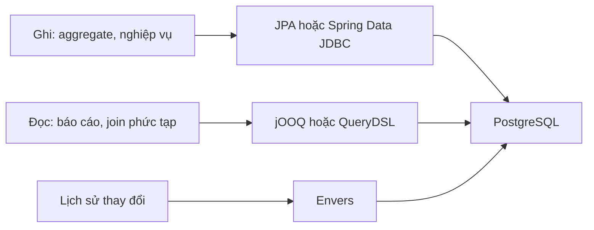
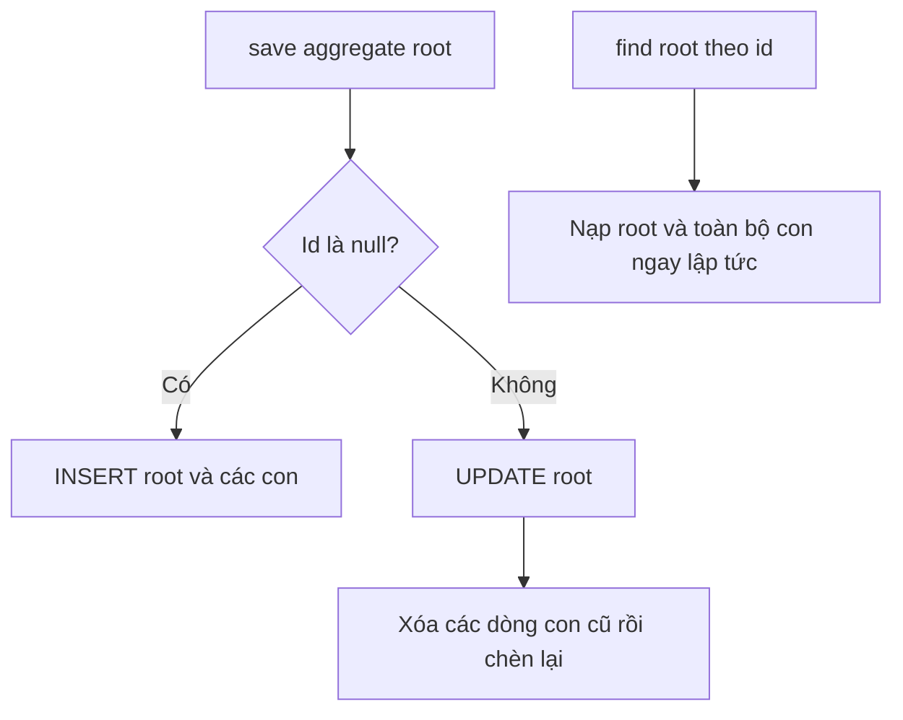
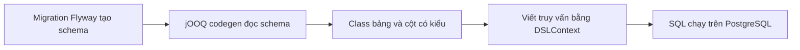
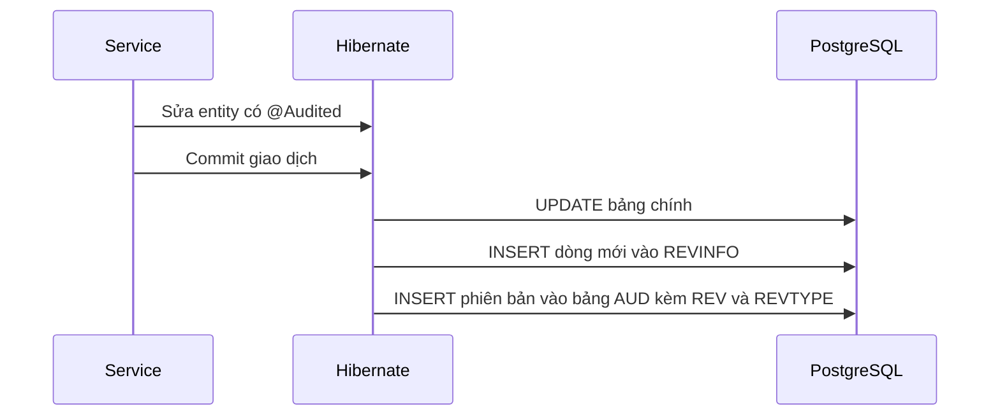
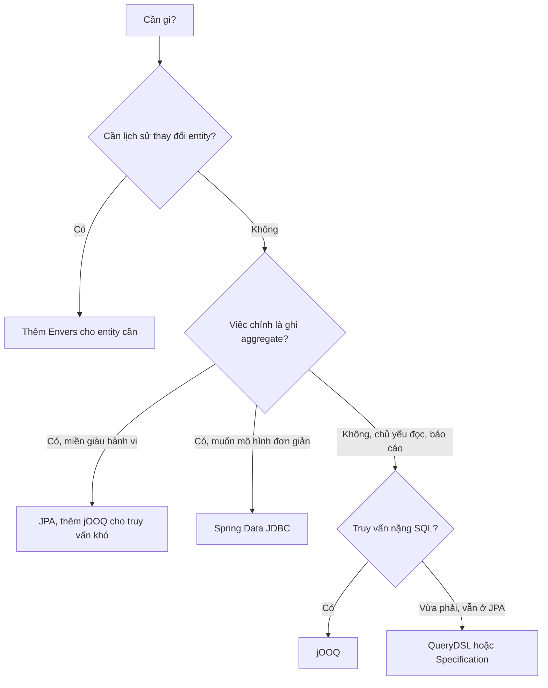
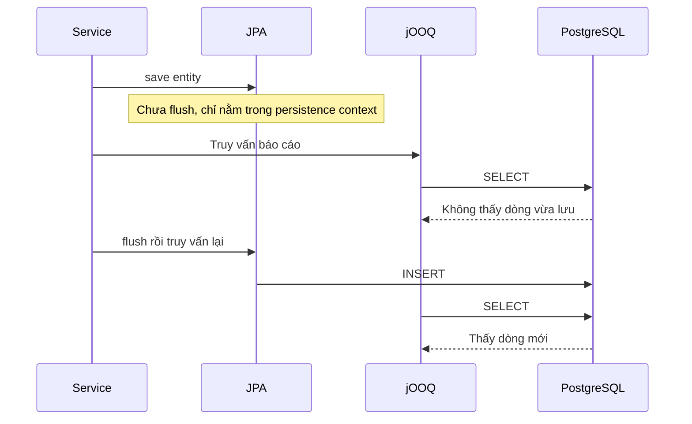

# Lý thuyết 41: Truy cập dữ liệu ngoài JPA thuần (jOOQ, QueryDSL, Spring Data JDBC, Envers)

JPA rất tiện cho việc ghi và đọc từng aggregate, nhưng không phải công cụ tốt nhất cho mọi truy vấn. Bài này trả lời hai câu hỏi: JPA khó ở đâu, và khi nào nên dùng một công cụ khác cạnh nó hoặc thay nó. Bốn công cụ trong tiêu đề giải quyết bốn vấn đề khác nhau, nên điều quan trọng là biết vấn đề nào cần công cụ nào, không phải thuộc tính năng của từng cái.

> **Phiên bản (kiểm tra 2026-10-30):** Spring Boot 4.1 (Framework 7, Hibernate 7, Spring Data 2026.0). Tài liệu Boot nêu `spring-boot-starter-data-jdbc` cho Spring Data JDBC và `JdbcClient` được auto-config; jOOQ được auto-config qua `DSLContext`, Boot ghi jOOQ cần Java 21 trở lên. Tên starter jOOQ và artifact Envers trong Boot 4 cần kiểm tra lại theo phiên bản (không xác nhận được trong lần tra này). Querydsl: Spring Data ghi upstream chậm bảo trì và cộng đồng chuyển sang bản fork OpenFeign (`io.github.openfeign.querydsl`), được Spring Data hỗ trợ theo kiểu cố gắng tối đa; chưa xác nhận được tương thích với Hibernate 7 và Spring Data 2026.0, hãy kiểm tra trước khi chọn. Với Boot 3.5 cách dùng gần như tương tự, khác ở số phiên bản.

**Cốt lõi:** JPA ánh xạ object sang bảng và theo dõi thay đổi, rất hợp để ghi aggregate, nhưng truy vấn báo cáo, join phức tạp và đọc hàng loạt lại là việc của SQL. Mỗi công cụ ngoài JPA là một cách "giữ SQL làm trung tâm" ở một mức khác: bỏ phần ma thuật (Spring Data JDBC), làm câu truy vấn có kiểu (QueryDSL, jOOQ), hay thêm một khả năng riêng (Envers cho lịch sử).

- Vì JPA có persistence context, lazy loading và dirty checking nên hành vi khó đoán khi truy vấn phức tạp, dễ N+1, và không dễ viết câu SQL có window function hay CTE.
- Vì SQL là ngôn ngữ mạnh nhất cho đọc dữ liệu nên đọc báo cáo bằng SQL có kiểu (jOOQ) thường rõ và nhanh hơn dịch qua JPQL.
- Vì mỗi công cụ có mô hình riêng nên trộn chúng trong một giao dịch phải để ý flush và cache của JPA.



Mô hình tư duy: chọn công cụ theo hình dạng của việc cần làm (ghi một aggregate, đọc báo cáo, lưu lịch sử), không theo thói quen.

**Tóm tắt:**

- JPA khó ở ba chỗ: lệch pha giữa object và bảng (impedance mismatch), truy vấn phức tạp qua JPQL, và N+1 do lazy loading.
- Spring Data JDBC bỏ lazy loading, persistence context và dirty checking: mô hình đơn giản, dễ đoán, xoay quanh aggregate.
- `JdbcClient` là API JDBC gọn của Spring để viết SQL trực tiếp, không có ánh xạ quan hệ.
- QueryDSL sinh Q-class để viết truy vấn có kiểu trên entity; hợp khi muốn type-safe nhưng vẫn ở thế giới JPA.
- jOOQ sinh code từ schema thật và cho viết SQL có kiểu; hợp với báo cáo và truy vấn nặng SQL; giấy phép phụ thuộc loại database.
- Envers tự lưu lịch sử entity vào bảng `_AUD` kèm số revision; là công cụ audit, không phải công cụ truy vấn.
- Ghép JPA (ghi) với jOOQ (đọc báo cáo) trong cùng dự án là mẫu phổ biến; bẫy chính là flush và cache của JPA.
- Chọn bằng câu hỏi về nhu cầu: có cần mô hình object không, truy vấn phức tạp không, có cần lịch sử không.

## Vấn đề nó giải quyết

JPA che giấu SQL. Điều đó tiện cho CRUD, nhưng khi cần câu truy vấn phức tạp, bạn phải dịch ý định SQL sang JPQL hoặc Criteria, mất tính trực quan và thường mất hiệu năng. Ba vấn đề cụ thể. Một: impedance mismatch, tức quan hệ nhiều-nhiều, kế thừa, khóa tổng hợp không khớp tự nhiên với object. Hai: truy vấn có `GROUP BY` nhiều tầng, window function, CTE, `LATERAL`, upsert khó diễn đạt qua JPQL. Ba: N+1 xảy ra khi lazy loading nạp từng quan hệ riêng lẻ (xem [JPA internals](/go?p=01-Spring-Boot%2Fmedium%2Flt-16-jpa-internals.md) và [Spring Data JPA nâng cao](/go?p=01-Spring-Boot%2Fmedium%2Flt-37-spring-data-jpa-nang-cao.md)). Các công cụ trong bài này là câu trả lời khác nhau cho ba vấn đề đó.

## Khi nào dùng, khi nào không

Giữ JPA khi miền nghiệp vụ giàu hành vi, ghi theo aggregate, và đội đã quen. Đừng bỏ JPA chỉ vì một vài truy vấn khó; dùng thêm công cụ cạnh nó. Dùng Spring Data JDBC khi muốn mô hình đơn giản, không ma thuật, nhất là dịch vụ nhỏ có aggregate rõ ràng. Dùng jOOQ khi SQL là công dân hạng nhất: báo cáo, tìm kiếm phức tạp, thao tác hàng loạt. Dùng Envers khi có yêu cầu "ai đã đổi gì lúc nào". Không dùng nhiều công cụ cho một việc nhỏ: mỗi công cụ thêm là thêm cấu hình, thêm khái niệm và thêm chỗ để đội phải học.

## Các khái niệm cần biết

| Khái niệm | Ý nghĩa |
|---|---|
| Impedance mismatch | Mô hình object và mô hình quan hệ khác nhau nên ánh xạ qua lại có ma sát |
| N+1 | Một truy vấn lấy N cha, rồi N truy vấn nữa lấy con; do lazy loading |
| Aggregate | Cụm object được lưu và nạp như một khối, có một gốc (aggregate root) |
| Dirty checking | JPA tự phát hiện thay đổi trên entity được quản lý và sinh `UPDATE` khi flush |
| Q-class | Class do QueryDSL sinh cho mỗi entity, chứa các trường có kiểu để dựng truy vấn |
| Codegen | jOOQ đọc schema DB thật rồi sinh class cho bảng, cột, khóa |
| Revision | Số phiên bản toàn cục Envers gán cho mỗi giao dịch có thay đổi được audit |
| Bảng `_AUD` | Bảng Envers tạo cho mỗi entity audit, lưu từng phiên bản của dòng |
| Persistence context | Bộ nhớ đệm cấp một của JPA, giữ các entity đang được quản lý |

## Spring Data JDBC

Spring Data JDBC chọn cách ngược với JPA: đơn giản có chủ đích. Nó xoay quanh khái niệm aggregate theo Domain-Driven Design: một aggregate root cùng các thực thể con thuộc về nó được nạp và lưu như một khối. Nó không có lazy loading, không có persistence context, không có dirty checking. Khi gọi `save`, nó ghi cả aggregate (với con là tập hay danh sách, thường xóa rồi chèn lại các dòng con), và khi gọi `find`, nó nạp cả aggregate bằng truy vấn tường minh.



Cách đọc: sơ đồ trên cho thấy lý do mô hình "dễ đoán". Không có trạng thái ẩn được theo dõi giữa hai lần gọi, nên bạn luôn biết câu SQL nào chạy: thấy `save` là ghi toàn aggregate, thấy `find` là đọc toàn aggregate. Cái giá: aggregate lớn đọc và ghi đắt, và liên kết giữa hai aggregate chỉ qua id (`AggregateReference`), không qua object. Nếu một aggregate có hàng nghìn con thì mô hình này không hợp.

```java
// Minh họa (chưa chạy thử)
@Table("orders")
record Order(@Id Long id, String customer, Set<OrderLine> lines) {}
record OrderLine(String sku, int qty) {}

interface OrderRepository extends CrudRepository<Order, Long> {}
```

Dependency: `spring-boot-starter-data-jdbc`. Nếu dùng AOT hoặc native image, tài liệu Boot khuyên khai báo một bean `JdbcDialect` phù hợp (ví dụ `JdbcPostgresDialect`) để khỏi cần kết nối DB lúc xử lý AOT.

**Nền tảng:** Spring Data JDBC đánh đổi tính tiện (lazy, dirty checking) lấy tính dự đoán được. Thiếu persistence context nghĩa là không có chuyện "sửa object rồi tự lưu": muốn lưu phải gọi `save`. Mọi hành vi của nó suy ra từ việc aggregate được nạp và lưu như một khối, không theo dõi gì giữa hai lần gọi.

## JdbcClient

`JdbcClient` là API fluent của Spring Framework (từ 6.1) để viết SQL trực tiếp, gọn hơn `JdbcTemplate`. Boot auto-config nó khi có `NamedParameterJdbcTemplate`. Không có ánh xạ quan hệ, không có repository: bạn viết SQL, nhận về record hoặc class qua `.query(Class)`.

```java
// Minh họa (chưa chạy thử)
record TopCustomer(String name, long total) {}

List<TopCustomer> top(JdbcClient jdbc) {
    return jdbc.sql("""
            SELECT c.name, SUM(o.amount) AS total
            FROM orders o JOIN customers c ON c.id = o.customer_id
            WHERE o.created_at >= :from
            GROUP BY c.name ORDER BY total DESC LIMIT 10
            """)
        .param("from", java.time.LocalDate.now().minusDays(30))
        .query(TopCustomer.class)
        .list();
}
```

Dùng `JdbcClient` khi chỉ cần vài truy vấn SQL thô và không muốn kéo thêm thư viện. Đổi lại, câu SQL là chuỗi: sai tên cột chỉ lộ lúc chạy.

## QueryDSL

QueryDSL giải quyết đúng điểm yếu đó cho thế giới JPA: truy vấn có kiểu. Một annotation processor sinh Q-class từ entity (ví dụ `QOrder`), và bạn dựng truy vấn bằng các trường có kiểu thay vì chuỗi. Đổi tên trường entity thì code truy vấn lỗi lúc biên dịch.

```java
// Minh họa (chưa chạy thử)
QOrder o = QOrder.order;
List<Order> result = queryFactory
    .selectFrom(o)
    .where(o.status.eq(Status.PAID).and(o.amount.gt(100)))
    .orderBy(o.createdAt.desc())
    .fetch();
```

Với Spring Data, `QuerydslPredicateExecutor` cho repository nhận `Predicate` (ghép được các điều kiện). So với `Specification` của Spring Data JPA (dựng bằng Criteria API): QueryDSL dễ đọc hơn và có type-safe nhờ Q-class, còn `Specification` không cần bước sinh code và không thêm phụ thuộc. Về dự án: tài liệu Spring Data cho biết upstream Querydsl bảo trì chậm, cộng đồng chuyển sang fork OpenFeign (`io.github.openfeign.querydsl`) và Spring Data chỉ hỗ trợ theo cách cố gắng tối đa. Với Hibernate 7 và Spring Data 2026.0, hãy kiểm tra tương thích thật trước khi đưa vào dự án mới. QueryDSL vẫn đi qua JPA, nên vẫn mang theo persistence context và các giới hạn của nó.

## jOOQ

jOOQ đi theo hướng khác: coi SQL là ngôn ngữ chính. Bạn chạy codegen để sinh class từ schema DB thật (bảng, cột, khóa), rồi viết SQL bằng API fluent có kiểu. Câu truy vấn đọc gần như SQL, nhưng đổi tên cột trong DB rồi sinh lại code thì chỗ nào dùng cột cũ sẽ lỗi biên dịch. Boot auto-config `DSLContext` nối với `DataSource` của bạn và tự đoán SQL dialect từ DB (hoặc đặt bằng `spring.jooq.sql-dialect`); Boot chỉ auto-config dialect có trong bản mã nguồn mở.



Cách đọc: thứ tự quan trọng. Schema phải có trước (do migration, xem [bài 40](/go?p=01-Spring-Boot%2Fmedium%2Flt-40-flyway-liquibase-hikaricp.md)), rồi mới sinh code. Nên chạy codegen trong build, đọc từ chính DB đã migrate (thường bằng Testcontainers) để class sinh ra luôn khớp migration.

```java
// Minh họa (chưa chạy thử): class ORDERS, CUSTOMERS do codegen sinh
List<TopCustomer> top = dsl
    .select(CUSTOMERS.NAME, DSL.sum(ORDERS.AMOUNT).as("total"))
    .from(ORDERS).join(CUSTOMERS).on(CUSTOMERS.ID.eq(ORDERS.CUSTOMER_ID))
    .where(ORDERS.CREATED_AT.ge(from))
    .groupBy(CUSTOMERS.NAME)
    .orderBy(DSL.field("total").desc())
    .limit(10)
    .fetchInto(TopCustomer.class);
```

Giấy phép phụ thuộc vào loại database, theo trang download của jOOQ (bản 3.21.9 lúc tra): bản mã nguồn mở theo Apache 2.0, dùng được với các database mã nguồn mở như PostgreSQL, MySQL, MariaDB, SQLite, H2, và không hỗ trợ database thương mại. Muốn dùng với Oracle hay SQL Server thì cần bản thương mại (giá và điều khoản xem trang jOOQ, có thể thay đổi). Bản mã nguồn mở của dòng 3.21 yêu cầu Java 21, các bản thương mại hỗ trợ Java thấp hơn. Với PostgreSQL, bản mã nguồn mở đủ dùng. Dùng jOOQ cho cả ghi cũng được, nhưng bạn tự quản lý logic mà JPA vốn lo (khóa lạc quan, quan hệ).

**Phải thuộc:** jOOQ sinh code từ schema và viết SQL có kiểu; Boot auto-config `DSLContext`. Bản mã nguồn mở dùng cho các database mã nguồn mở (có PostgreSQL), database thương mại như Oracle, SQL Server cần bản trả phí. JPA ghi theo aggregate, jOOQ hợp đọc báo cáo.

## Hibernate Envers

Envers giải quyết bài toán khác hẳn: lưu lịch sử. Gắn `@Audited` lên entity, mỗi lần giao dịch thay đổi entity đó, Envers ghi một dòng vào bảng `<tên>_AUD` (cột `REV` trỏ tới bảng `REVINFO`, và `REVTYPE` cho biết thêm, sửa hay xóa). `REVINFO` lưu số revision và thời điểm; revision là số tăng dần cho mỗi giao dịch có thay đổi được audit.



Cách đọc: việc ghi audit nằm trong cùng giao dịch với thay đổi, nên hoặc cả hai thành công hoặc cả hai hoàn tác. Đọc lịch sử bằng `AuditReader` (ví dụ lấy entity tại một revision), hoặc với Spring Data Envers: repository kế thừa `RevisionRepository` để lấy các revision. Boot tự auto-config hỗ trợ này khi module `spring-data-envers` có trên classpath.

```java
@Entity
@Audited
class Product {
    @Id Long id;
    String name;
    @NotAudited String internalNote;   // loại một trường khỏi lịch sử
}
```

Giới hạn cần biết: Envers theo dõi thay đổi đi qua Hibernate; cập nhật hàng loạt bằng HQL hoặc SQL thô không để lại dấu vết (nên coi đây là điểm cần kiểm tra theo phiên bản). Bảng `_AUD` tăng nhanh, cần chiến lược lưu giữ và index. Nếu chỉ cần "ai sửa gì" cho vài bảng nhạy cảm thì Envers hợp; nếu cần audit toàn hệ thống kể cả thay đổi ngoài ứng dụng, cân nhắc trigger hoặc change data capture ở mức database.

## Chọn bằng flow quyết định



Cách đọc: các nhánh không loại trừ nhau; Envers thường đi cùng JPA. Câu hỏi đầu tiên cần trả lời là ghi hay đọc, vì ghi cần mô hình, còn đọc cần SQL. Nếu hai nhánh cùng hợp thì chọn cái đội đã biết.

**Suy luận:** Vì JPA tối ưu cho việc ghi aggregate và theo dõi thay đổi, còn SQL tối ưu cho việc đọc tập hợp dữ liệu, nên xung đột giữa hai nhu cầu này là lý do không có công cụ "tốt nhất mọi nơi". Từ đó suy ra mẫu ghi bằng JPA, đọc báo cáo bằng jOOQ (hoặc `JdbcClient`) là hợp lý: ghi tận dụng khóa lạc quan và quan hệ, đọc tận dụng sức mạnh SQL mà không phải qua entity. Sai lầm hay gặp là dùng entity JPA cho mọi màn hình đọc; kết quả là N+1 và fetch quá nhiều cột. Nếu một truy vấn chỉ trả dữ liệu để hiển thị, chiếu thẳng ra DTO (projection, jOOQ) mà không cần entity.

## Ghép JPA với jOOQ và bẫy giao dịch

Cả hai dùng chung một `DataSource`, nên chia sẻ được cùng kết nối trong cùng giao dịch Spring. Boot nối `DSLContext` vào giao dịch Spring (jOOQ chạy trong `@Transactional` dùng đúng kết nối của giao dịch đó). Cái cần cẩn thận nằm ở chỗ JPA có bộ đệm riêng.



Cách đọc: JPA hoãn ghi đến lúc flush (thường lúc commit hoặc trước một truy vấn JPQL). jOOQ chạy SQL ngay, không đi qua persistence context, nên không thấy thay đổi chưa flush. Ngược lại, nếu jOOQ cập nhật dòng mà entity của dòng đó đang nằm trong persistence context, entity vẫn giữ giá trị cũ và lần flush sau có thể ghi đè. Cách xử lý: gọi `entityManager.flush()` trước khi đọc bằng jOOQ trong cùng giao dịch khi cần thấy dữ liệu mới; không trộn ghi bằng jOOQ vào các bảng mà JPA đang quản lý trong cùng giao dịch, hoặc gọi `entityManager.clear()` / `refresh` sau khi ghi bằng jOOQ. Thực hành sạch nhất là tách: lệnh ghi qua JPA, lệnh đọc báo cáo qua jOOQ ở dịch vụ riêng, đọc có `@Transactional(readOnly = true)`. Xem thêm [Transaction](/go?p=01-Spring-Boot%2Fmedium%2Flt-05-transaction.md) về cơ chế proxy và phạm vi giao dịch.

## Bẫy thường gặp

| Bẫy | Nguyên nhân | Cách xử lý |
|---|---|---|
| jOOQ không thấy dữ liệu vừa `save` | JPA chưa flush | `flush()` trước khi đọc, hoặc tách giao dịch |
| Entity cũ ghi đè dữ liệu jOOQ vừa sửa | Persistence context giữ bản cũ | Tránh ghi hai đường trên cùng bảng, hoặc `clear()` |
| Spring Data JDBC chậm với aggregate lớn | Ghi và đọc cả aggregate | Giữ aggregate nhỏ, tách aggregate lớn |
| Mong Spring Data JDBC tự lưu thay đổi | Không có dirty checking | Luôn gọi `save` |
| Q-class lỗi thời hoặc thiếu | Chưa chạy annotation processor | Cấu hình build sinh lại Q-class |
| Chọn QueryDSL không kiểm tra tương thích | Upstream chậm, dùng fork | Kiểm tra bản fork với Hibernate 7 và Spring Data |
| jOOQ với DB thương mại bị từ chối | Bản mã nguồn mở không hỗ trợ | Dùng bản có giấy phép phù hợp |
| `_AUD` phình to | Mỗi thay đổi thành một dòng | Chỉ audit entity cần, có chính sách dọn |
| Envers bỏ sót cập nhật hàng loạt | Bỏ qua Hibernate | Dùng trigger hoặc CDC nếu cần chắc chắn |

## Phỏng vấn khó: chuỗi hỏi xoáy

Người phỏng vấn senior thường mở bằng một câu dễ, rồi xoáy xuống cơ chế, đánh đổi và sự cố thật. Câu trả lời tốt đi từ cốt lõi xuống chi tiết.

### Chuỗi 1: JPA khó ở đâu và vì sao có lựa chọn khác

1. **Câu mở:** JPA có nhược điểm gì khiến bạn cân nhắc công cụ khác?
2. **Xoáy 1:** N+1 xảy ra thế nào, và nếu đổi sang Spring Data JDBC thì nó có biến mất không?
3. **Xoáy 2:** Spring Data JDBC lưu aggregate thế nào, và vì sao nó "dễ đoán" hơn nhưng không phải lựa chọn mọi lúc?

**Đáp án ngắn:** JPA ánh xạ object sang bảng và giữ persistence context để theo dõi thay đổi, rất hợp ghi aggregate nhưng lệch pha với quan hệ (impedance mismatch), khó diễn đạt SQL phức tạp qua JPQL, và dễ N+1. N+1 xảy ra khi truy vấn lấy N cha rồi lazy loading nạp từng quan hệ con bằng N truy vấn riêng; sửa bằng fetch join, entity graph hoặc batch size. Spring Data JDBC không có lazy loading nên không có N+1 kiểu đó, nhưng bạn trả giá bằng việc nạp cả aggregate mỗi lần. Nó lưu aggregate như một khối: `save` insert hoặc update root rồi thường xóa và chèn lại các dòng con, không theo dõi thay đổi giữa hai lần gọi. Vì không có trạng thái ẩn, bạn luôn biết câu SQL nào chạy, nên dễ đoán. Đổi lại, aggregate lớn đọc ghi đắt, liên kết giữa aggregate chỉ qua id, và không có cache cấp một. Trong thực tế production, nhiều đội giữ JPA cho ghi và thêm công cụ cho đọc thay vì thay hẳn.

**Sai lầm hay gặp:**
- Nói "bỏ JPA hoàn toàn" khi vấn đề chỉ nằm ở vài truy vấn.
- Cho rằng Spring Data JDBC "nhanh hơn" mà không nói tới chi phí nạp cả aggregate.
- Quên Spring Data JDBC không tự lưu thay đổi (không dirty checking).

### Chuỗi 2: QueryDSL, jOOQ và khi nào chọn cái nào

1. **Câu mở:** QueryDSL và jOOQ đều là "truy vấn có kiểu". Khác nhau ở đâu?
2. **Xoáy 1:** jOOQ biết cột nào để kiểm tra kiểu, và quy trình build của nó ra sao?
3. **Xoáy 2:** Giấy phép jOOQ ảnh hưởng quyết định chọn thế nào, và bạn có yên tâm với QueryDSL không?

**Đáp án ngắn:** QueryDSL dựng truy vấn trên mô hình entity JPA qua Q-class do annotation processor sinh, nên vẫn nằm trong thế giới JPA (persistence context, JPQL). jOOQ dựng SQL trên mô hình bảng do codegen sinh từ schema thật, nên bạn viết SQL có kiểu, hợp với báo cáo, window function, CTE. Quy trình build của jOOQ: migration tạo schema, codegen đọc schema (thường trên DB tạm bằng Testcontainers), sinh class bảng và cột, rồi dùng qua `DSLContext` mà Boot auto-config; schema đổi thì sinh lại và chỗ dùng cột cũ lỗi lúc biên dịch. Về giấy phép, bản mã nguồn mở của jOOQ theo Apache 2.0 và dùng cho database mã nguồn mở như PostgreSQL; với Oracle hay SQL Server cần bản thương mại, nên phải chốt loại DB trước khi chọn. QueryDSL thì cần để ý bảo trì: upstream chậm, cộng đồng dùng fork OpenFeign, Spring Data hỗ trợ cố gắng tối đa, nên kiểm tra tương thích với Hibernate 7 và Spring Data hiện hành trước khi dùng. Trong thực tế, nếu chủ yếu đọc nặng SQL thì jOOQ, nếu chỉ cần ghép điều kiện lọc động trên entity thì `Specification` hoặc QueryDSL.

**Sai lầm hay gặp:**
- Coi hai công cụ là như nhau vì cùng "type-safe".
- Quên bước phụ thuộc thứ tự: phải có schema trước khi sinh code jOOQ.
- Chọn jOOQ không kiểm tra giấy phép với database thương mại.

### Chuỗi 3: Ghép JPA với jOOQ, và Envers

1. **Câu mở:** Dự án dùng JPA để ghi và jOOQ để đọc báo cáo. Có vấn đề gì không?
2. **Xoáy 1:** Trong cùng một `@Transactional`, bạn `save` một entity rồi chạy truy vấn jOOQ và không thấy dòng đó. Giải thích và sửa.
3. **Xoáy 2:** Envers lưu lịch sử thế nào, và nó có bắt được mọi thay đổi không?

**Đáp án ngắn:** Mẫu này phổ biến vì JPA hợp ghi aggregate còn jOOQ hợp đọc báo cáo, và cả hai dùng chung `DataSource` nên chia sẻ được giao dịch Spring. Vấn đề là JPA có persistence context: `save` chỉ đưa entity vào bộ nhớ và hoãn `INSERT` đến lúc flush, trong khi jOOQ chạy SQL ngay, nên truy vấn jOOQ không thấy dòng chưa flush. Sửa bằng `entityManager.flush()` trước khi đọc, hoặc tách ghi và đọc thành hai giao dịch. Chiều ngược lại cũng có bẫy: jOOQ sửa dòng trong khi entity cũ còn trong persistence context thì lần flush sau có thể ghi đè, nên tránh ghi hai đường trên cùng bảng hoặc `clear()` sau khi ghi bằng jOOQ. Envers gắn `@Audited` thì mỗi giao dịch có thay đổi sẽ ghi một dòng vào `REVINFO` và một dòng phiên bản vào bảng `_AUD` với `REVTYPE`, trong cùng giao dịch với thay đổi gốc. Nó chỉ bắt thay đổi đi qua Hibernate; cập nhật hàng loạt bằng SQL thô hoặc HQL không để lại dấu vết, và bảng `_AUD` phình theo thời gian, cần chính sách lưu giữ.

**Sai lầm hay gặp:**
- Nghĩ jOOQ và JPA tự đồng bộ dữ liệu trong cùng giao dịch.
- Dùng Envers và tin rằng nó ghi lại mọi thay đổi trong database.
- Audit mọi entity mà không tính tới tăng trưởng bảng `_AUD`.

## Câu hỏi tự kiểm tra

**Câu 1.** Vì sao Spring Data JDBC không có N+1 kiểu JPA, và cái giá của việc đó là gì?

*Gợi ý suy luận:* Điều gì xảy ra khi bạn nạp một aggregate? Có thứ gì được nạp "sau" không?

*Lập luận và đáp án:* Spring Data JDBC không có lazy loading: aggregate được nạp trọn vẹn khi `find`, nên không có truy vấn con phát sinh sau đó. Cái giá là mỗi lần nạp lấy cả aggregate dù chỉ cần một phần, và aggregate lớn rất tốn; vì thế phải giữ aggregate nhỏ và tách theo ranh giới nhất quán.

**Câu 2.** Ghi bằng JPA, đọc báo cáo bằng jOOQ trong cùng giao dịch, báo cáo thiếu dòng mới. Nguyên nhân và cách sửa?

*Gợi ý suy luận:* JPA ghi vào DB lúc nào? jOOQ có đi qua persistence context không?

*Lập luận và đáp án:* JPA hoãn `INSERT` đến lúc flush, còn jOOQ chạy SQL ngay không qua persistence context, nên chưa thấy dòng mới. Sửa bằng `flush()` trước khi đọc, hoặc tách ghi và đọc ra hai giao dịch. Để tránh ghi đè ngược lại, không ghi cùng bảng bằng cả hai công cụ trong một giao dịch.

**Câu 3.** Bạn cần màn hình báo cáo với `GROUP BY` và window function trên PostgreSQL, đội chỉ dùng JPA. Chọn gì và vì sao?

*Gợi ý suy luận:* Việc này là ghi hay đọc? JPQL diễn đạt window function tốt không?

*Lập luận và đáp án:* Việc này là đọc nặng SQL, không cần entity, nên dùng jOOQ (hoặc `JdbcClient` nếu ít truy vấn) và chiếu thẳng ra DTO; PostgreSQL thuộc nhóm database mã nguồn mở nên bản jOOQ miễn phí đủ. Vẫn giữ JPA cho phần ghi. Native query của JPA là phương án nhẹ, đổi lại mất kiểm tra kiểu lúc biên dịch.

**Câu 4.** Yêu cầu "biết ai đã sửa giá sản phẩm lúc nào". Bạn dùng gì và có giới hạn nào?

*Gợi ý suy luận:* Cần lịch sử theo entity trong ứng dụng, hay theo mọi thay đổi trong DB?

*Lập luận và đáp án:* Envers với `@Audited` trên `Product`, cộng thông tin người dùng vào entity revision tuỳ chỉnh, đọc bằng `AuditReader` hoặc `RevisionRepository`. Giới hạn: chỉ bắt thay đổi đi qua Hibernate, bảng `_AUD` phình theo thời gian. Nếu cần bắt cả thay đổi từ ngoài ứng dụng thì cân nhắc trigger hoặc CDC.

Nguồn: Spring Boot reference "SQL Databases" và How-to "Database Initialization" (docs.spring.io, nhánh main, Boot 4.x); trang download và giấy phép jOOQ (jooq.org/download, jOOQ 3.21.9); tài liệu Spring Data "Extensions" về Querydsl (docs.spring.io/spring-data); tra cứu ngày 2026-10-30. Chưa kiểm chứng trực tiếp: tên starter jOOQ và artifact Envers trong Boot 4, tương thích Querydsl fork với Hibernate 7 và Spring Data 2026.0, hành vi Envers với cập nhật hàng loạt theo Hibernate 7.

