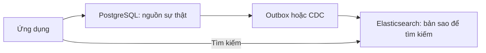
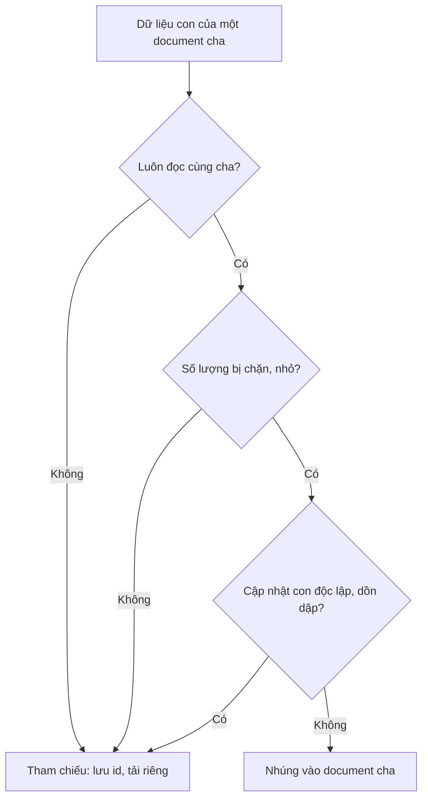
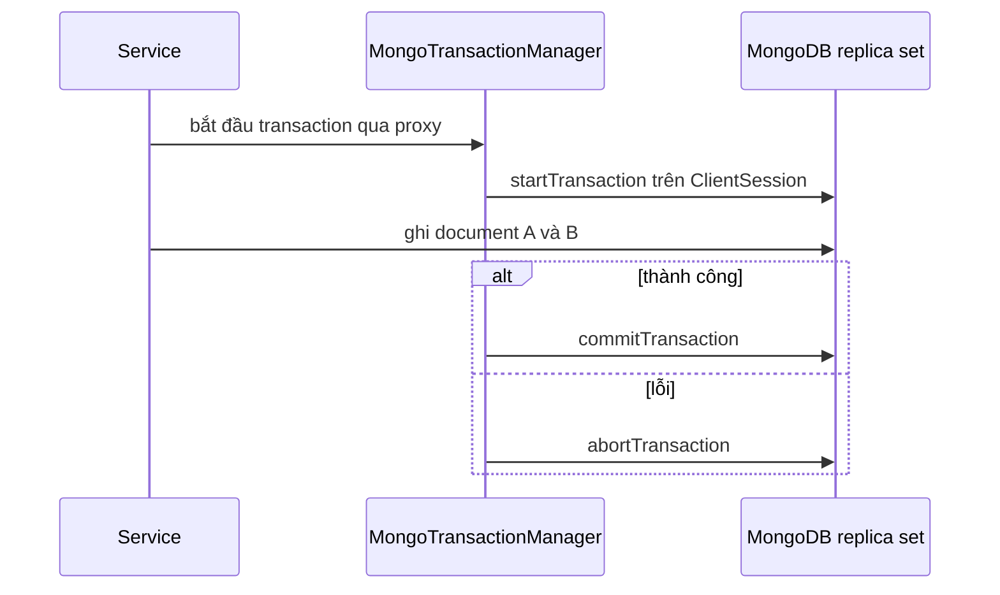
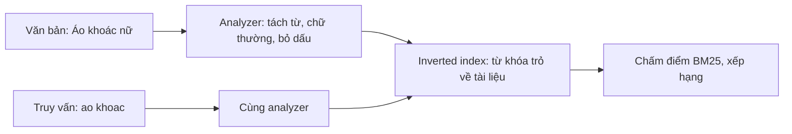
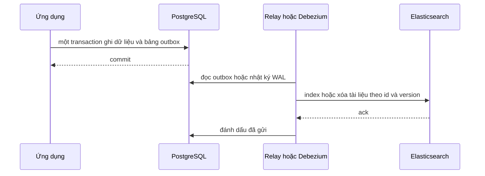
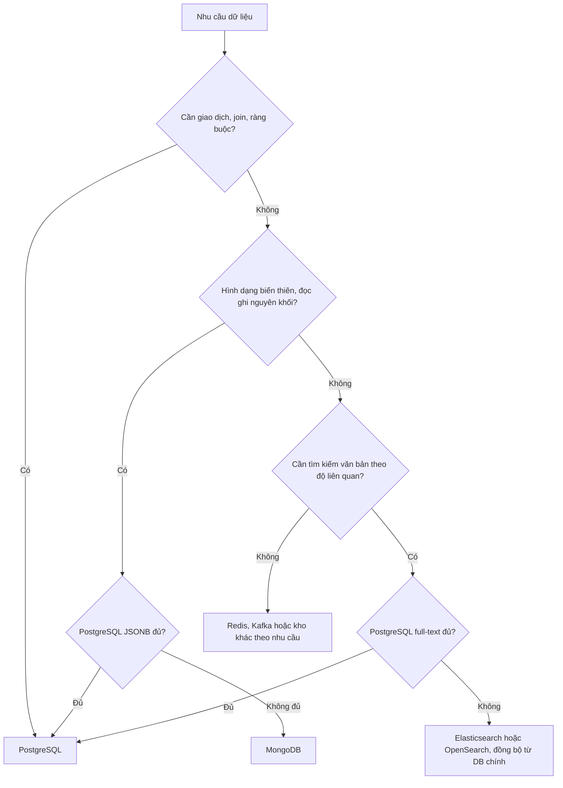

# Lý thuyết 43: MongoDB và Elasticsearch với Spring Data (polyglot persistence)

PostgreSQL xử lý tốt phần lớn bài toán, nhưng có hai nhu cầu nó làm chưa vừa tay: lưu dữ liệu có hình dạng thay đổi theo từng bản ghi (document), và tìm kiếm văn bản theo độ liên quan (search). MongoDB và Elasticsearch ra đời cho hai nhu cầu đó. Dùng nhiều kho cho nhiều mục đích gọi là polyglot persistence, và cái giá là bạn phải giữ dữ liệu đồng bộ giữa chúng. Bài này tập trung vào việc hiểu khi nào đáng dùng, mô hình hóa ra sao và đồng bộ đúng cách, hơn là liệt kê API. Phần chọn kho tổng quát xem [Chọn lưu trữ](/go?p=02-Database%2Fhard%2Flt-06-luu-tru-chon-db.md); phần JSONB và full-text của PostgreSQL xem [JSONB, array, range, full-text](/go?p=02-Database%2Fmedium%2Flt-16-jsonb-array-range-fulltext.md).

> **Phiên bản (kiểm tra 2026-10-30):** Spring Boot 4.1.2 với Spring Data MongoDB 5.1.2 và Spring Data Elasticsearch 6.1.2. Starter: `spring-boot-starter-data-mongodb` và `spring-boot-starter-data-elasticsearch` (có thêm `spring-boot-starter-elasticsearch` chỉ lấy client). Boot 4 đặt kết nối Mongo ở `spring.mongodb.*` (ví dụ `spring.mongodb.uri`); Boot 3.5 dùng `spring.data.mongodb.*`. Elasticsearch dùng `spring.elasticsearch.uris`. Số phiên bản server (MongoDB, Elasticsearch, OpenSearch) và điều kiện giấy phép kiểm tra lại theo phiên bản.

**Cốt lõi:** Mỗi kho dữ liệu tối ưu cho một kiểu truy vấn: bảng quan hệ cho giao dịch và join, document cho một "cục" dữ liệu đọc ghi nguyên khối, inverted index cho tìm từ khóa theo độ liên quan. Dùng kho chuyên dụng khi nhu cầu thật sự vượt khả năng của PostgreSQL, và chấp nhận rằng dữ liệu nay nằm ở nhiều nơi.

- Vì document được đọc và ghi nguyên khối nên mô hình tốt là gom những gì luôn đi cùng nhau vào một document (nhúng), và chỉ tham chiếu khi dữ liệu lớn vô hạn hoặc dùng độc lập.
- Vì search index là bản sao dựng từ DB chính chứ không phải nguồn sự thật nên nó luôn trễ một nhịp, và phải thiết kế cho eventual consistency.
- Vì ghi hai nơi (dual write) không có giao dịch chung nên một bên thành công, bên kia lỗi là chuyện sớm muộn; phải đi qua outbox hoặc CDC.



Mô hình tư duy: PostgreSQL giữ sự thật, kho chuyên dụng giữ bản sao phục vụ một kiểu truy vấn, và đường đồng bộ giữa chúng là phần khó nhất.

**Tóm tắt:**

- Document hợp hơn bảng khi dữ liệu có hình dạng thay đổi, được đọc và ghi nguyên khối, ít join; bảng hợp hơn khi cần ràng buộc, join và giao dịch nhiều thực thể.
- Nhúng khi con luôn đi cùng cha và số lượng bị chặn; tham chiếu khi con lớn không giới hạn, dùng độc lập hoặc được nhiều cha chia sẻ. Giới hạn một document MongoDB là 16 MB.
- Ghi một document là nguyên tử; transaction nhiều document cần replica set và bean `MongoTransactionManager`, nên đừng dùng nó để bù cho mô hình dữ liệu sai.
- Elasticsearch dựa trên inverted index (từ khóa trỏ về danh sách tài liệu) và analyzer, trả kết quả theo điểm liên quan, khác hẳn `LIKE '%x%'` quét toàn bảng.
- PostgreSQL full-text đủ cho tìm kiếm vừa phải trong một DB; chỉ thêm Elasticsearch khi cần relevance tinh chỉnh, facet, gợi ý, đa ngôn ngữ hay quy mô lớn.
- Index search là bản sao, trễ vì refresh (mặc định cỡ một giây) cộng độ trễ đồng bộ, nên đọc ngay sau ghi có thể chưa thấy.
- Dual write là bẫy; dùng transactional outbox hoặc CDC (như Debezium) để đồng bộ tin cậy, kèm tính idempotent ở phía ghi index.
- Luôn xây lại được index từ nguồn thật (reindex), vì đó là cứu cánh khi mapping sai hoặc đồng bộ lệch.

## Vấn đề nó giải quyết

Một sản phẩm thương mại có thuộc tính khác nhau theo ngành hàng (áo có size, điện thoại có RAM), nên bảng quan hệ phải thành hàng chục cột rỗng hoặc bảng EAV rối rắm. Document gom toàn bộ thuộc tính vào một bản ghi. Khác nhu cầu đó, người dùng gõ "ao khoac nu" mong ra "Áo khoác nữ" xếp theo độ phù hợp, có sửa lỗi gõ và đếm theo hãng; `LIKE` và index B-tree không làm được việc này hiệu quả. Search engine được dựng riêng cho điều đó.

## Khi nào dùng, khi nào không

Dùng MongoDB khi dữ liệu thật sự là document (hồ sơ, danh mục thuộc tính biến thiên, sự kiện, cấu hình), truy vấn chủ yếu theo khóa hoặc vài trường và ít quan hệ chéo. Không dùng khi bạn cần nhiều join, ràng buộc toàn vẹn chặt, hay giao dịch nhiều thực thể là việc thường ngày; lúc đó PostgreSQL (kể cả cột JSONB) hợp hơn. Dùng Elasticsearch hoặc OpenSearch khi tìm kiếm là tính năng cốt lõi. Không dùng nó làm nguồn sự thật hay cho giao dịch. Trước khi thêm kho mới, hãy thử PostgreSQL JSONB và full-text, vì mỗi kho thêm vào là thêm vận hành, backup, giám sát và bài toán đồng bộ.

## Các khái niệm cần biết

| Khái niệm | Ý nghĩa |
|---|---|
| Document | Một bản ghi dạng JSON/BSON lồng nhau, đọc ghi nguyên khối |
| Nhúng và tham chiếu | Gói dữ liệu con vào trong document cha, hay giữ id trỏ sang document khác |
| Replica set | Nhóm node MongoDB có primary và secondary; điều kiện để dùng transaction |
| `MongoTemplate` | API mức thấp, tự soạn query và update |
| Inverted index | Từ điển từ khóa, mỗi từ trỏ tới danh sách tài liệu chứa nó |
| Analyzer | Chuỗi xử lý văn bản khi lập index và khi tìm: tách từ, hạ chữ thường, bỏ dấu, stemming |
| Relevance và BM25 | Điểm xếp hạng độ phù hợp của tài liệu với truy vấn |
| Refresh | Bước làm dữ liệu mới ghi nhìn thấy được khi tìm (near real-time) |
| Outbox | Bảng sự kiện ghi cùng transaction với dữ liệu nghiệp vụ, rồi được đẩy đi |
| CDC | Đọc nhật ký thay đổi của DB để phát sự kiện, không sửa code ứng dụng |
| Eventual consistency | Các bản sao rồi sẽ nhất quán nhưng không tức thì |

## Mô hình hóa document: nhúng hay tham chiếu

Câu hỏi quyết định: dữ liệu con có luôn được đọc cùng cha không, và số lượng có bị chặn không? Đơn hàng và các dòng hàng luôn đọc cùng nhau, mỗi đơn có vài chục dòng: nhúng. Bài viết và bình luận có thể lên tới hàng triệu bình luận: tham chiếu, vì document không được phình vô hạn.



Cách đọc: đi từ trên xuống, chỉ nhúng khi cả ba điều kiện đều thuận. Nhúng cho đọc một lần là xong, ghi nguyên tử trọn document, nhưng làm document to, và cập nhật một phần tử nhúng dồn dập gây tranh chấp trên cùng document. Tham chiếu giữ document gọn nhưng đọc cần thêm truy vấn hoặc `$lookup`, và không có ràng buộc khóa ngoại.

**Nền tảng:** Ranh giới nguyên tử của MongoDB là một document. Mô hình tốt đặt những thứ cần nhất quán với nhau vào cùng một document để một lần ghi là đủ, thay vì dựa vào transaction nhiều document. Nếu bạn thấy mình luôn cần transaction nhiều document hay join nhiều bảng, đó là dấu hiệu dữ liệu vốn có tính quan hệ.

## Spring Data MongoDB

Thêm `spring-boot-starter-data-mongodb`, đặt `spring.mongodb.uri` (Boot 3.5: `spring.data.mongodb.uri`), rồi đánh dấu class bằng `@Document`. Repository cho CRUD và query theo tên method; `MongoTemplate` cho update từng phần và aggregation.

```java
// Minh họa (chưa chạy thử)
@Document("products")
@CompoundIndex(def = "{'category': 1, 'price': -1}")
public class Product {
    @Id private String id;
    private String name;
    @Indexed private String category;
    private BigDecimal price;
    private Map<String, Object> attributes;   // thuộc tính biến thiên theo ngành hàng
    // getter, setter
}

public interface ProductRepository extends MongoRepository<Product, String> {
    List<Product> findByCategoryOrderByPriceDesc(String category);
}

// Cập nhật một phần nguyên tử, không đọc rồi ghi cả document
mongoTemplate.updateFirst(
    Query.query(Criteria.where("_id").is(id)),
    new Update().inc("stock", -1),
    Product.class);
```

Hai điểm cần nhớ. Thứ nhất, `save()` trên repository thay cả document; hai luồng cùng đọc rồi `save` sẽ ghi đè lẫn nhau, nên dùng `Update` với `$inc`, `$set` hoặc thêm trường `@Version` cho khóa lạc quan. Thứ hai, tạo index tự động theo annotation không phải mặc định ở mọi phiên bản (từ Spring Data MongoDB 3 nó mặc định tắt; thuộc tính bật là `auto-index-creation`, kiểm tra lại tên và mặc định theo phiên bản), và production nên quản lý index bằng migration chủ động thay vì để ứng dụng tự tạo lúc khởi động.

### Transaction nhiều document

Theo tài liệu Spring Data MongoDB, nếu không khai báo `MongoTransactionManager` trong context thì hỗ trợ transaction bị tắt. Server phải là replica set (hoặc sharded cluster), URI cần tên replica set, và `@Transactional` sẽ chạy qua proxy với mọi giới hạn quen thuộc (xem [AOP và Proxy](/go?p=01-Spring-Boot%2Fmedium%2Flt-13-aop-proxy.md)). Có thêm giới hạn riêng: không tạo collection mới trong transaction, và `count` được đổi thành aggregation.



Cách đọc: manager gắn một `ClientSession` vào thread, `MongoTemplate` tự dùng session đó, rồi commit hoặc abort ở cuối. Vì transaction nhiều document tốn kém hơn ghi một document, hãy coi nó là ngoại lệ và ưu tiên mô hình sao cho một document là đủ.

## Elasticsearch: inverted index và analyzer

`LIKE '%khoac%'` không dùng được index B-tree vì không biết bắt đầu từ đâu, nên quét toàn bảng, không xếp hạng và không hiểu ngôn ngữ. Elasticsearch lập index ngược: khi lưu "Áo khoác nữ mùa đông", analyzer tách thành từ, hạ chữ thường, có thể bỏ dấu, rồi ghi `khoac -> [tài liệu 7, 19, ...]`. Tìm từ khóa là tra từ điển rồi giao các danh sách, nên nhanh trên khối lượng lớn.



Cách đọc: cùng một analyzer phải xử lý cả lúc lập index lẫn lúc truy vấn thì từ khóa mới khớp nhau; lệch analyzer là nguyên nhân phổ biến của "tìm không ra". Kết quả được xếp theo điểm liên quan (mặc định BM25: từ hiếm và xuất hiện nhiều trong tài liệu ngắn thì điểm cao).

**Phải thuộc:** Elasticsearch là near real-time: dữ liệu mới ghi chỉ tìm thấy được sau một lần refresh (mặc định cỡ 1 giây). Index là bản sao, không phải nguồn sự thật. Đổi analyzer hay kiểu field trong mapping thường đòi tạo index mới rồi reindex.

So sánh nhanh với PostgreSQL: full-text của PostgreSQL (`tsvector`, GIN, xem bài đã liên kết) cho tìm và xếp hạng cơ bản ngay trong DB, cùng transaction với dữ liệu, không có độ trễ đồng bộ và không thêm hạ tầng. Elasticsearch hơn ở relevance tinh chỉnh được, facet và aggregation nhanh, gợi ý và sửa lỗi gõ, nhiều ngôn ngữ, và scale ngang. Quy tắc thực tế: nếu tìm kiếm là tính năng phụ với vài triệu dòng, hãy ở lại PostgreSQL.

## Spring Data Elasticsearch và lưu ý về client mới

Boot 4.1 cung cấp `spring-boot-starter-data-elasticsearch`. Client chính thức nay là Java API client (`co.elastic.clients:elasticsearch-java`) chạy trên transport dựa vào `Rest5Client` (module `elasticsearch-rest5-client`); `RestHighLevelClient` cũ không còn là đường đi. Boot tự cấu hình `ElasticsearchClient` khi có client trên classpath, và Spring Data Elasticsearch dùng nó để cấp `ElasticsearchTemplate`. Cấu hình: `spring.elasticsearch.uris`, `username`, `password`, `socket-timeout`. Tên bean, lớp client và artifact đã đổi giữa Boot 3.5 và 4.x, nên khi nâng cấp phải đọc hướng dẫn migration thay vì giữ code cũ.

```java
// Minh họa (chưa chạy thử)
@Document(indexName = "products")
public class ProductDoc {
    @Id private String id;
    @Field(type = FieldType.Text, analyzer = "standard") private String name;
    @Field(type = FieldType.Keyword) private String category;
    @Field(type = FieldType.Double) private BigDecimal price;
}

public interface ProductSearchRepository extends ElasticsearchRepository<ProductDoc, String> {
    List<ProductDoc> findByNameContaining(String text);
}
```

Về OpenSearch (nhánh fork giấy phép Apache): nó tương thích giao thức ở mức lớn nhưng Spring Data Elasticsearch nhắm tới Elasticsearch, nên dùng chung client có thể gặp khác biệt theo phiên bản; kiểm tra lại ma trận tương thích hoặc dùng client riêng của OpenSearch. Điều kiện giấy phép của Elasticsearch đã đổi qua các năm, nên nếu giấy phép là ràng buộc của bạn hãy đọc trang giấy phép hiện hành thay vì dựa vào trí nhớ.

## Đồng bộ dữ liệu từ DB chính sang search

Cách ngây thơ là ghi PostgreSQL rồi ghi Elasticsearch trong cùng một method. Hai lần ghi không có transaction chung: DB commit xong mà Elasticsearch lỗi thì index thiếu dữ liệu; hoặc ghi Elasticsearch trước rồi DB rollback thì index có dữ liệu ma. Đây là dual write.



Cách đọc: sự kiện được ghi cùng transaction với dữ liệu nên nó tồn tại khi và chỉ khi dữ liệu commit. Relay (hoặc CDC đọc WAL) đẩy sang Elasticsearch ít nhất một lần, nên phía ghi index phải idempotent: dùng id của thực thể làm `_id` và kiểm tra phiên bản để ghi lại hay nhận trùng đều ra cùng kết quả.

**Suy luận:** Hai kho độc lập không thể cùng commit nguyên tử mà không có giao thức nhiều pha, vốn đắt và hiếm được hỗ trợ. Vì vậy ta đổi bài toán: chỉ một kho (PostgreSQL) là nơi quyết định sự thật, còn kho kia là kết quả suy ra bằng một luồng sự kiện đáng tin. Outbox biến "ghi hai nơi" thành "ghi một nơi rồi đọc ra", nên lỗi giữa chừng chỉ làm index trễ chứ không làm lệch vĩnh viễn. Cái giá là eventual consistency: người dùng vừa tạo sản phẩm có thể chưa thấy nó trong tìm kiếm. Giảm nhẹ bằng cách đọc chi tiết từ DB chính sau khi ghi, chỉ dùng search cho danh sách, và có job reindex định kỳ hoặc theo yêu cầu để sửa lệch. Phần cơ chế outbox xem thêm ở bài về khóa phân tán và idempotency và các bài về sự kiện.

## Flow chọn kho dữ liệu theo nhu cầu



Cách đọc: mặc định là PostgreSQL, và chỉ rẽ sang kho khác khi câu hỏi "PostgreSQL có đủ không" trả lời không. Nhánh Elasticsearch luôn đi kèm đường đồng bộ từ kho chính, còn MongoDB có thể là nguồn sự thật riêng cho dữ liệu document.

## Bẫy thường gặp

| Bẫy | Nguyên nhân | Cách xử lý |
|---|---|---|
| Document phình vô hạn | Nhúng mảng không chặn (bình luận, log) | Tham chiếu hoặc tách collection; nhớ giới hạn 16 MB |
| Mất cập nhật khi `save()` đồng thời | `save` thay cả document | `Update` từng phần hoặc `@Version` |
| `@Transactional` không có tác dụng với Mongo | Không có `MongoTransactionManager`, hoặc không phải replica set | Khai báo bean, dùng replica set, kiểm tra proxy |
| Tìm không ra dù có dữ liệu | Analyzer lúc index khác lúc tìm, hoặc chưa refresh | Thống nhất analyzer, đợi refresh, kiểm tra mapping |
| Index lệch với DB | Dual write | Outbox hoặc CDC, kèm job reindex |
| Đổi mapping bị từ chối | Mapping field không đổi tại chỗ | Tạo index mới, reindex, đổi alias |
| Coi search là nguồn sự thật | Index chỉ là bản sao, trễ | Đọc chi tiết từ DB chính |
| Thêm kho mới quá sớm | Chưa thử JSONB hay full-text của PostgreSQL | Đo trước, chỉ thêm khi vượt giới hạn thật |

## Phỏng vấn khó: chuỗi hỏi xoáy

### Chuỗi 1: Document hay bảng, nhúng hay tham chiếu

1. **Câu mở:** Khi nào bạn chọn MongoDB thay vì PostgreSQL?
2. **Xoáy 1:** Mô hình hóa đơn hàng và dòng hàng, bài viết và bình luận: nhúng hay tham chiếu, vì sao?
3. **Xoáy 2:** Nếu cần nhất quán giữa hai document, bạn xử lý thế nào, và có dùng transaction không?

**Đáp án ngắn:** Tôi chọn MongoDB khi dữ liệu thật sự là document: hình dạng biến thiên, đọc ghi nguyên khối, ít join; còn cần ràng buộc, join và giao dịch nhiều thực thể thì PostgreSQL hợp hơn, và JSONB thường đủ cho phần biến thiên. Cơ chế gốc là ranh giới nguyên tử của MongoDB nằm ở một document, nên những thứ cần nhất quán với nhau nên nằm chung một document. Đơn hàng và dòng hàng luôn đi cùng và bị chặn số lượng nên nhúng; bình luận không giới hạn nên tham chiếu, vì document có trần 16 MB và cập nhật dồn dập trên một document gây tranh chấp. Cần nhất quán nhiều document thì trước hết nhìn lại mô hình để gom lại; nếu vẫn cần thì dùng transaction với replica set và `MongoTransactionManager`, chấp nhận chi phí cao hơn. Thực tế production, transaction nhiều document xuất hiện thường xuyên là dấu hiệu chọn nhầm kho.

**Sai lầm hay gặp:**
- Chọn MongoDB vì "linh hoạt, không cần schema" mà không phân tích truy vấn.
- Nhúng mảng không chặn kích thước.
- Dùng transaction nhiều document như thói quen để bù mô hình sai.

### Chuỗi 2: Elasticsearch khác LIKE và full-text PostgreSQL ra sao

1. **Câu mở:** Vì sao `LIKE '%từ%'` không đủ cho tìm kiếm sản phẩm?
2. **Xoáy 1:** Inverted index và analyzer là gì, và vì sao analyzer lệch làm tìm không ra?
3. **Xoáy 2:** Khi nào bạn ở lại full-text của PostgreSQL, khi nào thêm Elasticsearch?

**Đáp án ngắn:** `LIKE` với dấu `%` đứng đầu không dùng được index B-tree nên quét toàn bảng, không xếp hạng theo độ phù hợp và không hiểu dấu hay biến thể từ. Elasticsearch lập inverted index: analyzer tách văn bản thành từ, chuẩn hóa (chữ thường, bỏ dấu, stemming), rồi mỗi từ trỏ tới danh sách tài liệu; tìm kiếm là tra từ điển rồi giao danh sách và chấm điểm BM25. Cùng một analyzer phải dùng khi lập index và khi truy vấn, lệch là từ khóa không khớp. Đánh đổi là dữ liệu chỉ near real-time (chờ refresh) và là bản sao cần đồng bộ. Tôi ở lại PostgreSQL full-text khi tìm kiếm vừa phải, muốn cùng transaction và không thêm hạ tầng. Tôi thêm Elasticsearch khi cần relevance tinh chỉnh, facet, gợi ý, đa ngôn ngữ hoặc quy mô lớn, và khi đó chấp nhận gánh vận hành cùng bài toán đồng bộ.

**Sai lầm hay gặp:**
- Nói Elasticsearch "nhanh hơn database" mà không nói nó là inverted index và là bản sao.
- Quên rằng analyzer áp dụng cả lúc truy vấn.
- Thêm Elasticsearch khi `tsvector` và GIN đã đủ.

### Chuỗi 3: Đồng bộ DB sang search và dual write

1. **Câu mở:** Bạn đồng bộ sản phẩm từ PostgreSQL sang Elasticsearch thế nào?
2. **Xoáy 1:** Vì sao ghi cả hai nơi trong cùng method là sai?
3. **Xoáy 2:** Với outbox hoặc CDC, làm sao đảm bảo không mất và không trùng, và người dùng thấy gì trong lúc trễ?

**Đáp án ngắn:** Tôi không ghi hai nơi mà coi PostgreSQL là nguồn sự thật, rồi đẩy sang Elasticsearch qua transactional outbox hoặc CDC như Debezium. Dual write sai vì hai kho không có transaction chung: DB commit mà Elasticsearch lỗi thì index thiếu, hoặc Elasticsearch ghi rồi DB rollback thì có tài liệu ma, và lệch này tích tụ âm thầm. Với outbox, sự kiện được ghi cùng transaction với dữ liệu nên chỉ tồn tại khi dữ liệu commit; một relay đọc và gửi ít nhất một lần, nên phía index phải idempotent bằng `_id` là id thực thể và kiểm tra phiên bản để nhận trùng hay sai thứ tự đều ra cùng kết quả. Đánh đổi là eventual consistency: sản phẩm vừa tạo có thể chưa hiện trong tìm kiếm, nên đọc chi tiết từ DB chính, dùng search cho danh sách, và có job reindex để sửa lệch. Production cần giám sát độ trễ đồng bộ và số sự kiện kẹt.

**Sai lầm hay gặp:**
- Gọi Elasticsearch trong `@Transactional` của DB và tin rằng cả hai cùng rollback.
- Quên idempotency khi relay gửi lặp.
- Không có đường reindex từ nguồn thật.

## Câu hỏi tự kiểm tra

**1. Một sản phẩm có hàng nghìn đánh giá. Nhúng đánh giá vào document sản phẩm có ổn không?**

Gợi ý suy luận: Số lượng có bị chặn không, và cập nhật có dồn dập không?

Lập luận và đáp án: Không ổn. Số đánh giá không bị chặn nên document phình, đẩy tới trần 16 MB, và mỗi đánh giá mới ghi lại trên cùng document gây tranh chấp. Tách đánh giá thành collection riêng có tham chiếu tới sản phẩm, và chỉ nhúng bản tóm tắt nhỏ (điểm trung bình, số lượng) nếu cần đọc nhanh.

**2. Bạn gắn `@Transactional` lên service dùng `MongoTemplate` nhưng không thấy rollback. Kiểm tra gì?**

Gợi ý suy luận: Điều kiện để transaction Mongo hoạt động, và giới hạn của proxy.

Lập luận và đáp án: Kiểm tra đã khai báo `MongoTransactionManager` chưa (không có thì hỗ trợ transaction bị tắt), server có phải replica set và URI có tên replica set không, `MongoTemplate` có dùng cùng `MongoDatabaseFactory` không, và có bị self-invocation hay method không public làm proxy không chạy không. Collection cần tồn tại trước vì không tạo collection trong transaction.

**3. Người dùng tạo sản phẩm xong tìm ngay nhưng không thấy. Có những nguyên nhân nào?**

Gợi ý suy luận: Đường từ DB tới kết quả tìm kiếm gồm những chặng nào, chặng nào có độ trễ?

Lập luận và đáp án: Có hai độ trễ cộng lại: độ trễ đồng bộ (outbox hoặc CDC chưa kịp đẩy) và độ trễ refresh của Elasticsearch (near real-time, cỡ một giây). Ngoài ra có thể sự kiện bị kẹt hoặc lỗi, hoặc analyzer lệch. Cách xử lý là chấp nhận eventual consistency, đọc chi tiết từ DB chính sau khi ghi, giám sát độ trễ đồng bộ và có đường reindex.

**4. Vì sao không bọc ghi PostgreSQL và ghi Elasticsearch trong cùng một `@Transactional` để đồng bộ?**

Gợi ý suy luận: `@Transactional` quản lý tài nguyên nào, và Elasticsearch có tham gia không?

Lập luận và đáp án: `@Transactional` chỉ điều phối transaction của kho được cấu hình (ở đây là PostgreSQL); Elasticsearch không tham gia transaction đó nên thao tác ghi vào nó không được rollback khi DB lỗi, và ngược lại. Kết quả là lệch dữ liệu. Giải pháp đúng là ghi một nơi rồi đồng bộ qua outbox hoặc CDC, với phía ghi idempotent và có reindex.

Nguồn: tài liệu Spring Boot 4.1.2 (Working with NoSQL Technologies), Spring Data MongoDB 5.1.2 (Sessions và Transactions), tra ngày 2026-10-30; các chi tiết về server MongoDB, Elasticsearch, OpenSearch, giấy phép và `auto-index-creation` chưa tra trực tiếp, cần kiểm tra lại theo phiên bản.

