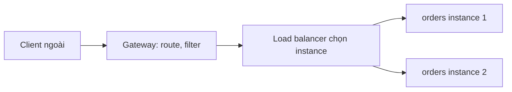
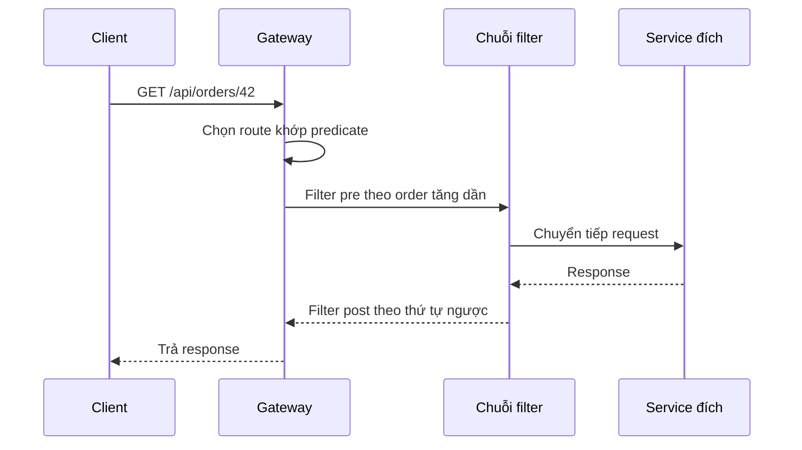
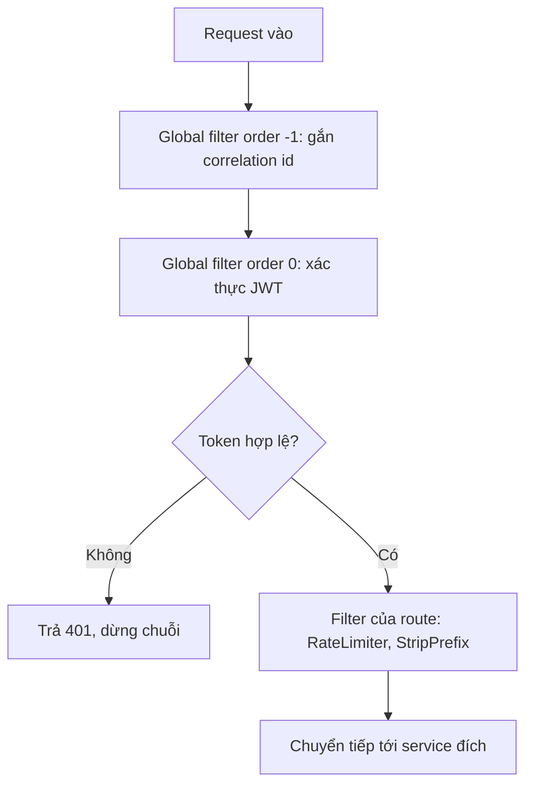
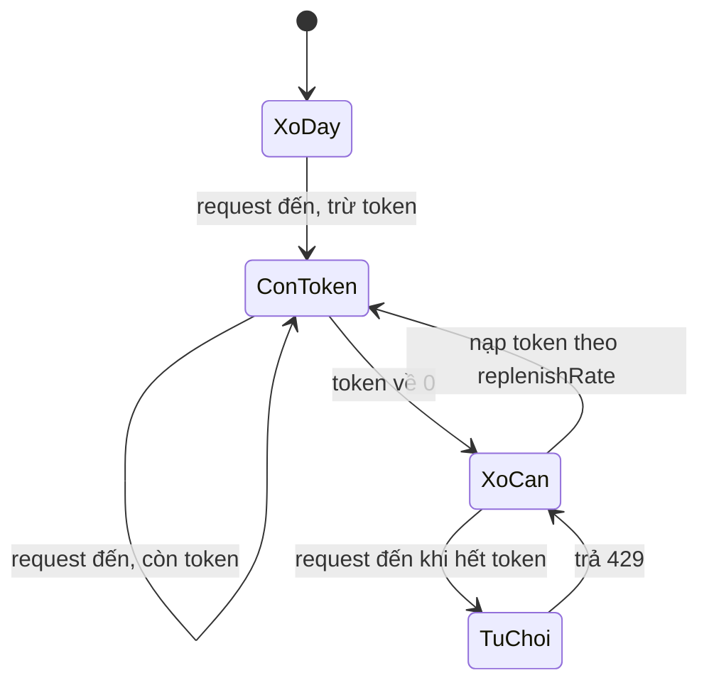
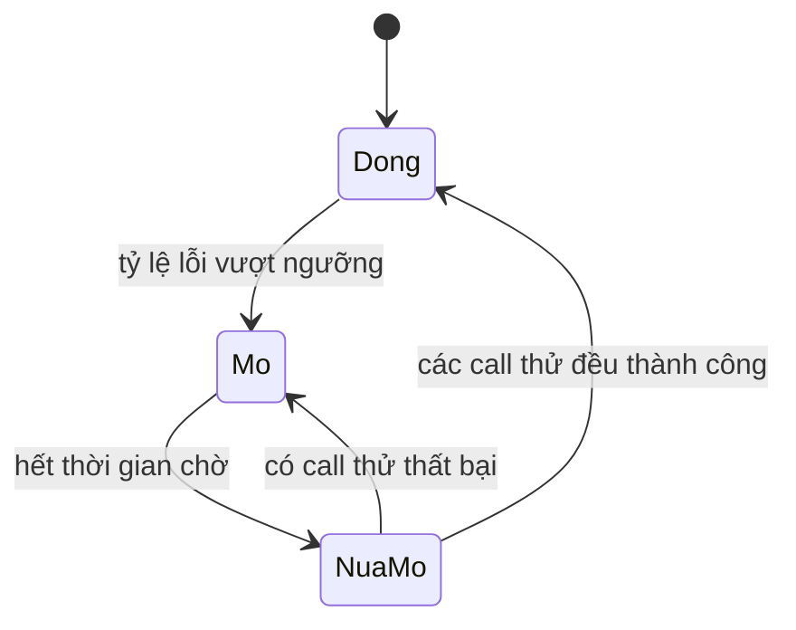
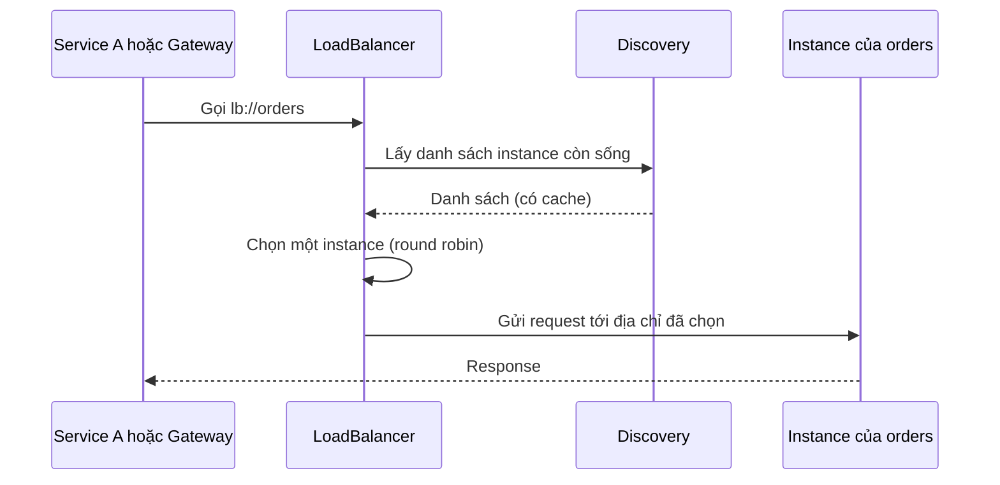
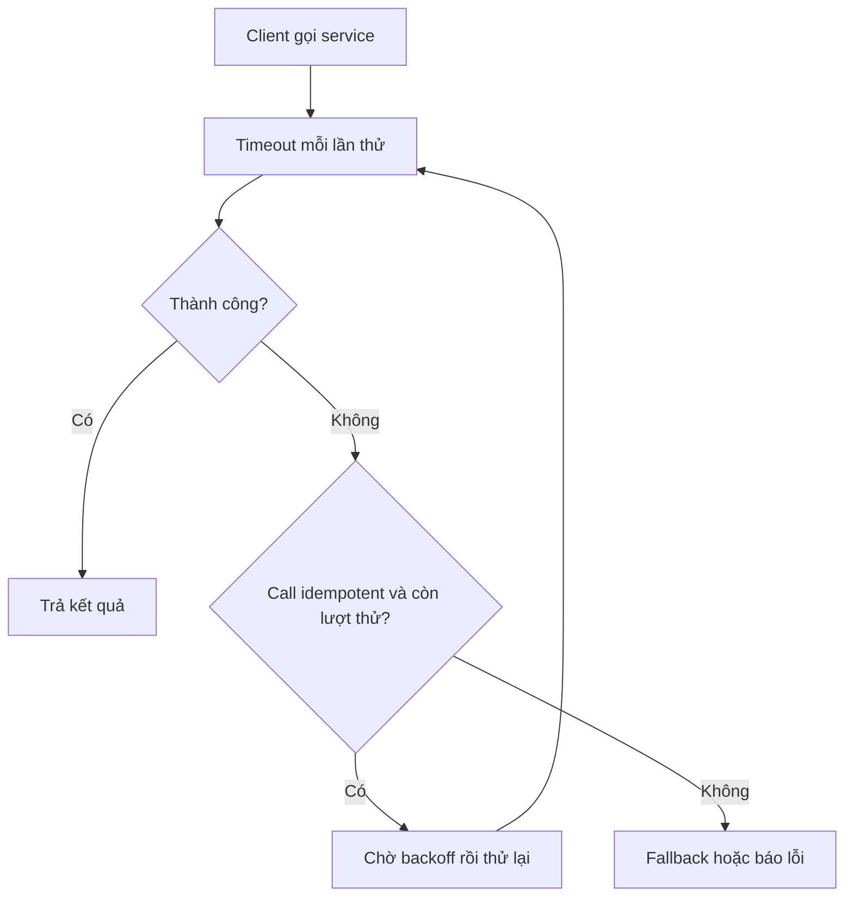

# Lý thuyết 46: Spring Cloud Gateway, OpenFeign và Load Balancer

Khi hệ thống tách thành nhiều service, hai câu hỏi xuất hiện ngay. Thứ nhất, client bên ngoài gọi vào đâu, và ai lo việc chung như xác thực, giới hạn tốc độ, CORS? Thứ hai, service A tìm và gọi service B thế nào khi B có nhiều instance đổi địa chỉ liên tục? Bài này trả lời bằng ba mảnh ghép: **API gateway** (cửa vào), **load balancer phía client** (chọn instance) và **HTTP client khai báo** (OpenFeign, `@HttpExchange`, `RestClient`).

> **Phiên bản (kiểm tra 2026-10-30):** Spring Boot 4.1 (Framework 7). Spring Cloud Gateway 5.0.4 là bản stable ghi trên tài liệu chính thức, 5.1.0-RC1 đang preview; Spring Cloud OpenFeign 5.0.4 stable. Bản ghép Boot 4.1 với release train Spring Cloud nào: kiểm tra lại theo bảng version mapping của Spring Cloud. Starter Gateway: `spring-cloud-starter-gateway-server-webflux` (đã xác nhận ở tài liệu 5.0.4). Key cấu hình đã đổi: bản mới dùng `spring.cloud.gateway.server.webflux.*`, bản 4.x cũ dùng `spring.cloud.gateway.*` (xem mục "Đổi tên key theo phiên bản"). Boot 3.5 đi với dòng Gateway 4.x.

**Cốt lõi:** Client bên ngoài không nên biết có bao nhiêu service, nằm ở đâu, và mỗi service không nên tự lặp lại xác thực, CORS, giới hạn tốc độ. Gateway là một reverse proxy đặt ở rìa: nhận request, chọn route theo predicate, chạy chuỗi filter rồi chuyển tiếp. Còn việc service gọi service thì cần tên logic thay cho địa chỉ cứng, và một bộ chọn instance chạy ngay trong process của client.

- Vì mọi request ngoài đi qua một điểm nên nên đặt các việc dùng chung (xác thực, rate limit, CORS, log) ở đó, và gateway cũng trở thành điểm lỗi và điểm nghẽn tiềm năng.
- Vì instance sinh ra và mất liên tục nên nên gọi bằng tên service (`lb://orders`) và để load balancer chọn instance từ danh sách do service discovery cung cấp.
- Vì mạng không đáng tin nên nên mọi call đi ra phải có timeout, và chỉ retry khi call an toàn để lặp lại (idempotent).



Mô hình tư duy: gateway quyết định request đi vào service nào, load balancer quyết định đi vào instance nào, còn client khai báo (Feign, `@HttpExchange`) chỉ là cách viết call gọn hơn trên cùng hai cơ chế đó.

**Tóm tắt:**

- Gateway là điểm vào duy nhất: gom xác thực, rate limit, CORS, routing, log để service phía sau không lặp lại.
- Một route gồm id, uri đích, predicate (khớp request nào) và filter (sửa request hoặc response); filter chạy theo thứ tự `order`, phần pre theo chiều đi vào và phần post theo chiều ngược lại.
- Rate limit ở gateway dùng `RequestRateLimiter` với token bucket; bản Redis cần Redis để mọi instance gateway chia sẻ đếm; không có `KeyResolver` tốt thì giới hạn sai đối tượng.
- Gọi service theo tên logic: service discovery (Eureka, hoặc Service của Kubernetes) cung cấp danh sách instance, Spring Cloud LoadBalancer chọn một cái ở phía client (mặc định round robin).
- Ba cách viết HTTP client: OpenFeign (feature-complete, chỉ sửa lỗi), HTTP Service interface `@HttpExchange` (chuẩn của Framework, hướng đi được khuyến nghị), `RestClient` (gọi tay, linh hoạt nhất).
- Timeout phải đặt ở mọi tầng và tầng ngoài phải lớn hơn tổng tầng trong; nếu không, tầng ngoài bỏ cuộc trong khi tầng trong còn retry.
- Chỉ retry method idempotent (GET, PUT, DELETE đúng nghĩa); retry POST không idempotent có thể tạo trùng đơn hàng.
- Gateway chạy trên WebFlux và Netty: không được chặn thread trong filter, và nó là điểm nghẽn nếu nhồi nghiệp vụ vào.

## Vấn đề nó giải quyết

Không có gateway, mỗi service phải tự xác thực token, tự cấu hình CORS, tự giới hạn tốc độ; client phải biết địa chỉ từng service. Đổi địa chỉ hay tách service là phá vỡ client. Không có load balancer, địa chỉ instance bị ghi cứng vào cấu hình, scale ngang hay thay instance là phải sửa tay. Không có client khai báo, mỗi lần gọi service khác là một khối code HTTP lặp lại, dễ quên timeout và xử lý lỗi.

## Khi nào dùng, khi nào không

Dùng gateway khi có nhiều service và nhiều loại client (web, mobile, đối tác) cần một mặt tiền thống nhất. Không dùng khi chỉ có một ứng dụng nguyên khối hoặc vài service: một reverse proxy như Nginx, Envoy hoặc Ingress của Kubernetes thường đủ và rẻ hơn. Gateway nên mỏng: chỉ làm việc ngang (xác thực, giới hạn, định tuyến, quan sát). Đừng đặt nghiệp vụ hay tổng hợp dữ liệu nặng ở đó, vì nó sẽ thành điểm nghẽn và điểm thay đổi của mọi đội.

Nếu chạy trên Kubernetes, thường không cần Eureka: Service của Kubernetes đã cân bằng tải ở tầng mạng và cho tên DNS ổn định. Client-side load balancing chỉ cần khi bạn muốn chọn instance trong ứng dụng (ví dụ ưu tiên cùng zone, hoặc gọi trực tiếp từng pod).

## Các khái niệm cần biết

| Khái niệm | Ý nghĩa |
|---|---|
| **Route** | Một quy tắc định tuyến: id, `uri` đích, danh sách predicate, danh sách filter. |
| **Predicate** | Điều kiện khớp request (path, host, method, header, thời gian...). Mọi predicate của route phải đúng thì route mới được chọn. |
| **GatewayFilter** | Filter gắn vào một route, sửa request trước khi gửi đi hoặc response trước khi trả về. |
| **GlobalFilter** | Filter áp cho mọi route, viết bằng code (ví dụ xác thực, log). |
| **`lb://tên`** | Scheme đặc biệt trong `uri`: chọn instance của service `tên` qua load balancer. |
| **Service discovery** | Nơi lưu danh sách instance còn sống của mỗi service (Eureka, Consul, Kubernetes). |
| **Spring Cloud LoadBalancer** | Bộ cân bằng tải phía client; mặc định round robin. |
| **Token bucket** | Thuật toán rate limit: xô đầy dần theo tốc độ cố định, mỗi request lấy token, hết token thì bị từ chối. |
| **Idempotent** | Gọi lặp lại nhiều lần cho cùng kết quả như gọi một lần; điều kiện để retry an toàn. |
| **`@HttpExchange`** | Annotation của Spring Framework để khai báo HTTP client bằng interface. |

## Mô hình route, predicate, filter

Một request vào gateway đi qua ba bước: tìm route khớp (handler mapping), chạy chuỗi filter, rồi chuyển tiếp tới `uri` đích. Mỗi filter chạy hai nửa: phần pre trước khi gửi đi, phần post sau khi nhận response.



Cách đọc: filter xếp như hành lang một chiều đi vào rồi đi ra, giống bài [AOP và Proxy](/go?p=01-Spring-Boot%2Fmedium%2Flt-13-aop-proxy.md): filter có `order` nhỏ nằm ngoài cùng, chạy pre sớm nhất và post muộn nhất. Một filter có thể dừng chuỗi (trả 401 mà không gọi tiếp) bằng cách không gọi `chain.filter(...)`.

**Nền tảng:** Gateway là một chuỗi xử lý có thứ tự, không phải một bảng định tuyến tĩnh. Route chỉ chọn "đi đâu"; mọi hành vi (xác thực, ghi header, rate limit) nằm ở filter. Hiểu thứ tự filter là hiểu vì sao cùng một cấu hình có thể chạy đúng hay sai.

Ví dụ cấu hình YAML cho dòng 5.0 (key mới). _Minh họa_ (chưa chạy thử):

```yaml
spring:
  cloud:
    gateway:
      server:
        webflux:
          routes:
            - id: orders
              uri: lb://orders            # chọn instance qua load balancer
              predicates:
                - Path=/api/orders/**
                - Method=GET,POST
              filters:
                - StripPrefix=1           # bỏ "/api" trước khi chuyển tiếp
                - name: CircuitBreaker
                  args:
                    name: ordersCb
                    fallbackUri: forward:/fallback/orders
          httpclient:
            connect-timeout: 1000         # ms
            response-timeout: 3s
```

### Đổi tên key theo phiên bản

Tài liệu Gateway 5.0.4 dùng prefix `spring.cloud.gateway.server.webflux.*` cho cấu hình của bản WebFlux, và starter `spring-cloud-starter-gateway-server-webflux`. Cách đặt tên này đi cùng việc Gateway tách thành các biến thể (Server WebFlux, Server Web MVC, Proxy Exchange). Tài liệu 5.0.4 cũng ghi thuộc tính bật tắt chung `spring.cloud.gateway.enabled` và thuộc tính cho rate limiter `spring.cloud.gateway.filter.request-rate-limiter.deny-empty-key` (prefix này không có `server.webflux`, đúng như tài liệu hiện ghi).

| Dòng | Starter | Prefix route và httpclient |
|---|---|---|
| Gateway 5.0.x (Boot 4) | `spring-cloud-starter-gateway-server-webflux` | `spring.cloud.gateway.server.webflux.*` |
| Gateway 4.2.x trở xuống (Boot 3.x) | `spring-cloud-starter-gateway` | `spring.cloud.gateway.*` |
| Gateway 4.3.x | cả hai tên có thể tồn tại, tên cũ ở trạng thái chuyển tiếp | kiểm tra lại theo phiên bản |

Đây là điểm dễ nhầm khi nâng cấp: giữ key cũ thì route không nạp mà thường không có lỗi rõ ràng, chỉ là mọi request trả 404. Trước khi nâng, đối chiếu trang "Configuration properties" của đúng phiên bản. Gateway cũng có biến thể Server Web MVC (starter riêng) cho ai muốn chạy trên Servlet; bài này tập trung WebFlux vì đó là biến thể truyền thống và có tài liệu đầy đủ nhất.

## Global filter và thứ tự filter

`GlobalFilter` áp cho mọi route và thường dùng cho việc ngang: xác thực, gắn correlation id, log. Thứ tự do `Ordered` (hoặc `@Order`) quyết định: số nhỏ chạy pre sớm hơn và post muộn hơn.



Cách đọc: xác thực nên đứng trước rate limit theo user (vì khóa giới hạn lấy từ danh tính), còn correlation id nên đứng ngoài cùng để mọi log phía sau có nó. Nếu đặt `order` sai, rate limiter chạy trước khi biết user và rơi về khóa rỗng.

```java
// _Minh họa_ (chưa chạy thử)
@Component
public class AuthGlobalFilter implements GlobalFilter, Ordered {

    @Override
    public Mono<Void> filter(ServerWebExchange exchange, GatewayFilterChain chain) {
        String auth = exchange.getRequest().getHeaders().getFirst(HttpHeaders.AUTHORIZATION);
        if (auth == null || !auth.startsWith("Bearer ")) {
            exchange.getResponse().setStatusCode(HttpStatus.UNAUTHORIZED);
            return exchange.getResponse().setComplete();   // dừng chuỗi
        }
        return chain.filter(exchange);   // đi tiếp, không chặn thread
    }

    @Override
    public int getOrder() { return 0; }
}
```

Trong thực tế bạn thường dùng Spring Security cho WebFlux ở gateway (xem [Microservices và Spring Cloud](/go?p=01-Spring-Boot%2Fhard%2Flt-08-microservices-spring-cloud.md)) thay vì tự kiểm tra header. Điểm cần nhớ là filter chạy trên event loop của Netty: không được gọi code chặn (JDBC, `RestTemplate`, `Thread.sleep`) trong đó, vì một lời gọi chặn làm đứng cả luồng phục vụ nhiều kết nối khác.

**Phải thuộc:** `GatewayFilter` gắn vào route, `GlobalFilter` áp cho mọi route; thứ tự theo `order` (nhỏ chạy pre trước, post sau cùng); Gateway chạy trên Netty và WebFlux, không chạy trong Servlet container hay đóng WAR; không được chặn thread trong filter.

## Rate limiting với Redis

`RequestRateLimiter` quyết định request có được đi tiếp không; nếu không, trả `429 Too Many Requests` (mặc định). Bản Redis dùng token bucket và cần starter `spring-boot-starter-data-redis-reactive` theo tài liệu 5.0.4. Ba tham số: `replenishRate` (token nạp mỗi giây), `burstCapacity` (sức chứa xô), `requestedTokens` (mỗi request tốn bao nhiêu, mặc định 1).



Cách đọc: xô nạp đều theo thời gian. Request đến lấy token; hết token thì bị từ chối cho tới khi xô nạp lại. `burstCapacity` lớn hơn `replenishRate` cho phép dồn một đợt đột biến ngắn, rồi phải chờ. Đặt hai giá trị bằng nhau cho tốc độ ổn định.

Vì sao cần Redis: nếu có nhiều instance gateway, mỗi instance tự đếm trong bộ nhớ thì giới hạn thực tế nhân lên theo số instance. Redis là nơi chung để mọi instance cùng trừ một xô. Khóa của xô do `KeyResolver` trả về (theo user, IP, API key). Mặc định nếu không tìm được khóa thì request bị từ chối, và hành vi này đổi được bằng thuộc tính `deny-empty-key`. Lưu ý: tài liệu ghi rõ filter này không cấu hình được bằng cú pháp shortcut, phải dùng dạng `name` và `args`.

```java
// _Minh họa_ (chưa chạy thử): khóa theo user đã xác thực, rơi về IP
@Bean
KeyResolver userKeyResolver() {
    return exchange -> exchange.getPrincipal()
        .map(Principal::getName)
        .switchIfEmpty(Mono.fromSupplier(() ->
            exchange.getRequest().getRemoteAddress().getAddress().getHostAddress()));
}
```

Đánh đổi cần biết: Redis thành phụ thuộc trên đường đi của mọi request. Khi Redis chậm hay chết, hành vi tùy cấu hình. Hãy quyết định trước bạn muốn "mở" (cho qua) hay "đóng" (chặn) khi mất bộ đếm, và đo độ trễ Redis. Ngoài ra, tài liệu có thêm bản Bucket4j cho ai không muốn dùng Redis.

## Circuit breaker ở gateway

Gateway có filter `CircuitBreaker` bọc call tới service đích. Khi service đích lỗi hoặc chậm quá ngưỡng, mạch mở và gateway trả về ngay một `fallbackUri` (ví dụ `forward:/fallback/orders`) thay vì dồn thêm request vào service đang yếu. Triển khai thực tế thường dùng Resilience4j qua Spring Cloud Circuit Breaker. Chi tiết về circuit breaker, bulkhead, retry xem [Resilience và chịu lỗi](/go?p=01-Spring-Boot%2Fhard%2Flt-32-resilience-chiu-loi.md).



Cách đọc: khi Đóng, request đi qua bình thường. Khi Mở, gateway từ chối ngay và trả fallback, không gọi service. Sau một khoảng chờ, Nửa mở cho vài call thử; thành công thì quay về Đóng, thất bại thì Mở lại. Fallback nên trả thứ tối thiểu và trung thực (503 kèm thông báo, hoặc dữ liệu cache), đừng trả dữ liệu giả trông như thật.

**Suy luận:** Vì sao đặt circuit breaker ở gateway mà không chỉ ở từng service? Gateway thấy mọi lưu lượng vào một service và có thể ngắt từ ngoài, bảo vệ service đang quá tải khỏi bị dồn thêm. Nhưng gateway không hiểu nghiệp vụ nên fallback ở đây chỉ nên là thông báo chung. Fallback có ý nghĩa nghiệp vụ (ví dụ dùng giá cache khi dịch vụ giá chết) đặt ở service gọi trực tiếp thì đúng chỗ hơn. Hai tầng bổ sung cho nhau, không thay thế nhau. Hệ quả khi thiết kế: đừng cấu hình retry và circuit breaker chồng nhau mà không tính, vì retry làm tăng số call lỗi và mạch mở sớm hơn bạn nghĩ.

## Service discovery và client-side load balancing

Khi gọi `lb://orders`, gateway (hoặc một HTTP client có tích hợp) hỏi `ServiceInstanceListSupplier` danh sách instance của `orders`, rồi `ReactorLoadBalancer` chọn một cái. Danh sách đến từ service discovery.



Cách đọc: LoadBalancer không tự biết instance; nó tin danh sách của discovery, thường được cache nên có thể cũ vài giây. Vì vậy một instance vừa chết vẫn có thể bị chọn. Đây là lý do cần timeout ngắn cộng retry sang instance khác (cho call an toàn), chứ không thể coi cân bằng tải là đủ.

| Lựa chọn discovery | Khi dùng | Ghi chú |
|---|---|---|
| Eureka (`spring-cloud-starter-netflix-eureka-client`) | Chạy ngoài Kubernetes, hoặc cần registry riêng | Phải vận hành server Eureka; instance đăng ký và gửi heartbeat |
| Kubernetes Service | Chạy trên Kubernetes | Gọi `http://orders` qua DNS; kube-proxy cân bằng ở tầng mạng, không cần Eureka |
| Spring Cloud Kubernetes discovery | Cần client-side balancing trên Kubernetes | Đọc danh sách endpoint từ API Kubernetes; cần quyền RBAC |

**Nền tảng:** Server-side load balancing (Nginx, Service của Kubernetes) đặt bộ cân bằng ở giữa; client-side load balancing đặt nó trong client. Cái thứ hai bớt một hop và cho phép chiến lược tinh hơn, nhưng mỗi client phải mang logic và danh sách instance. Trên Kubernetes, mặc định nên dùng Service và bỏ qua Eureka trừ khi có lý do rõ ràng.

## OpenFeign, HTTP Service interface và RestClient

Cả ba đều gọi HTTP, khác nhau ở mức trừu tượng và hướng phát triển. Tài liệu Spring Cloud OpenFeign 5.0.4 ghi rõ dự án ở trạng thái feature-complete (chỉ sửa lỗi, có thể nhận vài PR nhỏ từ cộng đồng) và khuyên chuyển sang Spring HTTP Service Clients. Xem [HTTP client và RestClient](/go?p=01-Spring-Boot%2Fmedium%2Flt-36-http-client-restclient.md) cho nền của `RestClient` và `@HttpExchange`.

| | OpenFeign | `@HttpExchange` (HTTP Service interface) | `RestClient` |
|---|---|---|---|
| Cách viết | Interface với `@FeignClient` và annotation Spring MVC | Interface với `@HttpExchange`, `@GetExchange`... | Gọi tay bằng fluent API |
| Tích hợp load balancer, discovery | Có sẵn (starter của Spring Cloud) | Cần cấu hình thêm; kiểm tra lại theo phiên bản | Cần cấu hình thêm |
| Hướng phát triển | Feature-complete | Hướng được khuyến nghị | Nền chung bên dưới |
| Dùng khi | Dự án sẵn có đã dùng Feign | Dự án mới, muốn khai báo gọn | Cần kiểm soát từng call, ít endpoint |

Quy tắc chọn gọn: dự án mới nên dùng `@HttpExchange` trên nền `RestClient`; dự án cũ đang dùng Feign thì giữ, đừng viết lại chỉ vì "mới hơn"; chỉ có một hai call lẻ thì dùng `RestClient` thẳng. `@HttpExchange` là lớp mỏng, nên mọi timeout, status handler, interceptor đặt ở `RestClient` bên dưới. Cấu hình client qua properties (`spring.http.serviceclient.<nhóm>.*`) có ở Boot 4; tên chính xác và các thuộc tính: kiểm tra lại theo phiên bản.

```java
// _Minh họa_ (chưa chạy thử): Feign
@FeignClient(name = "orders")             // tên service trong discovery
public interface OrderClient {
    @GetMapping("/orders/{id}")
    OrderDto get(@PathVariable("id") long id);
}
// Bật bằng @EnableFeignClients; starter: spring-cloud-starter-openfeign
```

```java
// _Minh họa_ (chưa chạy thử): HTTP Service interface
@HttpExchange("/orders")
public interface OrderApi {
    @GetExchange("/{id}")
    OrderDto get(@PathVariable long id);
}
// Đăng ký bằng @ImportHttpServices hoặc tạo proxy từ HttpServiceProxyFactory
```

## Timeout, retry và fallback

Ba thứ này phải thiết kế cùng nhau. Timeout giới hạn thời gian chờ; retry thử lại khi lỗi tạm thời; fallback cho kết quả thay thế khi thử mãi không được.



Cách đọc: mỗi lần thử có timeout riêng. Chỉ nhánh "idempotent và còn lượt" mới quay lại thử; mọi nhánh còn lại đi ra fallback hoặc lỗi. Tổng thời gian tối đa là số lần thử nhân timeout cộng thời gian backoff, và con số này phải nhỏ hơn timeout của tầng ngoài.

**Phải thuộc:** timeout chồng timeout: tổng thời gian tầng trong (số lần thử nhân timeout mỗi lần, cộng backoff) phải nhỏ hơn timeout tầng ngoài. Trong Feign có hai timeout: connect và read, cấu hình theo client qua `spring.cloud.openfeign.client.config.<tên>.connect-timeout` và `read-timeout`; mặc định retry của Spring Cloud OpenFeign là không retry (`Retryer.NEVER_RETRY`), còn giá trị timeout mặc định của chính Feign lớn (kiểm tra lại theo phiên bản). Ở gateway, `httpclient.connect-timeout` và `response-timeout` đặt toàn cục, và ghi đè được theo route bằng metadata.

Ví dụ bẫy "timeout chồng timeout": gateway có `response-timeout` 3 giây, service A gọi B với read timeout 5 giây và retry 3 lần. Gateway bỏ cuộc sau 3 giây và trả 504 cho client, nhưng A vẫn tiếp tục gọi B (và có thể đã ghi dữ liệu). Client thấy lỗi và bấm thử lại, tạo thêm một chuỗi call nữa. Cách sửa: tính ngược từ ngoài vào, tầng ngoài lớn hơn tổng tầng trong, và giảm số lần retry ở tầng sâu.

Retry chỉ an toàn với call idempotent. GET, PUT, DELETE đúng nghĩa thì lặp lại không đổi kết quả. POST tạo đơn hàng thì không: nếu request đã tới server và server đã ghi nhưng response bị mất trên đường về, retry sẽ tạo bản ghi thứ hai. Muốn retry POST phải có khóa idempotency (client gửi một `Idempotency-Key`, server nhớ và trả lại kết quả cũ). Filter `Retry` của gateway chỉ retry method GET theo mặc định, đúng vì lý do này; hãy kiểm tra lại cấu hình `methods` và `statuses` theo tài liệu phiên bản bạn dùng.

## Bẫy thường gặp

| Bẫy | Nguyên nhân | Cách xử lý |
|---|---|---|
| Gateway thành điểm nghẽn | Nhồi nghiệp vụ, tổng hợp dữ liệu, code chặn vào filter | Giữ gateway mỏng; không chặn thread; scale ngang nhiều instance |
| Nâng cấp xong route mất, trả 404 | Còn dùng key `spring.cloud.gateway.*` cũ trên bản mới | Đổi sang `spring.cloud.gateway.server.webflux.*` và đổi starter |
| Retry POST tạo trùng dữ liệu | Retry call không idempotent | Chỉ retry idempotent, hoặc dùng khóa idempotency |
| Timeout chồng timeout | Tầng ngoài ngắn hơn tổng tầng trong | Tính ngược từ ngoài vào; ghi bảng timeout cho từng hop |
| Rate limit sai đối tượng | `KeyResolver` mặc định lấy tên Principal, rỗng khi chưa xác thực nên bị từ chối | Viết `KeyResolver` có khóa dự phòng; đặt xác thực trước rate limit |
| Vẫn gọi vào instance đã chết | Danh sách discovery bị cache | Timeout ngắn, retry sang instance khác cho call an toàn, health check đúng |
| Gọi `lb://` không chạy | Thiếu starter load balancer hoặc discovery | Thêm `spring-cloud-starter-loadbalancer` và client discovery |
| Gateway đóng WAR chạy trên Tomcat | Gateway WebFlux cần Netty | Chạy như ứng dụng Boot độc lập, hoặc dùng biến thể Server Web MVC |

## Phỏng vấn khó: chuỗi hỏi xoáy

### Chuỗi 1: Vì sao cần gateway và nó khác gì reverse proxy

1. **Câu mở:** Hệ thống có 12 service. Vì sao nên có API gateway?
2. **Xoáy 1:** Gateway khác Nginx hay Ingress ở chỗ nào, và khi nào nên chọn cái nào?
3. **Xoáy 2:** Gateway có phải là điểm lỗi duy nhất không, bạn giảm rủi ro đó thế nào?

**Đáp án ngắn:** Gateway là điểm vào duy nhất, gom việc ngang như xác thực, rate limit, CORS, định tuyến và quan sát để 12 service không lặp lại và client không cần biết topology. Cơ chế là chuỗi route, predicate, filter: route chọn đích, filter làm mọi việc còn lại, chạy theo `order`. Nginx hoặc Ingress cũng là reverse proxy; khác biệt là Spring Cloud Gateway viết logic bằng Java, dùng chung Spring Security và hệ sinh thái, còn Ingress mạnh ở hiệu năng và vận hành sẵn trên Kubernetes. Nếu chỉ cần định tuyến và TLS thì Ingress đủ; cần logic tùy biến (token relay, rate limit theo user, tổng hợp nhẹ) thì Gateway hợp hơn. Về rủi ro, gateway là điểm lỗi tiềm năng và điểm nghẽn, nên chạy nhiều instance phía sau một load balancer, giữ nó stateless, giữ nó mỏng và không đặt nghiệp vụ. Trong production cần health check, circuit breaker tới các service, timeout rõ ràng, và đo độ trễ riêng của gateway để biết nó có đang chậm không.

**Sai lầm hay gặp:**
- Nói gateway giải quyết xác thực của service: nó chỉ chặn ngoài rìa, service vẫn nên kiểm tra quyền của chính nó.
- Nhét nghiệp vụ và tổng hợp dữ liệu nặng vào gateway.
- Quên rằng gateway chạy trên Netty nên không được chặn thread.

### Chuỗi 2: Load balancing và discovery

1. **Câu mở:** Service A gọi `http://orders` mà orders có 5 instance. Instance nào được chọn và ai chọn?
2. **Xoáy 1:** Eureka và Service của Kubernetes khác nhau thế nào, vì sao trên Kubernetes thường bỏ Eureka?
3. **Xoáy 2:** Một instance vừa chết nhưng vẫn nhận request. Vì sao, và bạn giảm tác hại thế nào?

**Đáp án ngắn:** Với client-side load balancing, Spring Cloud LoadBalancer chạy trong A: nó lấy danh sách instance từ discovery rồi chọn một cái theo chiến lược, mặc định round robin. Với server-side, bộ cân bằng nằm giữa (Nginx, hoặc kube-proxy của Kubernetes) và A chỉ gọi một tên ổn định. Eureka là registry riêng, instance tự đăng ký và gửi heartbeat; còn Kubernetes đã có Service và DNS, nên thêm Eureka là thêm một thành phần phải vận hành mà không thêm giá trị. Danh sách instance bị cache ở cả server discovery lẫn client, nên instance vừa chết vẫn xuất hiện trong khoảng thời gian cache và heartbeat hết hạn. Giảm tác hại bằng timeout kết nối ngắn, retry sang instance khác cho call idempotent, readiness probe đúng để loại instance ra khỏi danh sách nhanh, và graceful shutdown để instance báo ngừng trước khi tắt. Đánh đổi: client-side bớt một hop và chọn được theo zone, nhưng mọi client phải mang logic và danh sách.

**Sai lầm hay gặp:**
- Nói load balancer biết ngay instance nào chết.
- Dùng Eureka trên Kubernetes chỉ vì "microservices thì phải có Eureka".
- Quên rằng retry sang instance khác chỉ an toàn với call idempotent.

### Chuỗi 3: Timeout, retry và Feign

1. **Câu mở:** Bạn chọn OpenFeign, `@HttpExchange` hay `RestClient` cho dự án mới, vì sao?
2. **Xoáy 1:** Gateway timeout 3 giây, A gọi B timeout 5 giây retry 3 lần. Chuyện gì xảy ra khi B chậm?
3. **Xoáy 2:** Vì sao không nên retry POST, và làm sao retry an toàn khi bắt buộc?

**Đáp án ngắn:** Dự án mới nên dùng `@HttpExchange` trên nền `RestClient`, vì tài liệu OpenFeign ghi dự án feature-complete và khuyên chuyển sang Spring HTTP Service Clients; dự án đang dùng Feign thì giữ, còn vài call lẻ thì dùng `RestClient` thẳng. Với số liệu đã cho, gateway bỏ cuộc sau 3 giây và trả 504, nhưng A vẫn tiếp tục gọi B tới 3 lần mỗi lần 5 giây, nên thread và kết nối của A bị giữ dù client đã nhận lỗi, và client thường bấm thử lại làm tải nhân lên. Nguyên tắc là timeout tầng ngoài phải lớn hơn tổng tầng trong, tính cả backoff. Retry POST không idempotent có thể tạo bản ghi trùng khi request đã được xử lý nhưng response bị mất. Muốn retry an toàn, dùng khóa idempotency: client gửi `Idempotency-Key`, server lưu kết quả theo khóa và trả lại khi gặp lại. Trong production, kết hợp circuit breaker để khi downstream yếu thì ngừng retry thay vì khuếch đại tải, và đo tỷ lệ retry như một chỉ số.

**Sai lầm hay gặp:**
- Chọn Feign hay `@HttpExchange` chỉ vì "mới hơn" mà không xét tích hợp sẵn có.
- Đặt retry ở cả Feign, gateway và service gọi, nhân số lần thử lên theo cấp số nhân.
- Nghĩ rằng timeout của tầng ngoài hủy được công việc đang chạy ở tầng trong.

## Câu hỏi tự kiểm tra

1. Sau khi nâng cấp Gateway lên dòng 5.0, mọi route trả 404 dù YAML không đổi. Nguyên nhân khả dĩ nhất là gì?

   **Gợi ý suy luận:**
   - Route được nạp từ key cấu hình nào, và key đó đã đổi gì?
   - Một key không còn được đọc có báo lỗi không?

   **Lập luận và đáp án:** bản mới đọc route từ `spring.cloud.gateway.server.webflux.routes` và dùng starter `spring-cloud-starter-gateway-server-webflux`. Key cũ `spring.cloud.gateway.routes` không còn được đọc nên không có route nào, mọi request không khớp và trả 404, và thường không có lỗi khởi động. Sửa bằng cách đổi prefix và đối chiếu trang cấu hình của đúng phiên bản.

2. Gateway có hai instance, rate limit cấu hình 10 request mỗi giây theo user nhưng không dùng Redis. User thực tế gửi được khoảng bao nhiêu?

   **Gợi ý suy luận:**
   - Bộ đếm nằm ở đâu nếu không có kho chung?
   - Load balancer phía trước chia request cho mấy instance?

   **Lập luận và đáp án:** mỗi instance giữ xô riêng trong bộ nhớ nên user có thể đạt tới khoảng 10 nhân với số instance, tức khoảng 20 mỗi giây. Giới hạn đúng cần kho chung: dùng bản Redis để cả hai instance cùng trừ một xô.

3. A gọi B bằng Feign, B chậm. Gateway timeout 3 giây, Feign read timeout 5 giây và có retry 3 lần. Client nhận 504 nhưng B vẫn thấy nhiều request. Giải thích và sửa.

   **Gợi ý suy luận:**
   - Ai bỏ cuộc trước, và việc bỏ cuộc đó có dừng được tầng trong không?
   - Tổng thời gian tối đa của tầng trong là bao nhiêu?

   **Lập luận và đáp án:** gateway bỏ cuộc ở giây thứ 3 nhưng A không biết, nên vẫn thử tới tối đa 3 lần, mỗi lần chờ 5 giây. Tổng tầng trong vượt xa timeout tầng ngoài, và client thử lại sinh thêm tải. Sửa bằng cách đặt timeout tầng trong nhỏ hơn tầng ngoài, giảm retry hoặc chỉ retry call idempotent, thêm circuit breaker để ngừng gọi B khi nó yếu.

4. Một đồng nghiệp bật retry cho mọi call của Feign client, trong đó có `POST /payments`. Rủi ro là gì và bạn đề xuất gì?

   **Gợi ý suy luận:**
   - Nếu server đã xử lý xong nhưng response bị mất, client thấy gì?
   - Làm sao server nhận ra đây là call lặp?

   **Lập luận và đáp án:** client thấy lỗi mạng nên thử lại, trong khi server đã ghi thanh toán lần đầu, kết quả là trừ tiền hai lần. Đề xuất: không retry POST mặc định; nếu cần thì thêm `Idempotency-Key` do client sinh, server lưu kết quả theo khóa và trả lại khi gặp khóa đã có.

Nguồn: tài liệu chính thức Spring Cloud Gateway 5.0.4 (trang starter, configuration properties, RequestRateLimiter), Spring Cloud OpenFeign 5.0.4 (trang giới thiệu, ghi chú feature-complete), kiểm tra ngày 2026-10-30. Chưa kiểm chứng từ tài liệu: bản release train Spring Cloud ghép với Boot 4.1, tên thuộc tính `spring.http.serviceclient.*`, mặc định timeout của Feign, tích hợp load balancer với `@HttpExchange`; các điểm này ghi "kiểm tra lại theo phiên bản". Code là _Minh họa_, chưa chạy thử.

