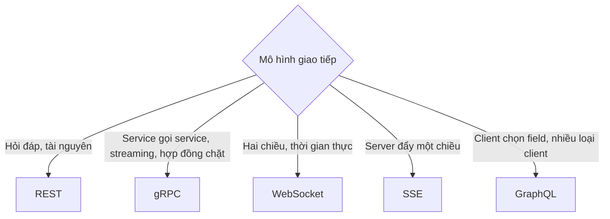
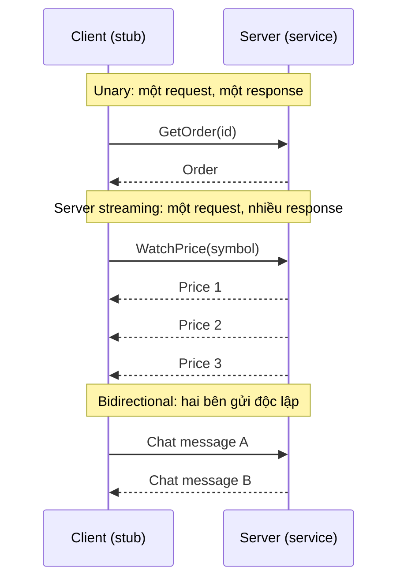
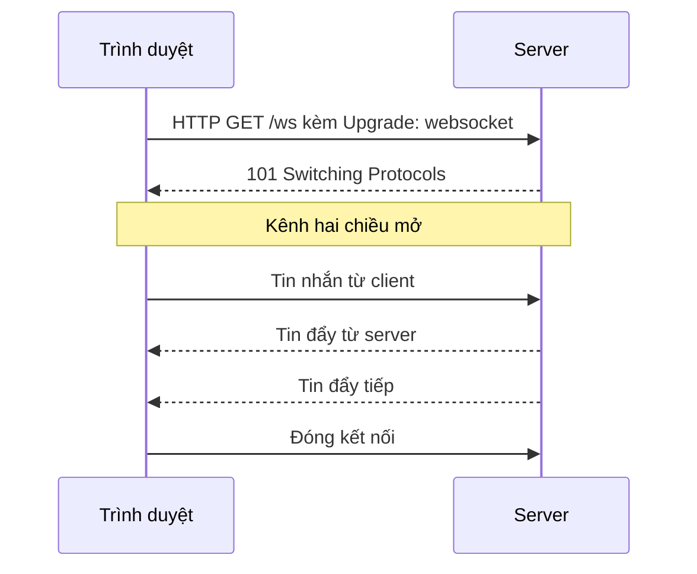
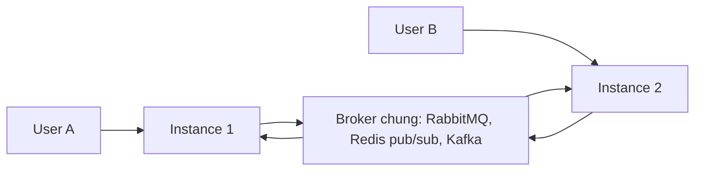
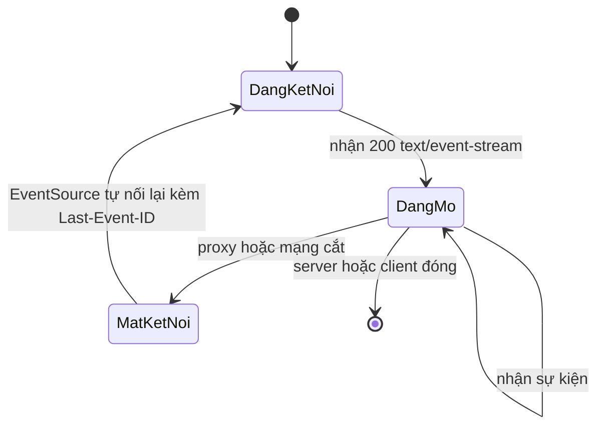
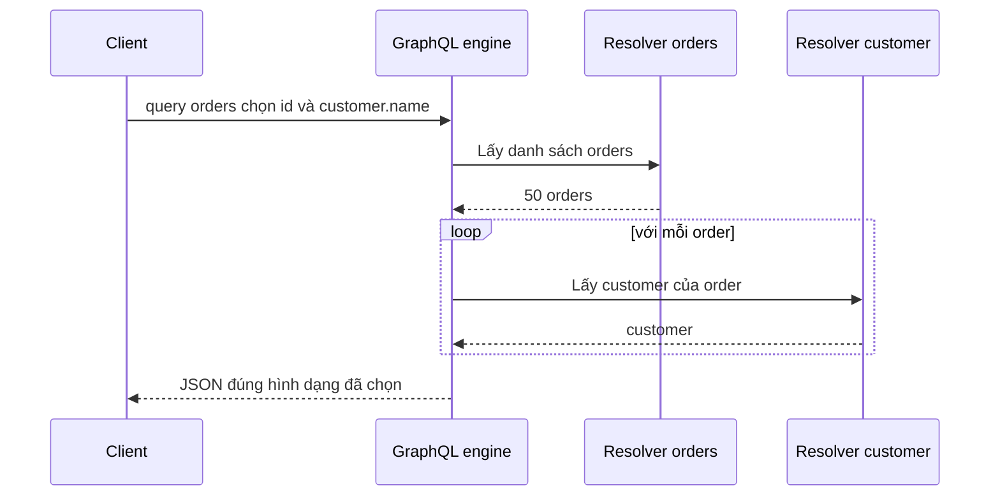
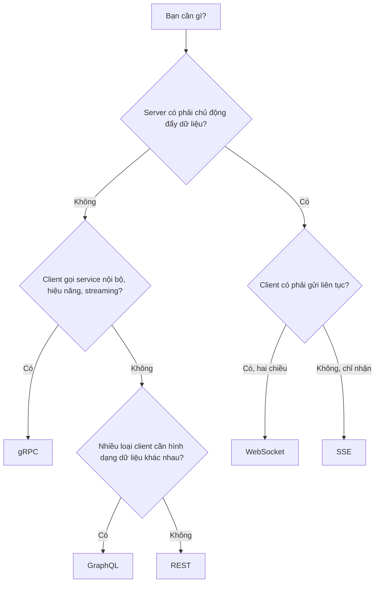

# Lý thuyết 47: Các giao thức giao tiếp khác (gRPC, WebSocket, SSE, GraphQL)

REST trên HTTP/JSON là lựa chọn mặc định, nhưng không phải lúc nào cũng vừa. Service gọi service với lưu lượng lớn cần hợp đồng chặt và nhẹ. Dashboard cần server đẩy dữ liệu xuống liên tục. Chat cần hai chiều. Mobile cần lấy đúng vài field thay vì cả object. Bài này giải thích bản chất bốn giao thức thay thế (gRPC, WebSocket, SSE, GraphQL), cách chọn giữa chúng và REST, và cách Spring hỗ trợ từng cái, kèm các bẫy hay gặp ở production.

> **Phiên bản (kiểm tra 2026-10-30):** Spring Boot 4.1 (Framework 7). Tài liệu Boot 4.1 (trang `io/grpc`, bản 4.1.2) xác nhận Boot có các module `spring-boot-grpc-server`, `spring-boot-grpc-client`, `spring-boot-grpc-test` và các starter `spring-boot-starter-grpc-server`, `spring-boot-starter-grpc-client`, `spring-boot-starter-grpc-server-test`, `spring-boot-starter-grpc-client-test`; phần cài đặt bên dưới là dự án Spring gRPC 1.1.x (Spring gRPC 1.1.1 là stable trên trang tài liệu của nó). Boot 3.5 chưa có module gRPC này: dùng thư viện Spring gRPC hoặc starter bên thứ ba (kiểm tra lại theo phiên bản). WebSocket, SSE và GraphQL đã có từ Boot 3.x; tên starter GraphQL và WebSocket ở Boot 4: kiểm tra lại theo phiên bản.

**Cốt lõi:** Mỗi giao thức tồn tại vì REST yếu ở một mặt cụ thể. gRPC thay JSON bằng protobuf nhị phân trên HTTP/2 để có hợp đồng chặt và streaming; WebSocket nâng một kết nối HTTP thành kênh hai chiều lâu dài; SSE cho server đẩy một chiều qua HTTP thường; GraphQL cho client tự chọn field qua một endpoint duy nhất. Chọn đúng nghĩa là xác định mô hình giao tiếp (hỏi đáp, luồng, hai chiều) rồi mới chọn công nghệ.

- Vì gRPC dùng protobuf mã hóa theo số hiệu field nên số hiệu đó là hợp đồng thật: không được đổi hay tái dùng.
- Vì WebSocket giữ một kết nối lâu dài tới đúng một instance nên scale nhiều instance cần broker hoặc pub/sub để chuyển tin giữa các instance.
- Vì GraphQL chạy resolver cho từng field của từng object nên danh sách lồng nhau dễ gây N+1, cần batching.



Mô hình tư duy: bắt đầu từ hướng và hình dạng của luồng dữ liệu (một lần, một chiều, hai chiều, do client định hình), không bắt đầu từ công nghệ nào đang được ưa chuộng.

**Tóm tắt:**

- REST là mặc định: đơn giản, cache được, công cụ nhiều; chỉ rời nó khi có lý do đo được.
- gRPC chạy trên HTTP/2 với protobuf, có bốn kiểu gọi: unary, server streaming, client streaming, bidirectional streaming; mạnh cho service gọi service, yếu cho trình duyệt trực tiếp.
- Hợp đồng protobuf dựa vào số hiệu field: đổi hay tái dùng số hiệu làm vỡ tương thích; field bị bỏ phải `reserved`.
- WebSocket là kết nối song công lâu dài; nhiều instance cần broker (STOMP broker relay, Redis pub/sub, Kafka) để mọi người dùng nhận được tin.
- SSE là server đẩy một chiều trên HTTP thường, trình duyệt tự kết nối lại; hợp với thông báo, tiến độ, feed; dễ vướng timeout của proxy.
- GraphQL có một endpoint, client chọn field; giải quyết over-fetching nhưng sinh N+1, cache HTTP khó hơn và cần giới hạn độ sâu truy vấn.
- Chọn theo mô hình giao tiếp: hỏi đáp thì REST, streaming nội bộ thì gRPC, hai chiều thì WebSocket, đẩy một chiều thì SSE, client đa dạng thì GraphQL.
- Mọi giao thức đều cần timeout, xác thực, giới hạn kích thước và quan sát; đổi giao thức không miễn trừ các việc đó.

## Vấn đề nó giải quyết

REST khó xử lý bốn tình huống. Một, hợp đồng JSON lỏng lẻo và nặng khi hàng chục service gọi nhau hàng triệu lần mỗi ngày. Hai, server muốn chủ động báo cho client (thông báo, giá, tiến độ) mà HTTP request-response không cho server mở lời. Ba, cần hai chiều liên tục như chat hay game. Bốn, nhiều loại client (web, mobile, đối tác) cần các hình dạng dữ liệu khác nhau từ cùng một nguồn, nên hoặc dư dữ liệu (over-fetching) hoặc phải gọi nhiều lần (under-fetching). Mỗi giao thức trong bài giải một hoặc hai tình huống đó, và trả giá bằng độ phức tạp ở chỗ khác.

## Khi nào dùng, khi nào không

Dùng REST cho phần lớn API công khai và CRUD (xem [REST API thực chiến](/go?p=01-Spring-Boot%2Fmedium%2Flt-33-rest-api-thuc-chien.md)). Dùng gRPC cho giao tiếp nội bộ giữa các service, đặc biệt nhiều ngôn ngữ, cần streaming hoặc độ trễ thấp; tránh khi client là trình duyệt thường (cần thêm lớp chuyển đổi). Dùng WebSocket khi thật sự cần hai chiều và độ trễ thấp (chat, cộng tác, game); nếu chỉ cần server đẩy, SSE đơn giản hơn. Dùng SSE cho thông báo, tiến độ tác vụ, feed. Dùng GraphQL khi nhiều client cần hình dạng dữ liệu khác nhau và bạn chấp nhận gánh độ phức tạp ở server; không nên dùng chỉ để "hiện đại". Phía giao diện, cách nối với Vue hoặc React xem [Fullstack](/go?p=12-Fullstack%2Findex.md).

## Các khái niệm cần biết

| Khái niệm | Ý nghĩa |
|---|---|
| **Protobuf** | Định dạng nhị phân, schema trong file `.proto`, mã hóa theo số hiệu field. |
| **HTTP/2** | Nhiều luồng ghép trên một kết nối TCP; nền của gRPC. |
| **Unary, streaming** | Bốn kiểu gọi gRPC: một-một, server stream, client stream, hai chiều. |
| **Handshake Upgrade** | Request HTTP xin nâng kết nối lên WebSocket. |
| **STOMP** | Giao thức nhắn tin đơn giản chạy trên WebSocket, có destination và subscribe. |
| **Broker relay** | Chuyển tin STOMP sang một message broker ngoài (RabbitMQ, ActiveMQ) để nhiều instance dùng chung. |
| **SSE** | Server-Sent Events: response `text/event-stream` kéo dài, server đẩy từng sự kiện. |
| **Schema GraphQL** | Mô tả kiểu và truy vấn có thể gọi, có kiểm tra kiểu. |
| **DataLoader, `@BatchMapping`** | Gom nhiều lần tải con thành một lô để tránh N+1. |
| **Reserved field** | Khai báo số hiệu hoặc tên field protobuf đã bỏ, cấm tái dùng. |

## gRPC: HTTP/2, protobuf và bốn kiểu gọi

gRPC định nghĩa dịch vụ trong file `.proto`, sinh code client và server. Dữ liệu được mã hóa protobuf (nhị phân, gọn) và đi trên HTTP/2, nên nhiều call chạy song song trên một kết nối và hỗ trợ streaming tự nhiên.



Cách đọc: unary giống một hàm gọi từ xa. Server streaming dùng cho luồng dữ liệu một chiều xuống client. Client streaming (không vẽ ở đây) là client gửi nhiều mẩu rồi nhận một kết quả, ví dụ upload theo mảng. Bidirectional cho hai bên gửi và nhận độc lập trên cùng một call. Bốn kiểu: unary, server streaming, client streaming, bidirectional streaming.

```proto
// _Minh họa_ (chưa chạy thử)
syntax = "proto3";

service OrderService {
  rpc GetOrder (GetOrderRequest) returns (Order);                 // unary
  rpc WatchStatus (GetOrderRequest) returns (stream StatusEvent); // server streaming
}

message Order {
  reserved 3;               // số hiệu đã bỏ, không được dùng lại
  reserved "legacy_note";
  int64 id = 1;
  string customer = 2;
  string status = 4;
}
```

**Nền tảng:** Protobuf không gửi tên field trên đường truyền mà gửi **số hiệu field** cùng giá trị. Vì vậy số hiệu là hợp đồng thật. Client cũ và server mới vẫn nói chuyện được nếu chỉ thêm field mới với số hiệu mới, vì bên không biết số hiệu đó sẽ bỏ qua. Nhưng đổi số hiệu của field đang dùng, hoặc dùng lại số hiệu của field đã xóa với kiểu khác, làm bên kia đọc sai dữ liệu một cách âm thầm.

### Spring cho gRPC

Theo tài liệu Boot 4.1, server dùng `spring-boot-starter-grpc-server`: bean nào cài `BindableService` được tự động phơi ra thành gRPC server, và mọi lớp sinh từ `.proto` đều cài giao diện này. Annotation `@GrpcService` (gói `org.springframework.grpc.server.service`) đánh dấu bean. Mặc định dùng Netty và lắng nghe cổng 9090 (theo tài liệu). Phía client dùng `spring-boot-starter-grpc-client` và `@ImportGrpcClients` để nhập các stub; target là tên kênh logic hoặc địa chỉ, ví dụ cấu hình `spring.grpc.client.channel.<tên>.target=static://host:9090`. Kiểm thử dùng `@AutoConfigureTestGrpcTransport` để thay kênh thật bằng kênh trong tiến trình, không mở cổng mạng. Các thuộc tính server như `spring.grpc.server.port`, `spring.grpc.server.reflection.enabled`, `spring.grpc.server.health.enabled` có trong tài liệu.

```java
// _Minh họa_ (chưa chạy thử), theo mẫu trong tài liệu Boot 4.1
@GrpcService
public class OrderGrpcService extends OrderServiceGrpc.OrderServiceImplBase {

    @Override
    public void getOrder(GetOrderRequest req, StreamObserver<Order> out) {
        Order order = Order.newBuilder().setId(req.getId()).setCustomer("An").build();
        out.onNext(order);
        out.onCompleted();       // quên onCompleted thì client chờ mãi
    }
}

@SpringBootApplication
@ImportGrpcClients(target = "orders", types = OrderServiceGrpc.OrderServiceBlockingStub.class)
class ClientApp { }
```

Lưu ý: trang tài liệu có chỗ viết `spring.grpc.channel.<tên>` và chỗ viết `spring.grpc.client.channel.<tên>`; ví dụ cấu hình cụ thể dùng dạng sau, hãy kiểm tra lại theo phiên bản. gRPC còn cần deadline cho mỗi call phía client (không có thì call có thể treo vô hạn) và health check để load balancer biết instance khỏe.

**Phải thuộc:** gRPC = HTTP/2 + protobuf + hợp đồng `.proto`; bốn kiểu gọi (unary, server streaming, client streaming, bidirectional); số hiệu field không được đổi hay tái dùng, field đã bỏ thì `reserved`; thêm field mới với số hiệu mới là tương thích ngược.

## WebSocket: song công và STOMP

WebSocket bắt đầu bằng một request HTTP có header `Upgrade`. Server đồng ý, kết nối TCP đó chuyển thành kênh hai chiều lâu dài, hai bên gửi tin bất cứ lúc nào mà không cần request-response.



Cách đọc: sau mã `101`, giao thức không còn là HTTP; hai bên gửi frame độc lập. Kết nối giữ trong bộ nhớ của đúng một instance server, và đó là gốc của mọi vấn đề scale.

Spring hỗ trợ ở hai mức. Mức thấp là `WebSocketHandler` tự xử lý từng tin. Mức cao là STOMP qua `@EnableWebSocketMessageBroker`: client gửi tới destination như `/app/chat`, server xử lý bằng `@MessageMapping` rồi đẩy kết quả tới các destination như `/topic/room1` mà nhiều client đã subscribe. Starter thường dùng: `spring-boot-starter-websocket` (tên ở Boot 4: kiểm tra lại theo phiên bản).

```java
// _Minh họa_ (chưa chạy thử)
@Configuration
@EnableWebSocketMessageBroker
class WsConfig implements WebSocketMessageBrokerConfigurer {
    @Override public void registerStompEndpoints(StompEndpointRegistry r) {
        r.addEndpoint("/ws").setAllowedOrigins("https://app.example.com");
    }
    @Override public void configureMessageBroker(MessageBrokerRegistry r) {
        r.enableSimpleBroker("/topic");          // broker trong bộ nhớ, chỉ một instance
        r.setApplicationDestinationPrefixes("/app");
    }
}

@Controller
class ChatController {
    @MessageMapping("/chat")
    @SendTo("/topic/room1")
    ChatMessage handle(ChatMessage m) { return m; }
}
```

### Scale WebSocket nhiều instance

`enableSimpleBroker` giữ danh sách subscriber trong bộ nhớ một instance. Khi có hai instance, người dùng A nối vào instance 1 và người dùng B nối vào instance 2 sẽ không thấy tin của nhau.



Cách đọc: mọi instance publish và subscribe qua một broker chung; broker phát tin tới tất cả instance, mỗi instance chuyển cho các kết nối mà nó đang giữ. Với STOMP có thể dùng broker relay (`enableStompBrokerRelay`) tới RabbitMQ hoặc ActiveMQ; hoặc tự xây trên Redis pub/sub hay Kafka (xem bài Kafka trong thư mục Backend). Ngoài ra cần lưu ý: sticky session không giải quyết bài toán gửi tin chéo instance, chỉ giúp kết nối lại về cùng chỗ; kết nối WebSocket chiếm tài nguyên lâu nên cần đặt giới hạn số kết nối, heartbeat để phát hiện kết nối chết, và xác thực lúc handshake (token không nên chỉ đặt trong URL vì lọt vào log).

**Suy luận:** Vì sao WebSocket khó scale hơn REST? REST không giữ trạng thái giữa các request nên instance nào cũng xử lý được. WebSocket giữ trạng thái "ai đang nối ở đâu" trong bộ nhớ của từng instance, nên bất kỳ tin nào cần tới một người dùng đều phải tìm đúng instance đang giữ kết nối của họ. Cách duy nhất không phụ thuộc vị trí là cho mọi instance cùng nghe một kênh chung (broker) rồi mỗi nơi tự lọc ra người của mình. Hệ quả khi review: bất kỳ thiết kế realtime nào chạy hơn một instance mà không nhắc tới broker hoặc pub/sub thì thiếu một mảnh cốt lõi, và đây là lỗi hay gặp khi demo chạy tốt trên máy một instance rồi vỡ khi scale.

## SSE: server đẩy một chiều qua HTTP

SSE dùng một response HTTP thường với `Content-Type: text/event-stream` và giữ nó mở; server ghi từng sự kiện khi có. Trình duyệt dùng `EventSource`, tự kết nối lại và gửi `Last-Event-ID` để server tiếp tục từ đúng chỗ.



Cách đọc: SSE chỉ một chiều (server xuống client); client muốn gửi thì dùng request HTTP riêng. Tự nối lại là ưu điểm lớn so với WebSocket tự viết, nhưng chỉ hữu ích nếu server nhớ được "đã gửi tới sự kiện nào" để không mất tin.

Trong Spring MVC, trả về `SseEmitter` từ controller. Với WebFlux có thể trả `Flux<ServerSentEvent<...>>` hoặc `Flux` với kiểu `text/event-stream`.

```java
// _Minh họa_ (chưa chạy thử)
@RestController
class ProgressController {
    private final Map<String, SseEmitter> emitters = new ConcurrentHashMap<>();

    @GetMapping(value = "/progress/{jobId}", produces = MediaType.TEXT_EVENT_STREAM_VALUE)
    SseEmitter subscribe(@PathVariable String jobId) {
        SseEmitter emitter = new SseEmitter(0L);   // 0 = không timeout phía Spring, cần chủ ý
        emitters.put(jobId, emitter);
        emitter.onCompletion(() -> emitters.remove(jobId));
        emitter.onTimeout(() -> emitters.remove(jobId));
        return emitter;
    }

    void publish(String jobId, int percent) throws IOException {
        SseEmitter e = emitters.get(jobId);
        if (e != null) e.send(SseEmitter.event().name("progress").data(percent));
    }
}
```

Bẫy proxy và timeout: nhiều reverse proxy và gateway đệm (buffer) response hoặc cắt kết nối rảnh sau vài chục giây, nên luồng SSE tưởng treo hoặc đứt. Cách giảm: gửi một sự kiện nhịp tim (comment hoặc event rỗng) định kỳ để kết nối không rảnh, tắt buffer cho đường này ở proxy (ví dụ cấu hình tắt buffering), và đặt timeout của `SseEmitter` có chủ ý, đồng thời dọn emitter khi kết nối đóng để không rò bộ nhớ. Giống WebSocket, mỗi kết nối SSE giữ tài nguyên và nằm ở một instance, nên scale nhiều instance cũng cần pub/sub để chuyển sự kiện tới đúng instance đang giữ emitter. Mỗi kết nối cũng chiếm một thread nếu chạy trên Servlet kiểu chặn; virtual thread hoặc WebFlux giúp giảm chi phí đó.

## GraphQL: một endpoint, client chọn field

Với GraphQL, server công bố một schema; client gửi một truy vấn nêu chính xác field cần, server trả đúng hình dạng đó. Chỉ có một endpoint (thường `/graphql`).



Cách đọc: vòng lặp ở giữa là bẫy N+1. Một truy vấn lấy 50 order, rồi với mỗi order engine gọi resolver `customer`, nếu mỗi lần là một query CSDL thì tổng là 1 cộng 50 query. Không giống REST nơi bạn kiểm soát từng endpoint, ở đây client quyết định truy vấn nên khó đoán trước.

Spring for GraphQL cho lập trình theo annotation: schema đặt ở `src/main/resources/graphql/*.graphqls`, `@QueryMapping` cho truy vấn, `@SchemaMapping` cho field con. Cách sửa N+1 là `@BatchMapping`: engine gom mọi lần tải `customer` thành một lời gọi nhận danh sách order và trả `Map` order sang customer, nên chỉ một query `WHERE id IN (...)`. Bên dưới dùng cơ chế DataLoader. Starter: `spring-boot-starter-graphql` (tên ở Boot 4: kiểm tra lại theo phiên bản).

```java
// _Minh họa_ (chưa chạy thử)
@Controller
class OrderGraphQlController {

    @QueryMapping
    List<Order> orders() { return orderRepository.findAll(); }

    // Gom 50 lần tải customer thành 1 query, tránh N+1
    @BatchMapping
    Map<Order, Customer> customer(List<Order> orders) {
        Set<Long> ids = orders.stream().map(Order::customerId).collect(toSet());
        Map<Long, Customer> byId = customerRepository.findAllById(ids).stream()
            .collect(toMap(Customer::id, c -> c));
        return orders.stream().collect(toMap(o -> o, o -> byId.get(o.customerId())));
    }
}
```

Các điểm vận hành khác: giới hạn độ sâu và độ phức tạp truy vấn để chặn truy vấn lồng vô hạn gây quá tải; cache HTTP khó hơn vì mọi thứ là POST tới một endpoint (cần persisted query hoặc cache ở tầng khác); lỗi trả về trong body với mã 200 nên giám sát theo status HTTP không đủ; và phân quyền phải làm ở từng field chứ không chỉ ở endpoint. Spring for GraphQL còn hỗ trợ subscription (qua WebSocket hoặc SSE) cho dữ liệu đẩy.

## Chọn giao thức: bảng quyết định



Cách đọc: câu hỏi đầu là server có phải đẩy hay không; nếu không, chọn giữa gRPC, GraphQL và REST theo người gọi và nhu cầu hình dạng; nếu có, chọn giữa hai chiều (WebSocket) và một chiều (SSE). Mặc định, khi không có lý do rõ thì REST.

| Tiêu chí | REST | gRPC | WebSocket | SSE | GraphQL |
|---|---|---|---|---|---|
| Mô hình | Hỏi đáp | Hỏi đáp và streaming | Hai chiều | Một chiều xuống | Hỏi đáp, client chọn field |
| Định dạng | JSON (thường) | Protobuf nhị phân | Tùy | Văn bản | JSON |
| Trình duyệt trực tiếp | Có | Cần lớp chuyển đổi | Có | Có | Có |
| Cache HTTP | Tốt | Không | Không | Hạn chế | Khó |
| Hợp đồng | OpenAPI, tùy chọn | `.proto`, bắt buộc | Tự định | Tự định | Schema, bắt buộc |

**Phải thuộc:** REST cho hỏi đáp và API công khai; gRPC cho service nội bộ, streaming, hợp đồng chặt; WebSocket cho hai chiều; SSE cho đẩy một chiều; GraphQL cho client chọn field. Đừng chọn bằng cảm tính: nêu được mô hình giao tiếp và chi phí vận hành đi kèm.

## Bẫy thường gặp

| Bẫy | Nguyên nhân | Cách xử lý |
|---|---|---|
| Đổi số hiệu field protobuf | Nghĩ tên field mới là hợp đồng | Số hiệu bất biến; field bỏ thì `reserved`; chỉ thêm số hiệu mới |
| Client gRPC treo | Không đặt deadline | Đặt deadline cho mỗi call; kiểm tra kênh và health |
| WebSocket mất tin khi scale | Broker trong bộ nhớ chỉ một instance | Dùng broker relay hoặc Redis/Kafka pub/sub |
| SSE đứt sau vài chục giây | Proxy buffer hoặc cắt kết nối rảnh | Gửi nhịp tim, tắt buffer, đặt timeout có chủ ý |
| Rò bộ nhớ ở SSE hoặc WebSocket | Không dọn emitter, session khi đóng | Dùng `onCompletion`, `onTimeout`, `onError` để xóa |
| N+1 trong GraphQL | Resolver con chạy một query mỗi object cha | `@BatchMapping` hoặc DataLoader, đo số query |
| Truy vấn GraphQL quá nặng | Client lồng sâu vô hạn | Giới hạn độ sâu và độ phức tạp, timeout |
| Giám sát GraphQL bỏ sót lỗi | Lỗi nằm trong body với mã 200 | Ghi nhận lỗi theo nội dung `errors`, không chỉ status |
| Bật CORS rộng cho WebSocket | `setAllowedOrigins("*")` cho tiện | Liệt kê origin cụ thể, xác thực lúc handshake |

## Phỏng vấn khó: chuỗi hỏi xoáy

### Chuỗi 1: gRPC và hợp đồng protobuf

1. **Câu mở:** gRPC khác REST ở những điểm cốt lõi nào, và khi nào bạn chọn nó?
2. **Xoáy 1:** Bốn kiểu streaming của gRPC là gì, và gRPC chạy trên giao thức nào giúp được điều đó?
3. **Xoáy 2:** Team đổi `int32 age = 4` thành `string age = 4` và deploy lệch phiên bản giữa hai service. Chuyện gì xảy ra?

**Đáp án ngắn:** gRPC định nghĩa hợp đồng bằng `.proto`, sinh code hai phía, truyền protobuf nhị phân trên HTTP/2, nên gọn hơn JSON, có kiểm tra kiểu và hỗ trợ streaming tự nhiên. Bốn kiểu gọi là unary, server streaming, client streaming và bidirectional streaming; HTTP/2 cho phép ghép nhiều luồng trên một kết nối nên làm được. Chọn gRPC cho giao tiếp nội bộ nhiều service, khác ngôn ngữ, cần độ trễ thấp hoặc streaming; không chọn khi client chính là trình duyệt thường vì cần lớp chuyển đổi. Protobuf mã hóa theo số hiệu field và kiểu dây (wire type), không theo tên. Đổi kiểu của field số 4 làm bên đang chạy phiên bản cũ đọc dữ liệu theo kiểu cũ: kết quả có thể là giá trị sai âm thầm hoặc field bị coi như không biết, không phải lỗi rõ ràng. Quy tắc production là số hiệu bất biến, field bỏ thì `reserved` cả số lẫn tên, chỉ thêm field mới bằng số hiệu mới, và chạy kiểm tra tương thích trong CI trước khi merge schema.

**Sai lầm hay gặp:**
- Nói gRPC "nhanh hơn REST" mà không nêu lý do (nhị phân, HTTP/2, kết nối dùng lại).
- Coi tên field là hợp đồng thay vì số hiệu.
- Quên deadline cho call gRPC.

### Chuỗi 2: WebSocket, SSE và scale

1. **Câu mở:** Cần đẩy thông báo xuống trình duyệt. Bạn chọn WebSocket hay SSE?
2. **Xoáy 1:** Hệ thống chạy 3 instance sau load balancer. Vì sao tin chỉ tới một số người dùng?
3. **Xoáy 2:** SSE chạy tốt ở local nhưng production đứt sau khoảng một phút. Bạn kiểm tra gì?

**Đáp án ngắn:** Nếu chỉ cần server đẩy xuống thì chọn SSE: nó là HTTP thường, trình duyệt tự nối lại và gửi `Last-Event-ID`, đơn giản hơn nhiều. WebSocket dành cho khi client cũng phải gửi liên tục (chat, cộng tác, game). Cả hai giữ kết nối lâu dài tới đúng một instance, nên với 3 instance, người dùng A ở instance 1 không nhận được tin phát từ instance 2 nếu broker nằm trong bộ nhớ. Giải pháp là một kênh chung: STOMP broker relay tới RabbitMQ, hoặc Redis pub/sub, hoặc Kafka; mọi instance cùng nghe và chuyển cho kết nối mà nó giữ. Sticky session không đủ vì nó chỉ giữ kết nối về cùng chỗ chứ không chuyển tin chéo instance. Với SSE đứt sau một phút, nghi ngờ đầu tiên là proxy hoặc load balancer có idle timeout hoặc buffer response; kiểm tra cấu hình timeout từng hop, bật nhịp tim định kỳ, tắt buffer cho đường đó, và xem timeout của `SseEmitter`. Thêm nữa là dọn emitter khi đóng để không rò bộ nhớ, và đặt giới hạn số kết nối mỗi instance.

**Sai lầm hay gặp:**
- Chọn WebSocket cho mọi nhu cầu realtime dù chỉ cần một chiều.
- Tin rằng sticky session giải quyết gửi tin chéo instance.
- Không kiểm tra idle timeout của từng hop (load balancer, gateway, proxy).

### Chuỗi 3: GraphQL và N+1

1. **Câu mở:** GraphQL giải quyết vấn đề gì mà REST không giải quyết tốt?
2. **Xoáy 1:** Truy vấn lấy 50 order kèm customer chạy 51 query. Vì sao, và sửa thế nào trong Spring?
3. **Xoáy 2:** Những rủi ro vận hành nào khiến bạn do dự khi đưa GraphQL ra công khai?

**Đáp án ngắn:** GraphQL cho client tự chọn field qua một endpoint, giải quyết over-fetching và under-fetching khi nhiều loại client cần hình dạng khác nhau, cùng schema có kiểm tra kiểu. Cơ chế là engine chạy resolver cho từng field; resolver của field `customer` chạy riêng cho từng order, nên nếu mỗi lần là một query thì 1 query lấy order cộng 50 query lấy customer là 51: đó là N+1. Trong Spring for GraphQL, dùng `@BatchMapping` (hoặc DataLoader): engine gom 50 lần thành một lời gọi nhận danh sách order và trả `Map` sang customer, nên chỉ một query `IN`. Rủi ro khi công khai: client có thể gửi truy vấn lồng sâu hoặc rộng gây quá tải nên phải giới hạn độ sâu, độ phức tạp và timeout; cache HTTP khó vì mọi call là POST tới một endpoint; lỗi nằm trong body với mã 200 nên giám sát theo status không đủ; phân quyền phải làm ở từng field. Nếu client ít và ổn định, REST thường đơn giản và rẻ hơn.

**Sai lầm hay gặp:**
- Nói GraphQL luôn nhanh hơn REST: nó giảm dữ liệu thừa nhưng có thể tăng số query phía sau.
- Chỉ kiểm tra N+1 ở tầng schema mà không đếm số query thật.
- Quên giới hạn độ sâu truy vấn và phân quyền theo field.

## Câu hỏi tự kiểm tra

1. Service A gọi B bằng gRPC. B thêm field `string note = 5` vào `Order`, deploy B trước, A chưa cập nhật. A có bị lỗi không?

   **Gợi ý suy luận:**
   - A đọc dữ liệu theo schema nào, và nó làm gì với số hiệu mà nó không biết?
   - Thêm field với số hiệu mới có thay đổi ý nghĩa field cũ không?

   **Lập luận và đáp án:** không lỗi. Protobuf mã hóa theo số hiệu; A không biết số hiệu 5 nên bỏ qua dữ liệu đó, các field 1 tới 4 vẫn đọc đúng. Đây là lý do thêm field bằng số hiệu mới là thay đổi tương thích ngược. Chỉ nguy hiểm khi đổi hoặc tái dùng số hiệu đã có.

2. Chat chạy tốt với một instance, lên hai instance thì người dùng ở hai instance khác nhau không thấy tin của nhau. Nguyên nhân và cách sửa?

   **Gợi ý suy luận:**
   - Danh sách subscriber của broker đơn giản nằm ở đâu?
   - Làm sao một instance biết tin cần chuyển cho kết nối nằm ở instance khác?

   **Lập luận và đáp án:** `enableSimpleBroker` giữ subscriber trong bộ nhớ từng instance nên mỗi instance chỉ biết người của mình. Cần broker chung: broker relay tới RabbitMQ hoặc ActiveMQ, hoặc Redis pub/sub hay Kafka, để mọi instance nhận cùng tin rồi chuyển cho kết nối mình giữ. Sticky session không sửa được vấn đề này.

3. Màn hình tiến độ dùng SSE hiển thị 1 phút rồi đứng, không báo lỗi. Bạn xử lý theo thứ tự nào?

   **Gợi ý suy luận:**
   - Có hop nào giữa trình duyệt và ứng dụng có idle timeout hoặc buffer response?
   - Kết nối có luôn có dữ liệu chảy qua hay có lúc rảnh?

   **Lập luận và đáp án:** SSE là response dài hạn, nên proxy hoặc load balancer thấy kết nối rảnh sẽ cắt, hoặc buffer khiến sự kiện không tới. Xử lý: xem idle timeout từng hop, gửi nhịp tim định kỳ để kết nối không rảnh, tắt buffering ở proxy cho đường này, kiểm tra timeout của `SseEmitter`, và dùng `Last-Event-ID` để client nối lại không mất sự kiện.

4. Truy vấn GraphQL lấy 100 sản phẩm kèm danh mục chạy 101 query. Thêm `@Cacheable` lên query danh mục có đủ không?

   **Gợi ý suy luận:**
   - Cache giảm số lần chạm CSDL hay giảm số lần gọi resolver?
   - Lần đầu, khi cache còn rỗng, số query là bao nhiêu?

   **Lập luận và đáp án:** chưa đủ. Cache chỉ giảm lần tải sau, còn lần đầu vẫn là 101 query và số lần gọi resolver không đổi. Gốc rễ là mỗi sản phẩm gọi tải danh mục riêng; sửa bằng `@BatchMapping` hoặc DataLoader để gom thành một query `IN`. Cache có thể bổ sung sau, đặt trên truy vấn đã gom.

Nguồn: tài liệu chính thức Spring Boot 4.1 (trang `io/grpc`, gồm module, starter, `@GrpcService`, `@ImportGrpcClients`, `@AutoConfigureTestGrpcTransport`, cổng mặc định 9090) và trang Spring gRPC reference 1.1.1, kiểm tra ngày 2026-10-30. Chưa tra trực tiếp trong phiên này: tài liệu Spring Framework (WebSocket, STOMP, `SseEmitter`) và Spring for GraphQL (`@BatchMapping`), tên starter WebSocket và GraphQL ở Boot 4; phần đó viết theo kiến thức hiện có, ghi "kiểm tra lại theo phiên bản". Code là _Minh họa_, chưa chạy thử.

