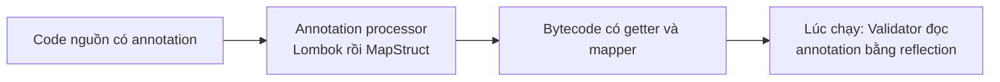
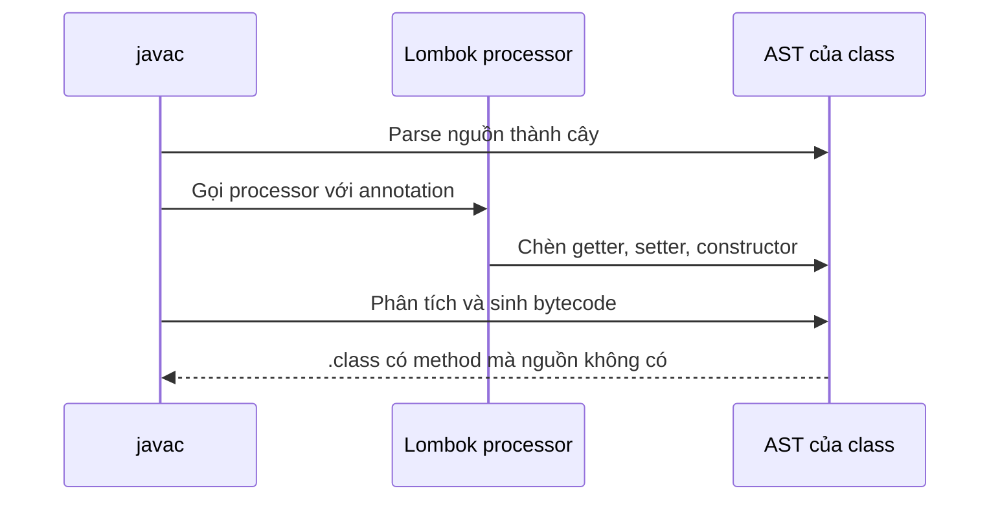
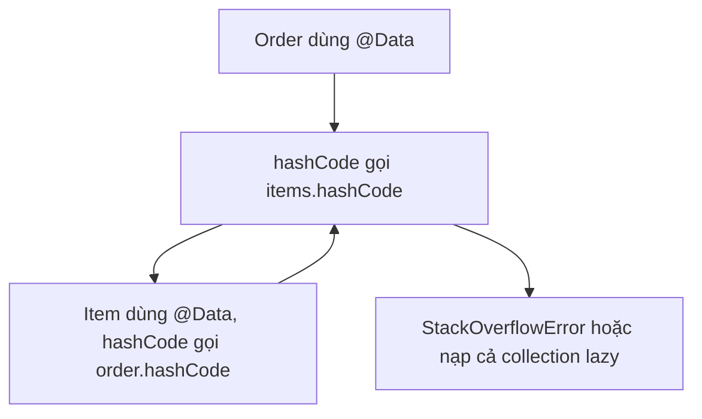
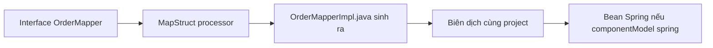
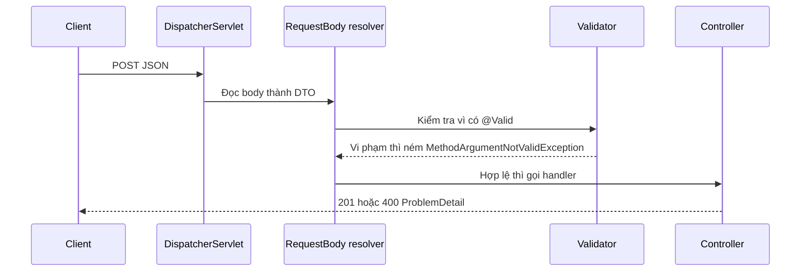
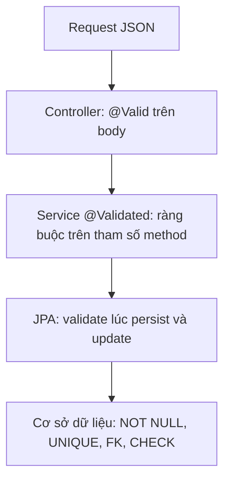
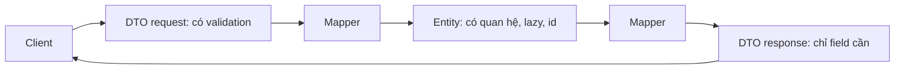

# Lý thuyết 48: Lombok, MapStruct và Bean Validation

Ba thư viện này xuất hiện trong gần như mọi dự án Spring Boot, và cả ba đều "làm việc" không phải bằng code bạn thấy. Lombok viết thêm getter, setter ngay lúc biên dịch. MapStruct sinh ra class mapper lúc biên dịch. Bean Validation đọc annotation lúc chạy rồi kiểm tra dữ liệu. Hiểu được **khi nào** mỗi thứ chạy thì bạn hiểu luôn vì sao chúng gây ra những lỗi đặc trưng, nhất là khi đụng tới JPA entity.

> **Phiên bản (kiểm tra 2026-10-30):** Dòng chính là Spring Boot 4.1 (Framework 7, Jackson 3, Hibernate 7). Boot 4 dùng Jakarta Validation 3.1 và Hibernate Validator 9.x; Boot 3.5 dùng Jakarta Validation 3.0 và Hibernate Validator 8.x (số chính xác lấy từ BOM của Boot, kiểm tra lại theo phiên bản bạn dùng). Tên starter `spring-boot-starter-validation` còn nguyên, nhưng starter web không còn kéo nó theo nên phải khai báo riêng. Lombok mới nhất tra được là 1.18.46 (2026-04-22, hỗ trợ JDK 26). MapStruct tài liệu stable là 1.6.3. Từ JDK 23, annotation processing không tự bật nếu bạn không khai báo processor tường minh, nên nên dùng `annotationProcessorPaths` (Maven) hoặc `annotationProcessor` (Gradle).

**Cốt lõi:** Lombok và MapStruct tồn tại để bạn khỏi viết code lặp (getter, setter, mapper), và cả hai làm việc ở **thời điểm biên dịch**: compiler gọi các annotation processor, processor sửa cây cú pháp hoặc sinh thêm file `.java`, rồi mới ra bytecode. Bean Validation khác: nó chỉ là annotation khai báo ràng buộc, và một `Validator` đọc chúng lúc chạy bằng reflection.

- Vì Lombok sửa AST của compiler nên IDE và build phải cài processor, và code nguồn bạn thấy không phải là code thực sự chạy.
- Vì MapStruct sinh ra code Java thường (gọi getter và setter) nên nó nhanh như viết tay và lỗi mapping hiện ngay lúc biên dịch.
- Vì Bean Validation chỉ kiểm tra object trong bộ nhớ nên nó không thay được ràng buộc của cơ sở dữ liệu (unique, foreign key, not null).



Mô hình tư duy: Lombok và MapStruct là thợ làm trước giờ mở cửa (biên dịch), còn Bean Validation là người gác cổng làm việc trong giờ mở cửa (chạy).

**Tóm tắt:**

- Lombok là annotation processor sửa AST của javac để thêm getter, setter, constructor, builder; bytecode có code mà nguồn không có.
- Lombok trên JPA entity là nguồn bẫy: `@Data` sinh `equals`, `hashCode`, `toString` trên mọi field, kéo lazy loading hoặc lặp vô hạn trên quan hệ hai chiều.
- DTO nên là `record` hoặc class bất biến; entity thì dùng Lombok có chọn lọc (`@Getter`, `@Setter` hẹp, constructor `protected`).
- MapStruct sinh class mapper lúc biên dịch, không dùng reflection, nên nhanh và báo lỗi mapping sớm; `componentModel = "spring"` biến mapper thành bean.
- Thứ tự processor: Lombok chạy trước MapStruct (MapStruct cần thấy getter, setter do Lombok sinh); thêm `lombok-mapstruct-binding` khi dùng Maven.
- Bean Validation: `@Valid` (Jakarta) lan truyền xuống object lồng nhau; `@Validated` (Spring) hỗ trợ group và validate method ở class.
- Lỗi validate nên trả về `ProblemDetail` (RFC 9457) với danh sách lỗi theo field, và mã lỗi ổn định cho client.
- Validate DTO bảo vệ biên API; ràng buộc DB bảo vệ dữ liệu khi có nhiều ghi đồng thời. Cần cả hai.

## Vấn đề nó giải quyết

Java dài dòng. Một class dữ liệu có 10 field cần 10 getter, 10 setter, `equals`, `hashCode`, `toString`. Chuyển `OrderEntity` sang `OrderResponse` bằng tay là hàng chục dòng `setX(getX())` dễ quên một field. Kiểm tra `if (name == null || name.isBlank())` rải rác khắp nơi, mỗi nơi một thông báo. Ba thư viện này gom ba nỗi đau đó: Lombok bỏ code lặp, MapStruct bỏ code chuyển đổi mà vẫn kiểm tra được lúc biên dịch, Bean Validation đưa luật dữ liệu thành khai báo.

## Khi nào dùng, khi nào không

- **Lombok:** dùng cho `@Slf4j`, `@RequiredArgsConstructor` (constructor injection), `@Getter` trên entity. Không dùng `@Data` và `@EqualsAndHashCode` mặc định trên entity. Với dữ liệu bất biến, `record` (Java 16+) thường thay được Lombok mà không cần processor.
- **MapStruct:** dùng khi có nhiều cặp entity và DTO, hoặc mapping lồng. Nếu chỉ có vài class đơn giản, một method `from(entity)` viết tay còn rõ hơn và đỡ thêm một processor.
- **Bean Validation:** dùng ở biên hệ thống (request, config properties). Không dùng nó để thay cho kiểm tra nghiệp vụ cần đọc DB (email đã tồn tại chưa) hoặc cho ràng buộc toàn vẹn.

## Các khái niệm cần biết

| Khái niệm | Nghĩa |
|---|---|
| Annotation processor | Plugin chạy trong compiler (JSR 269), đọc annotation và sinh file hoặc sửa cây cú pháp |
| AST | Cây cú pháp trừu tượng; Lombok thêm node (method) vào đây, dùng API nội bộ của javac |
| `componentModel` | Cách MapStruct tạo mapper: `default` (`Mappers.getMapper`), `spring` (bean `@Component`) |
| `@Mapping` | Khai báo ánh xạ field khác tên, biểu thức, giá trị mặc định, bỏ qua |
| `@MappingTarget` | Tham số object có sẵn, MapStruct cập nhật vào đó thay vì tạo mới |
| Jakarta Validation | Đặc tả (API): `@NotNull`, `@Size`, `Validator`, `ConstraintViolation` |
| Hibernate Validator | Bản hiện thực tham chiếu của đặc tả, Boot dùng mặc định |
| `@Valid` | Annotation Jakarta: kích hoạt validate và lan truyền xuống property lồng |
| `@Validated` | Annotation Spring: chọn group, và bật validate method khi đặt ở class |
| Constraint group | Interface đánh dấu để áp ràng buộc khác nhau cho từng ngữ cảnh (tạo, cập nhật) |

## Lombok: sửa cây cú pháp

Đa số annotation processor chỉ được **thêm** file mới. Lombok thì sửa trực tiếp class đang biên dịch, bằng cách dùng API nội bộ của javac (và ECJ cho Eclipse) để chèn method vào AST. Đó là lý do nó "ma thuật": file `.java` của bạn không có `getName()` nhưng `.class` thì có. Cũng vì vậy mỗi bản JDK mới có thể làm Lombok hỏng cho tới khi có bản vá (1.18.40 thêm JDK 25, 1.18.46 thêm JDK 26), và IDE cần plugin hoặc bật annotation processing.



Cách đọc: Lombok không sinh file mới mà sửa cây ngay giữa chừng, nên bytecode cuối cùng khác với nguồn. Hệ quả thực tế: nhảy tới định nghĩa `getName()` trong IDE phải nhờ plugin; decompile `.class` sẽ thấy code Lombok sinh.

**Nền tảng:** Lombok và MapStruct chạy ở compile time nên không tốn thời gian chạy và không dùng reflection. Lỗi (thiếu processor, sai thứ tự) lộ lúc build, không phải lúc chạy. Bean Validation ngược lại dùng reflection lúc chạy, xem thêm [Reflection và Annotation](/go?p=08-Java%2FJava-Core%2Fmedium%2Flt-11-reflection-annotation.md).

### Bẫy với JPA entity

Entity có đặc thù mà `@Data` phá hỏng: có quan hệ lazy, có proxy của Hibernate, có `id` chỉ được gán sau khi lưu. Xem cơ chế trong [JPA internals](/go?p=01-Spring-Boot%2Fmedium%2Flt-16-jpa-internals.md).

| Annotation | Bẫy trên entity |
|---|---|
| `@ToString` (qua `@Data`) | In cả field `@OneToMany` lazy: gọi log ngoài transaction ném `LazyInitializationException`, trong transaction thì kích hoạt query ngầm |
| `@EqualsAndHashCode` (qua `@Data`) | Dùng mọi field, gồm cả collection lazy; quan hệ hai chiều gọi nhau tới `StackOverflowError` |
| `@EqualsAndHashCode` theo `id` | `id` null trước khi lưu nên `hashCode` đổi sau `persist`, làm hỏng phần tử trong `HashSet` |
| `@Setter` mọi field | Mở cửa để đổi `id` hoặc trạng thái bất biến từ bất kỳ đâu |
| `@NoArgsConstructor` công khai | Cho phép tạo entity rỗng, không hợp lệ; JPA chỉ cần constructor `protected` |



Cách đọc: hai phía của quan hệ hai chiều đều sinh `hashCode` theo mọi field, nên gọi nhau mãi. Dù không vòng, chỉ cần `hashCode` chạm vào collection lazy là Hibernate chạy thêm query hoặc ném lỗi.

**Suy luận:** Lombok không sai; `@Data` được thiết kế cho object dữ liệu thuần, mà entity thì không thuần. Entity có danh tính (identity) khác với giá trị (value): hai entity là một khi cùng `id`, không phải cùng mọi field. Quan hệ lazy nghĩa là field có thể là proxy chưa nạp, nên đọc nó có tác dụng phụ. Từ đó suy ra quy tắc: không sinh `toString` và `equals` tự động trên mọi field; loại quan hệ khỏi `toString` (`@ToString.Exclude`), và tự viết `equals` và `hashCode` dựa trên danh tính (id khi đã có, hoặc business key ổn định), có xử lý proxy. Điểm dễ nhầm là tưởng "dùng Lombok là đủ" vì test đơn giản không có quan hệ lazy thì không lỗi. Hệ quả khi review: thấy `@Data` hay `@EqualsAndHashCode` trên class có `@Entity` thì dừng lại.

```java
// Minh họa (chưa chạy thử): entity dùng Lombok có chọn lọc
@Entity
@Getter
@NoArgsConstructor(access = AccessLevel.PROTECTED)
public class Order {
    @Id @GeneratedValue(strategy = GenerationType.IDENTITY)
    private Long id;

    private String code;

    @OneToMany(mappedBy = "order")
    @ToString.Exclude
    private List<OrderItem> items = new ArrayList<>();

    @Override
    public boolean equals(Object o) {
        if (this == o) return true;
        if (!(o instanceof Order other)) return false;   // instanceof an toàn với proxy
        return id != null && id.equals(other.getId());   // dùng getter để chạm proxy
    }

    @Override
    public int hashCode() {
        return getClass().hashCode();   // hằng số theo class, ổn định trước và sau persist
    }
}
```

Cách `hashCode` cố định theo class là kiểu hay dùng để hash không đổi khi `id` được gán; đánh đổi là mọi entity cùng loại rơi chung bucket, chấp nhận được với tập nhỏ. Tùy dự án có thể chọn business key; điều quan trọng là có chủ đích.

### Record thay Lombok ở đâu

Với DTO, `record` cho constructor, getter (kiểu `name()`), `equals`, `hashCode`, `toString` mà không cần processor. Jackson 2.12+ và Jackson 3 đều đọc được record. Record không dùng cho entity JPA vì Hibernate cần class không `final`, có constructor không tham số và field đổi được.

**Phải thuộc:** `record` cho DTO và config properties; Lombok có chọn lọc cho entity (`@Getter`, constructor `protected`, `@Slf4j`); không dùng `@Data`, `@EqualsAndHashCode` mặc định, `@ToString` mọi field trên entity.

## MapStruct: sinh code lúc biên dịch

MapStruct đọc interface `@Mapper` của bạn và sinh class `...MapperImpl` toàn code Java thường: `target.setName(source.getName())`. Không có reflection lúc chạy nên nhanh như viết tay và JIT inline được. Thư viện mapping dùng reflection (như ModelMapper) quét class lúc chạy, chậm hơn và lỗi tên field chỉ lộ khi chạy.



Cách đọc: file `OrderMapperImpl.java` nằm trong thư mục sinh code (`target/generated-sources`) và bạn đọc được nó. Khi mapping sai, bạn mở file này ra debug như code thường.

**Thứ tự processor.** MapStruct cần thấy getter và setter để ánh xạ. Nếu các method đó do Lombok sinh, Lombok phải chạy trước. Trong Maven, khai báo Lombok **trước** MapStruct trong `annotationProcessorPaths` và thêm `lombok-mapstruct-binding` (artifact của dự án Lombok; kiểm tra phiên bản mới nhất khi thêm vào). Gradle thì thêm cả hai vào `annotationProcessor` và binding cũng vậy. Tài liệu MapStruct có mục riêng về Lombok. Lỗi điển hình khi sai thứ tự: "Unmapped target properties" cho field chắc chắn có, vì processor chưa thấy setter.

```xml
<!-- Minh họa (chưa chạy thử): maven-compiler-plugin, Lombok đứng trước MapStruct -->
<annotationProcessorPaths>
  <path>
    <groupId>org.projectlombok</groupId>
    <artifactId>lombok</artifactId>
    <version>${lombok.version}</version>
  </path>
  <path>
    <groupId>org.projectlombok</groupId>
    <artifactId>lombok-mapstruct-binding</artifactId>
    <version>${lombok-mapstruct-binding.version}</version>
  </path>
  <path>
    <groupId>org.mapstruct</groupId>
    <artifactId>mapstruct-processor</artifactId>
    <version>${mapstruct.version}</version>
  </path>
</annotationProcessorPaths>
```

### Mapper thực tế: @Mapping, lồng nhau, cập nhật

```java
// Minh họa (chưa chạy thử)
@Mapper(componentModel = "spring",
        unmappedTargetPolicy = ReportingPolicy.ERROR,
        injectionStrategy = InjectionStrategy.CONSTRUCTOR,
        uses = AddressMapper.class)
public interface OrderMapper {

    @Mapping(source = "customer.fullName", target = "customerName")
    @Mapping(source = "createdAt", target = "createdDate", dateFormat = "yyyy-MM-dd")
    @Mapping(target = "note", ignore = true)
    OrderResponse toResponse(Order order);

    Order toEntity(CreateOrderRequest request);

    @BeanMapping(nullValuePropertyMappingStrategy = NullValuePropertyMappingStrategy.IGNORE)
    void update(UpdateOrderRequest request, @MappingTarget Order order);
}
```

- `source = "customer.fullName"` đi vào object lồng; với kiểu lồng khác (địa chỉ), `uses = AddressMapper.class` để MapStruct gọi mapper con.
- `unmappedTargetPolicy = ERROR` biến field bị bỏ sót thành lỗi biên dịch. Mặc định chỉ là cảnh báo, nên đặt nghiêm khi muốn chắc.
- `@MappingTarget` cập nhật entity có sẵn (đang được persistence context quản lý) thay vì tạo bản sao mới. Với PATCH, `IGNORE` làm field `null` trong request không ghi đè giá trị cũ.
- `componentModel = "spring"` sinh `@Component`; `InjectionStrategy.CONSTRUCTOR` dùng constructor injection thay vì `@Autowired` field.

Mapper chạm tới `order.getItems()` cũng gây lazy loading, nên map trong phạm vi transaction hoặc dùng truy vấn nạp sẵn (xem [Spring Data JPA nâng cao](/go?p=01-Spring-Boot%2Fmedium%2Flt-37-spring-data-jpa-nang-cao.md)).

## Bean Validation: ràng buộc khai báo

Jakarta Validation định nghĩa annotation và API; Hibernate Validator hiện thực. Boot tự cấu hình một `Validator` khi có `spring-boot-starter-validation`. Sơ đồ dưới là đường đi của một request tới controller:



Cách đọc: validate xảy ra **trước** khi code controller chạy, ngay trong bước giải quyết tham số. Vi phạm thì controller không bao giờ được gọi; ngoại lệ rơi vào exception handler. Chi tiết luồng ở [Spring MVC internals](/go?p=01-Spring-Boot%2Fmedium%2Flt-15-mvc-internals.md) và [REST controller](/go?p=01-Spring-Boot%2Feasy%2Flt-03-rest-controller.md).

### @Valid và @Validated

| | `@Valid` (jakarta) | `@Validated` (Spring) |
|---|---|---|
| Nguồn | Đặc tả Jakarta | Spring |
| Đặt ở | Tham số, field, return | Class, tham số |
| Lan truyền xuống object lồng | Có (cascade) | Không tự lan, vẫn cần `@Valid` ở field |
| Chọn group | Không | Có: `@Validated(OnCreate.class)` |
| Validate method của bean | Không | Có khi đặt ở class (qua proxy) |

Muốn validate field lồng, đặt `@Valid` trên field đó (ví dụ `@Valid Address address`); thiếu thì ràng buộc bên trong bị bỏ qua âm thầm.

### Group và custom constraint

```java
// Minh họa (chưa chạy thử)
public interface OnCreate {}
public interface OnUpdate {}

public record UserRequest(
    @Null(groups = OnCreate.class) @NotNull(groups = OnUpdate.class) Long id,
    @NotBlank @Size(max = 100) String name,
    @Email @NotBlank(groups = OnCreate.class) String email,
    @StrongPassword(groups = OnCreate.class) String password) {}

@Target({FIELD, PARAMETER, RECORD_COMPONENT})
@Retention(RUNTIME)
@Constraint(validatedBy = StrongPasswordValidator.class)
public @interface StrongPassword {
    String message() default "Mật khẩu quá yếu";
    Class<?>[] groups() default {};
    Class<? extends Payload>[] payload() default {};
}

public class StrongPasswordValidator implements ConstraintValidator<StrongPassword, String> {
    @Override
    public boolean isValid(String v, ConstraintValidatorContext ctx) {
        return v == null || v.length() >= 12;   // null để @NotNull lo
    }
}
```

Quy ước: validator của constraint tự chế coi `null` là hợp lệ, để việc "bắt buộc có" thuộc `@NotNull`. Ba thuộc tính `message`, `groups`, `payload` là bắt buộc của mọi constraint. Dùng group: `@Validated(OnCreate.class) @RequestBody UserRequest req`. Chú ý: ràng buộc không khai group thuộc group `Default`, và khi bạn chỉ chọn `OnCreate` thì các ràng buộc `Default` **không** chạy trừ khi group kế thừa `Default`.

### Validate ở service và entity



Cách đọc: bốn lớp phòng thủ. Càng xuống dưới càng gần dữ liệu thật và càng khó bị lách; càng lên trên càng cho thông báo thân thiện. Không lớp nào thay được lớp khác.

- **Controller:** `@Valid @RequestBody` cho body; ràng buộc trực tiếp trên `@RequestParam` và `@PathVariable` (`@Min(1) long id`) được Framework 6.1 trở lên validate gốc và ném `HandlerMethodValidationException` (không cần `@Validated` ở class). Class-level `@Validated` cũ vẫn chạy nhưng ném `ConstraintViolationException`, thường thành 500 nếu bạn không bắt.
- **Service (method validation):** đặt `@Validated` ở class bean, ràng buộc ở tham số hoặc giá trị trả về. Cơ chế là proxy AOP (`MethodValidationPostProcessor`), nên chịu mọi giới hạn của proxy: self-invocation không validate, xem [AOP và Proxy](/go?p=01-Spring-Boot%2Fmedium%2Flt-13-aop-proxy.md). Mặc định ném `ConstraintViolationException`; Spring có cờ để ném `MethodValidationException` thay thế, gom lỗi theo tham số (kiểm tra theo phiên bản).
- **Entity:** khi Hibernate Validator có trên classpath, JPA tự kiểm tra constraint lúc `persist` và `update` (chế độ auto của đặc tả). Đây là lưới an toàn cuối, không phải chỗ đưa lỗi thân thiện cho người dùng.

**Phải thuộc:** `@Valid` lan truyền và nằm ở tham số, field; `@Validated` của Spring chọn group và bật method validation (qua proxy) khi đặt ở class. Lỗi body: `MethodArgumentNotValidException`; lỗi param và path (Framework 6.1+): `HandlerMethodValidationException`; lỗi method validation ở class: `ConstraintViolationException`.

## Trả lỗi bằng ProblemDetail

Chuẩn RFC 9457 (kế thừa RFC 7807) định nghĩa dạng lỗi `application/problem+json` với `type`, `title`, `status`, `detail`, `instance` và phần mở rộng. Spring có sẵn lớp `ProblemDetail` và `ResponseEntityExceptionHandler` xử lý các ngoại lệ MVC. Boot có property bật nó (`spring.mvc.problemdetails.enabled`, kiểm tra lại tên theo Boot 4), hoặc bạn tự viết `@RestControllerAdvice`.

```java
// Minh họa (chưa chạy thử)
@RestControllerAdvice
class ApiExceptionHandler extends ResponseEntityExceptionHandler {

    @Override
    protected ResponseEntity<Object> handleMethodArgumentNotValid(
            MethodArgumentNotValidException ex, HttpHeaders headers,
            HttpStatusCode status, WebRequest request) {
        ProblemDetail pd = ProblemDetail.forStatusAndDetail(
                HttpStatus.BAD_REQUEST, "Dữ liệu không hợp lệ");
        pd.setTitle("Validation failed");
        pd.setProperty("errors", ex.getBindingResult().getFieldErrors().stream()
                .map(f -> Map.of("field", f.getField(), "message", f.getDefaultMessage()))
                .toList());
        return handleExceptionInternal(ex, pd, headers, status, request);
    }
}
```

Thông báo lấy từ `message` của annotation, có thể đưa vào `ValidationMessages.properties` hoặc `messages.properties` với khóa `{key}` để đa ngôn ngữ. Đừng trả `getDefaultMessage` thô mà không kiểm soát nếu client cần mã lỗi ổn định: thêm trường `code` riêng. Mô hình lỗi toàn diện ở [REST API thực chiến](/go?p=01-Spring-Boot%2Fmedium%2Flt-33-rest-api-thuc-chien.md).

## Vì sao tách DTO khỏi entity



Cách đọc: entity nằm sau hai lớp mapper, nên đổi bảng không vỡ API và client không tiếp xúc thẳng với persistence.

**Suy luận:** Entity phản chiếu **bảng**, DTO phản chiếu **hợp đồng API**. Hai thứ này thay đổi vì lý do khác nhau và theo nhịp khác nhau. Nếu dùng entity làm request, client gửi thêm field `role` hay `id` là bạn vô tình gán luôn (mass assignment). Nếu dùng entity làm response, Jackson duyệt cả quan hệ lazy gây `LazyInitializationException` hoặc vòng lặp, và mọi cột mới đều lộ ra ngoài. Thêm nữa, ràng buộc validate của một use case (tạo khác cập nhật) không khớp một entity duy nhất. Hệ quả: mỗi hợp đồng một DTO, mapper ở giữa, và MapStruct giúp phần giữa này ít tốn công và an toàn lúc biên dịch.

## DTO validation khác ràng buộc DB

| | Bean Validation | Ràng buộc DB |
|---|---|---|
| Chạy ở | JVM, trước khi ghi | Cơ sở dữ liệu, lúc ghi |
| Thấy được | Chỉ object trong tay | Toàn bộ dữ liệu, mọi client |
| Race condition | Không chống được | Chống được (UNIQUE, FK) |
| Thông báo | Thân thiện, theo field | Mã lỗi DB, cần dịch |
| Ví dụ | `@Email`, `@Size(max = 100)` | `UNIQUE (email)`, `NOT NULL`, `CHECK` |

Hai request cùng tạo email trùng đồng thời đều qua được validate vì cả hai đều thấy email chưa tồn tại; chỉ `UNIQUE` chặn được cái thứ hai. Cách đúng: bắt lỗi vi phạm ràng buộc (`DataIntegrityViolationException`) và chuyển thành 409 hoặc 400 có nghĩa. PostgreSQL cho mã SQLSTATE `23505` cho unique violation.

## Bẫy thường gặp

| Bẫy | Nguyên nhân | Cách xử lý |
|---|---|---|
| `@Data` trên entity gây StackOverflow hoặc N+1 | `equals`, `hashCode`, `toString` đụng quan hệ lazy | `@Getter` có chọn lọc, `equals` theo id, `@ToString.Exclude` |
| MapStruct báo thiếu property dù có Lombok | Sai thứ tự processor hoặc thiếu binding | Lombok trước MapStruct, thêm `lombok-mapstruct-binding` |
| Build không sinh `MapperImpl` trên JDK mới | Annotation processing không tự bật từ JDK 23 | Khai báo `annotationProcessorPaths` tường minh |
| `@Valid` không có tác dụng trên field lồng | Quên `@Valid` ở field | Đặt `@Valid` trên property lồng và phần tử collection |
| `@Validated` ở service không chạy | Self-invocation hoặc class không phải bean | Gọi qua bean khác, kiểm tra proxy |
| Group chạy mà `Default` biến mất | Chỉ chọn group riêng | Cho group kế thừa `Default` hoặc ghi rõ cả hai |
| Lỗi validate trả 500 | `ConstraintViolationException` không được bắt | Thêm `@ExceptionHandler` hoặc dùng `ResponseEntityExceptionHandler` |
| Mapper kéo lazy collection | `toResponse` chạm `getItems()` ngoài transaction | Map trong transaction hoặc nạp sẵn bằng fetch join |

## Phỏng vấn khó: chuỗi hỏi xoáy

Người phỏng vấn senior thường mở bằng một câu dễ, rồi xoáy xuống cơ chế, đánh đổi và sự cố thật. Câu trả lời tốt luôn đi từ cốt lõi xuống.

### Chuỗi 1: Lombok chạy lúc nào và vì sao nguy hiểm với entity

1. **Câu mở:** Lombok sinh getter bằng cách nào, có dùng reflection lúc chạy không?
2. **Xoáy 1:** Vì sao `@Data` trên `@Entity` thường là lỗi, và bạn viết `equals` cho entity ra sao?
3. **Xoáy 2:** Khi nâng JDK thì build Lombok có thể hỏng. Vì sao?

**Đáp án ngắn:** Lombok là annotation processor chạy lúc biên dịch, không dùng reflection lúc chạy và không tốn gì ở runtime. Khác processor thường chỉ sinh file mới, Lombok dùng API nội bộ của javac để sửa AST và chèn method, nên bytecode có code mà nguồn không có. `@Data` sinh `equals`, `hashCode`, `toString` trên mọi field, mà entity có quan hệ lazy và hai chiều: gọi `hashCode` chạm vào collection lazy kích hoạt query hoặc `LazyInitializationException`, còn hai chiều thì gọi nhau tới `StackOverflowError`. Entity có danh tính nên `equals` nên dựa trên `id` (khi đã gán) hoặc business key, dùng `instanceof` và getter để tương thích proxy, còn `hashCode` cố định theo class để không đổi sau `persist`. Chọn `@Getter`, constructor `protected`, `@ToString.Exclude` cho quan hệ. Vì dùng API nội bộ của javac nên mỗi JDK mới có thể phá Lombok đến khi có bản vá (đã có 1.18.40 cho JDK 25, 1.18.46 cho JDK 26), nên phải cập nhật Lombok cùng JDK và Boot BOM. Với DTO, `record` thường thay được Lombok mà không cần processor.

**Sai lầm hay gặp:**
- Nói "Lombok dùng reflection lúc chạy".
- Dùng `@EqualsAndHashCode` theo mọi field cho entity.
- Viết `equals` so sánh `getClass()` mà quên proxy của Hibernate là subclass.

### Chuỗi 2: MapStruct so với reflection

1. **Câu mở:** MapStruct khác ModelMapper ở đâu và vì sao nhanh hơn?
2. **Xoáy 1:** Dự án dùng Lombok và MapStruct, build báo thiếu property. Bạn kiểm tra gì?
3. **Xoáy 2:** Làm sao cập nhật entity có sẵn từ DTO PATCH mà không ghi đè field bằng null?

**Đáp án ngắn:** MapStruct sinh class `MapperImpl` bằng code Java thường lúc biên dịch, nên không có reflection lúc chạy, JIT tối ưu như code viết tay, và lỗi mapping (field không khớp) lộ ngay lúc build. ModelMapper và các thư viện tương tự quét class bằng reflection lúc chạy, chậm hơn và chỉ lỗi khi chạy. Khi dùng Lombok, MapStruct cần thấy getter và setter đã được sinh, nên Lombok phải chạy trước: khai báo Lombok trước MapStruct trong cấu hình processor, thêm `lombok-mapstruct-binding` với Maven, và đảm bảo annotation processing bật trên JDK mới. Để cập nhật, dùng method `void update(Dto d, @MappingTarget Entity e)` kèm `@BeanMapping(nullValuePropertyMappingStrategy = IGNORE)` để field null bị bỏ qua, và đặt `unmappedTargetPolicy = ERROR` để không sót field. Đánh đổi: thêm một processor và code sinh phải đọc khi debug; với vài class đơn giản, mapper viết tay có thể đủ. Trong production, mapper chạm tới quan hệ lazy nên chạy trong transaction hoặc nạp sẵn.

**Sai lầm hay gặp:**
- Nói MapStruct "nhanh nhờ cache reflection".
- Không đặt chính sách field chưa ánh xạ, để sót field âm thầm.
- Dùng `@MappingTarget` trên object detached rồi tưởng đã lưu.

### Chuỗi 3: Validation đặt ở đâu và vì sao vẫn cần DB constraint

1. **Câu mở:** `@Valid` và `@Validated` khác nhau thế nào?
2. **Xoáy 1:** `@Validated` ở service không chạy trong một số trường hợp. Vì sao?
3. **Xoáy 2:** Đã validate `@Email` và kiểm tra email trùng trong service, sao vẫn cần `UNIQUE`?

**Đáp án ngắn:** `@Valid` là của Jakarta, kích hoạt validate và lan truyền (cascade) xuống object lồng; `@Validated` là của Spring, chọn constraint group và bật validate method khi đặt ở class. Validate body diễn ra trong bước giải quyết tham số của MVC, vi phạm ném `MethodArgumentNotValidException` trước khi controller chạy; ràng buộc trên `@RequestParam` hay `@PathVariable` ném `HandlerMethodValidationException` từ Framework 6.1. Method validation ở service chạy qua proxy AOP, nên self-invocation, method `private` hoặc class không phải bean thì không validate. Lỗi nên chuyển thành `ProblemDetail` với danh sách field và mã lỗi ổn định. Bean Validation chỉ nhìn thấy object trong tay, nên hai request đồng thời cùng thấy email chưa tồn tại và cùng qua kiểm tra; chỉ `UNIQUE` của cơ sở dữ liệu chặn được bản thứ hai. Cách đúng là bắt `DataIntegrityViolationException` và trả 409. Validate DTO để phản hồi sớm và thân thiện; ràng buộc DB để đảm bảo toàn vẹn thật.

**Sai lầm hay gặp:**
- Nghĩ `@Validated` ở class tự lan xuống field lồng (vẫn cần `@Valid`).
- Dựa hoàn toàn vào kiểm tra "exists" trong code thay cho `UNIQUE`.
- Để `ConstraintViolationException` thành 500.

## Câu hỏi tự kiểm tra

**1. Mở `OrderMapperImpl.java` trong thư mục sinh code, bạn thấy gì và vì sao điều đó quan trọng?**

*Gợi ý suy luận:* Nghĩ về thời điểm MapStruct chạy và kết quả nó tạo ra.

*Lập luận và đáp án:* Bạn thấy code Java thường: `new OrderResponse()` rồi gọi các setter. Vì MapStruct sinh code lúc biên dịch, không dùng reflection, nên hiệu năng như viết tay và bạn debug bằng cách đọc file này. Lỗi mapping (thiếu field, kiểu không khớp) hiện ra khi build, đặc biệt khi `unmappedTargetPolicy = ERROR`.

**2. Một entity `Order` có `@OneToMany items` dùng `@Data`. Gọi `log.info("{}", order)` ngoài transaction thì sao?**

*Gợi ý suy luận:* `toString` do `@Data` sinh đụng tới field nào?

*Lập luận và đáp án:* `toString` in cả `items`, một collection lazy. Ngoài transaction (session đã đóng) thì ném `LazyInitializationException`; trong transaction thì chạy thêm query ngầm chỉ để ghi log. Nếu `OrderItem` cũng in `order` thì vòng lặp tới `StackOverflowError`. Sửa bằng `@ToString.Exclude` trên quan hệ, hoặc không dùng `@Data` cho entity.

**3. Vì sao `@Validated` đặt ở service không bắt được lỗi khi một method `public` gọi method khác cùng class?**

*Gợi ý suy luận:* Method validation dựa vào cơ chế gì?

*Lập luận và đáp án:* Method validation dùng proxy AOP (`MethodValidationPostProcessor`). Call nội bộ `this.other()` không đi qua proxy nên không có validate, giống `@Transactional`. Cách xử lý: tách sang bean khác hoặc validate ở biên (controller, hoặc method được gọi từ ngoài).

**4. Client tạo hai user cùng email trong cùng một mili giây, validate đều pass. Bạn chặn thế nào?**

*Gợi ý suy luận:* Ai thấy toàn bộ dữ liệu cùng lúc?

*Lập luận và đáp án:* Chỉ cơ sở dữ liệu thấy cả hai thao tác. Đặt `UNIQUE (email)` (PostgreSQL trả SQLSTATE `23505` cho vi phạm), bắt `DataIntegrityViolationException` trong tầng service hoặc handler và trả 409 với `ProblemDetail`. Bean Validation vẫn giữ vai trò phản hồi sớm cho lỗi định dạng.

Nguồn: tài liệu MapStruct 1.6.3 (mapstruct.org, reference stable), Spring Framework reference (Bean Validation, method validation, Framework 7.0.x), changelog Lombok (projectlombok.org/changelog, 1.18.46), tra cứu phiên bản Jakarta Validation và Hibernate Validator trên Maven Central, ngày 2026-10-30. Điều chưa kiểm chứng riêng cho Boot 4.1: tên property `spring.mvc.problemdetails.enabled`, phiên bản `lombok-mapstruct-binding`.

