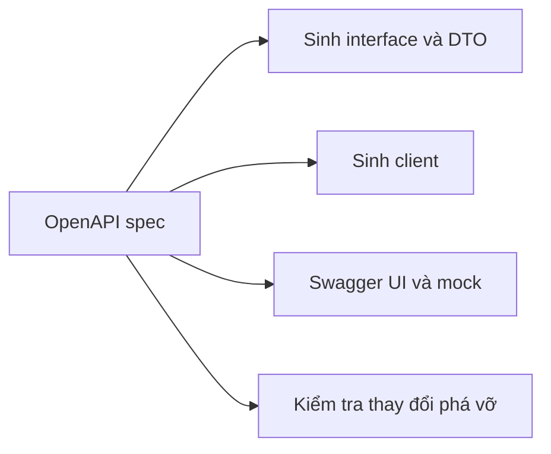
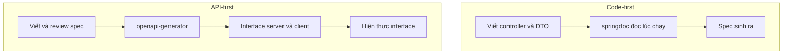
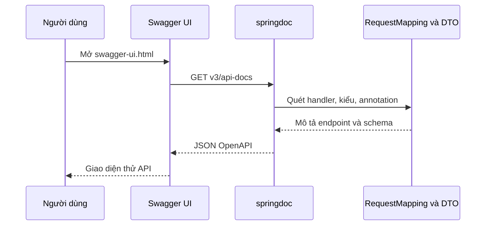
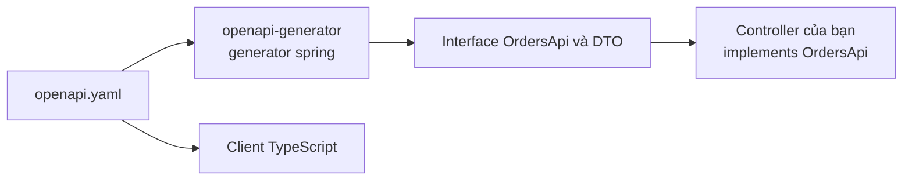
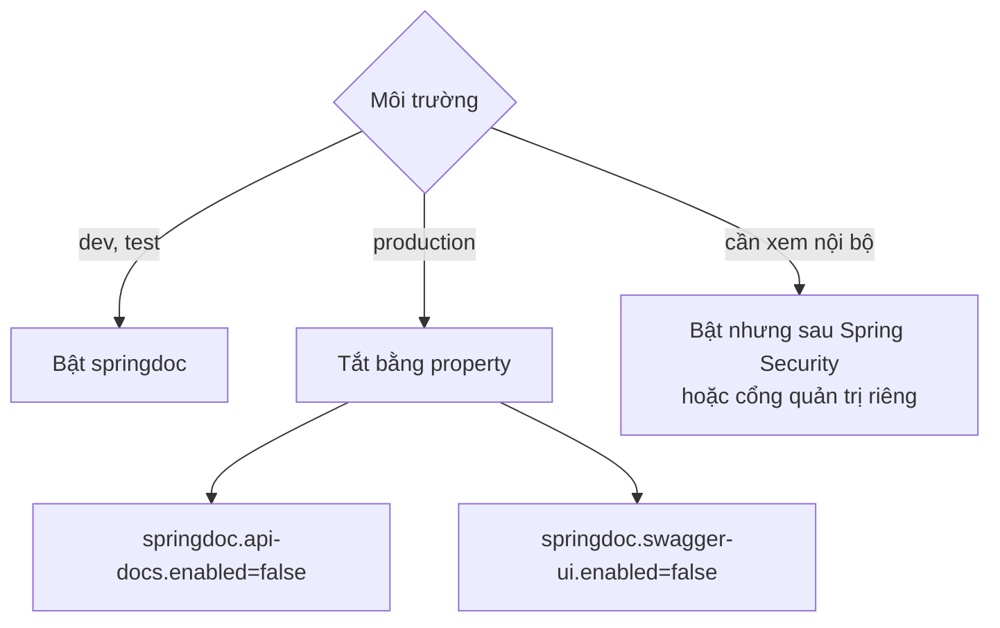
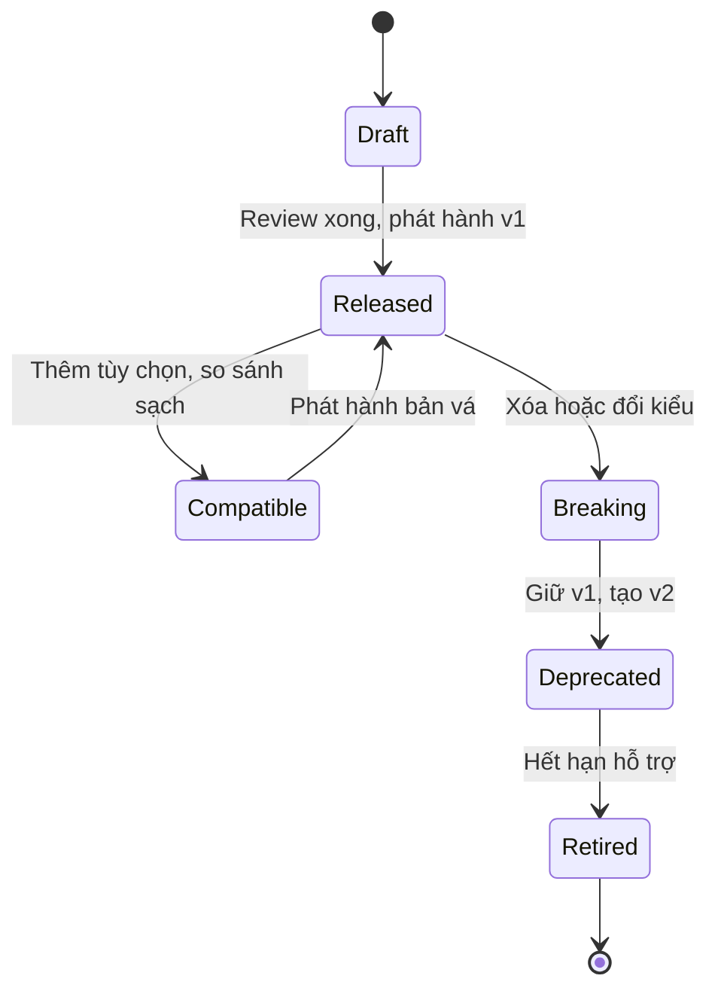
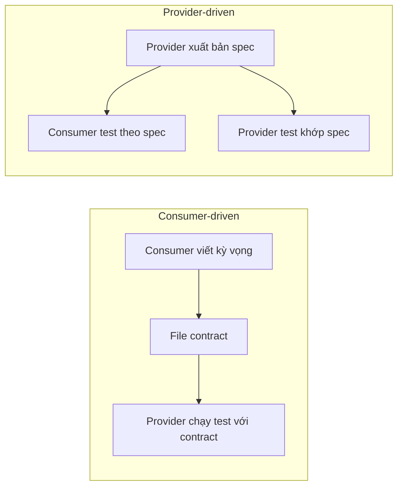

# Lý thuyết 49: OpenAPI, springdoc và thiết kế API-first

OpenAPI thường được nhìn như "thứ sinh ra trang Swagger để xem API". Nhìn vậy là bỏ lỡ phần quan trọng nhất: nó là **hợp đồng** máy đọc được giữa người cung cấp API và mọi người dùng API (frontend, mobile, đối tác, test). Bài này đi từ hợp đồng, qua hai cách tạo hợp đồng (code-first với springdoc, API-first với YAML), đến cách giữ hợp đồng không bị phá khi API đổi.

> **Phiên bản (kiểm tra 2026-10-30):** Dòng chính là Spring Boot 4.1 (Framework 7, Jackson 3, Hibernate 7). Theo trang springdoc.org, dòng springdoc-openapi **3.x** hỗ trợ Spring Boot 4 (bản mới nhất tra được trên trang chủ là 3.2.0), còn tài liệu cho Boot 3.x vẫn là springdoc 2.x (2.10.0). Tên artifact không đổi: `org.springdoc:springdoc-openapi-starter-webmvc-ui`, `...-webflux-ui`, `...-webmvc-api`, `...-webflux-api`. Chọn phiên bản theo bảng tương thích của springdoc, đừng đoán; springdoc là dự án cộng đồng, không do đội Spring duy trì. Tên option của openapi-generator cho Boot 4 (ví dụ `useSpringBoot4`) tôi chỉ xác nhận gián tiếp, kiểm tra lại theo phiên bản generator.

**Cốt lõi:** Khi nhiều bên cùng dùng một API, họ cần một nguồn sự thật về hình dạng request, response và lỗi, và nó phải đọc được bằng máy để sinh client, server stub và test. OpenAPI là tài liệu mô tả đó (YAML hoặc JSON). Hai hướng làm: sinh hợp đồng từ code, hoặc viết hợp đồng trước rồi sinh code từ nó.

- Vì hợp đồng là thứ các bên cùng cam kết nên đổi nó phải được coi là đổi API, không phải sửa tài liệu.
- Vì code-first sinh spec từ code nên spec luôn khớp code nhưng hợp đồng bị ràng buộc bởi cách bạn viết controller.
- Vì API-first viết spec trước nên frontend và backend làm song song được, nhưng phải giữ spec và code không lệch nhau.



Mô hình tư duy: spec là một văn bản gốc, từ đó mọi thứ khác (server, client, tài liệu, kiểm tra) là bản sao có thể sinh lại.

**Tóm tắt:**

- OpenAPI mô tả API (đường dẫn, tham số, body, response, lỗi, bảo mật) bằng YAML hoặc JSON; đó là hợp đồng, không chỉ tài liệu.
- Code-first: springdoc đọc controller và annotation lúc chạy rồi sinh spec; nhanh bắt đầu nhưng spec là hệ quả của code.
- API-first: viết spec trước, dùng openapi-generator sinh interface server và client; hợp đồng đi trước.
- springdoc 3.x cho Boot 4, springdoc 2.x cho Boot 3.x; chọn đúng starter theo stack (`webmvc` hay `webflux`, `ui` hay `api`).
- Lỗi mô tả bằng `ProblemDetail` (RFC 9457) trong spec để client xử lý nhất quán.
- Bảo mật khai báo bằng `securitySchemes`; Swagger UI và `/v3/api-docs` nên tắt hoặc bảo vệ ở production.
- Breaking change là thay đổi làm client cũ hỏng (xóa field, đổi kiểu, thêm field bắt buộc); công cụ so sánh spec bắt được trong CI.
- Contract testing kiểm tra hai phía thật sự theo hợp đồng: consumer-driven (người dùng đặt ra kỳ vọng) hoặc provider-driven (nhà cung cấp xuất bản hợp đồng).

## Vấn đề nó giải quyết

Không có hợp đồng, frontend đọc code backend hoặc hỏi qua chat để biết field nào bắt buộc; tài liệu viết tay lệch code sau vài tuần; backend đổi tên một field mà không ai biết cho đến khi production vỡ. OpenAPI đưa hình dạng API vào một file có cấu trúc, để công cụ kiểm tra, sinh code và cảnh báo thay đổi trước khi vỡ. Với nhóm lớn hoặc nhiều dịch vụ, đây là cách rẻ nhất để giữ các bên đồng bộ.

## Khi nào dùng, khi nào không

- **Code-first (springdoc):** hợp với một backend do một nhóm sở hữu, API còn đổi nhiều, cần tài liệu nhanh. Đánh đổi: hợp đồng là sản phẩm phụ của code, dễ vô tình phá khi refactor.
- **API-first:** hợp với API công khai, nhiều client, nhiều nhóm, hoặc cần frontend làm song song bằng mock. Đánh đổi: thêm quy trình (review spec, sinh code), và phải chống lệch giữa spec với phần hiện thực tay.
- **Không cần OpenAPI đầy đủ:** API nội bộ rất nhỏ chỉ có một người dùng, hoặc giao tiếp không phải HTTP JSON (gRPC có `.proto`, sự kiện có schema riêng).

## Các khái niệm cần biết

| Khái niệm | Nghĩa |
|---|---|
| OpenAPI Specification (OAS) | Đặc tả định dạng mô tả REST API; bản 3.0 và 3.1 đang dùng |
| Swagger | Tên cũ của đặc tả; nay chỉ bộ công cụ (Swagger UI, swagger-core annotations) |
| `paths` | Các endpoint và operation (GET, POST...) |
| `components/schemas` | Kiểu dữ liệu dùng lại (DTO) |
| `$ref` | Tham chiếu để dùng lại schema, tham số, response |
| `securitySchemes` | Khai báo cách xác thực (bearer, OAuth2, API key) |
| springdoc-openapi | Thư viện sinh spec từ ứng dụng Spring lúc chạy, kèm Swagger UI |
| openapi-generator | Công cụ sinh server stub và client từ spec |
| Breaking change | Thay đổi làm client đang chạy đúng bị hỏng |
| Contract test | Test kiểm tra provider và consumer cùng tuân thủ một hợp đồng |

## Hợp đồng và hai cách tạo ra nó



Cách đọc: code-first đi từ code ra spec (mũi tên hướng sang tài liệu); API-first đi từ spec ra code. Khác biệt cốt lõi là **ai là nguồn sự thật**: code hay spec. Khi hai thứ lệch nhau, bên nguồn sự thật thắng.

**Nền tảng:** Hợp đồng chỉ có giá trị khi có nguồn sự thật duy nhất và có cơ chế phát hiện lệch. Code-first bảo đảm khớp bằng cách sinh; API-first bảo đảm khớp bằng cách sinh interface mà code phải hiện thực, nên đổi spec mà quên sửa code thì build lỗi.

**Suy luận:** Câu hỏi thực sự không phải "cách nào tốt hơn" mà là "ai cần hợp đồng và khi nào". Nếu frontend phải chờ backend xong mới biết API thì code-first làm chậm cả nhóm; nếu chỉ một nhóm sở hữu cả hai đầu thì chi phí quy trình của API-first không đáng. Điểm dễ nhầm là tưởng code-first thì spec "luôn đúng". Spec đúng với **code hiện tại**, nhưng không nói gì về việc bạn đã phá client hay chưa; để biết điều đó cần so sánh với spec phiên bản trước. Vì vậy cả hai hướng đều cần bước kiểm tra tương thích, và API-first chỉ giúp hợp đồng được **thiết kế có chủ đích** thay vì rơi ra từ code.

## Code-first với springdoc

Thêm starter đúng stack. Với Spring MVC dùng `springdoc-openapi-starter-webmvc-ui`; với WebFlux dùng `springdoc-openapi-starter-webflux-ui`. Nếu chỉ cần endpoint JSON mà không cần giao diện, dùng bản `-api`. Không cần cấu hình thêm: ứng dụng khởi động thì spec ở `/v3/api-docs` và giao diện ở `/swagger-ui.html` (đường dẫn mặc định, đổi bằng `springdoc.api-docs.path` và `springdoc.swagger-ui.path`).

```xml
<!-- Minh họa (chưa chạy thử): Spring MVC, Boot 4, springdoc dòng 3.x -->
<dependency>
  <groupId>org.springdoc</groupId>
  <artifactId>springdoc-openapi-starter-webmvc-ui</artifactId>
  <version>3.2.0</version>  <!-- kiểm tra bảng tương thích theo phiên bản Boot -->
</dependency>
```



Cách đọc: spec được dựng **lúc runtime** từ các `HandlerMapping` và kiểu Java mà springdoc quét, rồi cache. Nghĩa là spec chỉ đúng khi ứng dụng khởi động; muốn lấy spec trong CI phải chạy ứng dụng (hoặc dùng plugin sinh spec lúc build). Xem cơ chế mapping ở [Spring MVC internals](/go?p=01-Spring-Boot%2Fmedium%2Flt-15-mvc-internals.md).

```java
// Minh họa (chưa chạy thử): annotation swagger-core mô tả thêm cho operation
@RestController
@RequestMapping("/api/v1/orders")
@Tag(name = "Orders")
class OrderController {

    @Operation(summary = "Lấy đơn hàng theo id")
    @ApiResponses({
        @ApiResponse(responseCode = "200", description = "Thành công"),
        @ApiResponse(responseCode = "404", description = "Không tìm thấy",
            content = @Content(mediaType = "application/problem+json",
                schema = @Schema(implementation = ProblemDetail.class)))
    })
    @GetMapping("/{id}")
    OrderResponse get(@PathVariable long id) { /* ... */ return null; }
}
```

Các ràng buộc Bean Validation như `@NotNull`, `@Size`, `@Min`, `@Max` được springdoc đọc và đưa vào schema, nên validate và hợp đồng khớp nhau; xem [Lombok, MapStruct và Bean Validation](/go?p=01-Spring-Boot%2Fmedium%2Flt-48-lombok-mapstruct-bean-validation.md). Đừng rắc annotation mô tả khắp nơi: giữ spec đọc được bằng tên rõ và vài `@Operation` ở chỗ cần.

**Lưu ý Boot 4:** Boot 4 dùng Jackson 3 (package `tools.jackson`) và Framework 7. Springdoc 3.x là dòng dành cho Boot 4, nhưng mức hỗ trợ Jackson 3 và các tính năng đi kèm có thể khác nhau giữa các bản; kiểm tra release notes của springdoc trước khi nâng. Ngược lại, đừng dùng springdoc 2.x với Boot 4 và ngược lại springdoc 3.x với Boot 3.x. Ghi chú Boot 3.5: dùng springdoc 2.x (2.10.0 là bản tài liệu hiện có).

**Phải thuộc:** springdoc sinh spec lúc chạy từ controller, mặc định `/v3/api-docs` (JSON) và `/swagger-ui.html`; đúng starter cho stack (`webmvc` cho MVC, `webflux` cho WebFlux); dòng 3.x cho Boot 4, dòng 2.x cho Boot 3.x.

## API-first: viết spec trước

Bạn viết `openapi.yaml`, review nó như review code, rồi sinh interface server (Spring) và client (TypeScript, Java...). Phần việc của backend là hiện thực interface.

```yaml
# Minh họa (chưa chạy thử): openapi.yaml rút gọn
openapi: 3.0.3
info: { title: Orders API, version: 1.0.0 }
paths:
  /api/v1/orders/{id}:
    get:
      operationId: getOrder
      parameters:
        - { name: id, in: path, required: true, schema: { type: integer, format: int64 } }
      responses:
        "200":
          description: OK
          content:
            application/json:
              schema: { $ref: "#/components/schemas/OrderResponse" }
        "404":
          description: Not found
          content:
            application/problem+json:
              schema: { $ref: "#/components/schemas/Problem" }
components:
  schemas:
    OrderResponse:
      type: object
      required: [id, status]
      properties:
        id: { type: integer, format: int64 }
        status: { type: string, enum: [NEW, PAID, SHIPPED] }
    Problem:
      type: object
      properties:
        type: { type: string }
        title: { type: string }
        status: { type: integer }
        detail: { type: string }
```



Cách đọc: generator sinh `OrdersApi` (interface có sẵn annotation mapping) và các DTO. Controller của bạn chỉ `implements OrdersApi`; nếu spec đổi mà bạn không sửa code thì biên dịch lỗi. Tùy chọn hay dùng gồm `interfaceOnly` (chỉ sinh interface) và `delegatePattern` (sinh lớp delegate để bạn cắm service); hai tùy chọn này có thể không dùng cùng nhau, và tên option cho Boot 4 (`useSpringBoot4`, `useJackson3`) cần kiểm tra theo phiên bản generator. Sinh vào `target/generated-sources` và không commit code sinh; commit spec.

Sinh client: cùng spec có thể sinh client cho Java, TypeScript, Kotlin. Lợi ích là kiểu dữ liệu client khớp server; nhược điểm là code sinh đôi khi xấu và khó tùy biến, nên nhiều nhóm chỉ sinh **kiểu** (type) rồi viết lớp gọi mỏng. Ghép với frontend xem [Fullstack: Spring Boot với Vue hoặc React](/go?p=12-Fullstack%2Findex.md).

## Lỗi, phiên bản và bảo mật trong spec

**Lỗi bằng ProblemDetail.** Khai báo một schema `Problem` (RFC 9457: `type`, `title`, `status`, `detail`, `instance`, cộng phần mở rộng như `errors`) và dùng nó cho mọi response lỗi với `application/problem+json`. Client xử lý lỗi theo một mẫu duy nhất thay vì đoán từng endpoint. Phía server, `ProblemDetail` của Spring trả đúng dạng này; xem [REST API thực chiến](/go?p=01-Spring-Boot%2Fmedium%2Flt-33-rest-api-thuc-chien.md).

**Versioning.** Các cách: đường dẫn (`/api/v1/...`), header, media type. Đường dẫn dễ thấy và dễ cache nhất. Spring Framework 7 có hỗ trợ versioning API gốc (kiểm tra tài liệu Framework 7 cho cú pháp cấu hình). Nguyên tắc cốt lõi không đổi: tránh tăng phiên bản chính nếu thay đổi tương thích được (thêm tùy chọn, không bớt). Mỗi phiên bản chính nên có spec riêng (springdoc hỗ trợ `GroupedOpenApi` để tách nhóm).

**Bảo mật.** `securitySchemes` mô tả cách gọi API (bearer JWT, OAuth2, API key) và `security` áp dụng cho operation. Spec chỉ **mô tả**, không thực thi: việc chặn truy cập vẫn do Spring Security làm, xem [Spring Security và JWT](/go?p=01-Spring-Boot%2Fmedium%2Flt-06-spring-security-jwt.md) và [OAuth2 và OIDC](/go?p=01-Spring-Boot%2Fmedium%2Flt-20-oauth2-oidc.md).

```java
// Minh họa (chưa chạy thử): khai báo bearer JWT cho toàn bộ API
@Configuration
@OpenAPIDefinition(info = @Info(title = "Orders API", version = "1.0.0"),
                   security = @SecurityRequirement(name = "bearerAuth"))
@SecurityScheme(name = "bearerAuth", type = SecuritySchemeType.HTTP,
                scheme = "bearer", bearerFormat = "JWT")
class OpenApiConfig {}
```

### Tránh lộ Swagger UI ở production

Swagger UI và `/v3/api-docs` cho kẻ tấn công bản đồ đầy đủ của API (kể cả endpoint nội bộ hoặc quản trị). Có ba lớp xử lý:



Cách đọc: mặc định nên tắt ở production bằng profile (`application-prod.yaml` đặt hai property trên về `false`); nếu bắt buộc mở thì đặt sau xác thực hoặc trên cổng quản trị nội bộ, và đừng cho phép `permitAll` cho `/v3/api-docs/**` hay `/swagger-ui/**` ngoài môi trường dev. Spec cũng nên được xuất bản qua kênh có kiểm soát (kho artifact, portal nội bộ) thay vì phụ thuộc endpoint sống. Mặc định springdoc không hiện endpoint Actuator (`springdoc.show-actuator=false`), đừng bật nếu không cần.

## Thay đổi hợp đồng: breaking change

**Breaking change** là thay đổi khiến một client đang chạy đúng với phiên bản cũ bị lỗi hoặc sai kết quả mà không đổi code. Cần phân biệt theo chiều dữ liệu, vì client là người đọc response và người gửi request.

| Thay đổi | Với response (server gửi) | Với request (client gửi) |
|---|---|---|
| Thêm field tùy chọn | An toàn (client nên bỏ qua field lạ) | An toàn |
| Thêm field **bắt buộc** | An toàn | **Phá vỡ**: client cũ không gửi |
| Xóa hoặc đổi tên field | **Phá vỡ**: client đang đọc | Phá vỡ nếu client còn gửi và server từ chối |
| Đổi kiểu, đổi định dạng | **Phá vỡ** | **Phá vỡ** |
| Thêm giá trị enum | Có thể phá vỡ (client `switch` không biết giá trị mới) | An toàn |
| Thu hẹp ràng buộc (`maxLength` nhỏ hơn) | An toàn | **Phá vỡ** |
| Đổi mã trạng thái, bỏ endpoint | **Phá vỡ** | **Phá vỡ** |

**Suy luận:** Quy tắc nền là "chặt hơn khi nhận, lỏng hơn khi gửi" nhìn từ phía mỗi bên (nguyên tắc Postel). Server có thể **cho phép thêm** ở input và **chỉ thêm** ở output mà không phá ai; mọi thứ bớt đi hoặc bắt buộc thêm đều có thể làm vỡ client chưa biết. Điểm dễ nhầm là coi thêm giá trị enum là vô hại, trong khi client viết `switch` kín sẽ lỗi. Cách làm đúng là coi enum ở response là tập mở và thông báo trước. Hệ quả vận hành: mọi thay đổi spec đi qua review, và CI so sánh spec mới với spec đã phát hành.



Cách đọc: một API sống qua các trạng thái; thay đổi tương thích giữ nguyên phiên bản, thay đổi phá vỡ buộc mở phiên bản mới và để bản cũ ở trạng thái deprecated (đánh dấu `deprecated: true` trong spec) một thời gian trước khi gỡ. Công cụ như **oasdiff** so sánh hai spec và liệt kê thay đổi phá vỡ (phân mức ERR và WARN); chạy nó trong CI như một cổng, và cho phép ngoại lệ có chủ đích qua file cấu hình.

**Phải thuộc:** thêm field tùy chọn ở response an toàn; thêm field bắt buộc ở request, xóa hoặc đổi tên hoặc đổi kiểu field là phá vỡ. Breaking change thì mở phiên bản mới, không sửa đè phiên bản đang dùng.

## Contract testing ở mức khái niệm

Spec nói API **nên** như thế nào; contract test kiểm tra provider và consumer **thật sự** làm đúng như vậy. Nó nằm giữa unit test và end-to-end test: chạy nhanh, không cần dựng cả hệ thống.



| | Consumer-driven | Provider-driven |
|---|---|---|
| Ai đặt hợp đồng | Mỗi consumer nói nó **cần** gì | Provider quyết định và xuất bản |
| Ưu điểm | Provider biết ai dùng field nào, gỡ field an toàn | Đơn giản, một hợp đồng cho mọi người |
| Nhược điểm | Cần phối hợp, công cụ và quy trình thêm | Provider không biết consumer thực sự dùng gì |
| Hợp với | Nhiều dịch vụ nội bộ, nhóm khác nhau | API công khai, nhiều consumer ẩn danh |
| Công cụ thường gặp | Pact, Spring Cloud Contract | OpenAPI kèm test hoặc validator chạy trên response |

Hiểu ý chính: consumer-driven trả lời "ai đang dùng cái tôi muốn đổi?", nên đặc biệt hợp để biết có xóa được field không. Provider-driven trả lời "tôi có tuân thủ cái tôi đã công bố không?". Hai cách bổ sung nhau; spec OpenAPI cộng bước so sánh breaking change là mức tối thiểu, contract test là mức đảm bảo cao hơn khi có nhiều consumer.

## Bẫy thường gặp

| Bẫy | Nguyên nhân | Cách xử lý |
|---|---|---|
| Dùng springdoc 2.x với Boot 4 (hoặc ngược lại) | Lệch dòng phiên bản | Tra bảng tương thích springdoc theo phiên bản Boot |
| Swagger UI lộ ở production | Mặc định springdoc bật | Tắt bằng profile hoặc đặt sau xác thực |
| Spec lệch code (API-first) | Hiện thực tay không theo interface | Dùng interface sinh ra, build lỗi khi lệch |
| Phá client mà không biết | Chỉ sinh spec, không so sánh | CI chạy oasdiff với spec đã phát hành |
| Trả entity JPA thẳng ra API | Spec sinh theo entity, lộ cột nội bộ | DTO riêng, xem bài 48 |
| Lỗi mỗi endpoint một dạng | Không chuẩn hóa | `ProblemDetail` cho mọi lỗi, khai báo trong spec |
| Enum response bị coi là tập đóng | Thêm giá trị làm client vỡ | Client xử lý giá trị lạ, thông báo trước |
| Spec không có `security` | Quên `securitySchemes` | Khai báo scheme và áp dụng ở mức toàn cục |

## Phỏng vấn khó: chuỗi hỏi xoáy

Người phỏng vấn senior thường mở bằng một câu dễ, rồi xoáy xuống cơ chế, đánh đổi và sự cố thật. Câu trả lời tốt luôn đi từ cốt lõi xuống.

### Chuỗi 1: Code-first hay API-first

1. **Câu mở:** OpenAPI là gì và vì sao nó không chỉ là tài liệu?
2. **Xoáy 1:** Khi nào bạn chọn API-first thay vì springdoc code-first?
3. **Xoáy 2:** Với API-first, làm sao spec và code không lệch nhau?

**Đáp án ngắn:** OpenAPI là mô tả máy đọc được về API, đóng vai hợp đồng giữa các bên: từ đó sinh client, server stub, mock, test và kiểm tra thay đổi. Code-first dùng springdoc đọc controller lúc chạy để sinh spec, nhanh và luôn khớp code, nhưng hợp đồng chỉ là hệ quả của code nên refactor có thể phá client mà không ai hay. API-first viết và review spec trước, cho phép frontend làm song song bằng mock, và hợp với nhiều client hoặc nhiều nhóm. Chống lệch bằng cách sinh interface từ spec để controller `implements` nó: đổi spec mà không sửa code thì build lỗi. Đánh đổi là thêm quy trình và code sinh khó tùy biến; nên commit spec, không commit code sinh. Trong thực tế, dù chọn hướng nào, cũng cần bước so sánh spec với bản đã phát hành trong CI, vì spec đúng với code hiện tại chưa chứng minh bạn không phá client.

**Sai lầm hay gặp:**
- Coi OpenAPI chỉ là trang Swagger UI.
- Nói code-first thì "không thể lệch" nên không cần kiểm tra tương thích.
- Commit code sinh ra rồi sửa tay, mất khả năng sinh lại.

### Chuỗi 2: Breaking change và versioning

1. **Câu mở:** Thêm một field vào response có phải breaking change không?
2. **Xoáy 1:** Thêm giá trị mới vào một enum thì sao, và thêm field bắt buộc vào request?
3. **Xoáy 2:** Bạn phát hiện breaking change bằng cách nào trước khi lên production, và xử lý ra sao?

**Đáp án ngắn:** Thêm field tùy chọn vào response thường an toàn nếu client bỏ qua field lạ; breaking change là thay đổi làm client cũ lỗi mà không đổi code. Phân biệt theo chiều: ở response, xóa, đổi tên hoặc đổi kiểu field là phá vỡ; ở request, thêm field bắt buộc hoặc thu hẹp ràng buộc là phá vỡ. Thêm giá trị enum ở response có thể làm client `switch` kín vỡ, nên coi enum response là tập mở và thông báo trước. Phát hiện bằng cách so sánh spec mới với spec đã phát hành trong CI (ví dụ oasdiff phân mức ERR và WARN), thêm contract test khi có nhiều consumer. Xử lý: nếu phải phá vỡ thì mở phiên bản mới (`/v2`), giữ bản cũ ở trạng thái deprecated, đặt thời hạn gỡ và theo dõi ai còn gọi bản cũ qua log hoặc metric. Nguyên tắc chung là nhận lỏng, gửi thêm chứ không bớt.

**Sai lầm hay gặp:**
- Coi mọi thay đổi "chỉ thêm" là an toàn (quên enum và field bắt buộc).
- Sửa đè `/v1` rồi báo sau.
- Gỡ bản cũ mà không đo xem còn ai gọi.

### Chuỗi 3: Springdoc ở production và contract testing

1. **Câu mở:** Bạn cấu hình springdoc cho ứng dụng Spring MVC trên Boot 4 thế nào và cần để ý gì về phiên bản?
2. **Xoáy 1:** Swagger UI ở production có vấn đề gì, và bạn xử lý ra sao?
3. **Xoáy 2:** Consumer-driven và provider-driven contract testing khác nhau thế nào, khi nào chọn cái nào?

**Đáp án ngắn:** Thêm `springdoc-openapi-starter-webmvc-ui` dòng 3.x cho Boot 4 (dòng 2.x cho Boot 3.x); starter `webflux` cho WebFlux, bản `-api` nếu không cần giao diện. Springdoc là dự án cộng đồng, nên mỗi lần nâng Boot phải tra bảng tương thích, đặc biệt khi Jackson 3 và Framework 7 đổi. Spec sinh lúc chạy từ các handler mapping và kiểu Java, mặc định ở `/v3/api-docs` và `/swagger-ui.html`. Ở production, UI và spec lộ bản đồ API, kể cả endpoint nội bộ; tắt bằng `springdoc.api-docs.enabled=false` và `springdoc.swagger-ui.enabled=false` theo profile, hoặc đặt sau xác thực và xuất bản spec qua kênh có kiểm soát. Consumer-driven: mỗi consumer ghi kỳ vọng thành contract, provider chạy test với contract đó, nên provider biết ai dùng field nào và gỡ field an toàn; hợp với nhiều dịch vụ nội bộ. Provider-driven: provider công bố spec và mọi bên test theo spec, đơn giản hơn, hợp với API công khai. Đánh đổi của consumer-driven là chi phí phối hợp và công cụ (Pact, Spring Cloud Contract).

**Sai lầm hay gặp:**
- Mở `permitAll` cho `/swagger-ui/**` ở môi trường thật.
- Dùng lẫn dòng springdoc 2.x và 3.x với Boot khác dòng.
- Nghĩ contract test thay được test tích hợp (nó chỉ kiểm tra hợp đồng, không kiểm tra nghiệp vụ).

## Câu hỏi tự kiểm tra

**1. Đội frontend cần bắt đầu làm màn hình khi backend chưa viết dòng code nào. Bạn chọn gì?**

*Gợi ý suy luận:* Ai cần hợp đồng và khi nào cần?

*Lập luận và đáp án:* API-first. Backend và frontend cùng thiết kế `openapi.yaml`, review xong thì frontend dùng mock hoặc client sinh từ spec, backend `implements` interface sinh ra. Code-first buộc frontend chờ controller tồn tại. Cần thêm CI so sánh spec để không phá hợp đồng sau này.

**2. Bạn đổi `price` từ số nguyên (đồng) sang chuỗi có định dạng tiền tệ trong response. Đây có phải breaking change không?**

*Gợi ý suy luận:* Client cũ đọc `price` như thế nào?

*Lập luận và đáp án:* Có. Đổi kiểu của field đang được đọc làm client cũ lỗi parse hoặc tính sai. Hướng xử lý: thêm field mới (`priceText`) giữ `price` cũ, đánh dấu `price` deprecated, hoặc mở `/v2`. Công cụ so sánh spec sẽ báo thay đổi kiểu này là phá vỡ.

**3. Vì sao đặt `springdoc.swagger-ui.enabled=false` chưa đủ để giấu API?**

*Gợi ý suy luận:* UI và dữ liệu spec là hai thứ khác nhau.

*Lập luận và đáp án:* UI chỉ là giao diện đọc spec; endpoint `/v3/api-docs` vẫn trả JSON nếu chưa tắt `springdoc.api-docs.enabled`. Cần tắt cả hai (hoặc bảo vệ cả hai bằng Spring Security). Ngoài ra, kiểm tra không có tài liệu nào bị xuất bản qua kênh khác như file tĩnh trong build.

**4. Nhóm A muốn xóa field `legacyCode` khỏi response, không rõ ai đang dùng. Contract testing giúp thế nào?**

*Gợi ý suy luận:* Cách nào cho provider biết kỳ vọng của từng consumer?

*Lập luận và đáp án:* Consumer-driven: mỗi consumer đăng ký contract nêu rõ field nó đọc. Provider chạy toàn bộ contract trong CI; nếu xóa `legacyCode` làm contract nào đó hỏng thì biết ngay consumer nào dùng và có thể phối hợp trước khi xóa. Với provider-driven chỉ biết spec đã công bố, không biết consumer thật sự đọc gì, nên cần log và metric để bổ sung.

Nguồn: springdoc.org (tài liệu springdoc-openapi dòng 3.x, bảng starter và property), Spring Framework reference (ProblemDetail, versioning), tài liệu openapi-generator.tech và oasdiff (GitHub), ngày 2026-10-30. Điều chưa kiểm chứng riêng cho Boot 4.1: mức hỗ trợ Jackson 3 của từng bản springdoc, tên option `useSpringBoot4` của openapi-generator cho generator `spring`, cú pháp versioning gốc của Framework 7.

