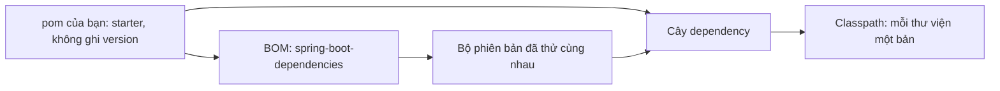
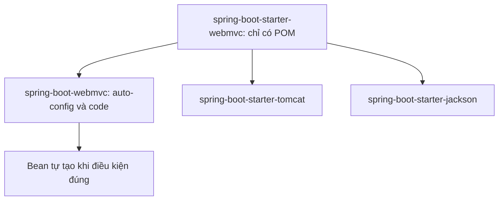
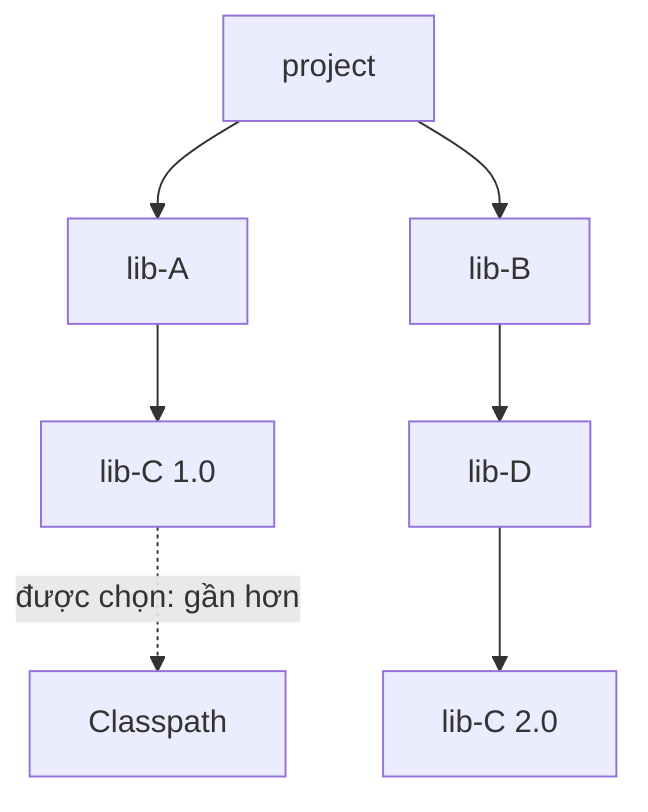
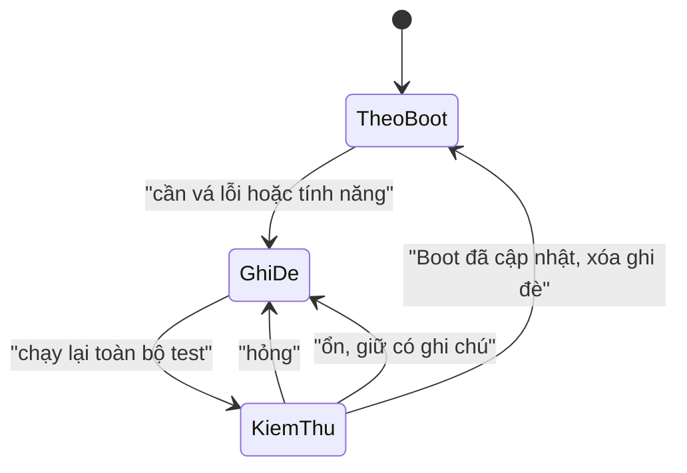
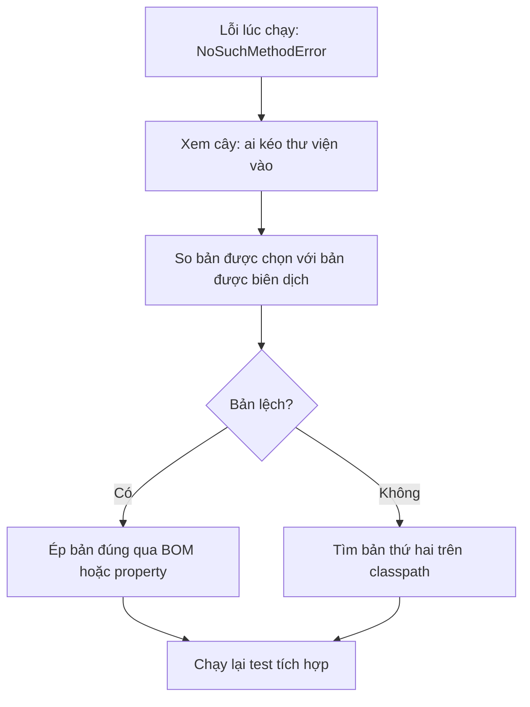
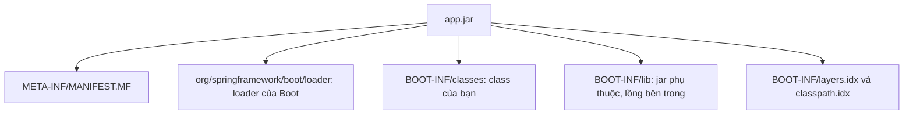
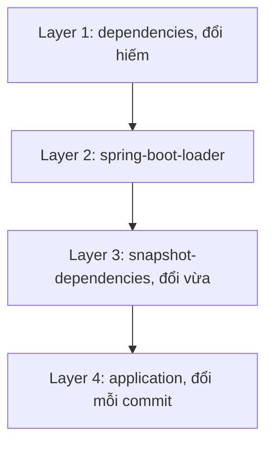

# Lý thuyết 50: Quản lý dependency (BOM, starter), xung đột phiên bản và đóng gói

Một ứng dụng Spring Boot kéo theo hàng trăm file jar. Mỗi jar lại phụ thuộc vào jar khác, và hai jar có thể đòi hai phiên bản khác nhau của cùng một thư viện. Hình dung bạn lắp một cái máy từ linh kiện của nhiều hãng: nếu mỗi hãng tự chọn cỡ ốc, máy sẽ không bao giờ khớp. Spring Boot đưa ra một "bảng cỡ ốc" chung đã được thử cùng nhau, gọi là BOM, và các "bộ linh kiện đóng sẵn" gọi là starter.

Bài này đi từ lý do dependency hỏng, cách Maven và Gradle chọn phiên bản, cách đọc và ghi đè có chủ đích, các lỗi kinh điển, rồi cách đóng gói thành jar và image Docker để cache tốt. Nền tảng build xem [Maven và Gradle](/go?p=08-Java%2FJava-Core%2Fmedium%2Flt-27-build-tool-maven-gradle.md); cơ chế vì sao thêm jar là có bean xem [Auto-configuration](/go?p=01-Spring-Boot%2Fmedium%2Flt-14-autoconfiguration.md).

> **Phiên bản (kiểm tra 2026-10-30):** Spring Boot 4.1.2 (bản ổn định mới nhất trên tài liệu chính thức), 4.0.9 và 3.5.16 vẫn còn được liệt kê. Boot 4 chia thành module nhỏ và starter mịn hơn; loader "classic" của uber-jar đã bị gỡ. Boot 3.5 vẫn dùng starter cũ, ít module hơn. Tên artifact starter phải tra theo bảng migration guide của đúng phiên bản, không đoán.

**Cốt lõi:** Dependency hỏng vì phiên bản được chọn rời rạc: mỗi thư viện khai báo phiên bản nó cần, còn công cụ build phải chọn một bản duy nhất cho cả classpath. Spring Boot gom mọi phiên bản đã thử chung vào một BOM (`spring-boot-dependencies`), và starter chỉ là một POM rỗng liệt kê sẵn các dependency cần cho một chức năng.

- Vì BOM chỉ khai báo phiên bản (không thêm jar nào) nên bạn khai báo dependency không cần ghi version, và cả cây dùng bộ phiên bản đã được Boot thử cùng nhau.
- Vì chỉ một bản của mỗi thư viện vào được classpath nên khi hai nhánh đòi hai phiên bản, một nhánh phải chạy với bản nó không được biên dịch cùng, và lỗi chỉ lộ lúc chạy (`NoSuchMethodError`).
- Vì jar Spring Boot chứa jar lồng trong `BOOT-INF/lib` nên đổi code ứng dụng làm đổi cả khối jar, trừ khi tách theo layer để Docker cache phần dependency ít đổi.



Mô hình tư duy: BOM quyết định "bản nào", starter quyết định "những jar nào", và classpath luôn chỉ giữ một bản cho mỗi thư viện.

**Tóm tắt:**

- Dependency hell là khi hai thư viện đòi hai phiên bản khác nhau của một thư viện thứ ba, hoặc một thư viện bị kéo vào hai tên (`javax` và `jakarta`).
- BOM là POM chỉ có `dependencyManagement`: nó gán phiên bản, không thêm jar. Spring Boot cung cấp `spring-boot-dependencies`, thường được kế thừa qua `spring-boot-starter-parent`.
- Starter là POM gom dependency (và không chứa code ứng dụng). Có jar rồi, auto-configuration mới tự bật bean.
- Maven chọn bản theo "nearest wins" (đường ngắn nhất tới gốc, hòa thì khai báo trước thắng); Gradle mặc định chọn bản cao nhất trong cây.
- Xem cây bằng `mvn dependency:tree` và `gradle dependencies`; ghi đè phiên bản bằng property của Boot là có chủ đích nhưng tự chịu rủi ro tương thích.
- Lỗi kinh điển: `NoSuchMethodError`, `ClassNotFoundException`, hai binding logging, hai bản Jackson, `javax` với `jakarta`.
- Boot 4 chia module nên sau nâng cấp có thể thiếu class cho đến khi thêm đúng starter hoặc dùng tạm starter classic.
- Đóng gói: `spring-boot-maven-plugin` tạo jar thực thi với jar lồng và layer; chọn Dockerfile, Buildpacks hoặc Jib tùy nhu cầu, và đặt phần ít đổi (dependency) ở layer dưới.

## Vấn đề nó giải quyết

Không có BOM, mỗi dự án phải tự tìm bộ phiên bản tương thích cho Spring, Jackson, Hibernate, Tomcat, Logback... và mỗi lần nâng cấp một thư viện có thể làm hỏng thư viện khác. Lỗi thường không lộ lúc biên dịch mà lộ lúc chạy, đôi khi chỉ ở một nhánh code hiếm đi qua. Spring Boot gom bộ phiên bản đã được kiểm thử chung nên bạn chỉ cần chọn một phiên bản Boot.

## Khi nào dùng, khi nào không

Dùng BOM và starter cho gần như mọi dự án Spring Boot. Ghi đè phiên bản chỉ khi có lý do rõ: vá lỗ hổng bảo mật mà Boot chưa cập nhật, hoặc cần một tính năng mới. Mỗi lần ghi đè là bạn rời khỏi bộ phiên bản đã thử, nên cần test lại. Nếu không thể dùng `spring-boot-starter-parent` (đã có parent riêng của công ty), import BOM bằng `scope import` thay vì kế thừa.

## Các khái niệm cần biết

| Khái niệm | Ý nghĩa |
|---|---|
| **BOM** (Bill of Materials) | POM chỉ chứa `dependencyManagement`, gán phiên bản cho nhiều artifact. |
| **`dependencyManagement`** | Khối khai báo phiên bản mặc định; tự nó không thêm dependency vào classpath. |
| **Starter** | Artifact rỗng (chỉ POM) liệt kê dependency cho một chức năng, như `spring-boot-starter-webmvc`. |
| **Transitive dependency** | Dependency bạn không khai báo nhưng được kéo vào qua dependency khác. |
| **Nearest wins** | Quy tắc Maven: khi một artifact xuất hiện nhiều lần, bản ở vị trí gần gốc cây nhất thắng. |
| **Conflict resolution (Gradle)** | Gradle mặc định chọn phiên bản cao nhất trong các yêu cầu; có thể ép bằng constraint hay `strictly`. |
| **Exclusion** | Cắt một nhánh transitive ra khỏi cây. |
| **Jar thực thi (fat jar)** | Jar chứa cả ứng dụng và jar phụ thuộc lồng bên trong, chạy được bằng `java -jar`. |
| **Layered jar** | Jar có `layers.idx` chia nội dung thành layer (dependencies, application...) để dựng image Docker hiệu quả. |
| **SNAPSHOT dependency** | Phiên bản đổi được theo thời gian; đặt riêng một layer vì thay đổi thường xuyên. |

## Starter thật sự là gì

Nhiều người tưởng starter là một thư viện có phép màu. Không phải: nó chỉ là một POM, thường không có class nào, liệt kê dependency. Phép màu (tự tạo bean) nằm ở auto-configuration trong các jar mà starter kéo vào, xem [Auto-configuration](/go?p=01-Spring-Boot%2Fmedium%2Flt-14-autoconfiguration.md).



Cách đọc: mũi tên là "kéo vào". Starter không tạo bean; nó đưa jar có auto-configuration lên classpath, rồi các điều kiện `@ConditionalOn...` quyết định bean nào được tạo. Từ đó hiểu vì sao "thêm một starter là có tính năng" và "xóa starter là mất tính năng".

**Nền tảng:** Starter = POM gom dependency. BOM = bảng phiên bản. Hai thứ khác nhau và thường dùng cùng nhau: BOM nói "bản nào", starter nói "những jar nào". Tính năng xuất hiện nhờ auto-configuration trong jar được kéo vào, không nhờ chính starter.

## Maven chọn phiên bản thế nào

Cây dependency là đồ thị, nhưng classpath chỉ nhận một bản cho mỗi artifact. Maven dùng "nearest wins": đếm số bước từ project của bạn, bản gần hơn thắng; hòa thì bản khai báo trước trong POM thắng. Riêng với `dependencyManagement`, phiên bản trong đó thắng mọi quy tắc trên, kể cả với dependency transitive. Đó chính là cách BOM áp bộ phiên bản của Boot lên toàn cây.



Cách đọc: `lib-C 1.0` cách gốc 2 bước, `lib-C 2.0` cách 3 bước, nên Maven chọn 1.0 dù `lib-D` được biên dịch với 2.0. Nếu `lib-D` gọi một method chỉ có ở 2.0, bạn nhận `NoSuchMethodError` lúc chạy. Gradle ngược lại: mặc định chọn bản cao nhất (2.0), nên cùng một cây có thể cho kết quả khác nhau giữa Maven và Gradle.

**Phải thuộc:** Maven nearest-wins (hòa: khai báo trước thắng), và `dependencyManagement` thắng cả nearest-wins. Gradle mặc định chọn phiên bản cao nhất. Spring Boot Gradle plugin áp bộ phiên bản của BOM qua plugin quản lý dependency của Boot, nên bạn cũng khai báo không cần version.

**Suy luận:** Classpath Java phẳng, mỗi tên class chỉ được nạp từ một jar (jar đứng trước thắng), nên công cụ build buộc phải chọn một bản. Maven chọn theo vị trí trong cây vì nó không biết bản nào "tốt hơn"; Gradle chọn bản cao nhất vì giả định tương thích ngược. Cả hai giả định đều có thể sai. Hệ quả: lỗi do xung đột không thể phát hiện lúc biên dịch trên module riêng lẻ, vì mỗi module đều biên dịch đúng với bản nó đòi. Nó chỉ lộ khi class của bản A gọi vào class của bản B. Cách phòng là để BOM quản lý phiên bản, giữ cây nhỏ, và có test tích hợp chạy đủ các nhánh quan trọng.

## Thấy cây và ghi đè có chủ đích

Trước khi sửa, luôn nhìn cây. Hai lệnh cốt lõi:

```bash
# Maven: toàn cây, hoặc lọc một artifact để xem ai kéo nó vào
mvn dependency:tree
mvn dependency:tree -Dincludes=org.slf4j

# Gradle: cây theo configuration; hỏi riêng một thư viện
gradle dependencies --configuration runtimeClasspath
gradle dependencyInsight --dependency jackson --configuration runtimeClasspath
```

Phiên bản do Boot quản lý có property tên cố định (danh sách ở mục "Version Properties" trong tài liệu Boot). Ghi đè bằng property là cách có chủ đích nhất vì nó chỉ đổi một chỗ và vẫn nằm trong cơ chế BOM:

```xml
<!-- Maven: property trong pom.xml (_Minh họa_, chưa chạy thử) -->
<properties>
    <postgresql.version>42.7.8</postgresql.version>
</properties>
```

```kotlin
// Gradle Kotlin DSL (_Minh họa_, chưa chạy thử)
extra["postgresql.version"] = "42.7.8"
```

Số phiên bản trên chỉ để minh họa cách viết; hãy chọn bản hợp lệ theo thời điểm và kiểm tra tên property chính xác theo trang "Version Properties" của đúng phiên bản Boot. Hậu quả của ghi đè: Boot chỉ kiểm thử với bản nó chọn, nên bạn tự chịu trách nhiệm tương thích. Nâng Boot sau này, property ghi đè của bạn vẫn còn và có thể thấp hơn bản mới của Boot. Quy tắc thực hành: ghi chú lý do cạnh dòng ghi đè (CVE nào, ticket nào) và xóa khi Boot đã đuổi kịp.



Cách đọc: trạng thái mặc định là "theo Boot". Ghi đè là một ngoại lệ có vòng đời: phải kiểm thử, có ghi chú, và có điều kiện để quay về. Ghi đè quên xóa là nguồn nợ kỹ thuật lặng lẽ.

## Các xung đột kinh điển

| Triệu chứng | Nguyên nhân thường gặp | Cách xử lý |
|---|---|---|
| `NoSuchMethodError`, `NoSuchFieldError`, `AbstractMethodError` | Class được biên dịch với bản A nhưng chạy với bản B (method đổi hoặc mất) | `dependency:tree`, tìm bản được chọn, ép về bản đúng bằng BOM hoặc property |
| `ClassNotFoundException`, `NoClassDefFoundError` | Thiếu jar (bị exclude, scope `provided`/`test`, hoặc Boot 4 chuyển class sang module khác) | Thêm đúng dependency, kiểm tra scope |
| Cảnh báo "multiple SLF4J providers" hoặc hai binding logging | Hai thư viện logging cùng trên classpath (ví dụ Logback và Log4j2) | Exclude `spring-boot-starter-logging` rồi dùng đúng starter, hoặc exclude binding thừa |
| Hai bản Jackson (cũ `com.fasterxml.jackson` và mới `tools.jackson`) | Boot 4 dùng Jackson 3 nhưng thư viện bên thứ ba còn dùng Jackson 2 | Chấp nhận hai bản cùng tồn tại (khác package) hoặc dùng `spring-boot-jackson2` tạm thời, đã bị đánh dấu deprecated |
| `javax.*` với `jakarta.*` | Thư viện cũ dùng `javax.servlet`, `javax.persistence` trong khi Boot 3 trở lên dùng `jakarta.*` | Nâng thư viện lên bản hỗ trợ Jakarta, hoặc thay thế; không trộn |

**Phải thuộc:** Spring Boot 3 trở lên dùng namespace `jakarta.*` (Jakarta EE 9 trở lên); thư viện còn `javax.*` sẽ không tương thích. Boot 4 dùng Jackson 3 với package `tools.jackson` và group ID `tools.jackson`, ngoại lệ là `jackson-annotations` vẫn ở `com.fasterxml.jackson.core` và package `com.fasterxml.jackson.annotation`.

**Exclusion** cắt một nhánh transitive khi bạn biết chắc nó thừa hoặc gây xung đột:

```xml
<!-- Loại logback mặc định để dùng Log4j2 (_Minh họa_, chưa chạy thử) -->
<dependency>
    <groupId>org.springframework.boot</groupId>
    <artifactId>spring-boot-starter-webmvc</artifactId>
    <exclusions>
        <exclusion>
            <groupId>org.springframework.boot</groupId>
            <artifactId>spring-boot-starter-logging</artifactId>
        </exclusion>
    </exclusions>
</dependency>
```

Exclusion chỉ có hiệu lực cho dependency khai báo nó. Nếu jar bị loại vẫn được kéo vào qua nhánh khác, nó quay lại; vì vậy luôn kiểm tra lại cây sau khi exclude. Quy trình gỡ lỗi một xung đột:



Cách đọc: đừng đoán. Hai việc luôn làm trước là xem cây và so bản được chọn với bản mà code gọi. Nếu hai bản ngang nhau, nghi có một jar thứ hai chứa cùng class (shaded jar hoặc cùng class ở hai artifact khác tên).

## Boot 4: module nhỏ và starter mịn hơn

Boot 4 tách các jar lớn thành module tập trung. Quy ước theo tài liệu migration: module tên `spring-boot-<technology>` (ví dụ `spring-boot-graphql`), starter tên `spring-boot-starter-<technology>`, và mỗi starter có bản test đi kèm `spring-boot-starter-<technology>-test`. Hệ quả thực tế sau nâng cấp:

- Công nghệ trước đây chỉ cần thư viện bên thứ ba nay cần starter riêng: Flyway và Liquibase nay là `spring-boot-starter-flyway` và `spring-boot-starter-liquibase`. Không thêm thì auto-configuration không có và migration không chạy, dù thư viện vẫn trên classpath.
- Web MVC có starter tên `spring-boot-starter-webmvc`; RestClient và RestTemplate ở `spring-boot-starter-restclient`; WebClient ở `spring-boot-starter-webclient`.
- Test cũng tách: `@WithMockUser` cần `spring-boot-starter-security-test`. Tài liệu cảnh báo không đổi sang starter test tương ứng có thể gây lỗi khó lần ra.
- Mỗi test starter kéo theo `spring-boot-starter-test`, nên không cần khai báo riêng starter đó nữa.

Đường nâng cấp nhanh là "classic starter": `spring-boot-starter-classic` và `spring-boot-starter-test-classic` mang về toàn bộ module nhưng bỏ transitive dependency. Dùng tạm để build chạy lại, sửa import hỏng, rồi xóa classic và thêm từng starter thật. Chi tiết xem [Boot 4 và Framework 7](/go?p=01-Spring-Boot%2Fhard%2Flt-38-boot4-framework7-thay-doi.md).

**Suy luận:** Trước đây một jar `spring-boot-autoconfigure` lớn chứa auto-configuration của mọi công nghệ, nên chỉ cần thêm thư viện là điều kiện `@ConditionalOnClass` thỏa. Chia module làm mục tiêu nhỏ hơn và rõ hơn: mỗi công nghệ có module riêng, nên auto-configuration chỉ có khi module đó có mặt. Nhược điểm là chuyển sự phụ thuộc ngầm thành khai báo tường minh. Triệu chứng sau nâng cấp: app khởi động nhưng một tính năng "biến mất" lặng lẽ (migration không chạy, bean thiếu), hoặc `ClassNotFoundException` ở một class từng nằm trong jar lớn. Cách xử lý là đọc bảng starter, so với import hỏng, và chạy báo cáo điều kiện (`--debug`) để thấy auto-configuration nào không khớp.

## Đóng gói: jar thực thi và jar lồng

`spring-boot-maven-plugin` có goal `repackage` biến jar thường thành jar thực thi: thêm loader của Boot, đặt class của bạn vào `BOOT-INF/classes` và các jar phụ thuộc vào `BOOT-INF/lib`. Java không có cách chuẩn để nạp jar lồng, nên Boot tự mang loader riêng. Cách này khác "shaded jar" (trộn mọi class vào một jar) ở chỗ vẫn thấy được thư viện nào có mặt và không đụng độ tên file giữa các jar. Chạy bằng `java -jar app.jar`; (Gradle tương đương là `bootJar`).



Cách đọc: `java -jar` khởi động loader trước, loader nạp class từ `BOOT-INF/classes` và các jar trong `BOOT-INF/lib` theo thứ tự trong `classpath.idx`. `layers.idx` liệt kê layer (mặc định có `dependencies`, `spring-boot-loader`, `snapshot-dependencies`, `application`) theo thứ tự đưa vào image. Boot chỉ dùng `classpath.idx` khi chạy `java -jar`, không dùng khi chạy từ IDE hay `spring-boot:run`, nên có lỗi "chỉ lỗi trên jar" nghĩa là thứ tự classpath trong jar có thể khác môi trường dev.

## Jib, Buildpacks hay Dockerfile

Ba cách tạo image, mỗi cách đánh đổi khác nhau. Xem thêm nền tảng container ở [Docker và Kubernetes](/go?p=01-Spring-Boot%2Fhard%2Flt-29-docker-kubernetes.md).

| | Dockerfile | Cloud Native Buildpacks (`spring-boot:build-image`) | Jib |
|---|---|---|---|
| Cần Docker daemon | Có | Có | Không (đẩy thẳng lên registry) |
| Bạn viết gì | Dockerfile, tự kiểm soát hoàn toàn | Không viết, cấu hình qua property | Cấu hình plugin Maven hoặc Gradle |
| Layer | Tự tổ chức (extract layers) | Buildpacks tự chia layer, kèm SBOM và memory calculator | Tự chia layer theo dependencies, resources, classes |
| Điểm mạnh | Linh hoạt, quen thuộc | Chuẩn hóa, ít phải bảo trì, cập nhật base image dễ | Nhanh, không cần Docker trong CI, tái lập tốt |
| Điểm yếu | Dễ viết sai layer, tự bảo trì | Image lớn hơn, build chậm lần đầu, cần Docker | Ít kiểm soát chi tiết hệ điều hành |

Chọn thế nào: nếu CI không có Docker hoặc muốn nhanh, Jib là lựa chọn nhẹ. Nếu tổ chức muốn chuẩn hóa nhiều dịch vụ mà không ai phải bảo trì Dockerfile, Buildpacks hợp. Nếu cần tùy biến sâu (thêm gói hệ điều hành, hardening riêng), dùng Dockerfile. Tên builder mặc định và tham số của build-image tra theo trang "Packaging OCI Images" đúng phiên bản.

### Thứ tự layer để cache tốt

Docker cache theo layer: layer đổi thì mọi layer phía sau phải dựng lại. Vì vậy đặt thứ ít đổi ở dưới, thứ hay đổi ở trên. Trong một ứng dụng, dependency đổi hiếm (khi nâng thư viện), còn code đổi mỗi commit. Nếu nhét tất cả vào một layer (một fat jar vài chục MB), mỗi commit đẩy lại toàn bộ.



Cách đọc: thứ tự trên cùng là layer dựng đầu. Khi bạn sửa một dòng code, chỉ layer `application` (thường vài trăm KB) dựng lại, ba layer dưới lấy từ cache. Đó là lý do ứng dụng Spring Boot cần layered jar thay vì sao chép nguyên jar.

```dockerfile
# Dockerfile nhiều giai đoạn, trích layer từ jar (_Minh họa_, chưa chạy thử)
FROM eclipse-temurin:21-jre AS builder
WORKDIR /builder
COPY target/app.jar application.jar
RUN java -Djarmode=tools -jar application.jar extract --layers --destination extracted

FROM eclipse-temurin:21-jre
WORKDIR /application
COPY --from=builder /builder/extracted/dependencies/ ./
COPY --from=builder /builder/extracted/spring-boot-loader/ ./
COPY --from=builder /builder/extracted/snapshot-dependencies/ ./
COPY --from=builder /builder/extracted/application/ ./
ENTRYPOINT ["java", "-jar", "application.jar"]
```

Lệnh `-Djarmode=tools ... extract --layers` là cách Boot 3.3 trở lên dùng (thay cho `layertools` cũ); kiểm tra lại cú pháp theo trang Dockerfiles của phiên bản bạn dùng. Dùng JRE thay vì JDK để image nhỏ hơn, và đừng chạy bằng root trong môi trường thật.

## Bẫy thường gặp

- Ghi version cho artifact đã được BOM quản lý: bản của bạn thắng, phá bộ phiên bản đã thử cùng nhau, và quên cập nhật khi nâng Boot.
- Khai báo cả `spring-boot-starter-parent` lẫn import BOM mà không hiểu cái nào thắng; khi có xung đột, dựa vào `dependency:tree` thay vì đoán.
- Tin rằng exclusion một lần là xong; jar loại vẫn có thể quay lại qua nhánh khác.
- Dùng `latest` hoặc khoảng phiên bản (`[1.0,)`) cho dependency: build không tái lập.
- Nâng Boot 4 nhưng chỉ đổi số phiên bản, bỏ qua bảng starter mới nên tính năng mất lặng lẽ.
- Copy cả jar vào image trong một layer, nên mỗi commit đẩy lại hàng chục MB.
- Chạy được trong IDE nhưng hỏng trên `java -jar`: thứ tự classpath và loader khác nhau; luôn thử lại bằng jar đã đóng gói.

## Phỏng vấn khó: chuỗi hỏi xoáy

Người phỏng vấn senior thường mở bằng một câu dễ, rồi xoáy xuống cơ chế, đánh đổi và sự cố thật. Câu trả lời tốt đi từ cốt lõi xuống, không nhảy thẳng vào chi tiết.

### Chuỗi 1: BOM và starter

1. **Câu mở:** Khai báo `spring-boot-starter-webmvc` mà không ghi version, version lấy ở đâu?
2. **Xoáy 1:** Starter có chứa code không? Vậy tính năng đến từ đâu?
3. **Xoáy 2:** Không dùng `spring-boot-starter-parent` thì làm sao vẫn có bộ phiên bản của Boot?

**Đáp án ngắn:** Version đến từ BOM `spring-boot-dependencies`, thường kế thừa qua `spring-boot-starter-parent`. BOM chỉ có `dependencyManagement`, gán phiên bản mà không thêm jar nào. Starter là POM gom dependency, không chứa code ứng dụng; tính năng đến từ auto-configuration trong các jar được kéo vào và các điều kiện `@ConditionalOn...`. Nếu không thể kế thừa parent, import BOM bằng `scope import` trong `dependencyManagement`, hoặc dùng plugin Gradle của Boot để áp bộ phiên bản. Đánh đổi là bạn bị khóa vào bộ phiên bản Boot đã thử, đổi lại tránh được xung đột. Trên production, điều cần nhớ là một lần nâng Boot đổi hàng chục phiên bản cùng lúc, nên cần test tích hợp đủ rộng. Ghi đè từng phiên bản chỉ khi có lý do và có ghi chú.

**Sai lầm hay gặp:**
- Nói "starter là thư viện có phép màu".
- Nhầm BOM với dependency thật (BOM không thêm jar).
- Quên rằng `dependencyManagement` thắng cả nearest-wins.

### Chuỗi 2: Xung đột phiên bản lúc chạy

1. **Câu mở:** Sau khi nâng một thư viện, production ném `NoSuchMethodError` nhưng build và test đều xanh. Vì sao?
2. **Xoáy 1:** Maven và Gradle chọn phiên bản khác nhau thế nào, và điều đó ảnh hưởng ra sao?
3. **Xoáy 2:** Bạn gỡ lỗi từng bước ra sao và sửa theo hướng nào?

**Đáp án ngắn:** Class gọi được biên dịch với bản A của thư viện nhưng lúc chạy classpath chỉ giữ bản B, nên method không còn. Lỗi không lộ lúc biên dịch vì mỗi module biên dịch đúng với bản nó đòi; nó chỉ lộ khi nhánh code đó thật sự chạy, và test không phủ nhánh ấy thì vẫn xanh. Maven dùng nearest-wins (hòa thì khai báo trước thắng), còn Gradle mặc định chọn bản cao nhất, nên cùng một cây có thể cho hai kết quả. Gỡ lỗi: `mvn dependency:tree` hoặc `gradle dependencyInsight`, xem ai kéo thư viện vào, so bản được chọn với bản được biên dịch, và kiểm tra có jar thứ hai chứa cùng class không. Sửa bằng cách để BOM quản lý bản đó, hoặc ghi đè property có ghi chú, hoặc exclude nhánh sai. Phòng ngừa là giữ cây dependency nhỏ, nâng version từng bước, và có test tích hợp phủ các đường đi chính.

**Sai lầm hay gặp:**
- Đoán nguyên nhân thay vì xem cây dependency.
- Ép phiên bản mà không chạy lại test tích hợp.
- Exclude một lần rồi không kiểm tra lại cây.

### Chuỗi 3: Đóng gói và image

1. **Câu mở:** Vì sao ứng dụng Spring Boot đóng gói thành jar lồng thay vì shaded jar?
2. **Xoáy 1:** Layered jar giúp gì cho image Docker, và layer nào đổi nhiều nhất?
3. **Xoáy 2:** Chọn giữa Dockerfile, Buildpacks và Jib thế nào trong CI không có Docker?

**Đáp án ngắn:** Java không có cách chuẩn để nạp jar lồng, nên Boot mang loader riêng và đặt dependency vào `BOOT-INF/lib`. Cách này giữ được danh sách thư viện và không đụng độ tên file giữa các jar như shaded jar. Layered jar chia nội dung thành layer (`dependencies`, `spring-boot-loader`, `snapshot-dependencies`, `application`) theo thứ tự ít đổi tới hay đổi. Docker cache theo layer, nên sửa code chỉ dựng lại layer `application` nhỏ, còn dependency lấy từ cache. Trong CI không có Docker, Jib đẩy image thẳng lên registry mà không cần daemon; Buildpacks cần Docker nhưng chuẩn hóa và kèm SBOM; Dockerfile cho kiểm soát tối đa nhưng phải tự bảo trì. Thực tế production còn phải xét chạy non-root, dùng JRE, và quét lỗ hổng image.

**Sai lầm hay gặp:**
- Copy cả fat jar vào một layer nên cache vô dụng.
- Nói Jib hay Buildpacks "luôn tốt hơn" mà không nêu đánh đổi.
- Quên rằng `classpath.idx` chỉ áp dụng khi chạy `java -jar`.

## Câu hỏi tự kiểm tra

**Câu 1.** Maven thấy `lib-C 1.0` ở độ sâu 2 và `lib-C 2.0` ở độ sâu 3. Bản nào vào classpath, và điều gì xảy ra nếu code gọi method chỉ có ở 2.0?

*Gợi ý suy luận:* nearest-wins xét khoảng cách tới gốc; classpath chỉ một bản; lỗi lộ ở đâu.

*Lập luận và đáp án:* Maven chọn 1.0 vì gần gốc hơn. Code của nhánh sâu hơn được biên dịch với 2.0 nên gọi method có ở 2.0, nhưng lúc chạy chỉ có 1.0, nên ném `NoSuchMethodError` khi nhánh đó chạy. Sửa bằng cách ép bản 2.0 qua `dependencyManagement`. Gradle mặc định chọn 2.0, nên cùng cây có thể cho kết quả khác.

**Câu 2.** Sau khi nâng lên Boot 4, Flyway không còn chạy migration dù `flyway-core` vẫn trong `pom.xml`. Giải thích và cách sửa.

*Gợi ý suy luận:* auto-configuration nằm ở module nào; starter đảm nhiệm gì.

*Lập luận và đáp án:* Boot 4 chia module: auto-configuration của Flyway nằm trong module riêng, được kéo vào bởi `spring-boot-starter-flyway`. Chỉ có thư viện `flyway-core` thì không có auto-configuration nên không có bean và migration không chạy, và không có lỗi rõ ràng. Thêm `spring-boot-starter-flyway`, và có thể dùng starter classic tạm thời để build chạy lại trước khi dọn dẹp.

**Câu 3.** Vì sao một commit chỉ sửa một dòng code lại làm CI đẩy cả 80MB image lên registry?

*Gợi ý suy luận:* mọi thứ trong cùng một layer; cache theo layer.

*Lập luận và đáp án:* Nếu fat jar nằm trong một layer duy nhất, đổi một byte làm layer đó thay đổi và phải đẩy lại toàn bộ. Với layered jar, dependency (phần lớn dung lượng) ở layer dưới không đổi nên được cache, chỉ layer `application` nhỏ phải đẩy.

**Câu 4.** Bạn ghi đè `postgresql.version` để vá một lỗ hổng. Nửa năm sau nâng Boot lên bản mới đã có bản driver cao hơn. Rủi ro là gì và quản lý ra sao?

*Gợi ý suy luận:* property của bạn thắng bản của BOM mới.

*Lập luận và đáp án:* Property của bạn vẫn áp, nên bạn đang chạy bản thấp hơn bản Boot mới đã thử, có thể mất bản vá khác hoặc lệch tương thích. Quản lý bằng ghi chú lý do cạnh dòng ghi đè (CVE, ticket), và khi nâng Boot thì rà lại các ghi đè để xóa những cái đã dư.

Nguồn: tài liệu chính thức Spring Boot 4.1.2 (Nested JARs, Dockerfiles, Maven Plugin Packaging OCI Images) và Spring Boot 4.0 Migration Guide (modularization, starters, classic starters, Jackson 3), tra ngày 2026-10-30. Phần Jib và quy tắc Maven nearest-wins, Gradle highest-wins dựa trên kiến thức chung, chưa tra lại trong phiên này.

