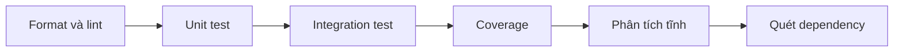
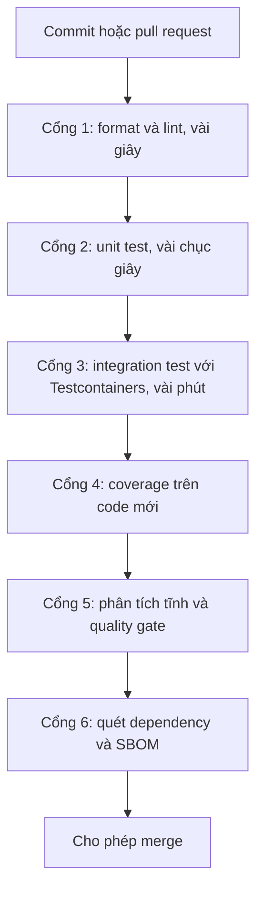
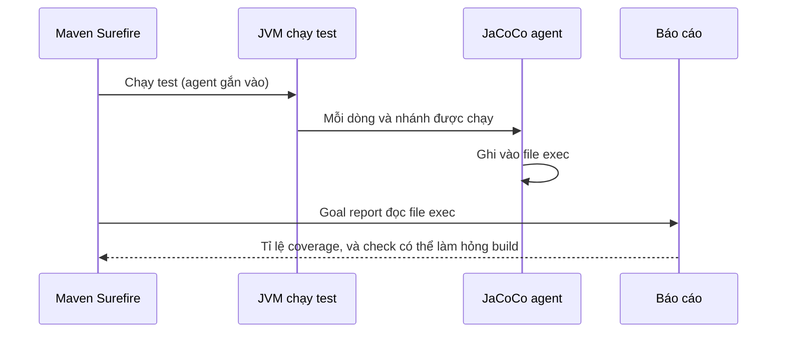
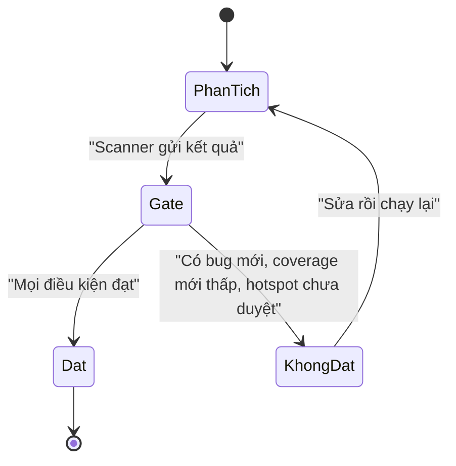
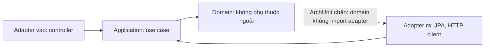
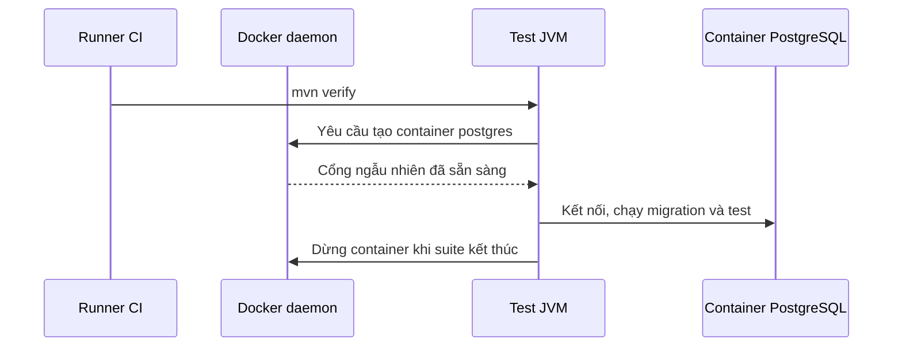
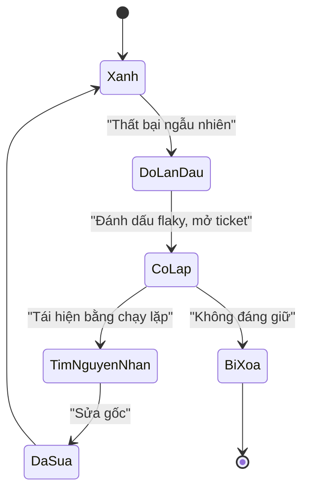

# Lý thuyết 51: Chất lượng code trong pipeline (JaCoCo, SonarQube, Checkstyle, Spotless, ArchUnit, Testcontainers)

Viết code đúng một lần chưa đủ; bạn cần một cơ chế để mọi commit sau đó cũng đúng. Pipeline CI là cơ chế đó: một dãy cổng kiểm tra tự động, mỗi cổng bắt một loại lỗi khác nhau, và commit chỉ qua khi mọi cổng xanh. Hình dung cửa an ninh sân bay: kiểm tra vé, soi hành lý, quét kim loại, mỗi chặng bắt một loại rủi ro và chặng rẻ đứng trước.

Bài này nói về vai trò từng công cụ, thứ tự cổng, và quan trọng hơn là chúng đo gì và không đo gì. Kiến thức kiểm thử nền xem [Testing cơ bản](/go?p=01-Spring-Boot%2Feasy%2Flt-12-testing-co-ban.md) và [Kiểm thử JUnit, Mockito](/go?p=08-Java%2FJava-Core%2Fmedium%2Flt-29-kiem-thu-junit-mockito.md); kiểm thử nâng cao ở [Advanced testing](/go?p=01-Spring-Boot%2Fhard%2Flt-27-advanced-testing.md).

> **Phiên bản (kiểm tra 2026-10-30):** Dòng chính Spring Boot 4.1 (4.1.2 là bản ổn định mới nhất trên tài liệu chính thức), Boot 3.5 vẫn được hỗ trợ. Tên artifact và phiên bản các công cụ ngoài Spring (JaCoCo, SonarQube, Checkstyle, Spotless, ArchUnit, Testcontainers, PIT, OWASP Dependency-Check) chưa được tra lại trong phiên này: hãy kiểm tra tài liệu và giấy phép của đúng phiên bản bạn dùng, đặc biệt Testcontainers (từ dòng 2.x tên module có thể khác).

**Cốt lõi:** Chất lượng không thể dựa vào kỷ luật cá nhân vì người review bỏ sót và con người mệt, nên ta dịch các kỳ vọng thành cổng tự động trong pipeline. Mỗi công cụ chỉ bắt một loại lỗi nhất định, vì vậy không có cổng nào đủ một mình và thứ tự cổng quyết định tốc độ phản hồi.

- Vì mỗi công cụ chỉ nhìn một khía cạnh (định dạng, mẫu lỗi, độ phủ, kiến trúc, lỗ hổng) nên pipeline cần nhiều cổng và không con số nào trong số đó đại diện cho "chất lượng".
- Vì coverage chỉ đo "dòng nào đã chạy" chứ không đo "có kiểm tra gì không" nên coverage cao vẫn có thể là test rỗng (không có assert).
- Vì cổng rẻ và nhanh nên đặt trước, cổng chậm đặt sau, để lỗi lặt vặt bị chặn sớm trước khi tốn phút CI.



Mô hình tư duy: pipeline là phễu; cổng nhanh và rẻ chặn lỗi đơn giản trước, cổng đắt chỉ chạy trên code đã sạch.

**Tóm tắt:**

- Pipeline có các cổng: format, lint, unit test, integration test, coverage, phân tích tĩnh, quét lỗ hổng dependency; thứ tự đi từ nhanh tới chậm.
- JaCoCo đo dòng, nhánh, method nào đã chạy trong test; không đo test có kiểm tra đúng không.
- Coverage cao không bằng test tốt; ngưỡng hợp lý thường nằm ở coverage trên code mới, không ép con số toàn dự án.
- Mutation testing (PIT) sửa code rồi xem test có bắt lỗi không, đo chất lượng test sát hơn coverage nhưng chạy chậm.
- SonarQube gom phân tích tĩnh thành quality gate: bug, code smell, security hotspot, technical debt, theo "new code".
- Checkstyle, Spotless, SpotBugs, Error Prone mỗi cái một vai: phong cách, tự định dạng, bắt lỗi bytecode, bắt lỗi lúc biên dịch.
- ArchUnit biến quy tắc kiến trúc (layer, cycle) thành test, rất hợp để giữ Hexagonal.
- Testcontainers cần Docker trong CI; test flaky phải được cô lập và sửa nguyên nhân, không chỉ retry.

## Vấn đề nó giải quyết

Không có cổng tự động, chất lượng phụ thuộc vào người review. Review bắt được vấn đề thiết kế nhưng tệ ở việc soi định dạng, import thừa, null chưa kiểm tra, hay lỗ hổng trong thư viện. Dồn những việc đó cho máy giải phóng người review cho việc con người làm tốt: thiết kế, tên gọi, và đúng nghiệp vụ. Pipeline cũng là bằng chứng lặp lại được rằng mỗi bản phát hành đã qua cùng một chuẩn.

## Khi nào dùng, khi nào không

Dùng cổng rẻ (format, lint, unit test) ngay từ ngày đầu. Thêm phân tích tĩnh và quét dependency khi dự án có nhiều người hoặc chạy production. ArchUnit đáng giá khi kiến trúc có quy tắc rõ (Hexagonal, module). Không nên: đặt ngưỡng coverage 90 phần trăm cứng cho toàn dự án (khuyến khích viết test rỗng), bật mọi luật Sonar hay Checkstyle một lúc (hàng nghìn cảnh báo khiến cả đội bỏ qua), hoặc coi test e2e nặng như cổng cho mọi commit.

## Các khái niệm cần biết

| Khái niệm | Ý nghĩa |
|---|---|
| **Quality gate** | Tập điều kiện đạt/không đạt (ví dụ coverage code mới, không có bug nghiêm trọng mới) mà commit phải qua. |
| **Line, branch coverage** | Tỉ lệ dòng, nhánh (`if`, `switch`) đã chạy trong test. |
| **New code** | Phần code thay đổi từ một mốc (nhánh gốc, phiên bản trước); gate nên đặt ở đây. |
| **Code smell** | Mùi thiết kế hay bảo trì kém nhưng chưa hẳn là lỗi (method quá dài, trùng lặp). |
| **Security hotspot** | Đoạn code nhạy cảm bảo mật cần người xem xét, chưa chắc là lỗ hổng. |
| **Technical debt** | Ước lượng thời gian sửa các vấn đề đã phát hiện. |
| **Mutation testing** | Cố tình sửa code (đổi `>` thành `>=`) rồi xem test có thất bại; test không bắt được là "mutant sống sót". |
| **SBOM** | Danh mục thành phần phần mềm (thư viện, phiên bản), dùng để biết mình có chịu ảnh hưởng của một CVE không. |
| **Flaky test** | Test lúc xanh lúc đỏ với cùng code. |

## Thứ tự các cổng

Nguyên tắc: chạy cái nhanh và rẻ trước, và chạy song song những cổng độc lập.



Cách đọc: một cổng đỏ dừng cả dãy phía sau, nên lỗi đơn giản (chưa format, thiếu import) không tốn thời gian chờ integration test. Cổng quét dependency thường chạy theo lịch (hằng ngày) bên cạnh mỗi pull request, vì lỗ hổng mới được công bố cả khi code của bạn không đổi.

**Nền tảng:** Không cổng nào chứng minh code đúng. Mỗi cổng chỉ loại một nhóm lỗi: format bắt phong cách, unit test bắt logic cục bộ, integration test bắt lỗi ghép nối (SQL, cấu hình), phân tích tĩnh bắt mẫu lỗi, quét dependency bắt lỗ hổng đã biết. Thiếu một nhóm thì có một khoảng mù.

## JaCoCo: đo gì và không đo gì

JaCoCo gắn một agent vào JVM khi chạy test, ghi lại dòng và nhánh bytecode nào đã được thực thi, rồi sinh báo cáo. Maven: goal `prepare-agent` gắn agent, `report` sinh báo cáo, `check` áp luật ngưỡng.



Cách đọc: coverage là bản ghi "bytecode đã được chạm vào", sinh ra như phụ phẩm khi test chạy. Nó không biết test có kiểm tra kết quả hay không.

JaCoCo không đo: test có assert gì (một test gọi hết method mà không assert vẫn cho 100 phần trăm), điều kiện biên và dữ liệu (một nhánh chạy với một giá trị), hành vi đồng thời, code bị bỏ qua (ví dụ class bị loại khỏi báo cáo), và đường tích hợp thật nếu bạn mock hết. Branch coverage trung thực hơn line coverage, vì một dòng `if (a && b)` có thể được tính phủ dù chỉ chạy một nhánh.

**Phải thuộc:** Coverage đo mức thực thi, không đo mức kiểm tra. Coverage thấp chứng minh có code chưa được test; coverage cao không chứng minh code được test tốt. Đừng dùng coverage như mục tiêu (định luật Goodhart: khi một thước đo thành mục tiêu, nó mất giá trị đo).

```java
// Coverage 100% nhưng không kiểm tra gì (_Minh họa_, chưa chạy thử)
@Test
void khongAssert() {
    new GiaService().tinh(100, 0.1);   // chạy hết dòng, không so kết quả
}

@Test
void testThat() {
    assertEquals(90, new GiaService().tinh(100, 0.1));
    assertThrows(IllegalArgumentException.class, () -> new GiaService().tinh(-1, 0.1));
}
```

**Suy luận:** Vì agent chỉ đánh dấu bytecode đã chạy, mọi sự kiện "không bị ném lỗi" đều tính là đã phủ. Từ đó suy ra ba điều. Một: ngưỡng cao toàn cục làm đội viết test rỗng để đạt số. Hai: số coverage chỉ có nghĩa khi đi kèm review chất lượng assert. Ba: đặt ngưỡng trên code mới (ví dụ 80 phần trăm cho phần thay đổi) hợp lý hơn đặt trên toàn dự án, vì nó không bắt cả đội trả nợ cũ một lúc và không đổi mỗi khi xóa code. Thực tế: dùng coverage để tìm vùng chưa được test, không để chứng nhận vùng đã được test.

### Mutation testing (PIT) ở mức giới thiệu

PIT tạo ra nhiều biến thể "đột biến" của code (đổi điều kiện, bỏ lệnh gọi, đổi giá trị trả về), chạy lại test, và đếm mutant bị giết (test thất bại) so với sống sót. Mutant sống sót nghĩa là test không phát hiện thay đổi, nên đo chất lượng assert sát hơn coverage. Cái giá là chạy rất chậm (nhiều lần chạy test), nên thường chạy theo lịch hoặc chỉ trên code thay đổi, không cho mọi commit. Với JUnit 5 cần plugin tích hợp tương ứng; kiểm tra tài liệu PIT cho phiên bản của bạn.

## SonarQube và quality gate

SonarQube phân tích mã nguồn (và đọc báo cáo coverage từ JaCoCo) để gom kết quả vào một dashboard và quality gate. Điểm quan trọng là khái niệm "new code": gate mặc định đánh giá phần thay đổi, nên dự án cũ nhiều nợ vẫn có thể "sạch từ bây giờ" mà không phải sửa hết quá khứ.



Cách đọc: quality gate là điểm chốt nhị phân (đạt hoặc không) của một lần phân tích. Pipeline chặn merge dựa vào trạng thái này (tùy cấu hình webhook hoặc bước chờ gate).

Phân loại kết quả: **bug** là code nhiều khả năng sai; **vulnerability** là lỗ hổng bảo mật chắc chắn hơn; **security hotspot** là chỗ nhạy cảm cần người duyệt (ví dụ dùng regex tự tạo, sinh số ngẫu nhiên); **code smell** là vấn đề bảo trì; **technical debt** là ước lượng thời gian để sửa. Điều kiện gate điển hình theo "new code": không có bug hoặc lỗ hổng mới, hotspot mới đã được duyệt, coverage code mới đạt ngưỡng, trùng lặp mới dưới ngưỡng. Con số cụ thể nên kiểm tra theo gate mặc định của phiên bản bạn dùng, và tên phiên bản miễn phí, giấy phép, giới hạn nhánh khác nhau giữa các bản, nên kiểm tra lại trước khi chọn.

## Các công cụ phân tích tĩnh và định dạng

Mỗi công cụ có một vai riêng; đừng bật tất cả với cấu hình mặc định.

| Công cụ | Vai trò | Đặt ở đâu |
|---|---|---|
| **Spotless** | Tự định dạng code theo một chuẩn (ví dụ google-java-format), có `check` và `apply` | Cổng đầu, hoặc pre-commit |
| **Checkstyle** | Kiểm tra quy ước phong cách và một số luật cấu trúc (đặt tên, Javadoc) | Cổng đầu |
| **SpotBugs** | Phân tích bytecode tìm mẫu lỗi (null, so sánh sai, tài nguyên không đóng) | Sau biên dịch |
| **Error Prone** | Plugin của `javac`, bắt lỗi thật ngay lúc biên dịch, kèm gợi ý sửa | Lúc biên dịch |
| **SonarQube** | Gom nhiều luật, theo dõi xu hướng, quality gate | Cổng phân tích |

Ranh giới: Spotless và Checkstyle thường chồng nhau về định dạng; chọn một công cụ làm "người định dạng" (Spotless tự sửa) và để Checkstyle chỉ giữ những luật nó làm tốt hơn, tránh hai công cụ cãi nhau về cùng một dòng. Mục tiêu của lint là chặn lỗi thật với rất ít báo động giả; luật gây nhiễu sẽ bị cả đội nhắm mắt qua.

```xml
<!-- Spotless: kiểm tra định dạng trong build (_Minh họa_, chưa chạy thử; kiểm tra phiên bản plugin) -->
<plugin>
    <groupId>com.diffplug.spotless</groupId>
    <artifactId>spotless-maven-plugin</artifactId>
    <configuration>
        <java>
            <googleJavaFormat/>
        </java>
    </configuration>
    <executions>
        <execution>
            <goals><goal>check</goal></goals>
        </execution>
    </executions>
</plugin>
```

CI chạy `check` (đỏ nếu chưa format); lập trình viên chạy `spotless:apply` ở máy local để sửa. Tách hai việc này giúp CI không tự sửa code.

## ArchUnit: kiểm tra kiến trúc bằng test

Quy tắc kiến trúc ghi trong tài liệu sẽ mục dần; ArchUnit biến chúng thành test chạy cùng unit test, nên vi phạm làm build đỏ. Ví dụ điển hình: lớp domain không được phụ thuộc vào framework hoặc adapter, controller không gọi repository trực tiếp, và không có vòng phụ thuộc giữa các package.



Cách đọc: các mũi tên liền là phụ thuộc hợp lệ trong Hexagonal (adapter trỏ vào trong, domain ở giữa). Mũi tên đứt là điều ArchUnit cấm. Xem thêm [Hexagonal, DDD, Modulith](/go?p=01-Spring-Boot%2Fhard%2Flt-24-hexagonal-ddd-modulith.md).

```java
// ArchUnit (_Minh họa_, chưa chạy thử; kiểm tra artifact archunit-junit5 theo phiên bản)
@AnalyzeClasses(packages = "com.example.shop")
class ArchitectureTest {

    @ArchTest
    static final ArchRule domainKhongPhuThuocAdapter =
        noClasses().that().resideInAPackage("..domain..")
            .should().dependOnClassesThat().resideInAnyPackage("..adapter..", "org.springframework..");

    @ArchTest
    static final ArchRule khongCoVong =
        slices().matching("com.example.shop.(*)..").should().beFreeOfCycles();

    @ArchTest
    static final ArchRule layers = layeredArchitecture().consideringAllDependencies()
        .layer("Web").definedBy("..web..")
        .layer("Service").definedBy("..service..")
        .layer("Persistence").definedBy("..persistence..")
        .whereLayer("Web").mayNotBeAccessedByAnyLayer()
        .whereLayer("Persistence").mayOnlyBeAccessedByLayers("Service");
}
```

Giới hạn của ArchUnit: nó chỉ biết phụ thuộc giữa class, không biết ý nghĩa nghiệp vụ; luật quá chặt sinh cảnh báo giả. Spring Modulith cũng kiểm tra ranh giới module, nên khi đã dùng Modulith, chọn một công cụ chính cho từng loại luật để khỏi trùng lặp.

**Suy luận:** Kiến trúc xuống cấp vì mỗi vi phạm riêng lẻ nhìn vô hại (một import thêm), và review khó thấy chúng lẫn trong diff lớn. Một quy tắc đã viết thành test thì vi phạm lộ ngay ở commit gây ra nó, chứ không ở lần "dọn dẹp" sau hai năm. Vì vậy test kiến trúc rẻ và rất hiệu quả, nhưng chỉ bắt được các quy tắc mà bạn đã chủ động viết.

## Testcontainers trong CI

Testcontainers chạy dịch vụ thật (PostgreSQL, Kafka) trong container cho test tích hợp, nên test gần với production hơn so với H2 hay mock. Đổi lại CI phải có Docker. Với Spring Boot, `@ServiceConnection` nối thông tin kết nối của container vào cấu hình tự động. Boot có module `spring-boot-testcontainers` (có trong danh sách module của tài liệu); tên artifact của chính Testcontainers (đặc biệt module PostgreSQL) cần kiểm tra theo phiên bản.

```java
// _Minh họa_, chưa chạy thử; kiểm tra import và artifact theo phiên bản Testcontainers
@SpringBootTest
@Testcontainers
class DonHangRepositoryIT {

    @Container
    @ServiceConnection
    static PostgreSQLContainer postgres = new PostgreSQLContainer("postgres:17");

    @Autowired DonHangRepository repo;

    @Test
    void luuVaDoc() {
        var saved = repo.save(new DonHang("A-1"));
        assertTrue(repo.findById(saved.getId()).isPresent());
    }
}
```

Vấn đề trong CI:

- **Docker trong CI:** runner phải có Docker daemon. Nếu job chạy trong container, có hai hướng: gắn socket Docker của host (nhanh, nhưng container job có quyền lớn trên host) hoặc Docker-in-Docker (cô lập hơn, tốn tài nguyên và cần chạy đặc quyền). Kiểm tra chính sách bảo mật của tổ chức trước khi chọn.
- **Thời gian:** mỗi lớp test tạo container riêng sẽ chậm. Dùng một container dùng chung cho cả suite (static container hoặc base class chung) và kéo image sẵn từ registry nội bộ.
- **Reuse:** chế độ reuse giữ container giữa các lần chạy để tăng tốc ở máy dev, cần bật opt-in ở cấu hình Testcontainers; nên tắt trong CI để mỗi lần chạy sạch và tái lập.
- **Dữ liệu:** mỗi test phải tự dọn hoặc dùng transaction rollback; một container dùng chung mà test dính dữ liệu của nhau là nguồn flaky kinh điển.



Cách đọc: test JVM không biết cổng cố định; Testcontainers cấp cổng ngẫu nhiên và `@ServiceConnection` nối nó vào datasource. Vì vậy hai job CI cùng chạy trên một máy không đụng cổng của nhau.

## Quét dependency và SBOM

Lỗ hổng nằm trong thư viện bạn dùng (kể cả transitive) nhiều không kém lỗ hổng trong code bạn viết. Hai cách bổ sung nhau:

- **Phát hiện:** OWASP Dependency-Check đối chiếu dependency với cơ sở dữ liệu lỗ hổng công khai; lần chạy đầu tải dữ liệu lớn và thường cần khóa API của nguồn dữ liệu để không bị giới hạn tốc độ (kiểm tra điều kiện hiện tại). Cho kết quả có báo động giả (khớp tên sai), nên cần cơ chế bỏ qua có ghi lý do.
- **Tự động cập nhật:** Dependabot hoặc Renovate mở pull request nâng phiên bản, kèm CI chạy lại test. Giá trị nằm ở việc nâng nhỏ và thường xuyên thay vì dồn một lần nâng lớn rủi ro.
- **SBOM:** danh mục thành phần (định dạng như CycloneDX hoặc SPDX) sinh trong build. Khi một CVE mới công bố, SBOM giúp trả lời "chúng ta có dùng bản bị ảnh hưởng không" trong vài phút. Actuator của Boot có endpoint `sbom` và Buildpacks có thể đính SBOM vào image; chi tiết cấu hình tra tài liệu.

Cây dependency do BOM quyết định, nên nâng bản Boot thường vá nhiều CVE cùng lúc; xem [quản lý dependency](/go?p=01-Spring-Boot%2Fmedium%2Flt-50-dependency-management-bom-starter-dong-goi.md). Nếu bạn ghi đè phiên bản để vá một CVE, nhớ ghi chú để gỡ khi Boot đã cập nhật.

## Test flaky và cách xử lý

Test flaky phá hủy niềm tin vào pipeline: khi mọi người quen với "chạy lại là xanh", họ bỏ qua cả lần đỏ có thật. Nguyên nhân hay gặp: phụ thuộc thời gian thực (`Thread.sleep`, đồng hồ hệ thống), thứ tự test, dữ liệu dùng chung, cổng hoặc tài nguyên cố định, bất đồng bộ không chờ đúng, và dịch vụ ngoài thật.



Cách đọc: đường đi đúng là cô lập, tìm nguyên nhân gốc, rồi sửa hoặc xóa. Retry mù là cách tạm ẩn vấn đề, không phải một trạng thái trong vòng này.

Cách xử lý theo thứ tự: tái hiện bằng chạy lặp nhiều lần (và đổi thứ tự); thay `sleep` bằng cơ chế chờ có điều kiện (ví dụ Awaitility) hoặc inject `Clock` để điều khiển thời gian; cô lập dữ liệu cho từng test; loại cổng cố định. Trong lúc chờ sửa, chuyển test vào nhóm "quarantine" chạy riêng và không chặn merge, nhưng đặt thời hạn. Retry tự động chỉ nên là bước tạm, có đếm số lần để thấy xu hướng, vì nó che cả lỗi race condition thật của code.

## Bẫy thường gặp

- Ép ngưỡng coverage cao toàn dự án: đội viết test không assert để đạt số.
- Bật toàn bộ luật Sonar và Checkstyle cùng lúc: hàng nghìn cảnh báo, mọi người bỏ qua.
- Hai công cụ định dạng cùng sửa một thứ và xung đột nhau.
- Chạy mọi thứ tuần tự: pipeline dài, cổng chậm đặt trước cổng nhanh.
- Test tích hợp dùng H2 thay cho PostgreSQL: khác biệt SQL và hành vi che mất lỗi thật; Testcontainers trung thực hơn.
- Dùng reuse container trong CI hoặc dữ liệu chia sẻ giữa test: kết quả không tái lập.
- Quét dependency chỉ chạy khi có commit: lỗ hổng mới công bố giữa hai commit không bị phát hiện.
- Xử lý flaky bằng retry vô hạn, che cả lỗi đồng thời thật.

## Phỏng vấn khó: chuỗi hỏi xoáy

Người phỏng vấn senior thường mở bằng một câu dễ, rồi xoáy xuống cơ chế, đánh đổi và sự cố thật. Câu trả lời tốt đi từ cốt lõi xuống, không nhảy thẳng vào chi tiết.

### Chuỗi 1: Coverage và chất lượng test

1. **Câu mở:** Dự án đạt 95 phần trăm coverage. Bạn có yên tâm chất lượng test không?
2. **Xoáy 1:** JaCoCo thật sự đo cái gì, và cái gì nằm ngoài tầm đo?
3. **Xoáy 2:** Bạn đặt ngưỡng coverage thế nào, và làm sao đánh giá chất lượng assert?

**Đáp án ngắn:** Không đủ để yên tâm, vì coverage đo mức thực thi chứ không đo mức kiểm tra. JaCoCo gắn agent vào JVM, đánh dấu dòng và nhánh bytecode đã chạy trong test. Nó không biết test có assert hay không, nên một test chạy hết method mà không so kết quả vẫn cho độ phủ cao. Nó cũng không đo điều kiện biên, dữ liệu đa dạng, đồng thời, và tích hợp thật nếu mock hết. Đánh đổi của ngưỡng cứng là khuyến khích test rỗng (định luật Goodhart), nên ngưỡng hợp lý đặt trên code mới (ví dụ phần thay đổi trong pull request) thay vì toàn dự án. Để đo chất lượng assert, dùng mutation testing như PIT: sửa code và xem test có bắt không, đổi lại chạy chậm nên chạy theo lịch hoặc trên code thay đổi. Trên production, dùng coverage để tìm vùng chưa được test và dùng review cộng mutation để đánh giá vùng đã được test.

**Sai lầm hay gặp:**
- Đồng nhất coverage cao với test tốt.
- Đặt ngưỡng 90 phần trăm cứng cho toàn dự án.
- Không biết branch coverage trung thực hơn line coverage.

### Chuỗi 2: Thiết kế pipeline

1. **Câu mở:** Bạn thiết kế pipeline CI cho một service Spring Boot thế nào, thứ tự các cổng ra sao?
2. **Xoáy 1:** Vì sao Testcontainers tốt hơn H2 cho test tích hợp, và nó đòi hỏi gì ở CI?
3. **Xoáy 2:** Pipeline mất 25 phút. Bạn tối ưu thế nào mà không giảm chất lượng?

**Đáp án ngắn:** Thứ tự đi từ rẻ tới đắt: format và lint, unit test, integration test, coverage, phân tích tĩnh với quality gate, quét dependency; cổng sau chỉ chạy khi cổng trước xanh, để lỗi lặt vặt không tốn phút CI. Testcontainers chạy PostgreSQL thật nên bắt được khác biệt SQL, kiểu dữ liệu và migration mà H2 che đi; đổi lại CI cần Docker daemon, qua gắn socket hoặc Docker-in-Docker, mỗi cách có đánh đổi về bảo mật và tài nguyên. Tối ưu thời gian: chạy song song các cổng độc lập, dùng một container dùng chung cho suite thay vì mỗi lớp một container, kéo image từ registry nội bộ, cache dependency và dữ liệu phân tích, và chỉ chạy phân tích nặng (mutation, quét đầy đủ) theo lịch. Trên production, đo thời gian từng cổng để biết cổng nào đáng tối ưu thay vì đoán.

**Sai lầm hay gặp:**
- Chạy tuần tự mọi cổng và đặt cổng chậm lên trước.
- Bật reuse container trong CI.
- Giảm chất lượng bằng cách bỏ test thay vì tối ưu cách chạy.

### Chuỗi 3: Kiến trúc, lỗ hổng và flaky

1. **Câu mở:** Làm sao đảm bảo domain không phụ thuộc vào adapter sau hai năm, khi đội đã thay người?
2. **Xoáy 1:** Một CVE mới công bố cho một thư viện transitive. Bạn trả lời "ta có bị ảnh hưởng không" thế nào?
3. **Xoáy 2:** Một test flaky làm đội quen với "chạy lại cho xanh". Bạn xử lý ra sao?

**Đáp án ngắn:** Biến quy tắc thành test bằng ArchUnit: domain không được phụ thuộc adapter hay framework, các package không có vòng phụ thuộc; vi phạm làm build đỏ ngay ở commit gây ra, nên không cần dựa vào trí nhớ hay review. Giới hạn là nó chỉ bắt các quy tắc đã viết và không hiểu nghiệp vụ. Với CVE, dùng SBOM sinh trong build để tra nhanh phiên bản đang dùng, kèm quét dependency (OWASP Dependency-Check) chạy theo lịch vì lỗ hổng mới xuất hiện cả khi code không đổi; cây dependency do BOM quyết định nên nâng Boot thường vá nhiều CVE cùng lúc. Với flaky, cô lập test ra nhóm quarantine để không chặn merge nhưng có thời hạn, tái hiện bằng chạy lặp và đổi thứ tự, tìm nguyên nhân gốc (sleep, dữ liệu dùng chung, cổng cố định, đồng hồ thật), rồi sửa bằng Awaitility, `Clock` inject hoặc cô lập dữ liệu. Retry chỉ là bước tạm vì nó che cả lỗi race condition thật.

**Sai lầm hay gặp:**
- Chỉ ghi quy tắc kiến trúc vào tài liệu mà không có test.
- Quét dependency chỉ khi có commit.
- Sửa flaky bằng retry vô hạn.

## Câu hỏi tự kiểm tra

**Câu 1.** Một class có `if (a && b)`. Test chạy với `a=true, b=true` và `a=false, b=true`. Line coverage cho dòng đó là bao nhiêu và điều gì còn thiếu?

*Gợi ý suy luận:* dòng được chạy, nhưng các nhánh thì sao.

*Lập luận và đáp án:* Line coverage tính dòng đó là đã phủ (100 phần trăm). Nhưng điều kiện `b=false` chưa được thử khi `a=true`, nên một số nhánh chưa chạy; branch coverage sẽ thấp hơn. Vì vậy branch coverage trung thực hơn line coverage, và cần thêm test cho `b=false`.

**Câu 2.** Đội đặt gate "coverage toàn dự án phải trên 85 phần trăm". Sau vài tháng coverage đẹp nhưng bug production không giảm. Giải thích và đề xuất.

*Gợi ý suy luận:* khi thước đo trở thành mục tiêu thì điều gì xảy ra.

*Lập luận và đáp án:* Đội viết test chạy qua code mà không assert để đạt số, nên độ phủ tăng mà khả năng bắt lỗi thì không. Đề xuất: đặt ngưỡng trên code mới, review assert, thêm mutation testing theo lịch để đo chất lượng, và dùng coverage để tìm vùng chưa được test chứ không để chứng nhận.

**Câu 3.** Test tích hợp chạy tốt trên máy dev nhưng đỏ ngẫu nhiên trên CI khi hai job chạy cùng lúc trên một máy. Bạn nghi ngờ những gì?

*Gợi ý suy luận:* tài nguyên chung giữa hai job, container và cổng.

*Lập luận và đáp án:* Nghi cổng cố định hoặc tên container cố định đụng nhau, container dùng chung dữ liệu giữa các job, bật reuse trong CI, và dữ liệu test không được dọn. Sửa bằng cách để Testcontainers cấp cổng ngẫu nhiên, tắt reuse trong CI, và bảo đảm mỗi job và mỗi test có dữ liệu riêng hoặc rollback.

**Câu 4.** Một thư viện transitive có CVE nghiêm trọng, bản vá chỉ có ở bản cao hơn bản Boot đang quản lý. Bạn làm gì và quản lý hậu quả ra sao?

*Gợi ý suy luận:* ghi đè phiên bản có chủ đích, nhưng rời bộ phiên bản đã thử.

*Lập luận và đáp án:* Ghi đè bằng property của Boot (hoặc ràng buộc phiên bản tương đương trong Gradle) để ép bản đã vá, chạy lại toàn bộ test tích hợp, ghi chú CVE và ticket cạnh dòng ghi đè. Kiểm tra bằng quét dependency và SBOM rằng bản mới đã vào cây. Khi nâng Boot về sau, rà lại ghi đè để xóa nếu Boot đã đuổi kịp.

Nguồn: tài liệu chính thức Spring Boot 4.1.2 (danh sách module và endpoint `sbom`, mục Testcontainers, Container Images), tra ngày 2026-10-30. Các công cụ ngoài Spring (JaCoCo, SonarQube, Checkstyle, Spotless, SpotBugs, Error Prone, ArchUnit, Testcontainers, PIT, OWASP Dependency-Check, Dependabot, Renovate) mô tả theo kiến thức chung, chưa tra lại trong phiên này.

