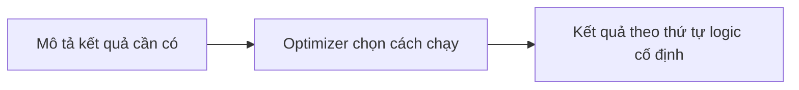
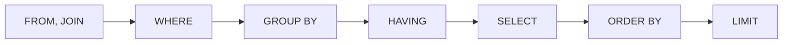
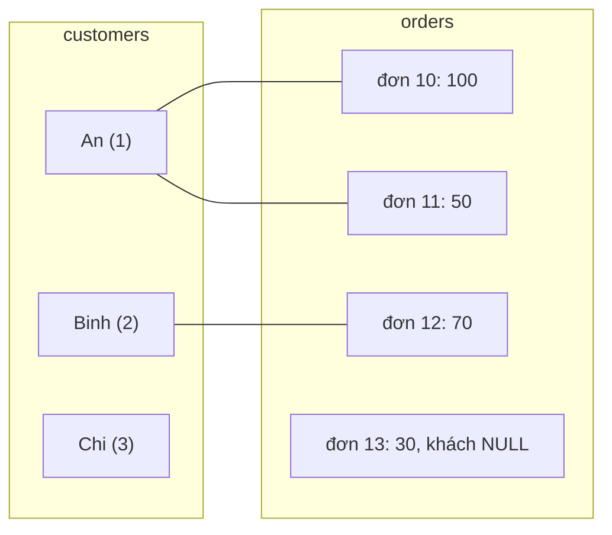
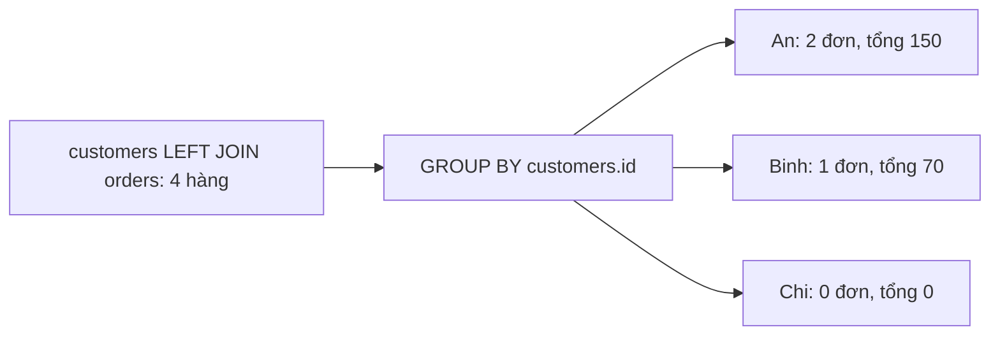

# SQL cơ bản và tư duy cơ sở dữ liệu quan hệ

SQL (Structured Query Language) là ngôn ngữ để hỏi và sửa dữ liệu trong cơ sở dữ liệu quan hệ, nơi dữ liệu nằm trong bảng gồm các hàng và cột. Đặc điểm cốt lõi: bạn viết "tôi muốn gì", không viết "lấy bằng cách nào". Bài này hướng dẫn tư duy đó và các phần SQL bạn dùng hằng ngày.

**Cốt lõi:** SQL cho bạn nói kết quả mình muốn có, không nói cách lấy; database tự chọn cách chạy. Để câu trả lời luôn xác định, nó dựa trên một thứ tự xử lý logic cố định và một logic có ba giá trị do NULL.

- Vì bạn chỉ khai báo kết quả nên optimizer được tự chọn cách chạy, và query vẫn nhanh khi dữ liệu lớn lên.
- Vì SELECT được xử lý sau FROM, WHERE, GROUP BY nên WHERE không thấy alias, và điều kiện trên giá trị gom phải để ở HAVING.
- Vì NULL là "chưa biết" nên so sánh với nó cho UNKNOWN, và WHERE loại hàng UNKNOWN mà không báo lỗi.



Mô hình tư duy: bạn chỉ lo phần "cái gì", database lo phần "làm sao", nên mọi lỗi hay gặp đều đến từ việc hiểu sai thứ tự logic hoặc ý nghĩa của NULL.

**Tóm tắt:**

- SQL là ngôn ngữ khai báo: bạn mô tả kết quả cần có, optimizer của database chọn cách chạy.
- Thứ tự thực thi logic là FROM/JOIN, WHERE, GROUP BY, HAVING, SELECT, ORDER BY, LIMIT, nên alias của SELECT không dùng được trong WHERE.
- INNER JOIN chỉ giữ hàng khớp hai bên, LEFT JOIN giữ mọi hàng bên trái; điều kiện lọc bảng bên phải đặt ở ON, đặt ở WHERE sẽ biến LEFT JOIN thành INNER JOIN.
- GROUP BY làm giảm số hàng còn window function giữ nguyên số hàng; WHERE lọc trước khi gom, HAVING lọc sau.
- NULL nghĩa là chưa biết giá trị: NULL = NULL cho UNKNOWN nên phải dùng IS NULL, và NOT IN gặp NULL trong subquery sẽ trả rỗng (dùng NOT EXISTS).
- Primary key định danh hàng, foreign key biểu diễn quan hệ giữa các bảng; prepared statement chống SQL injection.
- Thói quen an toàn: liệt kê cột thay vì SELECT *, luôn có WHERE khi UPDATE hoặc DELETE, dùng UNION ALL khi không cần loại trùng.

## Vấn đề nó giải quyết

Nếu bạn tự viết vòng lặp để duyệt dữ liệu (lấy mọi đơn hàng, lọc theo khách, cộng tổng), code vừa dài vừa chậm. Với SQL, bạn mô tả **kết quả cần có**, còn query optimizer của database tự chọn cách chạy nhanh nhất: dùng index nào, nối bảng theo thứ tự nào. Nhờ vậy cùng một câu SQL vẫn nhanh khi dữ liệu lớn lên mà không phải sửa code.

## Khi nào dùng, khi nào không

Dùng cho hầu hết ứng dụng nghiệp vụ có dữ liệu có cấu trúc và có quan hệ giữa các bảng, như đơn hàng, khách hàng, tài khoản. Nếu dữ liệu là tài liệu lỏng lẻo, hình dạng mỗi record mỗi khác, hoặc bạn chỉ tra theo key đơn giản với tải cực lớn, thì document store hoặc key-value store có thể hợp hơn (xem bài chọn DB).

## Cách học

Nhớ thứ tự thực thi logic của `SELECT` (`FROM`, `WHERE`, `GROUP BY`, `HAVING`, `SELECT`, `ORDER BY`), hiểu các loại `JOIN`, gom nhóm, hàm cửa sổ. Và coi chừng `NULL`: `NULL = NULL` không phải là true.

## Các khái niệm cần biết

- **Bảng, hàng, cột**: bảng là tập các record cùng cấu trúc; hàng là một record; cột là một attribute.
- **Primary key và foreign key**: primary key định danh duy nhất một hàng; foreign key là cột trỏ tới primary key của bảng khác, đó là cách biểu diễn quan hệ (ví dụ `orders.customer_id` trỏ tới `customers.id`).
- **JOIN**: ghép hàng của hai bảng theo điều kiện, thường là foreign key bằng primary key.
- **Alias**: tên tạm đặt cho bảng hoặc cột (`customers c`, `AVG(salary) AS avg_salary`).
- **Aggregate function**: hàm gom nhiều hàng thành một giá trị: `COUNT`, `SUM`, `AVG`, `MIN`, `MAX`.
- **Window function**: hàm tính trên một "cửa sổ" các hàng liên quan nhưng không gộp hàng lại, ví dụ xếp hạng trong từng phòng ban.
- **CTE (Common Table Expression)**: query con có tên, khai báo bằng `WITH`, giúp chia query dài thành các bước dễ đọc.
- **Tích Descartes**: mọi cặp hàng giữa hai bảng; m hàng nhân n hàng ra m × n hàng.
- **Logic ba giá trị**: biểu thức SQL có thể TRUE, FALSE hoặc UNKNOWN (khi dính `NULL`). `WHERE` chỉ giữ hàng TRUE.
- **Prepared statement**: câu SQL có chỗ trống tham số, giá trị truyền riêng, nên không bị hiểu là một phần câu lệnh (chống SQL injection).

## Thứ tự thực thi logic của SELECT



Điều cần hiểu trước: bạn viết `SELECT` đầu tiên nhưng database xử lý nó gần cuối. Lý do là nó phải có dữ liệu đã nối, đã lọc, đã gom rồi mới tính cột kết quả. Sơ đồ trên là thứ tự logic, còn optimizer có thể thực thi khác miễn kết quả giống.

Ý nghĩa: `FROM/JOIN` nối bảng; `WHERE` lọc từng hàng; `GROUP BY` gom nhóm; `HAVING` lọc nhóm; `SELECT` tính biểu thức và đặt bí danh (`DISTINCT` chạy ngay sau đó); cuối cùng `ORDER BY` rồi `LIMIT/OFFSET`.

Hệ quả: không dùng được bí danh của `SELECT` trong `WHERE`; điều kiện trên giá trị đã tổng hợp phải đặt ở `HAVING`, không phải `WHERE`.

**Nền tảng:** SQL là ngôn ngữ khai báo: bạn mô tả kết quả, optimizer chọn cách chạy. Vì vậy thứ tự viết khác thứ tự xử lý, và hiểu thứ tự logic FROM, WHERE, GROUP BY, HAVING, SELECT, ORDER BY, LIMIT là chìa khóa để hiểu mọi lỗi cú pháp và hiệu năng về sau.

**Suy luận:** Vì SQL chỉ khai báo kết quả, database có toàn quyền chọn kế hoạch thực thi, nên nó cần một thứ tự ngữ nghĩa cố định để biết câu trả lời đúng là gì, dù kế hoạch thực tế có khác. Thứ tự đó đi từ dữ liệu thô đến kết quả: nối bảng, lọc từng hàng, gom nhóm, lọc nhóm, rồi mới tính cột kết quả, sắp xếp và cắt. Từ đó suy ra ba hệ quả. Thứ nhất, WHERE chạy trước SELECT nên không thấy alias do SELECT đặt ra. Thứ hai, điều kiện trên giá trị tổng hợp như COUNT chỉ tồn tại sau khi gom, nên phải nằm ở HAVING. Thứ ba, với LEFT JOIN, các hàng bên phải không khớp được điền NULL ngay ở bước nối, nên điều kiện về bảng bên phải đặt ở WHERE sẽ chạy sau bước đó, loại luôn các hàng NULL và biến LEFT JOIN thành INNER JOIN mà không báo lỗi. Điểm dễ nhầm là tưởng thứ tự viết là thứ tự chạy; vì query vẫn chạy được, lỗi chỉ lộ ra bằng kết quả thiếu hàng. Khi review, hãy tự hỏi ở mỗi bước dữ liệu đang có hình dạng gì thay vì chỉ đọc từ trên xuống.

## Các loại JOIN

Vấn đề đặt ra: dữ liệu được tách ra nhiều bảng (khách một nơi, đơn một nơi) để tránh lặp, nên khi cần xem chung bạn phải nối chúng lại. Loại JOIN quyết định điều gì xảy ra với hàng không có cặp khớp, và chọn sai là lý do phổ biến khiến báo cáo thiếu hoặc thừa hàng. Dùng `INNER` khi chỉ quan tâm hàng có quan hệ ở cả hai bên; dùng `LEFT` khi phải giữ mọi hàng bên trái dù chưa có bên phải (ví dụ liệt kê cả khách chưa mua gì).

| JOIN | Kết quả |
|---|---|
| `INNER JOIN` | Chỉ các hàng có khớp ở cả hai bên |
| `LEFT JOIN` | Mọi hàng bên trái, bên phải không khớp thì `NULL` |
| `RIGHT JOIN` | Ngược lại, ít dùng (đổi chỗ để dùng LEFT) |
| `FULL OUTER JOIN` | Mọi hàng cả hai bên |
| `CROSS JOIN` | Tích Descartes, m × n hàng |

Query dưới đây dùng mẹo "LEFT JOIN rồi lọc `IS NULL`" để tìm hàng không có cặp (anti-join):

```sql
-- Khách hàng chưa có đơn nào
SELECT c.id, c.name
FROM customers c
LEFT JOIN orders o ON o.customer_id = c.id
WHERE o.id IS NULL;
```

Điều kiện lọc cột của bảng bên phải trong `LEFT JOIN` đặt ở `ON`, không đặt ở `WHERE` (đặt ở `WHERE` biến nó thành INNER JOIN).

**Phải thuộc:** INNER JOIN chỉ giữ hàng khớp hai bên; LEFT JOIN giữ mọi hàng bên trái (không khớp thì NULL). Điều kiện lọc bảng bên phải của LEFT JOIN đặt ở ON, đặt ở WHERE sẽ biến nó thành INNER JOIN.

### Ví dụ có kết quả (đã chạy trên SQLite 3.37; cú pháp tương thích PostgreSQL và MySQL)

Dữ liệu mẫu:

| customers (id, name) | orders (id, customer_id, total) |
|---|---|
| 1 An | 10, 1, 100 |
| 2 Binh | 11, 1, 50 |
| 3 Chi | 12, 2, 70 |
| | 13, NULL, 30 |

| Query | Kết quả (name, order id) |
|---|---|
| `INNER JOIN` | (An,10) (An,11) (Binh,12) |
| `LEFT JOIN` | (An,10) (An,11) (Binh,12) (Chi,NULL) |
| `LEFT JOIN ... WHERE o.id IS NULL` | (Chi,NULL) |
| `FULL OUTER JOIN` | như LEFT, thêm (NULL,13) cho đơn không có khách |
| `CROSS JOIN` (đếm) | 3 × 4 = 12 hàng |

PostgreSQL có `FULL OUTER JOIN`; MySQL không có, phải `LEFT JOIN ... UNION ... RIGHT JOIN`. Bản SQLite này cũng chưa hỗ trợ (kết quả trên lấy bằng LEFT JOIN `UNION ALL` phần đơn mồ côi).

`ON` khác `WHERE` trong LEFT JOIN, cùng điều kiện `o.total > 60`:

| Vị trí điều kiện | Kết quả |
|---|---|
| `LEFT JOIN orders o ON o.customer_id = c.id AND o.total > 60` | (An,10) (Binh,12) (Chi,NULL): Chi vẫn còn |
| `LEFT JOIN ... ON o.customer_id = c.id WHERE o.total > 60` | (An,10) (Binh,12): Chi mất vì `NULL > 60` là UNKNOWN |

### Hình minh họa JOIN và GROUP BY

Với dữ liệu mẫu ở trên, mũi tên là các cặp khớp theo `orders.customer_id = customers.id`. Chi không có mũi tên (không có đơn), đơn 13 cũng không có mũi tên (không có khách):



`INNER JOIN` giữ ba cặp có mũi tên; `LEFT JOIN` thêm Chi; `FULL OUTER JOIN` thêm cả đơn 13. Khi thêm `GROUP BY`, các hàng sau khi nối được gom theo khách rồi tính tổng:



```sql
SELECT c.name, count(o.id) AS n, COALESCE(sum(o.total), 0) AS spent
FROM customers c
LEFT JOIN orders o ON o.customer_id = c.id
GROUP BY c.id, c.name
ORDER BY c.id;
```

```text
 name | n | spent
------+---+-------
 An   | 2 |   150
 Binh | 1 |    70
 Chi  | 0 |     0
```

_Minh họa_ (kết quả tính trên cùng dữ liệu mẫu, chưa chạy thử trên PostgreSQL). `count(o.id)` đếm cột nên bỏ qua `NULL` do LEFT JOIN bù cho Chi; `count(*)` sẽ cho Chi là 1. Phiên bản có bộ dữ liệu đầy đủ hơn, từng bước bảng trước và sau khi gom, nằm ở [SELECT, JOIN và GROUP BY bằng hình](/go?p=02-Database%2Feasy%2Flt-13-sql-select-join-truc-quan.md).

## Gom nhóm và hàm cửa sổ

Vấn đề: đôi khi bạn cần số liệu theo nhóm (mỗi phòng ban bao nhiêu người, lương trung bình), và đôi khi bạn cần số liệu theo nhóm nhưng vẫn giữ từng hàng (so lương mỗi người với trung bình phòng ban). Cái đầu dùng `GROUP BY`, cái sau dùng hàm cửa sổ.

```sql
SELECT department, COUNT(*) AS n, AVG(salary) AS avg_salary
FROM employees
GROUP BY department
HAVING COUNT(*) >= 5;

-- Hàm cửa sổ: giữ nguyên số hàng, thêm cột tính trên "cửa sổ"
SELECT name, department, salary,
       RANK() OVER (PARTITION BY department ORDER BY salary DESC) AS rnk,
       salary - AVG(salary) OVER (PARTITION BY department)        AS diff_avg
FROM employees;
```

`GROUP BY` làm giảm số hàng; hàm cửa sổ **không** giảm. Dùng cho: top-N mỗi nhóm (`ROW_NUMBER`), tổng lũy kế, so sánh với kỳ trước (`LAG`).

**Phải thuộc:** WHERE lọc hàng trước khi gom nhóm, HAVING lọc nhóm sau khi gom. GROUP BY giảm số hàng, hàm cửa sổ (OVER) thì giữ nguyên số hàng. RANK nhảy hạng khi đồng điểm, DENSE_RANK không nhảy, ROW_NUMBER luôn duy nhất.

Kết quả thật (đã chạy) với `employees(name, department, salary)`:

```text
name dept salary | rnk  rn  diff_avg
E    HR   25     |  1   1   +5.0
D    HR   15     |  2   2   -5.0
A    IT   30     |  1   1   +6.67
B    IT   20     |  2   2   -3.33
C    IT   20     |  2   3   -3.33
```

B và C lương bằng nhau: `RANK` cho cùng hạng 2 (và hạng kế tiếp sẽ là 4, nhảy cách), `DENSE_RANK` cho 2 rồi 3, còn `ROW_NUMBER` luôn đánh số duy nhất (2, 3), thứ tự giữa hai hàng bằng nhau không xác định trừ khi thêm key phụ vào `ORDER BY`. Top-N mỗi nhóm: bọc query trong CTE rồi lọc `WHERE rn <= N`.

Tổng lũy kế và kỳ trước (`ORDER BY salary, name`): `SUM(salary) OVER (ORDER BY ...)` cho 15, 35, 55, 80, 110; `LAG(salary)` cho NULL, 15, 20, 20, 25.

Khác biệt `GROUP BY` và `HAVING` (đã chạy): `GROUP BY customer_id HAVING COUNT(*) >= 2` trên bảng `orders` chỉ trả `(1, 2 đơn, 150)`, vì An là khách duy nhất có từ 2 đơn. Điều kiện `WHERE` lọc hàng **trước** khi gom; `HAVING` lọc nhóm **sau** khi gom.

## CTE và query con

```sql
WITH recent AS (
    SELECT customer_id, SUM(total) AS spent
    FROM orders
    WHERE created_at >= now() - interval '30 days'
    GROUP BY customer_id
)
SELECT c.name, r.spent
FROM recent r JOIN customers c ON c.id = r.customer_id
ORDER BY r.spent DESC;
```

Dùng CTE khi query có nhiều bước hoặc một kết quả trung gian dùng nhiều lần; với query ngắn, query con thường là đủ. CTE giúp query dễ đọc; `WITH RECURSIVE` duyệt dữ liệu phân cấp (cây danh mục, sơ đồ tổ chức).

## NULL: logic ba giá trị

`NULL` nghĩa là "không biết giá trị", không phải 0 hay chuỗi rỗng. Vì vậy so sánh với nó không cho đúng/sai mà cho "không biết", và đây là nguồn của nhiều lỗi âm thầm (query không báo lỗi nhưng thiếu hàng).

- `NULL = NULL` không phải `TRUE` mà là `UNKNOWN`; dùng `IS NULL`, `IS NOT NULL`.
- `NOT IN (subquery)` trả không có hàng nào nếu subquery chứa `NULL`; ưu tiên `NOT EXISTS`.
- Hàm tổng hợp (`SUM`, `AVG`) bỏ qua `NULL`; `COUNT(*)` đếm hàng, `COUNT(cột)` bỏ `NULL`. Trên bảng `orders` mẫu: `COUNT(*) = 4`, `COUNT(customer_id) = 3`.
- Đã chạy với dữ liệu mẫu: `WHERE id NOT IN (SELECT customer_id FROM orders)` trả **0 hàng** (vì có `customer_id` NULL), còn `NOT EXISTS` trả đúng `Chi`.
- Dùng `COALESCE(x, 0)` để thay giá trị mặc định.

**Phải thuộc:** NULL = NULL cho UNKNOWN, không phải TRUE; dùng IS NULL. NOT IN (subquery) trả rỗng nếu subquery có NULL, nên dùng NOT EXISTS. COUNT(*) đếm hàng, COUNT(cột) bỏ NULL.

**Suy luận:** NULL không phải một giá trị mà là chưa biết giá trị, nên mọi phép so sánh với nó đều không thể khẳng định đúng hay sai và cho UNKNOWN. WHERE chỉ giữ hàng cho TRUE, nên hàng UNKNOWN bị loại cùng hàng FALSE mà không ai được thông báo. Từ đây suy ra NOT IN (subquery) nguy hiểm: x NOT IN (1, NULL) tương đương x <> 1 AND x <> NULL, vế sau là UNKNOWN nên cả biểu thức không bao giờ là TRUE và query trả rỗng. NOT EXISTS không bị vậy vì nó chỉ kiểm tra có hàng khớp hay không, không so sánh trực tiếp với NULL. Hàm tổng hợp bỏ qua NULL vì một giá trị chưa biết không thể cộng vào tổng, nên COUNT(*) và COUNT(cột) cho kết quả khác nhau khi cột có NULL. Điểm dễ nhầm là coi NULL như chuỗi rỗng hoặc số 0. Hãy quyết định cột có cho phép NULL ngay lúc thiết kế (mặc định NOT NULL), và khi viết query dùng IS NULL, COALESCE, NOT EXISTS thay vì phép so sánh thông thường.

## Điều cần nhớ

- `SELECT *` trong code ứng dụng làm lộ cột thừa và phá index bao phủ; liệt kê cột cần.
- `UNION` loại trùng (tốn sắp xếp), `UNION ALL` giữ nguyên và nhanh hơn: dùng `ALL` nếu không cần loại trùng.
- Cập nhật và xóa luôn có `WHERE`; thử bằng `SELECT` cùng điều kiện trước.
- Tham số hóa query (prepared statement) để chống SQL injection, không nối chuỗi.

## Phỏng vấn khó: chuỗi hỏi xoáy

Người phỏng vấn senior thường mở bằng một câu dễ rồi xoáy xuống cơ chế, đánh đổi và sự cố thật. Câu trả lời tốt luôn đi từ cốt lõi xuống, không đi từ chỗ học thuộc lên.

### Chuỗi 1: LEFT JOIN và vị trí của điều kiện

1. **Câu mở:** INNER JOIN và LEFT JOIN khác nhau thế nào?
2. **Xoáy 1:** Tôi viết LEFT JOIN rồi thêm `WHERE o.status = 'paid'` thì khách chưa có đơn biến mất. Database đã làm gì từng bước để ra kết quả đó?
3. **Xoáy 2:** Vậy muốn liệt kê mọi khách kèm đơn paid nếu có, và muốn tìm khách chưa có đơn nào, mỗi yêu cầu đặt điều kiện ở đâu? Sau LEFT JOIN, `count(*)` và `count(o.id)` khác nhau ra sao?

**Đáp án ngắn:** LEFT JOIN giữ mọi hàng bên trái, hàng chưa có cặp được điền NULL ở bên phải; INNER JOIN chỉ giữ cặp khớp. Về thứ tự logic, `ON` quyết định cặp nào ghép với nhau, rồi hàng trái chưa có cặp được bù NULL, và `WHERE` chạy sau cùng. Điều kiện `o.status = 'paid'` ở `WHERE` gặp hàng bù NULL, `NULL = 'paid'` cho UNKNOWN, mà `WHERE` chỉ giữ TRUE, nên hàng đó mất và LEFT JOIN thành INNER JOIN mà không báo lỗi. Muốn giữ mọi khách kèm đơn paid nếu có thì đặt điều kiện ở `ON`. Muốn tìm khách chưa có đơn thì LEFT JOIN rồi `WHERE o.id IS NULL`; đây là chỗ `WHERE` đúng vì ta cố ý lọc hàng bù NULL (anti-join). `count(*)` đếm cả hàng bù NULL nên khách chưa có đơn ra 1, còn `count(o.id)` bỏ NULL nên ra 0. Dấu hiệu trong production là báo cáo ít hàng hơn bảng bên trái mà không có lỗi nào.

**Sai lầm hay gặp:**

- Nói "ON và WHERE như nhau" mà không phân biệt INNER với LEFT.
- Trả lời bằng hình Venn nhưng không giải thích được vì sao hàng NULL bị loại.
- Dùng `count(*)` sau LEFT JOIN rồi báo khách chưa có đơn có 1 đơn.

### Chuỗi 2: NULL và NOT IN

1. **Câu mở:** NULL trong SQL nghĩa là gì, và `NULL = NULL` cho kết quả gì?
2. **Xoáy 1:** Query `NOT IN (SELECT customer_id FROM orders)` trả 0 hàng dù chắc chắn có khách chưa mua. Khai triển biểu thức để giải thích.
3. **Xoáy 2:** Đổi sang `IN` thì có lỗi tương tự không? Nếu cột `customer_id` khai báo NOT NULL thì `NOT IN` dùng được không, và vì sao vẫn nên ưu tiên `NOT EXISTS`?

**Đáp án ngắn:** NULL là "chưa biết giá trị", không phải 0 hay chuỗi rỗng, nên `NULL = NULL` cho UNKNOWN và phải dùng `IS NULL`. SQL có logic ba giá trị TRUE, FALSE, UNKNOWN, và `WHERE` chỉ giữ hàng TRUE. `x NOT IN (1, NULL)` tương đương `x <> 1 AND x <> NULL`; vế sau là UNKNOWN nên cả biểu thức không bao giờ TRUE và kết quả rỗng. Với `IN` thì `x IN (1, NULL)` vẫn TRUE khi x bằng 1, các trường hợp còn lại UNKNOWN bị loại, nên lỗi ít lộ ra vì ta chỉ cần hàng TRUE. `NOT EXISTS` chỉ kiểm tra có hàng khớp hay không, không so sánh trực tiếp với NULL. Nếu cột chắc chắn NOT NULL thì `NOT IN` cho kết quả đúng, nhưng "chắc chắn" là điều dựa vào schema có thể đổi về sau, còn `NOT EXISTS` an toàn không cần điều kiện đó. Triệu chứng trong production: báo cáo "khách chưa mua" đột nhiên rỗng sau khi một dòng NULL lọt vào, và không có lỗi.

**Sai lầm hay gặp:**

- Nói NULL "giống chuỗi rỗng" hoặc "bằng 0".
- Chỉ thuộc "NOT IN trả rỗng nếu có NULL" mà không khai triển được thành chuỗi `<>` nối bằng AND.
- Quên `COUNT(cột)` bỏ NULL còn `COUNT(*)` thì không.

