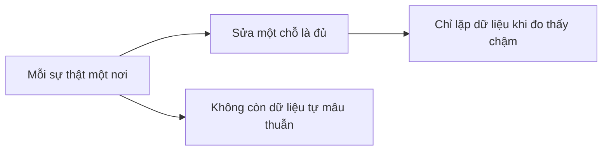
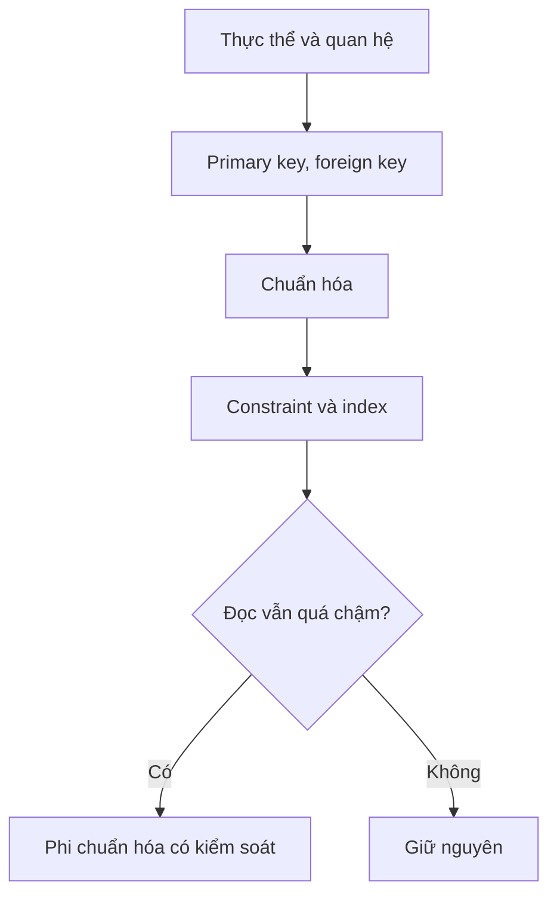
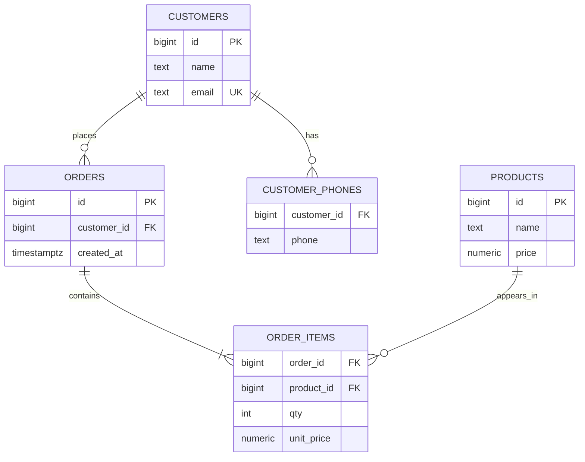
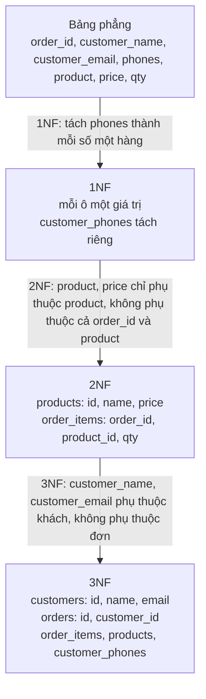
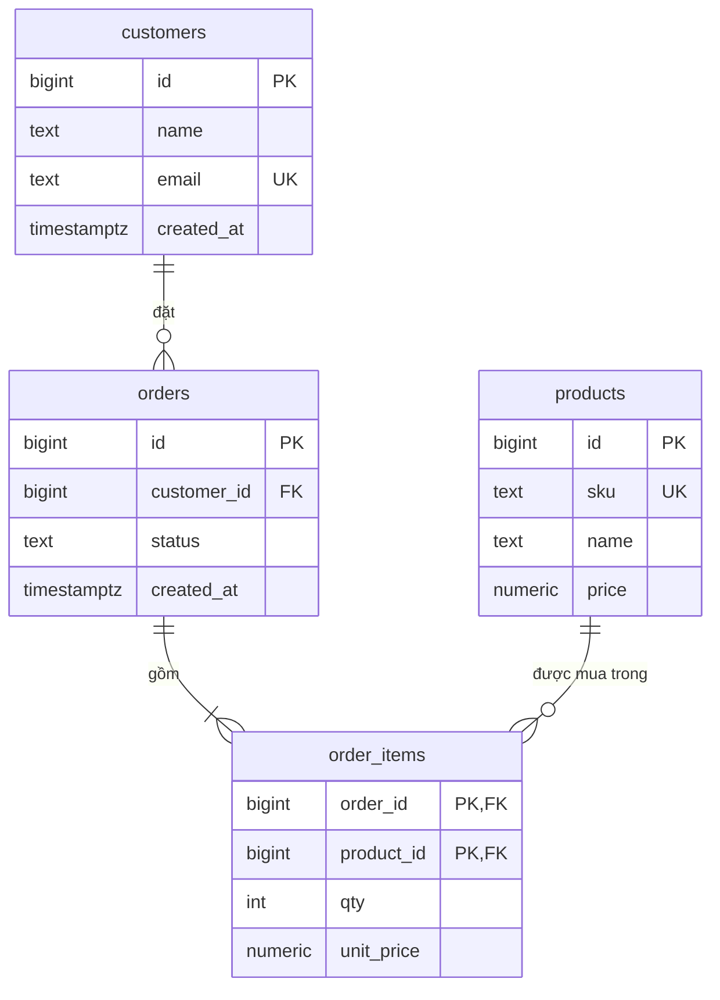

# Thiết kế schema và chuẩn hóa

Thiết kế schema là quyết định chia dữ liệu thành những bảng nào, key của mỗi bảng là gì, các bảng nối với nhau ra sao, và đặt constraint gì để không ai nhập được dữ liệu vô lý. Bài này hướng dẫn bạn làm việc đó từng bước và giải thích lý do đằng sau từng quy tắc.

**Cốt lõi:** Thiết kế schema xoay quanh một nguyên tắc: mỗi sự thật chỉ lưu ở một nơi. Lưu ở nhiều nơi thì sớm muộn các bản sẽ lệch nhau.

- Vì cùng một thông tin lưu ở nhiều chỗ sẽ bị sửa thiếu nên chuẩn hóa tách mỗi sự thật về đúng một bảng.
- Vì ứng dụng có thể lỗi hoặc có nhiều ứng dụng cùng ghi nên constraint đặt ở database, là lớp chặn cuối cùng.
- Vì mỗi bản lặp là một chỗ có thể lệch, và mỗi mức chuẩn hóa thêm JOIN, nên chỉ phi chuẩn hóa khi đã đo thấy chậm.



Mô hình tư duy: câu hỏi "sửa một thông tin thì phải sửa ở mấy chỗ" là thước đo cho mọi dạng chuẩn và mọi quyết định phi chuẩn hóa.

**Tóm tắt:**

- Chuẩn hóa tồn tại để mỗi sự thật chỉ lưu ở một nơi, tránh anomaly khi cập nhật, chèn, xóa.
- 1NF: mỗi ô một giá trị atomic; 2NF: attribute phụ thuộc toàn bộ key; 3NF: attribute không key không phụ thuộc attribute không key khác; thực tế 3NF là đủ cho phần lớn nghiệp vụ.
- Quan hệ 1-n đặt foreign key ở phía n, n-n cần bảng trung gian có hai foreign key, 1-1 là foreign key kèm UNIQUE.
- Constraint (primary key, foreign key, NOT NULL, UNIQUE, CHECK) đặt ở database vì đó là lớp bảo vệ cuối cùng khi ứng dụng lỗi hoặc có nhiều ứng dụng cùng ghi.
- Tiền dùng NUMERIC/DECIMAL hoặc số nguyên đơn vị nhỏ nhất, không dùng FLOAT; thời gian lưu UTC; mặc định NOT NULL.
- Phi chuẩn hóa chỉ làm có chủ đích sau khi đo thấy query chậm, và phải tự giữ dữ liệu sync.
- Schema sai rất đắt để sửa vì phải migrate dữ liệu đang sống, nên đầu tư thiết kế ngay từ đầu.

## Vấn đề nó giải quyết

Hãy hình dung bạn lưu email của khách ở mọi dòng đơn hàng. Khách đổi email, bạn sửa ở dòng này nhưng quên dòng kia; giờ cùng một người có hai email khác nhau và không biết cái nào đúng. Đây gọi là dị thường cập nhật (update anomaly), và nguyên nhân là cùng một thông tin được lưu ở nhiều chỗ. Chuẩn hóa là cách tổ chức bảng để mỗi sự thật chỉ nằm ở một nơi.

Schema sai càng đáng sợ vì đã có dữ liệu thật thì sửa rất đau: phải migrate dữ liệu, sửa code, có khi phải ngừng hệ thống. Vì vậy hãy dành thời gian cho nó ngay từ đầu.

**Nền tảng:** Chuẩn hóa tồn tại để mỗi sự thật chỉ lưu ở một nơi, tránh dị thường cập nhật, chèn, xóa. Constraint (key, NOT NULL, UNIQUE, CHECK) đặt ở database vì đó là lớp bảo vệ cuối cùng, ứng dụng có thể lỗi hoặc có nhiều ứng dụng cùng ghi.

## Khi nào làm, khi nào nới lỏng

Thiết kế schema khi bắt đầu một module hoặc service mới, và trước khi nghĩ tới tối ưu hiệu năng. Phi chuẩn hóa (cố ý lặp dữ liệu) chỉ nên làm khi bạn đã đo thấy query chậm thật, vì nó đánh đổi tốc độ đọc lấy rủi ro dữ liệu lệch nhau. Ngược lại, chuẩn hóa tới mức cực đoan (BCNF cho mọi bảng, tách đến từng cột) có thể khiến query phải nối quá nhiều bảng mà không đem lại lợi ích.

## Cách làm tóm tắt

Chuẩn hóa tới mức hợp lý (thường là 3NF), đặt primary key, foreign key và constraint (`NOT NULL`, `UNIQUE`, `CHECK`), chọn kiểu dữ liệu đúng. Để database tự chặn dữ liệu sai thay vì tin vào code ứng dụng.

## Các khái niệm cần biết

- **Thực thể và quan hệ**: thực thể là thứ bạn cần lưu (khách hàng, đơn hàng), mỗi thực thể thường thành một bảng; quan hệ là cách chúng liên quan (một khách có nhiều đơn).
- **Primary key**: cột (hoặc tổ hợp cột) định danh duy nhất một hàng, không null.
- **Foreign key**: cột tham chiếu primary key của bảng khác; DB từ chối giá trị không tồn tại bên kia, nên không có đơn "mồ côi".
- **Normal form**: các mức quy tắc về cách tổ chức bảng, mức càng cao càng ít dư thừa (1NF, 2NF, 3NF, BCNF).
- **Functional dependency**: cột B phụ thuộc vào cột A nếu biết A là suy ra B (biết `zip_code` là suy ra `city`). Các dạng chuẩn được định nghĩa dựa trên khái niệm này.
- **Anomaly**: lỗi do dư thừa: cập nhật (sửa thiếu chỗ), chèn (không thêm được vì thiếu dữ liệu không liên quan), xóa (xóa dòng này mất luôn thông tin khác).
- **Cardinality**: số lượng bên này ứng với bên kia trong quan hệ (1-1, 1-n, n-n), thể hiện trên sơ đồ ER.
- **Denormalization**: cố ý lặp dữ liệu để đọc nhanh hơn, đổi lại phải tự giữ sync.
- **Partial index**: index chỉ bao phủ các hàng thỏa điều kiện, ví dụ chỉ hàng chưa bị xóa mềm.

## Quy trình thiết kế



Đọc sơ đồ: bạn đi từ cái nghiệp vụ cần (thực thể), đến cách định danh và nối chúng (key), rồi mới chuẩn hóa để bỏ dư thừa. Index và constraint đặt sau khi biết query chính. Chỉ khi đo thấy đọc vẫn chậm mới quay lại phi chuẩn hóa; làm ngược thứ tự này là nguồn gốc của nhiều schema rối.

Chi tiết: quan hệ gồm 1-1, 1-n, n-n; constraint gồm `NOT NULL`, `UNIQUE`, `CHECK`; index đặt theo các query chính.

## Các dạng chuẩn

| Dạng | Quy tắc | Vi phạm điển hình |
|---|---|---|
| **1NF** | Mỗi ô một giá trị atomic, không nhóm lặp | Cột `phones = '0901,0902'` |
| **2NF** | Mọi attribute phụ thuộc vào **toàn bộ** key (composite key) | Tên sản phẩm lưu trong bảng chi tiết đơn có key `(order_id, product_id)` |
| **3NF** | Attribute không key không phụ thuộc vào attribute không key khác | Lưu cả `zip_code` và `city` suy ra từ nó |
| **BCNF** | Mọi functional dependency có vế trái là superkey | Trường hợp hiếm của candidate key chồng lấn |

Vấn đề bảng này giải quyết: bạn cần một thang đo để biết bảng của mình "đủ sạch" chưa. Mỗi dạng chuẩn loại bỏ thêm một kiểu dư thừa. Trong thực tế đạt 3NF là đủ cho phần lớn nghiệp vụ; BCNF chỉ cần quan tâm khi bảng có nhiều candidate key chồng lấn. Nếu không chuẩn hóa, hậu quả là các dị thường nói ở trên.

Nguyên tắc ngắn: mỗi sự thật chỉ lưu **một nơi**.

**Phải thuộc:** 1NF: mỗi ô một giá trị atomic. 2NF: mọi attribute phụ thuộc toàn bộ key (chỉ liên quan composite key). 3NF: attribute không key không phụ thuộc attribute không key khác. Thực tế đạt 3NF là đủ cho phần lớn nghiệp vụ.

**Suy luận:** Các dạng chuẩn không phải luật tùy ý mà là lần lượt loại bỏ từng cách để một sự thật bị lưu hai lần. 1NF buộc mỗi ô là một giá trị atomic, vì nếu một ô chứa danh sách thì không thể index hay ràng buộc nó, và sửa một phần tử phải ghi lại cả ô. 2NF xử lý trường hợp key ghép: attribute chỉ phụ thuộc một phần key (tên sản phẩm chỉ phụ thuộc product_id trong bảng có key (order_id, product_id)) bị lặp ở mọi dòng của cùng sản phẩm, nên sửa một chỗ sẽ lệch chỗ khác. 3NF xử lý phụ thuộc bắc cầu: nếu zip_code suy ra city và bảng lưu cả hai, hai dòng cùng zip_code có thể ghi hai city khác nhau. Mỗi cấp vì thế đều trả lời cùng một câu hỏi: nếu sửa một thông tin, tôi phải sửa ở mấy chỗ. Điểm dễ nhầm là cho rằng chuẩn hóa cao hơn thì luôn tốt hơn; thực tế mỗi mức thêm JOIN khi đọc. Hãy dừng ở 3NF và chỉ phi chuẩn hóa khi đã đo thấy query chậm thật, kèm cơ chế giữ các bản lặp luôn sync.

### Ví dụ trước và sau khi chuẩn hóa

Một bảng "đơn hàng" làm tất cả:

| order_id | customer_name | customer_email | phones | product | price | qty |
|---|---|---|---|---|---|---|
| 1 | An | a@x.vn | 0901,0902 | Áo | 100 | 2 |
| 1 | An | a@x.vn | 0901,0902 | Quần | 200 | 1 |
| 2 | An | an@x.vn | 0901,0902 | Áo | 100 | 1 |

Các lỗi, theo từng dạng chuẩn:

| Lỗi | Dạng vi phạm | Hậu quả |
|---|---|---|
| `phones` chứa hai số trong một ô | 1NF | Không tìm hoặc constraint từng số được |
| `product`, `price` phụ thuộc vào một phần key `(order_id, product)` | 2NF | Đổi giá Áo phải sửa nhiều hàng |
| `customer_name`, `customer_email` phụ thuộc vào khách, không phụ thuộc vào đơn | 3NF | Dòng 1 và 3 ghi hai email khác nhau cho cùng một khách: dị thường cập nhật |

Sau chuẩn hóa (mỗi sự thật một nơi):



```sql
CREATE TABLE order_items (
    order_id   bigint  NOT NULL REFERENCES orders(id),
    product_id bigint  NOT NULL REFERENCES products(id),
    qty        int     NOT NULL CHECK (qty > 0),
    unit_price numeric NOT NULL,                 -- giá tại thời điểm mua
    PRIMARY KEY (order_id, product_id)
);
```

`unit_price` lặp lại `products.price` **có chủ đích**: giá hôm nay đổi thì đơn cũ không được đổi theo. Đây là dữ liệu lịch sử, không phải dư thừa sai. Đã chạy trên SQLite: chèn trùng key `(order_id, product_id)`, sản phẩm không tồn tại, khách không tồn tại (khi bật `PRAGMA foreign_keys=ON`) hoặc `qty = 0` đều bị DB từ chối. PostgreSQL và MySQL (InnoDB) mặc định thực thi foreign key; SQLite thì phải bật.

Cardinality trong sơ đồ: `||` đúng một, `o{` không hoặc nhiều, `|{` một hoặc nhiều; một đơn có ít nhất một dòng chi tiết.

### Chuẩn hóa từng bước: từ bảng phẳng đến 3NF

Cùng bảng phẳng ở trên, nhìn dưới dạng sơ đồ: mỗi bước tách ra những cột phụ thuộc vào một thứ khác, cho đến khi mỗi sự thật chỉ nằm một nơi.



Sau bước cuối, mỗi sự thật nằm đúng một nơi: email của An ở một hàng của `customers`, giá Áo ở một hàng của `products`. Đổi email chỉ sửa một chỗ nên không thể xảy ra tình trạng hai email cho một khách.

### ER diagram của shop (customers, orders, order_items, products)

Sơ đồ đầy đủ hơn của schema vừa chuẩn hóa. Khóa ngoại nằm ở phía "nhiều": `orders.customer_id`, `order_items.order_id`, `order_items.product_id`. Bảng `order_items` chính là bảng trung gian của quan hệ nhiều-nhiều giữa đơn hàng và sản phẩm.



Đọc sơ đồ: một khách có không hoặc nhiều đơn; một đơn có ít nhất một dòng chi tiết; một sản phẩm xuất hiện ở không hoặc nhiều dòng chi tiết. Khóa chính của `order_items` là cặp `(order_id, product_id)`, nên cùng một sản phẩm không thể xuất hiện hai lần trong cùng một đơn (muốn tăng số lượng thì sửa `qty`). Tiếp theo, bài [SELECT, JOIN và GROUP BY bằng hình](/go?p=02-Database%2Feasy%2Flt-13-sql-select-join-truc-quan.md) cho thấy cách truy vấn một schema như thế này, còn [DDL, DML, kiểu dữ liệu và constraint](/go?p=02-Database%2Feasy%2Flt-14-ddl-dml-kieu-du-lieu-constraint-pg.md) cho thấy cách khai báo chúng trong PostgreSQL.

## Quan hệ

Biết cardinality quyết định foreign key đặt ở đâu, và đặt sai thì không biểu diễn được dữ liệu (ví dụ n-n mà chỉ có một foreign key thì mỗi sinh viên chỉ học được một môn).

- **1-n:** foreign key nằm ở phía "n" (`orders.customer_id`).
- **n-n:** bảng trung gian có hai foreign key (`student_course(student_id, course_id)`), primary key ghép hai cột.
- **1-1:** foreign key có `UNIQUE`; thường là tách cột ít dùng hoặc nhạy cảm.

**Phải thuộc:** 1-n: foreign key nằm ở phía n. n-n: cần bảng trung gian có hai foreign key, primary key ghép hai cột. 1-1: foreign key kèm UNIQUE.

## Primary key

Chọn primary key ảnh hưởng đến hiệu năng ghi, khả năng sinh key ở nhiều nơi và độ lộ thông tin. Bảng dưới so sánh các lựa chọn phổ biến; không có lựa chọn tốt cho mọi trường hợp. Mặc định hợp lý: `bigint` tự tăng cho hệ thống một DB, UUIDv7 nếu cần sinh phân tán.

| Lựa chọn | Ưu | Nhược |
|---|---|---|
| Số tự tăng (`bigint`) | Gọn, nhanh, thân thiện index | Lộ số lượng, khó sinh ở nhiều nơi, sharding khó |
| UUID ngẫu nhiên | Sinh phân tán, không đoán được | Dài, chèn ngẫu nhiên gây fragmentation cho index B-tree |
| UUIDv7 / ULID | Sinh phân tán **và** gần như tăng theo thời gian | PostgreSQL 18 có sẵn hàm `uuidv7()`; bản cũ hơn cần extension, thư viện hoặc sinh ở tầng ứng dụng |
| Natural key (email, mã) | Có ý nghĩa nghiệp vụ | Có thể đổi giá trị: nên chỉ làm `UNIQUE`, không làm primary key |

## Kiểu dữ liệu và constraint

Mỗi quy tắc dưới đây đều tránh một lỗi cụ thể:

- **Tiền:** `NUMERIC/DECIMAL(p, s)` hoặc số nguyên đơn vị nhỏ nhất, **không** dùng `FLOAT`.
- **Thời gian:** lưu theo UTC (`timestamptz`), chuyển múi giờ khi hiển thị.
- **Trạng thái:** `enum` hoặc bảng tra cứu với foreign key, thêm `CHECK`.
- Đặt `NOT NULL` mặc định, `NULL` chỉ khi "chưa biết/không có" có ý nghĩa thật.
- Constraint ở DB là lớp bảo vệ cuối cùng: ứng dụng có thể có lỗi hoặc có nhiều ứng dụng cùng ghi.

**Phải thuộc:** Tiền dùng NUMERIC/DECIMAL hoặc số nguyên đơn vị nhỏ nhất, không dùng FLOAT. Thời gian lưu UTC (timestamptz). Mặc định NOT NULL.

## Một số mẫu thường gặp

| Nhu cầu | Mẫu |
|---|---|
| Xóa mềm | `deleted_at timestamptz NULL` + index một phần `WHERE deleted_at IS NULL`; nhớ lọc ở mọi query |
| Lịch sử thay đổi | Bảng lịch sử hoặc trigger audit; record chỉ-thêm |
| Dữ liệu linh hoạt | Cột `jsonb` cho phần ít query; không thay cho schema chính |
| Phân cấp | Danh sách kề (`parent_id`), đường dẫn vật chất, hoặc CTE đệ quy |
| Đa người thuê | Cột `tenant_id` ở mọi bảng, đứng đầu index; hoặc schema/DB riêng |

## Phi chuẩn hóa có chủ đích

Dùng khi đã đo thấy một query đọc quan trọng quá chậm vì phải nối hoặc tính tổng nhiều lần, và index không đủ. Không dùng "cho chắc" vì mỗi bản dư thừa là một chỗ có thể lệch. Chấp nhận dư thừa để đổi lấy tốc độ đọc: lưu sẵn tổng tiền đơn hàng, đếm số bình luận, bảng báo cáo. Phải có cách giữ sync (transaction, trigger, job) và ghi rõ vì sao.

## Điều cần nhớ

- Chuẩn hóa trước, phi chuẩn hóa sau và có số liệu chứng minh.
- Đặt tên nhất quán (`snake_case`, số ít hoặc nhiều thống nhất), tránh reserved word.
- Đổi schema trên dữ liệu thật cần migration an toàn (xem [Storage và migration](/go?p=02-Database%2Fhard%2Flt-06-luu-tru-chon-db.md)).
- Index cho foreign key thường cần thiết vì JOIN và xóa dây chuyền dùng đến.

## Phỏng vấn khó: chuỗi hỏi xoáy

Người phỏng vấn senior thường mở bằng một câu dễ rồi xoáy xuống cơ chế, đánh đổi và sự cố thật. Câu trả lời tốt luôn đi từ cốt lõi xuống, không đi từ chỗ học thuộc lên.

### Chuỗi 1: Chuẩn hóa và phi chuẩn hóa có chủ đích

1. **Câu mở:** Chuẩn hóa để làm gì, và vì sao thường dừng ở 3NF?
2. **Xoáy 1:** Bảng `order_items` của anh lưu `unit_price` trong khi `products` đã có `price`. Đó có phải dư thừa vi phạm chuẩn hóa không?
3. **Xoáy 2:** Giờ query báo cáo chậm vì phải JOIN nhiều bảng. Anh phi chuẩn hóa ngay chứ? Làm sao giữ các bản lặp không lệch nhau?

**Đáp án ngắn:** Chuẩn hóa để mỗi sự thật chỉ lưu một nơi, nên sửa một chỗ là đủ và không có dị thường cập nhật, chèn, xóa. Mỗi dạng chuẩn loại một kiểu lưu hai lần: 1NF mỗi ô một giá trị, 2NF phụ thuộc toàn bộ key, 3NF không phụ thuộc bắc cầu. Dừng ở 3NF vì đủ cho phần lớn nghiệp vụ, còn mỗi mức thêm lại thêm JOIN khi đọc. `unit_price` không phải dư thừa sai: đó là giá tại thời điểm mua, dữ liệu lịch sử, nên giá hôm nay đổi thì đơn cũ không được đổi theo. Cách phân biệt: bản lặp phải đổi theo bản gốc là dư thừa, bản lặp phải đứng yên là một sự thật khác. Với JOIN chậm, trước hết đo và xem index; chỉ khi index không đủ mới lặp dữ liệu có chủ đích, như lưu sẵn tổng tiền đơn hay đếm số bình luận. Khi đó phải có cách giữ sync (transaction, trigger, job) và ghi rõ lý do, vì mỗi bản lặp là một chỗ có thể lệch.

**Sai lầm hay gặp:**

- Đọc thuộc định nghĩa 1NF, 2NF, 3NF nhưng không nêu được một ví dụ dị thường.
- Phi chuẩn hóa "cho chắc" khi chưa đo thấy chậm.
- Nói chuẩn hóa càng cao càng tốt, bỏ qua chi phí JOIN.

### Chuỗi 2: Constraint ở database, khóa chính và foreign key

1. **Câu mở:** Đã validate ở service rồi, sao còn đặt constraint ở database?
2. **Xoáy 1:** Anh chọn primary key kiểu nào: `bigint` tự tăng, UUID ngẫu nhiên hay UUIDv7? Vì sao UUID ngẫu nhiên làm index chậm?
3. **Xoáy 2:** Foreign key `orders.customer_id` thì xóa khách có chuyện gì, và có cần tạo index trên cột đó không?

**Đáp án ngắn:** Constraint ở database là lớp chặn cuối vì ứng dụng có thể lỗi, có nhiều ứng dụng cùng ghi, hoặc có người sửa tay; chỉ database thấy mọi lần ghi. Kiểm tra ở service chỉ để trả thông báo lỗi thân thiện. Về khóa chính, `bigint` tự tăng gọn và thân thiện index nhưng lộ số lượng và khó sinh ở nhiều nơi. UUID ngẫu nhiên sinh phân tán được nhưng chèn rải rác khắp B-tree gây fragmentation cho index. UUIDv7 gần như tăng theo thời gian nên chèn gần như nối đuôi; PostgreSQL 18 có sẵn `uuidv7()`, bản cũ hơn cần extension hoặc sinh ở ứng dụng. Foreign key khiến database từ chối xóa hàng cha còn hàng con trỏ tới, trừ khi khai báo hành vi khác như cascade. PostgreSQL không tự tạo index cho cột foreign key phía con, nên nếu hay JOIN hoặc xóa theo cha thì phải tự tạo, nếu không xóa một khách có thể quét cả bảng đơn.

**Sai lầm hay gặp:**

- Nói "validate ở code là đủ".
- Chọn UUID vì "bảo mật" mà không nói được ảnh hưởng lên index.
- Dùng natural key như email làm primary key, rồi giá trị bị đổi.

