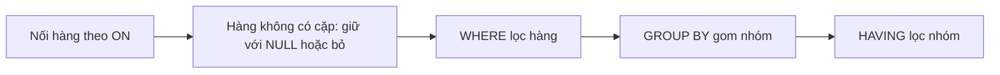
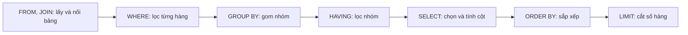
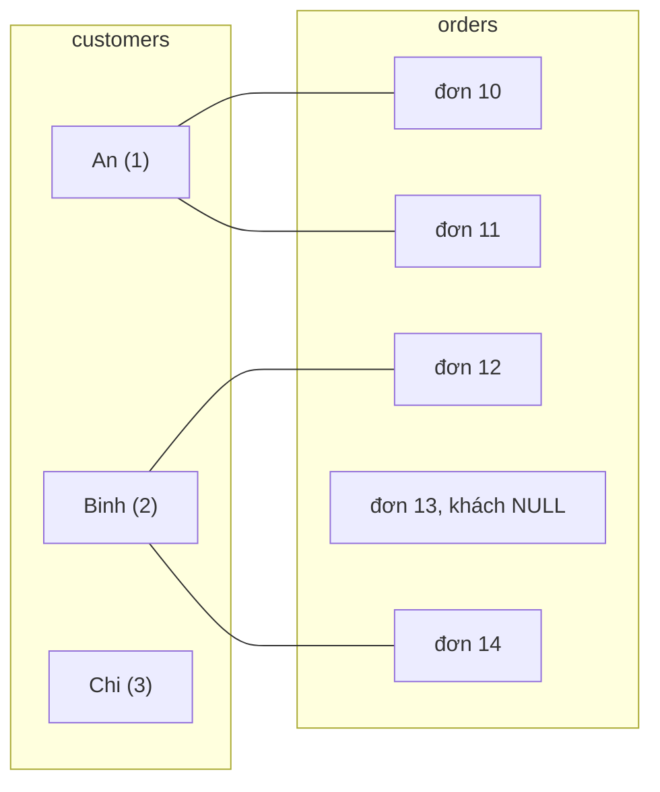
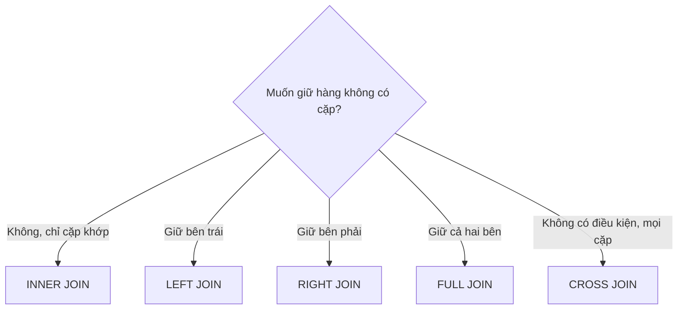
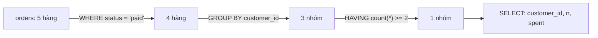
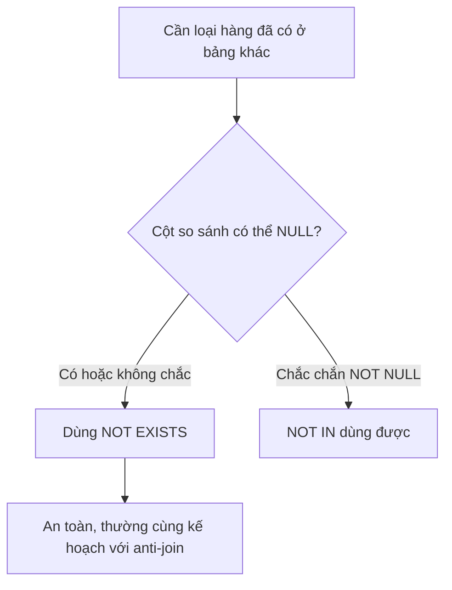

# SELECT, JOIN và GROUP BY bằng hình

Bài này dạy SQL truy vấn bằng cách nhìn thẳng vào dữ liệu: một bộ dữ liệu mẫu rất nhỏ (3 khách, 5 đơn) được dùng xuyên suốt, và mỗi loại JOIN, mỗi bước GROUP BY đều có bảng trước và sau để bạn tự kiểm chứng. Nếu bạn mới biết khái niệm bảng, hãy đọc [SQL cơ bản](/go?p=02-Database%2Feasy%2Flt-01-sql-co-ban.md) trước hoặc song song; nếu chưa có PostgreSQL để chạy thử, xem [PostgreSQL từ con số 0](/go?p=02-Database%2Feasy%2Flt-12-postgresql-cai-dat-psql.md).

**Cốt lõi:** Dữ liệu được tách ra nhiều bảng để mỗi thông tin chỉ nằm một chỗ, nên muốn trả lời câu hỏi nghiệp vụ bạn phải nối bảng lại, rồi lọc và gom. JOIN là nối từng hàng theo điều kiện ON, và các loại JOIN chỉ khác nhau ở việc giữ hay bỏ hàng không có cặp.

- Vì LEFT JOIN bù NULL cho hàng chưa có cặp rồi mới đến WHERE nên lọc bảng bên phải ở WHERE sẽ xóa các hàng NULL đó.
- Vì GROUP BY chạy sau WHERE nên WHERE lọc hàng trước khi gom, còn HAVING lọc nhóm sau khi gom.
- Vì mỗi nhóm cho ra đúng một hàng nên cột trong SELECT phải thuộc GROUP BY hoặc nằm trong hàm tổng hợp.



Mô hình tư duy: mỗi bước biến bảng thành một bảng mới, nên hãy luôn tự hỏi ở bước này còn những hàng nào trước khi đoán kết quả.

**Tóm tắt:**

- `SELECT` chọn cột, `WHERE` lọc hàng, `ORDER BY` sắp xếp, `LIMIT` cắt số hàng; thứ tự xử lý logic là FROM, WHERE, GROUP BY, HAVING, SELECT, ORDER BY, LIMIT.
- `INNER JOIN` chỉ giữ cặp khớp; `LEFT JOIN` giữ hết hàng bên trái; `RIGHT JOIN` là ảnh gương; `FULL JOIN` giữ hết cả hai bên; `CROSS JOIN` ghép mọi cặp (m nhân n hàng).
- Hàng không có cặp được điền `NULL` ở phía còn lại; lọc cột của bảng bên phải trong `LEFT JOIN` ở `WHERE` sẽ xóa các hàng `NULL` đó.
- `GROUP BY` gom hàng cùng giá trị khóa thành một hàng; `WHERE` lọc trước khi gom, `HAVING` lọc sau khi gom.
- Subquery trả giá trị hoặc tập giá trị; `EXISTS` chỉ hỏi "có hàng nào không" nên an toàn với `NULL`, còn `NOT IN` sẽ trả rỗng nếu tập chứa `NULL`.
- `CASE WHEN` là if/else trong SQL; `COALESCE` thay `NULL` bằng giá trị mặc định.
- `UNION` gộp hai kết quả và loại trùng (`UNION ALL` giữ trùng), `INTERSECT` lấy phần chung.
- Mọi ví dụ dùng chung một script tạo bảng ở mục dữ liệu mẫu, kèm kết quả mong đợi.

## Vấn đề nó giải quyết

Dữ liệu thật được tách thành nhiều bảng để mỗi thông tin chỉ nằm một chỗ: tên khách ở `customers`, đơn hàng ở `orders`. Muốn trả lời câu hỏi nghiệp vụ như "khách nào chưa mua gì", "mỗi khách đã chi bao nhiêu", bạn phải ghép các bảng lại, lọc, gom và tính. Hiểu JOIN và GROUP BY bằng hình giúp bạn đoán đúng kết quả trước khi chạy, thay vì chạy rồi mới ngạc nhiên vì thiếu hàng hoặc thừa hàng.

## Khi nào dùng, khi nào không

Dùng các câu lệnh trong bài cho mọi truy vấn đọc dữ liệu có quan hệ. Chỉ cần ghi nhớ hai giới hạn. Thứ nhất, JOIN nhiều bảng lớn mà thiếu index trên cột nối sẽ chậm (xem [Index và tối ưu query](/go?p=02-Database%2Fmedium%2Flt-03-index-toi-uu-truy-van.md)). Thứ hai, bài này chưa nói về hàm cửa sổ và CTE (đã có ở [SQL cơ bản](/go?p=02-Database%2Feasy%2Flt-01-sql-co-ban.md)).

## Các khái niệm cần biết

- **Hàng khớp (match)**: cặp hàng của hai bảng thỏa điều kiện `ON`, thường là `orders.customer_id = customers.id`.
- **Hàng mồ côi (unmatched)**: hàng của một bảng không có cặp ở bảng kia; tùy loại JOIN mà nó bị bỏ hoặc được giữ với `NULL`.
- **Bảng bên trái, bên phải**: bảng viết trước và sau từ khóa `JOIN`; chỉ có ý nghĩa với LEFT, RIGHT.
- **Nhóm (group)**: tập các hàng có cùng giá trị ở cột trong `GROUP BY`; mỗi nhóm cho ra đúng một hàng kết quả.
- **Hàm tổng hợp**: `COUNT`, `SUM`, `AVG`, `MIN`, `MAX`, tính một giá trị trên cả nhóm.
- **Subquery (query con)**: câu `SELECT` lồng trong câu khác; có thể trả một giá trị, một cột nhiều hàng hoặc cả bảng.
- **Logic ba giá trị**: biểu thức có thể TRUE, FALSE hoặc UNKNOWN (khi có `NULL`); `WHERE` chỉ giữ hàng TRUE.
- **Toán tử tập hợp**: `UNION`, `INTERSECT`, `EXCEPT` kết hợp kết quả của hai câu `SELECT` có cùng số cột và kiểu tương thích.

## Dữ liệu mẫu dùng xuyên suốt

Chạy script này trong `psql` (xem bài lt-12) hoặc DBeaver để có đúng dữ liệu của bài. Đơn 13 cố ý không có khách (`customer_id` là `NULL`), và khách Chi cố ý chưa có đơn nào, để các loại JOIN cho kết quả khác nhau.

```sql
CREATE TABLE customers (
    id   integer PRIMARY KEY,
    name text NOT NULL,
    city text NOT NULL
);

CREATE TABLE orders (
    id          integer PRIMARY KEY,
    customer_id integer REFERENCES customers (id),   -- cho phép NULL
    total       integer NOT NULL,                    -- đơn vị: nghìn đồng
    status      text    NOT NULL
);

INSERT INTO customers (id, name, city) VALUES
    (1, 'An',   'Ha Noi'),
    (2, 'Binh', 'HCM'),
    (3, 'Chi',  'Ha Noi');

INSERT INTO orders (id, customer_id, total, status) VALUES
    (10, 1,    100, 'paid'),
    (11, 1,     50, 'paid'),
    (12, 2,     70, 'cancelled'),
    (13, NULL,  30, 'paid'),
    (14, 2,     90, 'paid');
```

| customers: id | name | city |
|---|---|---|
| 1 | An | Ha Noi |
| 2 | Binh | HCM |
| 3 | Chi | Ha Noi |

| orders: id | customer_id | total | status |
|---|---|---|---|
| 10 | 1 | 100 | paid |
| 11 | 1 | 50 | paid |
| 12 | 2 | 70 | cancelled |
| 13 | NULL | 30 | paid |
| 14 | 2 | 90 | paid |

_Minh họa_ (chưa chạy thử trên PostgreSQL vì môi trường soạn bài không có PostgreSQL). Các kết quả "mong đợi" trong bài được tính và đối chiếu bằng SQLite 3.37 với cùng dữ liệu cho các truy vấn thuộc SQL chuẩn; riêng thứ tự hàng mà bài không có `ORDER BY` thì không được bảo đảm. Hãy chạy lại trên PostgreSQL 18 của bạn để xác nhận.

## SELECT, WHERE, ORDER BY, LIMIT

Câu `SELECT` đọc từ trên xuống nhưng chạy theo thứ tự logic dưới đây. Ghi nhớ thứ tự này giải thích vì sao alias của `SELECT` không dùng được trong `WHERE`.



```sql
-- Khách ở Hà Nội, tên giảm dần
SELECT id, name FROM customers WHERE city = 'Ha Noi' ORDER BY name DESC;
```

Kết quả mong đợi:

```text
 id | name
----+------
  3 | Chi
  1 | An
```

```sql
-- 2 đơn lớn nhất, bỏ qua đơn lớn nhất (phân trang kiểu OFFSET)
SELECT id, total FROM orders ORDER BY total DESC LIMIT 2 OFFSET 1;
```

```text
 id | total
----+-------
 14 |    90
 12 |    70
```

Hai điều dễ sai. `LIMIT` không có `ORDER BY` trả hàng ở thứ tự không xác định, nên "top N" luôn cần `ORDER BY`, tốt nhất thêm cột phụ như `id` để phá hòa. Và `NULL` khi sắp xếp: trong PostgreSQL, `ASC` đặt `NULL` cuối, `DESC` đặt `NULL` đầu; đổi bằng `NULLS FIRST` hoặc `NULLS LAST`.

**Phải thuộc:** Thứ tự logic: FROM/JOIN, WHERE, GROUP BY, HAVING, SELECT, ORDER BY, LIMIT. Không có ORDER BY thì thứ tự hàng không được bảo đảm. Trong PostgreSQL, ASC đặt NULL ở cuối, DESC đặt NULL ở đầu.

## JOIN bằng hình

Hãy nhìn JOIN như việc nối từng hàng bên trái với các hàng bên phải thỏa điều kiện `ON`. Sơ đồ dưới vẽ đúng dữ liệu mẫu: mũi tên là cặp khớp; Chi và đơn 13 không có mũi tên nào.



Từ sơ đồ này, mọi loại JOIN chỉ khác nhau ở việc có giữ Chi và đơn 13 hay không:



### INNER JOIN

```sql
SELECT c.name, o.id AS order_id, o.total
FROM customers c
JOIN orders o ON o.customer_id = c.id     -- JOIN trần = INNER JOIN
ORDER BY o.id;
```

```text
 name | order_id | total
------+----------+-------
 An   |       10 |   100
 An   |       11 |    50
 Binh |       12 |    70
 Binh |       14 |    90
```

4 hàng: Chi (không đơn) và đơn 13 (không khách) đều biến mất.

### LEFT JOIN

```sql
SELECT c.name, o.id AS order_id
FROM customers c
LEFT JOIN orders o ON o.customer_id = c.id
ORDER BY c.id, o.id;
```

```text
 name | order_id
------+----------
 An   |       10
 An   |       11
 Binh |       12
 Binh |       14
 Chi  |   (null)
```

Chi được giữ, cột bên phải là `NULL`. Thêm `WHERE o.id IS NULL` thì chỉ còn `Chi`: đây là mẫu "tìm hàng không có cặp" (anti-join).

### RIGHT JOIN và FULL JOIN

`RIGHT JOIN` là LEFT JOIN đổi chỗ hai bảng; trong thực tế người ta đổi chỗ và dùng LEFT cho dễ đọc. Với dữ liệu mẫu, giữ hết đơn:

```sql
SELECT c.name, o.id AS order_id
FROM customers c
RIGHT JOIN orders o ON o.customer_id = c.id
ORDER BY o.id;
```

```text
 name   | order_id
--------+----------
 An     |       10
 An     |       11
 Binh   |       12
 (null) |       13
 Binh   |       14
```

`FULL JOIN` (PostgreSQL gọi đầy đủ là `FULL OUTER JOIN`) giữ cả hai phía:

```sql
SELECT c.name, o.id AS order_id
FROM customers c
FULL JOIN orders o ON o.customer_id = c.id
ORDER BY c.id, o.id;
```

```text
 name   | order_id
--------+----------
 An     |       10
 An     |       11
 Binh   |       12
 Binh   |       14
 Chi    |   (null)
 (null) |       13
```

Hàng `(null, 13)` đứng cuối vì `c.id` của nó là `NULL` và `ASC` đặt `NULL` ở cuối.

### CROSS JOIN

```sql
SELECT count(*) FROM customers CROSS JOIN orders;   -- 3 x 5
```

```text
 count
-------
    15
```

`CROSS JOIN` không có `ON`, ghép mọi cặp. Chỉ hữu ích khi bạn cố ý cần mọi tổ hợp (ví dụ sinh lịch). Quên điều kiện `ON` hoặc `WHERE` khi nối bảng kiểu cũ `FROM a, b` cũng cho tích Descartes, với bảng triệu dòng là thảm họa.

**Phải thuộc:** INNER giữ cặp khớp; LEFT giữ hết bên trái (không cặp thì NULL); RIGHT là ảnh gương của LEFT; FULL giữ hết hai bên; CROSS cho m nhân n hàng. Với dữ liệu mẫu: INNER 4 hàng, LEFT 5, RIGHT 5, FULL 6, CROSS 15.

### ON và WHERE khác nhau trong LEFT JOIN

Cùng điều kiện `o.status = 'paid'`, đặt ở hai chỗ cho hai kết quả:

```sql
-- (a) Điều kiện ở ON: lọc đơn trước khi nối, khách vẫn được giữ
SELECT c.name, o.id AS order_id
FROM customers c
LEFT JOIN orders o ON o.customer_id = c.id AND o.status = 'paid'
ORDER BY c.id, o.id;

-- (b) Điều kiện ở WHERE: lọc sau khi nối, hàng NULL bị loại
SELECT c.name, o.id AS order_id
FROM customers c
LEFT JOIN orders o ON o.customer_id = c.id
WHERE o.status = 'paid'
ORDER BY c.id, o.id;
```

```text
(a)  name | order_id        (b)  name | order_id
     -----+---------             -----+---------
     An   |       10             An   |       10
     An   |       11             An   |       11
     Binh |       14             Binh |       14
     Chi  |   (null)
```

Đơn 12 (cancelled) mất ở cả hai. Khác biệt là Chi: ở (a) vẫn còn vì `ON` chỉ quyết định cặp nào khớp, ở (b) `o.status` là `NULL` nên `NULL = 'paid'` cho UNKNOWN và `WHERE` loại hàng đó, tức LEFT JOIN đã bị biến thành INNER JOIN.

**Nền tảng:** `ON` quyết định hàng nào ghép với nhau, `WHERE` quyết định hàng nào của kết quả được giữ. Với INNER JOIN hai chỗ tương đương, với LEFT JOIN thì khác nhau.

**Suy luận:** LEFT JOIN hoạt động theo hai pha: ghép các cặp thỏa `ON`, rồi với mỗi hàng trái chưa có cặp thì thêm một hàng có phía phải toàn `NULL`. `WHERE` chạy sau cả hai pha đó. Vì vậy điều kiện đặt ở `ON` chỉ làm bớt cặp khớp, và hàng trái nào hết cặp sẽ được pha hai bù lại bằng `NULL`. Điều kiện đặt ở `WHERE` nhìn thấy các hàng `NULL` đã bù, so sánh `NULL` với bất cứ gì đều UNKNOWN, và `WHERE` chỉ giữ TRUE nên xóa luôn chúng. Điểm dễ nhầm là tưởng hai cách viết "lọc đơn đã trả tiền" là một. Nếu mục tiêu là liệt kê mọi khách kèm đơn đã trả tiền (nếu có) thì điều kiện về bảng bên phải phải ở `ON`; nếu thật sự chỉ muốn khách có đơn paid thì dùng INNER JOIN cho rõ ý.

## GROUP BY và HAVING từng bước

Mục tiêu: tổng tiền các đơn đã trả của mỗi khách, chỉ giữ khách có từ 2 đơn trở lên.

```sql
SELECT customer_id, count(*) AS n, sum(total) AS spent
FROM orders
WHERE status = 'paid'
GROUP BY customer_id
HAVING count(*) >= 2;
```



Bước 1, sau `WHERE` (đơn 12 bị loại vì cancelled):

| id | customer_id | total |
|---|---|---|
| 10 | 1 | 100 |
| 11 | 1 | 50 |
| 13 | NULL | 30 |
| 14 | 2 | 90 |

Bước 2, sau `GROUP BY customer_id`: hàng cùng `customer_id` về cùng nhóm. `NULL` cũng tạo thành một nhóm riêng (với `GROUP BY`, các `NULL` được coi là bằng nhau).

| nhóm customer_id | các hàng trong nhóm | count(*) | sum(total) |
|---|---|---|---|
| 1 | đơn 10, đơn 11 | 2 | 150 |
| 2 | đơn 14 | 1 | 90 |
| NULL | đơn 13 | 1 | 30 |

Bước 3, `HAVING count(*) >= 2` giữ lại nhóm 1. Kết quả mong đợi:

```text
 customer_id | n | spent
-------------+---+-------
           1 | 2 |   150
```

Quy tắc của PostgreSQL: mọi cột trong `SELECT` phải nằm trong `GROUP BY` hoặc được bọc trong hàm tổng hợp; nếu không sẽ báo lỗi. Muốn giữ cả khách chưa có đơn, nối trước rồi gom:

```sql
SELECT c.id, c.name, count(o.id) AS n, COALESCE(sum(o.total), 0) AS spent
FROM customers c
LEFT JOIN orders o ON o.customer_id = c.id
GROUP BY c.id, c.name
ORDER BY c.id;
```

```text
 id | name | n | spent
----+------+---+-------
  1 | An   | 2 |   150
  2 | Binh | 2 |   160
  3 | Chi  | 0 |     0
```

Chú ý `count(o.id)` (đếm cột, bỏ `NULL`) cho Chi 0, còn `count(*)` sẽ cho 1 vì LEFT JOIN đã tạo một hàng cho Chi.

**Phải thuộc:** WHERE lọc hàng trước khi gom; HAVING lọc nhóm sau khi gom và mới dùng được hàm tổng hợp. `count(*)` đếm hàng, `count(cột)` bỏ qua NULL. Cột trong SELECT phải thuộc GROUP BY hoặc nằm trong hàm tổng hợp.

## Subquery, EXISTS

Subquery cho phép dùng kết quả của một truy vấn làm đầu vào của truy vấn khác.

```sql
-- Subquery trả tập giá trị, dùng với IN: khách có đơn từ 90 trở lên
SELECT name FROM customers
WHERE id IN (SELECT customer_id FROM orders WHERE total >= 90);
```

```text
 name
------
 An
 Binh
```

```sql
-- EXISTS: khách có ít nhất một đơn bị hủy
SELECT name FROM customers c
WHERE EXISTS (SELECT 1 FROM orders o
              WHERE o.customer_id = c.id AND o.status = 'cancelled');

-- NOT EXISTS: khách chưa có đơn nào
SELECT name FROM customers c
WHERE NOT EXISTS (SELECT 1 FROM orders o WHERE o.customer_id = c.id);
```

```text
 name          name
------        ------
 Binh          Chi
```

`EXISTS` chỉ cần biết có hàng hay không, nên `SELECT 1` hay `SELECT *` bên trong đều như nhau, và PostgreSQL có thể dừng ngay khi gặp hàng đầu tiên. Subquery như trên gọi là tương quan (correlated) vì nó dùng `c.id` của truy vấn ngoài.

Cạm bẫy với `NULL`: `WHERE id NOT IN (SELECT customer_id FROM orders)` trả **0 hàng** với dữ liệu mẫu, vì tập con chứa `NULL` (đơn 13) và `id <> NULL` là UNKNOWN. `NOT EXISTS` trả đúng `Chi`.



**Phải thuộc:** NOT IN (subquery) trả rỗng nếu subquery chứa NULL; dùng NOT EXISTS. EXISTS chỉ kiểm tra có hàng khớp hay không, nên không bị ảnh hưởng bởi NULL.

## CASE WHEN và COALESCE

```sql
SELECT id, total,
       CASE WHEN total >= 100 THEN 'lon'
            WHEN total >= 50  THEN 'vua'
            ELSE 'nho' END AS size,
       COALESCE(customer_id, 0) AS customer_or_zero
FROM orders
ORDER BY id;
```

```text
 id | total | size | customer_or_zero
----+-------+------+------------------
 10 |   100 | lon  |                1
 11 |    50 | vua  |                1
 12 |    70 | vua  |                2
 13 |    30 | nho  |                0
 14 |    90 | vua  |                2
```

`CASE` đánh giá các nhánh từ trên xuống và dừng ở nhánh đúng đầu tiên; không có `ELSE` thì trả `NULL`. `COALESCE(a, b, ...)` trả đối số đầu tiên khác `NULL`. Dùng `0` thay `NULL` chỉ để hiển thị; đừng ghi giá trị đệm đó ngược vào dữ liệu thật vì mất phân biệt "không có" với "bằng 0".

## UNION và INTERSECT

Hai câu `SELECT` phải có cùng số cột và kiểu tương thích.

```sql
-- UNION: gộp và loại trùng
SELECT city FROM customers
UNION
SELECT 'Da Nang'
ORDER BY city;
```

```text
   city
---------
 Da Nang
 HCM
 Ha Noi
```

Thứ tự `HCM` trước `Ha Noi` là thứ tự so sánh theo byte (chữ hoa đứng trước chữ thường, như collation `C`). Với collation theo ngôn ngữ, thứ tự có thể thành `Da Nang`, `Ha Noi`, `HCM`. Thứ tự chuỗi phụ thuộc collation của database, nên hãy xem kết quả trên máy bạn thay vì giả định.

```sql
-- INTERSECT: khách vừa có đơn paid vừa có đơn cancelled
SELECT customer_id FROM orders WHERE status = 'paid'
INTERSECT
SELECT customer_id FROM orders WHERE status = 'cancelled';
```

```text
 customer_id
-------------
           2
```

| Toán tử | Ý nghĩa | Trùng lặp |
|---|---|---|
| `UNION` | Hợp hai tập | Loại trùng (tốn sắp xếp hoặc hash) |
| `UNION ALL` | Nối hai tập | Giữ nguyên, nhanh hơn |
| `INTERSECT` | Phần chung | Loại trùng |
| `EXCEPT` | Có ở tập trái, không ở tập phải | Loại trùng |

Nếu bạn biết hai tập không giao nhau hoặc không cần loại trùng, hãy dùng `UNION ALL`.

## Bẫy thường gặp

| Bẫy | Hậu quả | Cách tránh |
|---|---|---|
| Lọc cột bảng phải của LEFT JOIN ở `WHERE` | LEFT JOIN thành INNER JOIN, khách không đơn biến mất | Đặt điều kiện ở `ON` |
| `NOT IN` với subquery có `NULL` | Trả 0 hàng, không báo lỗi | Dùng `NOT EXISTS` |
| `count(*)` sau LEFT JOIN | Khách không đơn vẫn đếm 1 | Dùng `count(o.id)` |
| Nối hai bảng 1-n rồi `sum` cột của bảng phía 1 | Tổng bị nhân lên theo số hàng phía n | Gom từng bảng trước rồi mới nối |
| `LIMIT` không `ORDER BY` | Kết quả khác nhau giữa các lần chạy | Luôn sắp xếp, thêm khóa phụ |
| Cột ngoài `GROUP BY` và hàm tổng hợp trong `SELECT` | Lỗi `must appear in the GROUP BY clause` | Thêm vào `GROUP BY` hoặc bọc hàm tổng hợp |
| Quên `ON` khi nối | Tích Descartes m nhân n hàng | Luôn có điều kiện nối, kiểm tra số hàng |
| Dùng `UNION` mà không cần loại trùng | Tốn thêm sắp xếp hoặc hash | Dùng `UNION ALL` |

## Điểm cần nhớ

- Nhìn JOIN như nối hàng theo `ON`, rồi tự hỏi hàng không có cặp được giữ hay bỏ.
- Với dữ liệu mẫu: INNER 4 hàng, LEFT 5, RIGHT 5, FULL 6, CROSS 15.
- `WHERE` lọc trước gom, `HAVING` lọc sau gom; mọi cột trong `SELECT` phải thuộc `GROUP BY` hoặc nằm trong hàm tổng hợp.
- `NULL` là nguồn của hầu hết kết quả "thiếu hàng": dùng `IS NULL`, `COALESCE`, `NOT EXISTS`.
- `UNION ALL` thay `UNION` khi không cần loại trùng.

## Phỏng vấn khó: chuỗi hỏi xoáy

Người phỏng vấn senior thường mở bằng một câu dễ rồi xoáy xuống cơ chế, đánh đổi và sự cố thật. Câu trả lời tốt luôn đi từ cốt lõi xuống, không đi từ chỗ học thuộc lên.

### Chuỗi 1: Tổng bị nhân lên sau khi JOIN 1-n

1. **Câu mở:** Báo cáo doanh thu theo khách bằng cách JOIN `orders` với bảng chi tiết đơn rồi `SUM(orders.total)` ra số lớn hơn thực tế. Vì sao?
2. **Xoáy 1:** Làm sao kiểm tra nhanh rằng JOIN đang nhân hàng?
3. **Xoáy 2:** Sửa thế nào, và lỗi này lộ ra thế nào với `count(*)`?

**Đáp án ngắn:** JOIN không giữ "một đơn một hàng" mà tạo một hàng cho mỗi cặp khớp. Đơn có 3 dòng chi tiết thành 3 hàng sau khi nối, nên `orders.total` của đơn đó bị cộng 3 lần. Kiểm tra bằng cách so số hàng sau JOIN với số hàng bảng phía 1, hoặc so tổng với số tính thẳng từ bảng đơn. Cách sửa là gom từng bảng riêng theo khóa nối rồi mới nối kết quả, hoặc tính tổng ở phía 1 trước khi nối. `count(*)` bị nhân y như vậy; `count(DISTINCT o.id)` che được triệu chứng đếm nhưng không sửa được `SUM`. Quy tắc nhớ: số hàng kết quả bằng số cặp khớp, nên trước khi gom nhóm hãy tự hỏi mỗi hàng đại diện cho cái gì. Trong production, dấu hiệu là số doanh thu của báo cáo lệch với sổ sách mà query không báo lỗi.

**Sai lầm hay gặp:**

- Nghĩ "JOIN đúng điều kiện thì ra đúng" mà không nghĩ tới số hàng sau khi nối.
- Dùng `DISTINCT` để "chữa" kết quả bị nhân hàng.
- Không kiểm tra số hàng sau khi nối trước khi gom nhóm.

### Chuỗi 2: LIMIT, thứ tự ổn định và phân trang sâu

1. **Câu mở:** `LIMIT 20` mà không có `ORDER BY` thì trả về gì?
2. **Xoáy 1:** Có `ORDER BY created_at` nhưng nhiều đơn cùng `created_at`, trang 1 và trang 2 bị trùng hoặc sót hàng. Vì sao? NULL được xếp ở đâu?
3. **Xoáy 2:** Trang thứ 50.000 phân trang bằng `OFFSET` rất chậm. Giải quyết thế nào, trả giá gì?

**Đáp án ngắn:** Không có `ORDER BY` thì thứ tự hàng không được bảo đảm, nên `LIMIT` lấy 20 hàng nào đó và mỗi lần chạy có thể khác. Có `ORDER BY` nhưng không duy nhất thì các hàng bằng nhau có thể đổi chỗ giữa hai lần query, nên trang sau có thể trùng hoặc sót; thêm cột phụ như `id` để phá hòa. Trong PostgreSQL, `ASC` đặt NULL ở cuối còn `DESC` đặt NULL ở đầu, đổi bằng `NULLS FIRST` hoặc `NULLS LAST`. `OFFSET n` buộc database tạo ra rồi bỏ n dòng đầu, nên chậm tuyến tính theo độ sâu trang. Keyset pagination thay bằng điều kiện `WHERE (created_at, id) < (:last_created_at, :last_id)` kèm `ORDER BY created_at DESC, id DESC` và index tương ứng, nhảy thẳng tới vị trí cuối trang trước nên độ trễ gần như không đổi. Đổi lại, nó không nhảy tới trang tùy ý và cần sort key duy nhất.

**Sai lầm hay gặp:**

- Tin rằng không có `ORDER BY` thì hàng ra theo thứ tự chèn.
- Dùng `OFFSET` sâu cho danh sách cuộn vô hạn.
- Nhớ keyset nhưng quên khóa phụ duy nhất, nên vẫn sót hàng khi có giá trị trùng.

## Câu hỏi tự kiểm tra

Với mỗi câu, thử trả lời theo gợi ý trước rồi mới đọc phần lập luận.

1. Với dữ liệu mẫu, `FROM customers c LEFT JOIN orders o ON o.customer_id = c.id` trả bao nhiêu hàng, và đơn 13 có xuất hiện không?
   - **Gợi ý suy luận:** LEFT JOIN giữ hàng của bảng nào? Hàng trái nào có bao nhiêu cặp khớp?
   - **Lập luận và đáp án:** An có 2 cặp, Binh 2 cặp, Chi không có cặp nên được giữ 1 hàng với `NULL`: tổng 5 hàng. Đơn 13 không xuất hiện vì nó là hàng phía phải không khớp và LEFT JOIN không giữ hàng phải. Muốn thấy nó phải dùng RIGHT hoặc FULL JOIN.
2. Hai truy vấn LEFT JOIN với điều kiện `o.status = 'paid'` đặt ở `ON` và ở `WHERE` khác nhau thế nào?
   - **Gợi ý suy luận:** `WHERE` chạy trước hay sau khi hàng `NULL` được bù? `NULL = 'paid'` cho giá trị gì?
   - **Lập luận và đáp án:** `WHERE` chạy sau, thấy hàng Chi với `o.status` là `NULL`, so sánh cho UNKNOWN nên bị loại. Đặt ở `ON` thì Chi vẫn được giữ. Vậy bản `ON` trả 4 hàng gồm Chi, bản `WHERE` trả 3 hàng.
3. Vì sao `SELECT name FROM customers WHERE id NOT IN (SELECT customer_id FROM orders)` trả rỗng?
   - **Gợi ý suy luận:** `x NOT IN (1, 2, NULL)` khai triển thành những phép so sánh nào? Một phép UNKNOWN trong chuỗi AND cho gì?
   - **Lập luận và đáp án:** nó tương đương `x <> 1 AND x <> 2 AND x <> NULL`. Phép cuối là UNKNOWN nên cả biểu thức không bao giờ TRUE, `WHERE` loại hết. Dùng `NOT EXISTS` sẽ trả `Chi`.
4. Tính tay: `WHERE status = 'paid' GROUP BY customer_id` trên bảng `orders` cho mấy nhóm, mỗi nhóm bao nhiêu?
   - **Gợi ý suy luận:** `WHERE` loại những đơn nào trước? `NULL` có thành nhóm không?
   - **Lập luận và đáp án:** sau WHERE còn đơn 10, 11, 13, 14. Nhóm `customer_id = 1` có 2 hàng (tổng 150), nhóm 2 có 1 hàng (90), nhóm `NULL` có 1 hàng (30): 3 nhóm. `GROUP BY` coi các `NULL` là cùng một nhóm.
5. Khi nào chọn `UNION ALL` thay cho `UNION`?
   - **Gợi ý suy luận:** `UNION` làm thêm việc gì để loại trùng, và cái giá của việc đó là gì?
   - **Lập luận và đáp án:** `UNION` phải sắp xếp hoặc băm toàn bộ kết quả để tìm hàng trùng. Nếu hai tập không giao nhau hoặc việc trùng không quan trọng thì `UNION ALL` chỉ nối lại, nhanh hơn và không đổi kết quả.
6. `SELECT c.name, sum(o.total) FROM customers c JOIN orders o ON ...` báo lỗi gì và sửa thế nào?
   - **Gợi ý suy luận:** `name` có nằm trong `GROUP BY` hay trong hàm tổng hợp không?
   - **Lập luận và đáp án:** `sum` là hàm tổng hợp nên kết quả gom lại, còn `name` không thuộc nhóm nào xác định, PostgreSQL báo lỗi cột phải nằm trong `GROUP BY`. Sửa bằng `GROUP BY c.id, c.name` (nhóm theo khóa chính cho chắc chắn đúng).

Nguồn: tài liệu chính thức PostgreSQL 18 (phần SQL Commands: SELECT, Queries: Table Expressions, Combining Queries, Conditional Expressions), kiểm tra ngày 2026-10-30.

