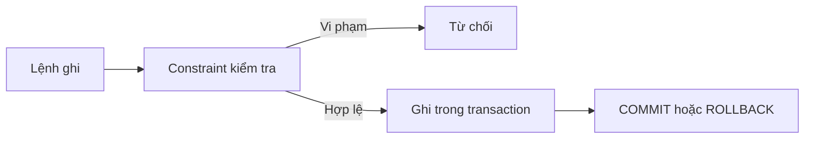
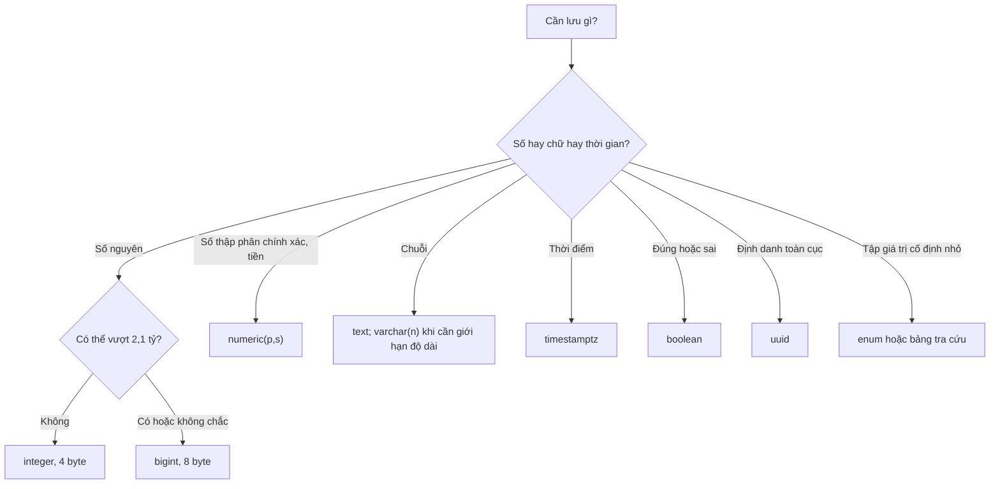
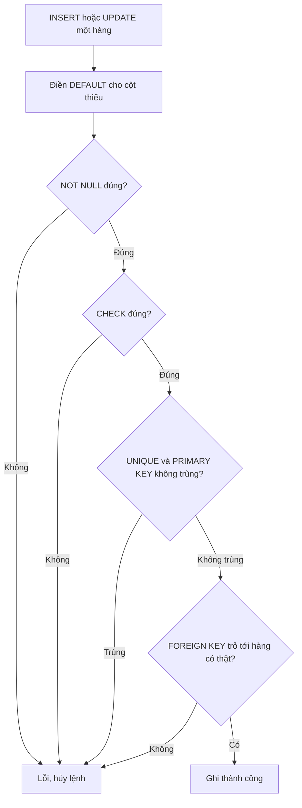
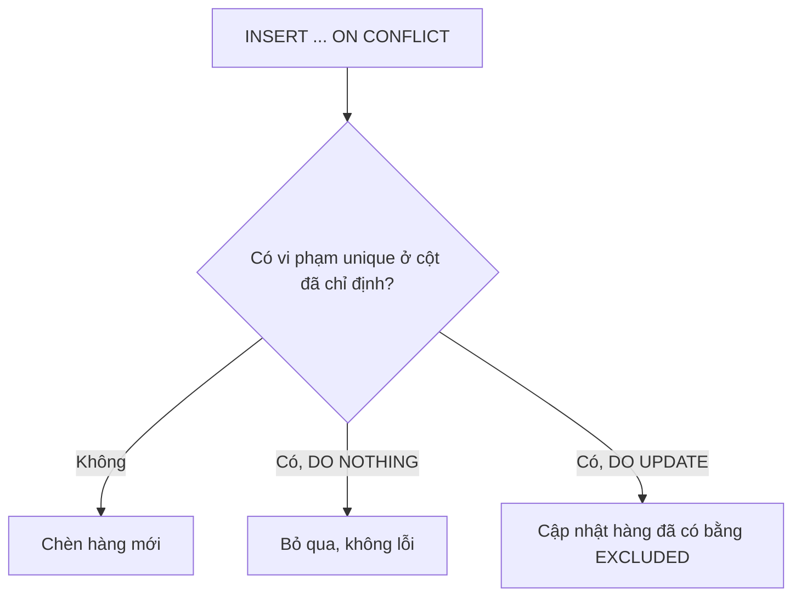
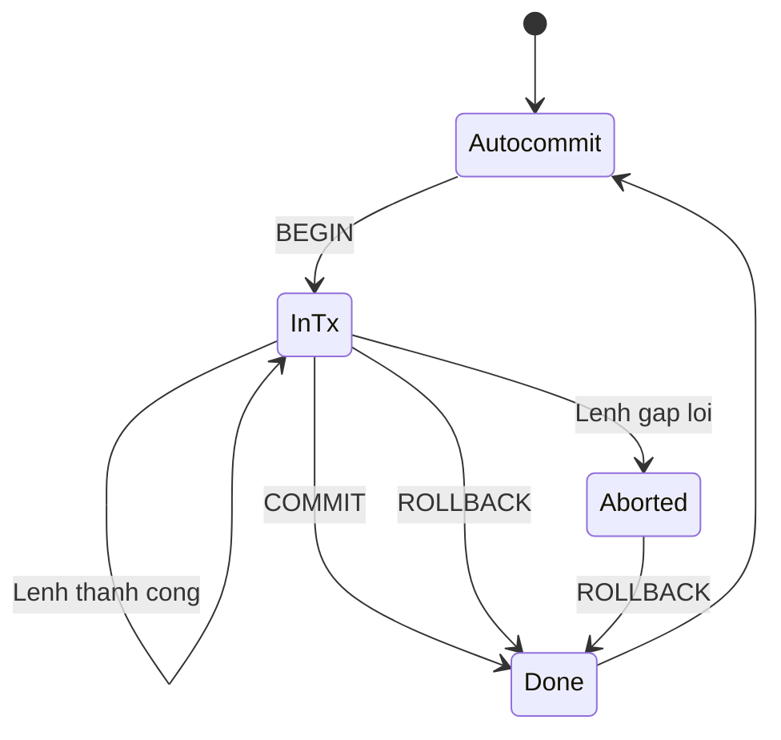
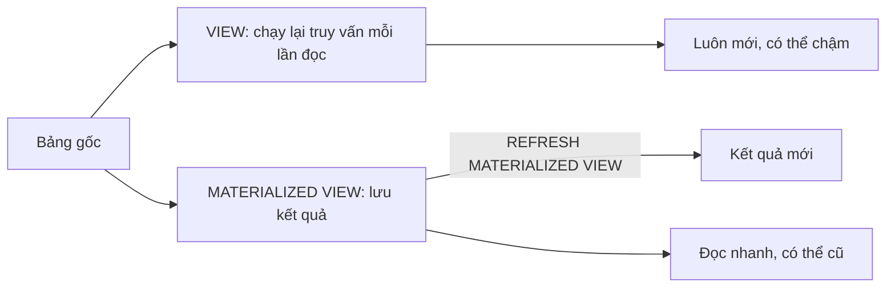

# DDL, DML, kiểu dữ liệu và constraint trong PostgreSQL

DDL (Data Definition Language) là nhóm lệnh định nghĩa cấu trúc như `CREATE TABLE`; DML (Data Manipulation Language) là nhóm lệnh thay đổi dữ liệu như `INSERT`, `UPDATE`, `DELETE`. Bài này đi qua cả hai trong PostgreSQL 18: chọn kiểu dữ liệu đúng, để database tự chặn dữ liệu sai bằng constraint, ghi dữ liệu an toàn (RETURNING, UPSERT, transaction), và dùng view để đóng gói truy vấn. Bạn nên đã biết cách chạy `psql` ([bài lt-12](/go?p=02-Database%2Feasy%2Flt-12-postgresql-cai-dat-psql.md)); phần thiết kế bảng ở mức tư duy nằm ở [Thiết kế schema](/go?p=02-Database%2Feasy%2Flt-02-thiet-ke-schema.md).

**Cốt lõi:** Quy tắc đặt trong schema bằng kiểu dữ liệu và constraint thì luôn đúng, bất kể ai ghi vào database. Việc ghi dữ liệu cũng được gói thành các thao tác nguyên tử: một câu lệnh hoặc một transaction thành công trọn vẹn hoặc không để lại gì.

- Vì chỉ database thấy mọi lần ghi nên bất biến như "tồn kho không âm" phải nằm ở constraint, không chỉ ở code ứng dụng.
- Vì kiểm tra rồi mới chèn không nguyên tử nên dùng ON CONFLICT để database xử lý xung đột trong một câu.
- Vì nhiều lệnh phải cùng thành công hoặc cùng thất bại nên gom chúng vào một transaction rồi COMMIT hoặc ROLLBACK.



Mô hình tư duy: mọi lần ghi đều đi qua cổng kiểm tra của database rồi nằm trong một transaction, nên dữ liệu sai bị chặn và thay đổi dở dang bị hoàn tác.

**Tóm tắt:**

- Chọn kiểu theo nghiệp vụ: `integer` hoặc `bigint` cho số nguyên, `numeric(p,s)` cho tiền, `text` cho chuỗi, `timestamptz` cho thời điểm, `boolean`, `uuid`, `enum` cho tập giá trị cố định nhỏ.
- Constraint đặt ở database là lớp bảo vệ cuối: `PRIMARY KEY`, `FOREIGN KEY`, `UNIQUE`, `CHECK`, `NOT NULL`, `DEFAULT`, cột sinh (`GENERATED`).
- `GENERATED ... AS IDENTITY` thay cho `serial`; sequence không rollback nên id có thể có khoảng trống, và đó là bình thường.
- `INSERT ... RETURNING` lấy luôn giá trị database sinh (id, thời gian); `ON CONFLICT` làm UPSERT nguyên tử; từ PostgreSQL 18, `RETURNING` lấy được cả giá trị `old` và `new`.
- `UPDATE` và `DELETE` luôn có `WHERE`, chạy trong transaction, kiểm tra số hàng bị ảnh hưởng rồi mới `COMMIT`; `TRUNCATE` xóa cả bảng rất nhanh nhưng đòi khóa mạnh.
- Transaction `BEGIN`, `COMMIT`, `ROLLBACK` làm nhiều lệnh thành một đơn vị tất cả hoặc không gì cả; PostgreSQL có DDL transactional.
- `VIEW` là truy vấn có tên (không lưu dữ liệu); `MATERIALIZED VIEW` lưu sẵn kết quả, cập nhật bằng `REFRESH`, và `REFRESH ... CONCURRENTLY` cần một unique index.
- Từ PostgreSQL 18: hàm `uuidv7()`, cột sinh `VIRTUAL` (mặc định), và `RETURNING OLD/NEW`.

## Vấn đề nó giải quyết

Nếu bảng chỉ là ô chứa tùy ý, dữ liệu sai sẽ vào: số lượng âm, email trùng, đơn hàng trỏ tới khách không tồn tại, tiền làm tròn sai vì dùng số thực. Mỗi lỗi như vậy sửa ở code ứng dụng thì phải sửa ở mọi chỗ, và chỉ cần một dịch vụ khác ghi thẳng vào database là lọt. Đặt quy tắc trong schema bằng kiểu dữ liệu và constraint thì quy tắc đó luôn đúng bất kể ai ghi. Ghi dữ liệu cũng gặp vấn đề riêng: chèn xong muốn biết id vừa sinh, chèn nếu chưa có còn có rồi thì cập nhật, nhiều lệnh phải cùng thành công hoặc cùng thất bại. Phần còn lại của bài giải quyết các việc đó.

## Khi nào dùng, khi nào không

Dùng constraint cho mọi quy tắc có thể kiểm tra trên dữ liệu của chính hàng hoặc bảng liên quan. Đừng ép vào constraint những quy tắc cần tra dữ liệu ngoài hoặc đổi liên tục theo nghiệp vụ; chúng thuộc về tầng ứng dụng. `enum` hợp với tập giá trị ổn định và nhỏ (trạng thái đơn); tập thay đổi thường xuyên hợp với bảng tra cứu kèm foreign key. `MATERIALIZED VIEW` hợp với báo cáo đọc nhiều, chấp nhận dữ liệu hơi cũ; nếu cần luôn mới thì dùng view thường hoặc query trực tiếp.

## Các khái niệm cần biết

- **DDL và DML**: DDL định nghĩa cấu trúc (`CREATE`, `ALTER`, `DROP`); DML thao tác dữ liệu (`INSERT`, `UPDATE`, `DELETE`).
- **Constraint**: ràng buộc database tự kiểm tra mỗi lần ghi; vi phạm thì lệnh bị từ chối.
- **Identity và sequence**: sequence là bộ đếm tăng độc lập; cột identity là cột dùng sequence do hệ thống quản lý, chuẩn SQL.
- **Cột sinh (generated column)**: cột có giá trị tính từ các cột khác, không được ghi trực tiếp.
- **RETURNING**: mệnh đề trả về các hàng vừa được chèn, sửa hoặc xóa.
- **UPSERT**: chèn, nếu trùng key thì làm việc khác (bỏ qua hoặc cập nhật), trong `INSERT ... ON CONFLICT`.
- **Transaction**: nhóm lệnh được xử lý thành một đơn vị nguyên tử.
- **Savepoint**: điểm đánh dấu trong transaction để hoàn tác một phần.
- **View và materialized view**: truy vấn có tên; loại thứ hai lưu sẵn kết quả.
- **Enum**: kiểu liệt kê, một danh sách giá trị chữ có thứ tự cố định.
- **timestamptz**: thời điểm tuyệt đối; hiển thị theo múi giờ của phiên.

## Dữ liệu mẫu: bảng cho cả bài

Mọi ví dụ trong bài dùng schema `lab` để không đụng bảng của bài khác. Cột `price_vat` dùng cột sinh `VIRTUAL`, **từ PostgreSQL 18**; trên bản cũ hơn phải viết `STORED`.

```sql
CREATE SCHEMA lab;
SET search_path TO lab, public;          -- chỉ có tác dụng trong phiên hiện tại

CREATE TYPE order_status AS ENUM ('pending', 'paid', 'cancelled');

CREATE TABLE products (
    id         bigint GENERATED ALWAYS AS IDENTITY PRIMARY KEY,
    sku        text           NOT NULL UNIQUE,
    name       text           NOT NULL,
    price      numeric(12, 2) NOT NULL CHECK (price >= 0),
    stock      integer        NOT NULL DEFAULT 0
               CONSTRAINT stock_non_negative CHECK (stock >= 0),
    active     boolean        NOT NULL DEFAULT true,
    price_vat  numeric(12, 2) GENERATED ALWAYS AS (round(price * 1.10, 2)) VIRTUAL,
    created_at timestamptz    NOT NULL DEFAULT now()
);

CREATE TABLE customers (
    id    uuid PRIMARY KEY DEFAULT uuidv7(),     -- uuidv7() có từ PostgreSQL 18
    email text NOT NULL UNIQUE,
    name  text NOT NULL
);

CREATE TABLE orders (
    id          bigint GENERATED ALWAYS AS IDENTITY PRIMARY KEY,
    customer_id uuid         NOT NULL REFERENCES customers (id),
    status      order_status NOT NULL DEFAULT 'pending',
    total       numeric(12, 2) NOT NULL DEFAULT 0,
    created_at  timestamptz  NOT NULL DEFAULT now()
);
```

_Minh họa_ (chưa chạy thử trên PostgreSQL vì môi trường soạn bài không có PostgreSQL; cú pháp đã được rà theo tài liệu PostgreSQL 18). Hãy chạy script trên PostgreSQL 18 và đối chiếu kết quả. Các giá trị id kiểu `uuid` sinh ngẫu nhiên nên mỗi lần chạy mỗi khác.

## Kiểu dữ liệu quan trọng



| Kiểu | Ghi nhớ | Lưu ý |
|---|---|---|
| `integer` | 4 byte, từ -2.147.483.648 đến 2.147.483.647 | Bảng lớn dễ tràn id: ưu tiên `bigint` cho khóa chính |
| `bigint` | 8 byte | Mặc định hợp lý cho id |
| `numeric(p, s)` | Chính xác tuyệt đối, p chữ số tổng, s chữ số sau dấu phẩy | Dùng cho tiền; chậm hơn số thực nhưng không sai số |
| `real`, `double precision` | Số thực nhị phân, có sai số | Không dùng cho tiền (`0.1 + 0.2` không đúng 0,3) |
| `text` | Chuỗi độ dài tùy ý | Trong PostgreSQL không nhanh hơn hay chậm hơn `varchar(n)`; ưu tiên `text` và thêm `CHECK (length(...))` khi cần |
| `varchar(n)` | Chuỗi tối đa n ký tự | Chỉ dùng khi giới hạn là quy tắc nghiệp vụ thật |
| `timestamptz` | Thời điểm tuyệt đối, lưu quy về UTC | Hiển thị theo `TimeZone` của phiên; mặc định nên chọn |
| `timestamp` | Ngày giờ không có múi giờ | Dễ lệch giờ khi server và client khác múi; tránh cho thời điểm sự kiện |
| `boolean` | `true`, `false`, `NULL` | Nên `NOT NULL` để chỉ còn hai trạng thái |
| `uuid` | 16 byte, định danh toàn cục | UUID ngẫu nhiên làm chèn rải rác trong index; `uuidv7()` (từ PostgreSQL 18) xếp theo thời gian |
| `enum` | Danh sách giá trị cố định | Thêm giá trị bằng `ALTER TYPE ... ADD VALUE`; không xóa bớt giá trị được |

`timestamptz` thực chất không lưu múi giờ: nó chuyển giờ nhập vào về UTC để lưu, rồi chuyển lại theo múi giờ của phiên khi hiển thị. Vì vậy hai máy khác múi giờ vẫn nói về cùng một khoảnh khắc.

**Phải thuộc:** Tiền dùng `numeric`, không dùng số thực. Thời điểm dùng `timestamptz`. `text` và `varchar(n)` có hiệu năng như nhau trong PostgreSQL. Khóa chính nên là `bigint` (hoặc `uuid`), `integer` dễ tràn ở 2,1 tỷ.

### uuidv7 (từ PostgreSQL 18)

```sql
SELECT uuidv7();
-- ví dụ giá trị, mỗi lần khác nhau: 0199c0d2-5b3e-7a41-9f20-3c1e8d6a4b77
```

UUIDv7 chứa dấu thời gian ở các bit đầu, nên giá trị sinh sau lớn hơn giá trị sinh trước (xấp xỉ); chèn vào B-tree gần như nối đuôi, tốt cho index hơn UUID ngẫu nhiên (`gen_random_uuid()`). Bù lại, nó lộ thời điểm tạo, nên đừng dùng nếu thời điểm tạo là thông tin nhạy cảm.

## Constraint: để database tự chặn dữ liệu sai



| Constraint | Quy tắc | Ví dụ trong bài |
|---|---|---|
| `PRIMARY KEY` | Duy nhất và không `NULL`, định danh hàng; tự tạo index | `products.id` |
| `FOREIGN KEY` (`REFERENCES`) | Giá trị phải tồn tại ở bảng được trỏ tới | `orders.customer_id` |
| `UNIQUE` | Không trùng (nhiều `NULL` vẫn được phép, trừ khi dùng `NULLS NOT DISTINCT`) | `products.sku`, `customers.email` |
| `CHECK` | Biểu thức phải TRUE hoặc UNKNOWN | `price >= 0`, `stock >= 0` |
| `NOT NULL` | Cấm `NULL` | hầu hết cột |
| `DEFAULT` | Giá trị khi không điền | `stock` mặc định 0, `created_at` mặc định `now()` |
| `GENERATED` | Cột tính từ cột khác, không ghi trực tiếp được | `price_vat` |

Hai chi tiết hay bị bỏ qua. Thứ nhất, `CHECK` cho qua khi biểu thức là UNKNOWN: nếu cột cho phép `NULL`, `CHECK (price >= 0)` vẫn cho `NULL` lọt, nên cặp `NOT NULL` cộng `CHECK` mới chặt. Thứ hai, foreign key quyết định cả hành vi khi xóa hàng cha: mặc định từ chối (`NO ACTION`); `ON DELETE CASCADE` xóa luôn hàng con; `ON DELETE SET NULL` đặt cột con về `NULL`. PostgreSQL không tự tạo index cho cột foreign key phía con, hãy tự tạo nếu hay JOIN hoặc xóa theo cha.

Thử vi phạm (mong đợi lỗi, không có hàng nào được ghi):

```sql
INSERT INTO products (sku, name, price) VALUES ('X1', 'Loi', -5);
-- ERROR:  new row for relation "products" violates check constraint "products_price_check"

INSERT INTO orders (customer_id) VALUES (uuidv7());
-- ERROR:  insert or update on table "orders" violates foreign key constraint "orders_customer_id_fkey"
```

**Nền tảng:** Constraint được kiểm tra bởi database ở mỗi lần ghi, cho mọi client. Đó là lớp bảo vệ cuối cùng không phụ thuộc code ứng dụng. Cặp `NOT NULL` cộng `CHECK` mới loại được cả `NULL` lẫn giá trị sai.

**Suy luận:** Ứng dụng có thể có lỗi, có nhiều dịch vụ cùng ghi, và có người sửa tay bằng công cụ GUI; chỉ database nhìn thấy mọi lần ghi nên chỉ nó đảm bảo được bất biến như "tồn kho không âm". Vì vậy quy tắc nào kiểm tra được trên dữ liệu thì nên có ở schema, còn code ứng dụng kiểm tra thêm chỉ để trả thông báo lỗi thân thiện. Cái giá là mỗi constraint thêm một chút chi phí cho mỗi lần ghi, nhưng rất nhỏ so với chi phí dọn dữ liệu bẩn. Điểm dễ nhầm là tưởng `CHECK (x > 0)` loại được `NULL`; thực tế UNKNOWN được coi là qua, nên cần thêm `NOT NULL`.

## Identity và sequence

`GENERATED ALWAYS AS IDENTITY` gắn cột với một sequence do hệ thống quản lý và cấm bạn tự điền giá trị (trừ khi viết `OVERRIDING SYSTEM VALUE`). `GENERATED BY DEFAULT AS IDENTITY` cho phép tự điền. Kiểu `serial` cũ vẫn chạy nhưng identity là cách khuyên dùng vì tuân chuẩn SQL và quyền sở hữu sequence rõ ràng.

```sql
INSERT INTO products (sku, name, price, stock)
VALUES ('A1', 'Ao thun', 100000, 10),
       ('Q1', 'Quan jean', 250000, 5)
RETURNING id, sku, price, price_vat;
```

```text
 id | sku |    price    |  price_vat
----+-----+-------------+-------------
  1 | A1  |  100000.00  |  110000.00
  2 | Q1  |  250000.00  |  275000.00
(2 rows)
INSERT 0 2
```

Sequence **không rollback**. Nếu một lệnh `INSERT` lấy số 3 rồi bị hủy (lỗi hoặc `ROLLBACK`), số 3 không được trả lại; lần chèn sau nhận 4. Id có khoảng trống là bình thường, đừng dùng id để đếm số hàng hay yêu cầu liên tục. Sau khi nhập dữ liệu hàng loạt kèm id thủ công, đồng bộ lại sequence:

```sql
SELECT setval(pg_get_serial_sequence('lab.products', 'id'),
              (SELECT max(id) FROM lab.products));
```

**Phải thuộc:** Sequence không rollback nên id có khoảng trống, không dùng id để đếm. Dùng `GENERATED ... AS IDENTITY` thay `serial` cho bảng mới. `RETURNING` lấy giá trị database vừa sinh mà không cần SELECT lại.

## UPSERT bằng ON CONFLICT

Bài toán: "chèn sản phẩm, nếu `sku` đã có thì cập nhật giá". Viết `SELECT` rồi mới `INSERT` hoặc `UPDATE` bị lỗi khi hai request chạy cùng lúc (cả hai thấy chưa có, cả hai chèn, một cái lỗi trùng key). `ON CONFLICT` làm việc đó nguyên tử trong một câu.



```sql
-- sku A1 đã tồn tại: cập nhật giá; sku B1 chưa có: chèn mới
INSERT INTO products (sku, name, price, stock)
VALUES ('A1', 'Ao thun', 120000, 0),
       ('B1', 'Non', 80000, 20)
ON CONFLICT (sku) DO UPDATE
    SET price = EXCLUDED.price
RETURNING id, sku, price;
```

```text
 id | sku |   price
----+-----+-----------
  1 | A1  | 120000.00
  4 | B1  |  80000.00
```

`EXCLUDED` là hàng đang định chèn. Lưu ý `stock` của A1 không bị đổi vì mệnh đề `SET` chỉ có `price`. Để ý B1 nhận id 4 chứ không phải 3: lần thử chèn A1 đã lấy số 3 từ sequence trước khi phát hiện trùng `sku`, và số đó không được trả lại, đúng với quy tắc "sequence không rollback" ở trên. Dùng `ON CONFLICT (sku) DO NOTHING` khi chỉ cần "chèn nếu chưa có". Ngoài ra còn câu `MERGE` cho logic nhiều nhánh; `ON CONFLICT` đơn giản hơn cho trường hợp phổ biến.

## RETURNING OLD và NEW (từ PostgreSQL 18)

Trước PostgreSQL 18, `RETURNING` chỉ trả giá trị sau thay đổi. **Từ PostgreSQL 18** có thể lấy cả giá trị cũ bằng bí danh `old` và mới bằng `new`, trong `INSERT`, `UPDATE`, `DELETE` và `MERGE`.

```sql
UPDATE products
SET price = 130000
WHERE sku = 'A1'
RETURNING sku, old.price AS gia_cu, new.price AS gia_moi;
```

```text
 sku |   gia_cu   |  gia_moi
-----+------------+------------
 A1  | 120000.00  | 130000.00
(1 row)
UPDATE 1
```

Hữu ích cho nhật ký thay đổi (audit) mà không cần trigger hoặc SELECT trước: bạn biết chính xác giá trị trước và sau trong cùng một câu. Với `ON CONFLICT DO UPDATE`, `old` là hàng cũ còn `new` là hàng sau cập nhật; với hàng mới chèn, các cột `old` là `NULL`.

## UPDATE và DELETE an toàn

Hai câu lệnh nguy hiểm nhất là `UPDATE` và `DELETE` thiếu `WHERE`: chúng sửa hoặc xóa toàn bộ bảng, và trong chế độ autocommit thì xong là xong. Quy trình an toàn:

1. Viết `SELECT` với cùng điều kiện, kiểm tra các hàng bị chọn.
2. Mở transaction bằng `BEGIN`.
3. Chạy `UPDATE` hoặc `DELETE`; đọc dòng trạng thái (`UPDATE 1`, `DELETE 3`) xem số hàng có khớp dự kiến không.
4. Đúng thì `COMMIT`, sai thì `ROLLBACK`.

```sql
SELECT id, sku, stock FROM products WHERE sku = 'Q1';

BEGIN;
UPDATE products SET stock = stock - 2 WHERE sku = 'Q1';   -- mong đợi: UPDATE 1
COMMIT;
```

Thêm `RETURNING` vào `DELETE` để xem chính xác những hàng đã xóa. Ở ứng dụng, thay vì xóa thật dữ liệu nghiệp vụ, nhiều hệ thống dùng xóa mềm (cột `deleted_at`); khi đó nhớ lọc ở mọi truy vấn.

### TRUNCATE

```sql
TRUNCATE TABLE lab.orders RESTART IDENTITY;   -- xóa hết hàng, đặt lại bộ đếm
```

`TRUNCATE` nhanh hơn `DELETE` không điều kiện vì không xóa từng hàng, nhưng nó lấy khóa `ACCESS EXCLUSIVE` (chặn cả đọc), không chạy trigger `ON DELETE` từng hàng, và từ chối khi có foreign key trỏ tới bảng trừ khi thêm `CASCADE` (xóa luôn dữ liệu bảng con). Trong PostgreSQL `TRUNCATE` vẫn nằm trong transaction nên rollback được. Dùng cho bảng tạm hoặc môi trường thử, hiếm khi trên bảng nghiệp vụ.

## Transaction cơ bản

Chuyển 5 sản phẩm từ kho này sang kho khác gồm hai lệnh `UPDATE`; nếu lệnh sau lỗi thì lệnh trước phải được hoàn tác, không thì hàng "biến mất". Transaction gom các lệnh thành một đơn vị: hoặc tất cả có hiệu lực, hoặc không gì cả.



Đọc sơ đồ: ngoài `BEGIN`, mỗi lệnh tự là một transaction (autocommit). Sau `BEGIN`, các lệnh cùng gom lại; nếu một lệnh lỗi, transaction vào trạng thái hỏng và mọi lệnh sau bị từ chối (`current transaction is aborted, commands ignored until end of transaction block`) cho đến khi `ROLLBACK`. Muốn hoàn tác một phần thì dùng `SAVEPOINT`.

```sql
BEGIN;
UPDATE products SET stock = stock - 5 WHERE sku = 'B1';
UPDATE products SET stock = stock + 5 WHERE sku = 'A1';
COMMIT;            -- hoặc ROLLBACK; nếu muốn hủy cả hai

BEGIN;
UPDATE products SET stock = -1 WHERE sku = 'A1';
-- ERROR:  new row for relation "products" violates check constraint "stock_non_negative"
ROLLBACK;
```

PostgreSQL còn có DDL transactional: `CREATE TABLE`, `ALTER TABLE` nằm trong transaction và rollback được, nên migration có thể "thử rồi hủy". Isolation, khóa và deadlock được bàn ở [Transaction, Isolation và Lock](/go?p=02-Database%2Fmedium%2Flt-04-transaction-isolation-lock.md).

**Phải thuộc:** Transaction có tính nguyên tử: `COMMIT` làm mọi thay đổi có hiệu lực, `ROLLBACK` hủy tất cả. Khi một lệnh lỗi trong transaction, phải `ROLLBACK` (hoặc về `SAVEPOINT`) mới chạy lệnh tiếp được. PostgreSQL có DDL transactional.

## VIEW và MATERIALIZED VIEW

View là truy vấn được đặt tên, dùng như bảng. Nó không lưu dữ liệu, mỗi lần đọc chạy lại truy vấn gốc.

```sql
CREATE VIEW order_summary AS
SELECT c.id AS customer_id, c.name, count(o.id) AS orders, COALESCE(sum(o.total), 0) AS spent
FROM customers c
LEFT JOIN orders o ON o.customer_id = c.id
GROUP BY c.id, c.name;

SELECT * FROM order_summary;
```

Dùng view để che sự phức tạp của JOIN, đặt quyền theo view (cho xem một số cột), hoặc giữ tên ổn định khi bảng gốc đổi.

Materialized view lưu sẵn kết quả của truy vấn, nên đọc nhanh nhưng dữ liệu chỉ mới ở lần làm mới gần nhất.



```sql
CREATE MATERIALIZED VIEW sales_by_status AS
SELECT status, count(*) AS orders, sum(total) AS revenue
FROM orders
GROUP BY status;

-- bắt buộc có unique index để dùng CONCURRENTLY
CREATE UNIQUE INDEX sales_by_status_status_idx ON sales_by_status (status);

REFRESH MATERIALIZED VIEW sales_by_status;                  -- khóa đọc trong lúc làm mới
REFRESH MATERIALIZED VIEW CONCURRENTLY sales_by_status;     -- không chặn đọc
```

`REFRESH ... CONCURRENTLY` tính kết quả mới ở bên rồi áp phần khác biệt, nên người đọc không bị chặn; đổi lại nó chậm hơn, và đòi view đã có dữ liệu và có ít nhất một unique index (không có điều kiện `WHERE`) trên các cột. View tạo bằng `WITH NO DATA` phải `REFRESH` thường một lần trước. Materialized view không tự cập nhật: cần job định kỳ (cron, pg_cron, scheduler của ứng dụng) gọi `REFRESH`.

## Bẫy thường gặp

| Bẫy | Hậu quả | Cách tránh |
|---|---|---|
| Dùng `float` hoặc `double precision` cho tiền | Sai số làm tròn, tổng lệch | `numeric(p,s)` hoặc số nguyên đơn vị nhỏ nhất |
| Dùng `timestamp` (không múi giờ) cho sự kiện | Lệch giờ khi server hoặc client đổi múi giờ | `timestamptz` |
| `UPDATE` hoặc `DELETE` thiếu `WHERE` | Sửa hoặc xóa cả bảng | SELECT trước, `BEGIN`, kiểm tra số hàng, mới `COMMIT` |
| Tin id liên tục | Báo lỗi sai khi có khoảng trống do rollback | Id chỉ để định danh, không để đếm |
| `INTEGER` làm khóa chính bảng lớn | Tràn ở 2,1 tỷ, đổi kiểu rất đắt | `bigint` ngay từ đầu |
| `SELECT` rồi `INSERT` thay cho UPSERT | Race condition, lỗi trùng key | `INSERT ... ON CONFLICT` |
| `CHECK` mà không `NOT NULL` | `NULL` vẫn lọt qua | Thêm `NOT NULL` |
| `TRUNCATE` bảng đang được dùng | Khóa `ACCESS EXCLUSIVE`, ứng dụng treo | Chỉ dùng ngoài giờ hoặc cho bảng tạm |
| Quên `REFRESH` materialized view | Báo cáo dữ liệu cũ | Lên lịch làm mới, hiển thị thời điểm cập nhật |
| `REFRESH ... CONCURRENTLY` không có unique index | Lỗi `cannot refresh materialized view concurrently` | Tạo unique index trước |
| Enum cho tập giá trị hay đổi | Khó đổi, không xóa được giá trị | Bảng tra cứu kèm foreign key |
| Mở transaction rồi để treo | Giữ khóa, cản VACUUM | Giữ transaction ngắn, đặt `idle_in_transaction_session_timeout` |

## Điểm cần nhớ

- Kiểu: `bigint` cho id, `numeric` cho tiền, `text` cho chuỗi, `timestamptz` cho thời điểm, `uuid` khi cần định danh toàn cục.
- Constraint đặt ở database vì chỉ nó thấy mọi lần ghi; `CHECK` cần đi cùng `NOT NULL`.
- Identity thay `serial`; sequence không rollback nên id có thể nhảy.
- `RETURNING` lấy giá trị sinh ra; `ON CONFLICT` là UPSERT nguyên tử.
- Từ PostgreSQL 18: `uuidv7()`, cột sinh `VIRTUAL` (mặc định), `RETURNING OLD/NEW`.
- Mọi `UPDATE` và `DELETE` có `WHERE`, chạy trong transaction, kiểm tra số hàng.
- View đọc luôn mới; materialized view đọc nhanh nhưng cần `REFRESH`, và `CONCURRENTLY` cần unique index.

## Phỏng vấn khó: chuỗi hỏi xoáy

Người phỏng vấn senior thường mở bằng một câu dễ rồi xoáy xuống cơ chế, đánh đổi và sự cố thật. Câu trả lời tốt luôn đi từ cốt lõi xuống, không đi từ chỗ học thuộc lên.

### Chuỗi 1: ON CONFLICT dựa vào đâu và sequence đi về đâu

1. **Câu mở:** Giải thích `INSERT ... ON CONFLICT (sku) DO UPDATE`.
2. **Xoáy 1:** Database phát hiện xung đột bằng cách nào? Nếu `sku` chưa có unique constraint thì sao?
3. **Xoáy 2:** Chèn hai hàng, một hàng trùng `sku` và một hàng mới. Hàng mới nhận id có liền số không, và có nên dùng id để đếm?

**Đáp án ngắn:** `ON CONFLICT` biến "chèn, nếu trùng thì làm việc khác" thành một câu nguyên tử do database xử lý, không còn khe hở giữa bước kiểm tra và bước ghi. Nó dựa vào unique constraint hoặc unique index trên cột chỉ định; không có unique ở đó thì không có gì để phát hiện xung đột và câu lệnh bị từ chối. `DO NOTHING` là chèn nếu chưa có; `DO UPDATE` cập nhật hàng đã có, `EXCLUDED` là hàng định chèn, và chỉ cột nằm trong `SET` bị đổi (ví dụ `stock` giữ nguyên nếu `SET` chỉ có `price`). Với cột identity, lần thử chèn đã lấy số từ sequence trước khi phát hiện trùng, và sequence không rollback, nên hàng mới sau đó nhận id nhảy cách một số. Id vẫn duy nhất và tăng nhưng có khoảng trống, nên chỉ dùng để định danh, không dùng để đếm hàng. Nếu logic nhiều nhánh thì có `MERGE`, còn `ON CONFLICT` đơn giản hơn cho trường hợp phổ biến.

**Sai lầm hay gặp:**

- Nghĩ `ON CONFLICT` chạy được mà không cần unique constraint.
- Quên rằng `DO UPDATE` chỉ đổi cột nằm trong `SET`.
- Coi khoảng trống trong id là lỗi dữ liệu rồi báo động sai.

### Chuỗi 2: Transaction hỏng giữa chừng, savepoint và DDL

1. **Câu mở:** Trong `BEGIN ... COMMIT`, lệnh thứ hai vi phạm `CHECK`. Lệnh thứ ba có chạy được không?
2. **Xoáy 1:** Muốn bỏ qua lỗi của một lệnh mà giữ phần đã làm trước đó thì làm sao?
3. **Xoáy 2:** Chạy `ALTER TABLE` hoặc `TRUNCATE` trong transaction thì rollback được không? `TRUNCATE` ảnh hưởng người đọc khác ra sao?

**Đáp án ngắn:** Trong PostgreSQL, một lệnh lỗi làm transaction vào trạng thái hỏng, mọi lệnh sau bị từ chối (`current transaction is aborted, commands ignored until end of transaction block`) cho tới khi `ROLLBACK`. Khác với autocommit, lỗi không chỉ hủy riêng lệnh đó. Muốn hoàn tác một phần thì đặt `SAVEPOINT` trước lệnh rủi ro, rồi quay về savepoint khi lỗi và chạy tiếp. PostgreSQL có DDL transactional: `CREATE TABLE`, `ALTER TABLE` nằm trong transaction và rollback được, nên migration có thể thử rồi hủy. `TRUNCATE` cũng rollback được, nhưng nó lấy khóa `ACCESS EXCLUSIVE` chặn cả đọc, không chạy trigger `ON DELETE` từng hàng, và từ chối khi có foreign key trỏ tới trừ khi thêm `CASCADE`. Một rủi ro nữa là mở transaction rồi để treo: nó giữ khóa và cản VACUUM, nên đặt `idle_in_transaction_session_timeout` và để ý trạng thái `idle in transaction` trong `pg_stat_activity`.

**Sai lầm hay gặp:**

- Nghĩ lỗi một lệnh chỉ hủy riêng lệnh đó như trong autocommit.
- Cho rằng DDL tự commit nên không thể rollback trong PostgreSQL.
- Chạy `TRUNCATE` trên bảng đang phục vụ ứng dụng vào giờ cao điểm.

## Câu hỏi tự kiểm tra

Với mỗi câu, thử trả lời theo gợi ý trước rồi mới đọc phần lập luận.

1. Vì sao không dùng `double precision` để lưu giá tiền?
   - **Gợi ý suy luận:** số thực nhị phân biểu diễn `0,1` chính xác được không? Cộng hàng triệu lần thì sai số làm gì?
   - **Lập luận và đáp án:** số thực nhị phân chỉ xấp xỉ nhiều số thập phân, nên phép cộng, so sánh bằng cho kết quả lệch nhỏ và tích lũy. `numeric(p,s)` tính chính xác theo chữ số thập phân nên đúng với tiền; chấp nhận chậm hơn một chút.
2. Một `INSERT` bị rollback, lần chèn sau nhận id nhảy cách một số. Có phải lỗi không?
   - **Gợi ý suy luận:** nếu sequence rollback theo transaction thì hai transaction chạy song song sẽ làm gì với bộ đếm?
   - **Lập luận và đáp án:** không phải lỗi. Sequence được cấp ngay không chờ commit để nhiều transaction cùng lấy số mà không chờ nhau, nên số đã cấp không được trả lại khi rollback. Hệ quả: id duy nhất và tăng nhưng có khoảng trống.
3. `CHECK (price >= 0)` trên cột `price` cho phép `NULL`. `INSERT` với `price = NULL` có qua không?
   - **Gợi ý suy luận:** `NULL >= 0` cho TRUE, FALSE hay UNKNOWN? Constraint từ chối khi nào?
   - **Lập luận và đáp án:** qua. Biểu thức cho UNKNOWN và `CHECK` chỉ từ chối khi FALSE. Muốn cấm `NULL` phải thêm `NOT NULL`.
4. Hai request cùng lúc chèn `sku = 'A1'`. Viết `SELECT` kiểm tra rồi `INSERT` sai ở đâu, và sửa thế nào?
   - **Gợi ý suy luận:** giữa `SELECT` và `INSERT` của request A, request B làm được gì?
   - **Lập luận và đáp án:** cả hai cùng `SELECT` thấy chưa có rồi cùng `INSERT`, một cái dính lỗi trùng key (kiểm tra rồi hành động không nguyên tử). Sửa bằng `INSERT ... ON CONFLICT (sku) DO UPDATE` hoặc `DO NOTHING`, để database xử lý xung đột nguyên tử, dựa trên unique constraint.
5. `REFRESH MATERIALIZED VIEW CONCURRENTLY` báo lỗi. Hai nguyên nhân thường gặp?
   - **Gợi ý suy luận:** database cần gì để so khớp hàng cũ với hàng mới? View đã từng có dữ liệu chưa?
   - **Lập luận và đáp án:** phải có ít nhất một unique index (không có điều kiện `WHERE`) trên view để định danh hàng khi áp phần khác biệt; và view phải đã có dữ liệu (tạo bằng `WITH NO DATA` thì cần `REFRESH` thường một lần trước).
6. Bạn muốn ghi nhật ký giá cũ và giá mới khi cập nhật giá. Từ PostgreSQL 18 làm thế nào trong một câu lệnh?
   - **Gợi ý suy luận:** `RETURNING` trước đây trả giá trị lúc nào? Bản 18 thêm gì?
   - **Lập luận và đáp án:** dùng `UPDATE ... RETURNING old.price, new.price`. Từ PostgreSQL 18 `RETURNING` truy cập được cả giá trị trước (`old`) và sau (`new`) khi thay đổi, không cần SELECT trước hay trigger. Ở bản cũ hơn phải đọc trước hoặc dùng trigger.

Nguồn: tài liệu chính thức PostgreSQL 18 (Data Types, Constraints, Generated Columns, INSERT, UPDATE, TRUNCATE, Transactions, CREATE VIEW, CREATE MATERIALIZED VIEW, REFRESH MATERIALIZED VIEW, UUID Functions, Release Notes 18), kiểm tra ngày 2026-10-30.

