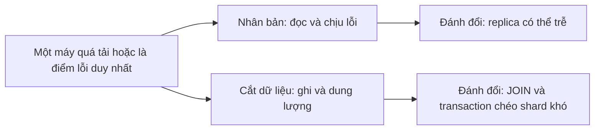
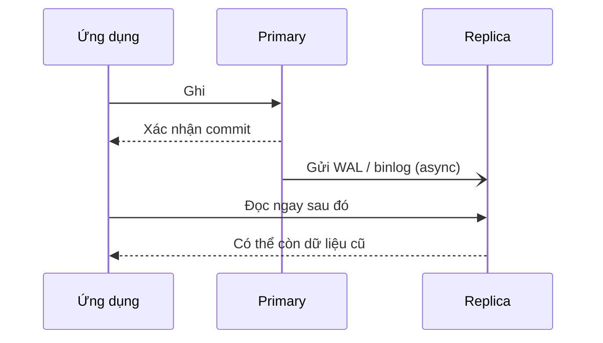
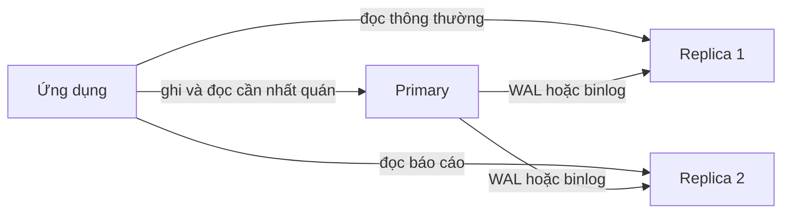
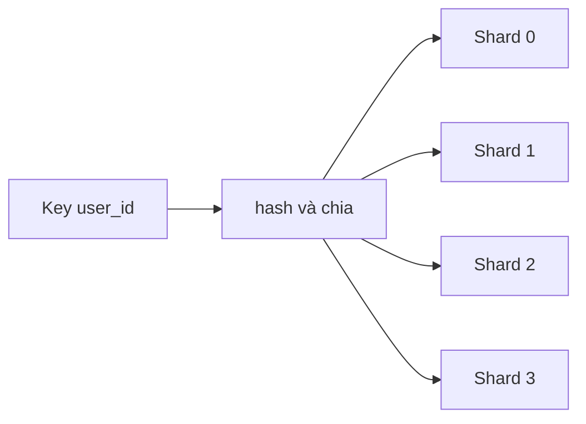
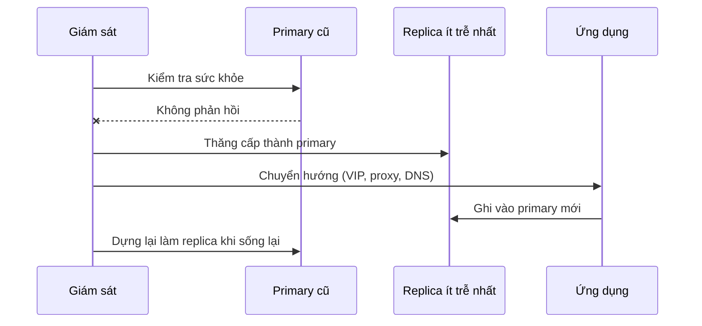

# Replication, Partitioning, Sharding và High Availability

Một database chạy trên một máy duy nhất sớm muộn gặp hai vấn đề: máy đó có trần về tải và dung lượng, và khi nó chết thì cả hệ thống chết theo (single point of failure, điểm lỗi duy nhất). Bài này hướng dẫn ba kỹ thuật giải quyết hai vấn đề đó, và quan trọng hơn là khi nào nên dùng từng cái.

**Cốt lõi:** Một máy có trần về tải và dung lượng, và khi nó chết thì cả hệ thống chết. Replication nhân bản dữ liệu để đọc nhiều và chịu lỗi, còn partitioning và sharding cắt dữ liệu ra để vượt trần đó.

- Vì primary commit xong mới gửi log nên replica có thể trễ, và đọc ngay sau ghi có thể thấy dữ liệu cũ.
- Vì mọi ghi vẫn đi qua một primary nên thêm replica không làm ghi nhanh hơn, và replica cũng không thay được backup.
- Vì vị trí của key phụ thuộc cách chia nên hash mod số node làm đổi chỗ phần lớn dữ liệu khi thêm node.



Mô hình tư duy: nhân bản và cắt nhỏ giải hai vấn đề khác nhau, và mỗi cách đều trả giá bằng độ phức tạp nên chỉ dùng khi cách đơn giản hơn đã hết.

**Tóm tắt:**

- Replication giữ nhiều copy dữ liệu: primary nhận ghi, replica nhận bản sao và phục vụ đọc; nó giúp scale đọc và chịu lỗi, không tăng throughput ghi.
- Replication async làm replica có thể trễ (replication lag), nên đọc sau ghi có thể thấy dữ liệu cũ; xử lý bằng đọc primary sau khi ghi hoặc đọc theo vị trí log (LSN, GTID).
- Partitioning chia một bảng thành phần nhỏ trong một DB; sharding chia dữ liệu ra nhiều DB hoặc máy để vượt giới hạn ghi và dung lượng.
- Thứ tự ưu tiên khi quá tải: index và query, cache, replica đọc, partition, rồi mới sharding.
- Đừng dùng hash mod số node vì đổi số node làm di chuyển phần lớn dữ liệu (mod 4 sang mod 5 khoảng 80 phần trăm); dùng bucket logic cộng bảng ánh xạ, hoặc consistent hashing.
- Failover thăng cấp replica ít trễ nhất và cần cơ chế bầu chọn để tránh split brain; replica không thay được backup vì lệnh xóa nhầm cũng được replicate.
- PITR cần base backup cộng WAL; RPO là lượng dữ liệu chấp nhận mất, RTO là thời gian chấp nhận ngừng.
- Connection pooling giữ số kết nối DB nhỏ so với số thread ứng dụng.

## Ba khái niệm chính

- **Replication**: giữ nhiều bản sao của cùng dữ liệu trên nhiều máy. Một máy là primary nhận ghi, các máy còn lại là replica nhận bản sao và phục vụ đọc. Giống như một cuốn sổ gốc và nhiều bản photo.
- **Partitioning và sharding**: cắt dữ liệu ra thành nhiều phần, mỗi phần nằm ở một chỗ. Partitioning cắt một bảng thành nhiều phần ngay trong một database; sharding chia dữ liệu ra nhiều database trên nhiều máy.
- **High availability (HA)**: hệ thống vẫn phục vụ khi một máy chết, thường nhờ replica tự động được thăng cấp.

## Khi nào dùng, khi nào không

Dùng replication khi đọc quá nhiều cho một node, hoặc cần chịu lỗi. Replication không giúp ghi nhanh hơn vì mọi ghi vẫn phải đi qua primary. Dùng sharding khi dữ liệu hoặc lượng ghi vượt sức một máy. Đừng shard sớm vì rất phức tạp: JOIN chéo shard khó, transaction phân tán khó, chia lại shard rất đau. Hãy thử nâng cấu hình, tối ưu index và query, cache, replica đọc, partition trước.

## Cách làm tóm tắt

Replication để scale đọc và chịu lỗi (chú ý replica có thể trễ). Partition cắt bảng trong cùng một DB. Sharding chia dữ liệu giữa nhiều DB theo shard key. Chuẩn bị failover và backup, và phải thử khôi phục thật, không chỉ có backup trên giấy.

## Các khái niệm cần biết

- **WAL (Write-Ahead Log) / binlog**: log các thay đổi mà DB ghi trước khi áp vào dữ liệu thật. Primary gửi log này cho replica để replica làm lại đúng các thay đổi đó (PostgreSQL gọi là WAL, MySQL gọi là binary log).
- **Replication lag**: khoảng chênh giữa lúc primary commit và lúc replica áp dụng xong. Là lý do replica có thể trả dữ liệu cũ.
- **Read-your-writes**: bảo đảm người dùng vừa ghi sẽ thấy ngay dữ liệu mình ghi khi đọc lại.
- **LSN / GTID**: định danh vị trí trong log (LSN của PostgreSQL, GTID của MySQL), dùng để biết replica đã áp dụng tới đâu.
- **Shard key**: cột dùng để quyết định một hàng nằm ở shard nào.
- **Scatter-gather**: query phải hỏi mọi shard rồi gộp kết quả, chậm và tốn kém.
- **Hot shard**: shard bị dồn tải quá mức so với các shard khác.
- **Failover**: quá trình chuyển vai trò primary sang máy khác khi primary chết.
- **Split brain**: hai máy cùng tin mình là primary và cùng nhận ghi, dẫn đến dữ liệu phân kỳ, rất khó sửa.
- **PITR (point-in-time recovery)**: khôi phục database về một thời điểm bất kỳ, nhờ base backup cộng log WAL.
- **RPO / RTO**: lượng dữ liệu tối đa chấp nhận mất, và thời gian tối đa chấp nhận ngừng.

## Replication



Đọc sơ đồ: primary xác nhận commit cho ứng dụng trước, rồi mới gửi log cho replica. Nếu ứng dụng đọc từ replica ngay sau đó, replica có thể chưa nhận kịp và trả dữ liệu cũ. Đây là điểm cốt lõi của replication async, và bảng sau so sánh hai chế độ:

**Nền tảng:** Replication async: primary commit xong mới gửi WAL hoặc binlog cho replica, nên replica có thể trễ (replication lag) và trả dữ liệu cũ. Mọi ghi vẫn đi qua primary, nên replica giúp scale đọc và chịu lỗi chứ không tăng throughput ghi.

**Suy luận:** Primary chỉ cần commit xong là trả lời client, vì nếu phải đợi mọi replica xác nhận thì mỗi lần ghi chậm theo replica chậm nhất và hỏng nếu một replica chết. Cái giá của lựa chọn đó là có một khoảng thời gian primary đã có dữ liệu mới mà replica chưa nhận được, chính là replication lag. Hệ quả thứ nhất: đọc từ replica ngay sau khi ghi có thể không thấy chính dữ liệu vừa ghi, nên người dùng thấy như dữ liệu biến mất. Hệ quả thứ hai: nếu primary chết đúng lúc đó và một replica được thăng cấp, các ghi chưa kịp sang replica mất vĩnh viễn dù client đã nhận thành công. Hệ quả thứ ba: vì mọi ghi vẫn đi qua một primary, thêm replica không làm ghi nhanh hơn. Điểm dễ nhầm là coi replica như bản backup hoặc như cách scale ghi; nó chỉ scale đọc và chịu lỗi phần cứng. Khi thiết kế, hãy phân loại các lần đọc nào chịu được dữ liệu hơi cũ, và đưa những lần đọc cần chính xác (số dư, trạng thái thanh toán) về primary.

| | Async | Sync |
|---|---|---|
| Commit chờ replica? | Không | Có |
| Độ trễ ghi | Thấp | Cao hơn |
| Mất dữ liệu khi primary chết | Có thể (phần chưa kịp replicate) | Không (tùy cấu hình) |
| Replica có thể cũ | **Có (replication lag)** | Ít |

Hệ quả thiết kế với replica async:

- Đọc sau khi ghi có thể thấy dữ liệu cũ: định tuyến các đọc cần nhất quán về primary, hoặc "đọc chính mình" (read-your-writes) trong một khoảng thời gian.
- Theo dõi và cảnh báo độ trễ replication.

### Topology và định tuyến đọc ghi



Replica chỉ phục vụ đọc; mọi ghi đi qua primary nên thêm replica **không** tăng throughput ghi.

Cách cấu hình định tuyến này trong ứng dụng Spring (`AbstractRoutingDataSource`, `@Transactional(readOnly = true)`) xem [Transaction chuyên sâu](/go?p=01-Spring-Boot%2Fhard%2Flt-31-transaction-chuyen-sau.md).

### Replication lag và đọc sau ghi

Tình huống điển hình: người dùng sửa hồ sơ rồi tải lại trang, thấy dữ liệu cũ.

| Thời điểm | Event |
|---|---|
| t=0 ms | Ghi trên primary, commit xong, trả 200 |
| t=20 ms | Trình duyệt tải lại, ứng dụng đọc từ replica |
| t=20 ms | Replica đang trễ 300 ms, chưa áp dụng thay đổi nên trả **dữ liệu cũ** |
| t=300 ms | Replica áp dụng xong, lần đọc sau mới thấy mới |

Cách xử lý, từ đơn giản:

| Cách | Ý tưởng | Đánh đổi |
|---|---|---|
| Đọc từ primary sau khi ghi | Trong N giây sau khi một người dùng ghi, mọi đọc của họ đi primary (đánh dấu trong session hoặc cookie) | Tăng tải primary nhẹ |
| Đọc theo vị trí log | Ghi nhớ LSN (PostgreSQL) hoặc GTID (MySQL) lúc ghi; chỉ đọc từ replica đã áp dụng tới vị trí đó | Phức tạp, cần hạ tầng hỗ trợ |
| Đọc quan trọng luôn ở primary | Số dư, trạng thái thanh toán | Ít lợi từ replica |
| Replication sync | Commit chờ replica | Ghi chậm hơn, replica chết có thể chặn ghi nếu cấu hình sai |

**Phải thuộc:** Cách xử lý đọc sau ghi: đọc từ primary trong N giây sau khi ghi, đọc theo vị trí log (LSN hoặc GTID), hoặc luôn đọc primary cho dữ liệu quan trọng (số dư, thanh toán).

Đo độ trễ:

```sql
-- PostgreSQL, trên primary: độ trễ tính bằng byte WAL
SELECT application_name, state, pg_wal_lsn_diff(pg_current_wal_lsn(), replay_lsn) AS lag_bytes
FROM pg_stat_replication;
-- PostgreSQL, trên replica: độ trễ thời gian (chỉ đúng khi primary đang có ghi)
SELECT now() - pg_last_xact_replay_timestamp() AS lag;
-- MySQL: cột Seconds_Behind_Source (bản cũ hơn 8.0.22: SHOW SLAVE STATUS, Seconds_Behind_Master)
SHOW REPLICA STATUS\G
```

Nguyên nhân lag thường gặp: một transaction ghi rất lớn, replica yếu hơn primary, replica đang chạy query đọc dài làm chậm việc áp dụng log, hoặc áp dụng đơn thread ở bản cũ. Cảnh báo theo ngưỡng (ví dụ lag lớn hơn vài giây kéo dài) và tự động loại replica trễ khỏi nhóm đọc.

## Partitioning và Sharding

| | Partitioning | Sharding |
|---|---|---|
| Phạm vi | Chia bảng thành phần nhỏ **trong một DB** | Chia dữ liệu ra **nhiều DB/máy** |
| Mục đích | Quản lý bảng lớn, xóa dữ liệu cũ nhanh, cắt tỉa partition | Vượt giới hạn ghi và dung lượng của một máy |
| Phức tạp | Thấp | Cao |

Vấn đề đặt ra: nếu bảng có hàng tỷ dòng, mọi query, index và thao tác bảo trì đều chậm. Cách giải quyết là chia nhỏ theo một quy tắc để mỗi query chỉ chạm vào một phần. Dùng partitioning khi bảng lớn nhưng vẫn vừa một máy (đặc biệt dữ liệu theo thời gian, cần xóa dữ liệu cũ nhanh bằng cách bỏ cả partition). Dùng sharding khi một máy không còn chịu nổi ghi hoặc dung lượng.

Cách chia: theo khoảng (thời gian, id), theo hash của key, hoặc theo danh mục (thư mục tra cứu). Chọn **shard key** sao cho query chính nằm gọn trong một shard và tải phân bố đều.

**Phải thuộc:** Partitioning chia một bảng thành phần nhỏ trong một DB (quản lý, xóa dữ liệu cũ bằng bỏ partition); sharding chia dữ liệu ra nhiều DB hoặc máy để vượt giới hạn ghi và dung lượng. Thứ tự ưu tiên khi quá tải: index và query, cache, replica đọc, partition, rồi mới sharding.

### Shard theo hash và theo khoảng

| | Theo hash của key (`hash(user_id) mod N`) | Theo khoảng (`created_at`, id) |
|---|---|---|
| Phân bố tải | Đều, ít lệch | Dễ lệch |
| Query khoảng | Phải hỏi **mọi** shard (scatter-gather) | Một hoặc vài shard |
| Hot shard điển hình | Một key quá nóng (người nổi tiếng, tenant lớn) | Ghi mới luôn dồn vào shard cuối (key tăng dần, thời gian) |
| Thêm shard | Hash mod đơn giản di chuyển rất nhiều dữ liệu | Tách một khoảng thành hai, ít di chuyển |



Đọc sơ đồ: key đi qua hash function rồi chia lấy dư để ra shard. Cùng một key luôn ra cùng shard, nhưng các key liền nhau được rải đều.

**Hot shard** xuất hiện khi tải không đều dù dữ liệu đều: ghi theo thời gian dồn vào khoảng mới nhất; một tenant chiếm 40 phần trăm lưu lượng. Cách giảm: hash thêm tiền tố (ví dụ `hash(user_id) + ngày`), tách riêng tenant lớn sang shard chuyên biệt, thêm cache cho hot key, hoặc shard key ghép.

**Resharding:** đo bằng mô phỏng (đã chạy, 10.000 key hash CRC32):

| Thay đổi | Tỷ lệ key phải di chuyển |
|---|---|
| `hash mod 4` thành `hash mod 5` | khoảng 80 phần trăm |
| `hash mod 4` thành `hash mod 8` (gấp đôi) | 50 phần trăm |
| 64 bucket logic ánh xạ sang node, thêm node thứ 5 bằng cách chuyển khoảng 13 bucket | khoảng 20 phần trăm |

Bài học: **đừng gắn trực tiếp `hash mod số node`**. Chia sẵn nhiều bucket logic (ví dụ 256 hoặc 1024) rồi bảng ánh xạ bucket sang node; thêm node chỉ chuyển một số bucket. Consistent hashing đạt mục tiêu tương tự (xem liên kết bên dưới). Quy trình di chuyển bucket: sao chép nền, ghi kép hoặc theo dõi thay đổi, đối chiếu, chuyển định tuyến, xóa bản cũ.

**Phải thuộc:** Đừng dùng trực tiếp hash mod số node, vì đổi số node làm di chuyển phần lớn dữ liệu (mod 4 sang mod 5 khoảng 80 phần trăm). Dùng nhiều bucket logic cộng bảng ánh xạ bucket sang node, hoặc consistent hashing.

**Suy luận:** Hash mod N gán mỗi key vào một shard chỉ dựa trên N, nên khi N đổi từ 4 sang 5 thì vị trí của gần như mọi key đổi theo: chỉ khoảng 20 phần trăm key giữ nguyên chỗ, còn khoảng 80 phần trăm phải di chuyển. Di chuyển ngần ấy dữ liệu nghĩa là copy hàng loạt và tải tăng vọt đúng lúc bạn thêm máy vì đang quá tải. Cách tránh là chèn một tầng gián tiếp: chia key thành nhiều bucket logic cố định (ví dụ 256 hoặc 1024), rồi dùng một bảng ánh xạ bucket sang node; thêm node chỉ là chuyển vài bucket. Consistent hashing đạt cùng mục tiêu bằng vòng hash, chỉ các key kề vị trí node mới đổi chủ. Điểm dễ nhầm là chọn số bucket quá ít, khi đó không còn đủ độ mịn để chia đều tải. Hãy chọn số bucket ngay từ đầu, vì đổi nó sau là resharding đau đớn.

Chi phí của sharding: query chéo shard, JOIN và transaction phân tán khó, chia lại shard (re-sharding) đau, shard key chọn sai khó sửa. Hãy thử mọi cách khác trước: tối ưu query, cache, replica đọc, partition, nâng cấu hình.

Liên hệ: [Database trong System Design](/go?p=15-System%20Design%2Fmedium%2Flt-04-database.md), [Consistent Hashing](/go?p=15-System%20Design%2Feasy%2Flt-09-consistent-hashing.md).

## High Availability và Failover



Đọc sơ đồ: giám sát phát hiện primary không phản hồi, chọn replica có dữ liệu mới nhất (ít trễ nhất) để thăng cấp, rồi chuyển hướng ứng dụng sang đó. Chọn replica trễ thì sẽ mất những ghi chưa kịp replicate. Khi primary cũ sống lại, nó phải được dựng lại thành replica, không được tự nhận lại vai trò, nếu không sẽ có split brain.

- Cần cơ chế **bầu chọn** tránh "split brain" (hai primary cùng nhận ghi); thường dựa vào đồng thuận (Patroni, etcd) hoặc dịch vụ quản lý.
- Ứng dụng phải chịu được **kết nối bị ngắt** và thử lại có giới hạn.

**Nền tảng:** Failover thăng cấp replica ít trễ nhất thành primary, và cần cơ chế bầu chọn để tránh split brain (hai primary cùng nhận ghi). Primary cũ sống lại phải được dựng lại làm replica. Replica không thay được backup vì lệnh xóa nhầm cũng được replicate; PITR cần base backup cộng WAL, với RPO là lượng dữ liệu chấp nhận mất và RTO là thời gian chấp nhận ngừng.

## Backup và khôi phục

Replica không thay được backup: nếu ai đó chạy nhầm `DELETE` trên primary, lệnh đó cũng được replicate sang mọi replica ngay. Backup cho phép quay về thời điểm trước lỗi.

| Loại | Ý nghĩa |
|---|---|
| Backup logic (`pg_dump`) | Dễ chuyển phiên bản, chậm với DB lớn |
| Backup vật lý + **WAL** | Khôi phục đến **thời điểm bất kỳ** (PITR) |
| Snapshot đĩa | Nhanh, cần nhất quán |

Hai chỉ số: **RPO** (chấp nhận mất dữ liệu bao lâu) và **RTO** (chấp nhận ngừng bao lâu). Backup chưa từng thử khôi phục thì chưa đáng tin: diễn tập định kỳ.

## Connection pooling

Mỗi kết nối DB tốn memory và process; nghìn kết nối từ nhiều instance ứng dụng làm DB quá tải. Dùng pool phía ứng dụng (HikariCP) và proxy gom kết nối (PgBouncer, ProxySQL). Số kết nối hữu ích thường nhỏ (vài chục) so với số thread ứng dụng.

## Điều cần nhớ

- Replica giúp đọc và chịu lỗi, **không** tăng khả năng ghi.
- Mọi thiết kế phải trả lời: replica trễ thì sao, failover thì mất gì, shard lệch tải thì sao.
- Thứ tự ưu tiên khi quá tải: query và index, cache, replica đọc, partition, rồi mới sharding.

## Phỏng vấn khó: chuỗi hỏi xoáy

Người phỏng vấn senior thường mở bằng một câu dễ rồi xoáy xuống cơ chế, đánh đổi và sự cố thật. Câu trả lời tốt luôn đi từ cốt lõi xuống, không đi từ chỗ học thuộc lên.

### Chuỗi 1: Replica, độ trễ và mất ghi

1. **Câu mở:** Hệ thống đọc nhiều nên anh thêm replica. Ghi có nhanh hơn không, và đọc từ replica cần cẩn thận gì?
2. **Xoáy 1:** Người dùng sửa hồ sơ, tải lại trang vẫn thấy dữ liệu cũ. Cơ chế nào gây ra, và xử lý ra sao?
3. **Xoáy 2:** Nếu primary chết đúng lúc đó và một replica được thăng cấp, những gì bị mất, và khi nào không mất?

**Đáp án ngắn:** Thêm replica không làm ghi nhanh hơn vì mọi ghi vẫn đi qua primary; replica chỉ scale đọc và chịu lỗi. Với replication async, primary commit xong mới gửi WAL, nên có một khoảng replica chưa nhận kịp, gọi là replication lag, và đọc ngay sau ghi có thể thấy dữ liệu cũ. Cách xử lý: trong N giây sau khi người dùng ghi, đọc của họ đi về primary; ghi nhớ LSN lúc ghi và chỉ đọc từ replica đã áp dụng tới vị trí đó; dữ liệu quan trọng như số dư luôn đọc primary. Nếu primary chết khi còn ghi chưa sang replica, các ghi đó mất vĩnh viễn dù client đã nhận thành công. Replication sync tránh được việc này nhưng ghi chậm hơn, và replica chết có thể chặn ghi nếu cấu hình sai. Trong production, đo lag bằng `pg_stat_replication` trên primary và cảnh báo theo ngưỡng, rồi tự động loại replica trễ khỏi nhóm đọc.

**Sai lầm hay gặp:**

- Nói replica giúp tăng throughput ghi.
- Cho rằng replica async luôn có dữ liệu mới nhất.
- Nói "dùng sync cho vừa nhanh vừa an toàn", bỏ qua cái giá ở độ trễ ghi.

### Chuỗi 2: Sharding và bài toán thêm node

1. **Câu mở:** Khi nào anh chia shard, và trước đó anh đã thử những gì?
2. **Xoáy 1:** Anh shard theo `hash(user_id) mod 4`. Giờ thêm node thứ 5 thì chuyện gì xảy ra với dữ liệu?
3. **Xoáy 2:** Thiết kế thế nào để thêm node bớt đau, và một tenant chiếm 40 phần trăm lưu lượng thì xử lý ra sao?

**Đáp án ngắn:** Chỉ shard khi dữ liệu hoặc lượng ghi vượt sức một máy, sau khi đã thử index và query, cache, replica đọc, partition, nâng cấu hình, vì sharding làm JOIN và transaction chéo shard khó và chia lại shard rất đau. Với hash mod N, vị trí mỗi key chỉ phụ thuộc N, nên từ mod 4 sang mod 5 khoảng 80 phần trăm key đổi chỗ (mô phỏng 10.000 key trong bài); gấp đôi lên mod 8 vẫn di chuyển 50 phần trăm. Phải copy ngần ấy dữ liệu đúng lúc hệ thống đang quá tải. Cách tránh là chia sẵn nhiều bucket logic (256 hoặc 1024) cố định rồi dùng bảng ánh xạ bucket sang node; thêm node chỉ chuyển một số bucket, còn consistent hashing đạt cùng mục tiêu bằng vòng hash. Số bucket phải chọn từ đầu, quá ít thì không đủ độ mịn để chia đều. Với tenant quá lớn, tách riêng sang shard chuyên biệt, hoặc hash thêm tiền tố, cache hot key, shard key ghép. Shard key tốt là key mà query chính nằm gọn trong một shard, nếu không sẽ thành scatter-gather.

**Sai lầm hay gặp:**

- Chốt "hash mod số node" mà không nêu được chi phí resharding.
- Đề xuất sharding khi chưa thử index, cache, replica.
- Chọn shard key tăng dần theo thời gian mà không nhận ra mọi ghi mới dồn vào shard cuối.

### Chuỗi 3: Failover, split brain và backup

1. **Câu mở:** Primary chết, một replica tự thăng cấp. Vậy là ổn rồi chứ?
2. **Xoáy 1:** Có nhiều replica thì chọn cái nào, và chọn sai thì mất gì?
3. **Xoáy 2:** Nếu primary cũ không chết thật mà chỉ bị cô lập rồi sống lại thì sao? Và có replica rồi thì còn cần backup không?

**Đáp án ngắn:** Thăng cấp chỉ là nửa việc: còn phải chuyển hướng ứng dụng qua VIP, proxy hoặc DNS, và ứng dụng phải chịu được kết nối bị ngắt, thử lại có giới hạn. Chọn replica ít trễ nhất, vì chọn replica trễ thì mất thêm các ghi chưa kịp sang. Nếu primary cũ thực ra còn sống và vẫn nhận ghi trong khi primary mới đã được thăng cấp, ta có split brain: hai máy cùng nhận ghi, dữ liệu phân kỳ và rất khó sửa. Vì vậy cần cơ chế bầu chọn dựa trên đồng thuận (như Patroni với etcd) để chỉ một bên được là primary, và primary cũ khi sống lại phải được dựng lại làm replica, không được tự nhận lại vai trò. Replica không thay được backup vì lệnh `DELETE` nhầm cũng được replicate sang ngay. Cần base backup cộng WAL để khôi phục về thời điểm bất kỳ (PITR), với RPO là lượng dữ liệu chấp nhận mất và RTO là thời gian chấp nhận ngừng. Backup chưa từng thử khôi phục thì chưa đáng tin.

**Sai lầm hay gặp:**

- Cho rằng chỉ cần phát hiện primary chết là failover xong.
- Nói "có replica rồi nên không cần backup".
- Quên rằng ứng dụng phải chịu được kết nối bị ngắt và thử lại khi failover.

