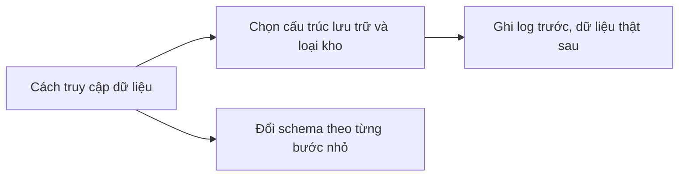
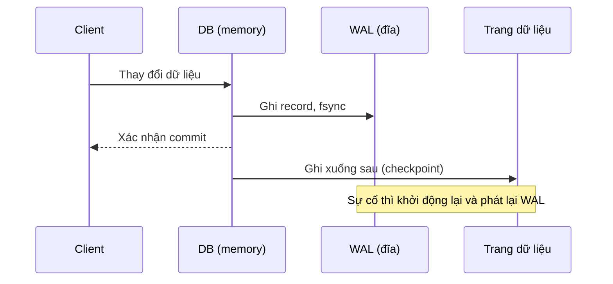
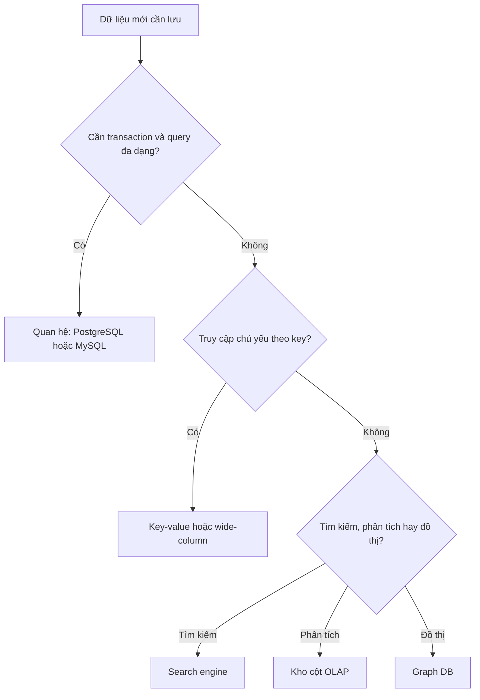
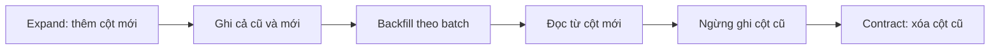

# Kiến trúc lưu trữ, chọn loại DB và migration an toàn

Bài này trả lời ba câu hỏi liên quan nhau: database lưu dữ liệu xuống đĩa như thế nào bên trong (B-tree, LSM-tree, WAL), có những loại kho dữ liệu nào và chọn loại nào cho bài toán nào, và làm sao đổi schema khi hệ thống vẫn đang chạy.

**Cốt lõi:** Mọi database là một cách đánh đổi giữa tốc độ ghi, tốc độ đọc và độ an toàn khi sập máy. Chọn kho dữ liệu là chọn đúng đánh đổi cho cách truy cập của bạn, và đổi schema khi hệ thống đang chạy là giữ cho code cũ lẫn mới đều chạy được ở mọi bước.

- Vì ghi tuần tự rẻ hơn ghi ngẫu nhiên nên WAL ghi log trước rồi mới báo commit, và LSM-tree gom ghi trong memory.
- Vì mỗi loại kho tối ưu cho một cách truy cập nên chọn theo mẫu truy cập, bắt đầu với quan hệ và giữ nguồn sự thật ở một nơi.
- Vì rolling deployment làm code cũ và mới chạy cùng lúc nên đổi schema theo từng bước tương thích ngược.



Mô hình tư duy: cách truy cập quyết định cấu trúc lưu trữ và loại kho, còn mọi thay đổi trên hệ thống đang chạy phải đi bằng những bước nhỏ an toàn.

**Tóm tắt:**

- B-tree sửa tại chỗ nên đọc nhanh và ổn định, hợp đọc nhiều và transaction; LSM-tree ghi tuần tự vào memory rồi xuống đĩa nên ghi rất nhanh, nhưng đọc phải tra nhiều tầng và có compaction nền.
- WAL: ghi thay đổi vào log tuần tự và fsync trước khi báo commit; sập thì phát lại log. Cùng cơ chế này là nền của durability, replication và PITR.
- Mặc định bắt đầu với PostgreSQL hoặc MySQL cho dữ liệu cốt lõi; chỉ thêm kho chuyên dụng khi có truy cập đo được mà quan hệ làm kém.
- Nguồn sự thật chỉ nằm một nơi, các kho khác là bản dẫn xuất.
- Chọn kho bằng câu hỏi: truy cập theo key hay theo điều kiện bất kỳ, có cần transaction nhiều bảng không, tỷ lệ đọc ghi ra sao.
- Migration không gián đoạn theo expand and contract: thêm cột mới, ghi cả hai, backfill, đọc cột mới, ngừng ghi cột cũ, rồi mới xóa ở lần phát hành sau.
- Rolling deployment làm code cũ và mới chạy cùng lúc, nên mỗi bước đổi schema phải tương thích ngược; DDL trên bảng lớn dùng CONCURRENTLY, NOT VALID và đặt lock_timeout.

## Vì sao cần biết

Nếu không hiểu bên trong, bạn không giải thích được vì sao ghi chậm, vì sao file dữ liệu phình to, vì sao DB này hợp bài toán này mà DB kia thì không. Hai sai lầm tốn kém nhất: chọn nhầm loại DB (ví dụ dùng kho key-value cho dữ liệu cần JOIN), và chạy `ALTER TABLE` thẳng trên bảng lớn đang có traffic, có thể lock bảng và làm sập production.

## Khi nào dùng, khi nào không

Dùng khi chọn DB cho hệ thống mới, điều tra vấn đề hiệu năng, hoặc đổi schema trên bảng lớn đang có traffic. Nếu bài toán bình thường thì PostgreSQL hoặc MySQL đã đủ, đừng thêm loại DB mới khi chưa có lý do rõ ràng: mỗi loại thêm vào là thêm chi phí vận hành và thêm bài toán sync dữ liệu.

## Cách làm tóm tắt

B-tree nhanh cho đọc, LSM-tree nhanh cho ghi nhiều. Chọn DB theo cách truy cập dữ liệu (quan hệ, key-value, tài liệu, cột, đồ thị). Đổi schema theo từng pha (expand, migrate, contract) để code cũ và mới cùng chạy được.

## Các khái niệm cần biết

- **B-tree**: cấu trúc cây cân bằng giữ dữ liệu có thứ tự, tra cứu và cập nhật tại chỗ trong vài lần đọc đĩa. Là cấu trúc index mặc định của hầu hết DB quan hệ.
- **LSM-tree (Log-Structured Merge-tree)**: ghi vào memory trước, định kỳ đẩy xuống đĩa thành các file đã sắp xếp, rồi gộp dần. Ghi rất nhanh vì chỉ ghi tuần tự, đổi lại đọc có thể phải tra nhiều file.
- **Compaction**: process nền của LSM gộp các file nhỏ thành file lớn và bỏ dữ liệu cũ. Nó tốn I/O và CPU, và gây hiện tượng khuếch đại ghi (một dữ liệu bị ghi lại nhiều lần).
- **Bloom filter**: cấu trúc nhỏ trả lời nhanh "key này chắc chắn không có trong file này", giúp LSM bỏ qua nhiều file khi đọc.
- **WAL (Write-Ahead Log)**: log ghi trước khi sửa dữ liệu thật, bảo đảm durability khi mất điện. `fsync` là lời gọi buộc dữ liệu thật sự xuống đĩa.
- **MVCC (Multi-Version Concurrency Control)**: giữ nhiều phiên bản của một hàng để người đọc không chặn người ghi.
- **VACUUM / bloat**: VACUUM của PostgreSQL thu hồi các phiên bản hàng đã chết; không thu hồi kịp thì bảng "phình" (bloat).
- **OLTP / OLAP**: OLTP là nhiều transaction nhỏ theo hàng; OLAP là query tổng hợp lớn theo cột.
- **CDC (Change Data Capture) / outbox**: kỹ thuật bắt các thay đổi của DB (qua log) để đẩy sang kho khác, tránh ghi hai nơi cùng lúc.
- **Polyglot persistence**: dùng nhiều loại DB trong một hệ thống, mỗi loại cho đúng việc.
- **Expand and contract**: cách đổi schema theo hai pha, mở rộng trước (thêm), thu hẹp sau (bỏ) để luôn tương thích ngược.

## B-tree và LSM-tree

| | B-tree (PostgreSQL, MySQL) | LSM-tree (Cassandra, RocksDB, HBase) |
|---|---|---|
| Ghi | Cập nhật tại chỗ, ghi ngẫu nhiên | Ghi tuần tự vào memory rồi xuống đĩa, rất nhanh |
| Đọc | Nhanh, ổn định | Có thể phải tra nhiều tầng, dùng Bloom filter |
| Dọn dẹp | Chủ yếu ở VACUUM/purge | **Compaction** nền, gây tải và khuếch đại ghi |
| Hợp với | Đọc nhiều, transaction | Ghi cực nhiều, chuỗi thời gian |

Vấn đề là cùng một thao tác "ghi" có hai cách làm trái ngược: B-tree sửa tại chỗ nên đọc nhanh, ghi phải nhảy ngẫu nhiên trên đĩa; LSM-tree gom ghi lại nên ghi nhanh, đọc phải tra nhiều tầng. Chọn B-tree khi tải là đọc nhiều và có transaction; chọn LSM-tree khi lượng ghi cực lớn (log, chuỗi thời gian). Nếu chọn LSM cho tải đọc ngẫu nhiên nhiều, bạn trả giá bằng độ trễ đọc và compaction chiếm tài nguyên.

**Phải thuộc:** B-tree sửa tại chỗ nên đọc nhanh, ổn định, hợp đọc nhiều và transaction (PostgreSQL, MySQL). LSM-tree ghi tuần tự vào memory rồi xuống đĩa nên ghi rất nhanh, đọc phải tra nhiều tầng (dùng Bloom filter), có compaction nền (Cassandra, RocksDB, HBase).

## WAL (Write-Ahead Log)

Làm sao DB bảo đảm không mất dữ liệu đã báo "commit" nếu máy sập giữa chừng? Ghi mọi thay đổi vào log (tuần tự, rẻ) và `fsync` trước, rồi mới trả lời client; việc ghi vào trang dữ liệu thật có thể làm sau.



Đọc sơ đồ: commit chỉ cần chờ bước ghi WAL, không chờ ghi trang dữ liệu. Nếu sập trước khi checkpoint, lúc khởi động lại DB phát lại WAL để dựng lại những thay đổi chưa xuống trang dữ liệu.

WAL là nền tảng của **durability**, **replication** (gửi WAL cho replica) và **khôi phục theo thời điểm**.

**Nền tảng:** WAL: ghi thay đổi vào log tuần tự và fsync trước, rồi mới báo commit; trang dữ liệu ghi sau, sập thì phát lại WAL. Cùng một cơ chế này là nền của durability, replication và khôi phục theo thời điểm.

**Suy luận:** Ghi một thay đổi trực tiếp vào đúng vị trí của nó trong file dữ liệu là ghi ngẫu nhiên, chậm, và nếu máy sập giữa chừng thì page bị ghi dở, dữ liệu hỏng. Ghi nối đuôi vào một log tuần tự thì nhanh hơn nhiều và mỗi record nhỏ nên hầu như không bị ghi dở. Vì vậy database ghi log trước và fsync, đến lúc đó mới báo commit; page dữ liệu có thể ghi xuống sau, gom nhiều thay đổi một lần. Nếu sập trước khi page được ghi, chỉ cần phát lại log là dựng lại được trạng thái đã commit, nên durability đến từ log chứ không từ page. Cũng vì log là chuỗi thay đổi có thứ tự, nó trở thành thứ gửi cho replica (replication) và thứ giữ lại để quay về một thời điểm (PITR). Điểm dễ nhầm là nghĩ commit nghĩa là dữ liệu đã nằm trong file bảng; thực ra nó chỉ có nghĩa là log đã xuống đĩa, và nếu tắt fsync hoặc nới lỏng cấu hình flush thì commit không còn an toàn trước mất điện.

## Vài điểm nội bộ đáng biết

- **PostgreSQL:** MVCC lưu nhiều phiên bản hàng trong bảng; `UPDATE` tạo bản mới. Cần **VACUUM** thu hồi chỗ trống; bảng/index bị "phình" (bloat) nếu autovacuum không theo kịp hoặc có transaction chạy rất lâu.
- **MySQL InnoDB:** key clustered index (clustered index theo primary key), bản cũ lưu trong undo log. Primary key ngẫu nhiên và dài làm mọi index phụ nặng và chèn chậm.
- Hiệu năng phần lớn là hiệu năng **I/O và cache**: bộ làm việc (working set) vừa với RAM thì nhanh.

## Chọn loại kho dữ liệu

Không có "DB tốt nhất"; mỗi loại tối ưu cho một cách truy cập. Bảng đầu là gợi ý nhanh, phần sau đi vào mẫu truy cập.

| Nhu cầu | Gợi ý |
|---|---|
| Transaction, quan hệ phức tạp, query đa dạng | **Cơ sở dữ liệu quan hệ** (mặc định) |
| Key-value rất nhanh, cache, phiên | Redis, DynamoDB |
| Tài liệu JSON linh hoạt theo truy cập | MongoDB, hoặc `jsonb` trong PostgreSQL |
| Ghi cực lớn, theo key, chịu partition | Cassandra, DynamoDB |
| Tìm kiếm toàn văn, xếp hạng | Elasticsearch/OpenSearch |
| Quan hệ đồ thị sâu | Neo4j |
| Chuỗi thời gian | TimescaleDB, InfluxDB |
| Phân tích (OLAP), quét cột | ClickHouse, BigQuery, Snowflake |

### Chọn theo mẫu truy cập

Hỏi trước khi chọn: truy cập theo key hay theo điều kiện bất kỳ? Cần transaction nhiều bảng không? Tỷ lệ đọc ghi, kích thước dữ liệu, độ trễ chấp nhận được?

| Loại | Mẫu truy cập hợp | Ví dụ bài toán | Đánh đổi chính |
|---|---|---|---|
| Quan hệ | Query đa dạng, JOIN, transaction ACID | Đơn hàng, tài khoản, tồn kho | Scale ghi ngang khó; dữ liệu cốt lõi nên bắt đầu ở đây |
| Key-value | `get`/`set` theo key, độ trễ dưới mili giây | Cache, phiên đăng nhập, rate limit | Không query theo giá trị; Redis giới hạn bởi RAM |
| Tài liệu | Đọc/ghi cả tài liệu JSON theo key, cấu trúc đa dạng | Danh mục sản phẩm, hồ sơ cấu hình | JOIN và transaction đa tài liệu yếu hoặc tốn kém; dễ lặp dữ liệu |
| Wide-column (LSM) | Ghi rất nhiều, truy cập theo partition key + khoảng trong partition | Event log, message, IoT | Phải thiết kế bảng theo từng query; không JOIN; eventual consistency tùy cấu hình |
| Tìm kiếm | Toàn văn, lọc nhiều chiều, xếp hạng | Tìm sản phẩm, tìm log | Không phải nguồn dữ liệu gốc; eventual consistency, cần sync từ DB chính |
| Chuỗi thời gian | Ghi theo thời gian, query khoảng và tổng hợp, xóa dữ liệu cũ theo thời hạn | Metric, cảm biến | Hẹp, không hợp cập nhật tùy ý |
| Cột (OLAP) | Quét và tổng hợp trên ít cột, nhiều hàng | Báo cáo, phân tích | Ghi từng dòng và cập nhật nhỏ không hợp |
| Đồ thị | Duyệt quan hệ nhiều bước | Gợi ý bạn bè, phát hiện gian lận | Ít dùng; query đa dụng yếu |

Ví dụ ra quyết định: hệ thống thương mại điện tử dùng PostgreSQL cho đơn hàng, Redis cho giỏ hàng tạm và cache, Elasticsearch cho tìm sản phẩm (sync từ PostgreSQL qua CDC hoặc outbox), kho cột cho báo cáo. Mỗi kho được thêm vì có truy cập mà kho trước làm kém, không vì thịnh hành.

Quy trình quyết định rút gọn:



Đọc sơ đồ: luôn thử "quan hệ" trước, vì nó đáp ứng được phần lớn nhu cầu. Chỉ rẽ nhánh khác khi bạn chỉ ra được truy cập mà quan hệ làm kém.

Quy tắc nhớ: **nguồn sự thật chỉ một nơi**; các kho khác là bản dẫn xuất có thể dựng lại.

**Phải thuộc:** Mặc định bắt đầu với PostgreSQL hoặc MySQL cho dữ liệu cốt lõi; chỉ thêm kho chuyên dụng khi có truy cập đo được mà quan hệ làm kém (key-value cho cache, search engine cho toàn văn, kho cột cho OLAP). Nguồn sự thật chỉ một nơi, các kho khác là bản dẫn xuất.

Nguyên tắc: **bắt đầu với PostgreSQL/MySQL** cho dữ liệu cốt lõi; thêm kho chuyên dụng khi có nhu cầu đo được. Mỗi kho thêm vào là thêm chi phí vận hành và vấn đề sync dữ liệu (polyglot persistence).

**OLTP và OLAP:** OLTP là nhiều transaction nhỏ theo hàng; OLAP là query tổng hợp lớn theo cột. Đừng chạy báo cáo nặng trên DB transaction: dùng replica hoặc kho phân tích, sync bằng CDC.

## Migration không gián đoạn: expand và contract



Vấn đề: khi rolling deployment, có lúc phiên bản ứng dụng cũ và mới chạy cùng nhau. Nếu đổi tên cột trong một lệnh, phiên bản cũ ngay lập tức lỗi. Cách giải quyết là chia thành nhiều bước nhỏ, mỗi bước đều tương thích với cả code cũ và mới. Không áp dụng cách này cho bảng nhỏ, không có traffic hoặc có cửa sổ bảo trì: đổi trực tiếp đơn giản hơn.

Bước Expand phải tương thích với code cũ; bước Contract làm ở lần phát hành sau.

**Phải thuộc:** Expand and contract: thêm cột mới, ghi cả cũ và mới, backfill theo batch, đọc từ cột mới, ngừng ghi cột cũ, rồi mới xóa cột cũ ở lần phát hành sau. Mỗi bước phải tương thích với cả code cũ và mới.

Quy tắc an toàn:

- Mỗi bước tương thích ngược với phiên bản ứng dụng đang chạy (rolling deployment có hai phiên bản cùng lúc).
- Tránh lệnh **khóa bảng lâu** trên bảng lớn: thêm cột có giá trị mặc định, tạo index, thêm constraint có thể lock; dùng biến thể không chặn (`CONCURRENTLY`, `NOT VALID` rồi `VALIDATE`).
- Backfill theo batch, có nghỉ giữa các batch, theo dõi tải và replication lag.
- Công cụ: Flyway/Liquibase; công cụ đổi schema trực tuyến (gh-ost, pt-online-schema-change) cho MySQL.
- Luôn có kế hoạch quay lui.

### Ví dụ: đổi tên cột `phone` thành `mobile` (PostgreSQL, minh họa)

| Pha | Lệnh hoặc thay đổi | Tương thích với code cũ? |
|---|---|---|
| Expand | `ALTER TABLE users ADD COLUMN mobile text;` (không có `DEFAULT` nặng, chỉ đổi metadata) | Có |
| Ghi kép | Ứng dụng v2 ghi cả `phone` và `mobile` | Có |
| Backfill | Lặp theo batch: `UPDATE users SET mobile = phone WHERE id BETWEEN :a AND :b AND mobile IS NULL;` rồi nghỉ | Có |
| Đọc mới | Ứng dụng v3 đọc `mobile`, vẫn ghi cả hai | Có |
| Ngừng ghi cũ | Ứng dụng v4 chỉ dùng `mobile` | Có |
| Contract | `ALTER TABLE users DROP COLUMN phone;` ở lần phát hành sau | Chỉ khi không còn code cũ |

Hai biến thể không chặn hay dùng:

```sql
-- Thêm foreign key/CHECK trên bảng lớn: bước 1 chỉ chặn ngắn, bước 2 quét nhưng không chặn ghi
ALTER TABLE orders ADD CONSTRAINT fk_cust FOREIGN KEY (customer_id) REFERENCES customers(id) NOT VALID;
ALTER TABLE orders VALIDATE CONSTRAINT fk_cust;
-- Tạo index không lock ghi (không chạy được trong transaction; nếu lỗi sẽ để lại index INVALID cần xóa)
CREATE INDEX CONCURRENTLY idx_orders_customer ON orders (customer_id);
```

Đặt `lock_timeout` (ví dụ `SET lock_timeout = '3s'`) trước DDL: nếu không lấy được lock nhanh thì bỏ, tránh DDL xếp hàng chờ rồi chặn mọi query phía sau. Cú pháp `NOT VALID` và `CONCURRENTLY` là của PostgreSQL; MySQL 8 dùng `ALGORITHM=INPLACE, LOCK=NONE` cho nhiều thao tác, hoặc gh-ost cho thay đổi lớn. Hành vi `ADD COLUMN ... DEFAULT` rẻ hay đắt tùy phiên bản (PostgreSQL 11 trở lên cho giá trị mặc định không đổi mà không viết lại bảng).

**Nền tảng:** Rolling deployment khiến phiên bản ứng dụng cũ và mới chạy cùng lúc, nên đổi schema phải chia nhỏ và tương thích ngược. DDL trên bảng lớn có thể lock bảng: dùng CONCURRENTLY, NOT VALID rồi VALIDATE (PostgreSQL), đặt lock_timeout.

## Điều cần nhớ

- Không có DB tốt nhất, chỉ có DB hợp mô hình truy cập và đội vận hành.
- Hiểu nguồn gốc của độ chậm: I/O, lock, kế hoạch query, hay thiếu memory.
- Đổi schema là thao tác rủi ro cao nhất hằng ngày: chia nhỏ và tương thích ngược.

## Phỏng vấn khó: chuỗi hỏi xoáy

Người phỏng vấn senior thường mở bằng một câu dễ rồi xoáy xuống cơ chế, đánh đổi và sự cố thật. Câu trả lời tốt luôn đi từ cốt lõi xuống, không đi từ chỗ học thuộc lên.

### Chuỗi 1: WAL và ý nghĩa thật của commit

1. **Câu mở:** Vì sao database ghi log trước rồi mới ghi dữ liệu thật, sao không ghi thẳng vào chỗ của nó?
2. **Xoáy 1:** Khi máy sập giữa chừng, durability được bảo đảm bằng gì, và checkpoint đóng vai trò gì?
3. **Xoáy 2:** Nếu tắt fsync hoặc nới cấu hình flush thì commit còn an toàn không? WAL còn dùng vào việc gì ngoài chống sập?

**Đáp án ngắn:** Ghi trực tiếp vào đúng vị trí trong file dữ liệu là ghi ngẫu nhiên, chậm, và nếu sập giữa chừng thì page bị ghi dở. Ghi nối đuôi vào một log tuần tự thì nhanh hơn nhiều, và mỗi record nhỏ nên hầu như không bị ghi dở. Vì vậy database ghi record WAL, fsync, rồi mới báo commit; page dữ liệu được ghi xuống sau, gom nhiều thay đổi một lần, ở checkpoint. Nếu sập trước khi page xuống đĩa, khởi động lại chỉ cần phát lại WAL để dựng lại trạng thái đã commit, nên durability đến từ log chứ không từ page. Tắt fsync hoặc nới flush thì commit không còn an toàn trước mất điện, vì log chưa chắc đã nằm trên đĩa. Cùng chuỗi thay đổi có thứ tự đó được gửi cho replica (replication) và giữ lại để quay về một thời điểm (PITR).

**Sai lầm hay gặp:**

- Nói commit nghĩa là dữ liệu đã nằm trong file bảng.
- Chỉ nói "WAL để ghi nhanh" mà không nói được vai trò khôi phục.
- Không biết WAL là nền của cả replication và PITR.

### Chuỗi 2: Chọn loại kho dữ liệu

1. **Câu mở:** Hệ thống thương mại điện tử mới, anh chọn database gì và vì sao?
2. **Xoáy 1:** Sản phẩm cần tìm toàn văn nên anh thêm Elasticsearch. Dữ liệu đồng bộ thế nào, và nếu hai bên lệch nhau thì tin bên nào?
3. **Xoáy 2:** Có một luồng ghi cực lớn như log hoặc chuỗi thời gian. Vì sao LSM-tree (Cassandra, RocksDB) ghi nhanh hơn B-tree của PostgreSQL, và giá phải trả là gì?

**Đáp án ngắn:** Bắt đầu bằng PostgreSQL hoặc MySQL cho dữ liệu cốt lõi như đơn hàng, tài khoản, tồn kho, vì cần transaction và query đa dạng; chỉ thêm kho chuyên dụng khi chỉ ra được một truy cập đo được mà quan hệ làm kém. Mỗi kho thêm vào là thêm chi phí vận hành và bài toán đồng bộ. Nguồn sự thật chỉ nằm một nơi, ở đây là PostgreSQL; Elasticsearch là bản dẫn xuất, đồng bộ qua CDC hoặc outbox, có eventual consistency, và khi lệch thì tin PostgreSQL rồi dựng lại bản dẫn xuất. LSM-tree ghi vào memory rồi đẩy xuống đĩa thành các file đã sắp xếp, chỉ ghi tuần tự nên ghi rất nhanh; B-tree sửa tại chỗ nên ghi phải nhảy ngẫu nhiên nhưng đọc nhanh và ổn định. Giá của LSM: đọc có thể phải tra nhiều tầng (Bloom filter giúp bỏ qua file), và compaction nền tốn I/O, CPU, gây khuếch đại ghi. Chọn LSM cho tải đọc ngẫu nhiên nhiều là trả giá bằng độ trễ đọc.

**Sai lầm hay gặp:**

- Chọn theo độ thịnh hành thay vì theo mẫu truy cập.
- Ghi vào hai kho cùng lúc thay vì một nguồn sự thật cộng CDC hoặc outbox.
- Nói "NoSQL luôn nhanh hơn" mà không nêu đánh đổi ở đọc và compaction.

### Chuỗi 3: Đổi schema không gián đoạn

1. **Câu mở:** Đổi tên cột `phone` thành `mobile` trên bảng lớn đang có traffic. Anh làm thế nào?
2. **Xoáy 1:** Sao không dùng một lệnh `RENAME COLUMN`?
3. **Xoáy 2:** Với foreign key và index trên bảng lớn, anh làm gì để không khóa production, và đặt `lock_timeout` để làm gì?

**Đáp án ngắn:** Dùng expand and contract: thêm cột `mobile`, ứng dụng ghi cả hai cột, backfill theo batch có nghỉ giữa các batch, chuyển sang đọc `mobile`, ngừng ghi `phone`, và chỉ xóa `phone` ở lần phát hành sau. Không rename trong một lệnh vì khi rolling deployment, code cũ và mới chạy cùng lúc, code cũ tìm cột `phone` sẽ lỗi ngay. Mỗi bước phải tương thích ngược với phiên bản đang chạy và quay lui được. Với PostgreSQL, thêm foreign key hoặc CHECK bằng `NOT VALID` (chỉ chặn ngắn) rồi `VALIDATE CONSTRAINT` (quét nhưng không chặn ghi); tạo index bằng `CREATE INDEX CONCURRENTLY`, lệnh này không chạy được trong transaction và nếu lỗi sẽ để lại index INVALID phải xóa. `lock_timeout` ngắn làm DDL thất bại nhanh nếu không lấy được lock, thay vì xếp hàng chờ rồi chặn mọi query phía sau. Backfill phải theo dõi tải và replication lag. Bảng nhỏ hoặc có cửa sổ bảo trì thì đổi trực tiếp cho đơn giản.

**Sai lầm hay gặp:**

- Gộp cả quy trình vào một lần deploy.
- Nghĩ `CONCURRENTLY` không có rủi ro, quên index INVALID và việc nó không chạy trong transaction.
- Chạy một `UPDATE` khổng lồ để backfill thay vì theo batch.

