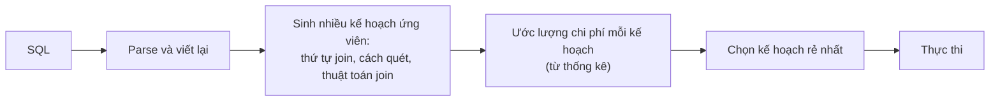
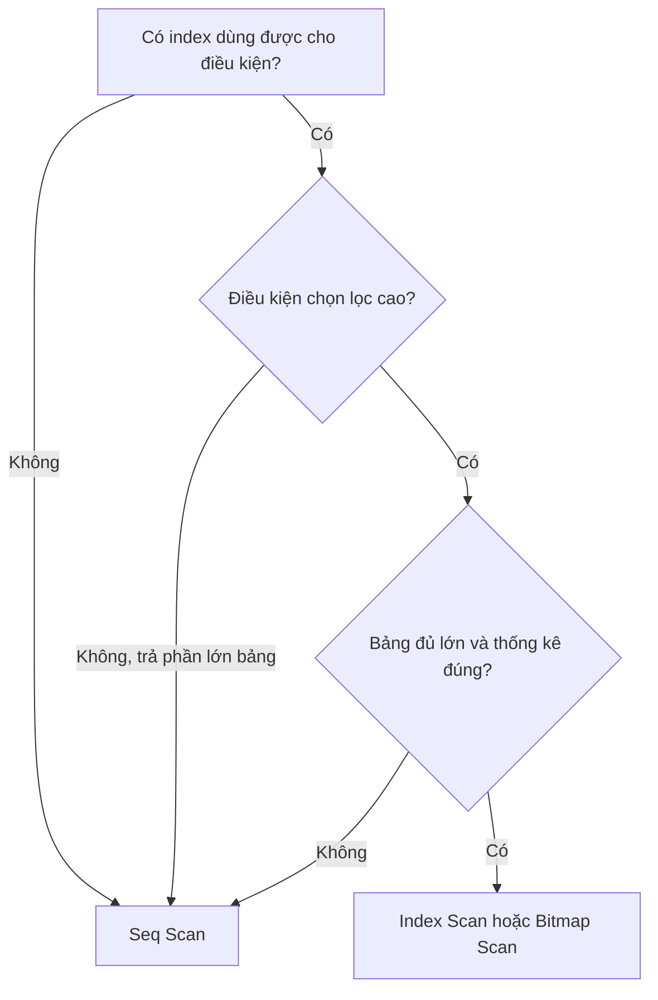
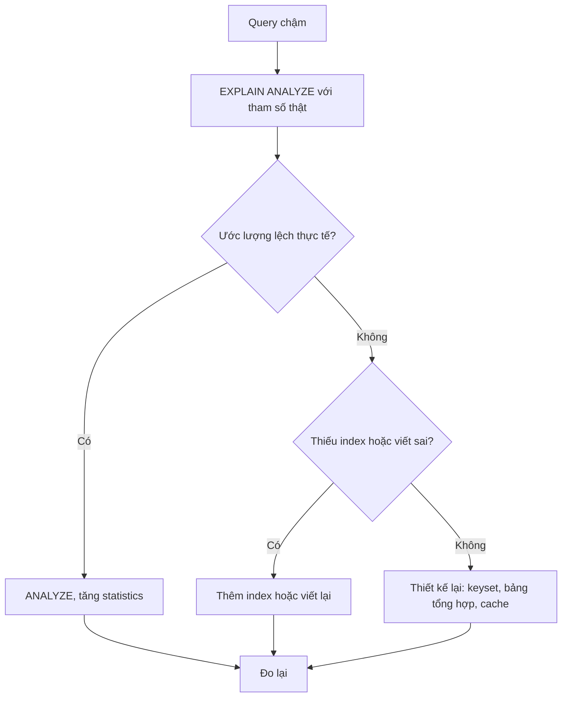

# EXPLAIN, query planner và tối ưu query sâu

Nền tảng: [Index và tối ưu query](/go?p=02-Database%2Fmedium%2Flt-03-index-toi-uu-truy-van.md). Bài này đi sâu hơn: planner chọn kế hoạch dựa trên gì, vì sao đôi khi nó chọn "sai", cách đọc kế hoạch thực tế của cả MySQL và PostgreSQL, và quy trình tối ưu từ chậm đến nhanh. Cơ chế index bên trong: [InnoDB](/go?p=02-Database%2Fmedium%2Flt-07-mysql-innodb-noi-bo.md), [PostgreSQL](/go?p=02-Database%2Fmedium%2Flt-08-postgresql-mvcc-wal.md).

Bài này trả lời một câu hỏi: vì sao cùng một câu SQL có lúc chạy 5 ms, có lúc chạy 5 phút, và làm sao tìm ra nguyên nhân thay vì thử index ngẫu nhiên.

**Cốt lõi:** Planner không chạy thử các cách làm mà ước lượng chi phí của từng cách trên giấy, dựa vào thống kê về dữ liệu, rồi chọn cách rẻ nhất. Vì vậy chất lượng thống kê quyết định chất lượng kế hoạch, và tối ưu là tìm chỗ ước lượng lệch thực tế.

- Vì kế hoạch chọn theo số dòng ước lượng nên ước lượng sai thì thứ tự join, thuật toán join và việc dùng index đều có thể sai theo.
- Vì cost chỉ là con số tương đối nên phải so rows ước lượng với rows thực tế, và nhân actual time với loops.
- Vì index được sắp theo giá trị cột nên bọc hàm quanh cột hoặc bỏ qua tiền tố trái sẽ làm mất khả năng dùng index.


Mô hình tư duy: thống kê sai kéo theo ước lượng sai và kế hoạch tệ, nên EXPLAIN ANALYZE là cách kiểm tra planner có tin đúng vào dữ liệu hay không.

**Tóm tắt:**

- Planner không chạy thử mà ước lượng chi phí các kế hoạch ứng viên dựa trên thống kê, rồi chọn kế hoạch rẻ nhất; ước lượng số dòng sai thì mọi quyết định phía sau sai theo.
- EXPLAIN chỉ ước lượng, EXPLAIN ANALYZE chạy thật (với INSERT, UPDATE, DELETE phải bọc BEGIN và ROLLBACK).
- Khi đọc plan: cost là đơn vị tương đối, actual time là của mỗi lần lặp nên phải nhân với loops, và phải so rows ước lượng với rows thực tế.
- Có ba thuật toán join (Nested Loop, Hash Join, Merge Join), mỗi cái hợp một kiểu kích thước dữ liệu.
- Seq Scan không phải lỗi: planner chọn nó khi điều kiện kém chọn lọc, bảng nhỏ, hoặc chi phí đọc ngẫu nhiên cao.
- Composite index theo tiền tố trái; sau cột khoảng, các cột sau chỉ còn lọc.
- OFFSET lớn chậm tuyến tính theo độ sâu trang; keyset pagination giữ độ trễ gần như không đổi nhưng không nhảy tới trang tùy ý.
- Quy trình tối ưu: đo, đọc plan, tìm node tốn nhất và chỗ ước lượng lệch, sửa gốc rễ rồi đo lại.

## Planner là gì và vì sao quan trọng

**Query planner (optimizer)** là thành phần của database nhận câu SQL và chọn execution plan rẻ nhất theo một **mô hình chi phí** dựa trên thống kê dữ liệu. Giống một ứng dụng chỉ đường: có nhiều tuyến đi, nó ước lượng thời gian mỗi tuyến từ dữ liệu giao thông (thống kê) rồi chọn tuyến nhanh nhất. Nếu dữ liệu giao thông cũ, nó chọn sai tuyến. `EXPLAIN` là lệnh cho bạn xem tuyến đó.

Tối ưu hiệu quả nghĩa là hiểu planner đang nghĩ gì, không phải thử index ngẫu nhiên. Mỗi index không cần thiết làm ghi chậm đi mà query đích vẫn không nhanh lên.

## Khi nào cần đọc bài này

Khi query chậm, khi độ trễ tăng theo lượng dữ liệu, khi thêm index mà query không nhanh lên, hoặc khi kế hoạch đổi đột ngột sau một đêm. Nếu query đã đủ nhanh thì đừng tối ưu thêm; nếu bạn chưa nắm index cơ bản thì đọc bài nền tảng ở trên trước.

## Cách làm tóm tắt

Đọc kế hoạch thực (`EXPLAIN ANALYZE`), so **số dòng ước lượng với thực tế**, tìm node tốn nhất, rồi sửa gốc rễ: thống kê, index, cách viết query hay thiết kế.

## Các khái niệm cần biết

- **Execution plan**: cây các bước (quét bảng, dùng index, nối, sắp xếp) mà DB sẽ chạy để trả kết quả.
- **Cost**: con số tương đối ước lượng công sức (I/O và CPU) của một kế hoạch, không phải mili giây.
- **Cardinality estimation**: ước lượng mỗi bước trả bao nhiêu dòng. Là đầu vào quan trọng nhất của planner.
- **Selectivity**: tỷ lệ dòng thỏa một điều kiện. Chọn lọc cao nghĩa là điều kiện loại bỏ gần hết dòng, và index có ích.
- **Seq Scan / Index Scan / Bitmap Scan**: đọc cả bảng theo thứ tự; duyệt index rồi đọc từng dòng; gom vị trí từ index rồi đọc theo thứ tự page.
- **Covering index / Index Only Scan**: index chứa đủ cột query cần nên không phải đọc bảng.
- **Heap**: nơi PostgreSQL lưu các dòng của bảng, tách khỏi index.
- **Visibility map**: bản đồ của PostgreSQL ghi page nào toàn dòng nhìn thấy được, cho phép Index Only Scan khỏi đọc heap.
- **Nested loop / Hash join / Merge join**: ba thuật toán nối bảng (mục 4).
- **Keyset pagination**: phân trang bằng cách nhớ key cuối trang trước, thay cho `OFFSET`.
- **work_mem**: memory PostgreSQL cấp cho mỗi thao tác sắp xếp hoặc hash; thiếu thì tràn ra đĩa, chậm đi rõ rệt.
- **Generic plan**: kế hoạch chung dùng lại cho prepared statement, không dựa trên giá trị tham số cụ thể.

## 1. Planner hoạt động thế nào



Đọc sơ đồ: planner không chạy thử mà tính toán trên giấy. Nó liệt kê các cách chạy, chấm điểm từng cách bằng thống kê rồi chọn cách điểm thấp nhất. Vì vậy chất lượng thống kê quyết định chất lượng kế hoạch.

**Nền tảng:** Planner không chạy thử mà ước lượng chi phí các kế hoạch ứng viên dựa trên thống kê, rồi chọn kế hoạch rẻ nhất. Ước lượng số dòng (cardinality estimation) sai thì mọi quyết định phía sau sai theo, nên thống kê cũ là nguồn kế hoạch tệ số một và ANALYZE là cách sửa rẻ nhất.

Chi phí là con số tương đối ghép từ I/O và CPU ước tính. Dữ liệu đầu vào quan trọng nhất là **cardinality estimation**: ước lượng mỗi bước trả bao nhiêu dòng. Ước lượng sai, mọi quyết định phía sau (thứ tự join, thuật toán join, có dùng index không) đều có thể sai theo.

### Thống kê từ đâu ra

- **PostgreSQL**: `ANALYZE` (hoặc autovacuum) lấy mẫu bảng và lưu `pg_statistic` (giá trị phổ biến nhất, histogram, độ phân biệt, mức tương quan với thứ tự vật lý). Độ chi tiết theo `default_statistics_target` (mặc định 100). Cột nào bị lệch nặng có thể tăng riêng bằng `ALTER TABLE ... ALTER COLUMN ... SET STATISTICS`. Với các cột **tương quan với nhau** (ví dụ `city` và `zip`), planner mặc định giả định chúng độc lập và ước lượng thấp quá nhiều; dùng `CREATE STATISTICS` (extended statistics) để khai báo.
- **MySQL**: thống kê index do InnoDB lấy mẫu (persistent stats), thêm **histogram** cho cột không có index qua `ANALYZE TABLE t UPDATE HISTOGRAM ON col`.

Thống kê cũ (sau khi nạp dữ liệu lớn, xóa hàng loạt) là nguyên nhân hàng đầu của kế hoạch tệ. Chạy `ANALYZE` thường là cách sửa rẻ nhất.

## 2. Đọc EXPLAIN của PostgreSQL

```sql
EXPLAIN (ANALYZE, BUFFERS)
SELECT o.id, o.total
FROM orders o
WHERE o.customer_id = 42 AND o.status = 'PAID'
ORDER BY o.created_at DESC
LIMIT 20;
```

Vấn đề đặt ra: làm sao biết một query chậm ở đâu? Câu trả lời là xem kế hoạch thật, từng node một, và so ước lượng với thực tế. `EXPLAIN` chỉ **ước lượng**, không chạy. `EXPLAIN ANALYZE` **chạy thật** (cẩn thận với `INSERT/UPDATE/DELETE`: bọc trong `BEGIN ... ROLLBACK`). `BUFFERS` cho biết số page đọc từ cache (`shared hit`) và từ đĩa (`read`).

Ví dụ rút gọn (số liệu minh họa):

```text
Limit  (cost=0.43..95.10 rows=20 width=16) (actual time=0.05..0.31 rows=20 loops=1)
  ->  Index Scan Backward using idx_orders_cust_status_created on orders o
        (cost=0.43..4210.55 rows=890 width=16) (actual time=0.05..0.30 rows=20 loops=1)
        Index Cond: ((customer_id = 42) AND (status = 'PAID'))
        Buffers: shared hit=25
Planning Time: 0.2 ms
Execution Time: 0.4 ms
```

| Thành phần | Ý nghĩa |
|---|---|
| `cost=a..b` | `a` = chi phí tới khi trả dòng đầu (startup), `b` = chi phí tới khi xong |
| `rows` | Số dòng **ước lượng**; so với `actual rows` để phát hiện thống kê sai |
| `actual time=a..b` | Thời gian thực (ms) tới dòng đầu và tới khi hết, **mỗi lần lặp** |
| `loops` | Số lần node này chạy; **thời gian và rows thực phải nhân với loops** (internal node của Nested Loop) |
| `Buffers` | Số page chạm, chỉ báo I/O thật |

Các node quét thường gặp: `Seq Scan` (đọc cả bảng), `Index Scan` (duyệt index rồi đọc heap), `Index Only Scan` (chỉ đọc index khi visibility map cho phép), `Bitmap Index Scan` + `Bitmap Heap Scan` (gom vị trí từ index rồi đọc heap theo thứ tự page, hợp khi trả lượng dòng vừa phải hoặc kết hợp nhiều index).

**Dấu hiệu cần điều tra**: `rows` ước lượng và thực tế lệch hơn 10 lần; `Sort` với `Sort Method: external merge Disk` (thiếu `work_mem`); `Rows Removed by Filter` rất lớn (index không đủ chọn lọc); `Nested Loop` có `loops` hàng triệu; `Buffers: read` cao.

**Phải thuộc:** EXPLAIN chỉ ước lượng, EXPLAIN ANALYZE chạy thật (bọc BEGIN ... ROLLBACK với INSERT, UPDATE, DELETE). cost=a..b là chi phí khởi động và chi phí tổng (đơn vị tương đối, không phải ms); actual time là mỗi lần lặp nên phải nhân với loops; so rows ước lượng với actual rows.

**Suy luận:** Cost của planner là con số tương đối dùng để so sánh các kế hoạch với nhau, không phải thời gian, nên nhìn cost một mình không cho biết query nhanh hay chậm. Thông tin có giá trị nằm ở chỗ ước lượng lệch so với thực tế, vì planner chọn kế hoạch dựa trên số hàng nó tin sẽ gặp: nếu tin là 10 hàng mà thực tế là 1 triệu, nó sẽ chọn Nested Loop vốn hợp cho ít hàng và query thành thảm họa. Thêm nữa, actual time trong EXPLAIN ANALYZE là thời gian của một lần lặp, còn node nằm phía trong Nested Loop chạy nhiều lần, nên tổng thời gian là actual time nhân loops; bỏ qua loops là nguyên nhân hay gặp của việc đọc sai node nào tốn nhất. Điểm dễ nhầm là chạy EXPLAIN ANALYZE cho INSERT, UPDATE, DELETE trên production, vì nó chạy thật và ghi dữ liệu thật; phải bọc trong transaction rồi ROLLBACK. Quy trình đúng là đo thật, so rows ước lượng với thực tế, tìm node tốn nhất, rồi sửa gốc rễ (thống kê, điều kiện, index) thay vì đoán.

## 3. Đọc EXPLAIN của MySQL

```sql
EXPLAIN SELECT ... ;                 -- bảng
EXPLAIN FORMAT=TREE SELECT ... ;     -- dạng cây, dễ đọc hơn
EXPLAIN ANALYZE SELECT ... ;         -- chạy thật, có thời gian thực (từ 8.0.18)
```

Cột quan trọng của dạng bảng:

| Cột | Giá trị đáng chú ý |
|---|---|
| `type` | Từ tốt đến xấu: `const`, `eq_ref`, `ref`, `range`, `index` (quét toàn index), `ALL` (quét toàn bảng) |
| `key` / `possible_keys` | Index được chọn / có thể chọn |
| `rows`, `filtered` | Ước lượng số dòng đọc và tỷ lệ còn lại sau điều kiện |
| `Extra` | `Using index` (covering), `Using where`, `Using index condition` (index condition pushdown), `Using filesort` (sắp xếp riêng, không nhất thiết trên đĩa), `Using temporary` (bảng tạm) |

Cách đọc: với MySQL, nhìn `type` và `rows` trước. Nếu `type` là `ALL` trên bảng lớn, hoặc `Extra` có `Using filesort` hay `Using temporary` trên tập lớn, đó là ứng viên cần tối ưu.

Về thuật toán join của MySQL: ngoài **nested loop** (kèm index), MySQL 8.0.18 thêm **hash join** cho join bằng không có index dùng được; từ 8.0.20 hash join thay thế hoàn toàn **block nested loop** và áp dụng cả cho join không bằng, semijoin, antijoin và outer join. Trong `EXPLAIN` bạn thấy `Using join buffer (hash join)`. Không có merge join trong MySQL.

## 4. Ba thuật toán join

| Thuật toán | Cách làm | Hợp khi | Chi phí |
|---|---|---|---|
| **Nested loop** | Với mỗi dòng bên ngoài, tra bên trong (nên có index) | Bên ngoài nhỏ, bên trong có index | ~ `N_ngoài × chi phí tra index` |
| **Hash join** | Dựng hash table từ bên nhỏ, quét bên lớn để dò | Join bằng, không có index, tập lớn | ~ `N + M`, tốn memory (tràn ra đĩa nếu quá lớn) |
| **Merge join** (PostgreSQL) | Hai đầu vào đã sắp xếp, duyệt parallel | Cả hai đã có thứ tự (index) hoặc sắp xếp rẻ | ~ `N + M` (cộng sắp xếp nếu cần) |

Chọn nhầm thuật toán gây ra hiện tượng điển hình: Nested Loop với bên ngoài lớn và bên trong không có index chạy chậm cả nghìn lần so với Hash Join. Planner thường chọn đúng nếu thống kê tốt; khi nó chọn nested loop với `loops` hàng triệu, hãy nghi thống kê sai.

Thứ tự join cũng quan trọng: join bảng nhỏ đã lọc trước thì các bước sau xử lý ít dòng. Với nhiều bảng, số thứ tự khả dĩ bùng nổ nên planner dùng heuristic/di truyền khi quá nhiều bảng (PostgreSQL có `geqo_threshold`).

## 5. Vì sao planner chọn Seq Scan dù có index

Đây không phải lỗi; thường là quyết định đúng:

1. **Chọn lọc kém**: điều kiện trả về phần lớn bảng (thường trên một phần nhỏ tổng số dòng, phụ thuộc cấu hình), đọc tuần tự rẻ hơn nhảy ngẫu nhiên giữa index và heap.
2. **Bảng nhỏ**: vài page, quét toàn bộ nhanh hơn chạm index.
3. **Hằng số chi phí**: PostgreSQL mặc định `random_page_cost = 4.0` so với `seq_page_cost = 1.0`, giả định đĩa quay. Trên SSD, đặt khoảng 1,1 đến 1,5 thường làm planner ưa index hơn.
4. **Thống kê sai/cũ**: tưởng điều kiện chọn lọc kém dù thực tế rất chọn lọc.
5. **Index không dùng được** cho biểu thức (mục tiếp theo).

Quyết định của planner theo trình tự sau:



Ép bằng `SET enable_seqscan = off` chỉ nên dùng để **chẩn đoán**, không để cố định lên production.

**Nền tảng:** Seq Scan không phải lỗi: planner chọn nó khi điều kiện chọn lọc kém, bảng nhỏ, hoặc chi phí đọc ngẫu nhiên cao (random_page_cost mặc định 4.0, trên SSD thường đặt khoảng 1,1 đến 1,5). enable_seqscan = off chỉ dùng để chẩn đoán.

## 6. Những kiểu viết khiến index không dùng được

| Viết | Vấn đề | Sửa |
|---|---|---|
| `WHERE DATE(created_at) = '2026-10-01'` | Hàm bọc cột | `created_at >= '2026-10-01' AND created_at < '2026-10-02'` |
| `WHERE lower(email) = ?` | Hàm bọc cột | Expression index `(lower(email))` (PostgreSQL) hoặc lưu cột đã chuẩn hóa / collation không phân biệt hoa thường |
| `WHERE phone = 912345678` (cột `VARCHAR`) | Ép kiểu ngầm trên cột | So sánh đúng kiểu: `phone = '912345678'` |
| `WHERE name LIKE '%abc'` | Wildcard đầu | Full-text search, `pg_trgm` + GIN, hoặc đảo chuỗi |
| `WHERE a = 1 OR b = 2` | Một index không phục vụ cả hai nhánh | `UNION ALL` hai query, hoặc để PostgreSQL dùng bitmap OR |
| `WHERE col + 1 = 10` | Biểu thức trên cột | `col = 9` |
| `WHERE x <> 5` hoặc `NOT IN` | Chọn lọc kém, khó dùng index | Xem lại logic, dùng `NOT EXISTS` |
| Join hai cột khác kiểu/collation | Ép kiểu một phía | Thống nhất kiểu và collation |

## 7. Composite index và quy tắc tiền tố trái

Index `(a, b, c)` được sắp theo `a`, trong cùng `a` theo `b`, trong cùng `(a,b)` theo `c`. Hệ quả:

- Phục vụ tốt: `a=`, `a= AND b=`, `a= AND b= AND c=`, `a= AND b>`.
- **Sau cột đầu tiên dùng điều kiện khoảng, các cột sau không còn thu hẹp được** việc duyệt: `a= AND b> AND c=` chỉ dùng được `a` và `b` làm điều kiện tìm kiếm, `c` chỉ lọc tiếp.
- Query chỉ có `b=` thường không tận dụng được. PostgreSQL 18 thêm *skip scan* cho index B-tree nhiều cột (release notes PG 18): planner có thể bỏ qua cột đầu để dùng index `(a, b)` cho điều kiện chỉ có `b=`. Nó chỉ hiệu quả khi cột đầu có rất ít giá trị khác nhau, và PostgreSQL 17 trở về trước không có, nên luôn đọc `EXPLAIN` để biết planner có chọn không. (MySQL chỉ có kiểu skip scan hạn chế từ 8.0.13.)
- Thứ tự cột: cột lọc bằng đặt trước, rồi cột khoảng, rồi cột để `ORDER BY`. Nếu `WHERE a=? ORDER BY b`, index `(a, b)` trả ra đã đúng thứ tự, **tránh sort**.

**Phải thuộc:** Composite index (a, b, c) theo tiền tố trái: cột bằng trước, rồi khoảng, rồi ORDER BY; sau cột khoảng, các cột sau chỉ còn lọc. Với WHERE a=? ORDER BY b, index (a, b) tránh được bước sort.

```sql
-- Truy vấn:  WHERE customer_id=? AND status=? ORDER BY created_at DESC LIMIT 20
CREATE INDEX idx_orders_cust_status_created ON orders (customer_id, status, created_at DESC);
-- Cả lọc lẫn sắp xếp đều xong trong index, LIMIT dừng sớm sau 20 dòng.
```

## 8. Phân trang: OFFSET và keyset

`OFFSET n LIMIT k` bắt DB **tạo ra rồi bỏ n dòng** đầu: trang càng sâu càng chậm tuyến tính. Trang 50 000 với 20 dòng/trang là bỏ 1 triệu dòng.

```sql
-- Chậm dần theo trang
SELECT id, created_at, total FROM orders
ORDER BY created_at DESC, id DESC LIMIT 20 OFFSET 1000000;

-- Keyset: nhảy thẳng tới vị trí cuối trang trước, độ trễ gần như không đổi
SELECT id, created_at, total FROM orders
WHERE (created_at, id) < (:last_created_at, :last_id)
ORDER BY created_at DESC, id DESC LIMIT 20;
-- cần index (created_at DESC, id DESC)
```

Keyset không cho nhảy tới trang tùy ý và cần sort key **duy nhất** (thêm `id` để phá hòa). Đổi lại, ổn định khi dữ liệu thay đổi giữa các lần tải.

**Phải thuộc:** OFFSET lớn chậm tuyến tính theo độ sâu trang; keyset dùng WHERE (created_at, id) < (:last_created_at, :last_id) kèm index để độ trễ gần như không đổi, nhưng không nhảy tới trang tùy ý và cần sort key duy nhất.

## 9. "N+1" ở tầng SQL

Ngoài N+1 của ORM, SQL cũng có dạng tương tự: subquery tương quan trong `SELECT` chạy lại **mỗi dòng**.

```sql
-- Mỗi khách một lần đếm đơn: N lần query con
SELECT c.id, (SELECT count(*) FROM orders o WHERE o.customer_id = c.id) AS n
FROM customer c;

-- Viết lại một lần quét và gom nhóm
SELECT c.id, coalesce(o.n, 0) AS n
FROM customer c
LEFT JOIN (SELECT customer_id, count(*) AS n FROM orders GROUP BY customer_id) o
       ON o.customer_id = c.id;
```

Planner hiện đại đôi khi tự viết lại, nhưng đừng trông chờ. Kiểm tra bằng `EXPLAIN` xem internal node có `loops` lớn không.

## 10. Quy trình tối ưu: từ chậm đến nhanh (ví dụ minh họa)

Bảng `orders` 10 triệu dòng. Query: đơn đã thanh toán của một khách, mới nhất trước, 20 dòng. **Các con số dưới đây là minh họa** để thấy bậc độ lớn; số thật phụ thuộc phần cứng và dữ liệu.

| Bước | Hành động | Kế hoạch | Thời gian (minh họa) |
|---|---|---|---|
| 0 | Chưa có index | `Seq Scan` toàn bảng, rồi Sort | ~ 4 000 ms |
| 1 | Index `(customer_id)` | `Index Scan`, lọc `status` sau, Sort ~ 900 dòng của khách | ~ 12 ms |
| 2 | Index `(customer_id, status, created_at DESC)` | Index Scan, **không Sort**, `LIMIT` dừng sau 20 dòng | ~ 0,4 ms |
| 3 | Chỉ cần vài cột, thêm `INCLUDE (total)` | `Index Only Scan` (cần visibility map sạch) | ~ 0,2 ms |

Quy trình đáng nhớ, tóm bằng sơ đồ rồi liệt kê chi tiết:



Chi tiết:

1. Lấy **query thật** và tham số thật (kể cả giá trị "xấu": khách có nhiều đơn nhất).
2. `EXPLAIN (ANALYZE, BUFFERS)`; tìm node tốn nhất và chỗ ước lượng lệch.
3. Nếu ước lượng lệch: `ANALYZE`, tăng statistics target, extended statistics.
4. Nếu thiếu cấu trúc truy cập: thiết kế index theo mục 7, **đo lại**.
5. Nếu query viết sai (hàm bọc cột, OR, subquery tương quan): viết lại.
6. Nếu vẫn chậm vì lượng dữ liệu: thiết kế lại (phân trang keyset, bảng tổng hợp, cache, partition).
7. Nhớ chi phí của index: chậm ghi, tốn đĩa và RAM. Gỡ index không dùng (`pg_stat_user_indexes`, `sys.schema_unused_indexes`).

## Bẫy thường gặp

| Bẫy | Hậu quả | Cách tránh |
|---|---|---|
| Tối ưu trên dữ liệu nhỏ ở máy dev | Kế hoạch khác hẳn trên production | Dùng dữ liệu cùng quy mô và phân phối |
| Chạy `EXPLAIN ANALYZE` trên `UPDATE/DELETE` thật | Thay đổi dữ liệu | Bọc `BEGIN ... ROLLBACK` |
| Quên nhân `actual time` với `loops` | Đọc sai node tốn nhất | Luôn tính `time × loops` |
| Thêm index "cho chắc" | Ghi chậm, planner có thêm lựa chọn sai | Mỗi index phải phục vụ một query đã đo |
| Dùng `OFFSET` sâu | Chậm tuyến tính theo trang | Keyset pagination |
| Cố định bằng hint/`enable_*` | Gãy khi dữ liệu đổi | Sửa gốc: thống kê, index, query |
| Kế hoạch đổi đột ngột | Chậm bất thường sau một đêm | Kiểm tra `ANALYZE` mới nhất, tham số bind khác biệt, prepared statement generic plan |

## Điểm cần nhớ

- Planner chọn kế hoạch rẻ nhất theo ước lượng; ước lượng dựa vào thống kê, nên thống kê sai là nguồn lỗi số một.
- `EXPLAIN ANALYZE` cho dữ liệu thật; so `rows` ước lượng với thực tế, nhớ nhân `loops`.
- Seq Scan không phải lúc nào cũng xấu: chọn lọc kém, bảng nhỏ, hằng số chi phí cho đĩa quay đều là lý do chính đáng.
- Hàm bọc cột, ép kiểu, wildcard đầu, `OR` làm mất khả năng dùng index.
- Composite index theo thứ tự: bằng, rồi khoảng, rồi sắp xếp; sau điều kiện khoảng, các cột sau chỉ còn lọc.
- Keyset pagination thay `OFFSET` sâu; viết lại subquery tương quan thành join/gom nhóm.
- MySQL 8.0.18 có hash join; từ 8.0.20 nó thay thế block nested loop.

## Phỏng vấn khó: chuỗi hỏi xoáy

Người phỏng vấn senior thường mở bằng một câu dễ rồi xoáy xuống cơ chế, đánh đổi và sự cố thật. Câu trả lời tốt luôn đi từ cốt lõi xuống, không đi từ chỗ học thuộc lên.

### Chuỗi 1: Query đang nhanh bỗng chậm sau một đêm

1. **Câu mở:** Query đang 5 ms bỗng thành 5 phút sau một đêm, không ai đổi code. Anh nghi gì trước?
2. **Xoáy 1:** Planner chọn kế hoạch bằng cách nào, và ước lượng số dòng sai kéo theo hậu quả gì ở thuật toán join?
3. **Xoáy 2:** Hai cột `city` và `zip` tương quan nhau thì ước lượng lệch ra sao? Prepared statement liên quan thế nào?

**Đáp án ngắn:** Nghi thống kê cũ hoặc ước lượng lệch trước, vì planner không chạy thử mà chấm chi phí các kế hoạch ứng viên bằng thống kê rồi chọn cái rẻ nhất. Sau khi nạp hoặc xóa dữ liệu hàng loạt mà chưa `ANALYZE`, planner tin sai số dòng. Tin là 10 dòng mà thực tế 1 triệu thì nó chọn Nested Loop vốn hợp cho ít dòng, và node bên trong chạy hàng triệu lần. Xác nhận bằng `EXPLAIN (ANALYZE, BUFFERS)` với tham số thật: so `rows` ước lượng với actual rows (lệch hơn 10 lần là dấu hiệu), nhớ nhân actual time với `loops`. Sửa gốc bằng `ANALYZE`, tăng statistics target cho cột lệch, và `CREATE STATISTICS` cho cột tương quan, vì mặc định planner giả định các cột độc lập nên ước lượng thấp quá nhiều. Cũng kiểm tra tham số bind khác biệt và generic plan của prepared statement, vì generic plan không dựa trên giá trị tham số cụ thể. Không cố định kế hoạch bằng hint hay `enable_*`, vì gãy khi dữ liệu đổi.

**Sai lầm hay gặp:**

- Nhảy ngay tới "thêm index" mà chưa so `rows` ước lượng với thực tế.
- Đọc cost như mili giây.
- Cố định kế hoạch bằng `enable_*` hoặc hint rồi để nguyên.

### Chuỗi 2: Composite index và quy tắc tiền tố trái

1. **Câu mở:** Query `WHERE customer_id = ? AND status = ? ORDER BY created_at DESC LIMIT 20`. Anh thiết kế index nào?
2. **Xoáy 1:** Vì sao thứ tự cột là bằng, rồi khoảng, rồi cột sắp xếp? Nếu `status` là điều kiện khoảng thì các cột sau nó còn thu hẹp được việc duyệt không?
3. **Xoáy 2:** Một query khác chỉ có `status = ?` thì index `(customer_id, status, created_at)` có dùng được không? PostgreSQL 18 có gì mới?

**Đáp án ngắn:** Index `(customer_id, status, created_at DESC)`. Index được sắp theo cột đầu, trong cùng giá trị đó theo cột kế tiếp, nên hai điều kiện bằng thu hẹp tới một đoạn liền nhau, và trong đoạn đó dữ liệu đã đúng thứ tự `created_at`. Kết quả là không cần Sort, và `LIMIT` dừng sau 20 dòng. Nếu một cột là điều kiện khoảng thì các cột sau nó không còn thu hẹp được việc duyệt, chỉ còn lọc tiếp. Theo quy tắc tiền tố trái, query chỉ có `status` thường không tận dụng được index này. PostgreSQL 18 thêm skip scan cho B-tree nhiều cột, chỉ hiệu quả khi cột đầu có rất ít giá trị khác nhau, và PostgreSQL 17 trở về trước không có, nên luôn đọc `EXPLAIN` để xem planner có chọn không. Cái giá: mỗi index làm ghi chậm, tốn đĩa và RAM, nên mỗi index phải phục vụ một query đã đo, và index không dùng (`idx_scan` bằng 0 lâu dài) nên gỡ.

**Sai lầm hay gặp:**

- Đặt cột theo thứ tự "nghĩ ra trước".
- Nói "index `(a, b)` dùng được cho mọi query có `b`" mà không biết quy tắc tiền tố trái.
- Thêm index "cho chắc" và quên chi phí ghi.

### Chuỗi 3: Có index mà vẫn Seq Scan

1. **Câu mở:** Bảng có index trên cột lọc nhưng `EXPLAIN` vẫn là Seq Scan. Có phải lỗi không?
2. **Xoáy 1:** Planner so sánh những gì để chọn, và `random_page_cost` mặc định 4.0 có ý nghĩa gì trên SSD?
3. **Xoáy 2:** Ở production vẫn Seq Scan trong khi máy dev dùng index. Có nên `SET enable_seqscan = off` lên production không? Vì sao dev khác production?

**Đáp án ngắn:** Không nhất thiết là lỗi. Planner so chi phí ước lượng, và Seq Scan thường là quyết định đúng khi điều kiện chọn lọc kém (trả phần lớn bảng) hoặc bảng nhỏ chỉ vài page, vì đọc tuần tự rẻ hơn nhảy ngẫu nhiên giữa index và heap. Mặc định `random_page_cost = 4.0` so với `seq_page_cost = 1.0`, hợp đĩa quay; trên SSD đặt khoảng 1,1 đến 1,5 thường làm planner ưa index hơn. Nguyên nhân khác: thống kê cũ khiến planner tưởng điều kiện kém chọn lọc, hoặc index không dùng được vì hàm bọc cột, ép kiểu, wildcard đầu. `enable_seqscan = off` chỉ để chẩn đoán xem index có thể thắng không, không cố định lên production vì gãy khi dữ liệu đổi. Dev khác production vì dữ liệu nhỏ hoặc phân phối khác nên kế hoạch khác hẳn; hãy dùng dữ liệu cùng quy mô. Sửa gốc: `ANALYZE`, chỉnh chi phí theo phần cứng, viết lại điều kiện, rồi đo lại.

**Sai lầm hay gặp:**

- Thấy Seq Scan là kết luận ngay "thiếu index".
- Dùng `enable_seqscan = off` như một bản vá lâu dài.
- Tối ưu trên dữ liệu dev vài trăm dòng.

## Câu hỏi tự kiểm tra

Với mỗi câu, thử trả lời theo gợi ý trước rồi mới đọc phần lập luận.

1. Bạn thấy dòng `cost=0.43..95.10` trong một kế hoạch PostgreSQL. Hai con số đó cho biết điều gì khác nhau?
   - **Gợi ý suy luận:** một node có thể phải làm việc trước khi trả dòng đầu (sắp xếp, dựng hash) hay trả ngay? Planner cần so sánh phương án theo đơn vị nào?
   - **Lập luận và đáp án:** có node phải xử lý xong một phần việc mới trả được dòng đầu, nên planner tách chi phí thành hai mốc. 0,43 là chi phí khởi động tới dòng đầu, 95,10 là tổng chi phí tới dòng cuối, cả hai theo đơn vị tương đối của planner (không phải mili giây).
2. Một node phía trong Nested Loop hiển thị `actual time=0.02..0.03` nhưng query chậm hàng giây. Bạn nghi ngờ gì?
   - **Gợi ý suy luận:** node phía trong của Nested Loop chạy mấy lần? Con số hiển thị là tổng hay trung bình mỗi lần?
   - **Lập luận và đáp án:** internal node chạy một lần cho mỗi dòng của node ngoài, và `actual time` là trung bình mỗi lần chạy. Vì vậy phải nhân với `loops`: 0,03 ms nhân vài triệu lần vẫn ra hàng giây.
3. Có index trên cột lọc nhưng planner vẫn chọn Seq Scan. Khi nào đó là quyết định đúng?
   - **Gợi ý suy luận:** đọc qua index là đọc ngẫu nhiên hay tuần tự? Nếu điều kiện lấy về phần lớn bảng thì sao? Bảng chỉ vài page thì sao?
   - **Lập luận và đáp án:** đi qua index nghĩa là nhảy tới từng page ngẫu nhiên, đắt hơn đọc tuần tự mỗi page. Khi điều kiện chọn lọc kém (lấy một phần lớn bảng) hoặc bảng nhỏ, quét tuần tự rẻ hơn, nên Seq Scan là đúng.
4. `WHERE DATE(created_at) = '2026-01-01'` không dùng được index trên `created_at`. Vì sao, và sửa thế nào?
   - **Gợi ý suy luận:** index sắp xếp theo giá trị nào, cột gốc hay kết quả của hàm? Muốn tìm bằng index thì cần so sánh với giá trị nào?
   - **Lập luận và đáp án:** index được sắp theo `created_at`, không theo `DATE(created_at)`. Bọc hàm quanh cột thì planner không thể dùng thứ tự đó để tìm. Viết lại thành khoảng `created_at >= '2026-01-01' AND created_at < '2026-01-02'` để so sánh trực tiếp với cột.
5. Trang 10.000 của danh sách phân trang bằng `OFFSET` chậm hơn hẳn trang 1. Keyset giải quyết ra sao và phải trả giá gì?
   - **Gợi ý suy luận:** `OFFSET n` buộc DB làm gì với n dòng đầu? Keyset thay "bỏ n dòng" bằng điều kiện gì lên index?
   - **Lập luận và đáp án:** `OFFSET` vẫn phải đọc rồi bỏ n dòng, nên chi phí tăng theo độ sâu trang. Keyset dùng điều kiện `WHERE key > giá_trị_cuối` nhảy thẳng tới vị trí qua index, nên độ trễ gần như không đổi. Đổi lại chỉ đi tiếp/lùi, không nhảy tới trang bất kỳ.
6. Join hai bảng trong MySQL mà cột nối không có index thì chạy thế nào từ 8.0.20?
   - **Gợi ý suy luận:** không có index thì nested loop phải quét lại bảng trong mỗi vòng, vậy cần cấu trúc nào để tra nhanh? Bản cũ làm gì?
   - **Lập luận và đáp án:** thiếu index khiến nested loop rất đắt, nên MySQL dựng hash table của bảng nhỏ rồi dò bảng kia. Đó là hash join (có từ 8.0.18 và từ 8.0.20 thay hẳn block nested loop).

Nguồn: tài liệu chính thức MySQL (Hash Join Optimization, Release Notes 8.0.18 và 8.0.20) và PostgreSQL (Using EXPLAIN, Planner Statistics), kiểm tra ngày 2026-10-21.

