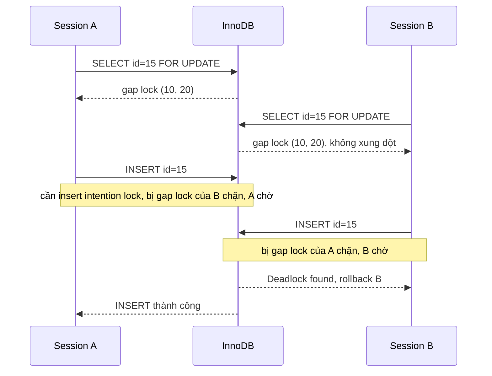
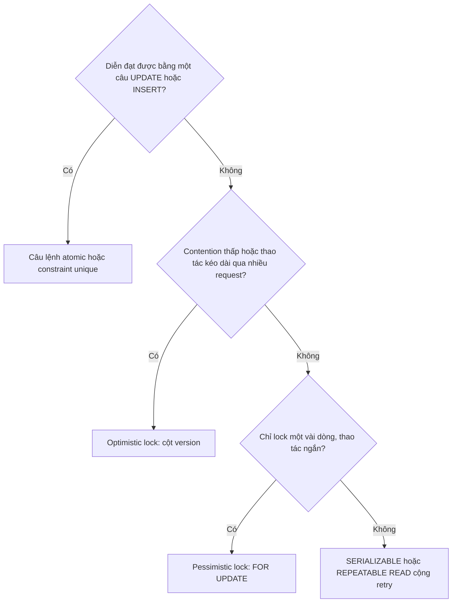
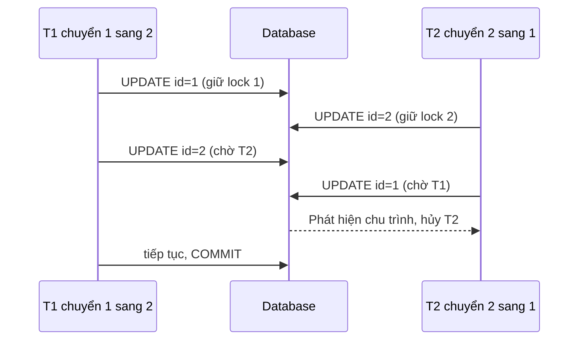

# Lock, deadlock và concurrency ở tầng database

Nền tảng: [Transaction, Isolation và Lock](/go?p=02-Database%2Fmedium%2Flt-04-transaction-isolation-lock.md). Cơ chế bên trong: [InnoDB](/go?p=02-Database%2Fmedium%2Flt-07-mysql-innodb-noi-bo.md), [PostgreSQL](/go?p=02-Database%2Fmedium%2Flt-08-postgresql-mvcc-wal.md). Phía Java: [Spring: Transaction](/go?p=01-Spring-Boot%2Fmedium%2Flt-05-transaction.md), [Concurrency: liveness hazards](/go?p=08-Java%2FJava-Concurrency%2Fhard%2Flt-10-liveness-hazards.md). Concurrency ở tầng database là cùng một vấn đề với concurrency trong JVM (race condition, deadlock, lost update), chỉ khác ở công cụ.

**Cốt lõi:** Nhiều transaction chạy chồng lên nhau có thể cho kết quả sai dù mỗi cái chạy riêng đều đúng. Database ngăn điều đó bằng lock bắt bên sau chờ, và hệ quả của việc giữ lock trong khi chờ lock khác là deadlock.

- Vì lỗi chỉ lộ khi các request chồng nhau nên mọi nghiệp vụ đọc rồi ghi cần một cơ chế tường minh, ưu tiên cách đơn giản nhất đủ dùng.
- Vì InnoDB lock trên entry của index nên thiếu index phù hợp cho WHERE thì lock gần như cả bảng.
- Vì deadlock là vòng chờ không tránh hết được nên khóa theo thứ tự cố định, giữ transaction ngắn, và retry cả transaction.


Mô hình tư duy: lock giải quyết xung đột bằng cách bắt chờ, và chờ lẫn nhau thành vòng thì phải hủy một bên và thử lại.

**Tóm tắt:**

- Lỗi concurrency (bán trùng, trừ kho âm, lost update, write skew) âm thầm và chỉ lộ dưới tải thật, vì mỗi request chạy riêng đều đúng.
- Thứ tự chọn công cụ: câu lệnh atomic, constraint unique, optimistic lock (cột version), pessimistic lock (FOR UPDATE), cuối cùng là SERIALIZABLE hoặc REPEATABLE READ kèm retry.
- InnoDB lock trên entry của index: record lock, gap lock, next-key lock (mặc định ở REPEATABLE READ); không có index phù hợp cho WHERE thì lock gần như cả bảng.
- Gap lock chỉ ngăn chèn nhưng chặn insert intention lock, nên kiểu kiểm tra rồi chèn dễ deadlock; hãy thay bằng unique constraint.
- Deadlock: MySQL báo ERROR 1213, PostgreSQL báo deadlock detected sau deadlock_timeout mặc định 1 giây; nạn nhân đã rollback hoàn toàn nên phải chạy lại cả transaction.
- Tránh deadlock bằng cách lock theo thứ tự cố định, giữ transaction ngắn và dùng index đúng để lock ít dòng.
- SKIP LOCKED cho nhiều worker lấy job mà không chờ nhau, hợp với queue trong database.

## Vấn đề: nhiều người cùng sửa một dữ liệu

Hãy tưởng tượng một cửa hàng còn đúng 1 chiếc áo. Hai khách cùng bấm "Mua" ở hai máy khác nhau, trong cùng một phần nghìn giây. Mỗi request đều đọc "còn 1", đều thấy hợp lệ, đều trừ kho và đều thu tiền. Kết quả: bán 2 chiếc áo trong khi chỉ có 1. Mỗi request chạy riêng lẻ đều đúng, nhưng chạy chồng lên nhau thì sai. Đó là bài toán concurrency ở tầng database: làm sao cho nhiều transaction chạy parallel mà kết quả vẫn đúng như thể chúng chạy lần lượt.

Database giải bài toán này bằng một bộ công cụ: các mức isolation (quy định một transaction được thấy gì từ transaction khác), các loại lock để bắt transaction khác chờ, cơ chế phát hiện xung đột và cơ chế xử lý deadlock (hai bên chờ nhau vĩnh viễn). Bài này đi từ các lỗi có thể xảy ra, đến công cụ của từng hệ (InnoDB, PostgreSQL), rồi đến cách chọn công cụ và cách viết code Spring/JPA cho đúng.

## Vì sao cần quan tâm

Lỗi concurrency ở tầng dữ liệu là lỗi **âm thầm và gây thiệt hại tiền bạc**: trừ kho âm, bán trùng vé, số dư sai, xử lý một job hai lần. Chúng không xuất hiện khi bạn test từng request một, chỉ lộ ra dưới tải thật, và khi lộ ra thì dữ liệu đã sai và rất khó truy vết. Vì vậy bạn cần chủ động nghĩ đến concurrency mỗi khi viết nghiệp vụ.

## Khi nào phải nghĩ đến chuyện này

Mọi nghiệp vụ "đọc rồi ghi" (đọc một giá trị, tính toán, ghi lại dựa trên giá trị đã đọc): trừ tồn kho, chuyển tiền, đặt chỗ, nhận job từ queue, sinh số thứ tự, đảm bảo duy nhất. Ngược lại, nghiệp vụ chỉ đọc hoặc chỉ chèn dữ liệu độc lập (log, event) hiếm khi cần lock tường minh.

Nguyên tắc chọn công cụ: dùng cái đơn giản nhất đủ dùng. Thứ tự ưu tiên là câu lệnh atomic, constraint unique, optimistic lock (`@Version`), pessimistic lock (`FOR UPDATE`, `SKIP LOCKED`), và cuối cùng là isolation cao kèm **thử lại** (retry). Phần 4 giải thích từng lựa chọn và khi nào không nên dùng.

**Nền tảng:** Lỗi concurrency (bán trùng, trừ kho âm, lost update, write skew) âm thầm và chỉ lộ dưới tải thật, vì mỗi request chạy riêng đều đúng. Mọi nghiệp vụ đọc rồi ghi phải được bảo vệ bằng một cơ chế tường minh: câu lệnh atomic, unique, lock hoặc isolation cao kèm retry.

## Các khái niệm cần biết

- **Lock**: dấu hiệu "tôi đang dùng dữ liệu này" mà database gắn lên dòng, index hoặc bảng. Transaction khác muốn xung đột sẽ phải chờ. Lock giữ đến khi transaction kết thúc (commit hoặc rollback), nên transaction dài giữ lock lâu.
- **Optimistic lock**: không lock khi đọc, chỉ kiểm tra lúc ghi xem dữ liệu có bị ai đổi không (thường qua cột `version`). Nếu bị đổi thì báo lỗi và thử lại. Hợp khi ít contention.
- **Pessimistic lock**: lock ngay lúc đọc (`SELECT ... FOR UPDATE`) để không ai chen vào. Hợp khi contention cao.
- **Deadlock**: transaction A giữ lock 1 và chờ lock 2, trong khi B giữ lock 2 và chờ lock 1. Không bên nào tiến được, database phải hủy một bên.
- **Serialization failure**: lỗi (SQLSTATE `40001`) mà database trả về khi nó phát hiện việc chạy parallel có thể cho kết quả khác với chạy tuần tự, nên hủy một transaction. Ứng dụng phải chạy lại transaction đó.
- **MVCC (Multi-Version Concurrency Control)**: database giữ nhiều phiên bản của một dòng, nên người đọc thường không chặn người ghi. Xem [InnoDB](/go?p=02-Database%2Fmedium%2Flt-07-mysql-innodb-noi-bo.md) và [PostgreSQL](/go?p=02-Database%2Fmedium%2Flt-08-postgresql-mvcc-wal.md).
- **Idempotent**: thực hiện một thao tác nhiều lần cho cùng kết quả như thực hiện một lần. Quan trọng khi retry hoặc khi webhook gửi trùng.
- **Backoff và jitter**: khoảng chờ tăng dần giữa các lần retry (backoff), cộng thêm độ trễ ngẫu nhiên (jitter) để nhiều client không cùng thử lại đúng một lúc.

## 1. Các concurrency anomaly

Năm dị thường (dirty read, non-repeatable read, phantom read, lost update, write skew), bảng mức isolation theo chuẩn SQL, bảng "mức nào chặn gì" và các lịch xen kẽ từng bước (kể cả ví dụ bác sĩ xin nghỉ trực) nằm ở bài nền [Transaction, Isolation và Lock](/go?p=02-Database%2Fmedium%2Flt-04-transaction-isolation-lock.md). Bài này giả định bạn đã nắm chúng và chỉ nhắc hai điều dùng ở các phần sau: lost update là hai bên ghi **cùng một dòng** dựa trên giá trị cũ, còn write skew là hai bên ghi **hai dòng khác nhau** nhưng cùng phá một constraint chung, nên cơ chế phát hiện xung đột ghi-ghi không bắt được.

## 2. Lock của InnoDB

InnoDB lock trên **các entry của index**, không phải trên "dòng" trừu tượng.

| Loại lock | Lock gì |
|---|---|
| **Record lock** | Một entry index |
| **Gap lock** | **Khoảng trống** giữa hai entry index (và trước entry đầu/sau entry cuối); chỉ có tác dụng **ngăn chèn** vào khoảng đó. Gap lock của các transaction khác nhau **không xung đột nhau** |
| **Next-key lock** | Record lock + gap lock ngay trước nó. Là kiểu lock mặc định cho đọc có lock, `UPDATE`, `DELETE` ở mức `REPEATABLE READ`, dùng để chặn phantom |
| **Insert intention lock** | Lock dạng gap mà `INSERT` đặt trước khi chèn; xung đột với gap lock của transaction khác trên cùng khoảng |
| Shared / Exclusive (S/X) | Chế độ đọc chia sẻ / ghi độc quyền ở mức record |
| Intention lock (IS/IX) | Intent lock ở mức bảng, để kiểm tra nhanh xung đột với lock bảng |

Quy tắc đáng nhớ:

- Query tìm theo **index unique với điều kiện bằng** chỉ lock đúng record đó, không lock gap.
- Điều kiện khoảng hoặc index không unique thì lock next-key trên các entry đã quét **và** gap xung quanh.
- **Không có index phù hợp cho `WHERE` thì InnoDB phải quét (và lock) rất nhiều entry, thực tế gần như lock cả bảng.** Một câu `UPDATE ... WHERE col = ?` trên cột chưa index có thể chặn mọi ghi khác.
- Ở `READ COMMITTED`, gap lock phần lớn tắt, nên ít deadlock hơn nhưng phantom có thể xảy ra (theo tài liệu MySQL).

**Phải thuộc:** InnoDB lock trên entry của index: record lock (một entry), gap lock (khoảng trống giữa hai entry, chỉ ngăn chèn), next-key lock (record cộng gap trước nó, mặc định ở REPEATABLE READ). Không có index phù hợp cho WHERE thì lock gần như cả bảng; ở READ COMMITTED gap lock phần lớn tắt.

**Suy luận:** InnoDB lưu dữ liệu trong cây index nên nó không có khái niệm lock một dòng độc lập, mà lock các entry của index mà nó đi qua khi tìm dòng. Nếu WHERE dùng được index, câu lệnh chỉ đi qua vài entry và lock vài entry. Nếu không có index phù hợp, InnoDB phải quét clustered index và lock mọi entry nó duyệt qua (ở REPEATABLE READ cả các khoảng giữa chúng), nên lock gần như cả bảng dù câu lệnh chỉ muốn sửa một dòng. Gap lock tồn tại vì REPEATABLE READ phải ngăn phantom: để lần đọc lại không thấy dòng mới, InnoDB chặn việc chèn vào khoảng trống giữa các entry đã quét. Điểm dễ nhầm là nghĩ lock theo điều kiện WHERE thay vì theo index; hai câu UPDATE có điều kiện khác nhau vẫn chặn nhau nếu chúng quét cùng một dải entry. Hệ quả hành động: mọi UPDATE hoặc SELECT ... FOR UPDATE phải có index khớp với WHERE, và khi thấy nghẽn lock bất thường, hãy kiểm tra EXPLAIN xem câu lệnh có quét rộng không.

```sql
-- REPEATABLE READ. Bảng t có index trên id, các id hiện có: 10, 20, 30
BEGIN;
SELECT * FROM t WHERE id BETWEEN 12 AND 18 FOR UPDATE;
-- Không có dòng nào khớp, nhưng lock gap (10, 20): INSERT id=15 từ session khác sẽ bị chặn.
```

### Deadlock kinh điển: hai transaction cùng chờ chèn vào một gap

```sql
-- Session A                                  -- Session B
BEGIN;                                        BEGIN;
SELECT * FROM t WHERE id = 15 FOR UPDATE;     SELECT * FROM t WHERE id = 15 FOR UPDATE;
-- (không có dòng 15: cả hai cùng giữ gap lock, vì gap lock không xung đột nhau)
INSERT INTO t(id) VALUES (15);                INSERT INTO t(id) VALUES (15);
-- A cần insert intention lock, bị gap lock của B chặn; B bị gap lock của A chặn  => DEADLOCK
```

Hãy xem trình tự thời gian của tình huống này.



Đọc sơ đồ: gap lock không chặn nhau nên cả hai đều lấy được; nhưng khi `INSERT`, mỗi bên bị gap lock của bên kia chặn, tạo thành vòng chờ. InnoDB phát hiện chu trình, hủy một bên (nạn nhân) và bên còn lại chạy tiếp. Hệ quả thực tế: ứng dụng nhận lỗi 1213 ngẫu nhiên dưới tải nếu không có retry.

Cách tránh: dùng `INSERT ... ON DUPLICATE KEY UPDATE` hoặc cơ chế unique constraint thay vì "kiểm tra rồi chèn", hạ xuống `READ COMMITTED`, hoặc chấp nhận và retry.

**Nền tảng:** Gap lock của các transaction khác nhau không xung đột nhau, nhưng chặn insert intention lock, nên hai transaction cùng lock một gap rồi cùng INSERT sẽ deadlock. Đây là ví dụ vì sao kiểu kiểm tra rồi chèn dễ lỗi và nên thay bằng unique constraint.

## 3. `SELECT ... FOR UPDATE` và các biến thể

| Cú pháp | Hành vi |
|---|---|
| `FOR UPDATE` | Exclusive lock các dòng trả về; transaction khác muốn ghi/lock phải **chờ** |
| `FOR SHARE` | Shared lock: cho đọc có lock chung, chặn ghi |
| `NOWAIT` | Không chờ: lỗi ngay nếu dòng đang bị lock |
| `SKIP LOCKED` | **Bỏ qua** các dòng đang bị lock, trả về phần còn lại |

`SKIP LOCKED` có từ PostgreSQL 9.5 và MySQL 8.0, `NOWAIT` có ở cả hai (MySQL từ 8.0, PostgreSQL từ trước 9.5); kiểm tra lại theo phiên bản bạn dùng. Đọc nhất quán thông thường không lock, nên `SELECT` rồi `UPDATE` **không** bảo vệ gì nếu bạn không dùng `FOR UPDATE` hoặc một cơ chế khác.

### Queue công việc bằng SKIP LOCKED

```sql
BEGIN;
SELECT id, payload FROM job
WHERE status = 'PENDING'
ORDER BY id
LIMIT 10
FOR UPDATE SKIP LOCKED;
-- xử lý 10 job này, cập nhật status = 'DONE'
COMMIT;
```

Nhiều worker chạy parallel, mỗi worker nhận một tập job khác nhau, không chờ nhau, không xử lý trùng. Cần index theo `(status, id)`. Nếu worker chết giữa chừng, transaction rollback, lock nhả, job trở lại queue. Lưu ý: dùng kiểu này trong transaction dài giữ lock và kéo dài transaction; với queue lớn nên cân nhắc broker chuyên dụng ([Kafka](/go?p=01-Spring-Boot%2Fhard%2Flt-07-event-driven-kafka.md)).

## 4. Chống lost update: chọn công cụ theo mức contention

Vấn đề đặt ra là có nhiều công cụ, mỗi cái đúng ở một hoàn cảnh. Sơ đồ dưới đây là cách đi từ đơn giản đến phức tạp để chọn.



Đọc sơ đồ: hỏi từ trên xuống, dừng ở lựa chọn đầu tiên phù hợp. Càng xuống dưới càng tốn tài nguyên và càng cần vòng retry. Bảng sau tóm tắt từng cách, kèm chỗ không nên dùng.

**Phải thuộc:** Thứ tự chọn công cụ chống lost update: câu lệnh atomic (UPDATE ... SET qty = qty - 1 WHERE qty >= 1), constraint unique, optimistic lock (cột version), pessimistic lock (FOR UPDATE), cuối cùng là SERIALIZABLE hoặc REPEATABLE READ kèm retry.

| Cách | Mẫu | Hợp khi | Lưu ý |
|---|---|---|---|
| **Câu lệnh atomic** (không phù hợp khi logic cần nhiều bước hoặc nhiều bảng) | `UPDATE stock SET qty = qty - 1 WHERE id = ? AND qty >= 1` rồi kiểm tra số dòng bị ảnh hưởng | Phép cập nhật diễn đạt được trong một câu lệnh | Đơn giản và nhanh nhất; ưu tiên số một |
| **Constraint unique / check** | `UNIQUE(order_id, step)`; `INSERT ... ON CONFLICT DO NOTHING` (PostgreSQL), `INSERT ... ON DUPLICATE KEY UPDATE` hoặc `INSERT IGNORE` (MySQL) | Đảm bảo duy nhất, idempotency | Cơ chế **không thể bị bỏ sót** vì nằm ở database |
| **Optimistic lock** | Cột `version`: `UPDATE ... SET ..., version = version + 1 WHERE id = ? AND version = ?` | Contention thấp, thao tác đọc-sửa-ghi kéo dài qua nhiều request (form người dùng) | Khi xung đột phải **thử lại** hoặc báo người dùng |
| **Pessimistic lock** | `SELECT ... FOR UPDATE` rồi sửa | Contention cao, thao tác ngắn, không thể diễn đạt atomic | Giữ lock ngắn, lock theo thứ tự cố định |
| **Isolation cao + retry** | `SERIALIZABLE` / `REPEATABLE READ` và bắt `40001`/deadlock | Logic phức tạp, nhiều dòng liên quan (write skew) | Bắt buộc có vòng retry cho cả transaction |

### Idempotency bằng unique constraint

Thanh toán, webhook, message có thể đến **hai lần**. Lưu `idempotency_key` với constraint unique, chèn trong **cùng transaction** với tác động nghiệp vụ. Lần thứ hai vi phạm unique, bắt lỗi và trả kết quả cũ. Xem thêm [Distributed lock và Idempotency](/go?p=01-Spring-Boot%2Fhard%2Flt-26-distributed-lock-idempotency.md).

## 5. Phát hiện và chẩn đoán deadlock

**Cơ chế**: các hệ dựng đồ thị chờ (wait-for graph); có chu trình thì chọn một nạn nhân, rollback nó và trả lỗi để ứng dụng thử lại.

| | MySQL InnoDB | PostgreSQL |
|---|---|---|
| Phát hiện | Chủ động, mặc định bật (`innodb_deadlock_detect`); nạn nhân thường là transaction thay đổi ít dòng hơn | Kiểm tra sau `deadlock_timeout` (mặc định 1 giây) khi một transaction đã chờ lâu |
| Lỗi trả về | `ERROR 1213 (40001) Deadlock found` | `ERROR: deadlock detected` (SQLSTATE `40P01`) |
| Chờ lock quá lâu (không phải deadlock) | `innodb_lock_wait_timeout` (mặc định 50 giây), lỗi 1205 | `lock_timeout` (mặc định tắt), `statement_timeout` |
| Xem chi tiết | `SHOW ENGINE INNODB STATUS` mục `LATEST DETECTED DEADLOCK`; `performance_schema.data_locks`, `data_lock_waits`; `sys.innodb_lock_waits` | `pg_locks`, `pg_stat_activity`, `pg_blocking_pids(pid)`; bật `log_lock_waits` |

```sql
-- MySQL: ai đang chặn ai
SELECT * FROM sys.innodb_lock_waits\G

-- PostgreSQL: các phiên bị chặn và phiên chặn chúng
SELECT a.pid, a.state, a.query, pg_blocking_pids(a.pid) AS blocked_by
FROM pg_stat_activity a
WHERE cardinality(pg_blocking_pids(a.pid)) > 0;
```

Đọc báo cáo deadlock của InnoDB: tìm hai transaction, câu lệnh mỗi bên **đang giữ** và **đang chờ**, index nào bị lock, kiểu lock (`rec but not gap`, `gap before rec`, `insert intention`). Thông tin này chỉ ra trực tiếp chỗ cần sửa: thiếu index, thứ tự truy cập, hay gap lock.

**Phải thuộc:** Deadlock: MySQL báo ERROR 1213 (SQLSTATE 40001), PostgreSQL báo deadlock detected (SQLSTATE 40P01) sau deadlock_timeout mặc định 1 giây. Nạn nhân đã rollback hoàn toàn nên phải chạy lại cả transaction.

**Suy luận:** Deadlock là hệ quả tất yếu của việc giữ một lock trong khi chờ lock khác: nếu hai transaction lấy lock theo thứ tự ngược nhau, mỗi bên giữ cái bên kia cần và không ai tiến được. Database không ngăn được điều này từ trước vì nó không biết transaction sẽ lock gì tiếp theo, nên nó phát hiện vòng chờ (hoặc hết deadlock_timeout) rồi chọn một nạn nhân để rollback. Vì nạn nhân đã rollback toàn bộ chứ không chỉ câu lệnh vừa lỗi, ứng dụng không được thử lại riêng câu lệnh đó mà phải chạy lại cả transaction từ đầu. Do đó cách chữa tận gốc là loại bỏ vòng chờ bằng một thứ tự lock toàn cục, ví dụ luôn lock theo id tăng dần, chứ không phải tăng timeout. Điểm dễ nhầm là coi deadlock là lỗi hiếm cần tránh tuyệt đối; ở tải cao nó sẽ xảy ra, và hệ thống đúng là hệ thống biết retry cả transaction một cách idempotent. Khi review, hãy tìm mọi nơi một transaction lock nhiều hàng, kiểm tra thứ tự lock, và kiểm tra có retry khi gặp mã lỗi deadlock hay không.

### Giảm deadlock

1. Truy cập **các bảng và dòng theo thứ tự cố định** ở mọi nơi (sắp xếp ID trước khi cập nhật hàng loạt). Ví dụ chuyển tiền ở dưới.
2. Giữ transaction **ngắn**: không gọi HTTP, không chờ người dùng trong transaction.
3. Đảm bảo query dùng **index đúng** để lock ít dòng nhất.
4. Dùng `READ COMMITTED` nếu nghiệp vụ chấp nhận (ít gap lock).
5. Luôn có **retry** cho lỗi deadlock/serialization (chạy lại **toàn bộ** transaction, có giới hạn lần và độ trễ ngẫu nhiên tăng dần).

### Deadlock do lock ngược thứ tự

Đây là kiểu deadlock phổ biến nhất ở tầng ứng dụng: hai transaction chuyển tiền ngược chiều giữa cùng hai tài khoản, mỗi bên lock dòng của mình trước rồi mới chờ dòng của bên kia.



PostgreSQL báo `ERROR: deadlock detected` (SQLSTATE `40P01`) sau `deadlock_timeout` (mặc định 1 giây); MySQL báo `ERROR 1213 (40001)`. Bên bị chọn làm nạn nhân đã rollback hoàn toàn nên ứng dụng phải chạy lại cả transaction. Sửa tận gốc bằng cách lock **theo thứ tự id tăng dần**, bất kể chiều chuyển:

```sql
BEGIN;
-- lock cả hai dòng, theo thứ tự id
SELECT id, balance FROM accounts WHERE id IN (1, 2) ORDER BY id FOR UPDATE;
UPDATE accounts SET balance = balance - 100 WHERE id = 1;
UPDATE accounts SET balance = balance + 100 WHERE id = 2;
COMMIT;
```

## 6. Liên hệ Spring và JPA

```java
@Entity
class Product {
    @Id Long id;
    int stock;
    @Version long version;   // optimistic lock do JPA quản lý
}

@Service
class StockService {
    @Transactional
    @Retryable(retryFor = {OptimisticLockingFailureException.class, CannotAcquireLockException.class},
               maxAttempts = 3, backoff = @Backoff(delay = 50, multiplier = 2, random = true))
    public void reserve(long productId, int qty) {
        Product p = repo.findById(productId).orElseThrow();
        if (p.stock < qty) throw new OutOfStockException();
        p.stock -= qty;          // flush sinh UPDATE ... WHERE id=? AND version=?
    }
}
```

- Cơ chế `@Version` (JPA thêm `AND version = ?` vào `UPDATE`, không khớp thì ném `OptimisticLockingFailureException`) và `@Lock(PESSIMISTIC_WRITE)` cùng `jakarta.persistence.lock.timeout` được giải thích ở [JPA hiệu năng, khóa và cache](/go?p=01-Spring-Boot%2Fhard%2Flt-34-jpa-hieu-nang-khoa-cache.md).
- `@Retryable` phải bọc **ngoài** ranh giới transaction (retry mở transaction mới). Đặt cả hai trên cùng một method thì thứ tự advisor quyết định; cách chắc chắn là đặt retry ở lớp gọi bên ngoài.
- `@Transactional(isolation = ...)` chỉ có tác dụng nếu database hỗ trợ và thực sự áp dụng cho transaction mới; kiểm tra bằng log SQL.
- Bẫy kinh điển: kiểm tra điều kiện bằng `SELECT` rồi `UPDATE` ở mức `READ COMMITTED` mà không lock: hai request cùng qua kiểm tra. Hãy dùng câu lệnh atomic hoặc `@Version`.

## Bẫy thường gặp

| Bẫy | Hậu quả | Cách tránh |
|---|---|---|
| `SELECT` kiểm tra rồi `UPDATE` không lock | Lost update, bán vượt tồn kho | Câu lệnh atomic, `@Version`, `FOR UPDATE` |
| `WHERE` trên cột thiếu index trong transaction ghi (InnoDB) | Lock quét rộng, chặn toàn bảng | Tạo index phù hợp |
| Tin rằng `REPEATABLE READ` của PostgreSQL chặn write skew | Phá constraint chung | Dùng `SERIALIZABLE` + retry hoặc lock tường minh |
| Không có vòng retry cho `40001`/`40P01` | Lỗi 500 ngẫu nhiên dưới tải | Retry cả transaction, backoff có jitter |
| Giữ transaction mở khi gọi dịch vụ ngoài | Lock giữ lâu, kéo theo deadlock và timeout | Tách phần gọi ngoài ra khỏi transaction |
| Dùng `FOR UPDATE` rộng (không giới hạn dòng) | Lock nhiều hơn cần | Giới hạn bằng `WHERE` có index, `LIMIT` |
| Lock theo thứ tự khác nhau ở các flow nghiệp vụ | Deadlock | Quy ước thứ tự lock toàn hệ thống |

## Điểm cần nhớ

- Lost update và write skew là lỗi thật dù đã có transaction; tên isolation giống nhau nhưng hành vi mỗi hệ khác nhau.
- Ưu tiên công cụ đơn giản: câu lệnh atomic, constraint unique, rồi `@Version`, rồi `FOR UPDATE`, rồi isolation cao + retry.
- InnoDB lock trên entry index, có gap/next-key lock ở `REPEATABLE READ`; thiếu index là lock rộng.
- `SKIP LOCKED` biến bảng thành queue parallel an toàn; `NOWAIT` cho thất bại nhanh.
- Deadlock là bình thường dưới tải; hệ thống phải **thử lại**, và nên giảm bằng thứ tự truy cập cố định và transaction ngắn.
- Đọc `LATEST DETECTED DEADLOCK` / `pg_blocking_pids` để tìm đúng nguyên nhân.

## Phỏng vấn khó: chuỗi hỏi xoáy

Người phỏng vấn senior thường mở bằng một câu dễ rồi xoáy xuống cơ chế, đánh đổi và sự cố thật. Câu trả lời tốt luôn đi từ cốt lõi xuống, không đi từ chỗ học thuộc lên.

### Chuỗi 1: Bán trùng chiếc áo cuối cùng

1. **Câu mở:** Còn một chiếc áo, hai khách bấm mua cùng lúc. Anh ngăn bán trùng thế nào?
2. **Xoáy 1:** Code của tôi `SELECT stock` rồi `UPDATE` nếu đủ, chạy ở `READ COMMITTED`. Sai ở đâu, và câu lệnh atomic thay thế ra sao?
3. **Xoáy 2:** Nếu nghiệp vụ nhiều bước, nhiều bảng, không gói vào một `UPDATE` được thì anh chọn công cụ nào, theo thứ tự nào?

**Đáp án ngắn:** Chọn công cụ đơn giản nhất đủ dùng. `SELECT` rồi `UPDATE` không lock thì cả hai request cùng đọc "còn 1", cùng qua kiểm tra rồi cùng trừ, vì đọc nhất quán thông thường không lock. Câu lệnh atomic là `UPDATE stock SET qty = qty - 1 WHERE id = ? AND qty >= 1`, rồi kiểm tra số dòng bị ảnh hưởng; 0 dòng nghĩa là hết hàng. Khi không gói được vào một câu thì đi xuống tiếp: constraint unique (duy nhất, idempotency), optimistic lock bằng cột `version` khi contention thấp hoặc thao tác kéo dài qua nhiều request, pessimistic lock `SELECT ... FOR UPDATE` khi contention cao và thao tác ngắn, cuối cùng `SERIALIZABLE` hoặc `REPEATABLE READ` kèm retry cả transaction. Càng xuống dưới càng tốn tài nguyên và càng cần vòng retry. Lỗi này âm thầm: test từng request không thấy, chỉ lộ dưới tải thật, dấu hiệu là tồn kho âm hoặc bán vượt hàng.

**Sai lầm hay gặp:**

- Nhảy thẳng tới `FOR UPDATE` hoặc `SERIALIZABLE` mà không xét câu lệnh atomic trước.
- Tin "đã có transaction thì an toàn", trong khi transaction không tự chống lost update.
- Dùng optimistic lock mà không có xử lý khi xung đột (retry hoặc báo người dùng).

### Chuỗi 2: Deadlock khi chuyển tiền

1. **Câu mở:** Hai giao dịch chuyển tiền ngược chiều giữa tài khoản 1 và 2 thì xảy ra gì?
2. **Xoáy 1:** Database phát hiện và xử lý deadlock thế nào, nạn nhân chịu gì, ứng dụng làm gì? Tăng timeout có chữa được không?
3. **Xoáy 2:** Đã lock theo thứ tự id mà ở MySQL InnoDB vẫn gặp deadlock. Anh nghi gì và đọc gì để chẩn đoán?

**Đáp án ngắn:** Mỗi bên giữ lock dòng của mình rồi chờ dòng của bên kia, thành vòng chờ nên là deadlock. Database dựng đồ thị chờ, thấy chu trình thì chọn một nạn nhân, rollback hoàn toàn và trả lỗi: MySQL `ERROR 1213 (40001)`, PostgreSQL `deadlock detected` (SQLSTATE `40P01`) sau `deadlock_timeout` mặc định 1 giây. Vì nạn nhân đã rollback toàn bộ, ứng dụng phải chạy lại cả transaction, có giới hạn lần và backoff ngẫu nhiên. Tăng timeout không chữa được vì vòng chờ vẫn còn; sửa gốc là một thứ tự lock toàn cục, ví dụ `SELECT ... WHERE id IN (1, 2) ORDER BY id FOR UPDATE` rồi mới `UPDATE`. Nếu InnoDB vẫn deadlock thì nghi lock trên entry của index: thiếu index phù hợp cho `WHERE` làm lock quét rộng, hoặc gap lock và insert intention lock ở `REPEATABLE READ`. Đọc mục `LATEST DETECTED DEADLOCK` trong `SHOW ENGINE INNODB STATUS` để thấy câu lệnh mỗi bên đang giữ và chờ, index nào, kiểu lock nào; với PostgreSQL dùng `pg_blocking_pids` và bật `log_lock_waits`. Giữ transaction ngắn, không gọi HTTP trong transaction.

**Sai lầm hay gặp:**

- Coi deadlock là lỗi hiếm phải diệt hoàn toàn, thay vì thiết kế retry.
- Chỉ thử lại câu lệnh vừa lỗi, không chạy lại cả transaction.
- Không biết đọc báo cáo deadlock để tìm chỗ cần sửa.

### Chuỗi 3: Idempotency và retry đúng chỗ

1. **Câu mở:** Webhook thanh toán có thể đến hai lần. Làm sao xử lý đúng một lần?
2. **Xoáy 1:** Vì sao `idempotency_key` phải nằm trong cùng transaction với tác động nghiệp vụ, và lần thứ hai thì làm gì?
3. **Xoáy 2:** Trong Spring, anh đặt `@Retryable` và `@Transactional` trên cùng một method để thử lại khi bị optimistic lock hoặc deadlock. Có vấn đề gì?

**Đáp án ngắn:** Lưu `idempotency_key` với constraint unique rồi chèn trong cùng transaction với tác động nghiệp vụ. Cùng transaction để hai việc cùng thành công hoặc cùng bị hủy: nếu nghiệp vụ rollback thì key cũng rollback và lần gửi lại vẫn xử lý được; tách ra thì có thể có key mà không có tác động, hoặc ngược lại. Lần thứ hai vi phạm unique, ta bắt lỗi và trả kết quả cũ; đây là cơ chế không thể bị bỏ sót vì nằm ở database. Về retry, mỗi lần thử phải mở transaction mới, nên `@Retryable` phải bọc ngoài ranh giới transaction; đặt cả hai trên một method thì thứ tự advisor quyết định, cách chắc chắn là đặt retry ở lớp gọi bên ngoài. Retry áp dụng cho `OptimisticLockingFailureException`, deadlock, serialization failure, có giới hạn lần, backoff và jitter để các client không cùng thử lại một lúc. Retry chỉ an toàn khi thao tác idempotent.

**Sai lầm hay gặp:**

- Kiểm tra trùng bằng `SELECT` rồi mới chèn.
- Thử lại bên trong cùng một transaction đã bị hủy.
- Retry không giới hạn và không backoff.

## Câu hỏi tự kiểm tra

Với mỗi câu, thử trả lời theo gợi ý trước rồi mới đọc phần lập luận.

1. Hai transaction cùng kiểm tra "còn ít nhất một bác sĩ trực" rồi mỗi bên cho một bác sĩ nghỉ. Kết quả sai. Đây có phải lost update không?
   - **Gợi ý suy luận:** hai bên ghi cùng một dòng hay hai dòng khác nhau? Điều kiện nào đã bị phá và ai đã đọc nó?
   - **Lập luận và đáp án:** mỗi bên đọc cùng điều kiện, rồi ghi một dòng riêng, nên không có xung đột ghi nào để DB phát hiện. Lost update là hai bên ghi cùng một dòng. Đây là write skew: ghi hai dòng khác nhau nhưng cùng phá một constraint chung dựa trên điều kiện đã đọc.
2. Hai transaction cùng `SELECT ... FOR UPDATE` một id chưa tồn tại rồi `INSERT`, và InnoDB báo deadlock. Vì sao?
   - **Gợi ý suy luận:** lock dòng không tồn tại thì lock cái gì (gap lock)? Hai gap lock có chặn nhau không? Còn `INSERT` cần lock gì?
   - **Lập luận và đáp án:** không có dòng để lock nên mỗi bên giữ một gap lock, và gap lock không xung đột với nhau nên cả hai đều qua bước đọc. Khi `INSERT`, mỗi bên cần insert intention lock vào đúng khoảng đó, mà bị gap lock của bên kia chặn. Hai bên chờ nhau thành vòng nên là deadlock.
3. Nhiều worker cùng lấy việc từ một bảng queue và hay giẫm chân nhau. `SKIP LOCKED` giúp gì?
   - **Gợi ý suy luận:** `FOR UPDATE` thường làm gì khi gặp dòng đang bị lock? Worker muốn gì thay vì chờ?
   - **Lập luận và đáp án:** bình thường worker gặp dòng bị lock sẽ chờ, làm cả đàn xếp hàng. `SKIP LOCKED` bỏ qua dòng đang bị lock, nên mỗi worker lấy các dòng chưa ai giữ, không chờ và không trùng nhau. Vì thế hay dùng làm queue công việc.
4. Khi nào chọn optimistic lock, khi nào bi quan?
   - **Gợi ý suy luận:** xung đột xảy ra thường xuyên hay hiếm? Thao tác có kéo dài qua nhiều request (người dùng mở form rồi lưu) không? Giữ lock lâu tốn gì?
   - **Lập luận và đáp án:** pessimistic lock giữ lock suốt thao tác, an toàn nhưng chặn người khác; chỉ hợp khi thao tác ngắn và contention cao. Optimistic lock (cột version) không giữ lock, chỉ phát hiện xung đột lúc ghi và thử lại, nên hợp khi contention thấp hoặc thao tác kéo dài qua nhiều request.
5. Ứng dụng nhận lỗi `40001` (serialization failure) hoặc deadlock. Xử lý thế nào?
   - **Gợi ý suy luận:** DB đã làm gì với transaction thua cuộc? Thử lại ngay lập tức nhiều thread cùng lúc có thể gây hậu quả gì?
   - **Lập luận và đáp án:** DB đã rollback transaction thua, nên toàn bộ công việc của nó mất. Do đó phải chạy lại cả transaction từ đầu, giới hạn số lần và chờ ngẫu nhiên (backoff) để các bên không đụng nhau lần nữa.
6. Bảng thiếu index mà một câu `UPDATE ... WHERE` làm đứng cả bảng trong InnoDB. Tại sao?
   - **Gợi ý suy luận:** không có index thì tìm dòng bằng cách nào? InnoDB lock trên cái gì (entry của index)?
   - **Lập luận và đáp án:** không tìm trực tiếp được thì phải quét cả clustered index, và InnoDB lock mọi entry mà nó duyệt qua (ở REPEATABLE READ). Duyệt hết bảng nghĩa là lock gần như cả bảng, nên các transaction khác bị chặn. Thêm index đúng cột lọc để chỉ lock phần cần thiết.

Nguồn: tài liệu chính thức MySQL (InnoDB Locking, Transaction Isolation Levels) và PostgreSQL (Transaction Isolation, Explicit Locking), kiểm tra ngày 2026-10-21.

