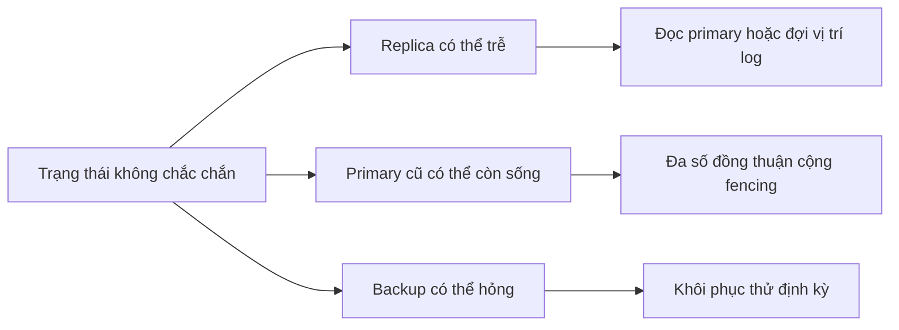
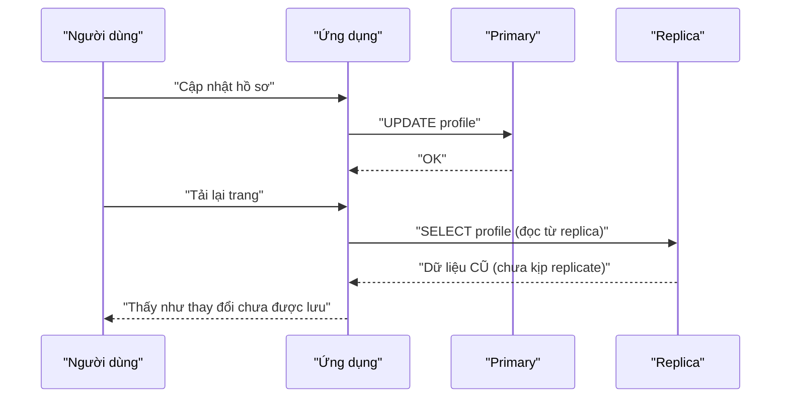
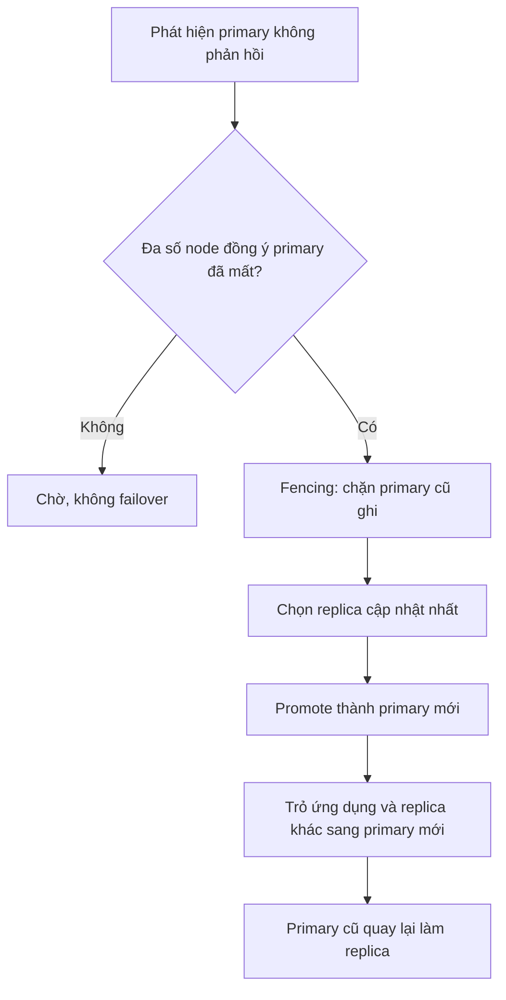
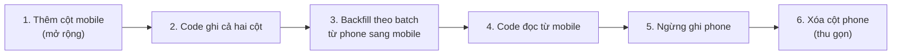
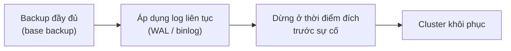

# Replication, partitioning, backup và vận hành thực chiến

Nền tảng và khái niệm: [Replication, Partitioning, Sharding và HA](/go?p=02-Database%2Fhard%2Flt-05-replication-sharding-ha.md). Bài này **không lặp lại khái niệm**, mà đi vào những gì xảy ra khi vận hành thật: độ trễ replica làm sai dữ liệu người dùng thấy, failover hỏng ra sao, đổi schema trên bảng lớn không sập hệ thống, backup có khôi phục được thật không, và theo dõi gì để biết trước sự cố. Cơ chế log bên dưới: [InnoDB](/go?p=02-Database%2Fmedium%2Flt-07-mysql-innodb-noi-bo.md), [PostgreSQL](/go?p=02-Database%2Fmedium%2Flt-08-postgresql-mvcc-wal.md).

**Cốt lõi:** Ở production, sự cố database nghiêm trọng thường đến từ vận hành chứ không từ query sai. Gốc chung là không biết chắc trạng thái của các node và các bản dữ liệu: replica đã theo kịp chưa, primary cũ đã chết thật chưa, backup có khôi phục được không.

- Vì replica async nhận log sau khi primary commit nên đọc từ replica có thể thấy dữ liệu cũ, và ứng dụng phải có chiến lược read-your-writes.
- Vì không chứng minh được primary cũ đã chết nên phải có đa số đồng thuận và fencing trước khi promote, để tránh split-brain.
- Vì code cũ và mới chạy cùng lúc khi deploy nên mỗi bước đổi schema phải tương thích với cả hai, và backup chỉ đáng tin khi đã khôi phục thử.



Mô hình tư duy: mỗi rủi ro vận hành là một điều ta không biết chắc, và mỗi biện pháp là cách biến nó thành điều kiểm chứng được.

**Tóm tắt:**

- Replica async luôn có thể trễ, nên cần chiến lược read-your-writes: đọc primary trong N giây sau khi ghi, đọc primary cho flow quan trọng, hoặc đợi replica đạt vị trí log (GTID, LSN).
- Sync hay async là đánh đổi giữa RPO và độ khả dụng ghi: async có thể mất transaction chưa sang replica, bán sync giảm mất dữ liệu nhưng cộng thêm độ trễ ghi và có thể treo ghi.
- Failover an toàn cần đa số node đồng thuận, fencing primary cũ trước khi promote và chọn replica cập nhật nhất; thiếu fencing thì split-brain, dữ liệu phân kỳ.
- Partitioning: primary key và mọi unique index phải chứa partition key, và query không chứa partition key phải quét mọi partition.
- Shard key tốt phải phân bố đều và nằm trong hầu hết query; key tăng dần hoặc lệch tạo hot shard.
- Đổi schema online: mỗi bước tương thích với cả code cũ và mới, đổi tên cột không bao giờ là một bước, đặt lock_timeout ngắn và backfill theo batch nhỏ.
- Backup có hai dạng: logical (mysqldump, pg_dump) linh hoạt nhưng chậm khi khôi phục và không cho PITR, physical nhanh khôi phục cả cluster; PITR cần base backup cộng log liên tục.
- Connection pool nên nhỏ so với số thread ứng dụng; quan sát replication lag, lock, kết nối và backup để biết trước khi sập.

## Database ở production khác database ở máy bạn

Trên máy dev, database luôn có một bản duy nhất, bảng chỉ vài trăm dòng, và không ai quan tâm nếu bạn tắt nó đi. Ở production, mọi thứ đảo ngược: dữ liệu là tài sản, có nhiều bản sao, bảng có hàng trăm triệu dòng, và một câu `ALTER TABLE` bất cẩn có thể làm cả hệ thống đứng vài phút. Bài này nói về các kỹ thuật và quy trình giúp database sống được ở môi trường đó: sao chép an toàn, chia dữ liệu hợp lý, đổi schema online, backup khôi phục theo thời điểm, và quan sát.

Lý do cần học riêng phần này là phần lớn sự cố database nghiêm trọng đến từ **vận hành** chứ không phải từ query sai: replica lệch làm người dùng thấy dữ liệu cũ, failover gây mất dữ liệu hoặc sinh ra hai primary, `ALTER TABLE` lock bảng giờ cao điểm, hoặc backup mà chưa từng thử khôi phục thì đến lúc cần mới biết là hỏng.

Bạn cần các kiến thức này khi hệ thống đủ lớn để có replica, partition, hoặc phải đổi schema mà không downtime. Riêng backup và giám sát thì cần ngay từ ngày đầu. Cách tiếp cận chung: thiết kế ứng dụng chịu được độ trễ replica, có quy trình failover với fencing, đổi schema theo từng bước tương thích ngược, backup có kiểm tra khôi phục định kỳ, và giám sát query chậm.

## Các khái niệm cần biết

- **Primary / replica**: primary là server nhận ghi; replica là bản sao chỉ đọc, nhận thay đổi từ primary. Dùng để chia tải đọc và làm dự phòng.
- **Replication lag**: khoảng chậm giữa lúc primary ghi và lúc replica áp dụng xong. Lag lớn thì đọc từ replica thấy dữ liệu cũ.
- **Read-your-writes**: đảm bảo người dùng luôn thấy thay đổi do chính họ vừa làm. Vi phạm khi đọc từ replica còn trễ.
- **WAL (PostgreSQL) và binlog (MySQL)**: log các thay đổi, được dùng cho replication và khôi phục. Replica về bản chất là "phát lại" log này.
- **GTID (MySQL) và LSN (PostgreSQL)**: định danh vị trí trong log. Nhờ chúng bạn biết replica đã đi tới đâu so với một lần ghi cụ thể.
- **RPO (Recovery Point Objective)**: mất tối đa bao nhiêu dữ liệu khi sự cố, tính theo thời gian. **RTO (Recovery Time Objective)**: mất tối đa bao lâu để dịch vụ chạy lại.
- **Failover**: chuyển vai trò primary sang một replica khi primary hỏng. **Split-brain**: hai node cùng tin mình là primary. **Fencing**: chặn chắc chắn primary cũ không ghi được nữa (ví dụ STONITH, "shoot the other node in the head", tức tắt hẳn node kia).
- **PITR (Point-In-Time Recovery)**: khôi phục về một thời điểm bất kỳ bằng backup cộng log liên tục.
- **Partition pruning**: database bỏ qua các partition không liên quan khi query có key partition.
- **Shard key, scatter-gather, hot shard**: key quyết định dữ liệu nằm ở shard nào; query thiếu key phải hỏi mọi shard rồi gộp kết quả (scatter-gather); một shard nhận quá nhiều lưu lượng gọi là hot shard.
- **Expand and contract**: kỹ thuật đổi schema theo hai pha, mở rộng (thêm cái mới, giữ cái cũ) rồi thu gọn (bỏ cái cũ), để code cũ và mới chạy được cùng lúc.
- **Idempotency**: thao tác làm lại nhiều lần vẫn cho cùng kết quả, cần khi transaction bị ngắt giữa failover và ứng dụng retry.

## 1. Replication lag và read-your-writes

Replica async luôn trễ so với primary (mili giây đến phút khi tải ghi lớn hoặc có query dài trên replica). Sự cố điển hình:



Đây là vi phạm **read-your-writes**. Các cách xử lý, từ đơn giản:

| Cách | Mô tả | Đánh đổi |
|---|---|---|
| Đọc từ primary sau khi ghi | Trong N giây sau ghi của người dùng đó, định tuyến đọc của họ về primary (cờ trong session/cookie) | Đơn giản, tải primary tăng nhẹ |
| Đọc từ primary cho flow quan trọng | Thanh toán, hiển thị kết quả ngay sau thao tác luôn đọc primary | Giảm lợi ích replica |
| **Đợi replica đuổi kịp** | Lấy vị trí log sau khi ghi (MySQL: GTID, `WAIT_FOR_EXECUTED_GTID_SET`; PostgreSQL: LSN, so với `pg_last_wal_replay_lsn()`), replica chỉ phục vụ khi đã qua vị trí đó | Chính xác, phức tạp |
| Sticky theo người dùng | Một người dùng luôn đọc một replica | Không giải quyết lag, chỉ nhất quán theo thời gian trên 1 replica |
| Replication sync | Primary đợi replica xác nhận | Latency ghi tăng, xem mục 2 |

Đừng quên: **đọc replica trong cùng transaction với ghi là không thể**; transaction ghi luôn nằm trên primary. Với Spring, `AbstractRoutingDataSource` kết hợp `@Transactional(readOnly = true)` là kỹ thuật phổ biến, nhưng cần kiểm soát read-your-writes ở trên.

**Nguyên nhân lag thường gặp**: một transaction ghi khổng lồ (replica phải áp dụng tuần tự, hoặc với MySQL mặc định theo thread replication, tùy cấu hình parallel), `ALTER TABLE` lớn, query dài trên replica gây xung đột với việc áp dụng (PostgreSQL: xung đột hot standby, hủy query hoặc trì hoãn replay), I/O đĩa yếu trên replica. Theo dõi: MySQL `SHOW REPLICA STATUS` (`Seconds_Behind_Source`, luôn kèm kiểm tra bằng bảng heartbeat vì chỉ số này có thể đánh lừa), PostgreSQL `pg_stat_replication` (`write_lag`, `flush_lag`, `replay_lag`).

**Phải thuộc:** Replica async luôn có thể trễ, nên ứng dụng cần chiến lược read-your-writes: đọc primary trong N giây sau khi ghi, đọc primary cho flow quan trọng, hoặc đợi replica đạt vị trí log (GTID với MySQL, LSN với PostgreSQL). Transaction ghi luôn nằm trên primary.

## 2. Sync và bán sync

| | Async | Bán sync / sync |
|---|---|---|
| Commit đợi | Chỉ primary | Ít nhất một replica **nhận** (hoặc ghi, hoặc áp dụng) record |
| Khi primary sập | **Có thể mất** các transaction chưa kịp sang replica (RPO > 0) | Giảm hoặc loại bỏ mất dữ liệu (RPO ≈ 0) |
| Latency ghi | Thấp nhất | Cộng thêm một vòng mạng |
| Khi replica sync chậm/chết | Không ảnh hưởng primary | **Có thể treo ghi** hoặc hạ cấp về async tùy cấu hình |

MySQL có plugin semi-sync; PostgreSQL điều khiển bằng `synchronous_standby_names` và `synchronous_commit` (`remote_write`, `on`, `remote_apply`). Đây là bài toán **RPO** (mất tối đa bao nhiêu dữ liệu) so với **độ khả dụng ghi**: không có bữa trưa miễn phí.

**Nền tảng:** Sync hay async là đánh đổi giữa RPO và độ khả dụng ghi: async có thể mất transaction chưa kịp sang replica (RPO lớn hơn 0), bán sync giảm mất dữ liệu nhưng cộng thêm độ trễ ghi và có thể treo ghi khi replica sync chậm.

## 3. Failover, split-brain và fencing

Failover thủ công hay tự động đều gồm: phát hiện primary hỏng, chọn replica **cập nhật nhất**, promote nó, trỏ ứng dụng và các replica khác sang primary mới. Sơ đồ sau cho thấy thứ tự an toàn, với bước chặn primary cũ đặt trước khi promote.



Đọc sơ đồ: bước hỏi đa số tránh việc một node tự cho rằng mình nên làm primary chỉ vì nó bị cô lập mạng. Bước fencing phải xong trước khi promote; nếu đảo thứ tự, có khoảng thời gian cả hai cùng nhận ghi. Failover không đáng làm khi sự cố chỉ là chập chờn ngắn mà primary tự hồi phục, vì mỗi lần failover đều có rủi ro mất transaction và làm gián đoạn kết nối.

**Split-brain**: primary cũ không thật sự chết (chỉ bị cô lập mạng hoặc treo), trong khi primary mới đã được promote. Cả hai cùng nhận ghi, dữ liệu phân kỳ, và không có cách hợp nhất tự động an toàn.

**Phải thuộc:** Failover an toàn cần: đa số node đồng thuận (số node lẻ hoặc có witness), fencing primary cũ trước khi promote, chọn replica cập nhật nhất, và primary cũ quay lại làm replica (có thể cần pg_rewind). Thiếu fencing thì split-brain, dữ liệu phân kỳ.

**Suy luận:** Sự cố khó nhất của failover là không biết primary cũ đã chết thật hay chỉ bị cô lập mạng hoặc bị treo. Nếu mạng chia đôi, phía có replica không nhận được heartbeat và promote một primary mới, trong khi primary cũ vẫn sống và nhận ghi từ các client ở phía của nó; bây giờ có hai primary với dữ liệu phân kỳ, gọi là split-brain. Vì vậy cần cộng ba điều kiện. Thứ nhất, quyết định promote phải do đa số node đồng thuận (số node lẻ hoặc có witness), vì phía thiểu số không được tự quyết định. Thứ hai, primary cũ phải bị fencing, tức bị chặn nhận ghi bằng cách tắt hẳn, rút khỏi load balancer hoặc thu hồi quyền, và việc này phải xong trước khi primary mới nhận ghi; thiếu bước này thì hai điều kiện còn lại không cứu được dữ liệu. Thứ ba, chọn replica cập nhật nhất để giảm số transaction mất, rồi dựng lại primary cũ thành replica (có thể cần pg_rewind vì dữ liệu của nó đã phân kỳ). Điểm dễ nhầm là nghĩ failover tự động chỉ cần phát hiện primary chết; phần khó là chứng minh nó đã chết. Khi thiết kế, hãy viết rõ cơ chế fencing và test bằng cách cô lập mạng của primary thay vì chỉ tắt nó.

Phòng ngừa:

- **Consensus/lock phân tán** quyết định ai là primary (Patroni dùng etcd, Consul hoặc ZooKeeper với lease; MySQL InnoDB Cluster/Group Replication dùng giao thức đồng thuận Paxos-like và cần đa số).
- **Fencing**: bảo đảm primary cũ **không thể ghi nữa** trước khi primary mới nhận ghi (tắt nguồn/STONITH, chặn mạng, hạ `read_only`, thu hồi lease).
- Số node lẻ hoặc có node chứng kiến (witness) để có đa số rõ ràng.
- Sau failover, primary cũ không tự quay lại làm primary: phải cấu hình lại làm replica (có thể cần `pg_rewind` với PostgreSQL vì dữ liệu của nó có thể đi trước điểm phân kỳ).

| Công cụ | Vai trò (mức nhận biết) |
|---|---|
| **Patroni** (PostgreSQL) | Quản lý cluster, bầu primary qua kho phân tán (etcd/Consul/ZooKeeper), tự failover, tích hợp HAProxy/VIP |
| **Group Replication / InnoDB Cluster** (MySQL) | Replication đa số, tự bầu primary, MySQL Router định tuyến |
| Dịch vụ quản lý (RDS/Aurora, Cloud SQL...) | Tự động hóa phần lớn, nhưng vẫn cần ứng dụng chịu được kết nối bị ngắt và retry |

Ứng dụng phải: dùng **timeout kết nối ngắn**, **retry** có backoff, và hiểu rằng transaction đang chạy lúc failover sẽ mất, kết quả không rõ (cần idempotency).

Logical replication của PostgreSQL cũng có tiến bộ: bản 16 cho phép logical decoding từ **standby**; bản 17 thêm **failover slot** (slot logical được sync sang standby để subscriber không mất vị trí sau khi chuyển primary) và công cụ `pg_createsubscriber` dựng replica logical từ standby vật lý.

## 4. Partitioning thực chiến

**Partitioning** chia một bảng logic thành nhiều phần vật lý trong **một** server. Khác sharding (nhiều server).

| Kiểu | Chia theo | Hợp khi |
|---|---|---|
| Range | Khoảng giá trị (ngày, tháng) | Dữ liệu theo thời gian, xóa dữ liệu cũ theo kỳ |
| List | Tập giá trị rời rạc (vùng, tenant) | Phân tách theo danh mục |
| Hash | Hash key | Rải đều, không có thứ tự tự nhiên |

Lợi ích thật:

1. **Partition pruning**: nếu `WHERE` chứa key partition, DB chỉ quét các partition liên quan (kiểm tra bằng `EXPLAIN`, MySQL cột `partitions`, PostgreSQL các node con của `Append`).
2. **Xóa dữ liệu cũ gần như tức thì**: `DROP PARTITION` / `DROP TABLE` partition, thay vì `DELETE` hàng triệu dòng (sinh nhiều WAL/binlog, bloat, lock).
3. Bảo trì từng phần nhỏ hơn: vacuum, rebuild index, backup theo partition.

Constraint và bẫy:

- **Primary key và mọi unique index phải chứa key partition** (cả MySQL lẫn PostgreSQL), nên `id` đơn lẻ không thể là PK duy nhất toàn cục; thường dùng PK `(id, created_at)`.
- Query **không** chứa key partition phải quét **mọi** partition, có thể chậm hơn bảng thường.
- Quá nhiều partition (hàng nghìn) làm tăng chi phí lập kế hoạch và memory.
- Partition **không** thay thế cho index; không phải cách tăng tốc mặc định.
- Cần tạo partition mới **trước** khi dữ liệu đến (job tự động, hoặc extension như `pg_partman`), nếu không ghi sẽ lỗi hoặc rơi vào partition mặc định.

## 5. Chọn shard key và hot shard

Sharding chia dữ liệu ra nhiều server theo **shard key**. Ba tính chất của key tốt: phân bố **đều**, nằm trong **hầu hết query** (tránh scatter-gather), và **ít thay đổi**.

| Chiến lược | Ưu | Nhược |
|---|---|---|
| Hash key (`hash(key) mod N`) | Rải đều | Thêm shard phải di chuyển nhiều dữ liệu (dùng consistent hashing hoặc số bucket ảo lớn cố định) |
| Theo khoảng | Query khoảng dễ | **Hot shard** nếu key tăng dần (shard cuối nhận hết ghi) |
| Thư mục (bảng ánh xạ) | Linh hoạt | Thêm một điểm tra cứu và điểm lỗi |
| Theo tenant | Cô lập khách hàng | Tenant khổng lồ gây lệch |

**Hot shard** còn xuất hiện khi key lệch (một khách hàng/sản phẩm chiếm phần lớn lưu lượng). Cách giảm: thêm hậu tố ngẫu nhiên vào hot key, tách riêng hot key, hoặc cache. Query **chéo shard** (join, tổng hợp, transaction) phải xử lý ở tầng ứng dụng hoặc bằng saga ([Distributed Transactions](/go?p=15-System%20Design%2Fhard%2Flt-10-distributed-transactions.md)). Resharding là việc khó và đắt, nên chọn key và số bucket ảo ngay từ đầu.

## 6. Đổi schema online

Mọi `ALTER TABLE` trên bảng lớn đều là rủi ro: lock metadata, sao chép bảng, replica lag. Nguyên tắc nền: **mỗi bước phải tương thích với cả phiên bản code cũ lẫn mới** (expand và contract, xem [bài lưu trữ](/go?p=02-Database%2Fhard%2Flt-06-luu-tru-chon-db.md)). Lý do là khi deploy, code cũ và code mới chạy parallel một lúc; nếu schema chỉ hợp với một phía thì phía kia lỗi ngay.

Ví dụ đổi tên cột `phone` thành `mobile` an toàn gồm các bước sau.



Mỗi bước là một lần deploy hoặc migration riêng và có thể quay lui độc lập. Hệ quả của việc gộp thành một bước `RENAME COLUMN`: ngay lúc chạy, các instance code cũ vẫn tìm cột `phone` và báo lỗi hàng loạt.

**Phải thuộc:** Đổi schema online: mỗi bước tương thích với cả code cũ và mới (expand and contract), đổi tên cột không bao giờ là một bước, đặt lock_timeout ngắn, backfill theo batch nhỏ, dùng gh-ost hoặc pt-online-schema-change (MySQL) và CREATE INDEX CONCURRENTLY, NOT VALID rồi VALIDATE (PostgreSQL).

| Việc | MySQL | PostgreSQL |
|---|---|---|
| Thêm cột | `ALGORITHM=INSTANT` cho nhiều trường hợp (có từ 8.0.12; từ 8.0.29 thêm cột ở vị trí bất kỳ), không viết lại bảng | Thêm cột với **giá trị mặc định hằng số** gần như tức thì từ PostgreSQL 11 |
| Thêm index | `ALGORITHM=INPLACE` thường không chặn DML nhưng vẫn có thể gây replica lag | `CREATE INDEX CONCURRENTLY` (lâu hơn, không chặn ghi; có thể để lại index không hợp lệ nếu lỗi, phải dọn) |
| Đổi kiểu cột, thao tác phải copy bảng | **gh-ost** hoặc **pt-online-schema-change**: tạo bảng bóng, sao chép dần, áp dụng thay đổi parallel, rồi hoán đổi tên | Tạo cột mới, sao chép dần theo batch, chuyển code, xóa cột cũ |
| Thêm constraint | Khó online; dùng công cụ trên nếu bảng lớn | `ADD CONSTRAINT ... NOT VALID`, sau đó `VALIDATE CONSTRAINT` (chỉ lock nhẹ) |
| Đặt `NOT NULL` | Cần chú ý lock/copy | Thêm `CHECK (col IS NOT NULL) NOT VALID`, validate, rồi `SET NOT NULL` (từ PostgreSQL 12, `SET NOT NULL` dùng constraint CHECK đã validate để bỏ quét lại bảng) |

Thói quen an toàn:

- Đặt `lock_timeout` ngắn (PostgreSQL) để DDL **thất bại nhanh** thay vì xếp hàng chờ lock và làm nghẽn mọi query phía sau.
- Backfill dữ liệu theo **batch nhỏ** có ngủ giữa các batch, theo dõi replica lag, không chạy một `UPDATE` khổng lồ.
- Chạy migration trong cửa sổ ít tải, có kế hoạch quay lui, kiểm thử trên bản sao có dữ liệu lớn.
- Đổi tên cột/bảng **không bao giờ** là một bước: thêm mới, chạy parallel, chuyển, rồi xóa.

## 7. Backup và PITR

| Loại | Cách làm | Ưu | Nhược |
|---|---|---|---|
| Logical | `mysqldump`, `pg_dump` | Linh hoạt, chuyển giữa phiên bản | Chậm khi khôi phục bảng lớn, không cho PITR |
| **Physical** | Sao chép file dữ liệu: `xtrabackup`/MySQL Enterprise Backup, `pg_basebackup`, snapshot đĩa | Nhanh khôi phục cả cluster | Gắn với phiên bản/kiến trúc |
| **PITR** | Bản backup vật lý (base) **cộng** log liên tục: PostgreSQL lưu trữ **WAL**; MySQL dùng **binlog** | Khôi phục tới **một thời điểm bất kỳ** (ngay trước một lệnh `DROP` nhầm) | Cần lưu trữ log liên tục và kiểm thử quy trình |



Đọc sơ đồ: backup đầy đủ là điểm xuất phát; log liên tục ghi mọi thay đổi sau đó; khi khôi phục bạn nạp backup rồi phát lại log và dừng đúng trước thời điểm sự cố (ví dụ ngay trước một lệnh `DROP TABLE` nhầm). Chỉ dùng logical dump thì không làm được việc này, nên nếu cần RPO thấp bạn phải dùng PITR.

Hai chỉ số cần cam kết: **RPO** (mất tối đa bao nhiêu dữ liệu, quyết định tần suất archive log) và **RTO** (khôi phục mất bao lâu, quyết định kiểu backup và băng thông).

Quy tắc vận hành:

- **Backup chưa từng khôi phục thử thì chưa phải là backup.** Lên lịch khôi phục định kỳ vào môi trường riêng và kiểm tra dữ liệu.
- Lưu bản sao **ngoài** hệ thống chính (khác vùng/tài khoản), bất biến nếu có thể, phòng ransomware và xóa nhầm.
- Replica **không** phải backup: lệnh `DROP TABLE` nhầm cũng được replicate sang replica ngay lập tức.
- Encrypt backup và quản lý encryption key.

## 8. Connection pool: cỡ bao nhiêu là đủ

Nhiều người đặt pool quá lớn vì tưởng "nhiều kết nối = nhanh hơn". Thực tế database xử lý parallel bị giới hạn bởi số core và đĩa; vượt ngưỡng đó chỉ thêm context switch và lock contention.

Điểm xuất phát thường được trích dẫn (hướng dẫn của HikariCP): `connections ≈ (số core × 2) + số ổ đĩa hiệu dụng`, rồi **đo** và chỉnh. Với đa số dịch vụ, pool vài chục là đã nhiều. Hệ quả cần tính:

- Tổng kết nối = số instance ứng dụng × kích thước pool; phải **nhỏ hơn** giới hạn của database (và nhớ chừa cho công cụ quản trị, job, replica). Khi tự động scale ngang, con số này tăng theo; cần pooler trung gian (PgBouncer, ProxySQL).
- Pool lớn + query chậm = queue kết nối cạn: thread ứng dụng đứng chờ `getConnection`. Đặt `connectionTimeout` hợp lý và giám sát số thread đang chờ.
- Đặt `maxLifetime` thấp hơn timeout của phía mạng/proxy/database để tránh kết nối chết âm thầm.

## 9. Quan sát: biết trước khi sập

### Slow query log (MySQL)

```ini
slow_query_log = ON
long_query_time = 0.5               # giây
log_queries_not_using_indexes = ON  # cẩn thận: có thể rất ồn
```

Phân tích bằng `pt-query-digest` để gom nhóm theo mẫu query và xếp theo tổng thời gian. Performance Schema và `sys` schema cung cấp thống kê tương tự mà không cần đọc file.

### `pg_stat_statements` (PostgreSQL)

Extension cần nạp qua `shared_preload_libraries`, rồi `CREATE EXTENSION pg_stat_statements`. Thống kê theo **mẫu query đã chuẩn hóa**: số lần gọi, tổng/trung bình thời gian, số dòng, buffer.

```sql
SELECT calls, round(total_exec_time::numeric,1) AS total_ms,
       round(mean_exec_time::numeric,2) AS mean_ms, rows, left(query, 80) AS q
FROM pg_stat_statements
ORDER BY total_exec_time DESC LIMIT 10;
```

Query tổng thời gian cao nhất thường là "kẻ phá hoại" thật (rất hay gọi) hơn là query chậm nhất đơn lẻ. Kết hợp `auto_explain` để ghi kế hoạch của các query vượt ngưỡng.

### Bảng chỉ số nên có cảnh báo

| Nhóm | Chỉ số |
|---|---|
| Replication | Độ trễ, replica ngừng áp dụng, slot giữ WAL |
| Tài nguyên | CPU, I/O wait, dung lượng đĩa còn lại, hit ratio buffer |
| Kết nối | Số kết nối đang dùng so với giới hạn, queue chờ pool |
| Lock | Số phiên đang chờ lock, deadlock/giờ, transaction chạy lâu nhất |
| Bảo trì | Tuổi transaction ID / bloat (PostgreSQL), History list length (InnoDB) |
| Backup | Lần backup thành công cuối, lần khôi phục thử cuối |

## Bẫy thường gặp

| Bẫy | Hậu quả | Cách tránh |
|---|---|---|
| Đọc ngay từ replica sau khi ghi | Người dùng thấy dữ liệu cũ | Chiến lược read-your-writes (mục 1) |
| Failover tự động không fencing | Split-brain, dữ liệu phân kỳ | Consensus + fencing + số node lẻ |
| Tin rằng replica là backup | Xóa nhầm lan sang replica | Backup riêng có PITR |
| Chạy `ALTER TABLE` trực tiếp bảng lớn giờ cao điểm | Lock metadata, nghẽn mọi query | Công cụ online, `lock_timeout`, expand/contract |
| Partition mà query không chứa key partition | Quét mọi partition, chậm hơn | Chọn key theo query, kiểm tra `EXPLAIN` |
| Pool quá lớn × nhiều instance | Vượt giới hạn kết nối, DB quá tải | Tính tổng, dùng pooler, đo |
| Không bao giờ thử khôi phục | Backup hỏng phát hiện lúc cần nhất | Diễn tập khôi phục định kỳ |
| Backfill một `UPDATE` khổng lồ | Replica lag, lock lâu, WAL phình | Theo batch, ngủ giữa batch, giám sát lag |

## Điểm cần nhớ

- Replica async trễ; ứng dụng phải có chiến lược read-your-writes.
- Bán sync đổi latency/khả dụng lấy RPO thấp; hãy chọn có chủ đích.
- Failover an toàn cần consensus và **fencing** để tránh split-brain.
- Partitioning mạnh nhất cho dữ liệu theo thời gian: pruning và `DROP PARTITION`; primary key phải chứa key partition.
- Shard key tốt: phân bố đều, có trong hầu hết query, ít đổi; coi chừng hot shard.
- Đổi schema online theo từng bước tương thích ngược, với `lock_timeout` và backfill theo batch.
- Backup phải có PITR và được **khôi phục thử** định kỳ; replica không phải backup.
- Pool nhỏ hơn bạn nghĩ; tổng kết nối = instance × pool phải thấp hơn giới hạn database.
- Giám sát bằng slow query log / `pg_stat_statements` và các cảnh báo về lag, lock, kết nối, bảo trì, backup.

## Phỏng vấn khó: chuỗi hỏi xoáy

Người phỏng vấn senior thường mở bằng một câu dễ rồi xoáy xuống cơ chế, đánh đổi và sự cố thật. Câu trả lời tốt luôn đi từ cốt lõi xuống, không đi từ chỗ học thuộc lên.

### Chuỗi 1: Sync, bán sync và đánh đổi RPO

1. **Câu mở:** Yêu cầu là "không mất giao dịch đã commit khi primary chết". Anh cấu hình replication thế nào?
2. **Xoáy 1:** Bán sync có cái giá gì? Nếu replica sync chậm hoặc chết thì primary ra sao?
3. **Xoáy 2:** PostgreSQL điều khiển mức này bằng gì, và anh chọn giữa các mức thế nào?

**Đáp án ngắn:** Async chỉ chờ primary commit, nên có thể mất transaction chưa kịp sang replica (RPO lớn hơn 0). Sync hoặc bán sync cho commit chờ ít nhất một replica xác nhận đã nhận, ghi hoặc áp dụng record, nên giảm hoặc loại việc mất dữ liệu (RPO gần 0). Giá phải trả là mỗi commit cộng thêm một vòng mạng, và nếu replica sync chậm hoặc chết thì ghi có thể bị treo, hoặc hạ cấp về async tùy cấu hình. Đây là đánh đổi giữa RPO và độ khả dụng ghi, không có bữa trưa miễn phí. PostgreSQL điều khiển bằng `synchronous_standby_names` và `synchronous_commit` với các mức `remote_write`, `on`, `remote_apply`; mức chờ càng nhiều thì độ trễ ghi càng cao. Chọn có chủ đích theo dữ liệu: tiền bạc cần RPO thấp, log thì async là đủ. Dù cấu hình thế nào, ứng dụng vẫn phải chịu kết nối bị ngắt khi failover, và transaction đang chạy lúc đó có kết quả không rõ nên cần idempotency.

**Sai lầm hay gặp:**

- Nói "dùng sync là hết mất dữ liệu" mà không có giá.
- Nhầm RPO với RTO.
- Cấu hình sync mà không tính trường hợp replica sync chết.

### Chuỗi 2: Khôi phục sau lệnh DROP nhầm

1. **Câu mở:** Ai đó chạy nhầm `DROP TABLE` lúc 14:03. Anh khôi phục thế nào?
2. **Xoáy 1:** Vì sao logical dump không làm được việc đó, còn PITR cần những gì?
3. **Xoáy 2:** Làm sao biết backup dùng được? Lưu ở đâu, và RPO với RTO quyết định điều gì?

**Đáp án ngắn:** Replica không cứu được vì `DROP TABLE` cũng được replicate sang ngay. Cần PITR: base backup vật lý cộng log liên tục (PostgreSQL lưu trữ WAL, MySQL dùng binlog); nạp base backup rồi phát lại log và dừng đúng trước 14:03. Backup logic như `pg_dump` linh hoạt và dễ chuyển phiên bản nhưng khôi phục bảng lớn chậm và chỉ cho một thời điểm, không cho PITR. Backup chưa từng khôi phục thử thì chưa phải là backup: phải lên lịch khôi phục định kỳ vào môi trường riêng và kiểm tra dữ liệu. Lưu bản sao ngoài hệ thống chính (khác vùng hoặc tài khoản), bất biến nếu có thể, mã hóa và quản lý khóa. RPO quyết định tần suất archive log, còn RTO quyết định kiểu backup và băng thông, vì backup vật lý khôi phục cả cluster nhanh hơn logic.

**Sai lầm hay gặp:**

- Trả lời "có replica rồi".
- Chỉ có `pg_dump` hằng đêm nhưng nói có thể quay về đúng 14:03.
- Có backup nhưng chưa bao giờ diễn tập khôi phục.

### Chuỗi 3: Cỡ connection pool

1. **Câu mở:** Anh đặt connection pool bao nhiêu?
2. **Xoáy 1:** Vì sao pool lớn hơn không nhanh hơn, và điểm xuất phát để chọn là gì?
3. **Xoáy 2:** Autoscale từ 5 lên 40 instance thì chuyện gì xảy ra với database, và xử lý ra sao?

**Đáp án ngắn:** Bắt đầu nhỏ rồi đo. Database xử lý song song bị giới hạn bởi số core và đĩa; vượt ngưỡng đó chỉ thêm context switch và lock contention, tức là hàng đợi chuyển vào bên trong database thay vì ở ứng dụng. Điểm xuất phát hay trích dẫn từ hướng dẫn HikariCP là số core nhân 2 cộng số ổ đĩa hiệu dụng, sau đó đo và chỉnh; với đa số dịch vụ, vài chục kết nối là đã nhiều. Tổng kết nối bằng số instance nhân kích thước pool, phải nhỏ hơn giới hạn của database và chừa chỗ cho công cụ quản trị, job, replica. Khi autoscale ngang, tổng này tăng theo và có thể vượt giới hạn, nên cần pooler trung gian như PgBouncer hoặc ProxySQL. Pool lớn kèm query chậm làm thread ứng dụng đứng chờ `getConnection`; đặt `connectionTimeout` hợp lý và giám sát số thread chờ. Đặt `maxLifetime` thấp hơn timeout của mạng, proxy, database để tránh kết nối chết âm thầm.

**Sai lầm hay gặp:**

- Đặt pool 200 vì "nhiều kết nối thì nhanh hơn".
- Chỉ tính pool của một instance, quên nhân số instance.
- Không đặt `maxLifetime` và `connectionTimeout`.

## Câu hỏi tự kiểm tra

Với mỗi câu, thử trả lời theo gợi ý trước rồi mới đọc phần lập luận.

1. Người dùng bấm lưu rồi tải lại trang nhưng không thấy thay đổi của chính mình. Điều gì xảy ra?
   - **Gợi ý suy luận:** ghi đi vào node nào, đọc đi vào node nào? Replication async có đảm bảo replica đã nhận kịp không?
   - **Lập luận và đáp án:** ghi vào primary, đọc từ replica, mà replica nhận log async nên có thể còn trễ. Lần đọc ngay sau khi ghi gặp dữ liệu cũ. Khắc phục: đọc primary với dữ liệu vừa ghi, hoặc đợi replica đạt vị trí log của lần ghi (read-your-writes).
2. Hai node cùng tin mình là primary và cùng nhận ghi. Đó là gì và phòng thế nào?
   - **Gợi ý suy luận:** vì sao một node có thể tin mình vẫn là primary (mất mạng, không thấy node kia)? Ai quyết định cuối cùng? Primary cũ phải bị làm gì?
   - **Lập luận và đáp án:** khi mạng chia cắt, mỗi phía có thể tự bầu mình, dữ liệu phân kỳ và khó gộp. Đó là split-brain. Phòng bằng consensus (đa số quyết định primary, nên dùng số node lẻ) và fencing (chặn primary cũ ghi tiếp).
3. Vì sao bảng log lớn hay được partition theo range thời gian?
   - **Gợi ý suy luận:** query thường lọc theo khoảng thời gian không? Xóa dữ liệu cũ bằng `DELETE` tốn gì?
   - **Lập luận và đáp án:** query lọc theo thời gian nên planner chỉ chạm partition liên quan (partition pruning). Dữ liệu cũ nằm gọn trong partition riêng, nên bỏ cả partition bằng `DROP PARTITION` thay vì `DELETE` hàng triệu dòng (sinh log, bloat, lock).
4. Vì sao primary key của bảng partition phải chứa cột partition?
   - **Gợi ý suy luận:** index unique nằm ở đâu, trong từng partition hay một cái toàn cục? Ai kiểm tra trùng giữa các partition?
   - **Lập luận và đáp án:** index của partition là cục bộ trong từng partition, không có index toàn cục. Nếu key không chứa cột partition thì hai dòng trùng key có thể nằm ở hai partition mà không ai thấy. Khi key chứa cột partition, mỗi giá trị chỉ thuộc một partition nên kiểm tra cục bộ là đủ.
5. Cần thêm cột `NOT NULL` có giá trị mặc định vào bảng hàng trăm triệu dòng mà không đứng hệ thống. Làm thế nào?
   - **Gợi ý suy luận:** thao tác nào bắt buộc ghi lại toàn bộ bảng và giữ lock lâu? Có thể chia thành các bước nhỏ tương thích với code cũ không?
   - **Lập luận và đáp án:** viết lại cả bảng thì lock lâu, nên chia bước: thêm cột cho phép NULL, backfill theo batch nhỏ, validate constraint rồi mới siết `NOT NULL`. Tận dụng thêm cột INSTANT (MySQL) hoặc default hằng số nhanh (PostgreSQL 11 trở lên) khi có thể.
6. RPO và RTO khác nhau thế nào?
   - **Gợi ý suy luận:** sau sự cố có hai câu hỏi: mất bao nhiêu dữ liệu, và mất bao lâu mới chạy lại. Mỗi câu gắn với chữ nào (Point hay Time)?
   - **Lập luận và đáp án:** RPO (Recovery Point Objective) là lượng dữ liệu tối đa chấp nhận mất, tính bằng thời gian từ điểm khôi phục. RTO (Recovery Time Objective) là thời gian tối đa để dịch vụ chạy lại.

Nguồn: tài liệu chính thức MySQL (Replication, InnoDB Online DDL, Partitioning) và PostgreSQL (High Availability, Continuous Archiving and PITR, Release Notes 16 và 17), kiểm tra ngày 2026-10-21.

