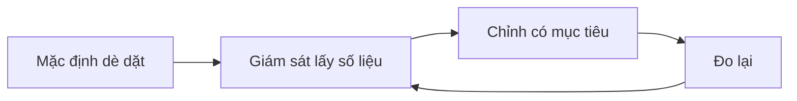
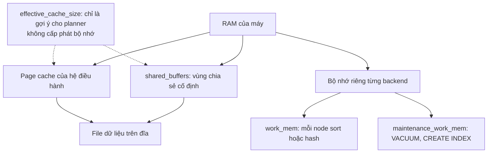
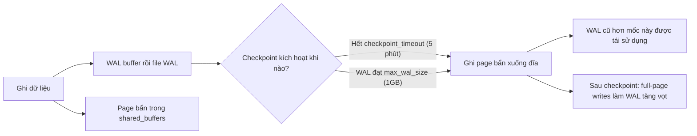
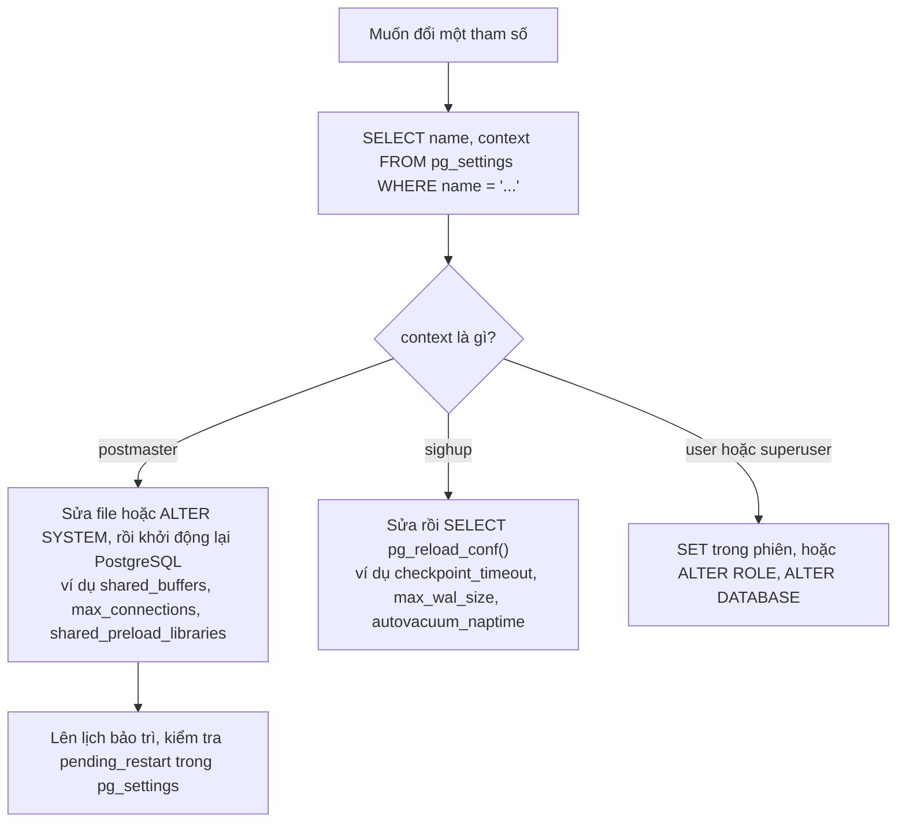
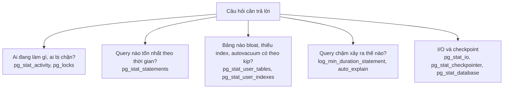
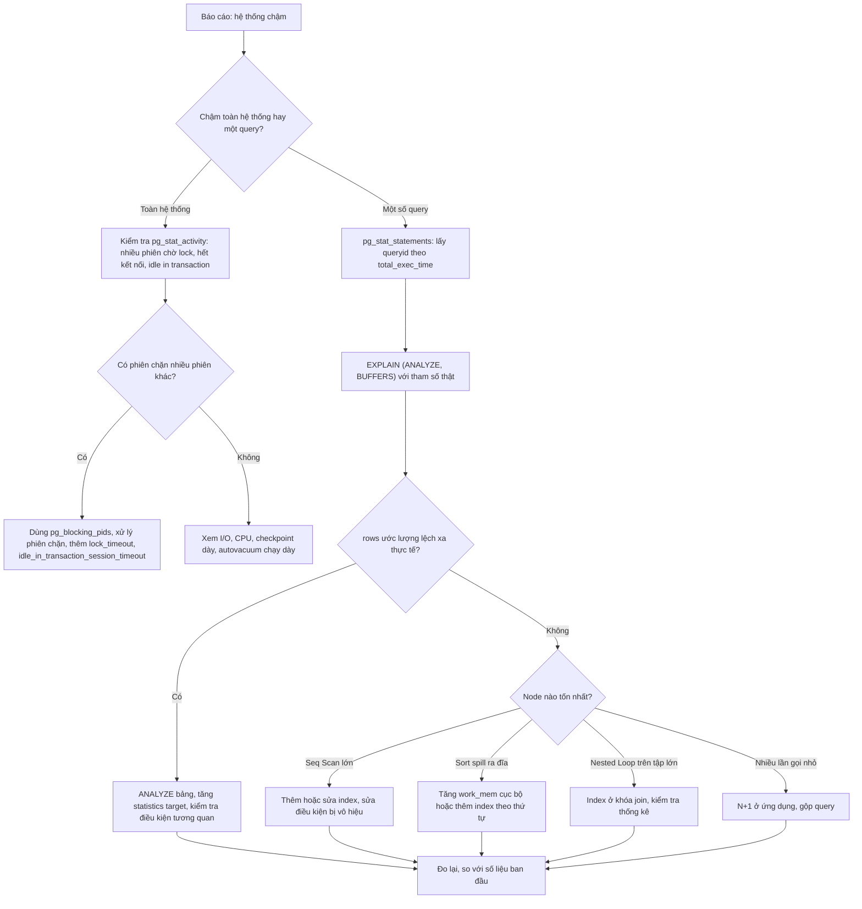
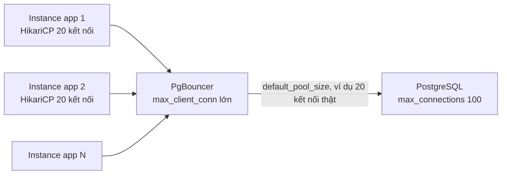

# PostgreSQL: cấu hình, tuning và giám sát

Nền tảng: [PostgreSQL bên trong: MVCC, WAL và VACUUM](/go?p=02-Database%2Fmedium%2Flt-08-postgresql-mvcc-wal.md), [Index và tối ưu query](/go?p=02-Database%2Fmedium%2Flt-03-index-toi-uu-truy-van.md), [EXPLAIN và query planner](/go?p=02-Database%2Fhard%2Flt-09-explain-query-planner-tuning.md). Vận hành tiếp theo: [Replication, partition và vận hành](/go?p=02-Database%2Fhard%2Flt-11-replication-partition-van-hanh.md). Bài này nối kiến thức bên trong của PostgreSQL với tay nắm điều khiển: tham số nào quyết định bộ nhớ, ghi đĩa, dọn rác, và công cụ nào cho bạn thấy hệ thống đang làm gì. Nền là PostgreSQL 18; các con số mặc định và công thức dưới đây là điểm khởi đầu, không phải đáp án cuối.

**Cốt lõi:** PostgreSQL ra khỏi hộp với cấu hình dè dặt để chạy được trên mọi máy, nên server thật cần chỉnh theo RAM, đĩa và kiểu tải. Muốn chỉnh đúng thì phải có số liệu giám sát, vì tuning bằng cảm giác có thể nguy hiểm không kém để mặc định.

- Vì work_mem cấp cho mỗi node sort hoặc hash của mỗi query nên tổng bộ nhớ có thể vượt RAM, và nên tăng cục bộ thay vì toàn cục.
- Vì planner chọn kế hoạch theo ước lượng nên effective_cache_size và random_page_cost chỉ là gợi ý ảnh hưởng quyết định, không cấp phát gì.
- Vì mỗi kết nối là một process nên dùng pooler thay vì tăng max_connections.



Mô hình tư duy: tuning là vòng lặp đo, chỉnh, đo lại, và sửa query hay index trước khi chỉnh tham số.

**Tóm tắt:**

- Cấu hình mặc định của PostgreSQL rất dè dặt (shared_buffers 128MB, work_mem 4MB) để chạy được trên máy nhỏ; server thật cần chỉnh theo RAM, loại đĩa và kiểu tải.
- Bộ nhớ có hai tầng: vùng chia sẻ cố định (shared_buffers) và vùng cấp theo từng thao tác (work_mem cho mỗi node sort hoặc hash, maintenance_work_mem cho VACUUM và CREATE INDEX); tổng work_mem thực dùng có thể gấp nhiều lần giá trị đặt.
- effective_cache_size không cấp phát gì cả, chỉ là gợi ý cho planner về lượng cache (shared_buffers cộng page cache của hệ điều hành) để chọn index scan hay seq scan.
- Checkpoint và WAL ảnh hưởng độ mượt của ghi: checkpoint_timeout và max_wal_size quyết định tần suất checkpoint; checkpoint quá dày gây tăng vọt WAL và I/O.
- Giám sát theo lớp: pg_stat_activity (đang làm gì), pg_stat_statements (query nào tốn nhất), pg_stat_user_tables (bảng nào cần dọn), pg_locks (ai chặn ai), cộng log (log_min_duration_statement, auto_explain).
- Chẩn đoán query chậm theo thứ tự: tìm query thủ phạm, EXPLAIN (ANALYZE, BUFFERS), so rows ước lượng với thực tế, rồi mới sửa (ANALYZE, index, viết lại query, tham số).
- Mỗi kết nối là một process, nên dùng PgBouncer với pool_mode phù hợp thay vì tăng max_connections; transaction mode mạnh nhất nhưng cấm dùng trạng thái phiên.
- PostgreSQL 18 có hệ I/O bất đồng bộ (tham số io_method), lợi ích phụ thuộc workload nên phải đo trước và sau.

## Vấn đề nó giải quyết

PostgreSQL ra khỏi hộp với cấu hình an toàn cho mọi máy, kể cả máy ảo vài trăm MB RAM. Đặt nó lên server 64 GB RAM với SSD NVMe mà không chỉnh gì, bạn dùng chưa tới vài phần trăm khả năng của phần cứng: sort tràn ra đĩa vì work_mem 4MB, planner né index vì tưởng đĩa quay chậm, autovacuum không theo kịp bảng lớn. Ngược lại, chỉnh bừa theo bài blog cũng nguy hiểm không kém: tăng work_mem lên 1GB rồi để 500 kết nối chạy là hết RAM, process bị OOM killer giết, cả server khởi động lại.

Bài toán thật có hai nửa. Nửa một là biết tham số nào ảnh hưởng gì và tính con số khởi đầu theo phần cứng. Nửa hai là có số liệu để biết điều chỉnh đúng hay sai: nếu không giám sát, bạn chỉ tuning bằng cảm giác. Phần giám sát cho phép trả lời những câu hỏi cụ thể: query nào chiếm nhiều thời gian nhất, bảng nào tích tuple chết, phiên nào đang giữ lock, cache hit bao nhiêu.

## Khi nào dùng, khi nào không

Tuning cấu hình đáng làm khi: chuyển lên production, đổi phần cứng, tải tăng gấp đôi, hoặc khi giám sát chỉ ra dấu hiệu rõ (nhiều file sort tạm, checkpoint xảy ra do đầy WAL, cache hit thấp, hết kết nối). Không nên dùng tuning tham số để chữa một query viết tệ hoặc thiếu index: query quét 100 triệu dòng sẽ vẫn chậm dù bạn thêm bao nhiêu RAM. Thứ tự đúng là sửa query và index trước (xem [Index và tối ưu query](/go?p=02-Database%2Fmedium%2Flt-03-index-toi-uu-truy-van.md)), cấu hình sau.

Nếu bạn dùng dịch vụ PostgreSQL được quản lý (RDS, Cloud SQL, Azure Database for PostgreSQL), nhiều tham số do nhà cung cấp đặt sẵn theo kích cỡ máy, một số bị khóa, và cách bật extension khác (parameter group thay vì sửa file). Khi đó vẫn cần hiểu ý nghĩa tham số để biết chỉnh cái nào trong phạm vi cho phép.

## Các khái niệm cần biết

- **GUC (Grand Unified Configuration)**: hệ thống tham số của PostgreSQL. Đặt trong `postgresql.conf`, hoặc `ALTER SYSTEM` (ghi vào `postgresql.auto.conf`), hoặc theo database, role, phiên (`ALTER DATABASE ... SET`, `SET`).
- **Context của tham số**: cột `context` trong `pg_settings`. `postmaster` phải khởi động lại; `sighup` chỉ cần reload (`SELECT pg_reload_conf();`); `user` đổi được ngay trong phiên.
- **shared_buffers**: vùng bộ nhớ chia sẻ giữ bản sao các page 8 KB của bảng và index.
- **work_mem**: bộ nhớ cho **mỗi node** sort hoặc hash trong **mỗi** query. Vượt thì spill ra file tạm trên đĩa.
- **maintenance_work_mem**: bộ nhớ cho VACUUM, CREATE INDEX, ALTER TABLE ADD FOREIGN KEY.
- **Checkpoint**: mốc ghi mọi page bẩn xuống đĩa; xem [bài MVCC và WAL](/go?p=02-Database%2Fmedium%2Flt-08-postgresql-mvcc-wal.md).
- **Page cache của hệ điều hành**: PostgreSQL đọc file qua bộ đệm của OS, nên một page có thể nằm ở hai nơi (shared_buffers và cache OS).
- **Statistics collector / cumulative statistics**: hệ thống số liệu tích lũy, cung cấp các view `pg_stat_*`.
- **Connection pooler**: lớp giữ ít kết nối thật tới PostgreSQL và cho nhiều client dùng chung (PgBouncer).

## 1. Cấu hình bộ nhớ



Đọc sơ đồ: RAM chia ba phần chính: page cache của OS, `shared_buffers` (cố định, cấp lúc khởi động), và bộ nhớ riêng của từng kết nối (động, theo thao tác). `effective_cache_size` chỉ là nét đứt: nó mô tả cho planner biết "tổng cache có thể dùng được" mà không giữ chỗ nào.

| Tham số | Mặc định | Điểm khởi đầu thường dùng | Ghi chú |
|---|---|---|---|
| `shared_buffers` | 128MB | Khoảng 25% RAM cho máy chuyên dụng | Cần khởi động lại. Đặt quá lớn (trên 40% RAM) thường không có lợi vì còn page cache của OS |
| `work_mem` | 4MB | 16MB đến 64MB tùy số kết nối đồng thời | Dùng cho **mỗi node** sort, hash; một query phức tạp dùng nhiều lần. Nên tăng cục bộ cho query hoặc role cần, không tăng toàn cục quá tay |
| `hash_mem_multiplier` | 2.0 | Giữ mặc định hoặc tăng nhẹ | Hash join, hash aggregate được dùng `work_mem` nhân hệ số này |
| `maintenance_work_mem` | 64MB | 512MB đến 2GB | Tăng tốc VACUUM và CREATE INDEX; chỉ vài thao tác chạy cùng lúc nên có thể đặt lớn |
| `autovacuum_work_mem` | -1 (dùng maintenance_work_mem) | Đặt riêng nếu có nhiều autovacuum worker | Mỗi worker dùng riêng một phần này |
| `effective_cache_size` | 4GB | 50% đến 75% RAM | Chỉ ảnh hưởng ước lượng chi phí của planner |
| `huge_pages` | try | Giữ `try`, cân nhắc `on` khi shared_buffers lớn | Giảm chi phí quản lý bộ nhớ trên Linux; kiểm tra lại theo hệ điều hành |

Tính sơ bộ theo RAM, ví dụ máy 16 GB RAM, workload OLTP, khoảng 100 kết nối thật sự hoạt động:

```text
shared_buffers        = 4GB            (25% của 16GB)
effective_cache_size  = 10GB           (khoảng 60 đến 70% RAM)
maintenance_work_mem  = 1GB
work_mem              = 16MB           ngân sách: 100 kết nối x vài node x 16MB vẫn còn xa mức RAM còn lại
```

Công thức an toàn cho work_mem: lấy RAM còn lại sau shared_buffers và OS (ví dụ 8GB), chia cho (số kết nối đồng thời nhân số node sort/hash ước lượng mỗi query, ví dụ 3), rồi chia thêm hệ số an toàn khoảng 2. Với 100 kết nối: 8GB / (100 x 3) / 2 ≈ 13MB, nên chọn 16MB là hợp lý. Đây là quy tắc kinh nghiệm: số node thực tế phụ thuộc query, và query song song (parallel) còn nhân thêm theo số worker.

**Nền tảng:** work_mem được cấp theo từng node sort hoặc hash trong từng query chứ không phải theo kết nối, nên tổng bộ nhớ có thể đạt số kết nối nhân số node nhân work_mem. shared_buffers là vùng cố định (khoảng 25% RAM là điểm bắt đầu); effective_cache_size chỉ là gợi ý cho planner chứ không cấp phát bộ nhớ.

**Suy luận:** PostgreSQL giao cho mỗi phép sort hoặc hash một hạn mức bộ nhớ riêng, vì chỉ lúc chạy mới biết query cần bao nhiêu node. Nếu hạn mức nhỏ, phép toán spill ra file tạm trên đĩa, chậm hơn hàng chục lần; nếu hạn mức lớn mà nhiều kết nối cùng chạy query nặng, tổng nhu cầu vượt RAM và kernel giết process. Vì thế không có một giá trị work_mem "đúng" toàn cục: giá trị toàn cục nên thận trọng, còn query báo cáo nặng thì tăng cục bộ bằng `SET LOCAL work_mem = '256MB'` trong transaction hoặc đặt theo role. Điểm dễ nhầm là nhìn work_mem như "bộ nhớ mỗi kết nối". Hệ quả hành động: tìm dấu hiệu spill (`Sort Method: external merge Disk: ...` trong EXPLAIN, hoặc `temp_files` và `temp_bytes` trong `pg_stat_database`) rồi chỉnh có mục tiêu, thay vì tăng toàn cục.

## 2. Cấu hình ghi, WAL và checkpoint



Đọc sơ đồ: mọi thay đổi vào WAL trước, page bẩn nằm trong bộ nhớ. Checkpoint xảy ra theo thời gian hoặc khi WAL đầy. Nếu `max_wal_size` quá nhỏ so với tốc độ ghi, checkpoint bị kích hoạt vì WAL đầy chứ không phải vì thời gian, tức dày và dồn I/O.

| Tham số | Mặc định | Gợi ý | Ghi chú |
|---|---|---|---|
| `checkpoint_timeout` | 5min | 15min cho tải ghi nhiều | Dài hơn thì ít checkpoint, WAL ít tăng vọt, nhưng crash recovery lâu hơn |
| `max_wal_size` | 1GB | 4GB đến vài chục GB tùy tốc độ ghi | Mục tiêu: đa số checkpoint xảy ra do hết `checkpoint_timeout`, không do đầy WAL |
| `min_wal_size` | 80MB | Tăng nếu tải ghi dao động | Lượng WAL tối thiểu giữ lại để tái sử dụng |
| `checkpoint_completion_target` | 0.9 | Giữ mặc định | Dàn đều I/O của checkpoint trong 90% khoảng thời gian |
| `wal_compression` | off | Cân nhắc bật | Nén full-page image trong WAL; đổi CPU lấy dung lượng WAL, các giá trị hỗ trợ phụ thuộc phiên bản, kiểm tra lại |
| `synchronous_commit` | on | Giữ `on` cho dữ liệu tiền bạc | `off` nhanh hơn, có thể mất vài giao dịch cuối khi crash nhưng không hỏng dữ liệu |
| `fsync`, `full_page_writes` | on | **Không tắt** trên production | Tắt có thể làm hỏng dữ liệu khi mất điện |

Cách kiểm tra checkpoint có dày không: bật `log_checkpoints` (mặc định bật từ PG 15) và đọc log, hoặc xem view thống kê checkpointer (từ PG 17 là `pg_stat_checkpointer`, trước đó nằm trong `pg_stat_bgwriter`). Hai cột `num_timed` và `num_requested` cho biết bao nhiêu checkpoint do thời gian và bao nhiêu do bị yêu cầu (đầy WAL); nếu `num_requested` lớn, hãy tăng `max_wal_size`.

## 3. Tham số của planner và autovacuum

**Planner.** Hai tham số hay chỉnh nhất:

- `random_page_cost` (mặc định 4.0) mô tả chi phí đọc ngẫu nhiên một page so với đọc tuần tự (`seq_page_cost` = 1.0). Giá trị 4.0 hợp đĩa quay; trên SSD hoặc NVMe thường đặt 1.1 đến 1.5 để planner mạnh dạn dùng index. Chỉnh sai theo hướng ngược lại làm planner bỏ index không cần thiết.
- `effective_io_concurrency` ảnh hưởng số yêu cầu đọc đồng thời của bitmap heap scan; PG 18 đổi giá trị mặc định lên cao hơn cùng với hệ I/O bất đồng bộ (kiểm tra lại theo release notes).
- `default_statistics_target` (mặc định 100) quyết định độ chi tiết thống kê; tăng cho cột phân bố lệch và hay lọc, bằng `ALTER TABLE ... ALTER COLUMN ... SET STATISTICS`.

**Autovacuum.** Bảng lớn, ghi nhiều cần chỉnh riêng (xem [bài MVCC và WAL](/go?p=02-Database%2Fmedium%2Flt-08-postgresql-mvcc-wal.md), mục 3):

| Tham số | Mặc định | Ý nghĩa |
|---|---|---|
| `autovacuum_vacuum_scale_factor` | 0.2 | Kích hoạt khi tuple chết vượt threshold cộng tỷ lệ này nhân số dòng |
| `autovacuum_vacuum_threshold` | 50 | Phần cố định của ngưỡng |
| `autovacuum_vacuum_insert_threshold` và `_insert_scale_factor` | 1000 và 0.2 | Ngưỡng theo số dòng mới chèn, để vacuum cả bảng chỉ có INSERT (cập nhật visibility map, freeze) |
| `autovacuum_analyze_scale_factor` | 0.1 | Khi nào tự `ANALYZE` lại thống kê |
| `autovacuum_max_workers` | 3 | Số worker song song; tăng nếu nhiều bảng lớn, nhưng cần xem lại ngân sách I/O |
| `autovacuum_vacuum_cost_delay` | 2ms | Độ "nhường" I/O của autovacuum; giảm hoặc tăng `autovacuum_vacuum_cost_limit` để nó chạy nhanh hơn |
| `autovacuum_naptime` | 1min | Chu kỳ launcher kiểm tra bảng |
| `autovacuum_vacuum_max_threshold` | (PG 18) | Trần số tuple chết, để bảng cực lớn không phải chờ tới 20% |

```sql
-- Chỉnh riêng cho một bảng ghi nhiều
ALTER TABLE events SET (autovacuum_vacuum_scale_factor = 0.01,
                        autovacuum_vacuum_threshold    = 1000,
                        autovacuum_analyze_scale_factor = 0.02);
```

Tham số nào cần khởi động lại, tham số nào chỉ cần reload? Sơ đồ dưới giúp chọn cách áp dụng và tránh bất ngờ ở production.



**Phải thuộc:** Mặc định cần nhớ: shared_buffers 128MB, work_mem 4MB, maintenance_work_mem 64MB, max_connections 100, checkpoint_timeout 5 phút, max_wal_size 1GB, random_page_cost 4.0, autovacuum_vacuum_scale_factor 0.2. Điểm khởi đầu: shared_buffers khoảng 25% RAM, effective_cache_size khoảng 50 đến 75% RAM, random_page_cost 1.1 đến 1.5 trên SSD. shared_buffers, max_connections, shared_preload_libraries cần khởi động lại.

## 4. Giám sát bằng các view và extension



**pg_stat_activity: phiên đang làm gì.**

```sql
SELECT pid, usename, state, wait_event_type, wait_event,
       now() - xact_start  AS xact_age,
       now() - query_start AS query_age,
       left(query, 100)    AS query
FROM pg_stat_activity
WHERE state <> 'idle' AND pid <> pg_backend_pid()
ORDER BY xact_start NULLS LAST;
```

Chú ý trạng thái `idle in transaction` (mở transaction rồi bỏ đó, giữ lock và cản VACUUM) và cột `wait_event` (đang chờ lock, I/O hay gì). Đếm kết nối theo trạng thái để biết còn bao nhiêu chỗ: `SELECT state, count(*) FROM pg_stat_activity GROUP BY state;`.

**pg_locks và pg_blocking_pids: ai chặn ai.**

```sql
SELECT a.pid, a.state, left(a.query, 80) AS query, pg_blocking_pids(a.pid) AS blocked_by
FROM pg_stat_activity a
WHERE cardinality(pg_blocking_pids(a.pid)) > 0;
```

Chi tiết cách đọc lock xem [Lock, deadlock và concurrency](/go?p=02-Database%2Fhard%2Flt-10-locking-deadlock-database.md). Bật `log_lock_waits` để ghi log khi một phiên chờ lock lâu hơn `deadlock_timeout`.

**pg_stat_statements: query nào tốn nhất.** Cần nạp qua `shared_preload_libraries` (khởi động lại), rồi tạo extension trong từng database:

```sql
-- postgresql.conf:  shared_preload_libraries = 'pg_stat_statements'   (cần restart)
CREATE EXTENSION IF NOT EXISTS pg_stat_statements;

SELECT queryid, calls,
       round(total_exec_time::numeric, 1) AS total_ms,
       round(mean_exec_time::numeric, 2)  AS mean_ms,
       rows,
       shared_blks_hit, shared_blks_read,
       left(query, 80) AS query
FROM pg_stat_statements
ORDER BY total_exec_time DESC
LIMIT 10;
```

Nó gom các query cùng hình dạng (tham số được thay bằng `$1`, `$2`) nên thấy được "query này gọi 2 triệu lần, mỗi lần 3 ms" mà từng dòng log không cho thấy. Hãy sắp xếp theo `total_exec_time` (tổng tải), `mean_exec_time` (chậm từng lần), `calls` (gọi nhiều) và `shared_blks_read` (đọc đĩa nhiều). Tên cột `total_exec_time` và `mean_exec_time` có từ PG 13; reset số liệu bằng `pg_stat_statements_reset()` khi muốn đo lại từ đầu.

**pg_stat_user_tables: sức khỏe từng bảng.**

```sql
SELECT relname, seq_scan, idx_scan, n_live_tup, n_dead_tup,
       n_tup_upd, n_tup_hot_upd, last_autovacuum, last_autoanalyze
FROM pg_stat_user_tables
ORDER BY n_dead_tup DESC
LIMIT 10;
```

Bảng có `seq_scan` cao trên bảng lớn mà `idx_scan` thấp là ứng viên cần index; `n_dead_tup` lớn kèm `last_autovacuum` rất cũ nghĩa là autovacuum không theo kịp. `pg_stat_user_indexes.idx_scan = 0` suốt thời gian dài cho thấy index chưa được dùng (xem xét xóa, trừ index unique hoặc index phục vụ constraint).

**Log chậm và auto_explain.**

```ini
log_min_duration_statement = 500      # ghi log mọi câu lệnh chạy hơn 500 ms (-1 là tắt, mặc định)
log_lock_waits             = on
log_temp_files             = 0        # ghi log mọi file tạm: dấu hiệu work_mem nhỏ
auto_explain.log_min_duration = 1000  # ghi cả kế hoạch của query chạy hơn 1 giây
auto_explain.log_analyze      = on    # kèm số liệu thực (tốn thêm chi phí đo)
auto_explain.log_buffers      = on
```

`auto_explain` nạp bằng `shared_preload_libraries` hoặc `session_preload_libraries`, hoặc `LOAD 'auto_explain'` trong phiên. Điểm mạnh: nó ghi kế hoạch thật của query chậm đúng lúc nó chậm, kể cả query chạy từ ứng dụng với tham số thật, thứ mà bạn khó tái hiện bằng tay. `log_analyze = on` làm mọi query bị đo thời gian từng node nên có chi phí; nên đặt ngưỡng cao và thử ở môi trường kiểm thử trước, hoặc kiểm tra tác động theo phiên bản.

**Cache hit ratio.** Chỉ số sơ bộ, đừng cho là "càng gần 100% càng tốt tuyệt đối":

```sql
SELECT datname,
       round(100.0 * blks_hit / nullif(blks_hit + blks_read, 0), 2) AS hit_pct
FROM pg_stat_database WHERE datname = current_database();
```

`blks_read` có thể được phục vụ từ page cache của OS chứ không nhất thiết từ đĩa, nên hit ratio của PostgreSQL chỉ phản ánh shared_buffers. Khi hit thấp bất thường (dưới khoảng 90% với OLTP) mới cần xem lại shared_buffers hoặc query quét rộng.

**Nền tảng:** Giám sát PostgreSQL theo lớp: pg_stat_activity cho phiên đang chạy, pg_locks với pg_blocking_pids cho lock, pg_stat_statements (nạp qua shared_preload_libraries) cho tải theo từng loại query, pg_stat_user_tables cho bloat và autovacuum, log_min_duration_statement cùng auto_explain cho query chậm.

## 5. Quy trình chẩn đoán query chậm từng bước



Đọc sơ đồ: luôn bắt đầu bằng việc xác định phạm vi (một query hay toàn hệ thống) và lấy số liệu thay vì đoán. Nhánh query đơn đi theo `EXPLAIN (ANALYZE, BUFFERS)`: kiểm tra rows ước lượng so với thực tế trước, vì sai ước lượng là nguyên nhân gốc của nhiều kế hoạch tệ; sau đó chọn đúng node tốn nhất để sửa. Cuối cùng đo lại để biết thay đổi có hiệu quả không. Từ PG 18, `EXPLAIN ANALYZE` hiển thị thông tin buffers mặc định, nhưng vẫn nên ghi rõ `BUFFERS` trong ghi chép để dùng được trên mọi phiên bản.

**Suy luận:** Kế hoạch được chọn dựa trên ước lượng; thực thi mới cho số thật. Vì vậy chênh lệch giữa hai thứ là chỉ báo nguyên nhân sớm nhất: nếu ước lượng đúng mà vẫn chậm thì vấn đề là thiếu index, thiếu bộ nhớ hoặc khối lượng dữ liệu thật; nếu ước lượng sai thì planner đã chọn nhầm từ đầu và phải sửa thống kê trước, nếu không mọi tối ưu sau đó đều là đoán mò. Đo `BUFFERS` bổ sung góc nhìn I/O: query chạy nhanh khi cache nóng nhưng chậm khi nguội sẽ lộ ra ở `read` cao. Điểm dễ nhầm là chạy `EXPLAIN ANALYZE` với tham số khác tham số gây chậm: planner có thể chọn kế hoạch khác. Hệ quả hành động: lấy tham số thật từ log hoặc `auto_explain`, và với `UPDATE/DELETE` bọc trong transaction rồi `ROLLBACK`.

## 6. Connection pooling với PgBouncer

Mỗi kết nối PostgreSQL là một process (xem [bài MVCC và WAL](/go?p=02-Database%2Fmedium%2Flt-08-postgresql-mvcc-wal.md), mục 7), nên hàng trăm kết nối bận cùng lúc là tốn RAM và tranh CPU. PgBouncer đứng giữa, giữ vài chục kết nối thật và cấp lại cho nhiều client.



```ini
; pgbouncer.ini (rút gọn, minh họa)
[databases]
appdb = host=127.0.0.1 port=5432 dbname=appdb

[pgbouncer]
listen_port = 6432
auth_type = scram-sha-256
pool_mode = transaction
max_client_conn = 2000
default_pool_size = 20
reserve_pool_size = 5
server_idle_timeout = 600
```

| `pool_mode` | Kết nối thật được trả lại pool khi | Dùng được | Không dùng được |
|---|---|---|---|
| `session` | Client ngắt kết nối | Mọi tính năng phiên | Ít lợi ích giảm kết nối |
| `transaction` | Transaction kết thúc | Hầu hết ứng dụng web | `SET` kéo dài qua transaction, advisory lock theo phiên, `LISTEN/NOTIFY`, cursor `WITH HOLD`, temp table theo phiên; prepared statement phụ thuộc phiên bản PgBouncer (có hỗ trợ từ nhánh 1.21 qua `max_prepared_statements`, kiểm tra lại) |
| `statement` | Mỗi câu lệnh | Truy vấn đơn lẻ autocommit | Transaction nhiều câu |

Hai điểm tính toán: tổng kết nối thật mà PgBouncer mở tới PostgreSQL xấp xỉ `default_pool_size` nhân số cặp (database, user), nên cộng cả `reserve_pool_size` rồi so với `max_connections` trừ phần dành cho superuser và công cụ giám sát. Và pool phía ứng dụng (HikariCP) vẫn cần đặt hợp lý: pool nhỏ hơn thường nhanh hơn pool lớn, vì nhiều kết nối bận chỉ tạo hàng đợi ở CPU và lock; xem [Spring Boot với PostgreSQL thực chiến](/go?p=02-Database%2Fhard%2Flt-22-postgresql-voi-spring-boot-thuc-chien.md).

**Phải thuộc:** PgBouncer có ba pool_mode: session (trả kết nối khi client ngắt), transaction (trả khi transaction kết thúc, phổ biến nhất nhưng cấm trạng thái phiên như SET, advisory lock theo session, LISTEN), statement (mỗi câu lệnh, không dùng transaction nhiều câu). Mỗi kết nối PostgreSQL là một process nên dùng pooler thay vì tăng max_connections.

## 7. Async I/O của PostgreSQL 18

PostgreSQL 18 (ra ngày 25/9/2025) thêm hệ con I/O bất đồng bộ cho các thao tác đọc: thay vì đọc từng khối rồi chờ, backend phát nhiều yêu cầu đọc cùng lúc. Theo tài liệu và release notes của PG 18, nó áp dụng cho các thao tác như sequential scan, bitmap heap scan và VACUUM. Tham số chính là `io_method` với các giá trị `worker` (dùng process I/O worker riêng, số lượng đặt bằng `io_workers`), `io_uring` (Linux, cần bản build có hỗ trợ) và `sync` (hành vi đồng bộ như trước). Tên giá trị mặc định, giá trị mặc định của `io_workers` và `effective_io_concurrency` đều nên được kiểm tra lại trong tài liệu của đúng bản đang dùng.

Ý nghĩa thực hành: lợi ích lớn nhất ở workload đọc nhiều dữ liệu lớn không nằm hết trong cache, hầu như không đổi với query chỉ chạm vài page đã nằm trong `shared_buffers`. Không thể kết luận trước mức cải thiện; hãy đo bằng `pg_stat_io` và thời gian query thật trước và sau khi nâng cấp hoặc đổi `io_method`.

## Bẫy thường gặp

| Bẫy | Hậu quả | Cách tránh |
|---|---|---|
| Đặt `work_mem` toàn cục rất lớn | Tổng bộ nhớ vượt RAM, OOM killer, server restart | Đặt thận trọng, tăng cục bộ bằng `SET LOCAL` hoặc theo role |
| Tăng `max_connections` thay vì dùng pooler | Tốn RAM, context switch, chậm hơn | PgBouncer, hạ kích thước pool ứng dụng |
| Giữ `random_page_cost = 4.0` trên SSD | Planner né index, chọn seq scan | Đặt 1.1 đến 1.5 và đo lại các query chính |
| `shared_buffers` quá lớn | Ít lợi, trùng cache với OS, checkpoint nặng hơn | Bắt đầu khoảng 25% RAM, tăng theo số liệu |
| Cho `max_wal_size` nhỏ với tải ghi nhiều | Checkpoint dày do đầy WAL, I/O dồn cục | Theo dõi `num_requested`, tăng `max_wal_size` |
| Tắt `fsync` để "tăng tốc" | Hỏng dữ liệu khi mất điện | Không tắt; nếu cần nhanh hơn, cân nhắc `synchronous_commit = off` |
| Tắt autovacuum | Bloat và nguy cơ wraparound | Chỉnh scale factor, worker, cost; không tắt |
| PgBouncer transaction mode kèm `SET`, advisory lock theo phiên, `LISTEN` | Trạng thái rò sang client khác hoặc mất | Dùng session mode cho client đặc biệt, hoặc `SET LOCAL` |
| Quên `shared_preload_libraries` khi bật `pg_stat_statements` | `CREATE EXTENSION` được nhưng view báo lỗi khi truy vấn | Thêm vào cấu hình và khởi động lại |
| Đọc `effective_cache_size` như bộ nhớ cấp phát | Đặt quá thấp làm planner né index, hoặc cho là có thể "tiết kiệm RAM" | Hiểu nó chỉ là gợi ý ước lượng chi phí |
| Tuning khi chưa có số liệu nền | Không biết thay đổi tốt hay xấu | Lưu snapshot pg_stat_statements trước khi chỉnh, đo lại sau |

## Điểm cần nhớ

- Mặc định dè dặt: tính lại shared_buffers, work_mem, maintenance_work_mem, effective_cache_size theo RAM, nhưng xem đó là điểm khởi đầu.
- work_mem nhân theo node và theo kết nối; tăng cục bộ cho query cần chứ không tăng bừa toàn cục.
- Checkpoint nên chủ yếu do thời gian, không do đầy WAL; theo dõi bằng log và view checkpointer.
- Giám sát theo lớp: pg_stat_activity, pg_stat_statements, pg_stat_user_tables, pg_locks, log chậm, auto_explain.
- Chẩn đoán query chậm: tìm thủ phạm, EXPLAIN (ANALYZE, BUFFERS), so ước lượng với thực tế, sửa đúng node tốn nhất, đo lại.
- PgBouncer transaction mode là mặc định hợp lý cho ứng dụng web, nhưng cấm trạng thái phiên.
- Biết tham số nào cần restart (shared_buffers, max_connections, shared_preload_libraries) để lên lịch.

## Phỏng vấn khó: chuỗi hỏi xoáy

Người phỏng vấn senior thường mở bằng một câu dễ rồi xoáy xuống cơ chế, đánh đổi và sự cố thật. Câu trả lời tốt luôn đi từ cốt lõi xuống, không đi từ chỗ học thuộc lên.

### Chuỗi 1: Autovacuum không theo kịp bảng lớn

1. **Câu mở:** Bảng `events` 200 triệu dòng, autovacuum bật nhưng bảng bloat và query chậm dần. Vì sao?
2. **Xoáy 1:** Autovacuum kích hoạt theo công thức nào, và công thức đó có vấn đề gì với bảng rất lớn?
3. **Xoáy 2:** Anh chỉnh thế nào, và có thứ gì ngoài tham số đang cản việc dọn dẹp không?

**Đáp án ngắn:** Autovacuum chạy khi số tuple chết vượt `autovacuum_vacuum_threshold` cộng `autovacuum_vacuum_scale_factor` nhân số dòng; mặc định là 50 và 0.2. Bảng 200 triệu dòng phải chờ khoảng 40 triệu tuple chết mới bị dọn, lúc đó bloat đã nặng. Chỉnh riêng cho bảng bằng `ALTER TABLE ... SET (autovacuum_vacuum_scale_factor = 0.01, autovacuum_vacuum_threshold = 1000, autovacuum_analyze_scale_factor = 0.02)`. PostgreSQL 18 có thêm `autovacuum_vacuum_max_threshold` làm trần số tuple chết, nên kiểm tra lại theo phiên bản. Nếu vẫn chậm thì xem `autovacuum_max_workers` (mặc định 3) khi có nhiều bảng lớn, cùng `autovacuum_vacuum_cost_delay` và cost limit quyết định nó nhường I/O nhiều hay ít. Ngoài tham số, transaction mở lâu hoặc `idle in transaction` cản VACUUM, nên kiểm tra `pg_stat_activity` và đặt `idle_in_transaction_session_timeout`. Theo dõi `pg_stat_user_tables`: `n_dead_tup` lớn cùng `last_autovacuum` rất cũ là dấu hiệu autovacuum không theo kịp.

**Sai lầm hay gặp:**

- Tắt autovacuum vì "tốn I/O" (hậu quả là bloat và nguy cơ wraparound).
- Chỉ tăng số worker mà không xem scale factor.
- Quên rằng transaction treo cản VACUUM.

### Chuỗi 2: Tìm thủ phạm bằng số liệu

1. **Câu mở:** Hệ thống chậm. Anh sửa query nào trước?
2. **Xoáy 1:** Vì sao sắp theo `total_exec_time` chứ không phải theo query chậm nhất?
3. **Xoáy 2:** `CREATE EXTENSION pg_stat_statements` xong mà truy vấn view báo lỗi, vì sao? Và cache hit ratio 99 phần trăm có nghĩa là không cần lo I/O?

**Đáp án ngắn:** Lấy số liệu thay vì đoán. `pg_stat_statements` gom các query cùng hình dạng (tham số thay bằng `$1`, `$2`) và cho số lần gọi, tổng và trung bình thời gian, số dòng, buffer. Sắp theo `total_exec_time` vì query gọi 2 triệu lần mỗi lần 3 ms tốn nhiều tải hơn query chạy 5 giây mỗi ngày một lần, và từng dòng log không cho thấy điều đó; sau đó xem thêm `mean_exec_time`, `calls`, `shared_blks_read`. Extension phải được nạp qua `shared_preload_libraries` (cần khởi động lại) rồi `CREATE EXTENSION` trong từng database; quên bước đầu thì view báo lỗi. Hit ratio tính từ `blks_hit` và `blks_read` chỉ phản ánh shared_buffers, vì `blks_read` có thể được phục vụ từ page cache của hệ điều hành chứ không nhất thiết từ đĩa. Chỉ khi nó thấp bất thường (dưới khoảng 90 phần trăm với OLTP) mới cần xem lại. Query riêng lẻ chậm thì dùng `log_min_duration_statement` và `auto_explain` để ghi kế hoạch thật với tham số thật; `log_analyze = on` có chi phí đo nên đặt ngưỡng cao.

**Sai lầm hay gặp:**

- Chỉ nhìn query chậm nhất đơn lẻ.
- Bật `auto_explain` với `log_analyze` và ngưỡng thấp trên production.
- Coi hit ratio 99 phần trăm là bằng chứng không có vấn đề I/O.

### Chuỗi 3: Tuning từ cấu hình mặc định

1. **Câu mở:** Anh nhận một server 64 GB RAM, NVMe, PostgreSQL còn cấu hình mặc định. Chỉnh gì trước, dựa vào đâu?
2. **Xoáy 1:** Vì sao `shared_buffers` khoảng 25 phần trăm RAM chứ không đặt 80 phần trăm?
3. **Xoáy 2:** `random_page_cost` trên NVMe nên là bao nhiêu? Tham số nào cần restart, tham số nào chỉ cần reload? Có người đề nghị tắt `fsync` cho nhanh thì sao?

**Đáp án ngắn:** Không chỉnh theo cảm giác: lấy snapshot `pg_stat_statements` làm số liệu nền, chỉnh có mục tiêu rồi đo lại; và sửa query, index trước khi chỉnh tham số. Điểm khởi đầu: `shared_buffers` khoảng 25 phần trăm RAM, `effective_cache_size` 50 đến 75 phần trăm, `maintenance_work_mem` 512MB đến 2GB, `work_mem` thận trọng. Không đặt `shared_buffers` quá lớn vì PostgreSQL đọc file qua page cache của hệ điều hành nên một page có thể nằm ở hai nơi; trên 40 phần trăm RAM thường ít lợi và checkpoint nặng hơn. `random_page_cost` mặc định 4.0 hợp đĩa quay; trên SSD hoặc NVMe đặt khoảng 1.1 đến 1.5 để planner mạnh dạn dùng index, rồi đo lại các query chính. Xem cột `context` trong `pg_settings`: `postmaster` (như `shared_buffers`, `max_connections`, `shared_preload_libraries`) phải khởi động lại, `sighup` (như `checkpoint_timeout`, `max_wal_size`) chỉ cần `pg_reload_conf()`, `user` đổi ngay trong phiên. Không tắt `fsync` hay `full_page_writes` vì mất điện có thể hỏng dữ liệu; muốn nhanh hơn thì cân nhắc `synchronous_commit = off`, chấp nhận mất vài giao dịch cuối.

**Sai lầm hay gặp:**

- Chép cấu hình từ blog mà không đo trước và sau.
- Coi `shared_buffers` càng lớn càng tốt.
- Nghĩ mọi tham số đều đổi được bằng reload.

## Câu hỏi tự kiểm tra

Với mỗi câu, thử trả lời theo gợi ý trước rồi mới đọc phần lập luận.

1. Máy 32 GB RAM, đặt `work_mem = 1GB` toàn cục vì "cho nhanh", 200 kết nối. Vì sao nguy hiểm?
   - **Gợi ý suy luận:** work_mem áp dụng cho đơn vị nào: kết nối, query hay node sort hoặc hash? Điều gì xảy ra nếu nhiều kết nối cùng chạy query nặng?
   - **Lập luận và đáp án:** work_mem tính cho mỗi node sort hoặc hash của mỗi query, nên một query có thể dùng nhiều lần giá trị đó, và 200 kết nối nhân lên rất nhanh vượt xa 32 GB. Khi hết RAM, kernel giết process hoặc hệ thống swap và chậm hẳn. Cách đúng là đặt giá trị toàn cục nhỏ và tăng cục bộ (SET LOCAL hoặc theo role) cho các query báo cáo cần.
2. `effective_cache_size = 12GB` có nghĩa PostgreSQL chiếm 12 GB RAM không?
   - **Gợi ý suy luận:** tham số này được dùng ở bước nào của việc xử lý query (cấp phát hay ước lượng)?
   - **Lập luận và đáp án:** không. Nó không cấp phát gì; planner dùng nó để ước lượng khả năng một page đã nằm sẵn trong cache (shared_buffers cộng page cache OS), từ đó đánh giá index scan rẻ hay đắt. Đặt quá thấp khiến planner đánh giá thấp index; nên đặt khoảng 50 đến 75% RAM của máy chuyên dụng.
3. Log checkpoint cho thấy hầu hết checkpoint do "wal" chứ không do "time". Làm gì?
   - **Gợi ý suy luận:** hai điều kiện kích hoạt checkpoint là gì? Cái nào đang bị chạm trước và vì sao?
   - **Lập luận và đáp án:** checkpoint kích hoạt khi hết checkpoint_timeout hoặc khi WAL đạt max_wal_size. Nếu bị kích hoạt vì WAL, max_wal_size đang nhỏ so với tốc độ ghi, checkpoint dồn dập và I/O cộc cằn. Tăng max_wal_size (và có thể checkpoint_timeout) để đa số checkpoint xảy ra theo thời gian; đổi lại crash recovery có thể lâu hơn.
4. Một API chậm bất thường. Trình tự điều tra của bạn?
   - **Gợi ý suy luận:** bạn cần xác định phạm vi trước hay sửa ngay? Số liệu lấy từ đâu và bước nào so sánh ước lượng với thực tế?
   - **Lập luận và đáp án:** xác định phạm vi bằng pg_stat_activity (lock, kết nối, idle in transaction) và pg_stat_statements (query nào tốn tổng thời gian). Với query thủ phạm, chạy EXPLAIN (ANALYZE, BUFFERS) bằng tham số thật, so rows ước lượng và thực tế; lệch thì ANALYZE hoặc tăng statistics, đúng mà vẫn chậm thì sửa index, bộ nhớ hoặc cách viết, rồi đo lại. Nếu là N+1 thì sửa ở ứng dụng.
5. Vì sao chuyển ứng dụng sang PgBouncer transaction mode làm lỗi các `SET search_path` và advisory lock?
   - **Gợi ý suy luận:** ở transaction mode, hai transaction liên tiếp của cùng một client có chắc dùng cùng một kết nối thật không?
   - **Lập luận và đáp án:** không chắc. Kết nối thật được trả về pool sau mỗi transaction và có thể được cấp cho client khác, nên trạng thái đặt bằng SET (ngoài SET LOCAL), advisory lock theo phiên, LISTEN hoặc temp table sẽ biến mất hoặc rò sang client khác. Giải pháp: dùng SET LOCAL trong transaction, advisory lock kiểu xact, hoặc cho tác vụ đặc biệt đi qua session pool riêng.
6. Bạn nâng lên PostgreSQL 18 và muốn biết async I/O có lợi không. Làm thế nào?
   - **Gợi ý suy luận:** lợi ích tùy workload; vậy cần so sánh cái gì với cái gì, trên dữ liệu nào?
   - **Lập luận và đáp án:** chạy workload đại diện (đặc biệt query quét lớn và VACUUM) trên cùng dữ liệu và phần cứng, thử các giá trị io_method được hỗ trợ, rồi so thời gian query và số liệu I/O (pg_stat_io). Workload chủ yếu trúng cache sẽ khó thấy khác biệt. Đo trước khi quyết định, đừng giả định cải thiện.

Nguồn: tài liệu chính thức PostgreSQL 18 (Server Configuration: Resource Consumption, WAL, Query Planning, Autovacuum; Monitoring Database Activity; pg_stat_statements; auto_explain; Release Notes 18) và tài liệu PgBouncer (cấu hình, pool_mode), kiểm tra ngày 2026-10-30. Các đoạn SQL và cấu hình ở trên là minh họa, chưa chạy thử trong môi trường không có PostgreSQL; tên tham số riêng của PG 18 (io_method, io_workers, autovacuum_vacuum_max_threshold) và giá trị mặc định mới cần đối chiếu lại theo đúng phiên bản.

