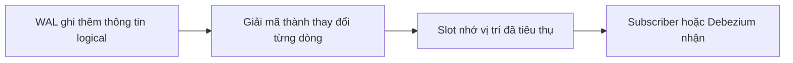
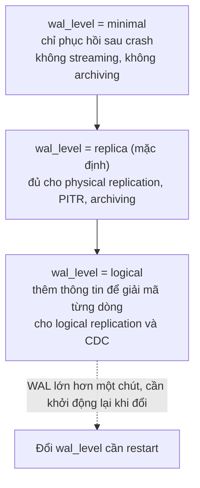
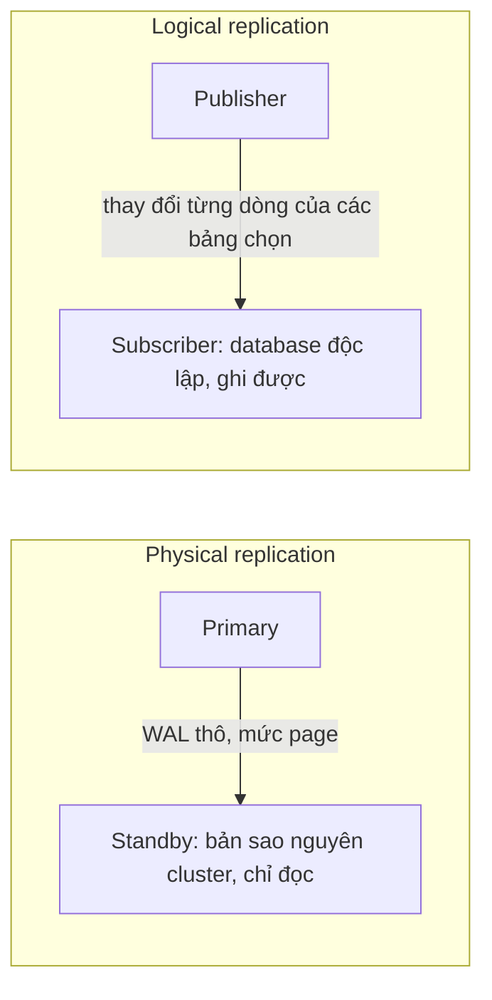
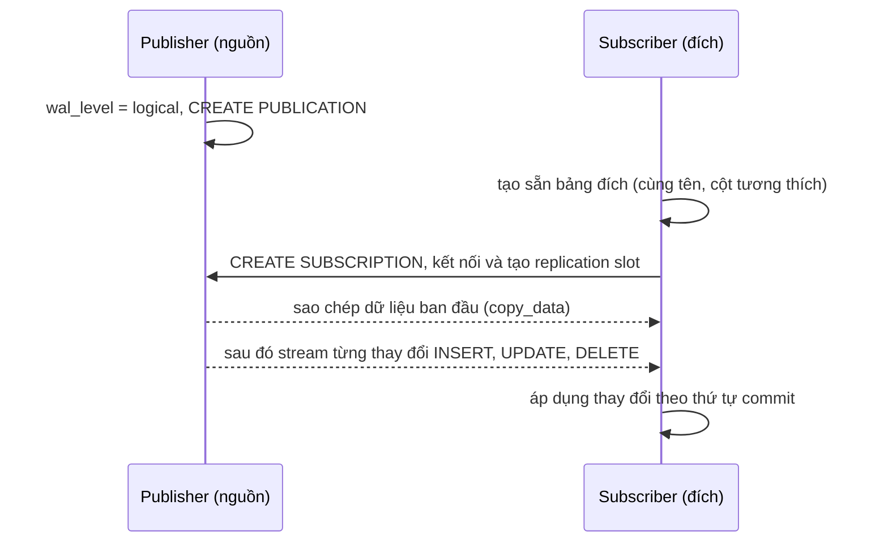
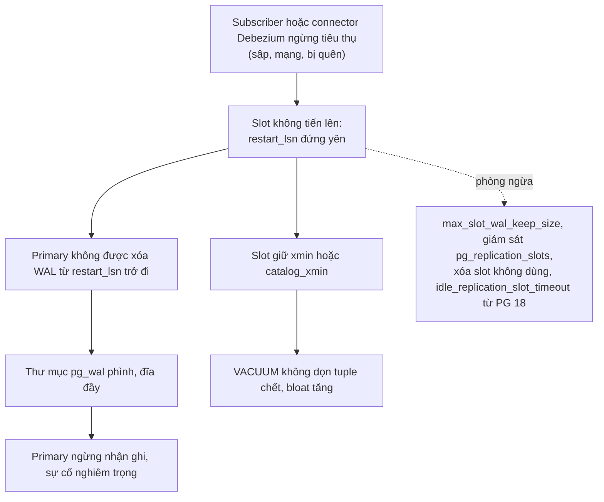
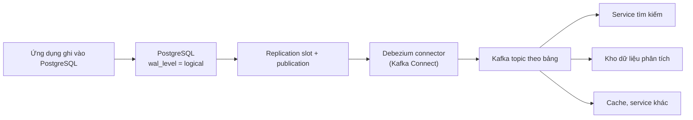
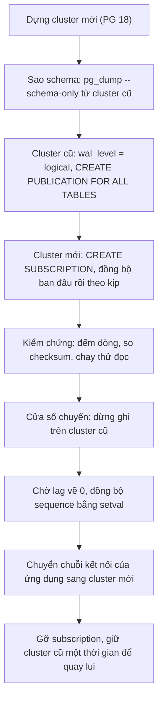
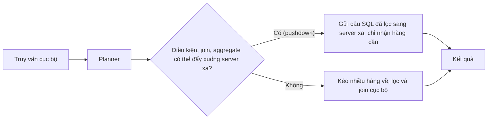

# Logical replication, wal_level, CDC và postgres_fdw

Nền tảng: [PostgreSQL bên trong: MVCC, WAL và VACUUM](/go?p=02-Database%2Fmedium%2Flt-08-postgresql-mvcc-wal.md) (WAL, replication slot giữ xmin), [Replication, partition và vận hành](/go?p=02-Database%2Fhard%2Flt-11-replication-partition-van-hanh.md) (physical replication, standby, PITR), [Replication, sharding và HA](/go?p=02-Database%2Fhard%2Flt-05-replication-sharding-ha.md). Bài này đi sâu vào phần replication ở mức logic: sao chép theo từng bảng, bắt thay đổi dữ liệu (CDC) để đẩy sang hệ khác, nâng cấp phiên bản ít downtime, và truy vấn dữ liệu ở server khác qua foreign table. Nền là PostgreSQL 18.

**Cốt lõi:** WAL vốn chỉ để máy phục hồi chính nó, nhưng nếu ghi thêm đủ thông tin thì có thể giải mã WAL thành thay đổi từng dòng rồi gửi cho nơi khác. Logical replication, CDC và nâng cấp ít downtime đều là cùng một dòng thay đổi, chỉ khác người tiêu thụ.

- Vì logical mô tả thay đổi ở mức dòng chứ không phải mức page, nên đích có thể khác phiên bản, khác schema và ghi được.
- Vì slot hứa giữ WAL cho consumer chưa đọc, nên consumer biến mất mà slot còn thì WAL và xmin bị giữ mãi.
- Vì DDL và giá trị sequence không nằm trong dòng thay đổi đó, nên phải tự đồng bộ chúng khi chuyển cụm.



Mô hình tư duy: một dòng thay đổi duy nhất đi ra từ WAL qua bước giải mã, và slot là sợi dây giữ dòng đó cho tới khi người nhận đọc xong.

**Tóm tắt:**

- `wal_level` quyết định lượng thông tin ghi vào WAL: `minimal` (chỉ đủ phục hồi sau crash), `replica` (mặc định, đủ cho streaming và archiving), `logical` (thêm thông tin để giải mã thành thay đổi từng dòng); đổi cần khởi động lại.
- Physical replication sao chép WAL ở mức byte của cả cluster, standby giống hệt primary (cùng major version, chỉ đọc); logical replication sao chép thay đổi từng dòng của các bảng chọn trước, cho phép khác phiên bản, khác schema và đích ghi được.
- Logical replication theo mô hình publisher/subscriber: publication khai báo bảng nào được xuất bản, subscription ở phía nhận kéo thay đổi về; bảng đích phải được tạo sẵn và DDL không tự được sao chép.
- UPDATE và DELETE cần REPLICA IDENTITY (thường là primary key) để subscriber xác định đúng dòng.
- Replication slot đánh dấu vị trí đã tiêu thụ; slot không được tiêu thụ sẽ giữ WAL mãi, làm đầy đĩa và cản VACUUM, nên phải giám sát và đặt `max_slot_wal_keep_size`.
- CDC dựa trên logical decoding: một plugin (như `pgoutput`) giải mã WAL thành sự kiện thay đổi; Debezium dùng cơ chế này để đẩy thay đổi sang Kafka.
- Nâng cấp gần như không downtime: dựng cluster phiên bản mới, đồng bộ bằng logical replication, đồng bộ sequence thủ công, chuyển ứng dụng trong một cửa sổ rất ngắn.
- `postgres_fdw` cho phép truy vấn bảng ở server PostgreSQL khác như bảng cục bộ, nhưng không cho giao dịch nguyên tử xuyên server và hiệu năng phụ thuộc việc đẩy điều kiện sang nơi xa (pushdown).

## Vấn đề nó giải quyết

Physical replication (standby) giải bài toán sẵn sàng cao và đọc mở rộng, nhưng nó là "sao chép nguyên cả cluster": bạn không chọn được từng bảng, không sang được phiên bản khác, và standby chỉ đọc. Nhiều nhu cầu thực tế không vừa khuôn đó. Muốn đẩy một vài bảng sang hệ thống phân tích mà không mang cả database. Muốn nâng PostgreSQL 15 lên 18 mà không chấp nhận dừng dịch vụ hàng giờ. Muốn đẩy mọi thay đổi của bảng `orders` ra Kafka cho các service khác dùng. Muốn gộp dữ liệu của nhiều database nhỏ vào một nơi.

Logical replication và logical decoding giải các nhu cầu đó bằng cách mô tả thay đổi ở mức dòng thay vì mức byte của page. Phần foreign data wrapper giải một bài toán gần kề: cần đọc dữ liệu của một database khác mà không muốn sao chép nó hoặc dựng ETL.

## Khi nào dùng, khi nào không

Dùng logical replication khi: chỉ cần một phần bảng, đích có schema khác hoặc cần ghi, cần nâng cấp major version với downtime tối thiểu, hợp nhất dữ liệu nhiều nguồn, hoặc làm nền cho CDC. Dùng physical replication khi cần bản sao giống hệt cho failover và đọc: đơn giản hơn, mọi thứ đều được sao chép (kể cả DDL), độ trễ thường thấp hơn.

Không nên dùng logical replication như thay thế cho HA đơn thuần: nó không tự sao chép DDL, sequence (xem phần bẫy), large object, và failover cần công cụ bổ sung. Không nên dùng `postgres_fdw` làm đường chính cho join lớn giữa hai server: mỗi truy vấn đi qua mạng, planner chỉ ước lượng được một phần; nếu cần join thường xuyên thì sao chép dữ liệu qua logical replication rồi join cục bộ.

## Các khái niệm cần biết

- **wal_level**: mức chi tiết của WAL (`minimal`, `replica`, `logical`).
- **Physical replication**: gửi bản ghi WAL thô (thay đổi page) cho standby, standby replay lại.
- **Logical decoding**: giải mã WAL thành dòng sự kiện logic (INSERT/UPDATE/DELETE/TRUNCATE theo bảng) qua một output plugin.
- **Publication**: tập thay đổi của một số bảng được xuất bản ở publisher.
- **Subscription**: ở subscriber, kết nối tới publisher, nhận và áp dụng thay đổi.
- **Replication slot**: cấu trúc trên server nhớ vị trí WAL mà một consumer đã nhận, đảm bảo WAL chưa tiêu thụ không bị xóa.
- **REPLICA IDENTITY**: cách xác định dòng cho UPDATE và DELETE trong WAL (primary key mặc định, hoặc unique index, hoặc `FULL`).
- **CDC (Change Data Capture)**: kỹ thuật bắt mọi thay đổi của dữ liệu để chuyển cho hệ khác.
- **Foreign data wrapper (FDW)**: cơ chế truy cập dữ liệu ngoài PostgreSQL như bảng (foreign table).
- **LSN (Log Sequence Number)**: vị trí trong WAL, dùng để đo độ trễ (`pg_wal_lsn_diff`).

## 1. wal_level và hai loại replication



Đọc sơ đồ: ba mức lồng nhau, mức sau là siêu tập của mức trước. Mức `logical` ghi thêm thông tin (ví dụ giá trị cũ của khóa khi UPDATE/DELETE) để có thể dựng lại thay đổi ở mức dòng. Chi phí là WAL lớn hơn ở một số workload; mức độ cụ thể phụ thuộc kiểu tải nên cần đo.



| | Physical (streaming) | Logical |
|---|---|---|
| Đơn vị sao chép | Cả cluster, mức byte của page | Bảng chọn trước, mức dòng |
| Phiên bản | Phải cùng major version và kiến trúc | Có thể khác major version |
| Đích | Chỉ đọc (hot standby) | Database độc lập, có thể ghi và có bảng, index riêng |
| DDL | Sao chép tự nhiên | **Không** tự sao chép |
| Sequence | Có (là một phần dữ liệu) | Không sao chép giá trị hiện tại |
| Dùng chính | Failover, đọc mở rộng, PITR | Nâng cấp, tích hợp, CDC, hợp nhất dữ liệu |
| `wal_level` cần | `replica` trở lên | `logical` |

**Nền tảng:** wal_level có ba mức minimal, replica (mặc định) và logical; logical là mức duy nhất cho phép logical replication và CDC, đổi cần khởi động lại. Physical replication sao chép WAL ở mức byte cho cả cluster (cùng major version, standby chỉ đọc); logical replication sao chép thay đổi từng dòng của bảng chọn trước, cho phép khác phiên bản và đích ghi được.

## 2. Publication và subscription



Cấu hình tối thiểu. _Minh họa_, chưa chạy thử vì môi trường viết bài không có PostgreSQL; hãy chạy trên hai instance thử nghiệm.

```sql
-- Publisher (postgresql.conf: wal_level = logical, rồi khởi động lại; max_wal_senders, max_replication_slots đủ dùng)
CREATE ROLE repl LOGIN REPLICATION PASSWORD '...';
GRANT SELECT ON orders, order_items TO repl;     -- cần quyền đọc dữ liệu để copy ban đầu

CREATE PUBLICATION pub_orders FOR TABLE orders, order_items;
-- Các biến thể: FOR ALL TABLES; FOR TABLES IN SCHEMA sales;
-- Từ PG 15: lọc dòng và cột
-- CREATE PUBLICATION pub_paid FOR TABLE orders (id, status, total) WHERE (status = 'PAID');

-- Subscriber: tạo sẵn cấu trúc bảng (pg_dump --schema-only), rồi
CREATE SUBSCRIPTION sub_orders
    CONNECTION 'host=pub-host port=5432 dbname=appdb user=repl password=...'
    PUBLICATION pub_orders;
```

Điểm cần biết khi vận hành:

- **Dữ liệu ban đầu**: mặc định `copy_data = true`, subscriber sao chép snapshot của từng bảng rồi chuyển sang stream thay đổi; trạng thái từng bảng xem ở `pg_subscription_rel`.
- **REPLICA IDENTITY**: bảng có UPDATE/DELETE cần primary key (mặc định) hoặc unique index khai báo qua `ALTER TABLE ... REPLICA IDENTITY USING INDEX ...`, hoặc `REPLICA IDENTITY FULL` (ghi cả dòng cũ, tốn kém). Thiếu thì UPDATE/DELETE trên publisher bị từ chối.
- **Loại thay đổi**: mặc định xuất bản INSERT, UPDATE, DELETE, TRUNCATE; thu hẹp bằng tùy chọn `publish`.
- **DDL không được sao chép**: thêm cột ở publisher mà quên thêm ở subscriber thì replication dừng với lỗi. Quy trình an toàn là áp migration lên subscriber trước với thay đổi tương thích ngược (xem phần dưới).
- **Xung đột**: subscriber ghi được nên có thể vi phạm unique hoặc thiếu dòng; khi đó apply worker lỗi và lặp lại. Phải xử lý nguyên nhân (sửa dữ liệu hoặc bỏ qua giao dịch lỗi bằng cách có kiểm soát). Release notes của PG 18 có thêm thống kê xung đột; kiểm tra lại chi tiết theo phiên bản.
- **Tránh vòng lặp** trong mô hình hai chiều: tùy chọn `origin = none` ở subscription (từ PG 16) để không sao chép lại những thay đổi vốn đến từ replication.
- **Hiệu năng áp dụng**: từ PG 16 có `streaming = parallel` cho giao dịch lớn; mặc định có thể khác giữa các bản, kiểm tra lại theo phiên bản.

Giám sát nhanh:

```sql
-- Ở subscriber
SELECT subname, pid, received_lsn, latest_end_lsn, latest_end_time FROM pg_stat_subscription;
-- Ở publisher: độ trễ của slot theo byte WAL
SELECT slot_name, active,
       pg_size_pretty(pg_wal_lsn_diff(pg_current_wal_lsn(), confirmed_flush_lsn)) AS lag
FROM pg_replication_slots WHERE slot_type = 'logical';
```

## 3. Replication slot và rủi ro giữ WAL

Slot là lời hứa của server: "WAL từ vị trí này trở đi chưa được tiêu thụ nên tôi sẽ không xóa". Đó là điều bạn cần để consumer không bỏ lỡ thay đổi khi nó tạm ngắt, nhưng cũng là nguồn sự cố số một của logical replication.



Đọc sơ đồ: slot không tiến lên sẽ kéo theo hai hậu quả độc lập, WAL không dọn được (đầy đĩa) và xmin bị giữ lại (bloat). Cả hai làm primary hỏng dù lỗi nằm ở consumer.

```sql
SELECT slot_name, slot_type, active, wal_status,
       pg_size_pretty(pg_wal_lsn_diff(pg_current_wal_lsn(), restart_lsn)) AS retained_wal,
       safe_wal_size
FROM pg_replication_slots;

-- Xóa slot không còn ai dùng (không thể hoàn tác, consumer phải khởi tạo lại)
SELECT pg_drop_replication_slot('ten_slot');
```

Biện pháp: đặt `max_slot_wal_keep_size` để chặn trên lượng WAL slot được giữ (vượt quá thì slot bị vô hiệu, `wal_status` thành `lost`, consumer phải đồng bộ lại từ đầu, nhưng primary được an toàn). PG 18 thêm `idle_replication_slot_timeout` để tự vô hiệu slot rảnh quá lâu (kiểm tra lại giá trị mặc định theo phiên bản). Đặt cảnh báo trên `retained_wal` và `active = false` kéo dài. Từ PG 17 có failover slot (slot logical được đồng bộ sang standby để sống sót khi chuyển primary); cần cấu hình thêm cả hai phía, xem tài liệu phiên bản.

**Phải thuộc:** Replication slot giữ WAL chưa được consumer tiêu thụ; slot bị bỏ quên làm pg_wal đầy đĩa và giữ xmin gây bloat. Phòng ngừa bằng max_slot_wal_keep_size, giám sát pg_replication_slots (restart_lsn, active, wal_status) và xóa slot không dùng.

**Suy luận:** WAL chỉ được tái sử dụng khi mọi thứ cần nó đã xong: crash recovery, standby và mọi slot. Slot ra đời để bảo đảm consumer không bỏ lỡ thay đổi, nghĩa là PostgreSQL chủ động đánh đổi dung lượng đĩa lấy tính đầy đủ dữ liệu. Nếu consumer biến mất, hệ thống không thể biết đó là tạm thời hay vĩnh viễn, nên nó giữ WAL mãi. Slot logical còn giữ `catalog_xmin` để catalog hệ thống không bị dọn khi consumer chưa giải mã xong, gây hiệu ứng như một transaction mở rất lâu. Điểm dễ nhầm là coi việc tắt consumer là vô hại: tắt consumer mà không xóa slot thì primary bị ảnh hưởng. Hệ quả hành động: mỗi slot cần chủ sở hữu, cảnh báo, và quy trình gỡ khi hệ thống đó ngừng.

## 4. CDC với logical decoding và Debezium

Logical decoding là phần "đọc WAL rồi dịch ra thay đổi dòng" mà logical replication dùng. Ứng dụng khác cũng có thể dùng nó trực tiếp qua replication protocol hoặc hàm SQL:

```sql
SELECT pg_create_logical_replication_slot('demo_slot', 'test_decoding');  -- plugin minh họa
SELECT * FROM pg_logical_slot_get_changes('demo_slot', NULL, NULL);       -- lấy và tiêu thụ thay đổi
SELECT pg_drop_replication_slot('demo_slot');
```

`test_decoding` chỉ để thử nghiệm; plugin chuẩn dùng trong thực tế là `pgoutput` (có sẵn, dùng cho logical replication và Debezium). `wal2json` là plugin bên thứ ba, cần cài thêm.

**Debezium** (mức giới thiệu) là nền tảng CDC mã nguồn mở chạy trên Kafka Connect. Connector PostgreSQL của nó mở một replication slot, đọc thay đổi qua `pgoutput` và đẩy mỗi thay đổi thành một message vào topic Kafka (thường mỗi bảng một topic), kèm trạng thái trước và sau của dòng. Nhờ đó các service khác có thể phản ứng với dữ liệu mà không truy vấn trực tiếp database của bạn.



Lưu ý khi dùng: cần theo dõi slot như phần 3, đặc biệt trên database ít ghi (slot có thể không tiến nếu không có thay đổi của bảng được theo dõi trong khi WAL từ bảng khác vẫn tăng; Debezium có cơ chế heartbeat để đẩy vị trí lên, xem tài liệu của nó); bảng cần `REPLICA IDENTITY` thích hợp để sự kiện UPDATE và DELETE có đủ thông tin; thay đổi schema phải được xử lý ở phía consumer. CDC cũng là một cách hiện thực mẫu Transactional Outbox: ứng dụng ghi sự kiện vào bảng `outbox` cùng giao dịch với dữ liệu, connector đọc bảng này (xem [Distributed Transactions](/go?p=15-System%20Design%2Fhard%2Flt-10-distributed-transactions.md) và [Kafka](/go?p=06-Distributed-Systems%2FKafka%2Findex.md)).

## 5. Nâng cấp phiên bản gần như không downtime

`pg_upgrade` (đặc biệt chế độ `--link`) nhanh nhưng vẫn cần dừng dịch vụ trong lúc chạy. Với hệ thống không chấp nhận downtime dài, logical replication cho phép dựng cluster mới ở phiên bản đích, đồng bộ dữ liệu khi cluster cũ vẫn phục vụ, rồi chuyển ứng dụng.



Các điểm hay bị sót:

- **Sequence**: logical replication không đồng bộ giá trị hiện tại của sequence. Trước khi chuyển, đọc `last_value` từ cluster cũ và `setval` trên cluster mới (cộng một khoảng đệm an toàn nếu muốn).
- **Bảng không có primary key** không replicate được UPDATE/DELETE nếu không có replica identity; kiểm tra danh sách bảng từ trước.
- **Extension, role, cấu hình** không đi theo publication; dựng riêng ở cluster mới (`pg_dumpall --globals-only` cho role).
- **Large object** không được logical replication sao chép.
- **Kế hoạch quay lui**: nếu cần quay về cluster cũ sau khi đã ghi trên cluster mới, phải có replication chiều ngược lại hoặc chấp nhận mất thay đổi; hãy thiết kế trước.
- PG 17 và 18 đã cải thiện đường nâng cấp bằng `pg_upgrade` (giữ replication slot logical và trạng thái subscription khi nâng cấp, giữ thống kê planner ở PG 18), và công cụ `pg_createsubscriber` (PG 17) biến một standby vật lý thành subscriber logical; chi tiết điều kiện cần kiểm tra theo release notes của đúng phiên bản.

## 6. postgres_fdw và foreign table

Foreign data wrapper cho phép khai báo bảng ở nơi khác như một bảng cục bộ. `postgres_fdw` (extension trong gói contrib) nối tới một server PostgreSQL khác.

```sql
CREATE EXTENSION postgres_fdw;

CREATE SERVER report_srv
    FOREIGN DATA WRAPPER postgres_fdw
    OPTIONS (host 'report-host', port '5432', dbname 'report');

CREATE USER MAPPING FOR app_user
    SERVER report_srv
    OPTIONS (user 'reader', password '...');

-- Cách một: khai báo từng bảng
CREATE FOREIGN TABLE remote_customer (id bigint, name text)
    SERVER report_srv OPTIONS (schema_name 'public', table_name 'customer');

-- Cách hai: nhập hàng loạt
IMPORT FOREIGN SCHEMA public LIMIT TO (customer, invoice)
    FROM SERVER report_srv INTO remote;

SELECT c.name, count(*) FROM local_order o JOIN remote_customer c ON c.id = o.customer_id
WHERE o.created_at > now() - interval '1 day' GROUP BY c.name;
```



Đọc sơ đồ: hiệu năng của foreign table phụ thuộc phần việc được đẩy sang server xa. `EXPLAIN VERBOSE` hiện dòng `Remote SQL` cho biết câu lệnh thật được gửi đi; nếu điều kiện `WHERE` của bạn không xuất hiện ở đó, dữ liệu bị kéo về rồi mới lọc.

Điểm cần nhớ:

- Pushdown áp dụng cho điều kiện dùng hàm và toán tử "an toàn" (immutable) có ở cả hai phía, và một số join, aggregate, sort; hàm tự định nghĩa thường không đẩy được trừ khi extension được khai báo qua tùy chọn `extensions`.
- Tùy chọn hay dùng: `use_remote_estimate` (hỏi server xa ước lượng, chính xác hơn nhưng tốn một vòng truy vấn), `fetch_size` (số hàng mỗi lần lấy), `async_capable` (cho phép quét bất đồng bộ nhiều foreign table, từ PG 14).
- **Không có giao dịch phân tán nguyên tử**: `postgres_fdw` không dùng two-phase commit, nên nếu giao dịch ghi vào cả bảng cục bộ lẫn bảng xa, một bên có thể commit còn bên kia lỗi. Đây không thay thế được Saga hay outbox.
- Bảo mật: lưu mật khẩu trong `USER MAPPING`; người dùng thường không phải superuser cần xác thực bằng mật khẩu (hoặc cấu hình khác phù hợp). PG 18 thêm tùy chọn chuyển tiếp xác thực SCRAM (kiểm tra tên tùy chọn trong tài liệu phiên bản trước khi dùng).
- Dùng đúng chỗ: truy vấn thỉnh thoảng, báo cáo nhẹ, di chuyển dữ liệu từng lần (`INSERT ... SELECT` từ foreign table), tích hợp tạm thời. Không dùng cho OLTP đường nóng.

**Nền tảng:** postgres_fdw cho phép truy vấn bảng của server PostgreSQL khác qua foreign table, nhưng mỗi truy vấn đi qua mạng và hiệu năng phụ thuộc pushdown; nó không bảo đảm giao dịch nguyên tử xuyên server vì không dùng two-phase commit.

## Thay đổi đáng biết ở PostgreSQL 17 và 18

| Phiên bản | Thay đổi liên quan (theo release notes, kiểm tra chi tiết theo phiên bản) |
|---|---|
| 15 | Lọc dòng (`WHERE`) và danh sách cột trong publication, `FOR TABLES IN SCHEMA` |
| 16 | Logical decoding trên standby, `origin = none`, apply song song giao dịch lớn |
| 17 | Failover slot, `pg_createsubscriber`, `pg_upgrade` giữ slot logical và trạng thái subscription |
| 18 | `idle_replication_slot_timeout`, thống kê xung đột của subscription, hỗ trợ cột generated trong logical replication, `pg_upgrade` giữ statistics của planner |

PostgreSQL 19 chưa phát hành chính thức tại thời điểm viết; bài không đề cập tới nó.

## Bẫy thường gặp

| Bẫy | Hậu quả | Cách tránh |
|---|---|---|
| Quên slot của consumer đã tắt | `pg_wal` đầy đĩa, primary ngừng ghi, bloat | `max_slot_wal_keep_size`, cảnh báo, quy trình xóa slot |
| Giả định DDL tự được sao chép | Replication dừng sau `ALTER TABLE` | Áp migration lên subscriber trước, tương thích ngược |
| Bảng không có primary key hoặc replica identity | UPDATE, DELETE bị từ chối ở publisher | Thêm primary key hoặc cấu hình `REPLICA IDENTITY` |
| Quên đồng bộ sequence khi chuyển cụm | Trùng khóa chính sau khi chuyển | `setval` theo giá trị cũ cộng đệm trước khi mở ghi |
| Ghi vào bảng đích ở subscriber song song với replication | Xung đột unique, apply worker lỗi lặp | Giữ bảng đích chỉ đọc với ứng dụng, hoặc thiết kế rõ vùng ghi |
| Mô hình hai chiều mà không chặn vòng lặp | Thay đổi bị sao chép qua lại mãi | `origin = none` và thiết kế phân vùng quyền ghi |
| Dùng `postgres_fdw` cho join lớn đường nóng | Kéo hàng triệu hàng qua mạng, chậm | Kiểm tra `Remote SQL` bằng `EXPLAIN VERBOSE`, hoặc sao chép dữ liệu về |
| Ghi xuyên bảng cục bộ và bảng xa trong một giao dịch rồi tin là nguyên tử | Dữ liệu lệch khi một bên lỗi | Mẫu Saga hoặc outbox, không dựa vào fdw |
| Bật `wal_level = logical` mà không tính lại dung lượng WAL | WAL lớn hơn dự tính, archive chậm | Đo trước và sau, theo dõi dung lượng |
| Debezium trên database ít ghi mà không có heartbeat | Slot đứng yên, WAL tăng từ bảng khác | Cấu hình heartbeat, giám sát lag theo LSN |

## Điểm cần nhớ

- `wal_level`: minimal, replica (mặc định), logical; logical cho phép logical replication và CDC, đổi cần restart.
- Physical sao chép cả cluster ở mức byte, logical sao chép từng dòng của bảng chọn, khác phiên bản và đích ghi được.
- Publication và subscription cần schema dựng sẵn ở đích; DDL và sequence không tự được sao chép.
- UPDATE và DELETE cần replica identity, thường là primary key.
- Slot là nguồn sự cố số một: giữ WAL và xmin khi consumer biến mất; giới hạn và giám sát bằng `max_slot_wal_keep_size`, `pg_replication_slots`.
- CDC dùng logical decoding (plugin `pgoutput`); Debezium đẩy thay đổi sang Kafka, cần theo dõi slot và heartbeat.
- Nâng cấp ít downtime: cluster mới, đồng bộ logical, đồng bộ sequence, chuyển nhanh, giữ cluster cũ để quay lui.
- `postgres_fdw` tiện cho truy vấn nhẹ và di chuyển dữ liệu, không bảo đảm nguyên tử xuyên server, cần kiểm tra pushdown.

## Phỏng vấn khó: chuỗi hỏi xoáy

Người phỏng vấn senior thường mở bằng câu dễ rồi xoáy xuống cơ chế, đánh đổi và sự cố thật. Câu trả lời tốt luôn đi từ cốt lõi xuống.

### Chuỗi 1: Replication slot và sự cố giữ WAL

1. **Câu mở:** Replication slot là gì và vì sao nó được coi là nguồn sự cố số một của logical replication?
2. **Xoáy 1:** Ngoài WAL, slot logical còn giữ gì, và vì sao nó làm autovacuum không dọn được dù ứng dụng không có transaction dài?
3. **Xoáy 2:** Bạn đã đặt `max_slot_wal_keep_size`. Khi slot vượt giới hạn thì chuyện gì xảy ra, và bạn đang đánh đổi cái gì?

**Đáp án ngắn:** Slot là lời hứa của primary: WAL từ vị trí chưa tiêu thụ sẽ không bị xóa, để consumer tạm ngắt không bỏ lỡ thay đổi. Vì server không biết consumer biến mất là tạm thời hay vĩnh viễn, slot đứng yên thì `restart_lsn` đứng yên và `pg_wal` phình tới đầy đĩa. Slot logical còn giữ `catalog_xmin`, nên catalog hệ thống không được dọn; hiệu ứng giống một transaction mở rất lâu, tuple chết không thu hồi được. Hai hậu quả này độc lập nhau và đều làm primary hỏng dù lỗi nằm ở consumer. `max_slot_wal_keep_size` chặn trên lượng WAL được giữ: vượt thì slot bị vô hiệu, `wal_status` thành `lost`, primary an toàn nhưng consumer phải đồng bộ lại từ đầu. Tức là đổi tính đầy đủ dữ liệu của consumer lấy sự sống của primary. Trong production tôi theo dõi `pg_replication_slots` (`active`, `restart_lsn`, `wal_status`) và cảnh báo `retained_wal`; PostgreSQL 18 có thêm `idle_replication_slot_timeout` để tự vô hiệu slot rảnh, giá trị mặc định thì kiểm tra lại theo phiên bản.

**Sai lầm hay gặp:**

- Coi việc tắt consumer là vô hại, quên rằng slot vẫn còn và vẫn giữ WAL.
- Chỉ nhắc đầy đĩa mà không nhắc xmin và bloat, hoặc nhầm slot với transaction của ứng dụng.
- Nói `max_slot_wal_keep_size` "giải quyết" vấn đề mà bỏ sót việc consumer phải khởi tạo lại.

### Chuỗi 2: Nâng cấp ít downtime bằng logical replication

1. **Câu mở:** Bạn nâng cấp PostgreSQL 15 lên 18 gần như không downtime bằng cách nào?
2. **Xoáy 1:** Sau khi chuyển ứng dụng, `INSERT` báo trùng primary key dù dữ liệu đã đồng bộ đủ. Vì sao, và bạn xử lý lúc nào trong quy trình?
3. **Xoáy 2:** Hai ngày sau cluster mới có sự cố, bạn muốn quay về cluster cũ. Điều gì làm việc đó khó, và phải chuẩn bị gì từ trước?

**Đáp án ngắn:** Logical replication mô tả thay đổi theo từng dòng nên đích có thể khác major version, khác với physical replication vốn truyền thay đổi mức page. Quy trình: dựng cluster mới, sao schema bằng `pg_dump --schema-only`, tạo publication ở cluster cũ và subscription ở cluster mới, chờ đồng bộ ban đầu rồi theo kịp, kiểm chứng, sau đó dừng ghi ở cluster cũ, chờ lag về 0 và chuyển kết nối. Dòng thay đổi chỉ chứa dòng dữ liệu, không chứa giá trị hiện tại của sequence và không chứa DDL, nên sequence ở cluster mới vẫn ở giá trị khởi tạo và sinh lại id cũ. Phải `setval` theo `last_value` cũ cộng đệm, làm trong cửa sổ chuyển trước khi mở ghi. Quay lui khó vì khi đã ghi vào cluster mới thì cluster cũ không có các thay đổi đó; cần replication chiều ngược lại hoặc chấp nhận mất, nên phải thiết kế trước và giữ cluster cũ một thời gian. Role, extension và large object cũng không đi theo publication.

**Sai lầm hay gặp:**

- Nói "logical replication sao chép hết mọi thứ", quên sequence, DDL, role, large object.
- Không có kế hoạch quay lui, hoặc nhầm rằng subscription tự chạy ngược được.
- Bỏ sót bảng không có primary key hoặc replica identity khi kiểm tra trước.

### Chuỗi 3: CDC bằng logical decoding và Debezium

1. **Câu mở:** CDC bằng cách đọc WAL khác gì so với service tự truy vấn bảng định kỳ?
2. **Xoáy 1:** `wal_level = logical` ghi thêm gì vào WAL, và vì sao UPDATE, DELETE trên bảng không có primary key lại gặp vấn đề?
3. **Xoáy 2:** Debezium chạy trên một database ít ghi, bảng được theo dõi hầu như không đổi, nhưng `pg_wal` vẫn phình. Giải thích và cách xử lý.

**Đáp án ngắn:** CDC đọc WAL đã giải mã nên gần thời gian thực, không thêm truy vấn lên bảng, và thấy đủ INSERT, UPDATE, DELETE theo thứ tự commit; polling thì tốn tải và dễ bỏ sót thay đổi giữa hai lần hỏi. Mức `logical` ghi thêm thông tin, ví dụ khóa của dòng cũ khi UPDATE và DELETE, để giải mã thành thay đổi từng dòng; đổi mức này cần restart và WAL có thể lớn hơn tùy tải, nên cần đo. Consumer phải biết dòng nào bị đổi, nên bảng cần replica identity: primary key, unique index khai báo, hoặc `FULL` (ghi cả dòng cũ, tốn kém). Thiếu thì publisher từ chối UPDATE, DELETE. Với database ít ghi, slot chỉ tiến lên khi consumer xác nhận; nếu bảng được theo dõi không đổi mà WAL từ bảng khác vẫn tăng, vị trí slot đứng yên và WAL bị giữ. Debezium có heartbeat để đẩy vị trí lên; cách cấu hình xem tài liệu của nó. Vẫn phải giám sát lag theo LSN.

**Sai lầm hay gặp:**

- Nói CDC "đọc bảng nhanh hơn" thay vì đọc dòng thay đổi đã giải mã từ WAL.
- Quên replica identity, nên không giải thích được vì sao DELETE thiếu thông tin.
- Không hiểu vì sao slot trên database ít ghi vẫn gây phình WAL.

## Câu hỏi tự kiểm tra

Với mỗi câu, thử trả lời theo gợi ý trước rồi mới đọc phần lập luận.

1. Vì sao không dùng physical replication để nâng cấp PostgreSQL 15 lên 18?
   - **Gợi ý suy luận:** physical replication truyền cái gì (thay đổi mức dòng hay mức page)? Định dạng page có ổn định giữa các major version không?
   - **Lập luận và đáp án:** physical replication truyền thay đổi ở mức byte của page nên standby phải có cùng major version và kiến trúc với primary. Logical replication truyền thay đổi theo dòng, độc lập định dạng lưu trữ, nên sang phiên bản khác được; vì vậy nó là nền cho nâng cấp ít downtime (hoặc dùng `pg_upgrade` với downtime ngắn).
2. Tạo subscription xong nhưng `UPDATE orders` ở publisher báo lỗi liên quan replica identity. Nguyên nhân và cách sửa?
   - **Gợi ý suy luận:** subscriber cần xác định dòng nào để sửa hoặc xóa; thông tin đó lấy từ đâu trong WAL?
   - **Lập luận và đáp án:** để áp dụng UPDATE và DELETE, subscriber phải biết dòng cũ nào; WAL phải mang khóa nhận diện (replica identity). Bảng không có primary key và chưa cấu hình thì không có khóa đó nên publisher từ chối. Sửa bằng cách thêm primary key, hoặc unique index kèm `REPLICA IDENTITY USING INDEX`, hoặc `REPLICA IDENTITY FULL` (tốn kém hơn).
3. Disk của primary tăng dần dù tải ghi không đổi, đồng thời autovacuum không dọn được. Bạn nghi điều gì và kiểm tra bằng gì?
   - **Gợi ý suy luận:** thứ gì giữ WAL và giữ xmin mà không liên quan transaction của ứng dụng?
   - **Lập luận và đáp án:** nghi replication slot không được tiêu thụ (consumer logical đã tắt hoặc lag). Kiểm tra `pg_replication_slots` (active, restart_lsn, wal_status, xmin, catalog_xmin) và tính WAL được giữ bằng `pg_wal_lsn_diff`. Xử lý bằng cách khôi phục consumer hoặc xóa slot, và đặt `max_slot_wal_keep_size` để phòng ngừa.
4. Sau khi chuyển ứng dụng sang cluster mới đã đồng bộ bằng logical replication, `INSERT` báo trùng primary key. Vì sao?
   - **Gợi ý suy luận:** giá trị nào được sao chép khi dữ liệu chuyển sang: dòng, hay cả trạng thái hiện tại của sequence?
   - **Lập luận và đáp án:** logical replication sao chép các dòng nhưng không sao chép giá trị hiện tại của sequence, nên sequence ở cluster mới vẫn ở giá trị khởi tạo và sinh lại các id đã tồn tại. Cần `setval` theo giá trị cuối của cluster cũ (cộng đệm) trước khi cho phép ghi.
5. Khi nào chọn Debezium thay vì để các service khác truy vấn trực tiếp database?
   - **Gợi ý suy luận:** hai cách khác nhau thế nào về tải lên database, độ trễ và độ đầy đủ thay đổi (kể cả DELETE)?
   - **Lập luận và đáp án:** truy vấn định kỳ gây tải, có độ trễ và dễ bỏ sót thay đổi giữa các lần hỏi (nhất là DELETE). CDC đọc WAL nên gần thời gian thực, không thêm truy vấn lên bảng, bắt đủ INSERT, UPDATE, DELETE theo thứ tự commit. Đổi lại phải vận hành connector, slot và xử lý thay đổi schema.
6. Truy vấn join giữa bảng cục bộ và foreign table chạy chậm. Bạn kiểm tra gì đầu tiên?
   - **Gợi ý suy luận:** phần việc nào đáng lẽ được thực hiện ở server xa? Làm sao biết câu SQL thực sự gửi đi?
   - **Lập luận và đáp án:** chạy `EXPLAIN (VERBOSE)` và xem dòng `Remote SQL`: nếu điều kiện lọc không nằm trong đó thì toàn bộ hàng bị kéo về rồi mới lọc cục bộ. Khắc phục bằng cách viết lại điều kiện để pushdown được, cân nhắc `use_remote_estimate`, hoặc sao chép dữ liệu cần join về cục bộ.

Nguồn: tài liệu chính thức PostgreSQL 18 (Logical Replication, Replication Slots, Logical Decoding, postgres_fdw, Write-Ahead Log: wal_level, Release Notes 15 đến 18) và tài liệu Debezium (PostgreSQL connector), kiểm tra ngày 2026-10-30. Các đoạn SQL là minh họa, chưa chạy thử vì môi trường viết bài không có PostgreSQL; các tên tùy chọn riêng của PG 17 và 18 (failover slot, `idle_replication_slot_timeout`, tùy chọn SCRAM của postgres_fdw) cần đối chiếu lại theo đúng phiên bản đang dùng.

