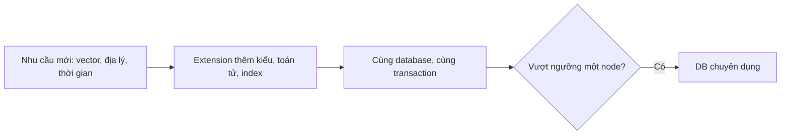
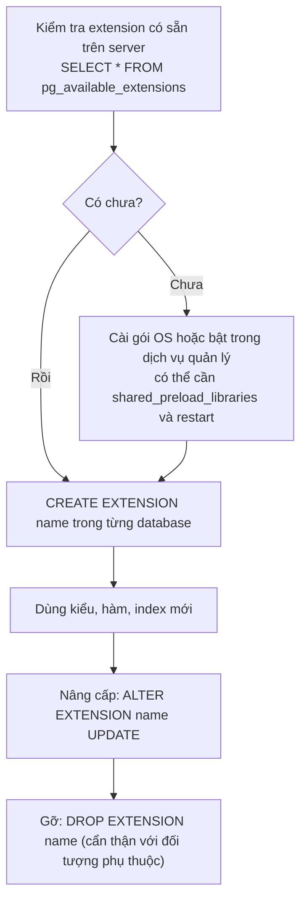
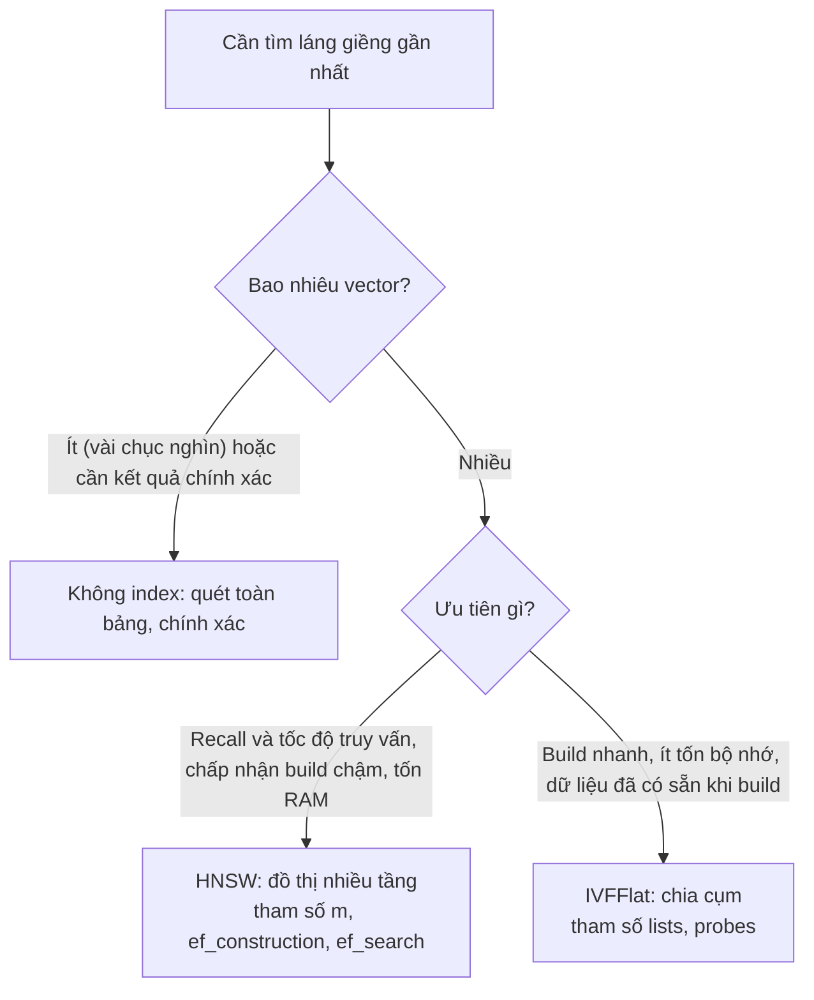
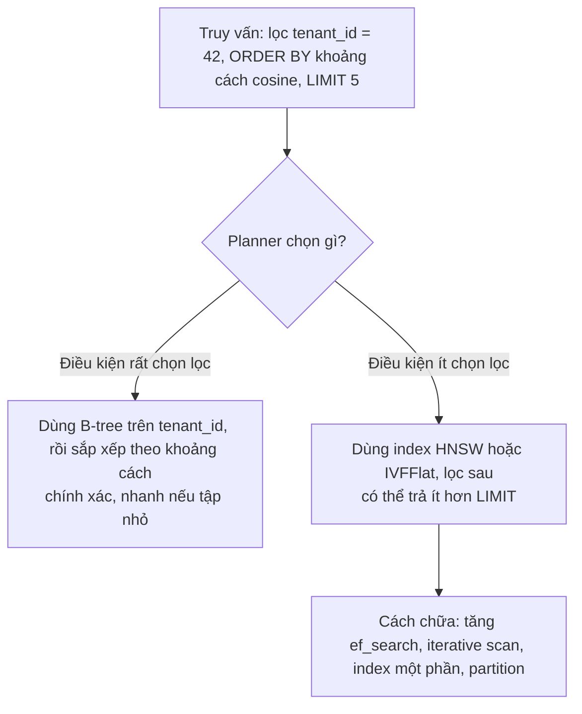
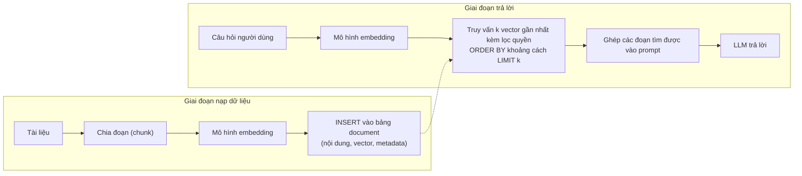
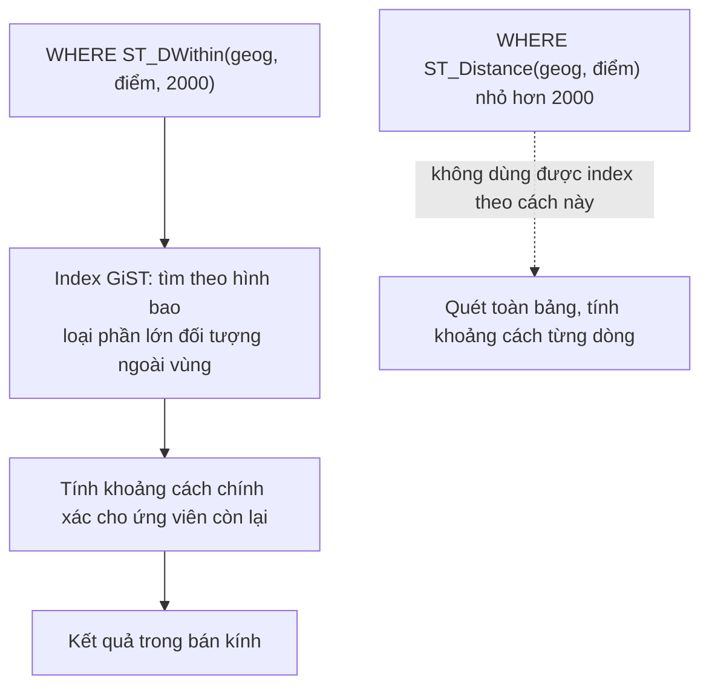
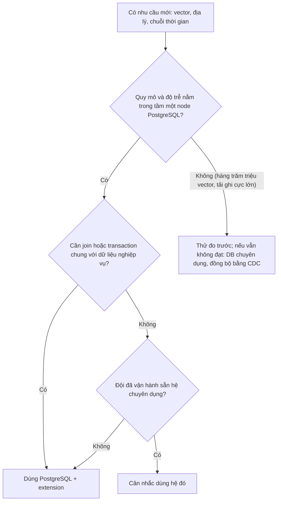

# Extension của PostgreSQL: pgvector, PostGIS, TimescaleDB

Nền tảng: [PostgreSQL bên trong: MVCC, WAL và VACUUM](/go?p=02-Database%2Fmedium%2Flt-08-postgresql-mvcc-wal.md) (các loại index GIN, GiST, BRIN), [Index và tối ưu query](/go?p=02-Database%2Fmedium%2Flt-03-index-toi-uu-truy-van.md), [Lưu trữ và chọn database](/go?p=02-Database%2Fhard%2Flt-06-luu-tru-chon-db.md). Điểm khác biệt lớn của PostgreSQL so với nhiều DB khác là nó mở rộng được: kiểu dữ liệu, toán tử, hàm, kiểu index mới đều có thể thêm bằng extension mà không sửa lõi. Bài này giải thích hệ extension, rồi đi vào ba nhóm quan trọng với lập trình viên backend: vector (AI, tìm kiếm ngữ nghĩa), địa lý (PostGIS) và chuỗi thời gian (TimescaleDB, cùng Citus để mở rộng ngang). Nền là PostgreSQL 18.

**Cốt lõi:** PostgreSQL cho thêm kiểu dữ liệu, toán tử và kiểu index mới mà không sửa lõi. Nhờ vậy vector, địa lý, chuỗi thời gian sống chung với dữ liệu nghiệp vụ, cùng transaction, thay vì cần thêm một hệ riêng.

- Vì extension là gói đối tượng cài theo từng database, nên gói phải có trên server rồi `CREATE EXTENSION` ở mỗi database.
- Vì vector không có thứ tự tuyến tính để dùng B-tree, nên index vector là xấp xỉ và đánh đổi recall lấy tốc độ.
- Vì mỗi hệ thêm vào kéo theo đồng bộ và vận hành, nên chỉ tách sang DB chuyên dụng khi số đo thật vượt ngưỡng một node.



Mô hình tư duy: mặc định mở rộng ngay trong PostgreSQL, và chỉ rẽ sang hệ riêng khi đo được rằng một node không còn đáp ứng.

**Tóm tắt:**

- Extension là gói kiểu, hàm, toán tử, index bổ sung; cài bằng `CREATE EXTENSION` trong từng database, và gói phải có sẵn trên server (contrib đi kèm hoặc gói của bên thứ ba).
- Extension nên biết: `pg_stat_statements` (giám sát query), `pg_trgm` (tìm gần đúng, LIKE có wildcard), `pgcrypto` (băm, mã hóa), `uuid-ossp` (UUID cũ; PostgreSQL mới đã có `gen_random_uuid()` và `uuidv7()`).
- pgvector thêm kiểu `vector` và các toán tử khoảng cách (L2 `<->`, tích trong âm `<#>`, cosine `<=>`); tìm láng giềng gần nhất bằng `ORDER BY ... LIMIT`.
- Index vector là xấp xỉ: HNSW (recall và tốc độ truy vấn tốt, build chậm, tốn RAM) và IVFFlat (build nhanh, nhẹ hơn, cần dữ liệu có sẵn khi build); cả hai đánh đổi độ chính xác lấy tốc độ.
- Kết hợp lọc với tìm vector là chỗ khó: lọc áp dụng sau khi index trả kết quả có thể làm thiếu kết quả; cách chữa gồm index một phần, partition, tăng ef_search hoặc dùng iterative scan của bản pgvector mới.
- PostGIS thêm `geometry` và `geography`; dùng `ST_DWithin` với index GiST để tìm theo bán kính, và chú ý thứ tự (kinh độ, vĩ độ) cùng SRID 4326.
- TimescaleDB tối ưu chuỗi thời gian bằng hypertable, nén và continuous aggregate; Citus phân tán bảng ra nhiều node. Cả hai chỉ giới thiệu ở bài này.
- Dùng PostgreSQL thay DB chuyên dụng giúp một nguồn dữ liệu, transaction chung, ít hệ cần vận hành, nhưng giới hạn ở quy mô và tính năng; phải biết ngưỡng cần chuyển.

## Vấn đề nó giải quyết

Hầu hết ứng dụng bắt đầu với một database quan hệ, rồi gặp nhu cầu mà SQL thuần không phục vụ tốt: tìm văn bản gần đúng, tìm quán ăn trong bán kính 2 km, lưu hàng triệu điểm đo cảm biến mỗi ngày, hoặc tìm tài liệu "gần nghĩa" với câu hỏi của người dùng cho một chatbot. Mỗi nhu cầu thường kéo theo một hệ riêng: Elasticsearch, một cơ sở dữ liệu vector, một kho GIS, một kho chuỗi thời gian. Mỗi hệ thêm chi phí vận hành, đồng bộ dữ liệu, bảo mật, backup, và xóa mất tính nhất quán giao dịch giữa dữ liệu nghiệp vụ và bản sao trong hệ phụ.

Extension cho phép giữ dữ liệu trong cùng PostgreSQL: join vector với bảng người dùng, lọc theo quyền truy cập và tìm gần nghĩa trong một câu SQL, cùng một transaction và cùng một bản backup. Cái giá là bạn đang đòi PostgreSQL làm thêm việc, và ở một quy mô nào đó DB chuyên dụng sẽ tốt hơn; bài này chỉ rõ ngưỡng đó.

## Khi nào dùng, khi nào không

Dùng extension khi nhu cầu nằm trong tầm của một node PostgreSQL được chỉnh tốt: vài triệu đến vài chục triệu vector có kích thước embedding thông dụng, dữ liệu địa lý cấp ứng dụng (điểm, vùng, tìm lân cận), chuỗi thời gian vài trăm triệu dòng được partition tốt. Lợi ích: một nguồn sự thật, transaction ACID, join tự nhiên, đội ngũ chỉ cần giỏi một công nghệ.

Cân nhắc DB chuyên dụng khi: hàng trăm triệu đến hàng tỷ vector với yêu cầu độ trễ thấp và recall cao, cần tính năng riêng mà extension chưa có (ví dụ phân tán vector tự động, ranking nhiều tín hiệu phức tạp), tải ghi chuỗi thời gian cực lớn cần nén cột chuyên dụng, hoặc khi workload của extension tranh tài nguyên với workload OLTP chính trên cùng server. Bảng so sánh ở cuối bài tóm tắt các đánh đổi.

## Các khái niệm cần biết

- **Extension**: gói gồm script SQL và (thường) thư viện nạp vào server, tạo ra các đối tượng mới (kiểu, hàm, toán tử, operator class, access method).
- **contrib**: tập extension được phát hành cùng mã nguồn PostgreSQL (pg_stat_statements, pg_trgm, pgcrypto, postgres_fdw, pageinspect...), thường có trong gói `postgresql-contrib` hoặc có sẵn.
- **Extension bên thứ ba**: pgvector, PostGIS, TimescaleDB, Citus; cần cài bản build tương ứng với major version của PostgreSQL.
- **Trusted extension**: từ PG 13, một số extension có đánh dấu "trusted" cho phép người không phải superuser tạo (nếu có quyền CREATE trên database); danh sách thay đổi theo phiên bản.
- **Operator class**: định nghĩa cách một kiểu dùng với một loại index; ví dụ `vector_cosine_ops` cho HNSW theo khoảng cách cosine.
- **ANN (Approximate Nearest Neighbor)**: tìm láng giềng gần nhất xấp xỉ, nhanh hơn tìm chính xác nhưng có thể bỏ sót một số kết quả đúng.
- **Recall**: tỷ lệ kết quả đúng (so với tìm chính xác) mà tìm xấp xỉ trả về.
- **Embedding**: vector số thực do mô hình học máy sinh ra từ văn bản, ảnh...; nội dung gần nghĩa thì vector gần nhau.
- **SRID**: mã hệ tọa độ; 4326 là WGS 84 (kinh độ, vĩ độ GPS).
- **Hypertable, chunk**: khái niệm của TimescaleDB; bảng logic được tự chia thành các chunk theo thời gian.

## 1. Hệ extension của PostgreSQL



Đọc sơ đồ: có hai tầng cài đặt. Tầng một là đưa gói vào server (do quản trị hoặc nhà cung cấp dịch vụ làm). Tầng hai là `CREATE EXTENSION` trong database bạn dùng; vì vậy extension là thuộc tính của từng database chứ không phải cả cluster. Vài extension (pg_stat_statements, auto_explain, và có thể TimescaleDB) còn cần nạp qua `shared_preload_libraries` và khởi động lại.

```sql
SELECT name, default_version, installed_version FROM pg_available_extensions
WHERE name IN ('pg_stat_statements', 'pg_trgm', 'pgcrypto', 'uuid-ossp', 'vector', 'postgis');

CREATE EXTENSION IF NOT EXISTS pg_trgm;
\dx        -- psql: liệt kê extension đã cài trong database hiện tại
```

Các extension thường gặp:

| Extension | Dùng để | Ví dụ |
|---|---|---|
| `pg_stat_statements` | Giám sát tải theo loại query (xem [bài cấu hình và giám sát](/go?p=02-Database%2Fhard%2Flt-19-pg-cau-hinh-tuning-giam-sat.md)) | `SELECT ... FROM pg_stat_statements ORDER BY total_exec_time DESC` |
| `pg_trgm` | Độ giống chuỗi, tìm `LIKE '%abc%'` và `ILIKE` bằng index GIN hoặc GiST | `CREATE INDEX ON customer USING gin (name gin_trgm_ops);` |
| `pgcrypto` | Hàm băm, mã hóa, băm mật khẩu có salt (`crypt`, `gen_salt`) | `crypt('pw', gen_salt('bf'))`; mật khẩu người dùng nên băm ở ứng dụng bằng thuật toán chuyên dụng |
| `uuid-ossp` | `uuid_generate_v4()` và các phiên bản UUID cũ | PostgreSQL 13 trở lên có sẵn `gen_random_uuid()` không cần extension; PG 18 thêm `uuidv7()` |
| `citext` | Kiểu chuỗi không phân biệt hoa thường | Cột email |
| `btree_gin`, `btree_gist` | Cho phép kiểu thường dùng với index GIN, GiST | Index tổng hợp với kiểu đặc biệt |
| `pageinspect`, `pg_buffercache` | Soi page và bộ nhớ đệm | Gỡ lỗi, học nội bộ |
| `postgres_fdw` | Truy vấn server PostgreSQL khác | Xem [bài logical replication và FDW](/go?p=02-Database%2Fhard%2Flt-20-logical-replication-wal-level-fdw.md) |

```sql
-- pg_trgm: LIKE có wildcard đầu mà index B-tree không giúp được
CREATE EXTENSION IF NOT EXISTS pg_trgm;
CREATE INDEX idx_customer_name_trgm ON customer USING gin (name gin_trgm_ops);
SELECT id, name FROM customer WHERE name ILIKE '%nguyen van%';
SELECT id, name, similarity(name, 'nguyen van an') AS sim
FROM customer WHERE name % 'nguyen van an' ORDER BY sim DESC LIMIT 10;
```

_Minh họa_: các câu SQL trong bài này chưa chạy thử trên server thật vì môi trường viết bài không có PostgreSQL và không cài thêm được gói; hãy chạy trên bản thử của bạn.

**Nền tảng:** Extension là gói kiểu, hàm, toán tử và index bổ sung, cài bằng CREATE EXTENSION cho từng database sau khi gói đã có trên server; một số extension (pg_stat_statements, auto_explain) còn cần shared_preload_libraries và khởi động lại. Nhờ đó PostgreSQL mở rộng được mà không đổi lõi, nên pgvector, PostGIS đều dùng chính hệ index GIN, GiST, HNSW có sẵn.

## 2. pgvector: tìm kiếm theo vector

Tên extension là `vector`. Nó thêm kiểu `vector(n)` (n chiều), ba loại khoảng cách chính, và hai loại index xấp xỉ.

```sql
CREATE EXTENSION IF NOT EXISTS vector;

CREATE TABLE document (
    id        bigint GENERATED ALWAYS AS IDENTITY PRIMARY KEY,
    tenant_id bigint NOT NULL,
    content   text   NOT NULL,
    embedding vector(1536) NOT NULL      -- số chiều theo mô hình embedding bạn dùng
);

INSERT INTO document (tenant_id, content, embedding)
VALUES (1, 'Chính sách hoàn tiền', '[0.01, -0.02, ...]');   -- 1536 số, rút gọn ở đây

-- 5 tài liệu gần nhất với vector truy vấn $1 theo cosine
SELECT id, content, embedding <=> $1 AS distance
FROM document
ORDER BY embedding <=> $1
LIMIT 5;
```

| Toán tử | Ý nghĩa | operator class của index |
|---|---|---|
| `<->` | Khoảng cách Euclid (L2) | `vector_l2_ops` |
| `<#>` | **Tích vô hướng nhân -1** (dùng ORDER BY tăng dần để lấy tích lớn nhất) | `vector_ip_ops` |
| `<=>` | Khoảng cách cosine (1 trừ độ tương đồng cosine) | `vector_cosine_ops` |
| `<+>` | Khoảng cách L1 (bản pgvector mới, kiểm tra theo phiên bản) | `vector_l1_ops` |

Chọn toán tử khớp với cách mô hình embedding được huấn luyện (nhiều mô hình văn bản dùng cosine hoặc tích vô hướng trên vector đã chuẩn hóa). Câu truy vấn phải dùng **cùng toán tử** với operator class của index, nếu không index không được dùng.

### Hai loại index: HNSW và IVFFlat

Không có index, truy vấn gần nhất quét toàn bảng và tính khoảng cách với mọi dòng: kết quả chính xác (recall 100%) nhưng chậm khi bảng lớn. Index xấp xỉ đánh đổi một phần độ chính xác lấy tốc độ.



```sql
-- HNSW
CREATE INDEX idx_doc_embedding_hnsw ON document
USING hnsw (embedding vector_cosine_ops) WITH (m = 16, ef_construction = 64);
SET hnsw.ef_search = 100;                -- cao hơn: recall tốt hơn, chậm hơn (mặc định 40)

-- IVFFlat: nên tạo SAU khi đã nạp dữ liệu, vì tâm cụm được tính lúc build
CREATE INDEX idx_doc_embedding_ivf ON document
USING ivfflat (embedding vector_cosine_ops) WITH (lists = 100);
SET ivfflat.probes = 10;                 -- số cụm được quét, mặc định 1
```

| | HNSW | IVFFlat |
|---|---|---|
| Cấu trúc | Đồ thị nhiều tầng, đi từ tầng thưa xuống tầng dày | Chia vector thành `lists` cụm, truy vấn chỉ quét `probes` cụm gần nhất |
| Recall và tốc độ truy vấn | Thường tốt hơn ở cùng mức recall | Kém hơn HNSW, nhưng đủ dùng ở nhiều bài toán |
| Thời gian build, bộ nhớ | Chậm hơn, tốn RAM hơn | Nhanh hơn, nhẹ hơn |
| Cần dữ liệu có sẵn khi build | Không (tạo trước rồi nạp dần được) | Có (chất lượng phụ thuộc dữ liệu lúc build; nếu phân bố đổi nhiều phải build lại) |
| Điều chỉnh khi truy vấn | `hnsw.ef_search` | `ivfflat.probes` |

Giá trị mặc định (`m = 16`, `ef_construction = 64`, `ef_search = 40`, `probes = 1`) và gợi ý chọn `lists` (khoảng số dòng chia 1000 cho bảng đến một triệu dòng, và căn bậc hai số dòng cho bảng lớn hơn) lấy từ tài liệu pgvector; kiểm tra lại theo phiên bản bạn dùng. Giới hạn số chiều của vector được index (kiểm tra theo phiên bản; thường là 2000 cho kiểu `vector`, có kiểu `halfvec` cho số chiều lớn hơn). Khi build index lớn, tăng `maintenance_work_mem` (xem [bài cấu hình](/go?p=02-Database%2Fhard%2Flt-19-pg-cau-hinh-tuning-giam-sat.md)) để tránh build quá chậm.

**Phải thuộc:** pgvector: kiểu vector(n); toán tử <-> (L2), <#> (tích vô hướng âm), <=> (cosine); truy vấn gần nhất là ORDER BY embedding <=> $1 LIMIT k. Index HNSW (recall tốt, build chậm, tốn RAM, chỉnh bằng ef_search) và IVFFlat (build nhanh, cần dữ liệu có sẵn, chỉnh bằng probes). Cả hai là xấp xỉ nên có thể bỏ sót kết quả đúng.

**Suy luận:** Tìm chính xác láng giềng gần nhất trong không gian hàng trăm đến hàng nghìn chiều không có cách nào tốt hơn việc so sánh với mọi vector, vì cấu trúc kiểu B-tree không áp dụng được khi không có thứ tự tuyến tính. Cả hai index vì thế bỏ yêu cầu "chính xác tuyệt đối": IVFFlat thu hẹp tìm kiếm vào vài cụm gần nhất nên có thể bỏ sót vector nằm sát biên cụm khác, HNSW đi theo đồ thị các láng giềng nên có thể rơi vào vùng cục bộ. Tham số `probes` và `ef_search` chính là núm điều chỉnh giữa tốc độ và recall. Hệ quả là kết quả phụ thuộc cả dữ liệu lẫn tham số, nên không thể coi "index bật lên là đúng": phải đo recall bằng cách so với tìm chính xác trên một tập mẫu. Điểm dễ nhầm là thêm index xong thấy nhanh rồi cho là xong; nếu recall tụt, chất lượng tìm kiếm của sản phẩm kém đi mà không có lỗi nào báo.

### Kết hợp lọc với tìm vector

Hầu như truy vấn thật đều có điều kiện kèm theo: cùng tenant, còn hiệu lực, đúng ngôn ngữ.

```sql
SELECT id, content
FROM document
WHERE tenant_id = 42
ORDER BY embedding <=> $1
LIMIT 5;
```

Index ANN trả về các ứng viên gần nhất trước, rồi điều kiện `WHERE` mới lọc những ứng viên đó. Nếu điều kiện rất chọn lọc (tenant chỉ chiếm 0,1% dữ liệu), sau khi lọc có thể còn ít hơn 5 kết quả, hoặc thậm chí không còn kết quả nào dù dữ liệu phù hợp tồn tại. Các cách xử lý:

- **Tăng `ef_search`** hoặc `probes` để index trả nhiều ứng viên hơn trước khi lọc (đánh đổi tốc độ).
- **Iterative index scan**: các bản pgvector mới (từ 0.8.0, kiểm tra theo phiên bản) có chế độ quét tiếp khi chưa đủ kết quả sau lọc (tham số `hnsw.iterative_scan`).
- **Index một phần** (`CREATE INDEX ... WHERE tenant_id = 42`) cho một số tenant lớn.
- **Partition theo tenant** hoặc theo khóa lọc, mỗi partition có index riêng.
- **Index thường trên cột lọc**: nếu điều kiện chọn lọc cực cao, planner có thể chọn index B-tree rồi sắp xếp thủ công theo khoảng cách (chính xác, vì tập đã nhỏ).



### RAG ở mức tổng quan

**RAG (Retrieval-Augmented Generation)** là mẫu đưa tài liệu liên quan vào câu hỏi gửi cho mô hình ngôn ngữ lớn (LLM), để nó trả lời dựa trên dữ liệu của bạn thay vì chỉ kiến thức đã học. PostgreSQL với pgvector đóng vai trò kho lưu và tìm đoạn tài liệu.



Lợi thế khi dùng PostgreSQL: lọc quyền truy cập bằng SQL thường (`WHERE tenant_id = ... AND allowed_role = ...`), ghi cập nhật tài liệu và vector trong một transaction, kết hợp full-text search (`tsvector`) với vector để tìm lai (hybrid), join sang bảng nghiệp vụ. Phần việc thực tế gồm chọn kích thước đoạn, mô hình embedding (đổi mô hình là phải tính lại toàn bộ vector), và đánh giá chất lượng truy hồi; chúng không phụ thuộc vào DB. Cần nhớ thêm: nội dung tài liệu nhạy cảm đi vào prompt gửi tới LLM bên ngoài là vấn đề bảo mật độc lập với việc lưu ở đâu.

## 3. PostGIS: dữ liệu địa lý

```sql
CREATE EXTENSION IF NOT EXISTS postgis;

CREATE TABLE store (
    id   bigint GENERATED ALWAYS AS IDENTITY PRIMARY KEY,
    name text NOT NULL,
    geog geography(Point, 4326) NOT NULL        -- điểm trên mặt cầu, tọa độ kinh độ, vĩ độ (WGS 84)
);
CREATE INDEX idx_store_geog ON store USING gist (geog);

INSERT INTO store (name, geog)
VALUES ('Cửa hàng Q1', ST_SetSRID(ST_MakePoint(106.7009, 10.7769), 4326)::geography);  -- (kinh độ, vĩ độ)

-- Cửa hàng trong bán kính 2000 mét quanh một điểm, sắp xếp theo khoảng cách
SELECT name, ST_Distance(geog, p.g) AS meters
FROM store, (SELECT ST_SetSRID(ST_MakePoint(106.6990, 10.7720), 4326)::geography AS g) p
WHERE ST_DWithin(geog, p.g, 2000)
ORDER BY meters
LIMIT 20;
```

| Khái niệm | Ý nghĩa |
|---|---|
| `geometry` | Hình học trên mặt phẳng Descartes; đơn vị theo hệ tọa độ (với SRID 4326 là độ, không phải mét). Nhiều hàm, nhanh, linh hoạt |
| `geography` | Hình học trên mặt cầu (hoặc ellipsoid) với tọa độ kinh độ, vĩ độ; khoảng cách tính bằng mét. Đúng cho khoảng cách lớn, ít hàm hơn, chậm hơn một chút |
| `ST_DWithin(a, b, d)` | Điều kiện "a và b cách nhau không quá d"; dùng được index GiST; **thay cho** `ST_Distance(a, b) < d` vì hàm sau không tận dụng index |
| `ST_Intersects`, `ST_Contains` | Quan hệ không gian giữa hình |
| Index GiST | Cây R xấp xỉ bằng hình bao (bounding box), loại nhanh các đối tượng không liên quan trước khi tính chính xác |
| Toán tử `<->` | Khoảng cách phục vụ truy vấn k láng giềng gần nhất với `ORDER BY ... LIMIT` có dùng index GiST |



**Nền tảng:** PostGIS cho hai kiểu: geometry (mặt phẳng, đơn vị theo SRID) và geography (mặt cầu, mét). Truy vấn trong bán kính viết bằng ST_DWithin để dùng được index GiST, không viết ST_Distance nhỏ hơn d. Tọa độ GPS dùng SRID 4326 và thứ tự điểm là (kinh độ, vĩ độ), tức (x, y), ngược với thói quen đọc "vĩ độ, kinh độ".

Bẫy phổ biến: đảo thứ tự kinh độ và vĩ độ (điểm rơi ra giữa biển hoặc sai nửa cầu), dùng `geometry` SRID 4326 rồi truyền khoảng cách "2000" tưởng là mét (thực ra là 2000 độ), quên index GiST, và trộn dữ liệu có SRID khác nhau (hàm báo lỗi hoặc cho kết quả sai nếu không chuyển bằng `ST_Transform`).

## 4. TimescaleDB và Citus (giới thiệu)

**TimescaleDB** là extension chuyên cho chuỗi thời gian (metric, log sự kiện, dữ liệu cảm biến). Ý tưởng chính:

- **Hypertable**: bạn tạo bảng thường rồi chuyển thành hypertable bằng `create_hypertable`; bên dưới nó tự chia thành các **chunk** theo thời gian (và tùy chọn thêm chiều khác), giống partition được quản lý tự động.
- **Nén**: chunk cũ được chuyển sang dạng cột nén, giảm đáng kể dung lượng cho dữ liệu lặp lại.
- **Continuous aggregate**: view vật chất hóa tự làm mới theo từng khoảng thời gian (ví dụ trung bình theo giờ), giúp truy vấn tổng hợp trên dữ liệu khổng lồ nhanh.
- **Chính sách giữ dữ liệu**: tự xóa chunk cũ.

```sql
-- Minh họa (chưa chạy thử): cú pháp chi tiết và tham số đổi theo phiên bản TimescaleDB
CREATE EXTENSION IF NOT EXISTS timescaledb;
CREATE TABLE sensor_reading (ts timestamptz NOT NULL, device_id int NOT NULL, value double precision);
SELECT create_hypertable('sensor_reading', 'ts');
```

Cần lưu ý: giấy phép của TimescaleDB gồm phần mã nguồn mở và phần theo giấy phép riêng của Timescale; nhiều dịch vụ quản lý chỉ hỗ trợ một phần hoặc không hỗ trợ; luôn kiểm tra điều khoản và danh sách tính năng khả dụng ở môi trường bạn dùng. Trước khi thêm extension, hãy thử partition khai báo sẵn của PostgreSQL kết hợp index BRIN (xem [bài MVCC](/go?p=02-Database%2Fmedium%2Flt-08-postgresql-mvcc-wal.md)), vì với nhiều bài toán log và sự kiện, nó đã đủ.

**Citus** biến PostgreSQL thành cụm phân tán: bảng được chia (shard) theo một cột phân phối ra nhiều node worker, truy vấn được định tuyến hoặc song song hóa. Phù hợp ứng dụng nhiều tenant (phân phối theo `tenant_id`) hoặc phân tích song song, nhưng đòi hỏi thiết kế schema xoay quanh khóa phân phối, và các truy vấn, transaction xuyên shard có giới hạn. Xem thêm [Replication, sharding và HA](/go?p=02-Database%2Fhard%2Flt-05-replication-sharding-ha.md) để thấy sharding đánh đổi gì.

## 5. Trade-off: PostgreSQL hay DB chuyên dụng

| Tiêu chí | Dùng PostgreSQL + extension | DB chuyên dụng (vector DB, Elasticsearch, kho GIS, kho chuỗi thời gian) |
|---|---|---|
| Nguồn dữ liệu | Một nơi, join trực tiếp với bảng nghiệp vụ | Phải đồng bộ (CDC, ETL), có độ trễ và rủi ro lệch |
| Tính nhất quán | Cùng transaction ACID với dữ liệu nghiệp vụ | Thường eventual consistency giữa các hệ |
| Vận hành | Một hệ để backup, giám sát, bảo mật | Thêm hệ, thêm công cụ, thêm kỹ năng |
| Quy mô | Một node mạnh, mở rộng đọc bằng replica; mở rộng ngang cần Citus hoặc thiết kế riêng | Thiết kế để mở rộng ngang và chuyên biệt hóa |
| Tính năng chuyên sâu | Đủ cho phần lớn ứng dụng, nhưng không phủ hết (ví dụ ranking phức tạp, vector phân tán tự động) | Đầy đủ hơn trong một lĩnh vực |
| Cạnh tranh tài nguyên | Truy vấn nặng của extension có thể làm chậm OLTP | Tách biệt, nhưng tốn thêm hạ tầng |



**Suy luận:** Việc chọn không nằm ở "PostgreSQL có làm được không" mà ở chi phí tổng thể của hai con đường. Mỗi hệ thêm vào kéo theo đồng bộ dữ liệu, quyết định chịu lệch bao lâu, backup, bảo mật, và người biết vận hành nó; những chi phí này thường lớn hơn chênh lệch hiệu năng ở quy mô vừa. Ngược lại khi quy mô vượt ngưỡng, ép PostgreSQL làm sẽ làm hại luôn workload nghiệp vụ dùng chung server. Vì vậy cách thực dụng là bắt đầu với PostgreSQL, đo bằng dữ liệu và tải thật (độ trễ p95, recall, dung lượng, ảnh hưởng tới OLTP), đặt ngưỡng chuyển rõ ràng, và thiết kế để tách ra được sau này (truy cập qua một lớp repository, dữ liệu có thể đẩy sang hệ khác bằng CDC).

## Bẫy thường gặp

| Bẫy | Hậu quả | Cách tránh |
|---|---|---|
| Quên `CREATE EXTENSION` trong từng database (hoặc thiếu gói ở server) | Lỗi "type does not exist" hoặc "extension is not available" | Đưa vào migration, kiểm tra `pg_available_extensions` ở môi trường đích |
| Extension cần `shared_preload_libraries` nhưng chưa khởi động lại | View hoặc hàm báo lỗi | Cấu hình, restart, kiểm tra lại |
| Truy vấn dùng toán tử khác với operator class của index vector | Index không được dùng, quét toàn bảng | Khớp `<=>` với `vector_cosine_ops`, v.v. |
| Tạo IVFFlat khi bảng còn trống | Cụm tính từ dữ liệu rỗng, recall kém | Nạp dữ liệu trước rồi mới build, build lại khi phân bố thay đổi nhiều |
| Lọc chọn lọc cao kết hợp index ANN | Trả ít hơn `LIMIT`, hoặc rỗng | Tăng ef_search, iterative scan, index một phần, partition |
| Không đo recall | Chất lượng tìm kiếm tụt mà không ai biết | So kết quả với tìm chính xác trên tập mẫu |
| Đổi mô hình embedding nhưng giữ vector cũ | Vector hai mô hình không so sánh được | Tính lại toàn bộ và tạo lại index |
| `ST_Distance(a, b) < d` thay vì `ST_DWithin` | Không dùng được index, chậm | Dùng `ST_DWithin` |
| Đảo (vĩ độ, kinh độ), nhầm đơn vị geometry với geography | Vị trí sai, bán kính sai | Nhớ `ST_MakePoint(lon, lat)`, dùng geography khi cần mét |
| Gắn thêm quá nhiều extension nặng vào một node OLTP | Truy vấn nặng cạnh tranh tài nguyên | Replica riêng cho workload nặng, hoặc tách hệ |
| Chọn extension không có trên dịch vụ quản lý đang dùng | Phải đổi kế hoạch muộn | Kiểm tra danh sách extension được hỗ trợ trước khi thiết kế |

## Điểm cần nhớ

- Extension mở rộng PostgreSQL mà không đổi lõi; cài từng database, vài cái cần preload và restart.
- Danh sách thực dụng: pg_stat_statements, pg_trgm, pgcrypto, uuid-ossp (đã có `gen_random_uuid()` và `uuidv7()` ở bản mới).
- pgvector: kiểu `vector(n)`, ba toán tử khoảng cách, `ORDER BY ... LIMIT k`; HNSW và IVFFlat là xấp xỉ, đánh đổi recall với tốc độ.
- Lọc kèm vector cần xử lý riêng (ef_search, iterative scan, index một phần, partition) vì lọc diễn ra sau index.
- RAG: chia đoạn, embedding, lưu vector, truy hồi k đoạn gần nhất, ghép vào prompt; PostgreSQL cho phép lọc quyền và transaction chung.
- PostGIS: geography cho mét, geometry cho mặt phẳng; dùng `ST_DWithin` kèm GiST; nhớ thứ tự (kinh độ, vĩ độ).
- TimescaleDB (hypertable, nén, continuous aggregate) và Citus (shard) chỉ đáng thêm khi partition và index sẵn có không đủ.
- Chọn PostgreSQL hay DB chuyên dụng bằng số đo thật và ngưỡng chuyển rõ ràng.

## Phỏng vấn khó: chuỗi hỏi xoáy

Người phỏng vấn senior thường mở bằng câu dễ rồi xoáy xuống cơ chế, đánh đổi và sự cố thật. Câu trả lời tốt luôn đi từ cốt lõi xuống.

### Chuỗi 1: Index vector xấp xỉ và recall

1. **Câu mở:** Vì sao index cho pgvector là xấp xỉ, không dùng B-tree được?
2. **Xoáy 1:** HNSW và IVFFlat mỗi loại có thể bỏ sót kết quả đúng ở chỗ nào, và núm điều chỉnh là gì?
3. **Xoáy 2:** Bạn vừa tạo index, truy vấn nhanh hẳn và không có lỗi. Làm sao biết chất lượng tìm kiếm không âm thầm tụt?

**Đáp án ngắn:** B-tree cần thứ tự tuyến tính, còn vector nhiều chiều không có thứ tự như vậy, và tìm chính xác láng giềng gần nhất thực chất là so với mọi vector. Hai index vì thế bỏ yêu cầu chính xác tuyệt đối để lấy tốc độ. IVFFlat chia vector thành `lists` cụm và chỉ quét `probes` cụm gần nhất, nên có thể bỏ sót vector nằm sát biên của cụm khác; tâm cụm tính lúc build nên cần dữ liệu có sẵn và phải build lại khi phân bố đổi nhiều. HNSW đi theo đồ thị nhiều tầng, có thể kẹt ở vùng cục bộ; núm là `hnsw.ef_search`. Tăng `probes` hoặc `ef_search` thì recall tốt hơn nhưng chậm hơn. Index chỉ được dùng khi toán tử trong truy vấn khớp operator class, ví dụ `<=>` với `vector_cosine_ops`. Muốn biết recall, so kết quả của index với tìm chính xác (không index) trên một tập truy vấn mẫu; số mặc định lấy từ tài liệu pgvector, kiểm tra lại theo phiên bản.

**Sai lầm hay gặp:**

- Nghĩ "có index và nhanh nghĩa là đúng", không nhắc recall và việc phải đo.
- Dùng sai toán tử so với operator class, rồi không hiểu vì sao quét toàn bảng.
- Tạo IVFFlat khi bảng còn trống.

### Chuỗi 2: Lọc kèm tìm vector

1. **Câu mở:** Truy vấn `WHERE tenant_id = 42 ORDER BY embedding <=> $1 LIMIT 5` có thể trả những gì?
2. **Xoáy 1:** Vì sao đôi khi nó trả ít hơn 5 dòng dù tenant 42 có hàng nghìn tài liệu?
3. **Xoáy 2:** Tenant 42 chỉ chiếm 0,1% bảng. Bạn sửa theo những hướng nào và mỗi hướng đánh đổi gì?

**Đáp án ngắn:** Index ANN trả về một số ứng viên gần nhất trên toàn bảng, số lượng giới hạn bởi `ef_search` hoặc `probes`, rồi `WHERE` mới lọc các ứng viên đó. Nếu tenant chỉ chiếm tỷ lệ nhỏ, phần lớn ứng viên bị loại, và kết quả có thể ít hơn `LIMIT` hoặc rỗng, không có lỗi nào báo. Hướng sửa thứ nhất là tăng `ef_search` hoặc `probes`, đổi bằng độ trễ. Thứ hai là iterative scan của bản pgvector mới (từ 0.8.0, tham số `hnsw.iterative_scan`, kiểm tra theo phiên bản): quét tiếp khi chưa đủ kết quả sau lọc. Thứ ba là index một phần cho tenant lớn, hoặc partition theo khóa lọc, mỗi partition có index riêng; đổi lại là nhiều index cần quản lý. Cuối cùng, nếu điều kiện cực chọn lọc, planner có thể dùng B-tree trên `tenant_id` rồi sắp xếp theo khoảng cách, cho kết quả chính xác vì tập đã nhỏ.

**Sai lầm hay gặp:**

- Tưởng `WHERE` được áp dụng trước khi tìm vector.
- Chỉ biết tăng `ef_search` mà không biết iterative scan, index một phần, partition.
- Không đo trên tenant nhỏ nhất, chỉ thử trên tenant lớn nên thấy "ổn".

### Chuỗi 3: PostgreSQL hay DB chuyên dụng, và PostGIS

1. **Câu mở:** Nhóm muốn thêm tìm kiếm vector và tìm theo bán kính. Bạn dựng DB riêng hay dùng extension trong PostgreSQL hiện có?
2. **Xoáy 1:** Cụ thể bạn lấy gì làm ngưỡng để chuyển sang hệ chuyên dụng, và khi chuyển thì dữ liệu đồng bộ ra sao?
3. **Xoáy 2:** Với tìm bán kính, vì sao `ST_Distance(a, b) < d` chậm còn `ST_DWithin` nhanh, và `geometry` SRID 4326 truyền 2000 thì được gì?

**Đáp án ngắn:** Mặc định dùng extension ngay trong PostgreSQL, vì giữ một nguồn dữ liệu, cùng transaction ACID, join và lọc quyền bằng SQL, và ít hệ cần vận hành. Hệ thêm vào kéo theo đồng bộ, độ trễ lệch, backup và bảo mật, thường lớn hơn chênh lệch hiệu năng ở quy mô vừa. Ngưỡng phải là số đo: độ trễ p95, recall, dung lượng, và ảnh hưởng của truy vấn nặng lên OLTP trên cùng server. Vượt ngưỡng thì tách ra, đồng bộ bằng CDC, và thiết kế sẵn lớp truy cập để tách được. Về PostGIS: `ST_DWithin` được thiết kế để dùng index GiST, lọc bằng hình bao rồi mới tính chính xác cho ứng viên; còn so sánh kết quả `ST_Distance` buộc tính khoảng cách từng dòng. Với `geometry` SRID 4326, đơn vị là độ chứ không phải mét, nên 2000 nghĩa là 2000 độ; muốn mét thì dùng `geography`. Thứ tự điểm là (kinh độ, vĩ độ).

**Sai lầm hay gặp:**

- Chọn DB chuyên dụng theo danh tiếng, không có số đo hay ngưỡng.
- Đảo (vĩ độ, kinh độ) hoặc nhầm đơn vị giữa `geometry` và `geography`.
- Quên rằng truy vấn nặng của extension cạnh tranh tài nguyên với OLTP.

## Câu hỏi tự kiểm tra

Với mỗi câu, thử trả lời theo gợi ý trước rồi mới đọc phần lập luận.

1. `ORDER BY embedding <-> $1 LIMIT 5` chạy chậm dù đã tạo index HNSW với `vector_cosine_ops`. Vì sao?
   - **Gợi ý suy luận:** index được tạo cho phép đo khoảng cách nào, và truy vấn đang dùng toán tử nào?
   - **Lập luận và đáp án:** operator class `vector_cosine_ops` phục vụ toán tử `<=>`, còn truy vấn dùng `<->` (L2) nên planner không dùng được index và quét toàn bảng. Sửa bằng cách dùng `<=>` hoặc tạo index với `vector_l2_ops`, và chọn phép đo khớp với mô hình embedding.
2. Vì sao truy vấn kèm `WHERE tenant_id = 42` đôi khi trả ít hơn 5 dòng dù tenant đó có hàng nghìn tài liệu?
   - **Gợi ý suy luận:** thứ tự xử lý: index lấy ứng viên trước hay điều kiện WHERE lọc trước?
   - **Lập luận và đáp án:** index ANN trả về một số ứng viên gần nhất toàn bảng (giới hạn bởi `ef_search` hoặc `probes`), rồi `WHERE` loại những ứng viên không thuộc tenant 42. Nếu tenant chiếm tỷ lệ nhỏ, hầu hết ứng viên bị loại và còn ít kết quả. Chữa bằng tăng ef_search, iterative scan (bản pgvector hỗ trợ), index một phần theo tenant lớn hoặc partition.
3. Khi nào chọn IVFFlat thay vì HNSW?
   - **Gợi ý suy luận:** hai index khác nhau ở thời gian build, bộ nhớ, và việc có cần dữ liệu sẵn hay không.
   - **Lập luận và đáp án:** khi cần build nhanh và ít tốn bộ nhớ, dữ liệu tương đối ổn định và đã có sẵn lúc build (tâm cụm tính từ dữ liệu), và chấp nhận recall thấp hơn ở cùng tốc độ. HNSW thường cho recall và độ trễ truy vấn tốt hơn nhưng build chậm và tốn RAM, hợp khi dữ liệu thêm dần và ưu tiên chất lượng truy hồi.
4. Tìm cửa hàng trong bán kính 2 km: `WHERE ST_Distance(geog, p) < 2000` chạy chậm, đổi sang `ST_DWithin(geog, p, 2000)` nhanh hẳn. Vì sao?
   - **Gợi ý suy luận:** index GiST hoạt động trên cái gì? Hàm nào cho phép planner dùng hình bao để loại sớm?
   - **Lập luận và đáp án:** `ST_DWithin` được thiết kế để planner dùng index GiST (lọc theo hình bao rồi mới tính chính xác cho ứng viên), còn so sánh kết quả của `ST_Distance` buộc tính khoảng cách cho từng dòng. Với kiểu `geography`, đơn vị là mét nên 2000 là 2 km.
5. Nhóm muốn thêm chatbot trả lời dựa trên tài liệu nội bộ, đang có PostgreSQL. Có nên dựng thêm DB vector riêng?
   - **Gợi ý suy luận:** quy mô vector, nhu cầu lọc theo quyền, và chi phí đồng bộ dữ liệu giữa hai hệ.
   - **Lập luận và đáp án:** với quy mô vừa, pgvector trong PostgreSQL cho phép lọc quyền bằng SQL, cập nhật tài liệu và vector cùng transaction và không phải đồng bộ giữa hai hệ. Chỉ khi đo thấy độ trễ hoặc recall không đạt ở quy mô thật, hoặc workload vector làm hại OLTP, mới cân nhắc DB chuyên dụng và đồng bộ qua CDC. Quyết định dựa trên số đo chứ không dựa trên danh tiếng của công cụ.
6. `CREATE EXTENSION pg_stat_statements` thành công nhưng truy vấn view báo lỗi yêu cầu nạp qua `shared_preload_libraries`. Cần làm gì?
   - **Gợi ý suy luận:** extension này thu thập số liệu ở đâu và cần được nạp vào thời điểm nào?
   - **Lập luận và đáp án:** nó thu thập số liệu trong bộ nhớ chia sẻ nên phải được nạp lúc server khởi động. Thêm `pg_stat_statements` vào `shared_preload_libraries` trong cấu hình rồi khởi động lại PostgreSQL; `CREATE EXTENSION` chỉ tạo các đối tượng SQL, chưa đủ.

Nguồn: tài liệu chính thức PostgreSQL 18 (Additional Supplied Modules, CREATE EXTENSION, pg_trgm, pgcrypto, uuid-ossp, GiST và GIN), README và tài liệu pgvector, tài liệu PostGIS, tài liệu TimescaleDB và Citus, kiểm tra ngày 2026-10-30. Các đoạn SQL là minh họa, chưa chạy thử vì môi trường viết bài không có PostgreSQL; số chiều tối đa của index vector, giá trị mặc định tham số HNSW và IVFFlat, tên tham số iterative scan, và điều khoản giấy phép của TimescaleDB cần đối chiếu lại theo đúng phiên bản.

