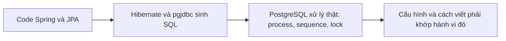
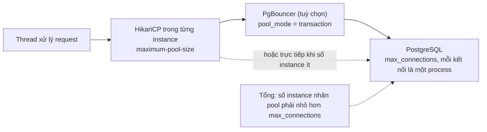
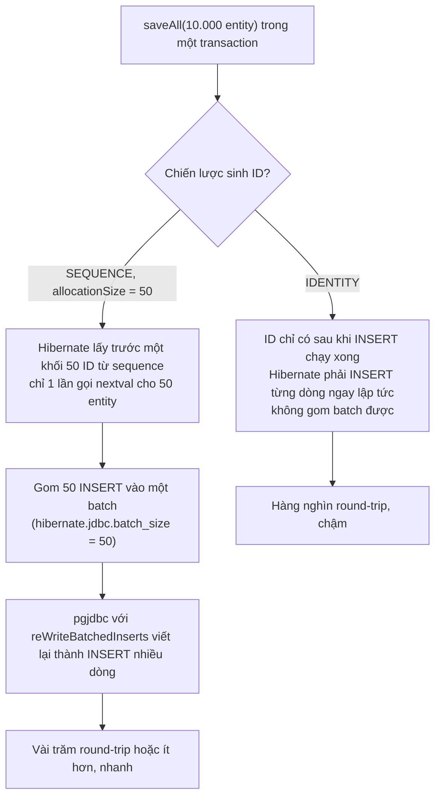
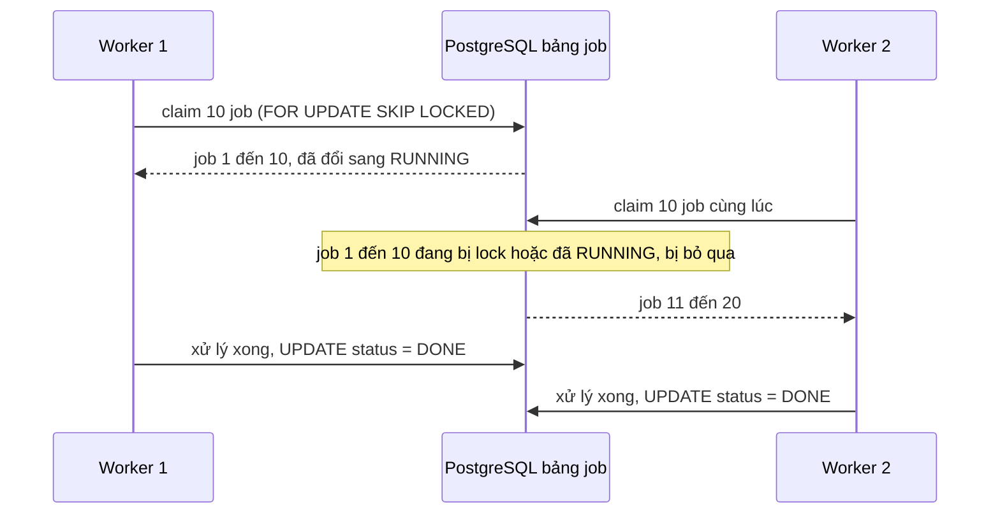
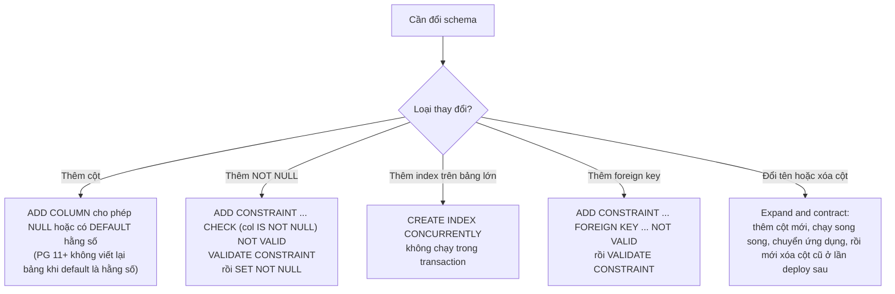
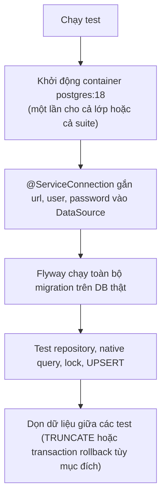
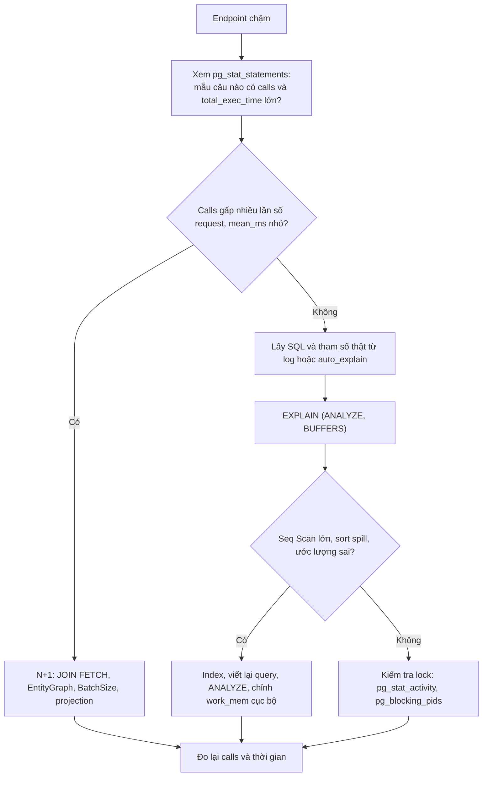

# PostgreSQL với Spring Boot: thực chiến

Nền tảng bên Spring: [JPA internals](/go?p=01-Spring-Boot%2Fmedium%2Flt-16-jpa-internals.md) (persistence context, flush, dirty checking), [JPA hiệu năng, khóa và cache](/go?p=01-Spring-Boot%2Fhard%2Flt-34-jpa-hieu-nang-khoa-cache.md) (N+1, `@Version`, pessimistic lock), [Spring: Transaction](/go?p=01-Spring-Boot%2Fmedium%2Flt-05-transaction.md). Bên database: [Lock, deadlock và concurrency](/go?p=02-Database%2Fhard%2Flt-10-locking-deadlock-database.md), [PostgreSQL bên trong](/go?p=02-Database%2Fmedium%2Flt-08-postgresql-mvcc-wal.md), [cấu hình, tuning và giám sát](/go?p=02-Database%2Fhard%2Flt-19-pg-cau-hinh-tuning-giam-sat.md). Bài này là cầu nối: những chỗ mà hiểu biết về PostgreSQL thay đổi cách bạn viết và cấu hình ứng dụng Spring Boot. Phiên bản tham chiếu: PostgreSQL 18; Spring Boot 4 (dùng Hibernate 7, Spring Framework 7) và ghi chú riêng cho Spring Boot 3 (Hibernate 6.x). Các đoạn code và SQL là _minh họa_, chưa chạy thử vì môi trường viết bài không có PostgreSQL và JDK; các tên thuộc tính riêng của từng phiên bản cần đối chiếu lại.

**Cốt lõi:** JPA che giấu SQL, nên nhiều lỗi chỉ lộ ra khi gặp hành vi thật của PostgreSQL. Bài này là cầu nối: hiểu PostgreSQL làm gì ở dưới, rồi cấu hình, ánh xạ và viết code ứng dụng cho khớp.

- Vì mỗi kết nối PostgreSQL là một process, nên tổng pool của mọi instance phải nhỏ hơn `max_connections`.
- Vì Hibernate phải biết ID trước khi flush mới gom được batch, nên SEQUENCE batch được còn IDENTITY thì không.
- Vì khoảng hở giữa đọc và ghi gây race, nên việc cần nguyên tử (UPSERT, claim job, migration) giao cho một câu lệnh của PostgreSQL.



Mô hình tư duy: code ứng dụng chỉ là lớp trên cùng, còn hiệu năng và tính đúng được quyết định ở lớp PostgreSQL phía dưới.

**Tóm tắt:**

- Cấu hình tối thiểu cho PostgreSQL gồm JDBC URL, driver `org.postgresql:postgresql`, HikariCP (mặc định 10 kết nối) và các tham số pgjdbc như `reWriteBatchedInserts=true`; pool nên nhỏ, vì mỗi kết nối PostgreSQL là một process.
- Hibernate 6 và 7 ánh xạ PostgreSQL native khá tốt: `uuid`, `jsonb` (qua `@JdbcTypeCode(SqlTypes.JSON)`), mảng (`SqlTypes.ARRAY`), enum (varchar hoặc `NAMED_ENUM` cho kiểu enum của PostgreSQL).
- `GenerationType.IDENTITY` tắt JDBC batch insert của Hibernate; dùng `SEQUENCE` với `allocationSize` khớp `INCREMENT BY` của sequence, cùng `hibernate.jdbc.batch_size`, `order_inserts` và `reWriteBatchedInserts`.
- UPSERT dùng `INSERT ... ON CONFLICT DO UPDATE` qua native query hoặc `JdbcTemplate`; nó chạy ngoài persistence context nên entity đang giữ trong bộ nhớ có thể lỗi thời.
- Hàng đợi trong database dùng `SELECT ... FOR UPDATE SKIP LOCKED` (hoặc `UPDATE ... WHERE id IN (subquery SKIP LOCKED) RETURNING`) để nhiều worker không giẫm chân nhau.
- Flyway an toàn: thêm cột nullable, tạo index bằng `CREATE INDEX CONCURRENTLY` (không chạy trong transaction), thêm ràng buộc bằng `NOT VALID` rồi `VALIDATE`, đặt `lock_timeout`, theo mẫu expand rồi contract.
- Testcontainers chạy một PostgreSQL thật trong test, cho kết quả gần production hơn H2 (H2 không có JSONB, mảng, `ON CONFLICT` giống PostgreSQL, hành vi lock khác).
- Bắt N+1 bằng `pg_stat_statements` (một câu SELECT nhỏ có `calls` rất lớn so với số request) và đọc EXPLAIN bằng cách lấy SQL cùng tham số thật từ log ứng dụng.

## Vấn đề nó giải quyết

Lập trình viên Spring Boot thường học JPA và SQL ở hai nơi khác nhau, rồi mang hai thứ đó vào production mà không nối được chúng. Kết quả là những lỗi lặp đi lặp lại: pool 100 kết nối làm PostgreSQL chậm hơn thay vì nhanh hơn; `saveAll` 10.000 entity mà vẫn chạy 10.000 câu INSERT riêng lẻ vì dùng IDENTITY; cột `jsonb` được map thành `String` rồi parse thủ công; "kiểm tra rồi chèn" gây lỗi unique ngẫu nhiên; migration thêm index khóa bảng cả phút trong giờ cao điểm; test xanh trên H2 nhưng đỏ trên PostgreSQL thật; và câu "API chậm" mà không ai biết là N+1, thiếu index hay lock.

Bài này giải từng điểm theo cùng một cách: hiểu PostgreSQL làm gì ở dưới, rồi nói ứng dụng phải cấu hình, ánh xạ hoặc viết thế nào cho khớp.

## Khi nào dùng, khi nào không

Những kỹ thuật dưới đây hợp cho ứng dụng Spring Boot dùng PostgreSQL làm kho chính. Một số chỉ nên dùng khi đúng nhu cầu: native query và `JdbcTemplate` cho các thao tác hàng loạt hoặc đặc thù PostgreSQL (UPSERT, `SKIP LOCKED`), trong khi CRUD thông thường vẫn nên để Spring Data JPA lo; hàng đợi bằng bảng chỉ hợp khi tải vừa và cần transaction chung với dữ liệu nghiệp vụ, còn lưu lượng lớn hoặc cần replay thì dùng broker ([Kafka](/go?p=06-Distributed-Systems%2FKafka%2Findex.md)); mỗi tính năng riêng của PostgreSQL (jsonb, mảng, enum native) đổi lấy ràng buộc vào PostgreSQL, nên cân nhắc nếu có khả năng đổi database.

## Các khái niệm cần biết

- **HikariCP**: connection pool mặc định của Spring Boot; giữ sẵn một số kết nối để tái sử dụng.
- **pgjdbc**: JDBC driver của PostgreSQL; nhiều hành vi (batch, prepared statement) chỉnh qua tham số trong URL.
- **Batch insert/update**: gửi nhiều câu lệnh trong một round-trip; phụ thuộc cách sinh ID.
- **Sequence và IDENTITY**: hai cách sinh khóa; Hibernate phải biết ID trước khi flush để gom batch (sequence làm được, IDENTITY thì không).
- **UPSERT**: chèn mới hoặc cập nhật nếu đã tồn tại, nguyên tử (`ON CONFLICT`).
- **SKIP LOCKED**: bỏ qua dòng đang bị lock, dùng cho hàng đợi.
- **Flyway**: công cụ migration schema theo phiên bản, lưu lịch sử trong bảng `flyway_schema_history`.
- **Expand and contract**: cách đổi schema không downtime: mở rộng trước (thêm cái mới), chuyển ứng dụng, rồi thu gọn (xóa cái cũ).
- **Testcontainers**: thư viện chạy container Docker (PostgreSQL thật) trong test.
- **N+1**: một query danh sách cộng N query con (xem [JPA hiệu năng](/go?p=01-Spring-Boot%2Fhard%2Flt-34-jpa-hieu-nang-khoa-cache.md)).

## 1. DataSource và HikariCP cho PostgreSQL

```yaml
# application.yml (Spring Boot 3 và 4 giống nhau ở phần này)
spring:
  datasource:
    url: jdbc:postgresql://db-host:5432/appdb?ApplicationName=order-service&reWriteBatchedInserts=true
    username: app
    password: ${DB_PASSWORD}
    hikari:
      maximum-pool-size: 20        # mặc định 10; chọn theo số core của DB, không theo số request
      minimum-idle: 20             # cố định kích thước pool (giảm co giãn bất ngờ)
      connection-timeout: 3000     # ms, mặc định 30000; thất bại nhanh khi cạn pool
      max-lifetime: 1500000        # ms (25 phút), phải NHỎ hơn timeout của PgBouncer, firewall, load balancer
      keepalive-time: 300000       # ms, giữ kết nối sống qua firewall hay idle timeout
      leak-detection-threshold: 20000
  jpa:
    open-in-view: false            # không giữ kết nối trong suốt vòng đời request
    hibernate:
      ddl-auto: validate           # schema do Flyway quản lý
    properties:
      hibernate:
        jdbc:
          batch_size: 50
          time_zone: UTC
        order_inserts: true
        order_updates: true
```

Các điểm liên quan trực tiếp tới PostgreSQL:

- **Kích thước pool**: mỗi kết nối là một process PostgreSQL (xem [bài MVCC](/go?p=02-Database%2Fmedium%2Flt-08-postgresql-mvcc-wal.md), mục 7). Tổng kết nối của mọi instance phải nhỏ hơn `max_connections` trừ phần dự phòng. Ví dụ 10 pod nhân pool 20 là 200 kết nối, vượt xa mặc định 100. Pool nhỏ thường nhanh hơn: kết nối nhiều hơn số core của DB chỉ tạo hàng đợi ở CPU và lock. Khi số instance lớn, dùng PgBouncer ([bài cấu hình](/go?p=02-Database%2Fhard%2Flt-19-pg-cau-hinh-tuning-giam-sat.md), mục 6) và cân nhắc để HikariCP đi qua pooler.
- **`ApplicationName`**: xuất hiện ở cột `application_name` của `pg_stat_activity`; giúp phân biệt kết nối của từng service khi điều tra.
- **`reWriteBatchedInserts=true`**: pgjdbc gộp nhiều INSERT trong một batch thành câu `INSERT ... VALUES (...), (...), ...`, giảm round-trip đáng kể. Đây là tham số của driver pgjdbc; kiểm tra tài liệu driver cho điều kiện áp dụng.
- **Prepared statement phía server**: pgjdbc chuyển sang prepared statement phía server sau một số lần chạy (`prepareThreshold`, mặc định 5). Khi đi qua PgBouncer transaction mode, hành vi này có thể gây lỗi nếu pooler không hỗ trợ; cần đối chiếu phiên bản PgBouncer (xem bài cấu hình) hoặc đặt `prepareThreshold=0`.
- **`max-lifetime`**: nếu hạ tầng ở giữa (PgBouncer, firewall) cắt kết nối rảnh sớm hơn Hikari tưởng, bạn sẽ gặp lỗi kết nối bị đóng ngẫu nhiên; đặt `max-lifetime` và `keepalive-time` nhỏ hơn các timeout đó.
- **Múi giờ**: dùng `timestamptz` ở PostgreSQL và `Instant` hoặc `OffsetDateTime` ở Java, đặt `hibernate.jdbc.time_zone` là UTC để tránh lệch giờ.



## 2. Ánh xạ kiểu PostgreSQL trong Hibernate

Hibernate 6.x (Spring Boot 3) và Hibernate 7 (Spring Boot 4) hỗ trợ các kiểu native của PostgreSQL qua `@JdbcTypeCode`. Hibernate 7 giữ hướng ánh xạ này; một số API cũ bị loại bỏ hoặc đổi tên giữa 6 và 7, nên khi nâng cấp hãy đọc migration guide của Hibernate (kiểm tra lại theo phiên bản).

```java
@Entity
@Table(name = "product")
public class Product {

    @Id
    @GeneratedValue(strategy = GenerationType.SEQUENCE, generator = "product_seq")
    @SequenceGenerator(name = "product_seq", sequenceName = "product_seq", allocationSize = 50)
    private Long id;

    private UUID externalId;                               // cột uuid, map trực tiếp

    @JdbcTypeCode(SqlTypes.JSON)
    @Column(columnDefinition = "jsonb")
    private Map<String, Object> attributes;                // cột jsonb (cần Jackson trên classpath)

    @JdbcTypeCode(SqlTypes.ARRAY)
    @Column(columnDefinition = "text[]")
    private List<String> tags;                             // cột mảng text[]

    @Enumerated(EnumType.STRING)
    @Column(length = 20, nullable = false)
    private ProductStatus status;                          // cách đơn giản: varchar (kèm CHECK)
}
```

| Kiểu PostgreSQL | Cách map | Lưu ý |
|---|---|---|
| `uuid` | `java.util.UUID` | Khóa UUID: dùng UUID có thứ tự thời gian (PG 18 có `uuidv7()`) để index đỡ phân mảnh; xem [Thiết kế schema](/go?p=02-Database%2Feasy%2Flt-02-thiet-ke-schema.md) |
| `jsonb` | `@JdbcTypeCode(SqlTypes.JSON)` trên `Map`, POJO hoặc `String`, kèm `columnDefinition = "jsonb"` | Truy vấn trong JSON (`@>`, `->>`) viết bằng native query hoặc hàm JSON của HQL (kiểm tra mức hỗ trợ theo phiên bản); index GIN tạo bằng migration |
| Mảng (`text[]`, `int[]`) | `@JdbcTypeCode(SqlTypes.ARRAY)` trên `List` hoặc mảng Java | Đừng lạm dụng thay cho bảng quan hệ khi cần join hay ràng buộc |
| Enum | `@Enumerated(EnumType.STRING)` vào varchar (kèm `CHECK`), hoặc `@JdbcTypeCode(SqlTypes.NAMED_ENUM)` vào kiểu `CREATE TYPE ... AS ENUM` | Enum native khó đổi (thêm giá trị được, bỏ giá trị khó); varchar kèm CHECK dễ migrate hơn |
| `timestamptz` | `Instant`, `OffsetDateTime` | Tránh `LocalDateTime` cho thời điểm tuyệt đối |
| `numeric` | `BigDecimal` | Khai báo `precision`, `scale` rõ ràng cho tiền |

Điểm cần chú ý ở `jsonb`: Hibernate đọc và ghi cả đối tượng, nên đổi một trường nhỏ vẫn ghi lại cả cột; cập nhật một khóa bên trong JSON nên dùng `jsonb_set` bằng native query. Và `jsonb` nên là chỗ chứa dữ liệu thật sự linh hoạt, còn cột hay lọc hoặc join nên là cột thật (xem [bài MVCC](/go?p=02-Database%2Fmedium%2Flt-08-postgresql-mvcc-wal.md), mục JSONB).

**Nền tảng:** Hibernate 6 và 7 ánh xạ kiểu native của PostgreSQL bằng @JdbcTypeCode: SqlTypes.JSON cho jsonb, SqlTypes.ARRAY cho mảng, SqlTypes.NAMED_ENUM cho enum native; uuid map trực tiếp từ java.util.UUID. Enum lưu varchar kèm CHECK dễ migrate hơn enum native.

## 3. Identity hay sequence, và batch insert

Với PostgreSQL, hai cách sinh khóa tự tăng: cột `GENERATED ... AS IDENTITY` (Hibernate gọi là `IDENTITY`) và `SEQUENCE`. Khác biệt quan trọng với Hibernate là **lúc nào ID được biết**.



Đọc sơ đồ: lý do IDENTITY không gom batch được là Hibernate cần ID sinh ra để gắn vào entity (và vào persistence context) ngay sau mỗi INSERT, trong khi với SEQUENCE nó xin ID trước và hoãn INSERT đến lúc flush. Vì thế chọn SEQUENCE khi cần chèn hàng loạt.

Điều kiện để mô hình trên đúng:

- `allocationSize` của generator phải **bằng** `INCREMENT BY` của sequence trong database. Hibernate mặc định dùng 50, vậy sequence phải `INCREMENT BY 50`; lệch nhau thì sinh ID trùng hoặc nhảy số khó hiểu. Migration cần tạo sequence rõ ràng:

```sql
CREATE SEQUENCE product_seq START WITH 1 INCREMENT BY 50;
```

- Bảo đảm `hibernate.jdbc.batch_size` được đặt, và `order_inserts` (nhóm INSERT cùng bảng cạnh nhau) khi có quan hệ cha con.
- Ứng dụng có nhiều instance cùng dùng một sequence: không sao, mỗi instance nhận khối ID riêng; khoảng trống ID là bình thường, đừng dựa vào ID liên tục.
- Vẫn cần giải phóng persistence context khi chèn rất nhiều (`flush()` rồi `clear()` theo lô), nếu không bộ nhớ phình và dirty checking chậm; xem [JPA internals](/go?p=01-Spring-Boot%2Fmedium%2Flt-16-jpa-internals.md).
- Với lô thật lớn (hàng trăm nghìn dòng), `JdbcTemplate.batchUpdate` hoặc `COPY` (qua `CopyManager` của pgjdbc) thường nhanh hơn JPA vì bỏ qua persistence context.

**Phải thuộc:** IDENTITY khiến Hibernate không gom batch insert được vì cần ID ngay sau mỗi INSERT; SEQUENCE với allocationSize (mặc định 50) lấy trước khối ID nên gom batch được. allocationSize phải khớp INCREMENT BY của sequence trong database. Bật hibernate.jdbc.batch_size, order_inserts và reWriteBatchedInserts=true ở pgjdbc.

**Suy luận:** Khóa chính phải được biết để entity có danh tính trong persistence context, và Hibernate chỉ có thể trì hoãn INSERT nếu nó đã có ID mà không cần hỏi database sau từng lệnh. Sequence cho phép điều đó vì ID được cấp từ trước theo khối, còn IDENTITY chỉ trả ID khi dòng đã được ghi. Từ lý do đó suy ra tất cả hệ quả: allocationSize phải khớp bước nhảy của sequence (nếu không hai instance có thể cấp trùng ID), ID sẽ có khoảng trống, và với IDENTITY thì hết cách gom batch trong JPA. Điểm dễ nhầm là bật `batch_size` rồi tin là đã batch trong khi vẫn dùng IDENTITY; cách kiểm tra là bật log SQL hoặc thống kê và đếm số lần thực thi.

## 4. UPSERT qua native query

"Kiểm tra tồn tại rồi chèn" bị race condition (hai request cùng thấy chưa có rồi cùng chèn, một bên lỗi unique). PostgreSQL có lệnh nguyên tử `INSERT ... ON CONFLICT`.

```java
public interface InventoryRepository extends JpaRepository<Inventory, Long> {

    @Modifying(clearAutomatically = true, flushAutomatically = true)
    @Query(value = """
        INSERT INTO inventory (sku, quantity, updated_at)
        VALUES (:sku, :qty, now())
        ON CONFLICT (sku) DO UPDATE
           SET quantity   = inventory.quantity + EXCLUDED.quantity,
               updated_at = now()
        """, nativeQuery = true)
    int addStock(@Param("sku") String sku, @Param("qty") int qty);
}
```

Điều kiện: có ràng buộc `UNIQUE` hoặc primary key trên cột trong `ON CONFLICT (...)`. Các biến thể: `DO NOTHING` (bỏ qua nếu trùng, phù hợp idempotency key); thêm `RETURNING id, quantity` để lấy kết quả (dùng `@Query` trả về dữ liệu thay vì `@Modifying`); `MERGE` từ PostgreSQL 15 cho logic nhiều nhánh (PG 17 thêm `RETURNING` cho `MERGE`; PG 18 thêm `RETURNING OLD/NEW`, xem [bài MVCC](/go?p=02-Database%2Fmedium%2Flt-08-postgresql-mvcc-wal.md)).

Hai lưu ý với JPA: câu native chạy thẳng trên database nên **persistence context không biết** nó đã đổi dữ liệu (entity đang nằm trong bộ nhớ có thể lỗi thời, vì vậy dùng `clearAutomatically` hoặc `EntityManager.refresh`); và `@Version` không tự tăng. Với UPSERT số lượng lớn, `NamedParameterJdbcTemplate.batchUpdate` với cùng câu SQL là cách gọn nhất. Phía lock và idempotency xem [Lock, deadlock và concurrency](/go?p=02-Database%2Fhard%2Flt-10-locking-deadlock-database.md), mục 4.

## 5. Khóa và hàng đợi với SELECT FOR UPDATE SKIP LOCKED

Mẫu "nhiều worker lấy job từ bảng" (xem [bài lock](/go?p=02-Database%2Fhard%2Flt-10-locking-deadlock-database.md), mục 3) trong Spring có hai cách.

Cách một, nguyên tử trong một câu SQL (khuyến nghị): lấy và đánh dấu job trong một lệnh.

```java
@Query(value = """
    UPDATE job
       SET status = 'RUNNING', locked_at = now(), locked_by = :worker
     WHERE id IN (
           SELECT id FROM job
            WHERE status = 'PENDING'
            ORDER BY id
            LIMIT :batch
              FOR UPDATE SKIP LOCKED)
    RETURNING *
    """, nativeQuery = true)
List<Job> claim(@Param("worker") String worker, @Param("batch") int batch);
```

Mỗi lần gọi, subquery khóa các dòng `PENDING` chưa ai giữ, bỏ qua dòng đang bị worker khác khóa, rồi `UPDATE` đổi trạng thái và `RETURNING` trả về; transaction ngắn, worker xử lý job **ngoài** transaction này. Cần index theo `(status, id)` hoặc index một phần `WHERE status = 'PENDING'`. Phải có cơ chế phục hồi job kẹt ở `RUNNING` khi worker chết (dựa trên `locked_at` quá hạn, đưa về `PENDING`).

Cách hai, giữ lock trong suốt transaction xử lý, dùng JPA:

```java
@Lock(LockModeType.PESSIMISTIC_WRITE)
@QueryHints(@QueryHint(name = "jakarta.persistence.lock.timeout", value = "-2"))   // -2 nghĩa là SKIP LOCKED trong Hibernate
@Query("select j from Job j where j.status = 'PENDING' order by j.id")
List<Job> lockNextBatch(Pageable pageable);
```

Giá trị `-2` của hint `jakarta.persistence.lock.timeout` được Hibernate hiểu là bỏ qua dòng đang bị khóa (kiểm tra lại theo phiên bản). Cách này giữ lock (và transaction) trong lúc xử lý, nên chỉ hợp với job ngắn.



Hàng đợi bằng bảng có chi phí MVCC: job liên tục UPDATE và DELETE tạo nhiều tuple chết nên autovacuum phải theo kịp (xem [bài MVCC](/go?p=02-Database%2Fmedium%2Flt-08-postgresql-mvcc-wal.md) và [bài cấu hình](/go?p=02-Database%2Fhard%2Flt-19-pg-cau-hinh-tuning-giam-sat.md) về autovacuum riêng cho bảng). Khi throughput lớn, dùng broker chuyên dụng.

## 6. Flyway: migration an toàn trên PostgreSQL

Flyway chạy các file `V<số>__<mô tả>.sql` trong `src/main/resources/db/migration` theo thứ tự và ghi lại vào `flyway_schema_history`. Phụ thuộc: `flyway-core` kèm module database (từ Flyway 10, PostgreSQL cần thêm `flyway-database-postgresql`; kiểm tra theo phiên bản Flyway mà Boot quản lý). Nguyên tắc: **mỗi migration phải chạy an toàn trong lúc ứng dụng bản cũ vẫn đang chạy và truy cập bảng**.



Các khuyến nghị và lý do:

- **Đặt `lock_timeout`** ở đầu migration có lệnh DDL: `SET lock_timeout = '5s';`. DDL như `ALTER TABLE` cần lock mạnh trên bảng; nếu có transaction dài đang giữ bảng, DDL chờ và mọi câu truy vấn đến sau xếp hàng sau nó, làm cả dịch vụ đứng. Với `lock_timeout`, migration thất bại nhanh thay vì kéo sập dịch vụ, và bạn thử lại.
- **`ADD COLUMN`**: thêm cột nullable hoặc có giá trị mặc định hằng số là thay đổi chỉ trên catalog (PostgreSQL 11 trở lên), nhanh. Default có hàm biến đổi (volatile) thì phải viết lại cả bảng.
- **Thêm `NOT NULL` trên bảng lớn**: `SET NOT NULL` quét cả bảng khi giữ lock. Cách an toàn: thêm `CHECK (col IS NOT NULL) NOT VALID` (chỉ kiểm tra dòng mới), `VALIDATE CONSTRAINT` (quét nhưng không chặn ghi), rồi `ALTER COLUMN ... SET NOT NULL` (PostgreSQL 12 trở lên dùng ràng buộc đã validate để bỏ qua bước quét).
- **`CREATE INDEX CONCURRENTLY`**: không chặn ghi, nhưng **không được chạy trong transaction**, trong khi Flyway mặc định bọc mỗi migration trong transaction. Cách xử lý: cấu hình migration đó không chạy trong transaction (Flyway: `executeInTransaction=false` qua file cấu hình đi kèm migration, kiểm tra tài liệu phiên bản Flyway của bạn), và đặt mỗi lệnh CONCURRENTLY trong migration riêng. Nếu lệnh bị gián đoạn, PostgreSQL để lại index **INVALID** (xem `pg_index.indisvalid`); phải `DROP INDEX` rồi tạo lại.
- **Không sửa migration đã áp dụng**: Flyway kiểm tra checksum; sửa file cũ làm lỗi validate. Thay đổi mới là migration mới.
- **Thứ tự deploy**: ứng dụng bản mới phải chạy được với schema cũ trong lúc migration chưa xong, và schema mới phải tương thích với ứng dụng bản cũ trong lúc rolling deploy. Đó chính là ý nghĩa của expand rồi contract.

```sql
-- V12__add_order_status_index.sql  (executeInTransaction=false cho file này)
SET lock_timeout = '5s';
CREATE INDEX CONCURRENTLY IF NOT EXISTS idx_orders_status_created
    ON orders (status, created_at DESC);
```

## 7. Testcontainers với PostgreSQL

H2 (kể cả chế độ giả lập PostgreSQL) không có `jsonb`, mảng, `ON CONFLICT` đúng ngữ nghĩa, `SKIP LOCKED`, hành vi lock và isolation giống PostgreSQL. Test xanh trên H2 không chứng minh gì về production. Testcontainers chạy một PostgreSQL thật trong Docker cho test.

```java
@SpringBootTest
@Testcontainers
class OrderRepositoryIT {

    @Container
    @ServiceConnection                       // Spring Boot 3.1 trở lên: tự gắn datasource vào container
    static PostgreSQLContainer<?> postgres = new PostgreSQLContainer<>("postgres:18");

    @Autowired OrderRepository repo;

    @Test
    void upsertIsIdempotent() {
        // gọi hai lần cùng một sku, kiểm tra chỉ có một dòng và số lượng cộng dồn
    }
}
```

Điểm lưu ý: tên artifact và package của Testcontainers thay đổi giữa các bản chính (bản 2.x đổi tên một số module), nên tra tài liệu Testcontainers tương ứng với phiên bản mà Spring Boot đang quản lý; image `postgres:18` nên khớp phiên bản production; dùng container `static` dùng chung cho cả lớp test (khởi động container tốn thời gian) và để Flyway chạy migration thật trên đó, vừa kiểm thử luôn migration; test phụ thuộc lock hoặc isolation phải tự quản lý transaction (không dùng `@Transactional` bao cả test vì sẽ che khuất hành vi commit, xem [Spring: Transaction](/go?p=01-Spring-Boot%2Fmedium%2Flt-05-transaction.md)). Cần Docker chạy được trên máy và CI.



## 8. Đọc EXPLAIN từ log ứng dụng và bắt N+1 bằng pg_stat_statements

**Lấy câu SQL thật.** Bật log của Hibernate (chỉ ở môi trường phát triển hoặc điều tra, vì tốn chi phí):

```yaml
logging:
  level:
    org.hibernate.SQL: DEBUG                 # câu SQL, tham số hiển thị là dấu ?
    org.hibernate.orm.jdbc.bind: TRACE       # giá trị tham số được bind (Hibernate 6 trở lên)
```

Lấy câu SQL cùng giá trị tham số, chạy `EXPLAIN (ANALYZE, BUFFERS)` trong `psql` (với `UPDATE/DELETE` bọc trong transaction rồi `ROLLBACK`). Nếu chỉ có câu SQL dạng `$1`, PostgreSQL 16 trở lên có `EXPLAIN (GENERIC_PLAN)` để xem kế hoạch tổng quát mà không cần giá trị. Hãy nhớ pgjdbc dùng prepared statement phía server sau vài lần chạy, nên kế hoạch có thể chuyển từ "custom" sang "generic" và khác kế hoạch bạn thấy khi thử bằng tay; trong trường hợp đó xem tham số `plan_cache_mode`. Cách đọc kế hoạch xem [EXPLAIN và query planner](/go?p=02-Database%2Fhard%2Flt-09-explain-query-planner-tuning.md); để PostgreSQL tự ghi kế hoạch của query chậm từ ứng dụng thì dùng `auto_explain` ([bài cấu hình](/go?p=02-Database%2Fhard%2Flt-19-pg-cau-hinh-tuning-giam-sat.md), mục 4).

**Bắt N+1 bằng `pg_stat_statements`.** N+1 không làm từng câu chậm; nó làm số lần gọi vọt lên. Đó chính xác là thứ `pg_stat_statements` cho thấy:

```sql
SELECT calls,
       round(mean_exec_time::numeric, 3) AS mean_ms,
       round(total_exec_time::numeric, 0) AS total_ms,
       rows,
       left(query, 100) AS query
FROM pg_stat_statements
ORDER BY calls DESC
LIMIT 10;
```

Dấu hiệu: một `SELECT ... FROM customer WHERE id = $1` với `calls` lớn hơn nhiều lần số request của endpoint, `rows/calls` gần 1, `mean_ms` rất nhỏ nhưng `total_ms` đứng đầu. Quy trình xác nhận: reset số liệu (`pg_stat_statements_reset()`) trên môi trường thử, gọi endpoint nghi ngờ một lần, rồi xem lại `calls`: nếu một request tạo ra hàng trăm lần gọi cùng một mẫu câu, đó là N+1. Cách sửa phía JPA (`JOIN FETCH`, `@EntityGraph`, `@BatchSize`, truy vấn dạng projection) nằm ở [JPA hiệu năng](/go?p=01-Spring-Boot%2Fhard%2Flt-34-jpa-hieu-nang-khoa-cache.md). Đặt `ApplicationName` trong JDBC URL (mục 1) giúp lọc theo service khi nhiều ứng dụng cùng một database (xem cột `application_name` ở `pg_stat_activity`).



**Nền tảng:** N+1 không làm từng câu chậm mà làm số lần gọi tăng vọt, nên nhận ra nó bằng pg_stat_statements: một mẫu SELECT đơn giản có calls gấp nhiều lần số request, rows chia calls xấp xỉ 1. Sau đó sửa ở tầng JPA (JOIN FETCH, EntityGraph, BatchSize, projection) và đo lại calls.

## Bẫy thường gặp

| Bẫy | Hậu quả | Cách tránh |
|---|---|---|
| Pool Hikari quá lớn, nhân với nhiều instance | Vượt `max_connections`, PostgreSQL chậm hoặc từ chối kết nối | Pool nhỏ, tính tổng toàn hệ thống, thêm PgBouncer |
| `GenerationType.IDENTITY` rồi kỳ vọng batch insert | Mỗi entity một INSERT | Dùng SEQUENCE kèm batch_size, order_inserts, `reWriteBatchedInserts` |
| `allocationSize` lệch `INCREMENT BY` của sequence | ID trùng hoặc nhảy số bất thường | Khai báo hai nơi khớp nhau, kiểm tra trong migration |
| `open-in-view` bật mặc định | Giữ kết nối suốt request kể cả lúc render | `spring.jpa.open-in-view=false` |
| Kiểm tra tồn tại rồi chèn | Race, lỗi unique ngẫu nhiên | `INSERT ... ON CONFLICT`, bắt `DuplicateKeyException` có chủ đích |
| UPSERT native mà vẫn dùng entity cũ trong persistence context | Đọc dữ liệu lỗi thời | `clearAutomatically` hoặc `refresh`, hoặc để UPSERT ngoài transaction đọc |
| Giữ transaction và lock suốt lúc gọi dịch vụ ngoài | Lock lâu, deadlock, cạn pool | Claim ngắn rồi xử lý ngoài transaction, có cơ chế phục hồi job kẹt |
| `CREATE INDEX` thường trên bảng lớn | Chặn ghi cả bảng | `CREATE INDEX CONCURRENTLY` ngoài transaction, kiểm tra index INVALID |
| Migration `ALTER TABLE` không có `lock_timeout` | DDL xếp hàng sau transaction dài, kéo theo cả dịch vụ đứng | `SET lock_timeout`, thử lại khi thất bại |
| Test chỉ trên H2 | Lỗi chỉ lộ ở production | Testcontainers với đúng phiên bản PostgreSQL |
| `@Transactional` bao cả test về lock, isolation | Che khuất hành vi commit và lock thật | Tự quản lý transaction trong test đó |
| Kết nối qua PgBouncer transaction mode mà vẫn dùng trạng thái phiên | Trạng thái rò hoặc mất | Dùng `SET LOCAL`, advisory lock theo transaction, kiểm tra prepared statement |

## Điểm cần nhớ

- Tổng pool của mọi instance phải nhỏ hơn `max_connections`; pool nhỏ thường nhanh hơn; dùng PgBouncer khi nhiều instance.
- Dùng `@JdbcTypeCode` cho `jsonb`, mảng, enum native; `uuid` map thẳng; enum varchar kèm CHECK dễ migrate hơn.
- SEQUENCE (allocationSize khớp INCREMENT BY) cộng `batch_size`, `order_inserts` và `reWriteBatchedInserts` mới cho batch insert thật; IDENTITY thì không.
- UPSERT bằng `ON CONFLICT`, nhớ persistence context không biết thay đổi đó.
- Hàng đợi bằng `FOR UPDATE SKIP LOCKED`, claim bằng một câu `UPDATE ... RETURNING`, xử lý ngoài transaction, theo dõi autovacuum.
- Flyway: `lock_timeout`, `NOT VALID` rồi `VALIDATE`, `CREATE INDEX CONCURRENTLY` ngoài transaction, expand rồi contract.
- Testcontainers PostgreSQL thật thay cho H2; image khớp phiên bản production.
- N+1 hiện ra ở `calls` của `pg_stat_statements`; câu SQL và tham số thật lấy từ log hoặc `auto_explain` để chạy `EXPLAIN (ANALYZE, BUFFERS)`.

## Phỏng vấn khó: chuỗi hỏi xoáy

Người phỏng vấn senior thường mở bằng câu dễ rồi xoáy xuống cơ chế, đánh đổi và sự cố thật. Câu trả lời tốt luôn đi từ cốt lõi xuống.

### Chuỗi 1: Connection pool và max_connections

1. **Câu mở:** Bạn chọn `maximum-pool-size` của HikariCP bằng cách nào?
2. **Xoáy 1:** Vì sao pool lớn hơn lại có thể làm PostgreSQL chậm hơn?
3. **Xoáy 2:** Hệ thống tăng từ 5 lên 20 pod, mỗi pod pool 20, và bạn thêm PgBouncer transaction mode. Những gì có thể hỏng?

**Đáp án ngắn:** Tôi chọn theo năng lực của database, không theo số request: tổng pool của mọi instance phải nhỏ hơn `max_connections` trừ phần dự phòng. Mỗi kết nối PostgreSQL là một process, nên nhiều kết nối hơn số core thật sự chỉ tạo hàng đợi ở CPU và lock, và tốn bộ nhớ. 20 pod nhân 20 là 400 kết nối, vượt mặc định 100. Cách xử lý là giảm pool mỗi pod, và thêm PgBouncer để dồn nhiều client vào ít kết nối thật. Ở transaction mode, kết nối thật chỉ gắn với client trong một transaction, nên không được dựa vào trạng thái phiên: dùng `SET LOCAL` và advisory lock theo transaction. pgjdbc chuyển sang prepared statement phía server sau `prepareThreshold` (mặc định 5), có thể xung đột với pooler không hỗ trợ; cần đối chiếu phiên bản PgBouncer hoặc đặt `prepareThreshold=0`. Ngoài ra `max-lifetime` và `keepalive-time` phải nhỏ hơn timeout của PgBouncer và firewall, nếu không sẽ gặp lỗi kết nối bị đóng ngẫu nhiên. Theo dõi bằng `pg_stat_activity` và `ApplicationName`.

**Sai lầm hay gặp:**

- Nghĩ pool càng lớn càng nhanh, hoặc chọn pool theo số request đồng thời.
- Chỉ tính pool của một pod, quên nhân với số instance.
- Thêm PgBouncer mà vẫn dùng trạng thái phiên, không nhắc prepared statement.

### Chuỗi 2: IDENTITY, SEQUENCE và batch insert

1. **Câu mở:** `saveAll` 10.000 entity rất chậm dù đã đặt `hibernate.jdbc.batch_size`. Bạn nghi gì đầu tiên?
2. **Xoáy 1:** Vì sao IDENTITY không gom batch được còn SEQUENCE thì được?
3. **Xoáy 2:** Chuyển sang SEQUENCE với `allocationSize = 50` nhưng ID bắt đầu trùng hoặc nhảy số lạ khi chạy nhiều instance. Nguyên nhân?

**Đáp án ngắn:** Tôi nghi chiến lược sinh ID là IDENTITY. Hibernate cần ID để đặt entity vào persistence context, nên với IDENTITY nó phải chạy INSERT ngay để lấy ID về, không trì hoãn và không gom được. Với SEQUENCE, nó xin trước một khối ID (50 ID một lần gọi `nextval`), hoãn INSERT đến lúc flush rồi gom vào batch. Ngoài `batch_size` còn cần `order_inserts` khi có quan hệ cha con, và `reWriteBatchedInserts=true` ở pgjdbc để viết lại thành INSERT nhiều dòng. Lỗi trùng ID thường do `allocationSize` không bằng `INCREMENT BY` của sequence trong database: hai instance cùng cấp khối chồng lên nhau. Nên migration tạo sequence rõ ràng với `INCREMENT BY 50`. Khoảng trống ID là bình thường, không được dựa vào ID liên tục. Kiểm tra bằng log hoặc thống kê đếm số lần thực thi, không tin cấu hình. Với lô rất lớn, `JdbcTemplate.batchUpdate` hoặc `COPY` nhanh hơn JPA vì bỏ qua persistence context.

**Sai lầm hay gặp:**

- Bật `batch_size` rồi tin đã batch, trong khi vẫn dùng IDENTITY.
- Nói "sequence nhanh hơn" mà không giải thích vì sao Hibernate cần ID trước.
- Để `allocationSize` và `INCREMENT BY` lệch nhau.

### Chuỗi 3: Migration an toàn và UPSERT nguyên tử

1. **Câu mở:** Bạn thêm index trên bảng 200 triệu dòng bằng migration Flyway như thế nào?
2. **Xoáy 1:** Vì sao `CREATE INDEX CONCURRENTLY` không chạy được trong Flyway mặc định, và nếu nó bị gián đoạn thì sao?
3. **Xoáy 2:** Một migration `ALTER TABLE` ngắn làm cả dịch vụ đứng. Đã chạy nhanh trên môi trường thử, vậy sự cố ở đâu và phòng ngừa thế nào?

**Đáp án ngắn:** `CREATE INDEX` thường chặn ghi cả bảng trong lúc xây, nên dùng `CREATE INDEX CONCURRENTLY`: không chặn ghi nhưng chậm hơn. Lệnh này không được chạy trong transaction, trong khi Flyway mặc định bọc mỗi migration trong transaction; nên cấu hình migration đó không chạy trong transaction (`executeInTransaction=false`, kiểm tra theo phiên bản Flyway) và để mỗi lệnh CONCURRENTLY một file riêng. Nếu bị gián đoạn, PostgreSQL để lại index INVALID, xem `pg_index.indisvalid`, phải `DROP INDEX` rồi tạo lại. DDL như `ALTER TABLE` cần lock mạnh; nếu có transaction dài đang giữ bảng, DDL chờ và mọi truy vấn đến sau xếp hàng sau nó, làm cả dịch vụ đứng dù bản thân DDL rất nhanh. Phòng ngừa bằng `SET lock_timeout` để thất bại nhanh và thử lại. Cùng tinh thần đó, việc cần nguyên tử như UPSERT giao cho `INSERT ... ON CONFLICT` thay vì kiểm tra rồi chèn, có ràng buộc UNIQUE làm chốt chặn cuối.

**Sai lầm hay gặp:**

- Chạy `CREATE INDEX` thường trên bảng lớn, hoặc quên kiểm tra index INVALID.
- Không biết lệnh DDL nhanh vẫn gây sự cố vì xếp hàng sau transaction dài.
- Tin vào `existsBy...` rồi chèn mà không có UNIQUE và thao tác nguyên tử.

## Câu hỏi tự kiểm tra

Với mỗi câu, thử trả lời theo gợi ý trước rồi mới đọc phần lập luận.

1. `saveAll` 5.000 entity dùng `GenerationType.IDENTITY` rất chậm dù đã đặt `hibernate.jdbc.batch_size=50`. Vì sao và sửa thế nào?
   - **Gợi ý suy luận:** Hibernate cần biết gì ngay sau mỗi INSERT để đặt entity vào persistence context? Với sequence nó biết điều đó từ lúc nào?
   - **Lập luận và đáp án:** với IDENTITY, ID chỉ có sau khi dòng được INSERT, nên Hibernate phải chạy từng INSERT ngay và không gom batch được. Chuyển sang SEQUENCE với allocationSize khớp INCREMENT BY, giữ batch_size và order_inserts, bật `reWriteBatchedInserts=true`; kiểm tra bằng log hoặc thống kê số lần thực thi.
2. Hai request cùng đăng ký một email, đôi khi một bên lỗi unique dù code đã kiểm tra `existsByEmail` trước. Cách xử lý tốt nhất?
   - **Gợi ý suy luận:** giữa lúc kiểm tra và lúc chèn có thể có ai chen vào không? Cơ chế nào của database làm hai bước thành một?
   - **Lập luận và đáp án:** kiểm tra rồi chèn là hai bước, request kia chen vào giữa. Cần ràng buộc UNIQUE ở database làm chốt chặn cuối và dùng thao tác nguyên tử (`INSERT ... ON CONFLICT DO NOTHING` rồi kiểm tra số dòng bị ảnh hưởng, hoặc bắt lỗi unique và trả kết quả thích hợp). Kiểm tra trước chỉ là tối ưu trải nghiệm, không phải cơ chế đúng đắn.
3. Hai worker nhận trùng một job từ bảng `job`. Vì sao và sửa thế nào?
   - **Gợi ý suy luận:** `SELECT` thường có khóa dòng không? Điều gì xảy ra nếu hai worker cùng đọc trước khi bên nào cập nhật trạng thái?
   - **Lập luận và đáp án:** đọc thường không khóa, hai worker cùng thấy job `PENDING` rồi cùng nhận. Cần claim nguyên tử: `UPDATE ... WHERE id IN (SELECT ... FOR UPDATE SKIP LOCKED LIMIT n) RETURNING *`, để mỗi worker lấy các dòng chưa ai giữ; xử lý ngoài transaction và có cơ chế phục hồi job kẹt.
4. Migration `CREATE INDEX` trên bảng 200 triệu dòng làm API đứng một lúc. Cách làm đúng?
   - **Gợi ý suy luận:** `CREATE INDEX` thường giữ lock gì trong lúc xây? Phiên bản không chặn ghi có ràng buộc gì với transaction?
   - **Lập luận và đáp án:** `CREATE INDEX` thường chặn ghi cả bảng trong lúc xây. Dùng `CREATE INDEX CONCURRENTLY` (không chặn ghi, chậm hơn) và chạy nó ngoài transaction (cấu hình Flyway không bọc migration đó trong transaction, mỗi file một lệnh). Sau đó kiểm tra index không bị INVALID, và đặt `lock_timeout` cho các lệnh DDL khác.
5. Pod tăng từ 5 lên 20, mỗi pod Hikari 20 kết nối. PostgreSQL bắt đầu báo hết kết nối và chậm. Phân tích và hướng xử lý?
   - **Gợi ý suy luận:** tính tổng kết nối; mỗi kết nối PostgreSQL là gì ở hệ điều hành; chạy bao nhiêu kết nối thật sự có ích?
   - **Lập luận và đáp án:** 20 pod nhân 20 là 400 kết nối, vượt `max_connections` mặc định 100 và dù tăng cũng chỉ tạo thêm process tranh CPU. Giảm pool mỗi pod (ví dụ 5 đến 10), thêm PgBouncer transaction mode để dồn nhiều client vào ít kết nối thật, kiểm tra không dùng trạng thái phiên, và đo bằng `pg_stat_activity`.
6. Một endpoint danh sách đơn hàng chậm nhưng `EXPLAIN` từng câu cho thấy đều rất nhanh. Bạn tìm nguyên nhân thế nào?
   - **Gợi ý suy luận:** nếu từng câu đều nhanh mà tổng chậm, điều gì đã nhân lên? Công cụ nào thống kê số lần gọi theo mẫu câu?
   - **Lập luận và đáp án:** nghi N+1: số lần gọi tăng chứ không phải từng câu chậm. Dùng `pg_stat_statements` sắp xếp theo `calls` để thấy một mẫu SELECT nhỏ được gọi hàng trăm lần mỗi request, xác nhận bằng cách reset số liệu rồi gọi endpoint một lần. Sửa bằng `JOIN FETCH`, `@EntityGraph`, `@BatchSize` hoặc projection.

Nguồn: tài liệu chính thức PostgreSQL 18 (INSERT ... ON CONFLICT, SELECT ... FOR UPDATE SKIP LOCKED, CREATE INDEX CONCURRENTLY, ALTER TABLE, pg_stat_statements, EXPLAIN), tài liệu pgjdbc (connection parameters, reWriteBatchedInserts), Spring Boot Reference (DataSource, HikariCP, Flyway, Testcontainers), Hibernate ORM User Guide và Migration Guide 7.0, tài liệu Flyway và Testcontainers, kiểm tra ngày 2026-10-30. Code và SQL là minh họa, chưa chạy thử trong môi trường viết bài; các điểm cần đối chiếu lại theo đúng phiên bản: tên artifact Flyway và Testcontainers ở Spring Boot 4, giá trị `-2` của hint lock timeout, tên cấu hình Flyway `executeInTransaction`, và thay đổi API Hibernate 7.

