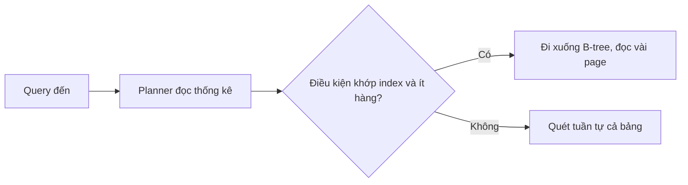
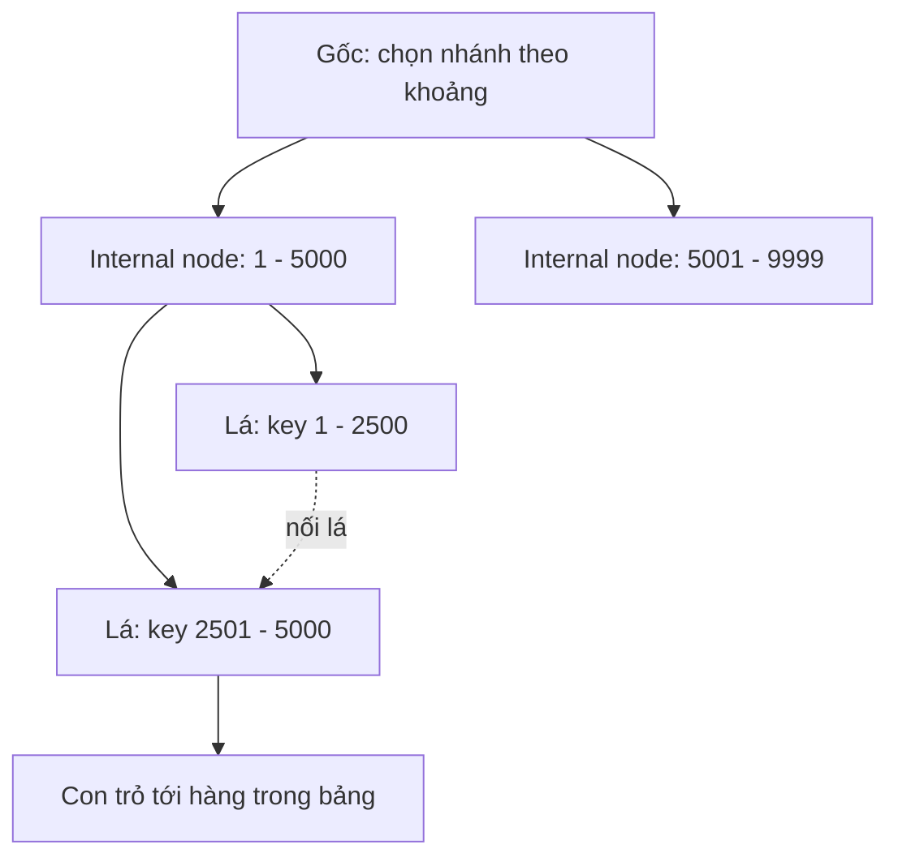
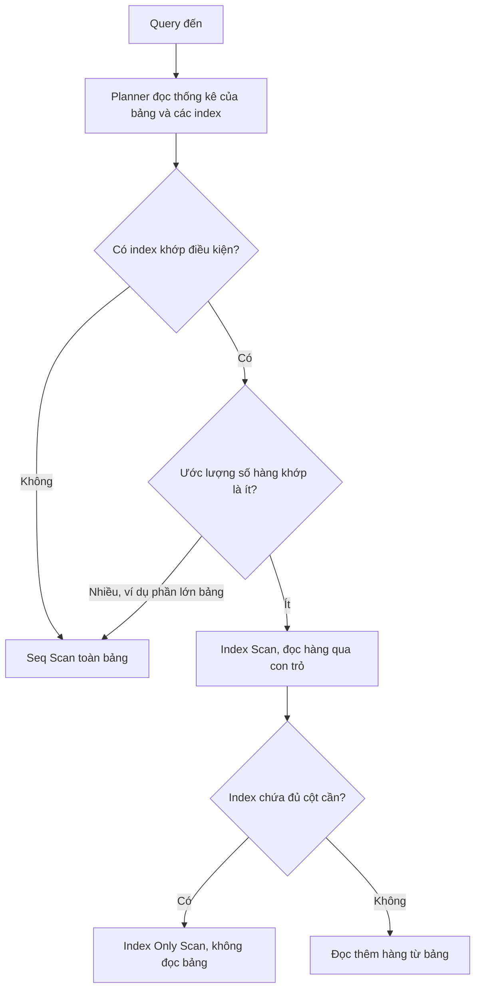
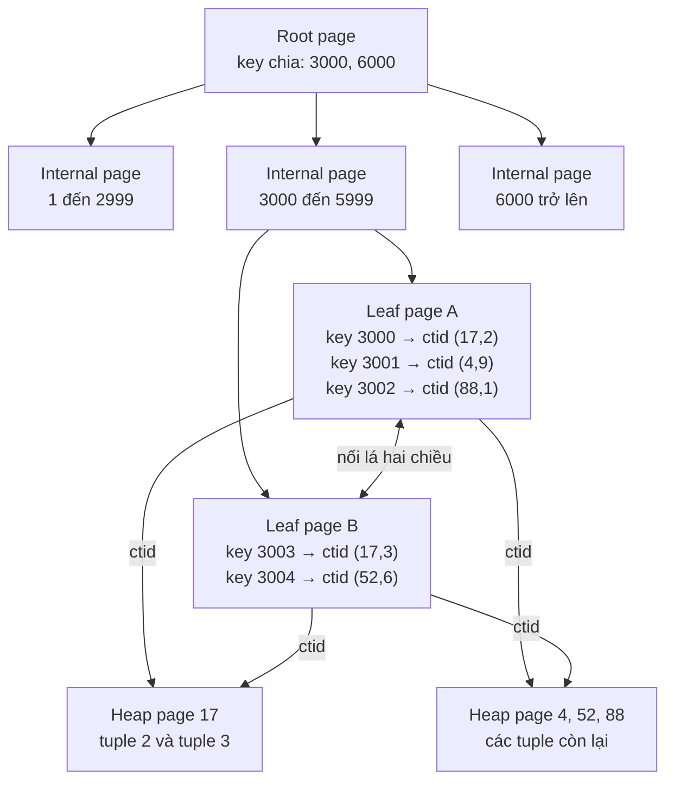
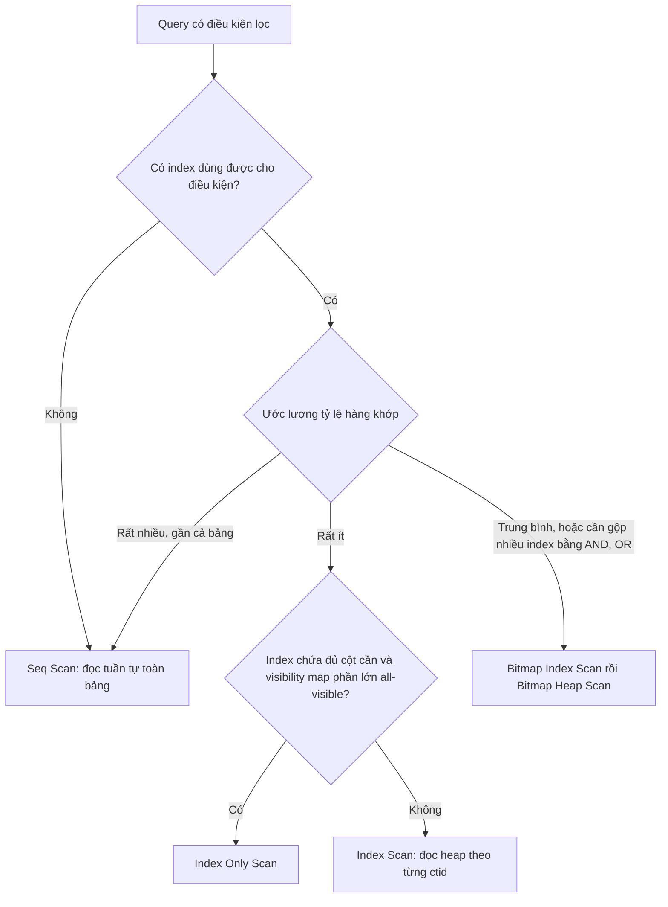

# Index và tối ưu query

**Cốt lõi:** Index là bản sao đã sắp thứ tự của vài cột kèm con trỏ tới hàng, nên tìm kiếm là đi xuống một cây nông thay vì đọc cả bảng. Nhưng người chọn cách chạy là planner, dựa trên thống kê và chi phí, nên index chỉ có ích khi query khớp với thứ tự của nó.

- Vì index được sắp xếp, nên chỉ điều kiện khớp tiền tố trái và không bọc cột trong hàm mới nhảy thẳng vào cây.
- Vì planner so chi phí theo thống kê, nên điều kiện trả phần lớn bảng thì quét tuần tự mới đúng, và thống kê cũ làm chọn sai.
- Vì mỗi lần ghi phải cập nhật mọi index, nên chỉ thêm index cho query có số đo cụ thể.



Mô hình tư duy: index chỉ là một lựa chọn trên bàn của planner, và nó được chọn khi chi phí ước lượng thấp hơn quét bảng.

**Tóm tắt:**

- Index là cấu trúc phụ (thường B-tree) giữ giá trị cột theo thứ tự kèm con trỏ tới hàng, biến tìm kiếm từ O(n) thành O(log n); đổi lại ghi chậm hơn và tốn dung lượng.
- B-tree rất nông (khoảng 3 đến 4 tầng cho hàng trăm triệu dòng), nên tra theo key chỉ cần vài lần đọc page.
- Planner chọn kế hoạch dựa trên thống kê và ước lượng chi phí, nên có index chưa chắc được dùng; query chậm bất ngờ thì nghi điều kiện viết sai dạng hoặc thống kê cũ (ANALYZE).
- Composite index theo quy tắc tiền tố trái: cột so sánh bằng trước, cột khoảng sau, rồi cột ORDER BY; sau cột khoảng, các cột còn lại chỉ lọc tiếp.
- Index bị vô hiệu khi bọc cột trong hàm, LIKE bắt đầu bằng %, ép kiểu ngầm, hoặc điều kiện trả về phần lớn bảng.
- Covering index chứa đủ cột query cần nên không phải quay lại bảng.
- OFFSET lớn chậm tuyến tính nên dùng keyset pagination; N+1 là một query danh sách cộng N query con, sửa bằng JOIN hoặc IN.
- Đọc EXPLAIN để biết query thật sự dùng index nào, thay vì đoán.

## Index là gì và vì sao cần nó

Hãy nghĩ đến một cuốn sách dày 1000 trang. Muốn tìm chữ "transaction", bạn có hai cách: lật từng trang từ đầu, hoặc mở mục lục cuối sách, thấy chữ đó ở trang 412 rồi nhảy thẳng tới. Index trong database chính là mục lục đó: một cấu trúc phụ (thường là B-tree) giữ các giá trị của một hoặc vài cột theo thứ tự, kèm con trỏ tới hàng thật, để DB nhảy thẳng tới hàng cần tìm thay vì đọc cả bảng.

Vấn đề nó giải quyết: nếu không có index, mỗi query phải quét toàn bảng (full scan), độ phức tạp O(n). Bảng vài triệu dòng thì mỗi query mất vài giây, và khi tải tăng lên thì cả hệ thống nghẹt. Có index thì tìm kiếm chỉ cỡ O(log n), tức vài lần đọc đĩa dù bảng có hàng triệu dòng.

**Nền tảng:** Index là cấu trúc phụ (thường B-tree) giữ giá trị cột theo thứ tự kèm con trỏ tới hàng, biến tìm kiếm từ O(n) thành O(log n). Đổi lại mỗi lần ghi phải cập nhật mọi index, nên index là đánh đổi giữa đọc nhanh và ghi chậm cộng tốn dung lượng.

## Khi nào nên tạo, khi nào không

Tạo index cho cột hay nằm trong `WHERE`, `JOIN`, `ORDER BY`, `GROUP BY` của các query chạy thường xuyên. Đừng index bừa, vì mỗi index làm mọi lần ghi (`INSERT/UPDATE/DELETE`) chậm đi và tốn dung lượng. Với bảng nhỏ (vài trăm dòng) quét toàn bảng còn nhanh hơn, và với điều kiện trả về phần lớn bảng thì index cũng không giúp gì.

Cách làm đúng là chọn index theo mẫu query thật, rồi dùng `EXPLAIN` để xem DB có dùng index không. Bài này cũng chỉ ra những kiểu viết làm index vô hiệu, như bọc cột trong hàm (`WHERE LOWER(email) = ...`) hay `LIKE '%abc'`.

## Các khái niệm cần biết

- **Query planner / optimizer**: thành phần của DB quyết định chạy query bằng cách nào (quét bảng hay dùng index nào, join theo thứ tự nào). Bạn không ra lệnh trực tiếp, mà cung cấp index và thống kê để nó chọn đúng.
- **Statistics**: số liệu DB thu thập về phân bố dữ liệu để ước lượng. Thống kê cũ thì planner chọn sai kế hoạch; cập nhật bằng `ANALYZE`.
- **Selectivity và cardinality**: cardinality là số giá trị khác nhau của cột; selectivity là tỉ lệ hàng một điều kiện giữ lại. Cột `status` chỉ có 4 giá trị thì chọn lọc kém, cột `email` gần như duy nhất thì chọn lọc rất cao. Index trên cột chọn lọc cao hiệu quả hơn.
- **Seq Scan (full scan)**: đọc tuần tự toàn bảng. Không xấu bản thân, chỉ xấu khi bảng lớn mà chỉ cần vài hàng.
- **Covering index**: index chứa đủ mọi cột query cần, nên DB không phải đọc bảng. Nhanh hơn nhưng index to hơn.
- **Partial index**: index chỉ lập cho tập con hàng thỏa điều kiện.
- **Keyset pagination**: phân trang bằng cách nhớ key của hàng cuối trang trước, thay vì `OFFSET`.
- **N+1**: một query lấy danh sách rồi N query nữa cho từng phần tử.

## B-tree hoạt động thế nào



Ví dụ tìm `id = 4521`: gốc chọn node `1 - 5000`, internal node chọn lá `2501 - 5000`, lá chứa key và con trỏ tới hàng (hoặc đủ dữ liệu ngay tại index).

Cây cân bằng, nhiều nhánh nên chỉ vài lần đọc đĩa cho hàng triệu record. Các leaf node nối với nhau nên hỗ trợ quét khoảng (`BETWEEN`, `ORDER BY`) tốt. Index làm **chậm ghi** và tốn memory: mỗi `INSERT/UPDATE/DELETE` phải cập nhật mọi index liên quan.

**Nền tảng:** Planner chọn kế hoạch dựa trên thống kê và ước lượng chi phí, nên có index chưa chắc được dùng. Khi query chậm bất ngờ, hãy nghi điều kiện viết sai dạng hoặc thống kê cũ trước tiên.

**Suy luận:** Planner không thể biết trước query sẽ trả bao nhiêu hàng, nên nó dựa vào thống kê (số hàng, phân bố giá trị) để ước lượng chi phí từng kế hoạch. Đọc qua index là đọc ngẫu nhiên từng hàng, còn quét tuần tự đọc liền khối, nên khi điều kiện trả về một phần lớn bảng thì quét tuần tự rẻ hơn và planner chọn nó đúng chứ không phải sai. Vì vậy cùng một query có thể dùng index khi tham số hiếm và bỏ index khi tham số phổ biến. Điểm dễ nhầm là thấy Seq Scan rồi kết luận thiếu index; đúng hơn phải so rows ước lượng với rows thực tế, vì ước lượng lệch mới là dấu hiệu thống kê cũ hoặc điều kiện viết sai dạng. Hệ quả hành động: khi query chậm, chạy EXPLAIN ANALYZE trước, rồi mới quyết định ANALYZE, sửa cách viết điều kiện hoặc thêm index, đừng thêm index theo phản xạ.

Để thấy planner dùng index ra sao, hãy xem quy trình rút gọn sau khi một query đến.



Đọc sơ đồ: có index chưa chắc được dùng; planner so chi phí ước lượng dựa trên thống kê. Vì vậy hai nguyên nhân phổ biến nhất khiến index "không chạy" là điều kiện viết sai dạng (xem mục "Khi index không được dùng") và thống kê cũ.

### Cấu trúc B-tree của PostgreSQL và con trỏ ctid

Sơ đồ trên là phiên bản rút gọn. Ở PostgreSQL, B-tree gồm các page 8 KB: một page gốc (root), các page trung gian (internal) và các page lá (leaf). Mỗi mục ở lá là một cặp "giá trị key và `ctid`" với `ctid` = `(số page, số mục)` của tuple trong heap. Các lá nối với nhau theo cả hai chiều nên quét khoảng chỉ việc đi ngang. Vì index không chứa dữ liệu của dòng (trừ cột `INCLUDE`), sau khi tìm được key, DB phải nhảy sang heap đọc tuple theo `ctid`.



Đọc sơ đồ: tìm `id = 3003` đi từ root sang internal page `3000 đến 5999`, xuống leaf page B, đọc được `ctid (17,3)`, rồi đọc heap page 17 lấy tuple số 3. Các key liền nhau (3000, 3001, 3002) có thể trỏ tới những heap page rất xa nhau, vì heap không sắp xếp theo key; đó là lý do đọc nhiều dòng qua index tốn nhiều lần đọc ngẫu nhiên. Các giá trị trên chỉ để minh họa.

### Planner chọn Seq Scan, Index Scan, Bitmap Scan hay Index Only Scan



- **Seq Scan**: đọc heap tuần tự. Rẻ khi cần phần lớn bảng, vì đọc liền khối nhanh hơn đọc ngẫu nhiên (tham số `seq_page_cost` mặc định 1,0 so với `random_page_cost` mặc định 4,0).
- **Index Scan**: đi qua index theo thứ tự key, mỗi key nhảy sang heap theo `ctid`. Hợp khi ít hàng, hoặc khi cần kết quả đã sắp xếp theo index (kèm `LIMIT`).
- **Bitmap Scan**: bước một (Bitmap Index Scan) quét index và ghi lại những page heap, hàng nào khớp vào một bitmap trong bộ nhớ; bước hai (Bitmap Heap Scan) đọc heap theo thứ tự vật lý của page nên mỗi page chỉ đọc một lần. Hợp khi số hàng khớp ở mức trung bình, và là cách để kết hợp nhiều index (`BitmapAnd`, `BitmapOr`). Cái giá: kết quả không còn theo thứ tự index nên cần `Sort` nếu có `ORDER BY`, và nếu bitmap quá lớn so với `work_mem` thì chỉ lưu theo page ("lossy") rồi phải kiểm tra lại điều kiện ở từng hàng (dòng `Recheck Cond`).
- **Index Only Scan**: lấy dữ liệu thẳng từ index, chỉ đọc heap cho những page chưa được đánh dấu all-visible trong visibility map (dòng `Heap Fetches` trong `EXPLAIN ANALYZE`). Cần mọi cột query dùng đều nằm trong index.

**Suy luận:** Ba kiểu đọc heap đánh đổi giữa số lần đọc và tính tuần tự. Index Scan đọc ít dữ liệu nhưng mỗi hàng là một lần nhảy ngẫu nhiên, nên chỉ thắng khi số hàng nhỏ. Seq Scan đọc nhiều hơn nhưng liền khối, nên thắng khi cần phần lớn bảng. Bitmap Scan là điểm giữa: dồn các `ctid` khớp lại, sắp theo page rồi mới đọc, nên giữ được tính tuần tự tương đối mà vẫn bỏ qua phần lớn bảng. Vì ranh giới giữa ba kiểu phụ thuộc ước lượng số hàng và `random_page_cost`, cùng một câu query có thể đổi kiểu khi tham số hoặc thống kê đổi. Điểm dễ nhầm là coi Bitmap Scan là kém hơn Index Scan; thực tế planner chọn nó đúng chỗ. Khi đọc EXPLAIN, hãy so số hàng ước lượng với thực tế trước khi kết luận kiểu scan là sai.

## Index nhiều cột và quy tắc tiền tố trái

Index nhiều cột (composite index) sắp xếp theo cột đầu, trong cùng giá trị cột đầu thì sắp theo cột thứ hai, và cứ thế, giống danh bạ xếp theo họ rồi mới đến tên. Vì vậy bạn tra được theo họ, hoặc theo họ cộng tên, nhưng không tra hiệu quả chỉ theo tên.

Index `(a, b, c)` dùng được cho điều kiện trên `a`, `(a, b)`, `(a, b, c)` nhưng **không** hiệu quả cho riêng `b` hoặc `c`.

Thứ tự cột: cột lọc bằng `=` đặt trước, cột khoảng/sắp xếp đặt sau; cột có độ chọn lọc cao thường đặt trước nếu mọi query đều dùng.

**Phải thuộc:** Index (a, b, c) dùng được cho a, (a, b), (a, b, c), không hiệu quả cho riêng b hoặc c (quy tắc tiền tố trái). Thứ tự cột: cột so sánh bằng trước, cột khoảng sau, rồi cột ORDER BY; cột đứng sau cột khoảng không còn thu hẹp được.

**Suy luận:** Composite index (a, b, c) là một B-tree sắp xếp theo a trước, trong cùng a thì theo b, trong cùng (a, b) thì theo c, giống danh bạ sắp theo họ rồi đến tên. Vì thứ tự đó, các hàng khớp một giá trị của a nằm liền nhau, các hàng khớp (a, b) cũng liền nhau, nên tìm theo tiền tố là một lần đi xuống cây rồi đọc một đoạn liên tục. Ngược lại, các hàng có cùng b nằm rải rác dưới mọi giá trị của a, nên tìm riêng b không thể nhảy vào cây mà phải quét. Từ đó suy ra quy tắc xếp cột. Cột so sánh bằng đứng trước vì nó thu hẹp về một đoạn liền. Cột khoảng đứng sau vì khi a là một khoảng, trong đoạn đó b không còn sắp xếp liên tục, nên các cột sau chỉ còn lọc được. ORDER BY đứng cuối vì thứ tự chỉ được giữ khi các cột trước đó là so sánh bằng. Điểm dễ nhầm là nghĩ index (a, b) tự động phục vụ WHERE b = ?. Khi review, hãy đọc query và hỏi tiền tố trái của index có được dùng liên tục không; khi thấy cả index (a) lẫn (a, b) thì index (a) thường thừa.

```sql
-- Truy vấn: WHERE tenant_id = ? AND status = ? ORDER BY created_at DESC LIMIT 20
CREATE INDEX idx_orders_tenant_status_created ON orders (tenant_id, status, created_at DESC);
```

### EXPLAIN trước và sau khi thêm index

Bảng `orders` 100.000 hàng (`tenant_id` 1 đến 100, `status` 4 giá trị, `created_at`). Query:

```sql
SELECT * FROM orders
WHERE tenant_id = 7 AND status = 'PAID'
ORDER BY created_at DESC LIMIT 20;
```

Kế hoạch thật lấy bằng `EXPLAIN QUERY PLAN` của SQLite 3.37 (đã chạy; chưa có PostgreSQL trong môi trường kiểm tra, nên cột PostgreSQL là cách đọc tương đương, không phải output thật):

| Bước | SQLite (đã chạy) | PostgreSQL tương đương |
|---|---|---|
| Chưa có index | `SCAN orders` + `USE TEMP B-TREE FOR ORDER BY` | `Seq Scan` rồi `Sort` (quét 100.000 hàng) |
| `INDEX (tenant_id)` | `SEARCH ... USING INDEX idx_t (tenant_id=?)` + vẫn `TEMP B-TREE FOR ORDER BY` | `Index Scan` hoặc `Bitmap Heap Scan`, lọc `status` sau, vẫn `Sort` |
| `INDEX (tenant_id, status, created_at)` | `SEARCH ... USING INDEX idx_tsc (tenant_id=? AND status=?)`, **không còn** bước sắp xếp | `Index Scan` (hoặc Backward), không `Sort`, dừng sau 20 hàng nhờ `LIMIT` |

Bài học: index đơn `tenant_id` thu hẹp phạm vi nhưng vẫn phải lọc và sắp xếp; index ghép theo đúng thứ tự `=`, `=`, sắp xếp cho phép DB đọc **đã sắp xếp sẵn** và dừng sớm.

Dạng output PostgreSQL cần biết đọc (minh họa):

```text
Limit  (cost=0.42..38.1 rows=20) (actual time=0.05..0.21 rows=20 loops=1)
  ->  Index Scan Backward using idx_tsc on orders
        Index Cond: ((tenant_id = 7) AND (status = 'PAID'))
Planning Time: 0.15 ms
Execution Time: 0.25 ms
```

`cost` là ước lượng, `actual time` và `rows` là thực đo (chỉ có khi `ANALYZE`). So `rows` ước lượng với `actual rows` để phát hiện thống kê cũ.

### Thứ tự cột và covering index

Dùng index `(tenant_id, status, created_at)` ở trên (đã chạy trên SQLite):

| Điều kiện | Có dùng index hiệu quả? |
|---|---|
| `tenant_id = 7` | Có (tiền tố `a`) |
| `tenant_id = 7 AND status = 'PAID'` | Có (tiền tố `a, b`) |
| `status = 'PAID' AND created_at > 5` (bỏ `tenant_id`) | Phụ thuộc: PostgreSQL thường không tận dụng tốt, cần quét cả index hoặc bảng; SQLite 3.37 dùng "skip-scan" nên vẫn có `SEARCH`. Đừng dựa vào skip-scan, thiết kế theo tiền tố trái |
| `lower(status) = 'paid' AND tenant_id = 7` | Chỉ dùng được phần `tenant_id`; hàm trên cột phá phần còn lại |

Quy tắc đặt thứ tự: cột so sánh `=` trước, cột khoảng (`>`, `BETWEEN`) sau cùng trong phần lọc, rồi tới cột `ORDER BY`. Cột sau cột khoảng không còn dùng để thu hẹp được.

**Covering index:** query chỉ cần cột nằm trong index nên không đọc bảng.

```sql
-- Truy vấn: SELECT total FROM orders WHERE tenant_id = 7 AND status = 'PAID'
-- PostgreSQL 11+, SQL Server
CREATE INDEX idx_cov ON orders (tenant_id, status) INCLUDE (total);
-- MySQL và SQLite không có INCLUDE: đưa total vào cuối key: (tenant_id, status, total)
```

Đã chạy trên SQLite với `(tenant_id, status, total)`: kế hoạch đổi từ `USING INDEX idx_tsc` (còn phải đọc bảng lấy `total`) thành `USING COVERING INDEX idx_cov`. PostgreSQL hiện `Index Only Scan` và chỉ thật sự không đọc bảng khi trang đã được đánh dấu trong visibility map (cần VACUUM gần đây; xem `Heap Fetches` gần 0). Đánh đổi: index to hơn, ghi chậm hơn.

## Các loại index khác

| Loại | Dùng cho |
|---|---|
| **Index bao phủ** (covering, `INCLUDE`) | Query lấy đủ cột từ index, không đọc bảng |
| **Index một phần** (`WHERE ...`) | Chỉ lập index tập con (`WHERE deleted_at IS NULL`), nhỏ và nhanh |
| Index duy nhất | Ép constraint `UNIQUE` |
| Hash | Chỉ so sánh bằng |
| GIN/GiST (PostgreSQL) | `jsonb`, mảng, tìm toàn văn, dữ liệu địa lý |

## Khi index không được dùng

Vấn đề đặt ra là bạn đã tạo index mà query vẫn chậm. Hệ quả thực tế là `EXPLAIN` hiện `Seq Scan` dù có index. Các mẫu dưới đây là nguyên nhân thường gặp.

| Mẫu | Vì sao | Cách sửa |
|---|---|---|
| `WHERE lower(email) = ?` | Hàm trên cột phá index | Index theo biểu thức, hoặc lưu sẵn dạng chuẩn hóa |
| `WHERE name LIKE '%abc'` | Wildcard đầu | Index trigram/toàn văn |
| `WHERE phone = 123` (cột chuỗi) | Ép kiểu ngầm | Truyền đúng kiểu |
| `WHERE a = ? OR b = ?` | Khó dùng một index | Hai index và `UNION`, hoặc kiểm tra kế hoạch |
| Điều kiện trả về phần lớn bảng | Quét tuần tự rẻ hơn | Bình thường, không phải lỗi |
| Thống kê cũ | Bộ tối ưu ước lượng sai | `ANALYZE` / cập nhật thống kê |

**Phải thuộc:** Index bị vô hiệu khi bọc cột trong hàm (lower(email)), LIKE bắt đầu bằng %, ép kiểu ngầm, hoặc điều kiện trả về phần lớn bảng. Sửa bằng index theo biểu thức, truyền đúng kiểu, hoặc ANALYZE.

## Đọc EXPLAIN

`EXPLAIN` cho bạn xem kế hoạch planner chọn; thêm `ANALYZE` thì DB chạy thật và báo số liệu đo được. Lưu ý `EXPLAIN ANALYZE` thực sự thực thi câu lệnh, nên với `UPDATE/DELETE` hãy bọc trong transaction rồi rollback.

```sql
EXPLAIN (ANALYZE, BUFFERS) SELECT ... ;   -- PostgreSQL
```

| Dấu hiệu | Ý nghĩa |
|---|---|
| `Seq Scan` trên bảng lớn | Quét toàn bảng, cần index hoặc điều kiện tốt hơn |
| `Index Scan` / `Index Only Scan` | Tốt; Only Scan là đã bao phủ |
| `rows` ước lượng lệch xa thực tế | Thống kê sai, kế hoạch tệ |
| `Sort` với `external merge` | Sắp xếp ra đĩa, thiếu index hoặc thiếu memory |
| `Nested Loop` trên tập lớn | Có thể cần index ở key JOIN |
| `Buffers: read` lớn | Đọc nhiều từ đĩa |

Luôn đo bằng `ANALYZE` (chạy thật) trên dữ liệu có kích thước gần với production.

## Các lỗi query kinh điển

- **N+1:** một query lấy danh sách rồi N query cho từng phần tử (ví dụ lấy 100 đơn hàng, rồi 100 lần lấy khách hàng); mỗi query đều nhanh nhưng 101 lần round trip thì chậm. Dùng JOIN hoặc `IN (...)` gom batch.
- **Phân trang bằng `OFFSET` lớn:** `OFFSET 100000` buộc DB đọc rồi vứt 100.000 hàng đầu, nên trang càng sâu càng chậm. Dùng **keyset pagination**: client gửi lại key của hàng cuối trang trước, DB nhảy thẳng tới đó bằng index (`WHERE (created_at, id) < (?, ?) ORDER BY created_at DESC, id DESC LIMIT 20`). Không dùng được khi cần nhảy tới trang số bất kỳ.
- **Đếm toàn bảng** (`COUNT(*)`) liên tục trên bảng lớn (PostgreSQL phải duyệt để đếm do MVCC): dùng số đếm gần đúng hoặc bảng tổng hợp.
- **Chọn quá nhiều cột/hàng** rồi lọc ở ứng dụng.

**Phải thuộc:** OFFSET lớn buộc DB đọc rồi bỏ từng đó hàng nên càng sâu càng chậm; dùng keyset pagination (WHERE (created_at, id) < (?, ?) kèm ORDER BY và LIMIT). N+1 là một query danh sách cộng N query con, sửa bằng JOIN hoặc IN gom batch.

## Điều cần nhớ

- Đo trước khi thêm index; thêm index vì một query cụ thể có số liệu.
- Index thừa (trùng tiền tố) chỉ làm chậm ghi; định kỳ rà soát index không dùng.
- Trên bảng lớn, tạo index bằng chế độ không lock (`CREATE INDEX CONCURRENTLY` ở PostgreSQL).
- Một query đơn lẻ nhanh chưa có nghĩa là hệ thống nhanh: xét cả concurrency và lock.

## Phỏng vấn khó: chuỗi hỏi xoáy

Người phỏng vấn senior thường mở bằng câu dễ rồi xoáy xuống cơ chế, đánh đổi và sự cố thật. Câu trả lời tốt luôn đi từ cốt lõi xuống.

### Chuỗi 1: Composite index và thứ tự cột

1. **Câu mở:** Query `WHERE tenant_id = ? AND status = ? ORDER BY created_at DESC LIMIT 20` nên có index thế nào?
2. **Xoáy 1:** Vì sao `(tenant_id, status, created_at)` mà không phải `(created_at, tenant_id, status)`? Cơ chế nào khiến thứ tự cột quyết định index dùng được hay không?
3. **Xoáy 2:** Nếu `status = 'PAID'` đổi thành `status > 'A'`, hoặc có query chỉ lọc `status` và `created_at` mà bỏ `tenant_id`, chuyện gì xảy ra?

**Đáp án ngắn:** Index ghép là một B-tree sắp theo cột đầu, trong cùng giá trị cột đầu thì sắp theo cột hai, như danh bạ xếp họ rồi tên. Nên các hàng khớp một tiền tố nằm liền nhau: đi xuống cây một lần rồi đọc một đoạn liên tục. Với `(tenant_id, status, created_at)`, hai điều kiện bằng thu hẹp về một đoạn, và trong đoạn đó các hàng đã sắp theo `created_at`, nên không cần `Sort` và `LIMIT 20` dừng sớm. Nếu `status` là điều kiện khoảng, trong đoạn đó `created_at` không còn sắp liên tục, nên cột sau cột khoảng chỉ còn lọc tiếp, và thứ tự ORDER BY không còn được giữ. Bỏ `tenant_id` thì các hàng cùng `status` rải rác dưới mọi tenant, không nhảy vào cây được; PostgreSQL thường không tận dụng tốt, còn skip-scan ở một số DB thì đừng dựa vào, hãy thiết kế theo tiền tố trái. Khi review, tôi cũng tìm index thừa: có `(a, b)` thì `(a)` thường thừa và chỉ làm ghi chậm.

**Sai lầm hay gặp:**

- Nói "đặt cột chọn lọc cao nhất lên đầu" mà không nhắc điều kiện bằng đứng trước khoảng và ORDER BY.
- Tin index `(a, b)` tự phục vụ `WHERE b = ?`.
- Quên rằng sau cột khoảng thì thứ tự sắp xếp không còn giúp ORDER BY.

### Chuỗi 2: Có index nhưng planner chọn Seq Scan

1. **Câu mở:** `EXPLAIN` hiện `Seq Scan` dù đã có index đúng cột. Bạn kết luận gì?
2. **Xoáy 1:** Vì sao đôi khi Seq Scan đúng, và khi nào planner chọn Bitmap Scan thay vì Index Scan?
3. **Xoáy 2:** Cùng một query, tham số này dùng index, tham số kia không. Và `rows` ước lượng lệch xa thực tế. Bạn xử lý theo thứ tự nào?

**Đáp án ngắn:** Chưa kết luận gì cho tới khi so rows ước lượng với rows thực từ `EXPLAIN ANALYZE`. Planner so chi phí dựa trên thống kê. Đọc qua index là nhảy ngẫu nhiên vào heap theo `ctid`, còn quét tuần tự đọc liền khối (`seq_page_cost` mặc định 1,0 so với `random_page_cost` mặc định 4,0), nên khi điều kiện trả phần lớn bảng thì Seq Scan rẻ hơn và đúng. Bitmap Scan là điểm giữa: gom các page khớp vào bitmap rồi đọc heap theo thứ tự page, hợp khi số hàng ở mức trung bình hoặc cần gộp nhiều index; đổi lại mất thứ tự index và có thể lossy nếu vượt `work_mem`. Tham số hiếm thì dùng index, tham số phổ biến thì bỏ index là hành vi bình thường. Nếu ước lượng lệch xa thì nghi thống kê cũ và chạy `ANALYZE`; nếu điều kiện bọc hàm, ép kiểu ngầm hoặc `LIKE '%abc'` thì sửa cách viết. Chỉ khi hai việc đó không giải thích được mới thêm index. Với Index Only Scan còn phải xem `Heap Fetches` và visibility map.

**Sai lầm hay gặp:**

- Thấy Seq Scan là thêm index ngay, không đọc rows ước lượng so với thực tế.
- Coi Bitmap Scan là kém hơn Index Scan.
- Quên `EXPLAIN ANALYZE` chạy thật câu lệnh, nguy hiểm với UPDATE hoặc DELETE nếu không bọc transaction rồi rollback.

