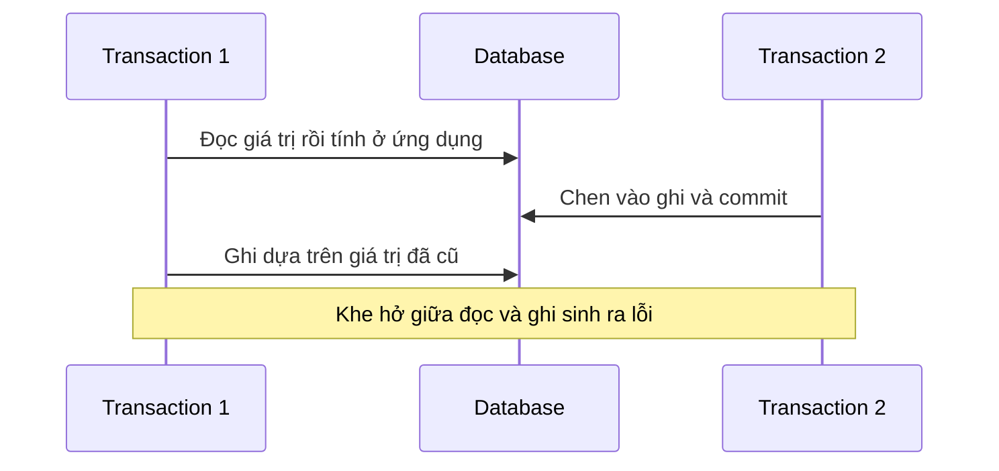
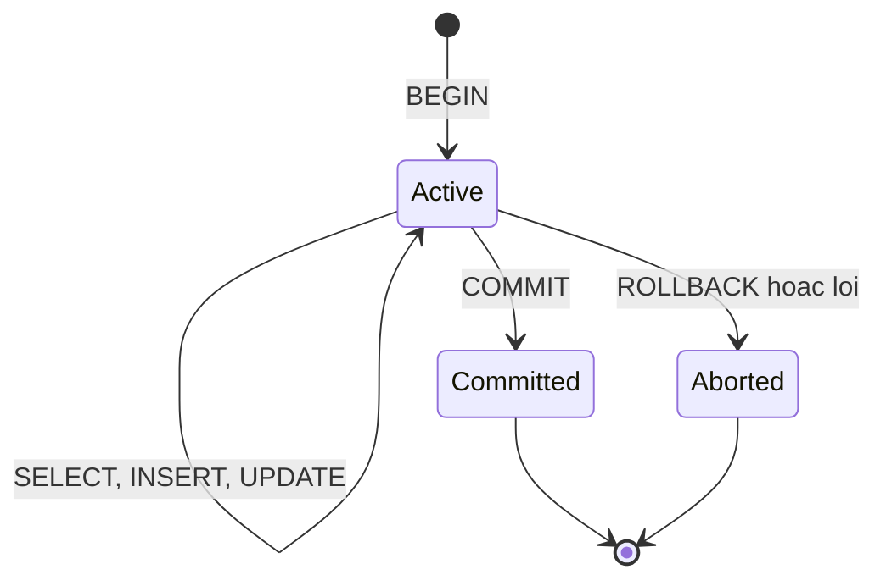
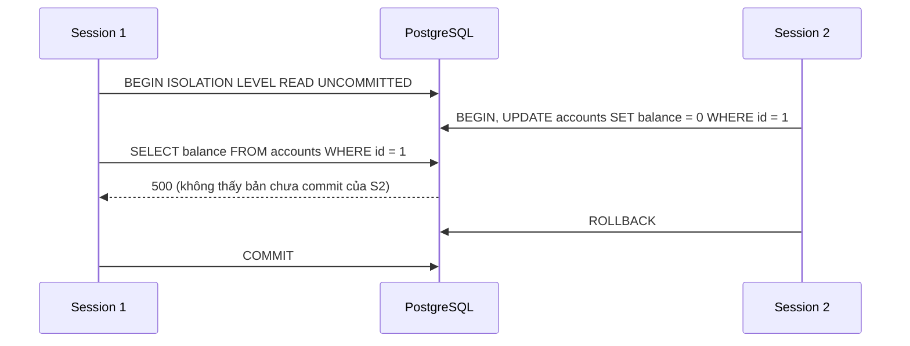
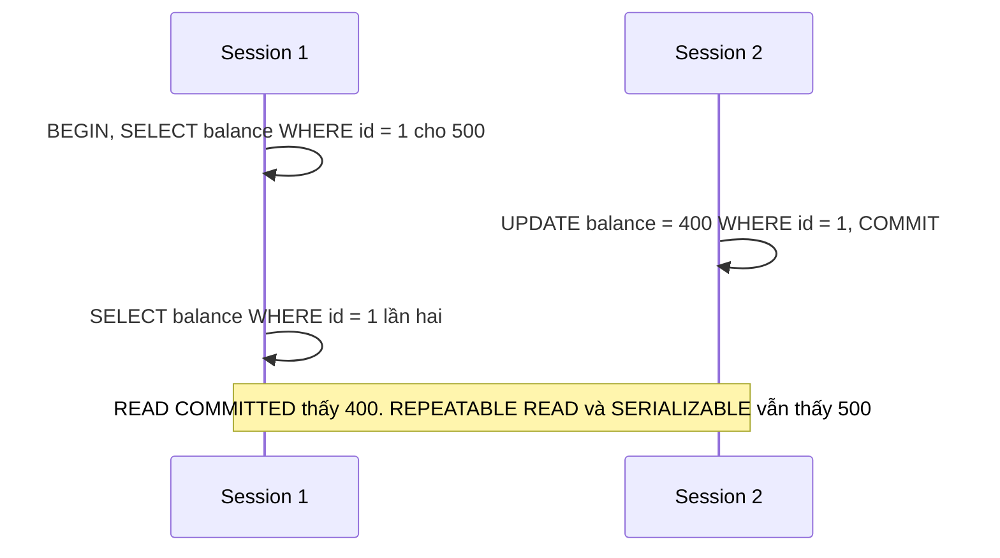
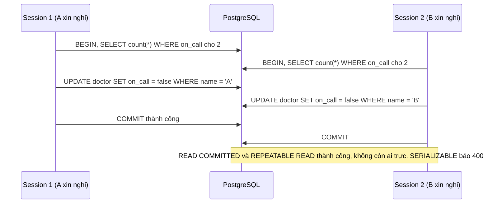
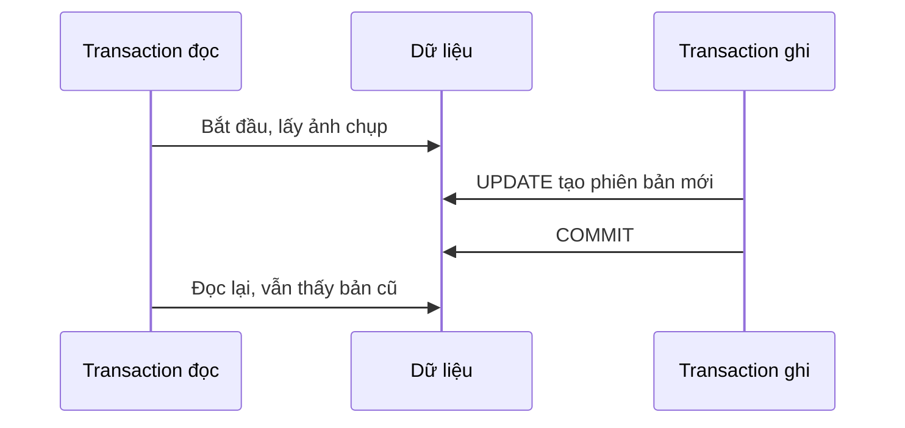

# Transaction, Isolation và Lock

**Cốt lõi:** Nhiều transaction chạy cùng lúc trên cùng dữ liệu, nên DB phải quyết định mỗi bên được thấy gì của bên kia. Hầu hết lỗi theo một mẫu: đọc, tính ở ứng dụng, rồi ghi, và có người chen vào giữa. Hiểu mẫu này thì chọn được cơ chế chặn.

- Vì isolation là mức "được thấy lại" thay đổi của người khác, nên mức càng cao càng ít dị thường nhưng càng nhiều lỗi phải retry.
- Vì MVCC giữ nhiều phiên bản và đọc từ snapshot, nên đọc không chặn ghi, nhưng bản cũ phải dọn và transaction dài làm phình dữ liệu.
- Vì lock trên hàng bị ghi không bắt được hai bên ghi hàng khác nhau, nên write skew cần Serializable hoặc lock chung tập hàng đã đọc.



Mô hình tư duy: mọi cơ chế trong bài đều nhằm đóng hoặc phát hiện khe hở giữa lúc đọc và lúc ghi.

**Tóm tắt:**

- Transaction gói nhiều thao tác thành một khối xong hết hoặc hủy hết; ACID là Atomicity, Consistency, Isolation, Durability.
- Độ khó thật nằm ở các transaction chạy concurrent: isolation, lock và MVCC là ba cơ chế giải bài toán đó.
- Bốn mức isolation chuẩn: Read Uncommitted, Read Committed, Repeatable Read, Serializable; PostgreSQL mặc định Read Committed, MySQL InnoDB mặc định Repeatable Read.
- Các anomaly cần biết: dirty read, non-repeatable read, phantom, lost update, write skew; hai loại cuối hay gây lỗi nghiệp vụ nhất.
- Lost update chặn bằng UPDATE atomic, SELECT ... FOR UPDATE hoặc cột version; write skew chỉ Serializable hoặc lock chung tập hàng đã đọc mới chặn được.
- MVCC giữ nhiều phiên bản của hàng nên đọc không chặn ghi; cái giá là phải dọn bản cũ và transaction chạy lâu làm phình dữ liệu.
- Deadlock xảy ra khi hai transaction mỗi bên giữ một lock mà bên kia cần; giảm bằng lock theo thứ tự cố định, giữ transaction ngắn và retry cả transaction.

## Transaction là gì và vì sao cần

Hãy tưởng tượng chuyển 100 đồng từ tài khoản A sang tài khoản B. Việc này gồm hai bước: trừ A, cộng B. Nếu server sập đúng giữa hai bước, tiền biến mất. Transaction giải quyết việc này: nó gói nhiều thao tác thành một khối, hoặc xong hết (commit), hoặc hủy hết (rollback), như thể chưa có gì xảy ra. Bộ bốn đặc tính đảm bảo điều đó gọi là ACID.

Nhưng một khối chạy một mình thì dễ; vấn đề thật là nhiều khối chạy cùng lúc. Hai người cùng mua món hàng cuối cùng mà không kiểm soát thì bán trùng, hoặc một bên ghi đè mất cập nhật của bên kia. **Isolation** quy định các transaction chạy concurrent được nhìn thấy nhau tới đâu; **lock** và **MVCC** là hai cơ chế DB dùng để thực hiện việc đó.

**Nền tảng:** Transaction gói nhiều thao tác thành một khối, xong hết hoặc hủy hết. Độ khó thật nằm ở việc nhiều transaction chạy concurrent, và isolation cùng lock cùng MVCC là các cơ chế giải bài toán đó.

## Khi nào dùng, khi nào không cần lo

Dùng transaction cho mọi thao tác ghi nhiều bước, nhất là tiền, tồn kho, đặt chỗ. Với một câu lệnh đơn lẻ thì DB đã tự bọc nó trong một transaction rồi (chế độ autocommit), nên bạn không cần mở thêm. Điều cần tránh là transaction dài: nó giữ lock lâu, làm các request khác bị chặn, và còn giữ lại các phiên bản dữ liệu cũ khiến DB phình ra.

Cách làm đúng: chọn mức isolation vừa đủ (mặc định thường là read committed hoặc repeatable read), dùng lock (`SELECT ... FOR UPDATE`) hoặc optimistic locking bằng cột version khi cần, và giữ transaction ngắn.

## Các khái niệm cần biết

- **Commit / rollback**: commit làm mọi thay đổi trong transaction có hiệu lực vĩnh viễn; rollback hủy tất cả. Lỗi giữa chừng thì DB tự rollback.
- **WAL (write-ahead log)**: DB ghi thay đổi vào log trên đĩa trước khi sửa dữ liệu thật. Nhờ vậy sập nguồn vẫn khôi phục được những gì đã commit.
- **Snapshot**: góc nhìn cố định của dữ liệu tại một thời điểm. Transaction đọc từ snapshot thì không bị ảnh hưởng bởi thay đổi của người khác.
- **MVCC (Multi-Version Concurrency Control)**: mỗi lần sửa tạo ra một phiên bản mới của hàng, bản cũ vẫn còn cho ai cần. Nhờ đó đọc không chặn ghi.
- **Pessimistic / optimistic lock**: bi quan là lock trước rồi mới sửa; lạc quan là cứ sửa, lúc ghi mới kiểm tra có ai đổi trước không.
- **Gap lock**: lock một khoảng trống giữa các giá trị index (InnoDB) để không ai chèn thêm hàng vào đó.
- **SSI (Serializable Snapshot Isolation)**: cách PostgreSQL thực hiện mức Serializable bằng cách theo dõi phụ thuộc đọc-ghi và hủy transaction gây xung đột thay vì lock.
- **Deadlock**: hai transaction chờ lock của nhau mãi mãi.
- **Retry**: chạy lại toàn bộ transaction khi DB báo lỗi serialization hoặc deadlock. Đây là hành vi bình thường chứ không phải bug.

Lifecycle của một transaction được tóm tắt dưới đây.



Đọc sơ đồ: mọi câu lệnh chạy trong trạng thái Active. Chỉ khi COMMIT thành công thay đổi mới bền; gặp lỗi (vi phạm constraint, deadlock, mất kết nối) thì chuyển sang Aborted và mọi thay đổi bị hủy.

## ACID

| | Ý nghĩa |
|---|---|
| **A**tomicity | Tất cả hoặc không gì cả |
| **C**onsistency | Từ trạng thái hợp lệ sang trạng thái hợp lệ (constraint luôn đúng) |
| **I**solation | Concurrent transaction không làm hỏng nhau |
| **D**urability | Đã commit thì không mất, nhờ write-ahead log (WAL) |

**Phải thuộc:** ACID: Atomicity (tất cả hoặc không gì cả), Consistency (từ trạng thái hợp lệ sang hợp lệ, phần lớn do constraint bạn khai báo), Isolation (concurrent transaction không làm hỏng nhau), Durability (đã commit thì không mất, nhờ WAL).

Lưu ý: Consistency ở đây phần lớn là trách nhiệm của bạn, qua việc khai báo constraint (`NOT NULL`, `UNIQUE`, `CHECK`, foreign key); DB chỉ đảm bảo không vi phạm những constraint đã khai báo. Isolation là chủ đề chính của bài vì nó có nhiều mức và mỗi mức đánh đổi hiệu năng lấy độ an toàn.

## Các hiện tượng dị thường

| Hiện tượng | Mô tả |
|---|---|
| Dirty read | Đọc dữ liệu chưa commit của transaction khác |
| Non-repeatable read | Đọc cùng một hàng hai lần ra giá trị khác nhau |
| Phantom read | Chạy lại cùng query khoảng thấy thêm/mất hàng |
| **Lost update** | Hai transaction đọc rồi cùng ghi đè, một cập nhật mất |
| **Write skew** | Hai transaction đọc cùng tập dữ liệu, ghi vào các hàng khác nhau, phá một constraint chung (hai bác sĩ cùng xin nghỉ trực) |

## Mức isolation (chuẩn SQL)

| Mức | Dirty | Non-repeatable | Phantom |
|---|---|---|---|
| Read Uncommitted | Có thể | Có thể | Có thể |
| **Read Committed** | Không | Có thể | Có thể |
| **Repeatable Read** | Không | Không | Theo chuẩn có thể |
| **Serializable** | Không | Không | Không |

**Phải thuộc:** Bốn mức isolation chuẩn SQL từ thấp đến cao: Read Uncommitted, Read Committed, Repeatable Read, Serializable. PostgreSQL mặc định Read Committed, MySQL InnoDB mặc định Repeatable Read. Dị thường: dirty read, non-repeatable read, phantom, lost update, write skew.

Thực tế khác nhau theo DB: **PostgreSQL** mặc định Read Committed; Repeatable Read của nó là snapshot isolation (không có phantom nhưng còn write skew); Serializable dùng SSI và có thể báo lỗi phải thử lại. **MySQL InnoDB** mặc định Repeatable Read, dùng gap lock chống phantom. Ở mức Serializable, InnoDB biến mọi `SELECT` thường thành `SELECT ... FOR SHARE` (shared lock) nên chậm và dễ deadlock, khác hẳn cách SSI của PostgreSQL (theo dõi phụ thuộc rồi hủy, không lock thêm). Luôn kiểm tra hành vi cụ thể của DB đang dùng.

### Hai transaction xen kẽ (minh họa theo hành vi PostgreSQL, chưa chạy trên DB thật)

Bảng `accounts(id, balance)`: tài khoản 1 có `balance = 500`. T1 và T2 là hai phiên.

**Non-repeatable read và phantom:**

| Thời điểm | T1 | T2 |
|---|---|---|
| 1 | `BEGIN; SELECT balance FROM accounts WHERE id=1;` thấy 500 | |
| 2 | | `UPDATE accounts SET balance=400 WHERE id=1; COMMIT;` |
| 3 | `SELECT balance ...` lần hai | |
| 4 | Read Committed: thấy **400** (non-repeatable). Repeatable Read: vẫn thấy **500** | |

Phantom giống hệt, chỉ khác là T2 `INSERT` thêm một hàng khớp điều kiện `WHERE` của T1: Read Committed thấy hàng mới ở lần đọc sau; Repeatable Read của PostgreSQL không thấy (snapshot cố định từ câu lệnh đầu tiên của transaction).

**Lost update (đọc rồi ghi, cả hai tính từ 500):**

| Thời điểm | T1 (rút 100) | T2 (rút 100) |
|---|---|---|
| 1 | `SELECT balance` được 500 | `SELECT balance` được 500 |
| 2 | ứng dụng tính 400 | ứng dụng tính 400 |
| 3 | `UPDATE ... SET balance=400; COMMIT` | |
| 4 | | `UPDATE ... SET balance=400; COMMIT` |
| Kết quả | Số dư **400** thay vì 300: mất một lần rút | |

Cách chặn:

| Cách | Hiệu quả |
|---|---|
| `UPDATE accounts SET balance = balance - 100 WHERE id=1 AND balance >= 100` | Đúng ở mọi mức: T2 chờ T1 commit rồi tính lại trên 400, được 300 |
| `SELECT ... FOR UPDATE` ở bước 1 | T2 bị chặn tại SELECT tới khi T1 commit, rồi đọc được 400 |
| Cột `version` | T2 cập nhật 0 hàng, ứng dụng phát hiện và thử lại |
| PostgreSQL Repeatable Read | T2 nhận lỗi `could not serialize access due to concurrent update` (SQLSTATE 40001), phải thử lại |
| MySQL Repeatable Read | Không tự báo lỗi: `UPDATE` đọc bản mới nhất nên vẫn có thể mất cập nhật nếu giá trị tính ở ứng dụng; vẫn phải dùng cập nhật atomic hoặc lock |

**Write skew** (constraint: ít nhất một bác sĩ trực; hiện cả A và B đang trực):

| Thời điểm | T1 (A xin nghỉ) | T2 (B xin nghỉ) |
|---|---|---|
| 1 | `SELECT count(*) WHERE on_call` được 2 | `SELECT count(*) WHERE on_call` được 2 |
| 2 | `UPDATE ... SET on_call=false WHERE name='A'` | `UPDATE ... SET on_call=false WHERE name='B'` |
| 3 | `COMMIT` | `COMMIT` |
| Kết quả | Không còn ai trực | |

Hai transaction ghi vào **hàng khác nhau** nên không xung đột ghi, Repeatable Read (snapshot) không phát hiện. Chặn bằng `SERIALIZABLE` (một trong hai bị hủy, thử lại) hoặc lock chung `SELECT ... FOR UPDATE` trên tập hàng đã đọc (hoặc một hàng lock điều phối).

**Phải thuộc:** Lost update chặn bằng UPDATE atomic (balance = balance - 100), SELECT ... FOR UPDATE, cột version, hoặc Repeatable Read ở PostgreSQL (báo lỗi phải retry). Write skew chỉ Serializable hoặc lock chung tập hàng đã đọc mới chặn được.

**Suy luận:** Lost update và write skew đều đến từ cùng một mẫu: đọc một giá trị, tính toán ở ứng dụng, rồi ghi, và giữa đọc với ghi có transaction khác chen vào. Với lost update, hai transaction cùng đọc số dư 500, cùng trừ 100 và cùng ghi 400, nên một lần trừ biến mất. Vì vậy cách chặn tự nhiên nhất là bỏ khoảng hở đó: để database tự tính trong một câu (balance = balance - 100), hoặc lock hàng ngay lúc đọc bằng SELECT ... FOR UPDATE, hoặc phát hiện thay đổi bằng cột version rồi retry. Write skew khác ở chỗ hai transaction đọc cùng một tập hàng nhưng ghi vào các hàng khác nhau (hai bác sĩ cùng thấy còn người trực và cùng xin nghỉ), nên lock trên hàng bị ghi không đụng nhau và không chặn được gì. Muốn chặn phải lock cả tập hàng đã đọc, hoặc dùng Serializable để database tự phát hiện xung đột đọc-ghi và hủy một bên. Điểm dễ nhầm là nghĩ Repeatable Read là đủ an toàn: nó giữ cho lần đọc lại không đổi nhưng không ngăn write skew. Khi thiết kế, hãy xác định các nghiệp vụ dạng đọc rồi ghi và gán cho mỗi cái đúng một cơ chế bảo vệ tường minh.

Tóm tắt phòng thủ theo mức (PostgreSQL):

| Hiện tượng | Read Committed | Repeatable Read | Serializable |
|---|---|---|---|
| Dirty read | Không | Không | Không |
| Non-repeatable read | Có | Không | Không |
| Phantom | Có | Không | Không |
| Lost update (đọc rồi ghi) | Có | Không (báo lỗi, phải retry) | Không (báo lỗi, phải retry) |
| Write skew | Có | Có | Không (báo lỗi, phải retry) |

Điểm khác MySQL InnoDB (Repeatable Read mặc định): đọc thường dùng snapshot nên không thấy phantom, nhưng `SELECT ... FOR UPDATE`, `UPDATE`, `DELETE` đọc bản mới nhất và dùng gap lock để chặn chèn vào khoảng đang lock. Các mức cao đòi hỏi ứng dụng có vòng lặp thử lại.

## Kịch bản hai session từng bước trên PostgreSQL

Phần trên đã nêu bảng thời điểm. Phần này viết lại thành lịch xen kẽ hai session (hai cửa sổ `psql`) kèm SQL có thể gõ từng bước, để bạn tự tái hiện và quan sát. _Minh họa_: các kết quả dưới đây suy ra từ tài liệu PostgreSQL về isolation, chưa chạy thử trên server thật trong lần viết này; hãy chạy lại trên PostgreSQL 18 của bạn.

Dữ liệu dùng chung:

```sql
CREATE TABLE accounts (id int PRIMARY KEY, balance int NOT NULL);
INSERT INTO accounts VALUES (1, 500), (2, 300);

CREATE TABLE doctor (name text PRIMARY KEY, on_call boolean NOT NULL);
INSERT INTO doctor VALUES ('A', true), ('B', true);
```

### Kịch bản 1: dirty read (không xảy ra ở PostgreSQL)



```sql
-- Session 1
BEGIN ISOLATION LEVEL READ UNCOMMITTED;
-- Session 2
BEGIN; UPDATE accounts SET balance = 0 WHERE id = 1;   -- chưa commit
-- Session 1
SELECT balance FROM accounts WHERE id = 1;             -- 500
-- Session 2
ROLLBACK;
-- Session 1
COMMIT;
```

Kết quả: S1 luôn thấy 500. Theo tài liệu PostgreSQL, `READ UNCOMMITTED` được chấp nhận về cú pháp nhưng hành xử y hệt `READ COMMITTED`, nên dirty read không bao giờ xảy ra. Điều này nhờ MVCC: bản chưa commit của S2 là tuple có `xmin` của một transaction chưa commit, nên snapshot của S1 bỏ qua nó.

### Kịch bản 2: non-repeatable read



```sql
-- Session 1                                    -- Session 2
BEGIN;  -- hoặc BEGIN ISOLATION LEVEL REPEATABLE READ;
SELECT balance FROM accounts WHERE id = 1;      -- 500
                                                UPDATE accounts SET balance = 400 WHERE id = 1;
                                                -- autocommit: đã commit
SELECT balance FROM accounts WHERE id = 1;      -- READ COMMITTED: 400. REPEATABLE READ: 500
COMMIT;
```

Lý do: ở `READ COMMITTED` mỗi câu lệnh lấy snapshot mới, ở `REPEATABLE READ` snapshot được lấy ở câu lệnh đầu tiên (không tính `BEGIN`) và giữ đến hết transaction.

### Kịch bản 3: phantom read

```sql
-- Session 1                                    -- Session 2
BEGIN;  -- thử cả READ COMMITTED và REPEATABLE READ
SELECT count(*) FROM accounts WHERE balance >= 300;   -- 2
                                                INSERT INTO accounts VALUES (3, 900);  -- đã commit
SELECT count(*) FROM accounts WHERE balance >= 300;   -- READ COMMITTED: 3. REPEATABLE READ: 2
COMMIT;
```

Ở `READ COMMITTED` S1 thấy hàng mới (phantom). Ở `REPEATABLE READ` của PostgreSQL S1 vẫn thấy 2 vì snapshot cố định, chặt hơn yêu cầu của chuẩn SQL (chuẩn cho phép phantom ở mức này). Chạy `DELETE FROM accounts WHERE id = 3;` để dọn trước khi thử kịch bản kế.

### Kịch bản 4: write skew



```sql
-- Session 1 (A)                                   -- Session 2 (B)
BEGIN ISOLATION LEVEL SERIALIZABLE;                BEGIN ISOLATION LEVEL SERIALIZABLE;
SELECT count(*) FROM doctor WHERE on_call;         SELECT count(*) FROM doctor WHERE on_call;   -- cả hai thấy 2
UPDATE doctor SET on_call = false WHERE name='A';  UPDATE doctor SET on_call = false WHERE name='B';
COMMIT;                                            COMMIT;
-- ở SERIALIZABLE, một trong hai nhận:
-- ERROR: could not serialize access due to read/write dependencies among transactions
-- SQLSTATE 40001: ứng dụng chạy lại cả transaction, lần này thấy count = 1 và từ chối cho nghỉ
```

Hai câu `UPDATE` ghi vào hai hàng khác nhau nên không có xung đột ghi cùng dòng; chỉ cơ chế theo dõi phụ thuộc đọc-ghi (SSI) của `SERIALIZABLE` thấy vòng "T1 đọc thứ T2 ghi, T2 đọc thứ T1 ghi" và hủy một bên. Bên nào bị hủy do PostgreSQL quyết định (thường rơi vào bên commit sau), đừng viết code phụ thuộc vào việc đó. Cách khác không cần `SERIALIZABLE`: cả hai chạy `SELECT ... FROM doctor WHERE on_call FOR UPDATE` trước, bên sau bị chặn chờ bên trước commit rồi đọc lại.

### Bảng kết quả theo mức isolation (PostgreSQL)

| Kịch bản | READ COMMITTED | REPEATABLE READ | SERIALIZABLE |
|---|---|---|---|
| Dirty read | Không xảy ra | Không xảy ra | Không xảy ra |
| Non-repeatable read | Xảy ra (thấy 400) | Không (vẫn 500) | Không (vẫn 500) |
| Phantom | Xảy ra (count 3) | Không (count 2) | Không (count 2) |
| Lost update (hai bên `UPDATE` cùng dòng với giá trị tính ở ứng dụng) | Xảy ra | Bên sau lỗi 40001 | Bên sau lỗi 40001 |
| Write skew | Xảy ra | Xảy ra | Một bên lỗi 40001 |

**Nền tảng:** Ở PostgreSQL, READ UNCOMMITTED hành xử như READ COMMITTED nên không có dirty read. READ COMMITTED lấy snapshot mới cho mỗi câu lệnh (có non-repeatable và phantom), REPEATABLE READ giữ một snapshot cho cả transaction (không phantom nhưng còn write skew), SERIALIZABLE thêm SSI để phát hiện cả write skew bằng lỗi 40001 phải retry.

**Suy luận:** Mỗi dị thường tương ứng một thứ transaction được phép "thấy lại". Non-repeatable read và phantom đều là lần đọc thứ hai thấy dữ liệu mới của người khác, nên chỉ cần cố định snapshot là hết; vì vậy REPEATABLE READ của PostgreSQL chặn được cả hai. Lost update thêm một ràng buộc: ghi vào dòng đã bị người khác commit sau snapshot của mình thì phải lỗi, vì ghi đè lên thứ mình chưa từng thấy là sai. Write skew thì khác hẳn: hai bên ghi hai dòng khác nhau, snapshot của mỗi bên vẫn nhất quán nội tại, nên không có gì "lỗi" nếu chỉ nhìn từng bên. Chỉ khi nhìn cả hai và thấy kết quả không tương đương một thứ tự chạy tuần tự nào thì mới phát hiện được, và đó chính là việc của SSI. Điểm dễ nhầm là nghĩ REPEATABLE READ nghĩa là "an toàn như chạy tuần tự". Hệ quả hành động: với nghiệp vụ kiểm tra một điều kiện trên nhiều dòng rồi ghi, chọn SERIALIZABLE kèm retry hoặc lock tường minh tập dòng đã đọc, và luôn viết vòng lặp thử lại cho mã `40001`.

## MVCC



Đọc sơ đồ: người đọc lấy ảnh chụp trước, người ghi tạo phiên bản mới và commit, nhưng người đọc vẫn thấy bản cũ vì nó đọc từ ảnh chụp của mình. Kết quả: đọc không chặn ghi, ghi không chặn đọc. Ảnh chụp lấy tại lúc bắt đầu transaction (hoặc bắt đầu câu lệnh, tùy mức cô lập).

Cái giá phải trả: bản cũ cần dọn (VACUUM ở PostgreSQL, purge ở InnoDB); transaction chạy rất lâu giữ bản cũ và gây phình dữ liệu.

**Nền tảng:** MVCC giữ nhiều phiên bản của hàng, mỗi transaction đọc từ snapshot của mình nên đọc không chặn ghi và ghi không chặn đọc. Cái giá là phải dọn bản cũ (VACUUM, purge), và transaction chạy lâu làm phình dữ liệu.

**Suy luận:** Nếu mọi lần đọc đều phải lock để khỏi thấy dữ liệu đang sửa dở, người đọc và người ghi sẽ chặn nhau và hệ thống nghẽn ngay khi tải tăng. MVCC tránh điều đó bằng cách không sửa tại chỗ: mỗi lần ghi tạo một phiên bản mới, còn người đọc dùng snapshot trỏ tới các phiên bản đã commit tại thời điểm của mình, nên đọc và ghi không phải chờ nhau. Phiên bản cũ phải được giữ chừng nào còn một snapshot có thể cần nó, và đó là nguồn gốc của cái giá: transaction chạy lâu giữ snapshot cũ nên VACUUM hoặc purge không dọn được, bảng và undo phình ra. Điểm dễ nhầm là nghĩ MVCC loại bỏ lock; hai transaction ghi cùng một hàng vẫn phải chờ nhau, và lock vẫn cần cho các thao tác như SELECT ... FOR UPDATE. Hệ quả hành động là giữ transaction ngắn, không để transaction mở khi gọi dịch vụ ngoài, và theo dõi transaction mở lâu như một chỉ số vận hành.

## Lock

Khi cần bảo vệ một thao tác đọc rồi ghi, thứ tự chọn công cụ là: câu lệnh `UPDATE` atomic (`SET qty = qty - 1 WHERE id = ? AND qty > 0`), rồi optimistic lock bằng cột `version`, rồi pessimistic lock `SELECT ... FOR UPDATE`, và cuối cùng là `SERIALIZABLE` kèm vòng thử lại. Càng xuống dưới càng tốn tài nguyên. Sơ đồ chọn, bảng so sánh từng cách, `SKIP LOCKED` cho queue công việc và idempotency bằng unique constraint nằm ở bài [Lock, deadlock và concurrency ở tầng database](/go?p=02-Database%2Fhard%2Flt-10-locking-deadlock-database.md), mục 3 và 4.

## Deadlock

Deadlock xảy ra khi hai transaction mỗi bên giữ một lock mà bên kia cần, nên không ai tiến được. DB phát hiện chu trình chờ và hủy một bên, bên đó phải **thử lại** cả transaction. Cách giảm: luôn lock các dòng theo **thứ tự cố định**, giữ transaction ngắn, truy cập bảng theo cùng thứ tự, dùng index đúng để lock ít dòng. Ví dụ chuyển tiền lock theo id tăng dần, sơ đồ hai transaction lock ngược thứ tự, mã lỗi của từng DB và cách đọc báo cáo deadlock ở bài [Lock, deadlock và concurrency ở tầng database](/go?p=02-Database%2Fhard%2Flt-10-locking-deadlock-database.md), mục 5.

## Điều cần nhớ

- `SELECT` rồi `UPDATE` ở Read Committed dễ lost update: dùng cập nhật atomic, lock, hoặc version.
- Đừng giữ transaction mở khi gọi API ngoài hoặc đợi người dùng.
- Mức cao hơn không "miễn phí": tăng xung đột và lỗi cần retry.
- Transaction trải nhiều DB/service cần mô hình khác (Saga, Outbox), xem [Distributed Transactions](/go?p=15-System%20Design%2Fhard%2Flt-10-distributed-transactions.md).
- Ánh xạ sang Spring: [Transaction](/go?p=01-Spring-Boot%2Fmedium%2Flt-05-transaction.md).
- Lock, deadlock, `SKIP LOCKED` và cách chọn công cụ: [Lock, deadlock và concurrency ở tầng database](/go?p=02-Database%2Fhard%2Flt-10-locking-deadlock-database.md).

## Phỏng vấn khó: chuỗi hỏi xoáy

Người phỏng vấn senior thường mở bằng câu dễ rồi xoáy xuống cơ chế, đánh đổi và sự cố thật. Câu trả lời tốt luôn đi từ cốt lõi xuống.

### Chuỗi 1: Lost update, write skew và giới hạn của Repeatable Read

1. **Câu mở:** Hai request cùng rút tiền từ một tài khoản, số dư cuối sai. Bạn chặn bằng cách nào?
2. **Xoáy 1:** Nếu nâng lên Repeatable Read thì sao, và PostgreSQL với MySQL InnoDB khác nhau thế nào ở đây?
3. **Xoáy 2:** Hai bác sĩ cùng xin nghỉ trực, mỗi người cập nhật hàng của mình, và không còn ai trực. Repeatable Read có cứu được không, vì sao lock trên hàng bị ghi không giúp?

**Đáp án ngắn:** Cả hai lỗi cùng một mẫu: đọc, tính ở ứng dụng, rồi ghi, và có người chen vào giữa. Với lost update, cách gọn nhất là bỏ khe hở: `UPDATE ... SET balance = balance - 100 WHERE balance >= 100`, đúng ở mọi mức. Hoặc `SELECT ... FOR UPDATE`, hoặc cột `version` rồi retry. Ở PostgreSQL Repeatable Read, ghi vào dòng mà người khác đã commit sau snapshot của mình thì báo lỗi 40001 và phải retry. MySQL Repeatable Read không tự báo lỗi, vì `UPDATE` đọc bản mới nhất, nên vẫn mất cập nhật nếu giá trị tính ở ứng dụng. Write skew khác hẳn: hai bên đọc cùng tập hàng nhưng ghi hàng khác nhau, nên không có xung đột ghi cùng dòng và snapshot của mỗi bên vẫn nhất quán. Repeatable Read không cứu được. Chỉ Serializable (SSI thấy vòng phụ thuộc đọc-ghi và hủy một bên, lỗi 40001) hoặc lock chung cả tập hàng đã đọc mới chặn được. Trong cả hai trường hợp ứng dụng phải có vòng lặp thử lại cả transaction.

**Sai lầm hay gặp:**

- Nói Repeatable Read "an toàn như chạy tuần tự".
- Dùng cập nhật atomic cho lost update rồi tin rằng nó cũng giải được write skew.
- Không nhắc retry khi gặp 40001.

### Chuỗi 2: MVCC, snapshot và cái giá của transaction dài

1. **Câu mở:** MVCC giải quyết vấn đề gì và vì sao đọc không chặn ghi?
2. **Xoáy 1:** Snapshot được lấy lúc nào ở Read Committed và Repeatable Read, và vì sao `READ UNCOMMITTED` ở PostgreSQL không có dirty read?
3. **Xoáy 2:** MVCC có nghĩa là không cần lock nữa không? Và một transaction mở lâu gây hại gì dù nó không ghi gì?

**Đáp án ngắn:** Nếu mọi lần đọc đều phải lock để khỏi thấy dữ liệu sửa dở thì người đọc và người ghi chặn nhau. MVCC không sửa tại chỗ: mỗi lần ghi tạo một phiên bản mới, người đọc dùng snapshot trỏ tới các phiên bản đã commit tại thời điểm của mình. Read Committed lấy snapshot mới cho mỗi câu lệnh; Repeatable Read lấy ở câu lệnh đầu tiên và giữ đến hết transaction. Ở PostgreSQL, bản chưa commit là tuple của một transaction chưa commit, snapshot bỏ qua nó, nên `READ UNCOMMITTED` hành xử như Read Committed. MVCC không loại bỏ lock: hai transaction ghi cùng một hàng vẫn chờ nhau, và `SELECT ... FOR UPDATE` vẫn cần. Cái giá là phiên bản cũ phải được giữ chừng nào còn snapshot cần nó, nên transaction mở lâu, kể cả chỉ đọc hoặc quên commit, làm VACUUM hoặc purge không dọn được, dữ liệu phình. Vì vậy giữ transaction ngắn, không mở transaction khi gọi dịch vụ ngoài, và theo dõi transaction lâu như một chỉ số vận hành.

**Sai lầm hay gặp:**

- Nói "MVCC không cần lock" hoặc "đọc không bao giờ bị ảnh hưởng gì".
- Nhầm thời điểm lấy snapshot giữa Read Committed và Repeatable Read.
- Bỏ sót rằng transaction chỉ đọc nhưng mở lâu vẫn giữ bản cũ.

