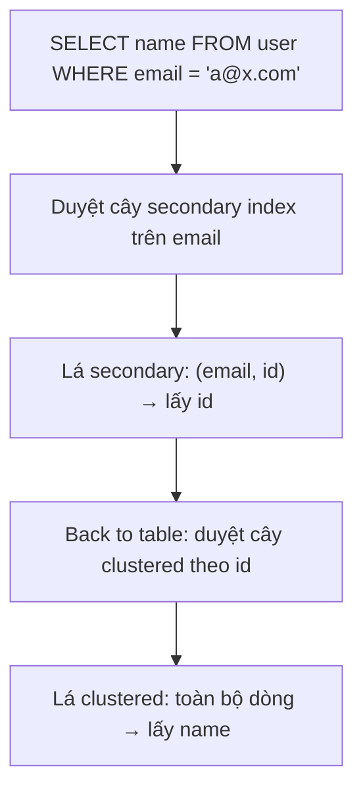
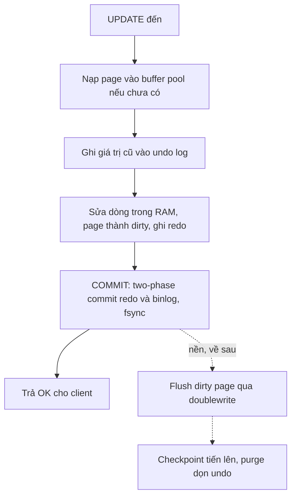

# MySQL InnoDB bên trong

Nền tảng: [Index và tối ưu query](/go?p=02-Database%2Fmedium%2Flt-03-index-toi-uu-truy-van.md), [Transaction, Isolation và Lock](/go?p=02-Database%2Fmedium%2Flt-04-transaction-isolation-lock.md), [Kiến trúc lưu trữ](/go?p=02-Database%2Fhard%2Flt-06-luu-tru-chon-db.md). Bài này đi vào cơ chế bên trong của InnoDB: dữ liệu nằm ở đâu, một lần ghi đi qua những log nào, vì sao crash không mất dữ liệu, và vì sao chọn primary key sai làm chậm cả hệ thống.

**Cốt lõi:** InnoDB muốn ghi nhanh mà vẫn không mất dữ liệu, nên lúc commit nó ghi một log tuần tự trước, còn page dữ liệu để ghi nền. Dữ liệu thì được tổ chức quanh một cây duy nhất theo primary key.

- Vì bảng chính là clustered index theo primary key, nên key nhỏ và tăng dần giữ cây gọn và mọi secondary index nhỏ.
- Vì commit chỉ cần log xuống đĩa, nên mỗi log lo một việc: redo phục hồi, undo cho rollback và MVCC, binlog cho replication, doublewrite chống page ghi dở.
- Vì redo và binlog là hai log độc lập, nên two-phase commit nội bộ giữ chúng khớp nhau sau crash.


Mô hình tư duy: phần client phải chờ chỉ là log tuần tự, còn việc ghi page tốn kém được hoãn lại và vẫn an toàn nhờ log đã có trên đĩa.

**Tóm tắt:**

- Bảng InnoDB chính là clustered index theo primary key, lá chứa toàn bộ dòng; secondary index chứa primary key ở lá nên tra bằng nó cần thêm bước quay lại bảng.
- Primary key nên nhỏ và tăng dần (BIGINT AUTO_INCREMENT, UUID v7, Snowflake); UUID v4 gây page split và fragmentation, và key càng to thì mọi secondary index càng to.
- Buffer pool giữ page trong memory còn change buffer gom các thay đổi secondary index để ghi sau.
- Một lần ghi đi qua bốn thứ: redo log (phục hồi crash), undo log (rollback và MVCC), binlog (replication và PITR), doublewrite (chống torn page).
- Commit chỉ cần log xuống đĩa chứ không đợi page dữ liệu (write-ahead logging); redo và binlog được ghép bằng two-phase commit nội bộ để không lệch nhau.
- MVCC dựa trên undo log và read view: READ COMMITTED tạo read view mỗi câu lệnh, REPEATABLE READ (mặc định) tạo một lần cho cả transaction.
- Transaction mở lâu làm purge không dọn được undo; theo dõi History list length để phát hiện.

## InnoDB là gì và vì sao nên hiểu bên trong

InnoDB là storage engine mặc định của MySQL, tức là phần chịu trách nhiệm thật sự lưu và đọc dữ liệu trên đĩa (MySQL phía trên chỉ phân tích SQL rồi nhờ engine làm việc). InnoDB lưu dữ liệu theo B+Tree, hỗ trợ transaction ACID, MVCC (nhiều phiên bản của một dòng để đọc không chặn ghi) và lock mức hàng. Điểm đặc trưng cần nhớ nhất: mọi bảng thực chất là một **clustered index** theo primary key, nghĩa là các dòng được sắp xếp vật lý theo primary key ngay trong cây index.

Vì sao phải biết cơ chế bên trong? Vì hầu hết lỗi hiệu năng và lỗi "lạ" của MySQL (chậm dần theo thời gian, deadlock, replica lệch, mất dữ liệu sau crash, bảng phình) đều giải thích được bằng cấu trúc này. Khi hiểu cơ chế, bạn chẩn đoán có căn cứ thay vì đoán mò.

Bạn sẽ cần kiến thức này khi chọn primary key, thiết kế index, chỉnh các tham số `innodb_*`, điều tra chậm khi ghi, điều tra deadlock hoặc độ trễ replication. Cách học dễ nhất là chia InnoDB thành ba lớp: (1) cấu trúc dữ liệu trên đĩa (page, B+Tree), (2) memory (buffer pool, change buffer), (3) nhóm log (redo, undo, binlog, doublewrite) và cách chúng phối hợp khi commit. Nếu chưa vững về index, hãy đọc trước [Index và tối ưu query](/go?p=02-Database%2Fmedium%2Flt-03-index-toi-uu-truy-van.md).

## Các khái niệm cần biết

- **Page**: khối dữ liệu 16 KB, đơn vị InnoDB đọc và ghi đĩa. Đọc một dòng cũng phải nạp cả page chứa nó.
- **Clustered index**: cây chứa toàn bộ dòng, sắp theo primary key. **Secondary index**: cây index khác, lá chứa giá trị cột được index kèm primary key.
- **Buffer pool**: vùng RAM cache page. **Dirty page**: page đã sửa trong RAM nhưng chưa ghi xuống đĩa.
- **Redo log**: log thay đổi để phát lại sau crash. **Undo log**: lưu giá trị cũ để rollback và dựng phiên bản cũ. **Binlog**: log mức server cho replication. **Doublewrite**: bản sao page để chống page ghi dở.
- **WAL (write-ahead logging)**: quy tắc "ghi log xuống đĩa trước, ghi page dữ liệu sau", cho phép commit nhanh mà vẫn bền.
- **`fsync`**: lời gọi hệ điều hành ép dữ liệu thật sự xuống đĩa chứ không dừng ở page cache. Đây là phép tốn kém nhất của commit.
- **Checkpoint**: mốc cho biết các thay đổi trước đó đã nằm trên đĩa, nên redo trước mốc này có thể bỏ.
- **Read view**: danh sách transaction đang hoạt động tại một thời điểm, dùng để quyết định phiên bản dòng nào "nhìn thấy được". **Purge**: thread nền xóa các phiên bản cũ không ai cần nữa.
- **Group commit**: gộp nhiều transaction vào cùng một lần `fsync`.

## 1. Page và B+Tree: dữ liệu nằm ở đâu

Đơn vị lưu trữ và I/O của InnoDB là **page**, mặc định 16 KB (`innodb_page_size`). Mỗi bảng (một index) là một B+Tree gồm các page: page lá chứa dữ liệu, page trong chứa key và con trỏ xuống page con. Các page lá được nối với nhau bằng danh sách liên kết hai chiều, nên quét khoảng chỉ cần duyệt ngang.

Vì mỗi page chứa hàng trăm key, cây rất nông: bảng hàng trăm triệu dòng thường chỉ sâu 3 đến 4 tầng, tức 3 đến 4 lần đọc page để tìm một key (các tầng trên cùng thường đã nằm sẵn trong memory).

### Clustered index và secondary index

| | Clustered index (primary key) | Secondary index |
|---|---|---|
| Leaf node chứa | **Toàn bộ dòng** | Giá trị cột được index + **giá trị primary key** |
| Số lượng mỗi bảng | Đúng một | Nhiều |
| Tra cứu | Một lần duyệt cây | Duyệt cây secondary, rồi (nếu cần cột khác) duyệt tiếp cây clustered |

Nếu bảng không khai báo `PRIMARY KEY`, InnoDB dùng unique index NOT NULL đầu tiên, và nếu cũng không có thì tự tạo cột ẩn row id 6 byte. Thực tế nên luôn khai báo primary key rõ ràng.

**Nền tảng:** Trong InnoDB, bảng chính là clustered index theo primary key (lá chứa toàn bộ dòng), còn secondary index chứa primary key ở lá. Vì vậy tra bằng secondary index cần thêm bước quay lại bảng, và primary key càng to thì mọi secondary index càng to.



Bước "quay lại bảng" (back to table, bookmark lookup) là một lần duyệt cây thứ hai và là I/O ngẫu nhiên. Với query trả hàng nghìn dòng, bước này thường là chi phí chính.

### Covering index

Nếu index chứa **đủ mọi cột mà query cần** thì InnoDB trả lời hoàn toàn từ secondary index, bỏ qua bước quay lại bảng. `EXPLAIN` hiện `Using index` trong cột `Extra`.

```sql
-- index (customer_id, created_at) chưa đủ vì còn cần total
SELECT customer_id, created_at, total FROM orders WHERE customer_id = 42;

-- thêm total vào cuối index => covering, không còn back to table
CREATE INDEX idx_cust_created_total ON orders (customer_id, created_at, total);
```

Vì secondary index luôn mang theo primary key, query chỉ cần `id` và cột đã index cũng tự động là covering. Hệ quả quan trọng: **primary key càng to, mọi secondary index càng to**.

**Phải thuộc:** Covering index chứa đủ mọi cột query cần nên bỏ được bước back to table; EXPLAIN hiện Using index ở cột Extra. Primary key nên nhỏ và tăng dần (BIGINT AUTO_INCREMENT, UUID v7, Snowflake), tránh UUID v4 vì gây page split và fragmentation.

**Suy luận:** Vì bảng là clustered index nên các dòng được sắp xếp vật lý theo primary key, và mỗi page lá chứa một dải key liên tiếp. Nếu key tăng dần, mỗi dòng mới nối vào page cuối cùng: ghi tuần tự, page đầy thì mở page mới, các page cũ được lấp đầy. Nếu key ngẫu nhiên như UUID v4, mỗi dòng mới rơi vào một page bất kỳ trong cây; page đó phải được nạp vào buffer pool (đọc đĩa nếu chưa có), và khi đã đầy thì phải tách đôi (page split), để lại hai page chỉ đầy một nửa. Kết quả là ghi ngẫu nhiên, nhiều cache miss và cây phình do page thưa. Thêm nữa, mọi secondary index lưu primary key ở lá, nên key 16 byte được lặp lại trong từng secondary index và làm chúng to hơn nhiều so với BIGINT 8 byte. Điểm dễ nhầm là cho rằng chỉ ghi bị ảnh hưởng; đọc cũng chậm hơn vì buffer pool bị page thưa chiếm chỗ. Hệ quả hành động: dùng key nhỏ, tăng dần hoặc gần tăng dần theo thời gian (BIGINT, UUID v7, Snowflake) và đừng dùng chuỗi dài làm primary key.

## 2. Vì sao UUID ngẫu nhiên làm hỏng clustered index

Clustered index sắp xếp **vật lý theo primary key**. Hai kiểu chèn có hành vi rất khác:

| | Key tăng dần (`AUTO_INCREMENT`, UUID v7, Snowflake) | UUID v4 ngẫu nhiên |
|---|---|---|
| Vị trí chèn | Luôn ở page lá cuối cùng | Rải đều khắp cây |
| Page split | Hiếm, page được lấp đầy | Thường xuyên: chèn vào page đã đầy phải tách đôi |
| Mức lấp page | Cao | Thấp, fragmentation |
| Buffer pool | Chỉ "nóng" ở đuôi cây | Phải kéo page ngẫu nhiên vào memory, dễ miss |
| Kích thước | `BIGINT` 8 byte | 16 byte nhị phân (36 byte nếu lưu `CHAR(36)`) lặp lại trong **mọi** secondary index |

**Page split** xảy ra khi chèn vào một page đã đầy: InnoDB cấp page mới, chuyển khoảng một nửa dòng sang, rồi sửa con trỏ trên page cha. Tốn I/O, sinh thêm redo log, và để lại hai page chỉ đầy chừng một nửa.

Cách xử lý thường dùng: primary key `BIGINT` tăng dần cho bảng lớn; nếu cần định danh toàn cục thì dùng ID có thành phần thời gian ở đầu (UUID v7, ULID, Snowflake), hoặc lưu UUID dưới dạng `BINARY(16)` (hàm `UUID_TO_BIN(uuid, 1)` hoán đổi các phần để tăng dần theo thời gian, nhưng chỉ có ý nghĩa với UUID v1, UUID v4 vẫn ngẫu nhiên), giữ `id` nội bộ làm primary key và UUID làm cột unique riêng.

## 3. Memory: buffer pool và change buffer

### Buffer pool

Là vùng nhớ lớn nhất của InnoDB, cache các page dữ liệu và index (`innodb_buffer_pool_size`, thường đặt vài chục phần trăm đến khoảng ba phần tư RAM trên máy chuyên dụng). Mọi đọc và ghi đều đi qua đây: page được sửa trong memory trước, trở thành **dirty page**, rồi được ghi xuống đĩa nền sau (flush).

Buffer pool dùng LRU có hai vùng: page mới nạp vào **điểm giữa** (vùng "old") và chỉ được đẩy lên vùng "young" khi được truy cập lần nữa sau một khoảng ngắn. Nhờ vậy một lệnh quét toàn bảng lớn không đẩy mất toàn bộ tập dữ liệu nóng ra khỏi memory.

Nếu buffer pool quá nhỏ so với tập dữ liệu nóng, page liên tục bị đẩy ra rồi đọc lại từ đĩa, query chậm hẳn. Chỉ số cần theo dõi: tỷ lệ hit của buffer pool; nếu thấp thì query chủ yếu đang đọc đĩa.

### Change buffer

Khi cập nhật **secondary index không unique** mà page index đó chưa nằm trong buffer pool, InnoDB không đọc page lên chỉ để sửa. Nó ghi thay đổi vào change buffer và gộp (merge) vào page thật khi page đó được nạp vì một lý do khác. Giúp giảm I/O ngẫu nhiên khi ghi nhiều. Index unique không dùng được cách này vì phải kiểm tra trùng ngay, tức phải đọc page.

## 4. Một lần ghi đi qua những log nào

Vấn đề đặt ra: ghi thẳng page dữ liệu xuống đĩa mỗi lần commit thì rất chậm (ghi ngẫu nhiên), còn không ghi thì mất dữ liệu khi crash. InnoDB giải bằng cách dùng nhiều log, mỗi log một việc. Gộp chung thành một thì rất dễ nhầm.

| Log | Tầng | Loại | Mục đích |
|---|---|---|---|
| **Redo log** | InnoDB | Vật lý ("page X, offset Y, ghi giá trị Z") | Đảm bảo **bền vững** (Durability) và phục hồi sau crash |
| **Undo log** | InnoDB | Logic ("giá trị cũ của dòng") | **Rollback** và **MVCC** (dựng lại phiên bản cũ) |
| **Binlog** | Server MySQL (mọi engine) | Logic (event/dòng thay đổi) | **Replication** và khôi phục theo thời điểm (PITR) |
| **Doublewrite** | InnoDB | Bản sao page | Chống **torn page** (page ghi dở khi mất điện) |

**Phải thuộc:** Redo log: bền vững và phục hồi crash (vật lý, ghi tuần tự). Undo log: rollback và MVCC. Binlog: replication và PITR (tầng server). Doublewrite: chống torn page. Commit chỉ cần log xuống đĩa, không đợi page dữ liệu (write-ahead logging).

### Redo log và WAL

Nguyên tắc **write-ahead logging**: mô tả thay đổi phải xuống đĩa **trước** khi dirty page được phép xuống đĩa. Ghi redo là ghi **tuần tự** vào cuối file, rẻ hơn nhiều so với ghi ngẫu nhiên từng page dữ liệu. Commit chỉ cần redo đã được flush (`fsync`), còn page dữ liệu có thể ghi sau. Nếu crash, khởi động lại InnoDB phát lại redo để đưa các page về trạng thái đúng.

`innodb_flush_log_at_trx_commit` quyết định đánh đổi giữa bền vững và tốc độ:

| Giá trị | Hành vi khi commit | Rủi ro khi crash |
|---|---|---|
| `1` (mặc định) | Ghi và `fsync` redo mỗi lần commit | Không mất transaction đã commit |
| `2` | Ghi ra OS cache, `fsync` mỗi giây | Mất tối đa khoảng 1 giây nếu **máy** sập (crash process mysqld thì không mất) |
| `0` | Ghi và `fsync` mỗi giây | Có thể mất khoảng 1 giây dữ liệu cả khi chỉ mysqld sập |

**Thay đổi từ MySQL 8.0.30**: dung lượng redo log được đặt bằng `innodb_redo_log_capacity` (mặc định 100 MB), **đổi được lúc đang chạy**, và redo nằm trong thư mục `#innodb_redo` gồm 32 file, mỗi file bằng 1/32 dung lượng. Hai biến cũ `innodb_log_file_size` và `innodb_log_files_in_group` bị đánh dấu deprecated, và bị bỏ qua nếu đã đặt `innodb_redo_log_capacity`. Nếu redo quá nhỏ so với tốc độ ghi, InnoDB buộc phải flush dirty page gấp để lấy chỗ, gây khựng ghi (stall).

### Undo log

Khi sửa một dòng, InnoDB cập nhật dòng ngay trong clustered index và ghi **giá trị cũ** vào undo log. Hai việc undo phục vụ: rollback (áp ngược lại), và MVCC (xem mục 5). Bản thân việc ghi undo cũng được bảo vệ bằng redo.

### Doublewrite buffer

Page 16 KB nhưng đĩa và hệ điều hành có thể chỉ ghi nguyên vẹn từng khối nhỏ hơn. Nếu mất điện giữa chừng, page có thể bị **torn page**, mà redo log chỉ lưu "thay đổi" nên không sửa được page đã hỏng. Giải pháp: trước khi ghi page vào vị trí thật, ghi một bản sao sang vùng doublewrite; nếu crash thì lấy bản nguyên vẹn từ đó. Từ MySQL 8.0.20, vùng này nằm trong các **doublewrite file** riêng (`innodb_doublewrite_dir`), không còn trong system tablespace; từ 8.0.30 tham số `innodb_doublewrite` có thể đổi động giữa các chế độ (`ON`, `DETECT_AND_RECOVER`, `DETECT_ONLY`). Chỉ tắt khi bạn chắc chắn tầng lưu trữ đảm bảo ghi page atomic.

### Binlog và two-phase commit giữa redo và binlog

Hãy xem vì sao cần điều phối giữa hai log. Có hai log "lưu thay đổi" độc lập (redo ở InnoDB, binlog ở server). Nếu commit làm việc này rồi crash trước việc kia, binlog và dữ liệu sẽ lệch nhau, replica sẽ khác primary. MySQL dùng **two-phase commit nội bộ** để hai log luôn nhất quán:

```mermaid
sequenceDiagram
    participant T as "Transaction"
    participant R as "Redo log (InnoDB)"
    participant B as "Binlog (server)"
    T->>R: "1. PREPARE: ghi redo kèm cờ prepare, fsync"
    T->>B: "2. Ghi event vào binlog, fsync"
    T->>R: "3. COMMIT: đánh dấu redo là đã commit"
    Note over R,B: "Crash giữa các bước: lúc khởi động, redo ở trạng thái prepare thì tra binlog; có XID trong binlog => commit, không có => rollback"
```

Đọc sơ đồ: bước 1 và 2 là hai lần ghi bền khác nhau; chỉ bước 3 mới làm transaction chính thức commit. Nếu crash sau bước 2 nhưng trước bước 3, lúc khởi động InnoDB thấy redo ở trạng thái prepare, tra binlog thấy transaction đã có (qua XID, mã định danh transaction), nên commit nốt. Nhờ vậy primary và replica (đọc binlog) không bao giờ lệch nhau. Nếu crash trước bước 2 thì binlog không có, transaction bị rollback.

**Nền tảng:** Redo (InnoDB) và binlog (server) là hai log độc lập, nên MySQL dùng two-phase commit nội bộ: prepare redo, ghi binlog, rồi commit redo. Khi recovery, transaction ở trạng thái prepare mà có trong binlog thì commit, không có thì rollback, nhờ đó primary và replica không lệch nhau.

**Suy luận:** InnoDB là một storage engine cắm vào MySQL server, nên nó có redo log riêng còn server có binlog riêng, và một transaction phải xuất hiện đúng trong cả hai: redo để phục hồi sau crash, binlog để replica và PITR dựng lại. Nếu ghi hai log độc lập, một crash giữa hai lần ghi để lại trạng thái lệch. Nếu redo ghi commit mà binlog thiếu, replica thiếu transaction đó; nếu binlog có mà redo không có, primary mất transaction còn replica thì có. Two-phase commit giải quyết bằng cách tạo một điểm quyết định duy nhất: ghi redo ở trạng thái prepare, ghi binlog, rồi mới commit redo. Khi recovery gặp transaction đang ở trạng thái prepare, chỉ cần tra binlog: có thì commit, không có thì rollback, nên hai bên luôn khớp. Điểm dễ nhầm là coi các tham số flush log (innodb_flush_log_at_trx_commit, sync_binlog) chỉ là tinh chỉnh hiệu năng; chúng quyết định cửa sổ có thể mất dữ liệu và độ nhất quán giữa primary với replica. Cấu hình an toàn nhất là fsync mỗi commit cho cả hai log, và đó cũng là cấu hình đắt nhất.

Với `sync_binlog=1` và `innodb_flush_log_at_trx_commit=1`, mỗi commit đều bền ở cả hai log (cấu hình an toàn nhất, đắt nhất). **Group commit** gộp nhiều transaction vào cùng một lần `fsync` để giảm chi phí.

## 5. MVCC: read view, version chain và purge

Mỗi dòng trong clustered index mang hai trường ẩn: `DB_TRX_ID` (transaction ghi lần cuối) và `DB_ROLL_PTR` (con trỏ tới record undo của phiên bản trước). Các bản undo nối thành một **version chain**.

Khi đọc nhất quán (`SELECT` thường), InnoDB dùng **read view**: danh sách các transaction đang hoạt động vào lúc tạo read view. Với mỗi dòng, so `DB_TRX_ID` với read view để biết phiên bản đó có "nhìn thấy được" không; nếu không, lần theo `DB_ROLL_PTR` sang bản cũ hơn cho đến khi gặp bản nhìn thấy được.

| Mức isolation | Khi nào tạo read view |
|---|---|
| `READ COMMITTED` | **Mỗi câu lệnh** (mỗi `SELECT` thấy dữ liệu commit mới nhất tại thời điểm đó) |
| `REPEATABLE READ` (mặc định MySQL) | **Một lần** ở lần đọc nhất quán đầu tiên của transaction, dùng lại cho cả transaction |

**Phải thuộc:** MVCC của InnoDB dựa vào undo log và read view: READ COMMITTED tạo read view mỗi câu lệnh, REPEATABLE READ (mặc định) tạo một lần cho cả transaction. Transaction mở lâu làm purge không dọn được undo, theo dõi History list length.

Đọc nhất quán **không đặt lock** nên không chặn ghi và không bị ghi chặn. `SELECT ... FOR UPDATE` và `UPDATE`/`DELETE` thì không dùng read view mà đọc **phiên bản mới nhất** và lock nó (chi tiết ở [bài lock và deadlock](/go?p=02-Database%2Fhard%2Flt-10-locking-deadlock-database.md)).

### Purge và hậu quả của transaction dài

Bản undo cũ chỉ xóa được khi **không còn read view nào cần**. Thread nền **purge** dọn undo và các dòng đã đánh dấu xóa. Một transaction (hoặc một kết nối quên `COMMIT`) mở lâu sẽ giữ read view cũ, khiến purge không dọn được: undo phình to, query phải đi theo chuỗi phiên bản dài, tất cả đều chậm đi. Chỉ số cảnh báo: **History list length** trong `SHOW ENGINE INNODB STATUS` tăng liên tục.

```sql
SHOW ENGINE INNODB STATUS\G   -- tìm "History list length" và "TRANSACTIONS"

-- Transaction đang mở lâu
SELECT trx_id, trx_started, trx_mysql_thread_id, trx_query
FROM information_schema.innodb_trx
ORDER BY trx_started LIMIT 5;
```

## 6. Chuỗi event khi `UPDATE ... COMMIT`

Phần này ráp các mảnh ở trên thành một flow. Sơ đồ nhìn từ góc độ "việc nào chạy ngay, việc nào để nền".



Đường liền là phần client phải chờ; đường đứt là phần chạy nền. Chuỗi bước chi tiết:

1. Tìm page chứa dòng trong buffer pool (nạp từ đĩa nếu chưa có).
2. Ghi bản cũ vào **undo log** (kèm redo cho chính việc này).
3. Sửa dòng **trong page ở memory** (page thành dirty), ghi **redo** mô tả thay đổi.
4. Với secondary index liên quan: sửa trực tiếp hoặc đưa vào **change buffer**.
5. Commit: two-phase commit redo + binlog, `fsync` theo cấu hình.
6. Về sau: thread nền flush dirty page xuống đĩa (qua doublewrite), checkpoint đẩy lên, purge dọn undo.

Điều quan trọng: **commit không đợi page dữ liệu xuống đĩa**, chỉ đợi log. Đó là lý do ghi nhanh mà vẫn bền.

## Bẫy thường gặp

| Bẫy | Hậu quả | Cách tránh |
|---|---|---|
| Primary key là UUID v4 / chuỗi dài | Split page, fragmentation, mọi secondary index phình | `BIGINT` tăng dần hoặc ID có thành phần thời gian |
| `SELECT *` trên bảng rộng | Luôn phải back to table, không covering được | Chỉ chọn cột cần, tạo covering index cho query nóng |
| Transaction mở lâu / quên commit | History list length tăng, undo phình, chậm toàn hệ thống | Giữ transaction ngắn, theo dõi `innodb_trx` |
| Redo quá nhỏ | Stall khi ghi nhiều | Tăng `innodb_redo_log_capacity` (8.0.30+) |
| Đặt `innodb_flush_log_at_trx_commit` ≠ 1 mà không biết đánh đổi | Mất dữ liệu khi sập máy | Chỉ chấp nhận khi hệ thống chịu được mất 1 giây dữ liệu |
| Tưởng binlog là nguồn phục hồi crash | Nhầm vai trò | Crash recovery dùng redo; binlog dùng cho replication và PITR |

## Điểm cần nhớ

- Bảng InnoDB là clustered index theo primary key; secondary index lưu primary key nên primary key nhỏ và tăng dần là mặc định tốt.
- Covering index tránh được back to table; `EXPLAIN` hiện `Using index`.
- Redo = bền vững và phục hồi crash (vật lý, tuần tự); undo = rollback và MVCC; binlog = replication và PITR; doublewrite = chống torn page.
- Commit chỉ cần log xuống đĩa, không cần page dữ liệu; two-phase commit giữ redo và binlog nhất quán.
- MVCC dựa vào undo và read view; RC tạo read view mỗi câu lệnh, RR tạo một lần mỗi transaction.
- Transaction mở lâu làm purge đứng: theo dõi History list length.
- Từ 8.0.30 redo cấu hình bằng `innodb_redo_log_capacity` và đổi được khi chạy; từ 8.0.20 doublewrite nằm trong file riêng.

## Phỏng vấn khó: chuỗi hỏi xoáy

Người phỏng vấn senior thường mở bằng câu dễ rồi xoáy xuống cơ chế, đánh đổi và sự cố thật. Câu trả lời tốt luôn đi từ cốt lõi xuống.

### Chuỗi 1: Clustered index và chọn primary key

1. **Câu mở:** Vì sao nói bảng InnoDB "chính là" clustered index?
2. **Xoáy 1:** Tra bằng secondary index khác tra bằng primary key ở chỗ nào, và primary key to ảnh hưởng gì tới mọi index khác?
3. **Xoáy 2:** Một bảng dùng UUID v4 làm primary key chậm dần và phình. Giải thích cơ chế, và `UUID_TO_BIN(uuid, 1)` có cứu được không?

**Đáp án ngắn:** InnoDB lưu toàn bộ dòng ở lá của B+Tree theo primary key, nên không có bảng riêng bên cạnh index. Secondary index chỉ chứa giá trị cột cộng primary key ở lá, nên tra xong phải duyệt thêm cây clustered để lấy cột còn thiếu (back to table); covering index bỏ được bước này và `EXPLAIN` hiện `Using index`. Vì primary key được lặp trong mọi secondary index, key 16 byte hay chuỗi 36 ký tự làm tất cả index to hơn nhiều so với BIGINT 8 byte. UUID v4 ngẫu nhiên khiến dòng mới rơi vào page bất kỳ: page phải nạp vào buffer pool, nếu đã đầy thì tách đôi (page split), để lại hai page chỉ đầy khoảng một nửa. Hậu quả là ghi ngẫu nhiên, cache miss, cây phình, và đọc cũng chậm vì buffer pool bị page thưa chiếm chỗ. `UUID_TO_BIN(uuid, 1)` hoán đổi các phần để tăng dần theo thời gian nhưng chỉ có ý nghĩa với UUID v1, UUID v4 vẫn ngẫu nhiên. Hướng đúng: BIGINT tăng dần hoặc ID có thành phần thời gian (UUID v7, Snowflake), UUID để ở cột unique riêng.

**Sai lầm hay gặp:**

- Chỉ nói UUID "chậm ghi", bỏ sót secondary index phình và buffer pool.
- Không giải thích được vì sao secondary index cần quay lại bảng.
- Tin rằng `UUID_TO_BIN` làm UUID v4 tăng dần.

### Chuỗi 2: Đường commit: redo, binlog và crash

1. **Câu mở:** Khi `COMMIT`, client phải chờ gì, và vì sao commit vẫn bền dù page dữ liệu chưa xuống đĩa?
2. **Xoáy 1:** Redo log và binlog đều ghi lại thay đổi. Vì sao cần cả hai, và nếu crash giữa hai lần ghi thì sao?
3. **Xoáy 2:** Đặt `innodb_flush_log_at_trx_commit = 2` thì rủi ro cụ thể là gì, và doublewrite khác redo ở chỗ nào?

**Đáp án ngắn:** Client chỉ chờ log tuần tự xuống đĩa (`fsync`), còn page dirty được flush nền về sau. Đó là write-ahead logging: mô tả thay đổi phải xuống đĩa trước page, và sau crash InnoDB phát lại redo. Redo là log của InnoDB cho bền vững và phục hồi; binlog là log của tầng server cho replication và PITR, nên một transaction phải có mặt đúng trong cả hai. Để không lệch, MySQL dùng two-phase commit nội bộ: prepare redo, ghi binlog, rồi commit redo. Khi recovery, transaction ở trạng thái prepare mà có trong binlog thì commit, không có thì rollback. Giá trị `2` ghi ra cache của OS và `fsync` mỗi giây: mất tối đa khoảng 1 giây nếu cả máy sập, nhưng crash riêng mysqld thì không mất. Giá trị `0` có thể mất cả khi chỉ mysqld sập. Doublewrite giải bài toán khác: page 16 KB bị ghi dở (torn page) thì redo, vốn chỉ là thay đổi áp lên page nguyên vẹn, không sửa được; bản sao ở vùng doublewrite mới khôi phục page.

**Sai lầm hay gặp:**

- Gộp redo, undo, binlog thành "một cái log" hoặc nói binlog dùng để phục hồi crash.
- Chỉnh `innodb_flush_log_at_trx_commit` như tinh chỉnh hiệu năng mà không nói cửa sổ mất dữ liệu.
- Nhầm vai trò doublewrite với redo.

## Câu hỏi tự kiểm tra

Với mỗi câu, thử trả lời theo gợi ý trước rồi mới đọc phần lập luận.

1. Hai query lấy cùng số dòng, một bằng primary key, một bằng secondary index, nhưng cái sau chậm hơn. Vì sao?
   - **Gợi ý suy luận:** clustered index chứa gì ở lá? Lá của secondary index chứa gì?
   - **Lập luận và đáp án:** lá clustered index chứa cả dòng, nên tra primary key xong là có dữ liệu. Lá secondary index chỉ chứa primary key, nên với mỗi dòng phải duyệt thêm cây clustered để lấy cột còn lại (quay lại bảng).
2. Redo log và undo log khác nhau ở mục đích nào?
   - **Gợi ý suy luận:** sau crash, dữ liệu đã commit nhưng chưa kịp ghi xuống page thì khôi phục từ đâu? Khi rollback hoặc đọc phiên bản cũ thì cần biết gì?
   - **Lập luận và đáp án:** redo ghi lại "đã làm gì" để làm lại sau crash, đảm bảo bền vững. Undo giữ giá trị cũ để rollback và dựng phiên bản cũ cho MVCC.
3. Đã có redo log rồi sao InnoDB còn cần doublewrite?
   - **Gợi ý suy luận:** page 16 KB còn đĩa ghi theo khối nhỏ hơn: crash giữa chừng thì page ra sao? Redo là record thay đổi trên page, vậy nó áp lên page hỏng được không?
   - **Lập luận và đáp án:** crash khi ghi dở tạo torn page (nửa mới, nửa cũ). Redo chỉ là thay đổi áp lên một page nguyên vẹn, nên không sửa được page hỏng. Doublewrite giữ một bản nguyên vẹn để khôi phục, rồi redo mới áp lên.
4. Redo log và binlog là hai log riêng. Làm sao chúng không lệch nhau sau crash?
   - **Gợi ý suy luận:** nếu ghi redo xong, crash trước khi ghi binlog, replica sẽ thấy gì? Cần một giao thức nhiều bước để thống nhất.
   - **Lập luận và đáp án:** InnoDB dùng two-phase commit nội bộ: prepare redo, ghi binlog, rồi commit redo. Khi recovery, transaction đang prepare mà có trong binlog thì commit, không có thì rollback, nên hai log luôn khớp.
5. Một transaction mở lâu có thể làm cả hệ thống chậm dần. Cơ chế nào?
   - **Gợi ý suy luận:** transaction giữ read view cũ cần thấy phiên bản nào? Purge có dám xóa undo của các phiên bản đó không?
   - **Lập luận và đáp án:** read view cũ buộc phải giữ các phiên bản dữ liệu cũ nên purge không dọn được undo. Chuỗi phiên bản của dòng nóng dài ra, mọi lần đọc phải đi qua nhiều bản hơn nên chậm.
6. Dùng UUID v4 làm primary key khiến bảng chậm và phình. Vì sao?
   - **Gợi ý suy luận:** clustered index sắp theo primary key, vậy dòng mới chèn vào đâu? Giá trị ngẫu nhiên rơi vào page nào, page đó đã đầy chưa? Secondary index lưu gì?
   - **Lập luận và đáp án:** key ngẫu nhiên chèn vào page bất kỳ, gây page split, fragmentation và cache miss (page cần nạp không nằm trong buffer pool). Primary key lớn (16 byte) còn được replicate vào mọi secondary index nên index cũng to.

Nguồn: tài liệu chính thức MySQL (MySQL 8.0 và 8.4 Reference Manual, Release Notes 8.0.20 và 8.0.30), kiểm tra ngày 2026-10-21.

