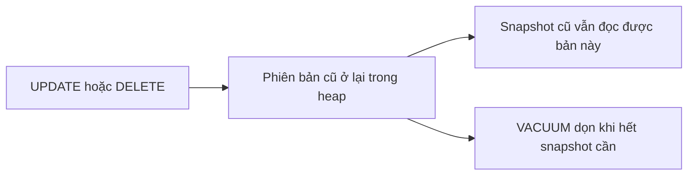
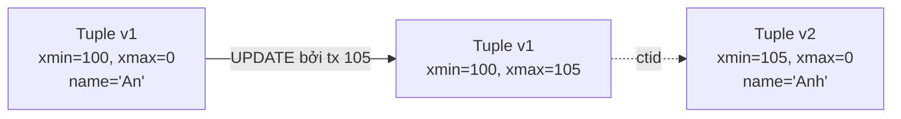
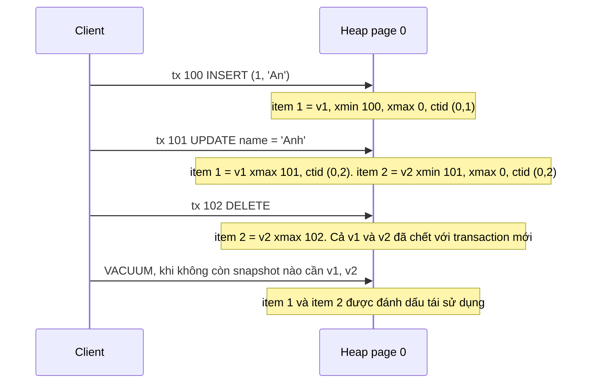
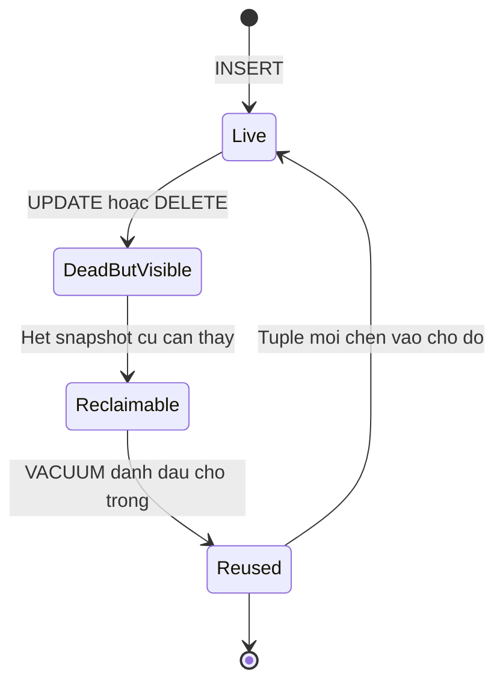
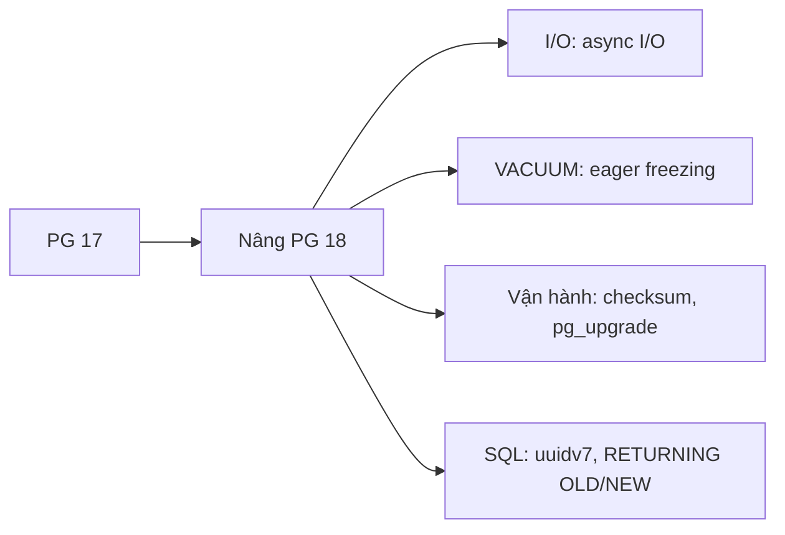
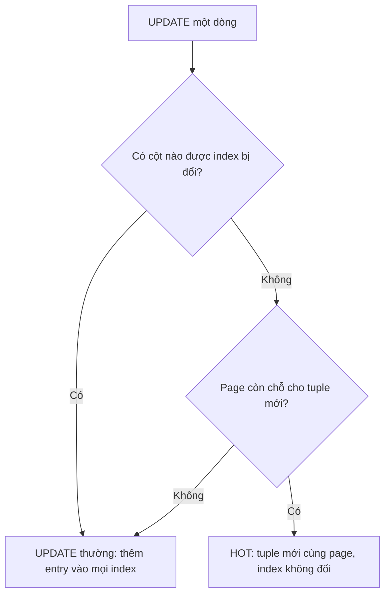

# PostgreSQL bên trong: MVCC, WAL và VACUUM

Nền tảng: [Transaction, Isolation và Lock](/go?p=02-Database%2Fmedium%2Flt-04-transaction-isolation-lock.md), [Index và tối ưu query](/go?p=02-Database%2Fmedium%2Flt-03-index-toi-uu-truy-van.md). So sánh với MySQL: [InnoDB bên trong](/go?p=02-Database%2Fmedium%2Flt-07-mysql-innodb-noi-bo.md). Bài này giải thích vì sao PostgreSQL cần VACUUM, vì sao bảng bị "phình" (bloat), và vì sao mô hình kết nối của nó khác hẳn.

**Cốt lõi:** PostgreSQL không sửa dòng tại chỗ mà viết thêm phiên bản mới, nên người đọc cũ vẫn thấy dữ liệu của mình mà không cần lock. Đổi lại, phiên bản chết tích tụ trong heap và phải có VACUUM dọn.

- Vì UPDATE tạo tuple mới và DELETE chỉ đặt xmax, nên đọc không chặn ghi nhưng bảng phình nếu không dọn.
- Vì tuple chỉ dọn được khi không còn snapshot nào cần, nên một transaction mở lâu hay slot bị bỏ quên cản VACUUM trên nhiều bảng.
- Vì WAL được ghi xuống đĩa trước file dữ liệu, nên commit chỉ cần flush WAL, còn full-page write chống page ghi dở.



Mô hình tư duy: phiên bản cũ là món nợ do MVCC để lại, và snapshot cũ nhất quyết định lúc nào VACUUM được phép trả nợ.

**Tóm tắt:**

- PostgreSQL không sửa dòng tại chỗ: UPDATE tạo tuple mới và đặt xmax trên tuple cũ, DELETE chỉ đặt xmax; phiên bản cũ nằm ngay trong heap.
- Mỗi transaction có snapshot riêng, nên đọc không lock và ghi không chặn đọc.
- Hệ quả là tuple chết tích tụ, cần VACUUM và autovacuum dọn, nếu không bảng bị bloat; VACUUM thường không trả đĩa cho hệ điều hành, VACUUM FULL giữ exclusive lock nên production dùng pg_repack.
- VACUUM còn freeze tuple để tránh transaction ID wraparound, vì ID chỉ có 32 bit.
- HOT update tránh phải cập nhật index khi không cột nào có index bị đổi và còn chỗ trong cùng page; hạ fillfactor để chừa chỗ.
- WAL ghi xuống đĩa trước khi sửa file dữ liệu, commit chỉ cần WAL được flush; full-page write chống torn page, checkpoint giới hạn thời gian phục hồi.
- Mỗi kết nối PostgreSQL là một process hệ điều hành (max_connections mặc định 100), nên cần pooler như PgBouncer thay vì tăng max_connections.

## PostgreSQL làm việc thế nào ở bên trong

PostgreSQL có một cách làm khác hẳn nhiều DB khác ở chỗ nó **không sửa dòng tại chỗ**. Khi bạn `UPDATE`, nó giữ nguyên dòng cũ và viết thêm một dòng mới; khi bạn `DELETE`, nó chỉ đánh dấu dòng là "đã xóa". Ví dụ đời thường: thay vì tẩy một chữ trên giấy rồi viết lại, bạn gạch chữ cũ và viết chữ mới bên cạnh. Ai đang đọc trang giấy từ trước vẫn thấy chữ cũ, còn ai đọc sau thì thấy chữ mới. Đó là MVCC của PostgreSQL. Cái giá là giấy dần đầy chữ bị gạch, nên cần một người dọn định kỳ: **VACUUM**.

Tóm lại, PostgreSQL lưu dữ liệu trong **heap** (các page 8 KB), cài MVCC bằng cách giữ nhiều phiên bản dòng ngay trong heap, bảo đảm bền vững bằng **WAL** (write-ahead log), và dọn phiên bản cũ bằng VACUUM.

Vì sao phải hiểu điều này? Vì các hiện tượng "kỳ lạ" của PostgreSQL (bảng phình dù đã xóa nhiều, autovacuum chạy hoài, lỗi `too many connections`, query chậm dần) đều bắt nguồn từ thiết kế trên. Bạn cần kiến thức này khi vận hành PostgreSQL ở production, đặt tham số autovacuum, chọn kiểu index, thiết kế bảng cập nhật nhiều (HOT), và khi quyết định có cần connection pooler. Chìa khóa là nắm lifecycle của một tuple (qua `xmin`/`xmax`), biết snapshot quyết định bạn thấy gì, và biết VACUUM biến chỗ chết thành chỗ dùng lại được.

## Các khái niệm cần biết

- **Heap, page, tuple**: heap là kho chứa dòng của bảng, không theo thứ tự nào; page là khối 8 KB; tuple là một phiên bản của một dòng.
- **TID / `ctid`**: địa chỉ của tuple, dạng `(số page, số mục)`. Index dùng nó để trỏ tới dữ liệu.
- **`xmin` / `xmax`**: ID transaction tạo và ID transaction xóa tuple. Hai trường này quyết định tuple có "sống" với một góc nhìn hay không.
- **Snapshot**: ảnh chụp "những transaction nào đã commit" tại một thời điểm; dùng để lọc tuple nhìn thấy được.
- **Dead tuple / bloat**: tuple chết chưa được dọn chiếm chỗ; bloat là tình trạng bảng hoặc index phình vì chúng.
- **VACUUM / autovacuum**: process dọn tuple chết, chạy tự động nền (autovacuum) hoặc thủ công.
- **Freeze và transaction ID wraparound**: ID transaction chỉ 32 bit nên sẽ quay vòng; VACUUM đánh dấu "đóng băng" tuple cũ để chúng luôn nhìn thấy được, tránh hỏng dữ liệu khi quay vòng.
- **Visibility map**: bản đồ cho biết page nào chắc chắn toàn tuple nhìn thấy được, giúp `Index Only Scan` khỏi đọc heap.
- **HOT (Heap-Only Tuple)**: kiểu UPDATE không cần chạm vào index (mục 4).
- **WAL, checkpoint, full-page write, torn page**: write-ahead log; mốc ghi mọi page bẩn xuống đĩa; ghi cả page vào WAL ở lần sửa đầu sau checkpoint để chống page bị ghi dở.
- **TOAST**: cơ chế đưa giá trị lớn sang bảng phụ.
- **Pooler**: lớp đứng giữa cho nhiều kết nối ứng dụng dùng chung ít kết nối thật.

## 1. Heap, tuple và con trỏ TID

Bảng là một **heap** các page 8 KB; mỗi page chứa nhiều **tuple** (dòng). Một dòng được định danh bằng **TID** (tuple identifier) = `(số page, số mục trong page)`, còn gọi là `ctid`. Khác với InnoDB, **mọi index (kể cả primary key) đều là secondary index trỏ tới TID**, không có clustered index theo mặc định. Dữ liệu trong heap không được sắp xếp theo primary key.

Giá trị lớn (văn bản dài, `jsonb` lớn) được nén và/hoặc đưa sang bảng phụ **TOAST**, giữ tuple chính nhỏ.

**Nền tảng:** PostgreSQL không sửa dòng tại chỗ: UPDATE tạo tuple mới và đặt xmax trên tuple cũ, DELETE chỉ đặt xmax. Phiên bản cũ nằm ngay trong heap, nên đọc không lock nhờ snapshot, nhưng cần VACUUM dọn tuple chết, nếu không bảng bị bloat.

**Suy luận:** Giữ phiên bản cũ ngay trong heap là cách đơn giản nhất để người đọc cũ vẫn thấy dữ liệu họ cần: UPDATE không ghi đè mà tạo tuple mới, tuple cũ vẫn còn đó với xmax đánh dấu transaction đã xóa nó, và mỗi snapshot dựa vào xmin, xmax để quyết định tuple nào nhìn thấy được. Nhờ vậy đọc không cần lock và rollback gần như miễn phí, vì tuple mới chỉ cần được coi như không tồn tại. Cái giá nằm ở chỗ nếu không ai dọn thì tuple cũ ở lại mãi: bảng phình (bloat), index trỏ vào tuple chết, quét chậm dần. Tuple chỉ dọn được khi không còn snapshot nào cần nó, nên một transaction mở lâu giữ mốc dọn lại cho nhiều bảng, không chỉ bảng nó đụng tới. Điểm dễ nhầm là tưởng VACUUM thường trả dung lượng cho hệ điều hành; nó chỉ đánh dấu chỗ trống để dùng lại. Hệ quả hành động: giữ transaction ngắn, theo dõi số tuple chết và transaction mở lâu, và chỉnh autovacuum riêng cho các bảng ghi nhiều.

## 2. MVCC: mỗi lần UPDATE là một tuple mới

Header của mỗi tuple có các trường chính: `xmin` (ID transaction đã tạo tuple), `xmax` (ID transaction đã xóa hoặc cập nhật nó, 0 nếu còn sống), và `ctid` (trỏ tới phiên bản mới hơn nếu có).



Đọc sơ đồ: ban đầu chỉ có v1 và còn sống (`xmax=0`). Khi transaction 105 `UPDATE`, v1 được đặt `xmax=105` (đã bị thay thế) và v2 mới được tạo với `xmin=105`. Transaction nào có snapshot từ trước 105 commit vẫn đọc được v1; transaction mới đọc v2.

- `INSERT`: tạo tuple với `xmin` = ID transaction.
- `DELETE`: **không xóa vật lý**, chỉ đặt `xmax`.
- `UPDATE`: = `DELETE` + `INSERT`: đặt `xmax` trên tuple cũ và tạo tuple mới với `xmin` mới, trong **cùng heap**.

Mỗi lệnh (hoặc transaction, tùy mức isolation) có một **snapshot** gồm: transaction nhỏ nhất còn chạy (`xmin`), ID tiếp theo sẽ cấp (`xmax`) và danh sách transaction đang chạy giữa hai mốc. Tuple "nhìn thấy được" nếu `xmin` đã commit và nằm trước snapshot, đồng thời `xmax` chưa commit hoặc nằm sau snapshot. Kết quả: đọc không lock, ghi không chặn đọc.

| Mức isolation (PostgreSQL) | Snapshot | Ghi chú |
|---|---|---|
| `READ COMMITTED` (mặc định) | Mới cho **mỗi câu lệnh** | Hai lần đọc trong một transaction có thể khác nhau |
| `REPEATABLE READ` | **Một** snapshot cho cả transaction | Về thực chất là snapshot isolation: không có phantom đọc, nhưng write skew vẫn xảy ra; ghi vào dòng đã bị sửa bởi transaction khác commit sau snapshot sẽ lỗi `serialization_failure` |
| `SERIALIZABLE` | Snapshot + theo dõi phụ thuộc (SSI) | Có thể hủy transaction với `serialization_failure` (mã `40001`), ứng dụng phải **thử lại** |

### Khác InnoDB ở đâu

| | InnoDB | PostgreSQL |
|---|---|---|
| Phiên bản cũ nằm ở | **Undo log** (tách khỏi bảng) | **Ngay trong heap** cùng tuple mới |
| UPDATE | Sửa tại chỗ trong clustered index, ghi bản cũ vào undo | Tạo tuple mới, đánh dấu cũ |
| Dọn rác | Purge undo | **VACUUM** dọn tuple chết |
| Hậu quả phụ | Undo phình khi có transaction dài | **Bloat** trong bảng và index |
| Index trỏ tới | Primary key | TID (nên UPDATE thường cần thêm index entry, trừ khi HOT) |

### Vòng đời một tuple qua INSERT, UPDATE, DELETE và VACUUM

Để thấy `xmin`, `xmax`, `ctid` đổi thế nào, hãy theo dõi một dòng duy nhất qua bốn bước. _Minh họa_: số transaction ID (100, 101, 102) chọn cho dễ đọc, ID thật lớn hơn; chưa chạy thử trên server thật trong lần viết này.



Trạng thái heap sau từng bước (tuple nào còn sống với một transaction mới bắt đầu sau bước đó):

| Bước | Item 1 (v1) | Item 2 (v2) | Còn sống với transaction mới |
|---|---|---|---|
| 1. `INSERT` bởi tx 100, đã commit | xmin=100, xmax=0, ctid=(0,1) | chưa có | v1 |
| 2. `UPDATE` bởi tx 101, đã commit | xmin=100, xmax=101, ctid=(0,2) | xmin=101, xmax=0, ctid=(0,2) | v2 |
| 3. `DELETE` bởi tx 102, đã commit | như trên | xmin=101, xmax=102, ctid=(0,2) | không có |
| 4. `VACUUM` (không còn snapshot cũ) | trống, dùng lại được | trống, dùng lại được | không có |

Đọc bảng: `ctid` trong header của tuple v1 trỏ tới phiên bản kế tiếp (0,2) sau UPDATE; với tuple chưa bị UPDATE thì nó trỏ về chính nó. `DELETE` chỉ đặt `xmax`, không đụng `ctid`. Ở bước 3 cả hai tuple vẫn nằm trong page; một transaction mở từ trước tx 101 vẫn có thể đọc v1, và một transaction mở trước tx 102 vẫn thấy v2. Chỉ sang bước 4, khi mọi snapshot như vậy đã kết thúc, VACUUM mới thu hồi chỗ.

Tự quan sát bằng SQL (extension `pageinspect` có sẵn trong gói contrib, cần quyền superuser):

```sql
CREATE TABLE t (id int, name text);
INSERT INTO t VALUES (1, 'An');
SELECT ctid, xmin, xmax, * FROM t;                 -- (0,1), xmin = tx insert, xmax = 0

UPDATE t SET name = 'Anh' WHERE id = 1;
SELECT ctid, xmin, xmax, * FROM t;                 -- (0,2): đã là phiên bản mới

CREATE EXTENSION IF NOT EXISTS pageinspect;
SELECT lp, t_xmin, t_xmax, t_ctid FROM heap_page_items(get_raw_page('t', 0));  -- thấy cả hai phiên bản

DELETE FROM t WHERE id = 1;
VACUUM t;
SELECT lp, lp_flags, t_xmin, t_xmax FROM heap_page_items(get_raw_page('t', 0)); -- chỗ cũ đã được thu hồi
```

Lưu ý khi chạy thử: truy vấn `SELECT ... FROM t` thường chỉ thấy phiên bản sống, muốn thấy phiên bản chết phải đọc page bằng `pageinspect`. Trong thực tế `UPDATE` ở bước 2 có thể là HOT (mục 4), khi đó v1 chuyển thành con trỏ chuyển tiếp sau khi page được dọn nhẹ (pruning) và ngoài `VACUUM` cũng có thể thu hồi một phần chỗ. Nếu có transaction cũ đang mở, `VACUUM` ở bước 4 sẽ không dọn được v1 và v2.

## 3. VACUUM và autovacuum

Hệ quả của việc giữ phiên bản cũ là tuple chết (không transaction nào còn cần thấy) vẫn chiếm chỗ. Nếu không dọn, bảng phình mãi và query phải bỏ qua ngày càng nhiều rác. Lifecycle của một tuple có thể mô tả như sau.



Đọc sơ đồ: sau `UPDATE`/`DELETE`, tuple cũ chưa biến mất ngay vì có thể còn snapshot cũ cần nó (DeadButVisible). Chỉ khi không còn snapshot nào cần, VACUUM mới đánh dấu chỗ đó dùng lại được. Do đó snapshot cũ chính là thứ cản VACUUM (xem phần dưới). **VACUUM** thực hiện:

1. Tìm tuple chết, **đánh dấu chỗ trống tái sử dụng được** (không trả lại đĩa cho hệ điều hành, trừ khi các page cuối bảng trống hoàn toàn).
2. Dọn entry tương ứng trong index.
3. Cập nhật **visibility map** (page nào toàn tuple nhìn thấy được, cho phép `Index Only Scan` khỏi đọc heap) và **free space map**.
4. **Freeze** các tuple đủ cũ để tránh lỗi tràn bộ đếm transaction ID.

**Transaction ID wraparound**: ID transaction là số 32 bit, vòng lại sau khoảng hai tỷ transaction. Nếu tuple cũ không được freeze kịp, PostgreSQL buộc phải dừng nhận ghi để bảo vệ dữ liệu. Vì thế autovacuum có chế độ "chống wraparound" chạy bắt buộc dù đã tắt. Theo dõi `age(datfrozenxid)` / `age(relfrozenxid)`.

`VACUUM FULL` viết lại cả bảng sang file mới để trả đĩa, nhưng giữ **exclusive lock** suốt thời gian chạy; trên production thường thay bằng công cụ như `pg_repack`.

**Phải thuộc:** VACUUM đánh dấu chỗ trống dùng lại được (không trả đĩa cho hệ điều hành), cập nhật visibility map, và freeze tuple để tránh transaction ID wraparound (ID 32 bit). VACUUM FULL viết lại bảng, giữ exclusive lock, nên production dùng pg_repack.

### Autovacuum kích hoạt khi nào

Mặc định, autovacuum chạy trên một bảng khi số tuple chết vượt `autovacuum_vacuum_threshold` (50) cộng `autovacuum_vacuum_scale_factor` (0,2) nhân số dòng. Với bảng 100 triệu dòng, đó là khoảng 20 triệu tuple chết mới kích hoạt, quá muộn. Bảng lớn, ghi nhiều nên **hạ scale factor riêng cho bảng đó**:

```sql
ALTER TABLE events SET (autovacuum_vacuum_scale_factor = 0.01,
                        autovacuum_vacuum_threshold   = 1000);
```

### Điều gì làm VACUUM không dọn được

VACUUM chỉ xóa được tuple chết **cũ hơn mọi snapshot đang tồn tại**. Những thứ giữ "đường chân trời xmin" lại:

- Transaction chạy rất lâu, kể cả `idle in transaction` (mở transaction rồi quên).
- Replication slot không được tiêu thụ, hoặc standby bật `hot_standby_feedback` mà query trên standby chạy lâu.
- Prepared transaction (2PC) bị bỏ quên.

```sql
-- Transaction cũ nhất đang giữ xmin
SELECT pid, state, xact_start, now() - xact_start AS dur, left(query, 80)
FROM pg_stat_activity
WHERE xact_start IS NOT NULL
ORDER BY xact_start LIMIT 5;

-- Slot đang giữ lại WAL / xmin
SELECT slot_name, active, xmin, catalog_xmin FROM pg_replication_slots;
```

**Cải tiến PostgreSQL 17**: VACUUM lưu danh sách tuple chết bằng cấu trúc tiết kiệm memory hơn, và không còn bị giới hạn ngầm ở 1 GB dù `maintenance_work_mem` / `autovacuum_work_mem` đặt cao hơn (theo release notes của PG 17). Với bảng rất lớn điều này giảm số lần quét index trong một lượt vacuum.

## Cải tiến PostgreSQL 18 (ra 25/9/2025)

PostgreSQL 18 là bản ổn định hiện hành (PostgreSQL 19 chưa GA tại thời điểm kiểm tra). Những thay đổi liên quan trực tiếp tới MVCC, VACUUM và WAL trong bài này:



| Thay đổi | Ý nghĩa |
|---|---|
| **Async I/O (AIO)** | Hệ con I/O bất đồng bộ giúp seq scan, bitmap heap scan và VACUUM đọc song song thay vì chờ từng khối |
| **Eager freezing** | VACUUM chủ động freeze cả page all-visible, giảm chi phí freeze toàn bảng về sau; chỉnh bằng `vacuum_max_eager_freeze_failure_rate` |
| **`autovacuum_vacuum_max_threshold`** | Trần số tuple chết để kích hoạt autovacuum; bảng rất lớn không phải chờ tới 20% mới dọn |
| **Data checksums mặc định bật** | `initdb` bật checksum; cluster cũ không có checksum cần `--no-data-checksums` khi `pg_upgrade` |
| **`pg_upgrade` giữ statistics** | Sau nâng cấp không phải chờ `ANALYZE` lại toàn bộ; extended statistics thì không được giữ |
| **Virtual generated columns** | Cột sinh tính lúc đọc (mặc định), muốn lưu như trước thì khai báo `STORED` |
| **`RETURNING OLD/NEW`** | Lấy cả giá trị trước và sau trong `INSERT/UPDATE/DELETE/MERGE` |
| **`uuidv7()`** | UUID sắp xếp được theo thời gian, hợp làm primary key (xem [Thiết kế schema](/go?p=02-Database%2Feasy%2Flt-02-thiet-ke-schema.md)) |
| **Xác thực OAuth** | Thêm phương thức `oauth`; đồng thời mật khẩu MD5 bị đánh dấu deprecated, nên chuyển sang SCRAM |

**Suy luận:** MVCC để lại tuple chết và tuple cũ chưa freeze, nên mọi cải tiến của VACUUM đều nhắm một trong hai việc: dọn sớm hơn (ngưỡng autovacuum) hoặc trả nợ freeze dần thay vì một lần lớn (eager freezing). AIO không đổi cơ chế MVCC mà giảm thời gian chờ đĩa của chính các thao tác quét và VACUUM. Điểm dễ nhầm là nghĩ nâng PG 18 sẽ tự nhanh: AIO phụ thuộc cấu hình và loại I/O, nên đo lại trước và sau trên workload thật.

## 4. HOT update

Vấn đề: vì mọi index trỏ tới TID, và UPDATE tạo tuple mới có TID mới, nên cập nhật một dòng thường phải thêm entry mới vào **mọi** index, dù cột index không đổi. Với bảng có nhiều index và cập nhật liên tục, đó là lãng phí lớn. **HOT (Heap-Only Tuple)** tránh việc đó khi thỏa hai điều kiện: (1) **không cột nào có index bị đổi**, (2) **còn chỗ trống trong cùng page**. Khi đó phiên bản mới nằm cùng page, được nối từ tuple cũ, và các index không cần động đến. Page còn được dọn nhanh ("pruning") ngay khi truy cập.



Hệ quả thiết kế: với bảng cập nhật nhiều (bộ đếm, trạng thái), đừng index cột hay đổi nếu không cần, và đặt `fillfactor` thấp hơn 100 (ví dụ 80 đến 90) để chừa chỗ trong page cho HOT.

**Phải thuộc:** UPDATE là HOT khi không cột nào có index bị đổi và còn chỗ trong cùng page; hạ fillfactor (ví dụ 80 đến 90) để chừa chỗ. Autovacuum mặc định kích hoạt khi tuple chết vượt 50 cộng 0,2 nhân số dòng, bảng lớn nên hạ scale factor riêng.

```sql
ALTER TABLE accounts SET (fillfactor = 85);
-- Tỷ lệ HOT update
SELECT relname, n_tup_upd, n_tup_hot_upd FROM pg_stat_user_tables ORDER BY n_tup_upd DESC LIMIT 5;
```

## 5. WAL và checkpoint

Nguyên tắc giống InnoDB: ghi **WAL (write-ahead log)** xuống đĩa trước khi sửa file dữ liệu. Commit chỉ cần WAL được flush; page bẩn trong `shared_buffers` được ghi xuống nền.

- **Checkpoint**: định kỳ (`checkpoint_timeout`, mặc định 5 phút, hoặc khi WAL đạt `max_wal_size`, mặc định 1 GB) ghi mọi page bẩn xuống đĩa; sau đó WAL cũ hơn điểm này có thể tái sử dụng. Crash recovery chỉ phát lại WAL từ checkpoint gần nhất.
- **Full-page writes**: ngay lần sửa **đầu tiên** của mỗi page sau checkpoint, PostgreSQL ghi nguyên cả page vào WAL. Đây là cách chống torn page (thay cho doublewrite của InnoDB). Cái giá: ngay sau checkpoint, lượng WAL tăng vọt; checkpoint quá dày làm WAL phình.
- `synchronous_commit`: `on` (mặc định) đợi WAL flush; `off` trả về sớm hơn (có thể mất vài trăm mili giây dữ liệu khi crash nhưng **không làm hỏng** dữ liệu); các mức `remote_write`/`remote_apply` liên quan đến standby sync.
- WAL cũng là nền của **replication** (streaming), **archiving** và **PITR** (bài [vận hành](/go?p=02-Database%2Fhard%2Flt-11-replication-partition-van-hanh.md)).
- **Logical replication/decoding**: PG 16 cho phép logical decoding trên **standby** (giảm tải primary); PG 17 thêm **failover slots** để slot logical sống sót khi chuyển primary và tiện ích `pg_createsubscriber` dựng logical replica từ physical standby.

**Nền tảng:** WAL: ghi log xuống đĩa trước khi sửa file dữ liệu, commit chỉ cần WAL được flush. Full-page write chống torn page, checkpoint giới hạn thời gian phục hồi, và WAL cũng là nền của replication, archiving và PITR.

## 6. Các loại index

| Loại | Phù hợp | Ghi chú |
|---|---|---|
| **B-tree** (mặc định) | `=`, khoảng, `ORDER BY`, `LIKE 'abc%'` (với collation phù hợp) | Dùng cho hầu hết trường hợp |
| **Hash** | Chỉ so sánh `=` | Hiếm khi hơn B-tree |
| **GIN** (inverted) | Mảng, `jsonb` (`@>`, `?`), full-text search | Đọc nhanh, ghi chậm hơn, có queue pending list |
| **GiST** | Hình học, khoảng (range), tìm kiếm gần đúng | Khái quát hóa nhiều kiểu |
| **SP-GiST** | Dữ liệu partition không cân bằng (trie, quadtree) | Chuyên biệt |
| **BRIN** | Bảng **khổng lồ** có giá trị tương quan với thứ tự vật lý (timestamp, ID tăng) | Chỉ lưu min/max theo khối page, cực nhỏ; vô dụng nếu dữ liệu xáo trộn |

Ngoài ra có **partial index** (`WHERE status = 'ACTIVE'`), **expression index** (`lower(email)`) và **covering index** với `INCLUDE`.

### JSONB

`jsonb` lưu dạng nhị phân đã phân tích, truy cập key nhanh, hỗ trợ index GIN. `json` giữ nguyên văn bản gốc (kể cả thứ tự key, key trùng) và phải phân tích lại mỗi lần. Hầu như luôn chọn `jsonb`.

```sql
CREATE INDEX idx_prod_attr ON product USING gin (attrs jsonb_path_ops);
SELECT id FROM product WHERE attrs @> '{"color":"red"}';
```

Đừng biến `jsonb` thành chỗ chứa mọi thứ: cột hay lọc, join, constraint nên là cột thật.

## 7. Mô hình kết nối: một process cho mỗi kết nối

Postmaster `fork` **một process hệ điều hành** cho mỗi kết nối khách. Mỗi process tốn memory (vài MB trở lên, tăng theo `work_mem` mà query dùng) và chi phí context switch; tạo kết nối mới cũng đắt. `max_connections` mặc định chỉ 100; tăng lên hàng nghìn thường làm hệ thống chậm đi, không nhanh lên.

Cách xử lý: dùng **pooler** đứng giữa (PgBouncer, hoặc pool phía ứng dụng như HikariCP kết hợp giới hạn cứng), để hàng nghìn kết nối ứng dụng dùng chung vài chục kết nối thật.

**Phải thuộc:** Mỗi kết nối PostgreSQL là một process hệ điều hành, max_connections mặc định 100, nên cần pooler (PgBouncer, thường ở chế độ transaction) thay vì tăng max_connections.

| Chế độ PgBouncer | Giữ kết nối thật đến khi | Lưu ý |
|---|---|---|
| Session | Khách ngắt kết nối | An toàn nhất, ít lợi nhất |
| **Transaction** | Transaction kết thúc | Phổ biến nhất; cẩn thận với trạng thái phiên (`SET`, advisory lock theo session, `LISTEN`, prepared statement kiểu cũ; hỗ trợ prepared statement phụ thuộc phiên bản pooler, kiểm tra lại theo phiên bản) |
| Statement | Mỗi câu lệnh | Không dùng được transaction nhiều câu |

## Bẫy thường gặp

| Bẫy | Hậu quả | Cách tránh |
|---|---|---|
| Transaction `idle in transaction` kéo dài | VACUUM không dọn, bảng phình | `idle_in_transaction_session_timeout`, giám sát `pg_stat_activity` |
| Autovacuum mặc định cho bảng cực lớn | Dọn quá muộn, bloat | Hạ scale factor riêng cho bảng |
| Replication slot bỏ quên | WAL phình đầy đĩa, giữ xmin | Giám sát `pg_replication_slots`, xóa slot không dùng |
| Index nhiều cột trên bảng cập nhật thường xuyên | Mất HOT, ghi chậm | Chỉ index thứ cần, hạ `fillfactor` |
| Tăng `max_connections` thay vì dùng pooler | Tốn RAM, context switch | PgBouncer transaction mode |
| `VACUUM FULL` giờ cao điểm | Exclusive lock bảng | `pg_repack` hoặc làm trong cửa sổ bảo trì |
| Quên retry khi `SERIALIZABLE`/`REPEATABLE READ` | Lỗi `40001` lọt ra người dùng | Bắt mã lỗi và thử lại cả transaction |

## Điểm cần nhớ

- PostgreSQL giữ phiên bản cũ trong heap; UPDATE = tuple mới; đọc không lock nhờ snapshot.
- VACUUM là một phần bắt buộc của thiết kế: dọn tuple chết, cập nhật visibility map, freeze chống wraparound.
- Không dọn được khi có snapshot cũ: transaction dài, slot bỏ quên, standby feedback.
- HOT update giảm chi phí ghi nếu không đổi cột có index và còn chỗ trống trong page.
- WAL + full-page writes bảo đảm bền vững và chống torn page; checkpoint giới hạn thời gian phục hồi.
- Mỗi kết nối là một process: cần pooler, không tăng `max_connections` bừa.
- Chọn index theo kiểu query: B-tree mặc định, GIN cho `jsonb`/mảng/full-text, BRIN cho bảng khổng lồ tương quan thứ tự.

## Phỏng vấn khó: chuỗi hỏi xoáy

Người phỏng vấn senior thường mở bằng câu dễ rồi xoáy xuống cơ chế, đánh đổi và sự cố thật. Câu trả lời tốt luôn đi từ cốt lõi xuống.

### Chuỗi 1: VACUUM, bloat và thứ cản VACUUM

1. **Câu mở:** Vì sao PostgreSQL cần VACUUM còn nhiều DB khác thì không?
2. **Xoáy 1:** Autovacuum chạy đều nhưng bảng vẫn bloat. Bạn điều tra từ đâu, và vì sao một transaction không đụng tới bảng đó vẫn cản được việc dọn?
3. **Xoáy 2:** Bảng 100 triệu dòng, cấu hình mặc định. Chuyện gì xảy ra, và VACUUM còn làm việc gì ngoài dọn tuple chết?

**Đáp án ngắn:** PostgreSQL không sửa tại chỗ: UPDATE tạo tuple mới và đặt `xmax` trên tuple cũ, DELETE chỉ đặt `xmax`, nên phiên bản cũ nằm ngay trong heap để snapshot cũ vẫn đọc được. Đổi lại tuple chết tích tụ và VACUUM phải dọn; InnoDB để bản cũ trong undo log nên cái giá là purge undo. Tuple chết chỉ dọn được khi không còn snapshot nào cần nó, nên "đường chân trời xmin" do snapshot cũ nhất quyết định, không phải theo từng bảng. Vì vậy transaction `idle in transaction`, replication slot bị bỏ quên, standby có `hot_standby_feedback` chạy query lâu, hoặc prepared transaction bị bỏ quên đều cản dọn trên nhiều bảng. Tôi nhìn `pg_stat_activity` (`xact_start`) và `pg_replication_slots` (`xmin`, `catalog_xmin`). Với mặc định, ngưỡng là 50 cộng 0,2 nhân số dòng, tức khoảng 20 triệu tuple chết mới kích hoạt, nên hạ scale factor riêng cho bảng. VACUUM còn cập nhật visibility map và freeze tuple để tránh transaction ID wraparound (ID 32 bit); đừng quên VACUUM thường không trả đĩa cho hệ điều hành.

**Sai lầm hay gặp:**

- Nói VACUUM "giải phóng đĩa", hoặc dùng `VACUUM FULL` giờ cao điểm mà quên exclusive lock.
- Chỉ nhìn bảng bị bloat mà không tìm transaction hay slot cũ nhất toàn cluster.
- Không nhắc freeze và wraparound khi nói về vai trò của VACUUM.

### Chuỗi 2: UPDATE tạo tuple mới, index và HOT

1. **Câu mở:** Một lệnh UPDATE trong PostgreSQL thực sự làm gì ở heap?
2. **Xoáy 1:** Index trỏ tới TID, vậy UPDATE một cột không có index có phải thêm entry vào mọi index không?
3. **Xoáy 2:** Bảng đếm lượt xem cập nhật liên tục, ghi chậm và bloat. Bạn thiết kế và đo thế nào?

**Đáp án ngắn:** UPDATE là DELETE cộng INSERT trong cùng heap: tuple cũ nhận `xmax`, tuple mới có `xmin` mới và `ctid` của bản cũ trỏ sang nó. Khác InnoDB, mọi index kể cả primary key đều trỏ tới TID, và tuple mới có TID mới, nên thông thường phải thêm entry vào mọi index dù cột index không đổi. HOT tránh việc đó khi hai điều kiện cùng thỏa: không cột nào có index bị đổi và còn chỗ trống trong cùng page. Khi đó tuple mới nằm cùng page, được nối từ tuple cũ và index không bị động tới; page còn được dọn nhẹ (pruning). Với bảng cập nhật nhiều tôi không index cột hay đổi nếu không cần, và hạ `fillfactor` (ví dụ 80 đến 90) để chừa chỗ trong page. Đo bằng `n_tup_hot_upd` so với `n_tup_upd` trong `pg_stat_user_tables`. Đánh đổi của fillfactor thấp là bảng to hơn lúc ban đầu và đọc nhiều page hơn.

**Sai lầm hay gặp:**

- Nghĩ HOT chỉ cần "không đổi cột có index", quên điều kiện còn chỗ trong page.
- Nói UPDATE "sửa tại chỗ" như InnoDB.
- Thêm index cho cột hay đổi mà không tính cái giá là mất HOT và ghi chậm.

## Câu hỏi tự kiểm tra

Với mỗi câu, thử trả lời theo gợi ý trước rồi mới đọc phần lập luận.

1. `DELETE` hàng triệu dòng xong nhưng file bảng không nhỏ lại. Vì sao?
   - **Gợi ý suy luận:** MVCC xóa một dòng bằng cách nào (xóa thật hay đánh dấu)? VACUUM làm gì với chỗ trống đó?
   - **Lập luận và đáp án:** `DELETE` chỉ đặt `xmax` để dòng không còn hiển thị với transaction mới, vì transaction cũ có thể vẫn cần thấy nó. VACUUM đánh dấu chỗ đó dùng lại được, nhưng không trả đĩa cho hệ điều hành (trừ khi các page cuối file trống hẳn).
2. Điều kiện để một UPDATE là HOT?
   - **Gợi ý suy luận:** UPDATE tạo tuple mới, vậy index trỏ về đâu? Khi nào không cần cập nhật index? Tuple mới nằm ở đâu để chuỗi nối được?
   - **Lập luận và đáp án:** nếu không cột nào có index bị đổi thì entry index vẫn đúng, chỉ cần nối tuple cũ sang tuple mới. Việc nối đó cần tuple mới ở cùng page, nên điều kiện là không đổi cột có index và còn chỗ trống trong page.
3. VACUUM chạy đều mà bảng vẫn bloat. Cái gì chặn nó?
   - **Gợi ý suy luận:** tuple chết được dọn khi không ai còn có thể cần thấy nó. Ai còn giữ snapshot cũ?
   - **Lập luận và đáp án:** chỉ cần một snapshot cũ còn sống là mọi tuple chết sau thời điểm đó không được dọn. Thủ phạm thường gặp: transaction dài hoặc `idle in transaction`, replication slot hoặc standby feedback, prepared transaction bị bỏ quên.
4. PostgreSQL đã có WAL mà vẫn cần full-page writes. Vì sao?
   - **Gợi ý suy luận:** record WAL là thay đổi trên page hay là cả page? Nếu page trên đĩa bị ghi dở thì áp thay đổi lên đâu?
   - **Lập luận và đáp án:** WAL thường chỉ chứa thay đổi, mà áp thay đổi lên một page bị torn thì vô nghĩa. Vì vậy lần sửa đầu tiên của mỗi page sau checkpoint ghi cả page vào WAL, để recovery có bản nguyên vẹn làm gốc.
5. Vì sao đặt PgBouncer trước PostgreSQL?
   - **Gợi ý suy luận:** mỗi kết nối PostgreSQL là gì ở hệ điều hành? Hàng nghìn kết nối ứng dụng cần thật sự cùng chạy một lúc không?
   - **Lập luận và đáp án:** mỗi kết nối là một process tốn RAM và chi phí context switch. Ở mỗi thời điểm chỉ ít kết nối thật sự bận, nên pooler cho nhiều kết nối ứng dụng dùng chung ít kết nối thật.
6. `REPEATABLE READ` của PostgreSQL khác chuẩn SQL ở đâu?
   - **Gợi ý suy luận:** mỗi transaction dùng một snapshot cố định thì có thấy dòng mới của người khác không? Snapshot có ngăn hai transaction ghi dựa trên dữ liệu đã đọc không?
   - **Lập luận và đáp án:** đó là snapshot isolation: không có phantom read (chặt hơn chuẩn), nhưng vẫn có write skew. Xung đột ghi cùng dòng báo `serialization_failure`, ứng dụng phải thử lại.

Nguồn: tài liệu chính thức PostgreSQL (Release Notes 16, 17 và 18, tài liệu về MVCC, VACUUM, WAL), kiểm tra ngày 2026-10-30.

