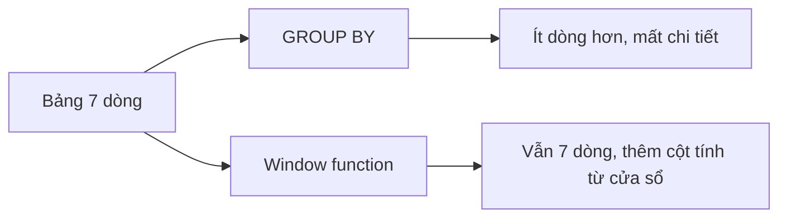
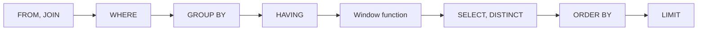
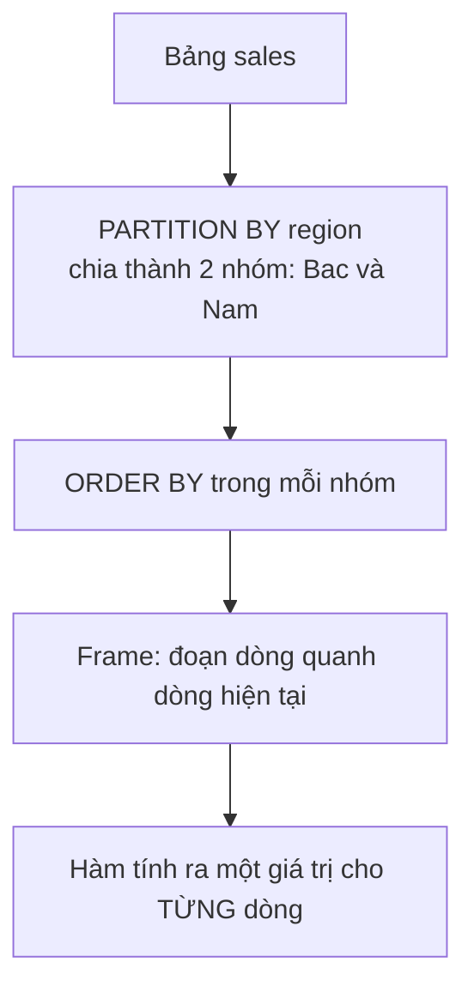
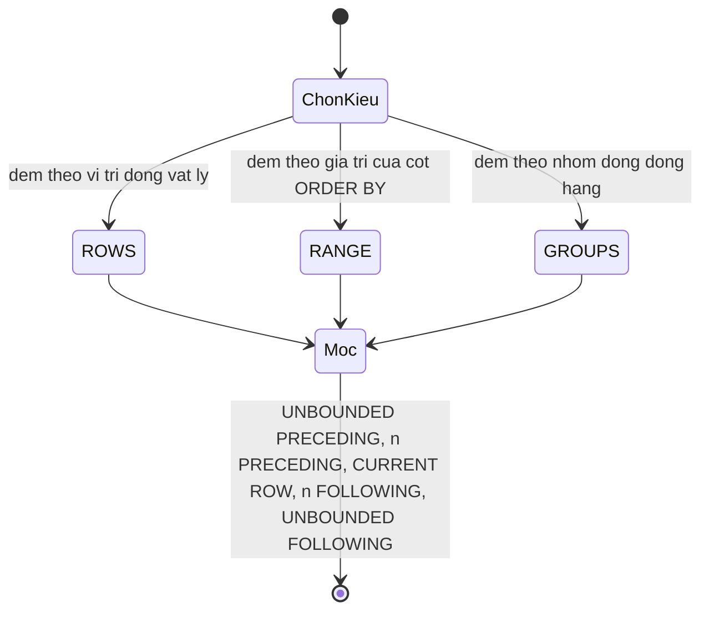
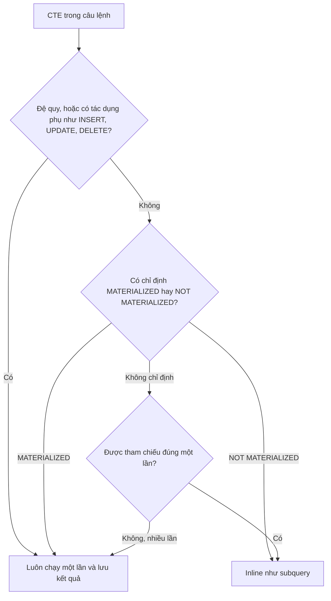
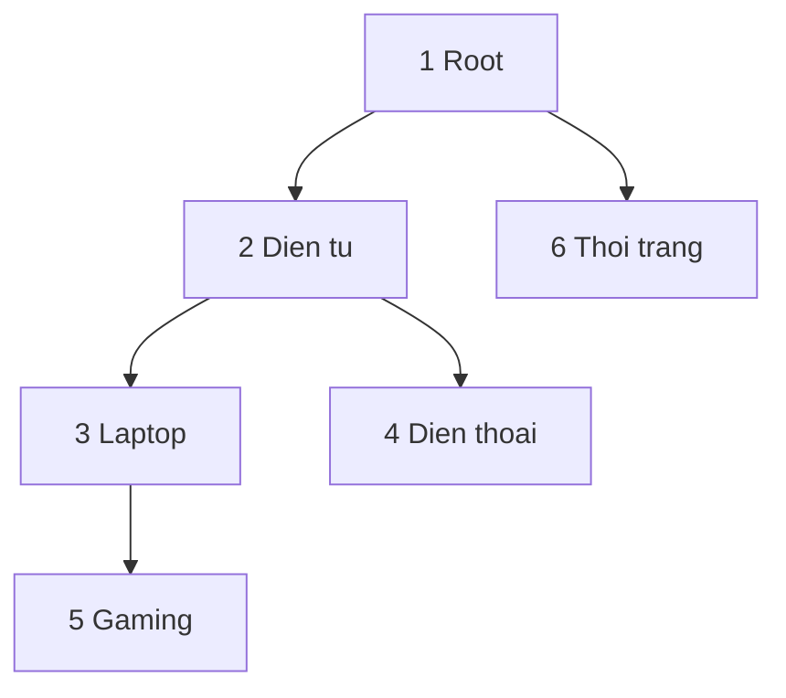
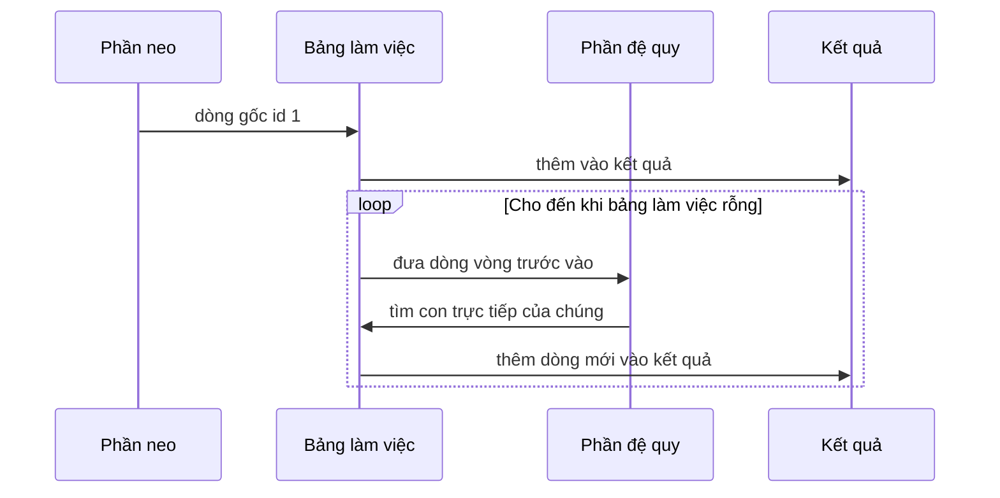
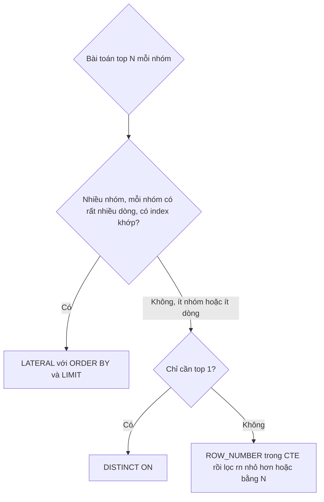
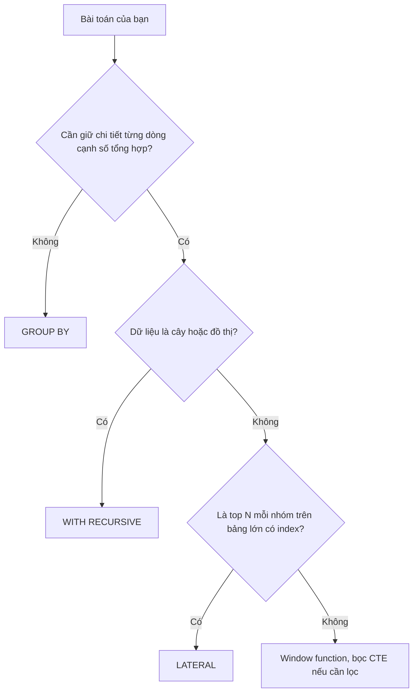

# Window function, CTE và LATERAL

Nền tảng: [SELECT, JOIN trực quan](/go?p=02-Database%2Feasy%2Flt-13-sql-select-join-truc-quan.md), [DDL, DML, kiểu dữ liệu và constraint trong PostgreSQL](/go?p=02-Database%2Feasy%2Flt-14-ddl-dml-kieu-du-lieu-constraint-pg.md), [Index và tối ưu query](/go?p=02-Database%2Fmedium%2Flt-03-index-toi-uu-truy-van.md). Bài này dạy ba công cụ giúp một câu SQL giải được các bài toán mà người mới thường kéo dữ liệu về ứng dụng rồi lặp bằng vòng for: xếp hạng trong nhóm, tổng lũy kế, top N mỗi nhóm, duyệt cây, tìm đoạn liên tiếp.

> Quy ước của bài: ví dụ SQL dưới đây là _Minh họa_ (chưa chạy thử trên PostgreSQL thật vì môi trường soạn bài không có server). Kết quả được suy ra bằng tay từ dữ liệu mẫu và đã rà cú pháp; khi học, hãy dán vào PostgreSQL 18 để tự kiểm chứng.

**Cốt lõi:** GROUP BY gộp dòng nên mất chi tiết, trong khi nhiều câu hỏi cần cả chi tiết lẫn số tổng hợp cạnh nhau. Window function tính trên một cửa sổ quanh dòng hiện tại mà vẫn giữ nguyên số dòng. CTE và LATERAL giúp diễn đạt các bước phụ thuộc nhau, kể cả cây có độ sâu không biết trước.

- Vì window chạy sau WHERE, GROUP BY và HAVING, nên muốn lọc theo kết quả của nó phải bọc trong CTE hoặc subquery.
- Vì frame mặc định kết thúc ở dòng hiện tại và gộp các dòng đồng hạng, nên tổng lũy kế và `LAST_VALUE` dễ cho kết quả bất ngờ nếu không khai báo frame.
- Vì LATERAL chạy lại subquery theo từng dòng bên trái, nên có index đúng thì top N mỗi nhóm chỉ tốn số nhóm nhân N.



Mô hình tư duy: GROUP BY thu hẹp bảng, còn window giữ nguyên bảng và chỉ thêm cột tính từ các dòng lân cận.

**Tóm tắt:**

- Window function tính trên một "cửa sổ" các dòng liên quan tới dòng hiện tại mà không gộp dòng như GROUP BY; kết quả vẫn giữ nguyên số dòng.
- Cửa sổ gồm ba phần: PARTITION BY (chia nhóm), ORDER BY (sắp trong nhóm) và frame (đoạn dòng được tính, ROWS, RANGE hoặc GROUPS).
- ROW_NUMBER luôn cho số khác nhau, RANK để hở số khi đồng hạng, DENSE_RANK không để hở; LAG và LEAD lấy giá trị dòng trước và dòng sau.
- Mặc định khi có ORDER BY, frame là RANGE từ đầu nhóm đến dòng hiện tại và gộp cả các dòng đồng hạng (peer); đây là nguồn của nhiều kết quả bất ngờ như LAST_VALUE.
- Window function chạy sau WHERE, GROUP BY và HAVING nên không thể lọc trực tiếp bằng WHERE; muốn lọc theo rank phải bọc trong subquery hoặc CTE (PostgreSQL không có QUALIFY).
- CTE (WITH) đặt tên cho một truy vấn con; từ PostgreSQL 12 CTE không đệ quy chỉ dùng một lần được inline mặc định, MATERIALIZED và NOT MATERIALIZED để ép cách thực thi; WITH RECURSIVE duyệt cây và đồ thị, cần điều kiện dừng hoặc CYCLE (từ PostgreSQL 14).
- LATERAL cho subquery ở FROM tham chiếu cột của bảng đứng trước, là cách gọn nhất để lấy top N mỗi nhóm khi có index phù hợp.
- Bốn mẫu kinh điển: top N mỗi nhóm, running total, gaps and islands, khử trùng lặp (dedup).

## Vấn đề nó giải quyết

`GROUP BY` gộp nhiều dòng thành một dòng, nên mất chi tiết. Nhưng nhiều câu hỏi nghiệp vụ cần cả chi tiết lẫn con số tổng hợp cạnh nhau: "doanh số của từng đơn và thứ hạng của nó trong khu vực", "số dư sau mỗi giao dịch", "so với ngày trước đó tăng bao nhiêu". Nếu thiếu window function, bạn phải self-join hoặc subquery tương quan cho từng cột (chậm và khó đọc), hoặc kéo dữ liệu lên ứng dụng.

Ba nhu cầu nữa: dữ liệu dạng cây (danh mục con, sơ đồ tổ chức, bình luận lồng nhau) có độ sâu không biết trước, mà JOIN thường chỉ đi được số tầng cố định; "lấy 3 đơn mới nhất của mỗi khách" mà không phải lặp N+1 query; và chia một câu truy vấn dài thành các bước có tên để đọc được.

## Khi nào dùng, khi nào không

| Tình huống | Nên dùng | Ghi chú |
|---|---|---|
| Xếp hạng, top N trong từng nhóm | Window `ROW_NUMBER`/`RANK` hoặc `LATERAL` | `LATERAL` nhanh hơn khi có index và nhóm nhiều dòng |
| Tổng lũy kế, trung bình trượt, so với kỳ trước | Window `SUM OVER`, `LAG` | Frame quyết định kết quả |
| Cây, đồ thị có độ sâu không cố định | `WITH RECURSIVE` | Cây rất lớn hoặc truy vấn cây thường xuyên: cân nhắc `ltree` hoặc lưu thêm đường dẫn |
| Tách truy vấn dài thành bước dễ đọc | CTE | Từ PG 12 thường không tốn thêm so với subquery |
| Chỉ cần tổng của cả nhóm | `GROUP BY` | Đơn giản hơn window |
| Cần top 1 mỗi nhóm đơn giản | `DISTINCT ON` | Cú pháp riêng của PostgreSQL, ngắn gọn |

Không nên dùng window function khi bảng rất lớn mà không có index khớp với `PARTITION BY ... ORDER BY`: PostgreSQL phải sort toàn bộ trước khi tính. Cũng đừng dùng `RECURSIVE` để thay cho thiết kế dữ liệu kém (ví dụ lưu cả tập tổ tiên vào một cột chuỗi).

## Các khái niệm cần biết

- **Window function**: hàm tính trên tập dòng liên quan tới dòng hiện tại, viết bằng `hàm(...) OVER (...)`.
- **PARTITION BY**: chia dòng thành các nhóm độc lập; bỏ đi thì cả bảng là một nhóm.
- **ORDER BY trong OVER**: thứ tự dòng trong nhóm; xác định thứ hạng và hướng của frame.
- **Frame**: đoạn dòng trong nhóm mà hàm tổng hợp thực sự nhìn thấy; khai báo bằng `ROWS`, `RANGE` hoặc `GROUPS` cùng `BETWEEN ... AND ...`.
- **Peer**: các dòng có cùng giá trị trong `ORDER BY` của cửa sổ (đồng hạng).
- **CTE (Common Table Expression)**: `WITH ten AS (truy vấn)`, một "bảng tạm có tên" chỉ sống trong một câu lệnh.
- **Recursive CTE**: CTE tự tham chiếu, gồm phần neo (anchor) và phần đệ quy nối bằng `UNION ALL`.
- **LATERAL**: từ khóa cho phép subquery hoặc hàm ở `FROM` dùng cột của mục đứng trước nó.
- **Gaps and islands**: bài toán tìm các đoạn liên tiếp (island) và khoảng trống (gap) trong dãy giá trị.

## 1. Window function từng bước

Dữ liệu mẫu dùng xuyên suốt:

```sql
CREATE TABLE sales (
    id      int PRIMARY KEY,
    region  text NOT NULL,
    rep     text NOT NULL,
    amount  int  NOT NULL,
    sold_on date NOT NULL
);
INSERT INTO sales VALUES
 (1,'Bac','An',   100,'2026-01-01'),
 (2,'Bac','Binh', 300,'2026-01-02'),
 (3,'Bac','Binh', 300,'2026-01-03'),
 (4,'Bac','Chi',  200,'2026-01-04'),
 (5,'Nam','Dung', 150,'2026-01-01'),
 (6,'Nam','Em',   500,'2026-01-02'),
 (7,'Nam','Em',   250,'2026-01-05');
```

Vị trí của window function trong thứ tự thực thi một câu SELECT rất quan trọng:



Đọc sơ đồ: window function chạy sau khi WHERE đã lọc xong và GROUP BY đã gộp xong. Vì vậy `WHERE rn <= 2` với `rn` là cột window không viết được; phải bọc ra ngoài một lớp.

### Ba phần của một cửa sổ



Khác với `GROUP BY`, không dòng nào bị gộp: bảng 7 dòng vào thì 7 dòng ra.

### Hàm xếp hạng: ROW_NUMBER, RANK, DENSE_RANK

```sql
SELECT id, region, rep, amount,
       ROW_NUMBER() OVER (PARTITION BY region ORDER BY amount DESC, id) AS rn,
       RANK()       OVER (PARTITION BY region ORDER BY amount DESC)     AS rk,
       DENSE_RANK() OVER (PARTITION BY region ORDER BY amount DESC)     AS dr
FROM sales
ORDER BY region, amount DESC, id;
```

Kết quả (_Minh họa_):

| id | region | rep | amount | rn | rk | dr |
|---|---|---|---|---|---|---|
| 2 | Bac | Binh | 300 | 1 | 1 | 1 |
| 3 | Bac | Binh | 300 | 2 | 1 | 1 |
| 4 | Bac | Chi | 200 | 3 | 3 | 2 |
| 1 | Bac | An | 100 | 4 | 4 | 3 |
| 6 | Nam | Em | 500 | 1 | 1 | 1 |
| 7 | Nam | Em | 250 | 2 | 2 | 2 |
| 5 | Nam | Dung | 150 | 3 | 3 | 3 |

Đọc bảng: hai dòng 300 của khu vực Bac đồng hạng. `RANK` cho cả hai hạng 1 rồi nhảy sang hạng 3 (để hở số 2); `DENSE_RANK` cho hạng 2 (không hở); `ROW_NUMBER` không quan tâm đồng hạng và luôn đánh số liên tục, nên phải thêm `id` vào `ORDER BY` để kết quả ổn định, nếu không thứ tự giữa hai dòng 300 là không xác định.

### LAG và LEAD

```sql
SELECT id, region, sold_on, amount,
       LAG(amount)  OVER w AS prev_amount,
       LEAD(amount) OVER w AS next_amount,
       amount - LAG(amount) OVER w AS diff
FROM sales
WINDOW w AS (PARTITION BY region ORDER BY sold_on)
ORDER BY region, sold_on;
```

Kết quả (_Minh họa_):

| id | region | sold_on | amount | prev_amount | next_amount | diff |
|---|---|---|---|---|---|---|
| 1 | Bac | 2026-01-01 | 100 | NULL | 300 | NULL |
| 2 | Bac | 2026-01-02 | 300 | 100 | 300 | 200 |
| 3 | Bac | 2026-01-03 | 300 | 300 | 200 | 0 |
| 4 | Bac | 2026-01-04 | 200 | 300 | NULL | -100 |
| 5 | Nam | 2026-01-01 | 150 | NULL | 500 | NULL |
| 6 | Nam | 2026-01-02 | 500 | 150 | 250 | 350 |
| 7 | Nam | 2026-01-05 | 250 | 500 | NULL | -250 |

Mệnh đề `WINDOW w AS (...)` đặt tên cửa sổ để dùng lại. `LAG(amount, 2, 0)` lấy dòng trước hai bước, thiếu thì trả 0 thay vì NULL. LAG và LEAD không dùng frame.

### SUM OVER: tổng lũy kế và frame

```sql
SELECT id, region, sold_on, amount,
       SUM(amount) OVER (PARTITION BY region ORDER BY sold_on) AS running_total,
       SUM(amount) OVER (PARTITION BY region ORDER BY sold_on
                         ROWS BETWEEN 2 PRECEDING AND CURRENT ROW) AS last3
FROM sales
ORDER BY region, sold_on;
```

Kết quả cho khu vực Bac (_Minh họa_):

| id | sold_on | amount | running_total | last3 (3 dòng gần nhất) |
|---|---|---|---|---|
| 1 | 2026-01-01 | 100 | 100 | 100 |
| 2 | 2026-01-02 | 300 | 400 | 400 |
| 3 | 2026-01-03 | 300 | 700 | 700 |
| 4 | 2026-01-04 | 200 | 900 | 800 |

Với `last3`, dòng 4 chỉ cộng ba dòng gồm id 2, 3, 4 (300 + 300 + 200 = 800); dòng id 1 đã trượt ra khỏi frame.

### Frame: ROWS, RANGE, GROUPS



Khác biệt chỉ lộ ra khi có dòng đồng hạng. Lấy khu vực Bac sắp theo `amount` tăng dần: các dòng là 100 (id 1), 200 (id 4), 300 (id 2), 300 (id 3), trong đó hai dòng 300 là peer của nhau.

| Frame | id 1 | id 4 | id 2 | id 3 | Giải thích |
|---|---|---|---|---|---|
| `ROWS BETWEEN UNBOUNDED PRECEDING AND CURRENT ROW` | 100 | 300 | 600 | 900 | Đúng tới dòng vật lý hiện tại |
| `RANGE BETWEEN UNBOUNDED PRECEDING AND CURRENT ROW` (mặc định khi có ORDER BY) | 100 | 300 | 900 | 900 | Gộp luôn các peer của dòng hiện tại |
| `GROUPS BETWEEN 1 PRECEDING AND CURRENT ROW` | 100 | 300 | 800 | 800 | Nhóm hiện tại cộng một nhóm đồng hạng trước đó |

Điểm cốt lõi: `ROWS` đếm dòng, `GROUPS` đếm nhóm peer, `RANGE` so theo giá trị (và có thể có độ lệch số như `RANGE BETWEEN 7 PRECEDING AND CURRENT ROW` cho ngày hoặc số). Chế độ `GROUPS` và `RANGE` với độ lệch có từ PostgreSQL 11. Kiểu `EXCLUDE CURRENT ROW` cũng từ bản này.

**Phải thuộc:** Mặc định, khi có ORDER BY trong OVER mà không khai báo frame, frame là `RANGE BETWEEN UNBOUNDED PRECEDING AND CURRENT ROW` và gộp cả các dòng peer; khi không có ORDER BY thì frame là cả nhóm. RANK để hở số khi đồng hạng, DENSE_RANK không hở, ROW_NUMBER luôn khác nhau.

**Nền tảng:** Window function không làm giảm số dòng; nó thêm cột tính từ một cửa sổ gồm PARTITION BY, ORDER BY và frame. Vì chạy sau WHERE, GROUP BY, HAVING, muốn lọc theo kết quả của nó phải bọc trong subquery hoặc CTE.

**Suy luận:** Hàm xếp hạng và hàm giá trị (LAG, LEAD) chỉ phụ thuộc vị trí trong nhóm đã sắp, còn hàm tổng hợp (SUM, AVG) phụ thuộc thêm frame. Khi có ORDER BY mà không khai báo frame, SQL chọn frame "từ đầu tới dòng hiện tại" để cho ra tổng lũy kế một cách tự nhiên, và chọn kiểu RANGE nên các peer được tính chung, vì không có lý do để dòng đồng hạng này thấy dữ liệu khác với dòng đồng hạng kia. Điểm dễ nhầm là `LAST_VALUE(x) OVER (ORDER BY ...)` trả về giá trị của chính dòng hiện tại (hoặc peer cuối) thay vì dòng cuối nhóm: do frame mặc định kết thúc ở dòng hiện tại. Muốn dòng cuối nhóm, khai báo `ROWS BETWEEN UNBOUNDED PRECEDING AND UNBOUNDED FOLLOWING`. Hệ quả hành động: với hàm tổng hợp lũy kế, tự viết frame tường minh (và ưu tiên ROWS khi bạn muốn "N dòng gần nhất").

## 2. CTE: WITH, MATERIALIZED và NOT MATERIALIZED

CTE đặt tên cho một bước tính để câu lệnh đọc từ trên xuống dưới. Bài toán "top 2 đơn mỗi khu vực" cần bọc window function vào CTE rồi lọc:

```sql
WITH ranked AS (
    SELECT id, region, rep, amount,
           ROW_NUMBER() OVER (PARTITION BY region ORDER BY amount DESC, id) AS rn
    FROM sales
)
SELECT id, region, rep, amount
FROM ranked
WHERE rn <= 2
ORDER BY region, rn;
```

Kết quả (_Minh họa_):

| id | region | rep | amount |
|---|---|---|---|
| 2 | Bac | Binh | 300 |
| 3 | Bac | Binh | 300 |
| 6 | Nam | Em | 500 |
| 7 | Nam | Em | 250 |

Cách PostgreSQL thực thi CTE đổi ở PostgreSQL 12:



- **Từ PostgreSQL 12**: CTE không đệ quy, không tác dụng phụ và chỉ được tham chiếu một lần được inline vào truy vấn cha, nên điều kiện WHERE bên ngoài có thể "đẩy xuống" CTE và dùng index. Trước PG 12, CTE luôn là rào cản tối ưu hóa (optimization fence) và chạy thành một khối riêng.
- `WITH x AS MATERIALIZED (...)`: ép tính một lần và lưu lại; hữu ích khi CTE đắt và được dùng nhiều lần, hoặc muốn ngăn planner đẩy điều kiện xuống.
- `WITH x AS NOT MATERIALIZED (...)`: ép inline kể cả khi dùng nhiều lần; hữu ích khi mỗi chỗ dùng có điều kiện lọc rất chọn lọc.
- CTE ghi dữ liệu (`WITH moved AS (DELETE ... RETURNING *) INSERT ...`) luôn chạy đúng một lần, kể cả khi không được tham chiếu.

```sql
WITH big AS MATERIALIZED (
    SELECT region, sum(amount) AS total FROM sales GROUP BY region
)
SELECT * FROM big WHERE total > 800;
```

Kết quả (_Minh họa_): hai dòng `Bac | 900` (100 + 300 + 300 + 200) và `Nam | 900` (150 + 500 + 250), thứ tự không được bảo đảm vì không có ORDER BY.

## 3. WITH RECURSIVE: cây danh mục và tổ chức

Bảng danh mục tự tham chiếu, `parent_id` NULL là gốc:

```sql
CREATE TABLE categories (
    id        int PRIMARY KEY,
    parent_id int REFERENCES categories(id),
    name      text NOT NULL
);
INSERT INTO categories VALUES
 (1, NULL, 'Root'),
 (2, 1, 'Dien tu'),
 (3, 2, 'Laptop'),
 (4, 2, 'Dien thoai'),
 (5, 3, 'Gaming'),
 (6, 1, 'Thoi trang');
```



Truy vấn đệ quy gồm phần neo, `UNION ALL`, phần đệ quy:

```sql
WITH RECURSIVE tree AS (
    SELECT id, parent_id, name, 1 AS depth, name AS path
    FROM categories
    WHERE parent_id IS NULL
  UNION ALL
    SELECT c.id, c.parent_id, c.name, t.depth + 1, t.path || ' > ' || c.name
    FROM categories c
    JOIN tree t ON c.parent_id = t.id
)
SEARCH DEPTH FIRST BY name SET ord
SELECT id, depth, path FROM tree ORDER BY ord;
```

Kết quả (_Minh họa_):

| id | depth | path |
|---|---|---|
| 1 | 1 | Root |
| 2 | 2 | Root > Dien tu |
| 4 | 3 | Root > Dien tu > Dien thoai |
| 3 | 3 | Root > Dien tu > Laptop |
| 5 | 4 | Root > Dien tu > Laptop > Gaming |
| 6 | 2 | Root > Thoi trang |



Đọc sơ đồ: vòng 0 là phần neo cho ra Root. Vòng 1 tìm con của Root (2, 6). Vòng 2 tìm con của 2 và 6 (3, 4). Vòng 3 tìm con của 3 và 4 (5). Vòng 4 không còn con, bảng làm việc rỗng nên dừng. `SEARCH DEPTH FIRST BY name SET ord` (từ PostgreSQL 14) tạo cột `ord` để sắp theo thứ tự duyệt sâu, các anh em cùng cha sắp theo `name`; `SEARCH BREADTH FIRST` sắp theo tầng.

**Chu trình**: nếu dữ liệu có vòng (A là cha B, B là cha A), truy vấn lặp vô hạn. Từ PostgreSQL 14 dùng `CYCLE id SET is_cycle USING path_ids` để tự đánh dấu và dừng khi gặp lại một dòng. Trước đó phải tự giữ mảng đường đi và kiểm tra `NOT (id = ANY(path_ids))`. Dùng `UNION` thay `UNION ALL` cũng loại dòng trùng nhưng chậm và không phải lúc nào cũng đủ.

Sơ đồ tổ chức (nhân viên và quản lý) có cùng khuôn: neo là người đứng đầu (`manager_id IS NULL`), phần đệ quy nối `employees e JOIN tree t ON e.manager_id = t.id`. Đếm cả cây con của một nút chỉ cần đặt neo là nút đó.

**Phải thuộc:** WITH RECURSIVE gồm phần neo, `UNION ALL`, phần đệ quy tự tham chiếu; dừng khi vòng cuối không sinh dòng mới. Từ PostgreSQL 14 có `SEARCH DEPTH/BREADTH FIRST` và `CYCLE`. Từ PostgreSQL 12 CTE không đệ quy dùng một lần được inline mặc định; `MATERIALIZED` và `NOT MATERIALIZED` ép cách thực thi.

## 4. LATERAL: top N mỗi nhóm

Subquery bình thường ở `FROM` không nhìn thấy cột của bảng đứng trước. `LATERAL` bỏ giới hạn đó: với mỗi dòng bên trái, subquery chạy lại với giá trị của dòng đó, giống một vòng lặp được planner tối ưu.

```sql
CREATE TABLE customers (id int PRIMARY KEY, name text);
CREATE TABLE orders (id int PRIMARY KEY, customer_id int REFERENCES customers(id), amount int);
INSERT INTO customers VALUES (1,'An'),(2,'Binh'),(3,'Chi');
INSERT INTO orders VALUES (10,1,50),(11,1,80),(12,1,20),(13,2,70);
CREATE INDEX ON orders (customer_id, amount DESC);

SELECT c.name, o.id AS order_id, o.amount
FROM customers c
LEFT JOIN LATERAL (
    SELECT id, amount FROM orders
    WHERE customer_id = c.id
    ORDER BY amount DESC
    LIMIT 2
) o ON true
ORDER BY c.id, o.amount DESC;
```

Kết quả (_Minh họa_):

| name | order_id | amount |
|---|---|---|
| An | 11 | 80 |
| An | 10 | 50 |
| Binh | 13 | 70 |
| Chi | NULL | NULL |

`LEFT JOIN LATERAL ... ON true` giữ cả khách không có đơn (Chi); `CROSS JOIN LATERAL` sẽ bỏ Chi. Nhờ index `(customer_id, amount DESC)`, mỗi lần chạy subquery chỉ đọc đúng 2 mục index của khách đó, rất khác với window function phải xếp hạng toàn bộ bảng.



`LATERAL` còn dùng để gọi hàm trả nhiều dòng theo từng dòng bên trái, ví dụ `CROSS JOIN LATERAL unnest(tags) AS t(tag)` (và `FROM tbl, unnest(tbl.tags)` tự hiểu là lateral với hàm).

**Suy luận:** Window function trả lời "xếp hạng mọi dòng rồi giữ lại vài dòng đầu", nên cost tỉ lệ với tổng số dòng của bảng. LATERAL trả lời "với mỗi nhóm, lấy N dòng đầu", và nếu có index đúng thứ tự thì chi phí tỉ lệ với số nhóm nhân N. Khi số nhóm nhỏ so với số dòng (ví dụ 1.000 khách, 50 triệu đơn), LATERAL thắng lớn; khi gần như nhóm nào cũng ít dòng, hai cách ngang nhau và window dễ đọc hơn. Điểm dễ nhầm là tin rằng window luôn nhanh vì "chỉ quét một lần". Hệ quả hành động: nhìn `EXPLAIN` và chọn theo số nhóm cùng sự tồn tại của index.

## 5. Bốn mẫu bài toán kinh điển

### 5.1 Top N mỗi nhóm

Đã có ở mục 2 (window) và mục 4 (LATERAL). Với đúng top 1 mỗi nhóm, PostgreSQL có cú pháp ngắn:

```sql
SELECT DISTINCT ON (region) region, rep, amount
FROM sales
ORDER BY region, amount DESC, id;
```

Kết quả (_Minh họa_): `Bac | Binh | 300` và `Nam | Em | 500`. `DISTINCT ON` giữ dòng đầu tiên của mỗi giá trị `region` theo `ORDER BY`, nên `ORDER BY` phải bắt đầu bằng chính biểu thức trong `DISTINCT ON`.

### 5.2 Running total

Là `SUM(...) OVER (PARTITION BY ... ORDER BY ...)` ở mục 1. Nếu ORDER BY có thể trùng giá trị (nhiều giao dịch cùng giây), thêm cột duy nhất như `id` vào ORDER BY hoặc dùng `ROWS`, để các dòng peer không nhận cùng một tổng.

### 5.3 Gaps and islands

Cho bảng ngày đăng nhập của một người dùng:

```sql
CREATE TABLE logins (day date PRIMARY KEY);
INSERT INTO logins VALUES
 ('2026-10-01'),('2026-10-02'),('2026-10-03'),
 ('2026-10-05'),('2026-10-06'),('2026-10-09');
```

Ý tưởng: trong một đoạn liên tiếp, ngày tăng 1 và số thứ tự dòng cũng tăng 1, nên hiệu `ngày - số thứ tự` là hằng số trong đoạn, và đổi giá trị khi qua một khoảng trống.

```sql
SELECT min(day) AS island_start, max(day) AS island_end, count(*) AS days
FROM (
    SELECT day,
           day - (ROW_NUMBER() OVER (ORDER BY day))::int AS grp
    FROM logins
) s
GROUP BY grp
ORDER BY island_start;
```

| day | số thứ tự | grp (ngày trừ số thứ tự) |
|---|---|---|
| 2026-10-01 | 1 | 2026-09-30 |
| 2026-10-02 | 2 | 2026-09-30 |
| 2026-10-03 | 3 | 2026-09-30 |
| 2026-10-05 | 4 | 2026-10-01 |
| 2026-10-06 | 5 | 2026-10-01 |
| 2026-10-09 | 6 | 2026-10-03 |

Kết quả (_Minh họa_):

| island_start | island_end | days |
|---|---|---|
| 2026-10-01 | 2026-10-03 | 3 |
| 2026-10-05 | 2026-10-06 | 2 |
| 2026-10-09 | 2026-10-09 | 1 |

Muốn liệt kê khoảng trống (gap) thì dùng LEAD:

```sql
SELECT day AS gap_after, next_day, next_day - day - 1 AS missing_days
FROM (SELECT day, LEAD(day) OVER (ORDER BY day) AS next_day FROM logins) s
WHERE next_day - day > 1;
```

Kết quả (_Minh họa_): `2026-10-03 | 2026-10-05 | 1` và `2026-10-06 | 2026-10-09 | 2`.

### 5.4 Dedup (khử trùng lặp)

Bảng `users(id, email)` có email trùng; giữ dòng có `id` nhỏ nhất:

```sql
DELETE FROM users u
USING (
    SELECT id,
           ROW_NUMBER() OVER (PARTITION BY lower(email) ORDER BY id) AS rn
    FROM users
) d
WHERE u.id = d.id AND d.rn > 1;
```

Sau khi dọn, thêm ràng buộc `CREATE UNIQUE INDEX ON users (lower(email))` để không trùng lại. Chạy trong transaction và `SELECT` thử trước khi `DELETE` trên dữ liệu thật.



## Bẫy thường gặp

| Bẫy | Hậu quả | Cách tránh |
|---|---|---|
| Viết `WHERE rn <= 3` cùng cấp với window | Lỗi: cột window không dùng được trong WHERE | Bọc vào CTE hoặc subquery rồi lọc ở ngoài |
| `ROW_NUMBER` với ORDER BY có giá trị trùng | Kết quả đổi giữa các lần chạy | Thêm cột duy nhất (`id`) vào ORDER BY |
| `LAST_VALUE` không khai báo frame | Trả về giá trị dòng hiện tại | Đặt `ROWS BETWEEN UNBOUNDED PRECEDING AND UNBOUNDED FOLLOWING` |
| Tổng lũy kế bằng RANGE mặc định khi ORDER BY trùng | Các dòng peer cùng nhận một tổng | Dùng `ROWS` hoặc thêm cột duy nhất |
| Không index khớp `PARTITION BY ... ORDER BY` | Sort toàn bảng, tốn memory và đĩa | Tạo index theo đúng thứ tự cột |
| Đệ quy trên dữ liệu có vòng | Lặp vô hạn | `CYCLE` (từ PG 14) hoặc giữ mảng đường đi |
| Dùng `UNION` thay `UNION ALL` trong đệ quy mà không cần | Chậm vì phải khử trùng mỗi vòng | Dùng `UNION ALL` cộng điều kiện dừng rõ ràng |
| Tin rằng CTE luôn được lưu sẵn kết quả | Hiểu sai hiệu năng, kết quả `random()` hoặc `nextval` đổi giữa các chỗ dùng khi bị inline | Từ PG 12 chủ động `MATERIALIZED` khi cần tính một lần |
| Quên `LEFT JOIN LATERAL ... ON true` | Mất các nhóm rỗng | Dùng LEFT JOIN khi cần giữ nhóm không có dòng |
| Đệ quy cây lớn truy vấn liên tục | Chậm, tốn CPU | Cân nhắc extension `ltree`, hoặc lưu thêm đường dẫn vật chất hóa |

## Điểm cần nhớ

- Window function giữ nguyên số dòng; cửa sổ là PARTITION BY, ORDER BY và frame.
- RANK để hở, DENSE_RANK không hở, ROW_NUMBER luôn khác nhau; thêm cột duy nhất để ổn định.
- Frame mặc định khi có ORDER BY là RANGE tới dòng hiện tại và gộp peer; GROUPS có từ PG 11.
- Lọc theo kết quả window phải qua CTE hoặc subquery; PostgreSQL không có QUALIFY.
- CTE từ PG 12 được inline khi không đệ quy, không tác dụng phụ, dùng một lần; MATERIALIZED, NOT MATERIALIZED để ép.
- WITH RECURSIVE: neo, UNION ALL, đệ quy; SEARCH và CYCLE từ PG 14.
- LATERAL cộng index cho top N mỗi nhóm; gaps and islands dùng hiệu `giá trị - ROW_NUMBER`.

## Phỏng vấn khó: chuỗi hỏi xoáy

Người phỏng vấn senior thường mở bằng câu dễ rồi xoáy xuống cơ chế, đánh đổi và sự cố thật. Câu trả lời tốt luôn đi từ cốt lõi xuống.

### Chuỗi 1: Top N mỗi nhóm, đồng hạng và chi phí của window

1. **Câu mở:** Lấy 3 đơn lớn nhất của mỗi khu vực, bạn viết thế nào?
2. **Xoáy 1:** Hai đơn đồng hạng ở vị trí thứ 3 thì `ROW_NUMBER`, `RANK` cho kết quả gì, và vì sao kết quả có thể đổi giữa các lần chạy?
3. **Xoáy 2:** Bảng 50 triệu dòng, 1.000 nhóm, query chạy chậm và tốn memory. Giải thích chi phí và cách sửa.

**Đáp án ngắn:** Bọc `ROW_NUMBER() OVER (PARTITION BY region ORDER BY amount DESC, id)` trong CTE rồi lọc `rn <= 3` ở ngoài, vì window chạy sau WHERE, GROUP BY, HAVING và PostgreSQL không có QUALIFY. Đồng hạng quyết định ngữ nghĩa: `ROW_NUMBER` luôn đánh số khác nhau nên chỉ lấy đúng 3 dòng; `RANK` có thể trả hơn 3 dòng nếu đồng hạng ở biên. Nếu `ORDER BY` có giá trị trùng mà không có cột phá hòa, thứ tự giữa các dòng đó là không xác định nên kết quả đổi giữa các lần chạy; phải thêm cột duy nhất như `id`. Về chi phí, window xếp hạng mọi dòng của bảng, và nếu không có index khớp `PARTITION BY ... ORDER BY` thì phải sort toàn bộ. Khi số nhóm nhỏ so với số dòng, dùng `LEFT JOIN LATERAL (... ORDER BY amount DESC LIMIT 3) ON true` với index `(region, amount DESC)`: chi phí khoảng số nhóm nhân N, và `LEFT` giữ nhóm rỗng. Top 1 thì `DISTINCT ON`, nhưng `ORDER BY` phải bắt đầu bằng biểu thức của nó. Chọn bằng `EXPLAIN`, không bằng thói quen.

**Sai lầm hay gặp:**

- Viết `WHERE rn <= 3` cùng cấp với window.
- Dùng `ROW_NUMBER` mà không có cột phá hòa, rồi không giải thích được vì sao kết quả không ổn định.
- Tin rằng window luôn nhanh vì "chỉ quét một lần".

### Chuỗi 2: CTE, MATERIALIZED và đệ quy

1. **Câu mở:** CTE khác subquery ở điểm nào, và có đúng là CTE luôn được tính sẵn một lần không?
2. **Xoáy 1:** Từ PostgreSQL 12 điều gì đổi, khi nào planner không inline, và bạn dùng `MATERIALIZED` hay `NOT MATERIALIZED` lúc nào?
3. **Xoáy 2:** Duyệt cây danh mục bằng `WITH RECURSIVE` thì dừng thế nào, nếu dữ liệu có vòng thì sao, và khi nào bỏ đệ quy?

**Đáp án ngắn:** CTE đặt tên cho một bước để câu lệnh đọc từ trên xuống; về mặt tối ưu, từ PostgreSQL 12 nó không còn là rào cản. CTE không đệ quy, không có tác dụng phụ và chỉ tham chiếu một lần được inline như subquery, nên điều kiện WHERE bên ngoài đẩy xuống được và dùng được index. Còn CTE đệ quy, CTE có INSERT/UPDATE/DELETE, hoặc được tham chiếu nhiều lần thì chạy một lần và lưu kết quả. `MATERIALIZED` hợp khi CTE đắt và dùng nhiều lần, hoặc cần tính đúng một lần với hàm không ổn định như `random()`; `NOT MATERIALIZED` hợp khi mỗi chỗ dùng lọc rất chọn lọc. Đệ quy gồm phần neo, `UNION ALL`, phần đệ quy; dừng khi vòng cuối không sinh dòng mới. Nếu dữ liệu có chu trình thì lặp vô hạn: từ PostgreSQL 14 dùng `CYCLE`, trước đó giữ mảng đường đi và kiểm tra `NOT (id = ANY(path_ids))`. `UNION` thay `UNION ALL` chậm vì khử trùng mỗi vòng. Cây rất lớn, truy vấn liên tục thì cân nhắc `ltree` hoặc lưu thêm đường dẫn.

**Sai lầm hay gặp:**

- Nói "CTE luôn là rào cản tối ưu hóa", đúng với trước PostgreSQL 12 mà sai với bản mới.
- Tin CTE luôn được lưu sẵn, rồi bất ngờ khi `random()` hay `nextval` cho kết quả khác nhau ở các chỗ dùng.
- Dùng đệ quy trên dữ liệu có vòng mà không có `CYCLE` hay mảng đường đi.

## Câu hỏi tự kiểm tra

Với mỗi câu, thử trả lời theo gợi ý trước rồi mới đọc phần lập luận.

1. Hai nhân viên cùng doanh số cao nhất khu vực. `ROW_NUMBER`, `RANK`, `DENSE_RANK` cho ra gì, và đề bài "lấy nhân viên hạng 1 mỗi khu vực" nên dùng hàm nào?
   - **Gợi ý suy luận:** hàm nào quan tâm đến việc đồng hạng? Đề bài muốn một người hay tất cả những người đồng hạng nhất?
   - **Lập luận và đáp án:** ROW_NUMBER cho 1 và 2 (tùy ORDER BY phụ), RANK và DENSE_RANK đều cho cả hai là 1. Nếu muốn mọi người đồng hạng nhất thì lọc `rk = 1` bằng RANK; nếu cần đúng một người thì ROW_NUMBER kèm cột phá hòa có chủ đích.
2. Vì sao `SELECT ..., RANK() OVER (...) AS rk FROM t WHERE rk = 1` báo lỗi?
   - **Gợi ý suy luận:** hãy xếp thứ tự thực thi WHERE và window function.
   - **Lập luận và đáp án:** WHERE chạy trước window function nên chưa có cột `rk`. Phải đưa truy vấn vào CTE hoặc subquery rồi lọc ở lớp ngoài.
3. `SUM(amount) OVER (ORDER BY amount)` trên các giá trị 100, 200, 300, 300 cho kết quả gì, và `ROWS` cho gì?
   - **Gợi ý suy luận:** frame mặc định là RANGE hay ROWS? Dòng đồng hạng được coi là peer thế nào?
   - **Lập luận và đáp án:** mặc định RANGE gộp peer nên ra 100, 300, 900, 900. Với `ROWS BETWEEN UNBOUNDED PRECEDING AND CURRENT ROW` ra 100, 300, 600, 900.
4. Khi nào nên đặt `MATERIALIZED` cho một CTE?
   - **Gợi ý suy luận:** từ PG 12 CTE nào được inline? Điều gì xảy ra nếu CTE đắt mà được tham chiếu nhiều lần?
   - **Lập luận và đáp án:** khi CTE tốn kém và được dùng nhiều lần (hoặc muốn tính đúng một lần với hàm không ổn định), ép lưu kết quả tránh tính lặp. Ngược lại, `NOT MATERIALIZED` đúng khi mỗi chỗ dùng có điều kiện lọc rất chọn lọc và index giúp được.
5. Bảng `categories` có thể xuất hiện chu trình do nhập sai dữ liệu. Làm sao để truy vấn đệ quy không chạy mãi?
   - **Gợi ý suy luận:** cần nhận ra "đã gặp dòng này trên đường đi". PostgreSQL 14 trở đi hỗ trợ sẵn cách nào?
   - **Lập luận và đáp án:** dùng `CYCLE id SET is_cycle USING path_ids` (từ PG 14), nó đánh dấu và dừng nhánh khi quay lại dòng cũ. Trước PG 14 tự giữ mảng đường đi và loại các dòng có `id = ANY(path_ids)`. Đồng thời nên sửa dữ liệu gốc bằng ràng buộc hoặc kiểm tra.
6. Lấy 3 đơn mới nhất của mỗi khách trên bảng 50 triệu đơn, 1.000 khách: window hay LATERAL?
   - **Gợi ý suy luận:** window xếp hạng bao nhiêu dòng? LATERAL chạy subquery bao nhiêu lần, mỗi lần đọc bao nhiêu mục index?
   - **Lập luận và đáp án:** LATERAL cùng index `(customer_id, created_at DESC)`: 1.000 lần, mỗi lần đọc 3 mục, tổng khoảng 3.000 mục. Window phải đọc và xếp hạng cả 50 triệu dòng. LATERAL thắng rõ ở dạng dữ liệu này.

Nguồn: tài liệu chính thức PostgreSQL 18 (Window Functions, Window Function Processing, WITH Queries, SELECT với LATERAL, Release Notes 11, 12 và 14), kiểm tra ngày 2026-10-30.

