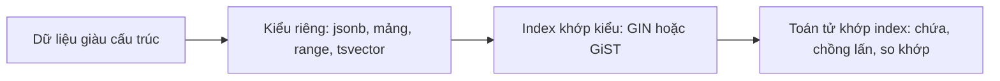
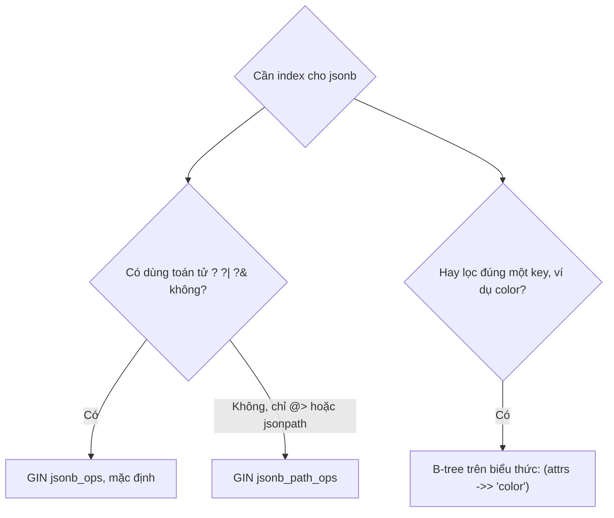
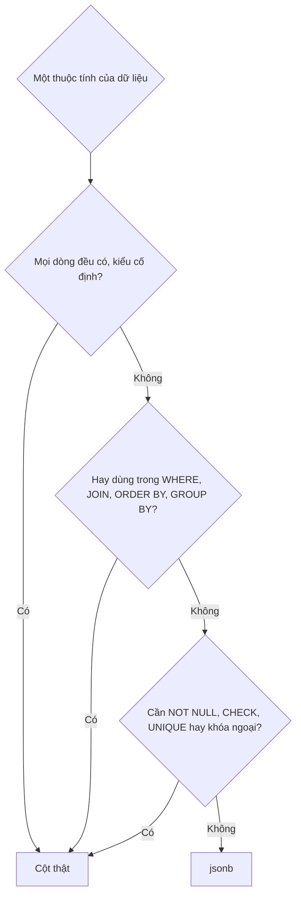
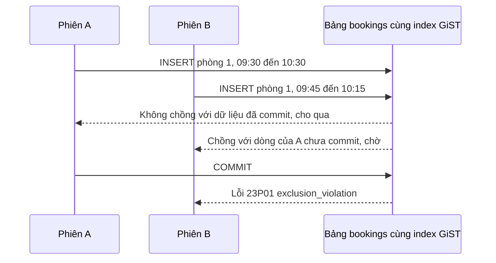
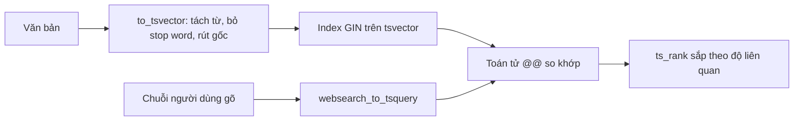
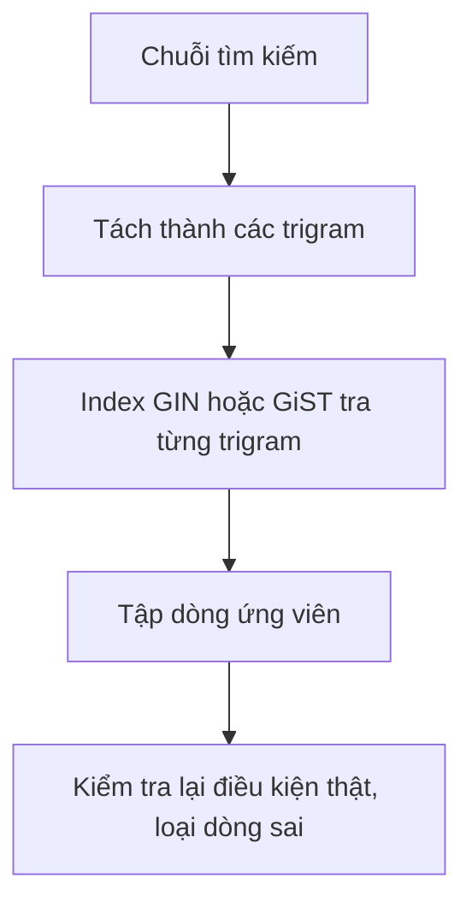

# JSONB, ARRAY, range type và full-text search

Nền tảng: [DDL, DML, kiểu dữ liệu và constraint trong PostgreSQL](/go?p=02-Database%2Feasy%2Flt-14-ddl-dml-kieu-du-lieu-constraint-pg.md), [SELECT, JOIN trực quan](/go?p=02-Database%2Feasy%2Flt-13-sql-select-join-truc-quan.md), [Index và tối ưu query](/go?p=02-Database%2Fmedium%2Flt-03-index-toi-uu-truy-van.md), [PostgreSQL bên trong: MVCC, WAL và VACUUM](/go?p=02-Database%2Fmedium%2Flt-08-postgresql-mvcc-wal.md) (mục các loại index và TOAST). Bài này nói về bốn nhóm kiểu dữ liệu "giàu cấu trúc" mà PostgreSQL có sẵn và hầu hết DB khác không có hoặc làm kém: JSONB, mảng, range, và tìm kiếm toàn văn cùng tìm gần đúng.

> Quy ước của bài: ví dụ SQL là _Minh họa_ (chưa chạy thử trên PostgreSQL thật vì môi trường soạn bài không có server). Kết quả được suy ra từ dữ liệu mẫu và tài liệu chính thức, đã rà cú pháp; khi học hãy dán vào PostgreSQL 18 để kiểm chứng. Định dạng hiển thị chính xác của một số kiểu (khoảng trắng, dấu nháy) có thể khác chút ít.

**Cốt lõi:** Không phải dữ liệu nào cũng vừa hàng và cột cố định. PostgreSQL có kiểu riêng cho từng hình dạng dữ liệu, mỗi kiểu đi kèm index và toán tử phù hợp, nên vẫn giữ được transaction và constraint ở một nơi.

- Vì jsonb và mảng được hỏi theo kiểu "chứa", nên index GIN ánh xạ phần tử tới các dòng trả lời nhanh bằng `@>`, chứ không phải bằng `->>` hay `= ANY`.
- Vì "không chồng lấn" là ràng buộc trên cả khoảng, nên range cộng exclusion constraint với GiST kiểm tra ngay trong index và đóng khe hở race của kiểm tra ở ứng dụng.
- Vì văn bản được chuẩn hóa thành lexeme hoặc trigram, nên tìm kiếm trở thành tra index đảo thay vì quét chuỗi.



Mô hình tư duy: kiểu dữ liệu, index và toán tử đi thành bộ ba, nên truy vấn phải dùng đúng toán tử thì index mới phát huy.

**Tóm tắt:**

- `jsonb` lưu JSON dạng nhị phân, nhanh để truy cập key, có toán tử `->` (trả jsonb), `->>` (trả text), `@>` (chứa), `?` (có key), và jsonpath qua `jsonb_path_query`, `@?`, `@@`.
- Index GIN cho jsonb có hai operator class: `jsonb_ops` (mặc định, hỗ trợ cả `?`) và `jsonb_path_ops` (nhỏ hơn, nhanh hơn, chỉ hỗ trợ `@>` và jsonpath).
- Dùng JSONB cho thuộc tính thưa, linh hoạt hoặc payload ngoài; cột hay lọc, join, cần constraint hoặc khóa ngoại thì tách thành cột thật.
- Mảng (`text[]`, `int[]`) tiện cho tập nhỏ không cần quan hệ; truy vấn bằng `= ANY(...)`, `@>`, `&&` và index GIN.
- Range type (`daterange`, `tstzrange`, `int4range`...) biểu diễn một khoảng là một giá trị, mặc định đóng-mở `[)`; kết hợp exclusion constraint với GiST để cấm trùng lịch ngay ở tầng DB.
- Full-text search: `tsvector` là tài liệu đã chuẩn hóa, `tsquery` là truy vấn, so khớp bằng `@@`, index GIN, sắp xếp bằng `ts_rank`; `websearch_to_tsquery` (từ PostgreSQL 11) nhận cú pháp giống ô tìm kiếm của người dùng.
- `pg_trgm` chia chuỗi thành bộ ba ký tự để index hóa `LIKE '%abc%'`, `ILIKE` và tìm gần đúng (gõ sai chính tả), dùng với GIN hoặc GiST.
- Không có bộ từ điển tiếng Việt có sẵn; dùng cấu hình `simple` kèm `unaccent`, hoặc `pg_trgm`, hoặc đẩy sang công cụ tìm kiếm chuyên dụng khi yêu cầu cao.

## Vấn đề nó giải quyết

Mô hình quan hệ chuẩn bắt mỗi sự thật vào một cột có kiểu cố định. Thực tế có những dữ liệu không vừa khuôn đó:

- Một sản phẩm có thuộc tính khác nhau theo loại (áo có size, laptop có RAM). Tạo cột cho mọi thuộc tính thì bảng đầy NULL; tạo bảng EAV (entity-attribute-value) thì truy vấn đau đớn.
- Phản hồi từ API ngoài có cấu trúc lồng nhau, đổi theo thời gian; muốn lưu nguyên và vẫn truy vấn được.
- Đặt lịch phòng họp: "hai khoảng thời gian không được chồng lên nhau" là ràng buộc về cả khoảng, mà hai cột `start`, `end` kèm kiểm tra ở ứng dụng thì có race condition.
- Ô tìm kiếm sản phẩm: `WHERE name LIKE '%ao thun%'` quét cả bảng, không hiểu biến thể từ, không xếp hạng được, không chịu nổi gõ sai.

PostgreSQL giải từng nhu cầu bằng một kiểu dữ liệu và một loại index đi kèm, nhờ đó vẫn giữ được transaction, constraint và một nơi lưu duy nhất.

## Khi nào dùng, khi nào không

| Nhu cầu | Công cụ | Không nên khi |
|---|---|---|
| Thuộc tính thưa, thay đổi, payload ngoài | `jsonb` | Cột đó luôn có mặt, hay lọc, join, cần FK hoặc `NOT NULL` |
| Tập giá trị nhỏ gắn với một dòng (tag, quyền) | Mảng | Cần FK tới phần tử, cần đếm hoặc cập nhật từng phần tử rất nhiều: dùng bảng nối |
| Khoảng thời gian, giá, phiên bản; cấm chồng lấn | Range và `EXCLUDE` | Chỉ cần lưu hai mốc không ràng buộc |
| Tìm văn bản theo từ, xếp hạng | `tsvector` cùng GIN | Cần tìm kiếm tiếng Việt chất lượng cao, gợi ý, phân tích ngữ nghĩa: cân nhắc Elasticsearch hay OpenSearch |
| `LIKE '%x%'`, gõ sai chính tả | `pg_trgm` | Chỉ cần tiền tố (`LIKE 'abc%'`): B-tree thường đủ |

Nguyên tắc chung: kiểu giàu cấu trúc là công cụ bổ sung, không thay thế thiết kế quan hệ cho phần dữ liệu cốt lõi.

## Các khái niệm cần biết

- **jsonb**: kiểu JSON nhị phân đã phân tích; khác `json` (giữ nguyên văn bản, phải phân tích lại mỗi lần). Gần như luôn chọn jsonb.
- **Containment (`@>`)**: "vế trái chứa vế phải", cách chính để hỏi jsonb và mảng, và là toán tử được index hỗ trợ tốt nhất.
- **jsonpath**: ngôn ngữ đường dẫn kiểu SQL/JSON (`$.size[*] ? (@ == "L")`), có từ PostgreSQL 12.
- **GIN (Generalized Inverted Index)**: index đảo, ánh xạ từng phần tử (key, từ, phần tử mảng) tới các dòng chứa nó.
- **GiST**: index cây tổng quát, dùng cho range, hình học, và trigram gần đúng.
- **Range type**: một giá trị biểu diễn khoảng, kèm cận dưới và cận trên, mỗi cận đóng hoặc mở.
- **Multirange**: tập các range rời nhau trong một giá trị, từ PostgreSQL 14.
- **Exclusion constraint**: tổng quát của UNIQUE: không có hai dòng nào mà các cột cho trước thỏa đồng thời các toán tử chỉ định (ví dụ cùng phòng và khoảng thời gian chồng nhau).
- **tsvector / tsquery**: văn bản đã tách từ, chuẩn hóa (lexeme) cùng vị trí; và biểu thức tìm kiếm.
- **Text search configuration**: bộ quy tắc tách từ, bỏ stop word, rút gọn gốc từ theo ngôn ngữ (`english`, `simple`...).
- **Trigram**: bộ ba ký tự liên tiếp của một chuỗi, nền của `pg_trgm`.

## 1. JSONB

### 1.1 Dữ liệu mẫu và toán tử truy cập

```sql
CREATE TABLE products (
    id    int PRIMARY KEY,
    name  text NOT NULL,
    attrs jsonb NOT NULL DEFAULT '{}'
);
INSERT INTO products VALUES
 (1,'Ao thun',   '{"color":"red","size":["S","M"],"price":120000,"tags":["sale"]}'),
 (2,'Quan jean', '{"color":"blue","size":["M","L"],"price":350000}'),
 (3,'Non',       '{"color":"red","price":80000,"brand":{"name":"X","country":"VN"}}');
```

| Biểu thức | Trả về | Với id 1, 3 (_Minh họa_) |
|---|---|---|
| `attrs -> 'color'` | `jsonb` | `"red"` (còn nháy kép, vẫn là jsonb) |
| `attrs ->> 'color'` | `text` | `red` |
| `attrs -> 'size' -> 0` | phần tử mảng, đếm từ 0 | id 1: `"S"`; id 3: NULL |
| `attrs #>> '{brand,country}'` | text theo đường dẫn | id 3: `VN`; id 1: NULL |
| `attrs ? 'brand'` | boolean, có key ở cấp trên cùng | id 3: true |
| `attrs @> '{"color":"red"}'` | boolean, chứa | id 1, 3: true |

Đọc bảng: `->` giữ nguyên kiểu jsonb nên nối tiếp được (`-> 'brand' -> 'name'`); `->>` lấy ra text, cần ép kiểu khi so sánh số: `(attrs ->> 'price')::int > 100000`. Key không tồn tại cho NULL chứ không báo lỗi.

```sql
SELECT id, name FROM products WHERE attrs @> '{"color":"red"}' ORDER BY id;
```

Kết quả (_Minh họa_): `1 | Ao thun` và `3 | Non`.

### 1.2 jsonpath

Từ PostgreSQL 12, jsonpath cho phép hỏi điều kiện phức tạp trên cấu trúc lồng và mảng:

```sql
SELECT id, jsonb_path_query(attrs, '$.size[*]') AS sz
FROM products ORDER BY id;
```

Kết quả (_Minh họa_): `1 | "S"`, `1 | "M"`, `2 | "M"`, `2 | "L"`; id 3 không có `size` nên không ra dòng nào (`jsonb_path_query` là hàm trả tập dòng).

```sql
SELECT id FROM products WHERE attrs @? '$.size[*] ? (@ == "L")';   -- có tồn tại phần tử khớp
SELECT id FROM products WHERE attrs @@ '$.price > 100000';         -- biểu thức điều kiện
```

Kết quả (_Minh họa_): câu đầu ra id 2; câu hai ra id 1 và 2. `@?` hỏi "đường dẫn này có trả ít nhất một mục không", `@@` kiểm tra một predicate đúng hay sai. Cả hai dùng được index GIN.

Cập nhật không cần thay cả document:

```sql
UPDATE products SET attrs = jsonb_set(attrs, '{color}', '"green"') WHERE id = 3;
UPDATE products SET attrs = attrs || '{"stock":5}' WHERE id = 3;   -- gộp thêm key
UPDATE products SET attrs = attrs - 'tags' WHERE id = 1;           -- bỏ key
```

Từ PostgreSQL 14 có thêm cú pháp subscript: `attrs['color']` để đọc, `UPDATE ... SET attrs['color'] = '"green"'` để ghi. Từ PostgreSQL 17 có các hàm theo chuẩn SQL/JSON như `JSON_EXISTS`, `JSON_QUERY`, `JSON_VALUE` và `JSON_TABLE` (biến JSON thành bảng quan hệ).

### 1.3 Index GIN cho jsonb



```sql
CREATE INDEX idx_products_attrs ON products USING gin (attrs jsonb_path_ops);
CREATE INDEX idx_products_color ON products ((attrs ->> 'color'));
```

- `jsonb_ops` (mặc định) index từng key và từng giá trị riêng lẻ; hỗ trợ `@>`, `?`, `?|`, `?&`, `@?`, `@@`; index lớn hơn.
- `jsonb_path_ops` băm theo cả đường dẫn tới giá trị; thường nhỏ và nhanh hơn, nhưng chỉ hỗ trợ `@>`, `@?`, `@@`, không hỗ trợ `?`.
- Index GIN không giúp được `attrs ->> 'color' = 'red'`; muốn dùng, tạo B-tree trên đúng biểu thức đó (câu thứ hai ở trên), và viết truy vấn đúng biểu thức đó.

**Phải thuộc:** `->` trả jsonb, `->>` trả text; `@>` là "chứa", `?` là "có key" (chỉ index `jsonb_ops` hỗ trợ). GIN `jsonb_path_ops` nhỏ và nhanh hơn nhưng chỉ cho `@>` và jsonpath. Đa số trường hợp chọn `jsonb` thay vì `json`.

### 1.4 Khi nào dùng JSONB, khi nào tách cột



Lý do kỹ thuật cho đường rẽ này: planner không có thống kê cho từng key bên trong jsonb nên ước lượng số dòng kém, dẫn tới plan tệ; mỗi dòng lặp lại tên key nên tốn dung lượng; sửa một key nhỏ trong document lớn làm ghi lại cả giá trị (xem TOAST và MVCC ở [PostgreSQL bên trong](/go?p=02-Database%2Fmedium%2Flt-08-postgresql-mvcc-wal.md)). Cách dung hòa thường dùng: cột thật cho phần lõi (`id`, `name`, `price`, `status`), một cột `attrs jsonb` cho phần thưa, và có thể thêm cột sinh (`GENERATED ALWAYS AS (attrs ->> 'color') STORED`, từ PostgreSQL 12) cho key được lọc nhiều.

**Suy luận:** Jsonb cho phép bỏ qua việc khai báo schema, nhưng không bỏ được việc schema tồn tại: nó chỉ chuyển từ DB sang code ứng dụng, nơi không ai kiểm tra thay bạn. Một key bạn lọc thường xuyên thực chất đã là một cột; để nó trong jsonb nghĩa là mất kiểu dữ liệu, mất constraint và mất thống kê cho planner, đổi lại chỉ được sự tiện lợi ban đầu. Ngược lại, thuộc tính khác nhau theo từng dòng mà chỉ đọc nguyên khối thì ép thành cột sẽ tạo nhiều NULL và nhiều lần đổi schema. Điểm dễ nhầm là tưởng có GIN thì jsonb nhanh như cột thật; GIN trả lời tốt câu hỏi "chứa" nhưng không sắp xếp, không so sánh khoảng và không cho thống kê. Hệ quả hành động: bắt đầu bằng cột cho thứ bạn biết sẽ lọc, jsonb cho phần còn lại, và chuyển key thành cột khi nó xuất hiện trong WHERE thường xuyên.

## 2. ARRAY

PostgreSQL cho cột kiểu mảng của bất kỳ kiểu nào; chỉ số bắt đầu từ 1.

```sql
CREATE TABLE posts (id int PRIMARY KEY, title text, tags text[] NOT NULL DEFAULT '{}');
INSERT INTO posts VALUES
 (1,'PG tips',  ARRAY['db','postgres']),
 (2,'Spring',   ARRAY['java','spring']),
 (3,'PG vs MySQL', ARRAY['db','postgres','mysql']);
CREATE INDEX idx_posts_tags ON posts USING gin (tags);
```

| Truy vấn | Ý nghĩa | Kết quả (_Minh họa_) |
|---|---|---|
| `WHERE 'db' = ANY(tags)` | có phần tử bằng 'db' | id 1, 3 |
| `WHERE tags @> ARRAY['db','mysql']` | chứa cả hai | id 3 |
| `WHERE tags && ARRAY['java','mysql']` | có ít nhất một phần tử chung | id 2, 3 |
| `SELECT id, tags[1] FROM posts` | phần tử đầu | `1 db`, `2 java`, `3 db` |
| `SELECT id, unnest(tags) FROM posts WHERE id = 1` | bung thành dòng | `1 db`, `1 postgres` |

Index GIN mặc định (`array_ops`) hỗ trợ `@>`, `<@`, `&&`, `=`; không hỗ trợ `= ANY(tags)`, nên để dùng index hãy viết `tags @> ARRAY['db']`. Hàm gộp ngược lại: `array_agg(col)` gom nhiều dòng thành mảng, `array_length(tags, 1)` lấy độ dài.

Mảng hợp cho tag, danh sách quyền, id tham chiếu mềm. Không nên khi cần khóa ngoại tới từng phần tử (mảng không có FK), cần thống kê theo phần tử, hoặc mảng lớn lên không giới hạn: dùng bảng nối `post_tags(post_id, tag_id)`.

## 3. Range type và exclusion constraint

Range là một giá trị có hai cận. Các kiểu có sẵn: `int4range`, `int8range`, `numrange`, `daterange`, `tsrange` (timestamp không múi giờ), `tstzrange` (timestamp có múi giờ). Cú pháp `[a,b)` là bao gồm a, không bao gồm b; đây là dạng chuẩn hóa mặc định cho các range rời rạc (int, date).

| Biểu thức | Kết quả (_Minh họa_) |
|---|---|
| `int4range(1,5) @> 3` | true |
| `int4range(1,5) @> 5` | false (cận trên mở) |
| `'[1,5]'::int4range` | `[1,6)` (chuẩn hóa về dạng đóng-mở) |
| `int4range(1,5) && int4range(4,9)` | true (chồng lên nhau) |
| `int4range(1,5) && int4range(5,9)` | false (chỉ chạm nhau) |
| `daterange('2026-11-01','2026-11-03') @> DATE '2026-11-02'` | true |

Đóng-mở `[)` quan trọng cho lịch: ca 9:00 đến 10:00 và ca 10:00 đến 11:00 không chồng nhau vì cận trên 10:00 của ca đầu là mở.

### Chặn đặt trùng lịch bằng exclusion constraint

```sql
CREATE EXTENSION IF NOT EXISTS btree_gist;

CREATE TABLE bookings (
    id      int GENERATED ALWAYS AS IDENTITY PRIMARY KEY,
    room_id int NOT NULL,
    during  tstzrange NOT NULL,
    EXCLUDE USING gist (room_id WITH =, during WITH &&)
);

INSERT INTO bookings (room_id, during)
VALUES (1, '[2026-11-01 09:00+07, 2026-11-01 10:00+07)');   -- OK
INSERT INTO bookings (room_id, during)
VALUES (1, '[2026-11-01 09:30+07, 2026-11-01 10:30+07)');   -- lỗi
INSERT INTO bookings (room_id, during)
VALUES (1, '[2026-11-01 10:00+07, 2026-11-01 11:00+07)');   -- OK, chỉ chạm cận
INSERT INTO bookings (room_id, during)
VALUES (2, '[2026-11-01 09:30+07, 2026-11-01 10:30+07)');   -- OK, phòng khác
```

Câu thứ hai báo lỗi (_Minh họa_): `ERROR: conflicting key value violates exclusion constraint "bookings_room_id_during_excl"` kèm `DETAIL: Key (room_id, during)=(...) conflicts with existing key (room_id, during)=(...)`, SQLSTATE `23P01` (exclusion_violation). Hai câu còn lại thành công.

`btree_gist` cần thiết vì toán tử `=` trên `int` không có sẵn operator class cho GiST; extension này bổ sung. Nếu chỉ có một cột range thì không cần.



Đọc sơ đồ: kiểm tra chồng lấn được thực hiện trong index, kể cả với dòng của transaction khác chưa commit (giống cách UNIQUE hoạt động), nên race condition mà code ứng dụng kiểu "SELECT kiểm tra rồi INSERT" mắc phải không còn. Ứng dụng chỉ cần bắt lỗi `23P01` và báo "khung giờ đã có người đặt".

Từ PostgreSQL 18 còn có cú pháp ràng buộc theo thời gian (temporal constraints): `PRIMARY KEY (room_id, during WITHOUT OVERLAPS)` hoặc `UNIQUE (...WITHOUT OVERLAPS)`, và khóa ngoại `FOREIGN KEY (room_id, PERIOD during) REFERENCES ...`. Bên dưới vẫn dựa trên GiST, nên vẫn cần `btree_gist` cho cột vô hướng; kiểm tra lại cú pháp trong tài liệu bản 18 trước khi dùng thật.

**Nền tảng:** Ràng buộc "không chồng lấn" phải được thi hành trong DB, vì kiểm tra ở ứng dụng có khoảng hở giữa đọc và ghi (xem write skew ở [Transaction, Isolation và Lock](/go?p=02-Database%2Fmedium%2Flt-04-transaction-isolation-lock.md)). Exclusion constraint cộng GiST đóng khoảng hở đó bằng một index mà các phiên chung nhau.

## 4. Full-text search

Tìm bằng `LIKE '%x%'` thất bại ở ba điểm: quét toàn bảng, so khớp từng ký tự nên không biết "running" và "run" cùng gốc, và không có khái niệm độ liên quan. Full-text search (FTS) xử lý bằng cách chuẩn hóa văn bản thành các lexeme rồi index hóa.



```sql
SELECT to_tsvector('english', 'a fat cat sat on a mat');
-- 'cat':3 'fat':2 'mat':7 'sat':4

SELECT to_tsquery('english', 'fat & rat');
-- 'fat' & 'rat'

SELECT websearch_to_tsquery('english', '"supernovae stars" -crab');
-- 'supernova' <-> 'star' & !'crab'
```

Đọc kết quả: các lexeme kèm vị trí; stop word `a`, `on` bị bỏ nhưng vị trí vẫn tính. `websearch_to_tsquery` (từ PostgreSQL 11) hiểu cú pháp giống web: chuỗi trong nháy kép thành cụm từ (`<->` nghĩa là liền kề), dấu `-` thành phủ định, `or` thành `|`; nó không bao giờ báo lỗi cú pháp với đầu vào bậy, nên an toàn để đưa thẳng ô tìm kiếm của người dùng. `plainto_tsquery` và `phraseto_tsquery` là các biến thể đơn giản hơn; `to_tsquery` đòi hỏi người gọi tự viết đúng toán tử `&`, `|`, `!`.

### Index và xếp hạng

```sql
CREATE TABLE articles (
    id     int PRIMARY KEY,
    title  text NOT NULL,
    body   text NOT NULL,
    fts    tsvector GENERATED ALWAYS AS
             (setweight(to_tsvector('english', title), 'A') ||
              setweight(to_tsvector('english', body),  'B')) STORED
);
CREATE INDEX idx_articles_fts ON articles USING gin (fts);

INSERT INTO articles (id, title, body) VALUES
 (1, 'PostgreSQL indexing', 'GIN and B-tree indexes speed up queries'),
 (2, 'Cooking pasta',       'Boil water, add salt, cook the pasta'),
 (3, 'Index tuning',        'Choosing the right index for PostgreSQL queries');

SELECT id, title, ts_rank(fts, q) AS rank
FROM articles, websearch_to_tsquery('english', 'postgresql index') AS q
WHERE fts @@ q
ORDER BY rank DESC;
```

Kết quả (_Minh họa_, giá trị rank cụ thể do PostgreSQL tính, chỉ cần thứ tự): id 1 và id 3 khớp (id 2 không có từ nào), id 1 thường đứng trước vì cả hai từ nằm ở title có trọng số A. Điểm chính: cột `tsvector` sinh tự động (`GENERATED ... STORED`, từ PostgreSQL 12) luôn đồng bộ với `title`, `body`; `setweight` ưu tiên title (A) hơn body (B); `ts_rank` dùng tần suất và trọng số, `ts_rank_cd` còn xét độ gần giữa các từ; `ts_headline` tô sáng đoạn khớp để hiển thị. Nếu không dùng cột sinh, phải tạo index trên đúng biểu thức `to_tsvector('english', col)` và truy vấn đúng biểu thức đó, đồng thời luôn truyền tên cấu hình (dạng một đối số phụ thuộc cấu hình mặc định của phiên, không dùng được trong index).

### Tiếng Việt

PostgreSQL không có từ điển tiếng Việt. Cấu hình `simple` chỉ tách từ theo dấu cách, hạ chữ thường, không bỏ stop word và không rút gốc; vì tiếng Việt vốn không biến hình, `simple` khá ổn cho tìm từ đơn. Để tìm "ha noi" ra "Hà Nội", cài extension `unaccent` và bọc: `to_tsvector('simple', unaccent(title))` (tạo một hàm `IMMUTABLE` bao `unaccent` nếu cần index biểu thức, vì `unaccent` mặc định không immutable). Từ ghép nhiều âm tiết ("xe máy") không được nhận là một từ; dùng cụm từ `"xe may"` với `<->`. Khi yêu cầu cao hơn nữa, tìm kiếm trong PostgreSQL chỉ là mức khởi đầu.

**Phải thuộc:** FTS gồm `tsvector` (tài liệu), `tsquery` (truy vấn), toán tử `@@`, index GIN, `ts_rank` để xếp hạng. `websearch_to_tsquery` (từ PostgreSQL 11) nhận đầu vào của người dùng mà không báo lỗi cú pháp. Cột `tsvector` sinh sẵn giữ index luôn đồng bộ.

## 5. pg_trgm: LIKE và tìm gần đúng

FTS làm việc theo từ; còn muốn tìm chuỗi con (`LIKE '%thun%'`) hoặc chịu được gõ sai ("postgre" thay vì "postgres") thì dùng `pg_trgm`. Nó chia chuỗi thành các trigram (bộ ba ký tự liên tiếp, có đệm khoảng trắng đầu và cuối từ).

```sql
CREATE EXTENSION IF NOT EXISTS pg_trgm;
SELECT show_trgm('cat');
-- {"  c"," ca","at ",cat}
SELECT similarity('postgres', 'postgre');   -- giá trị trong khoảng 0 đến 1, càng gần 1 càng giống
```

(Hiển thị `show_trgm` có thể khác chút về dấu nháy; điều cần nhớ là `cat` cho bốn trigram gồm hai đệm đầu, một đệm đầu, đệm cuối và nguyên từ.)



```sql
CREATE INDEX idx_products_name_trgm ON products USING gin (name gin_trgm_ops);

SELECT id, name FROM products WHERE name ILIKE '%jean%';       -- dùng được index
SELECT id, name, similarity(name, 'quan jeen') AS sim
FROM products WHERE name % 'quan jeen'                          -- toán tử % so với ngưỡng
ORDER BY name <-> 'quan jeen' LIMIT 5;                          -- <-> là khoảng cách trigram
```

Kết quả (_Minh họa_): câu đầu ra `2 | Quan jean`; câu hai ra `Quan jean` vì giống đủ ngưỡng (mặc định `pg_trgm.similarity_threshold` là 0,3; chỉnh bằng `SET`). Với GIN, `gin_trgm_ops` hỗ trợ `LIKE`, `ILIKE`, `~`, `~*`, `%`; với GiST, `gist_trgm_ops` còn hỗ trợ sắp theo khoảng cách `<->` bằng index (hợp với "gần giống nhất" cùng `LIMIT`). Mẫu quá ngắn (dưới 3 ký tự) cho ít trigram nên index kém hiệu quả.

Từ PostgreSQL 18, việc build index GIN có thể chạy song song, giúp tạo các index lớn như trigram nhanh hơn.

**Suy luận:** B-tree sắp theo thứ tự từ trái sang phải nên chỉ trả lời được tiền tố; `%thun%` không có điểm bắt đầu để dò. Trigram đổi bài toán: thay vì hỏi "chuỗi con nằm ở đâu", hỏi "những dòng nào chứa tất cả các bộ ba ký tự của chuỗi con này", đây là phép tra index đảo rất hợp với GIN. Kết quả lọc thô có thể có dòng sai (cùng trigram nhưng không liền nhau) nên PostgreSQL kiểm tra lại điều kiện thật trên các dòng ứng viên. Điểm dễ nhầm là nghĩ trigram thay được FTS: nó không rút gốc từ, không có stop word, không xếp hạng theo nghĩa từ vựng. Hệ quả hành động: FTS cho tìm theo từ có xếp hạng, trigram cho chuỗi con và sai chính tả, và hai cái có thể dùng cùng nhau.

## Bẫy thường gặp

| Bẫy | Hậu quả | Cách tránh |
|---|---|---|
| Dùng `json` thay `jsonb` | Không index GIN được, phân tích lại mỗi lần | Dùng `jsonb` |
| Index GIN rồi truy vấn `attrs ->> 'k' = 'v'` | Không dùng index, quét bảng | Dùng `@>`, hoặc B-tree trên đúng biểu thức |
| `jsonb_path_ops` rồi dùng toán tử `?` | Index không giúp được | Chọn `jsonb_ops` nếu cần `?` |
| Nhét mọi thứ vào một cột jsonb | Mất kiểu, constraint, thống kê planner | Cột thật cho phần lõi |
| Cập nhật một key trong document rất lớn liên tục | Ghi lại cả giá trị, phình bảng | Tách key hay đổi ra cột riêng |
| `'x' = ANY(tags)` rồi mong dùng GIN | Không dùng index | Viết `tags @> ARRAY['x']` |
| Quên `btree_gist` khi `EXCLUDE ... room_id WITH =` | Lỗi không có operator class | `CREATE EXTENSION btree_gist` |
| Dùng `[]` đóng cả hai đầu cho lịch | Hai ca liền nhau bị coi là chồng | Dùng đóng-mở `[)` |
| `to_tsvector(col)` không truyền cấu hình trong index | Không index được hoặc kết quả đổi theo cấu hình phiên | Luôn ghi rõ `'english'` hay `'simple'` |
| Mong FTS `english` hiểu tiếng Việt | Rút gốc sai, stop word sai | Dùng `simple` kèm `unaccent`, hoặc trigram |
| Trigram trên mẫu 1 đến 2 ký tự | Index kém hiệu quả | Yêu cầu tối thiểu 3 ký tự |

## Điểm cần nhớ

- jsonb: `->` jsonb, `->>` text, `@>` chứa, `?` có key, jsonpath từ PG 12; GIN `jsonb_path_ops` nhỏ và nhanh cho `@>`.
- Lõi thành cột, phần thưa vào jsonb; key lọc nhiều thì chuyển thành cột (hoặc cột sinh).
- Mảng cho tập nhỏ; truy vấn bằng `@>` và `&&` để dùng index GIN; quan hệ nhiều-nhiều thì dùng bảng nối.
- Range mặc định đóng-mở `[)`; `EXCLUDE USING gist (... WITH =, ... WITH &&)` cấm chồng lấn, lỗi `23P01`; PG 18 có `WITHOUT OVERLAPS`.
- FTS: `to_tsvector` cộng `websearch_to_tsquery` cộng `@@` cộng GIN cộng `ts_rank`; cột `tsvector` sinh sẵn giữ đồng bộ.
- `pg_trgm` cho `LIKE '%x%'` và gần đúng; chỉ dùng B-tree khi tìm tiền tố.
- Tiếng Việt: `simple` và `unaccent`; cần chất lượng cao thì cân nhắc công cụ chuyên dụng.

## Phỏng vấn khó: chuỗi hỏi xoáy

Người phỏng vấn senior thường mở bằng câu dễ rồi xoáy xuống cơ chế, đánh đổi và sự cố thật. Câu trả lời tốt luôn đi từ cốt lõi xuống.

### Chuỗi 1: Index GIN cho jsonb và ranh giới với cột thật

1. **Câu mở:** Đã tạo GIN trên cột `attrs jsonb` nhưng `WHERE attrs ->> 'color' = 'red'` vẫn quét cả bảng. Vì sao?
2. **Xoáy 1:** GIN lưu gì bên trong, và `jsonb_ops` khác `jsonb_path_ops` ở đâu?
3. **Xoáy 2:** Team nhét mọi thuộc tính vào jsonb. Bạn phản biện bằng những lý do kỹ thuật nào, và dung hòa ra sao?

**Đáp án ngắn:** GIN là index đảo: nó ánh xạ từng key, giá trị hoặc đường dẫn tới các dòng chứa nó, nên trả lời tốt câu hỏi "chứa" như `@>`. Biểu thức `attrs ->> 'color' = 'red'` là phép so sánh trên một biểu thức khác, GIN không phục vụ được; muốn dùng thì viết `attrs @> '{"color":"red"}'`, hoặc tạo B-tree trên đúng biểu thức `(attrs ->> 'color')` và truy vấn đúng biểu thức đó. `jsonb_ops` index từng key và từng giá trị riêng lẻ, hỗ trợ cả `?`, `?|`, `?&` nhưng index lớn hơn; `jsonb_path_ops` băm theo đường dẫn tới giá trị, thường nhỏ và nhanh hơn nhưng chỉ cho `@>` và jsonpath. Về thiết kế, planner không có thống kê cho từng key bên trong jsonb nên ước lượng số dòng kém và plan dễ tệ; tên key lặp lại ở mỗi dòng tốn dung lượng; sửa một key nhỏ trong document lớn làm ghi lại cả giá trị; và không có `NOT NULL`, khóa ngoại cho từng key. Dung hòa: cột thật cho phần lõi và key hay lọc (có thể dùng cột sinh `GENERATED ... STORED`), jsonb cho phần thưa.

**Sai lầm hay gặp:**

- Nghĩ có GIN thì jsonb nhanh như cột thật.
- Chọn `jsonb_path_ops` rồi dùng toán tử `?`.
- Bảo vệ jsonb bằng "linh hoạt" mà không nêu được chi phí về thống kê planner và constraint.

### Chuỗi 2: Range và exclusion constraint chống đặt trùng

1. **Câu mở:** Làm sao ở tầng database bảo đảm hai booking cùng phòng không chồng giờ?
2. **Xoáy 1:** Hai phiên cùng chèn khung giờ chồng nhau cùng lúc. Cơ chế nào làm một bên thất bại, và nó khác kiểm tra bằng `SELECT` ở ứng dụng ở điểm nào?
3. **Xoáy 2:** Vì sao `EXCLUDE USING gist (room_id WITH =, during WITH &&)` cần `btree_gist`, ứng dụng xử lý lỗi thế nào, và PostgreSQL 18 có cách khai báo nào gọn hơn?

**Đáp án ngắn:** Dùng kiểu `tstzrange` và exclusion constraint: không có hai dòng nào mà `room_id` bằng nhau và `during` chồng nhau (`&&`). Khoảng thời gian được xem là một giá trị, mặc định đóng-mở `[)`, nên ca 9 đến 10 giờ và ca 10 đến 11 giờ chỉ chạm cận chứ không chồng. Kiểm tra ở ứng dụng có khe hở giữa đọc và ghi, dạng write skew. Exclusion constraint kiểm tra ngay trong index GiST, kể cả với dòng chưa commit của phiên khác, giống cách UNIQUE hoạt động: phiên đến sau chờ, rồi nhận lỗi khi phiên trước commit. Lỗi là SQLSTATE `23P01` (`exclusion_violation`); ứng dụng bắt mã này và báo "khung giờ đã có người đặt". `btree_gist` cần vì toán tử `=` trên `int` không có sẵn operator class cho GiST; nếu chỉ có cột range thì không cần. Từ PostgreSQL 18 có cú pháp ràng buộc theo thời gian như `WITHOUT OVERLAPS`, bên dưới vẫn dựa trên GiST; kiểm tra lại cú pháp trong tài liệu bản 18 trước khi dùng.

**Sai lầm hay gặp:**

- Dùng `[]` đóng cả hai đầu nên hai ca liền nhau bị coi là chồng.
- Tin `SELECT` kiểm tra trống rồi `INSERT` là đủ an toàn.
- Quên `btree_gist` hoặc không bắt `23P01`, để lỗi lọt thành 500 cho người dùng.

## Câu hỏi tự kiểm tra

Với mỗi câu, thử trả lời theo gợi ý trước rồi mới đọc phần lập luận.

1. Khác nhau giữa `attrs -> 'color'` và `attrs ->> 'color'`, và vì sao `attrs ->> 'price' > '100000'` (so với một chuỗi) có thể cho kết quả sai?
   - **Gợi ý suy luận:** mỗi toán tử trả kiểu gì? So sánh hai chuỗi khác so sánh hai số ra sao?
   - **Lập luận và đáp án:** `->` trả jsonb, `->>` trả text. Với text, so sánh theo thứ tự chữ, nên `'80000' > '100000'` đúng (vì '8' đứng sau '1'). Phải ép kiểu: `(attrs ->> 'price')::int > 100000`; hoặc dùng jsonpath `attrs @@ '$.price > 100000'`.
2. Bạn cần truy vấn nhanh `WHERE attrs @> '{"color":"red"}'` trên bảng lớn và không dùng toán tử `?`. Chọn index nào, vì sao?
   - **Gợi ý suy luận:** hai operator class của GIN khác nhau ở những toán tử nào và kích thước ra sao?
   - **Lập luận và đáp án:** `GIN (attrs jsonb_path_ops)`: nhỏ và nhanh hơn `jsonb_ops`, đủ cho `@>` và jsonpath. Chỉ khi cần `?`, `?|`, `?&` mới phải chọn `jsonb_ops`.
3. Vì sao kiểm tra "phòng còn trống" bằng `SELECT` rồi `INSERT` ở ứng dụng vẫn có thể đặt trùng?
   - **Gợi ý suy luận:** giữa SELECT và INSERT, một phiên khác có thể làm gì? Ràng buộc nào của DB loại bỏ khoảng hở đó?
   - **Lập luận và đáp án:** hai phiên cùng thấy phòng trống rồi cùng chèn (dạng write skew). Exclusion constraint `EXCLUDE USING gist (room_id WITH =, during WITH &&)` kiểm tra trong index, kể cả với dòng chưa commit của phiên khác, nên phiên chậm hơn bị lỗi `23P01`.
4. `tstzrange('2026-11-01 09:00+07', '2026-11-01 10:00+07')` và `tstzrange('2026-11-01 10:00+07', '2026-11-01 11:00+07')` có chồng nhau không?
   - **Gợi ý suy luận:** cận mặc định của hàm constructor là đóng hay mở ở mỗi đầu?
   - **Lập luận và đáp án:** không, vì mặc định `[)`: cận trên của khoảng đầu là mở, nên 10:00 chỉ thuộc khoảng sau. `&&` trả false.
5. Muốn tìm "postgre" ra "PostgreSQL" và `LIKE '%gre%'` nhanh. FTS hay pg_trgm?
   - **Gợi ý suy luận:** FTS làm việc theo từ đầy đủ hay chuỗi con? Trigram thì sao?
   - **Lập luận và đáp án:** `pg_trgm` với GIN `gin_trgm_ops`, vì cần chuỗi con và gần đúng. FTS khớp theo lexeme nguyên (và gốc từ), không khớp một mảnh bên trong từ.
6. Nên chọn cách nào cho `tags` của bài viết khi cần đếm số bài theo từng tag và có bảng quản lý tag (tên, mô tả)?
   - **Gợi ý suy luận:** mảng có khóa ngoại tới phần tử không? Cần thống kê và metadata theo từng tag không?
   - **Lập luận và đáp án:** bảng nối `post_tags(post_id, tag_id)` với bảng `tags`, vì cần FK, metadata và đếm hiệu quả. Mảng `text[]` hợp khi tag chỉ là nhãn tự do không có thực thể riêng.

Nguồn: tài liệu chính thức PostgreSQL 18 (JSON Types, JSON Functions and Operators, jsonpath, Arrays, Range Types, Exclusion Constraints, Full Text Search, pg_trgm, btree_gist, Release Notes 11, 12, 14, 17 và 18), kiểm tra ngày 2026-10-30.

