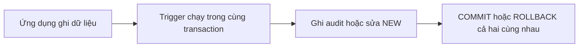
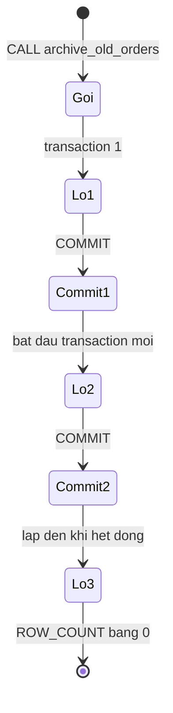
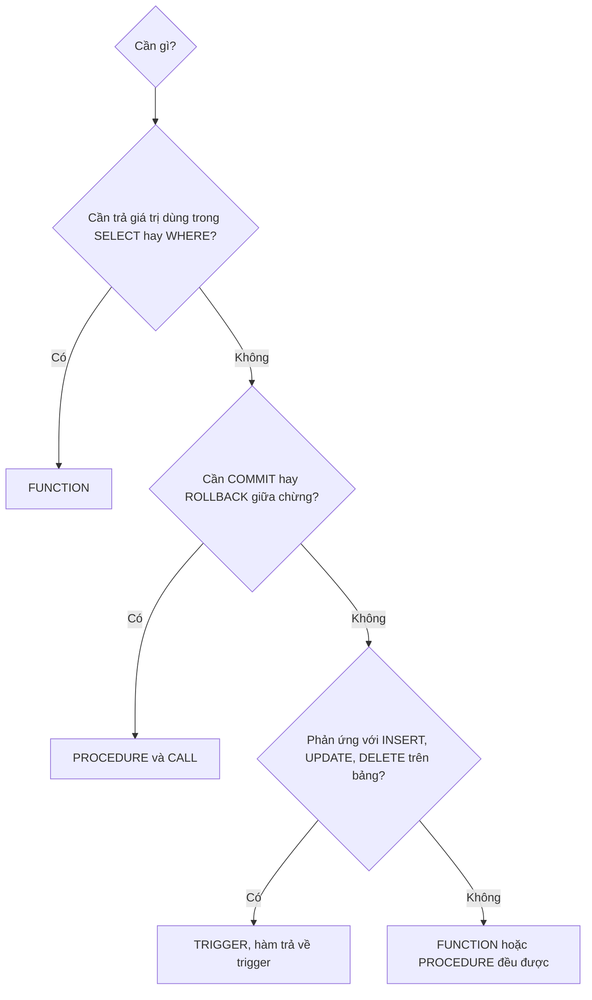
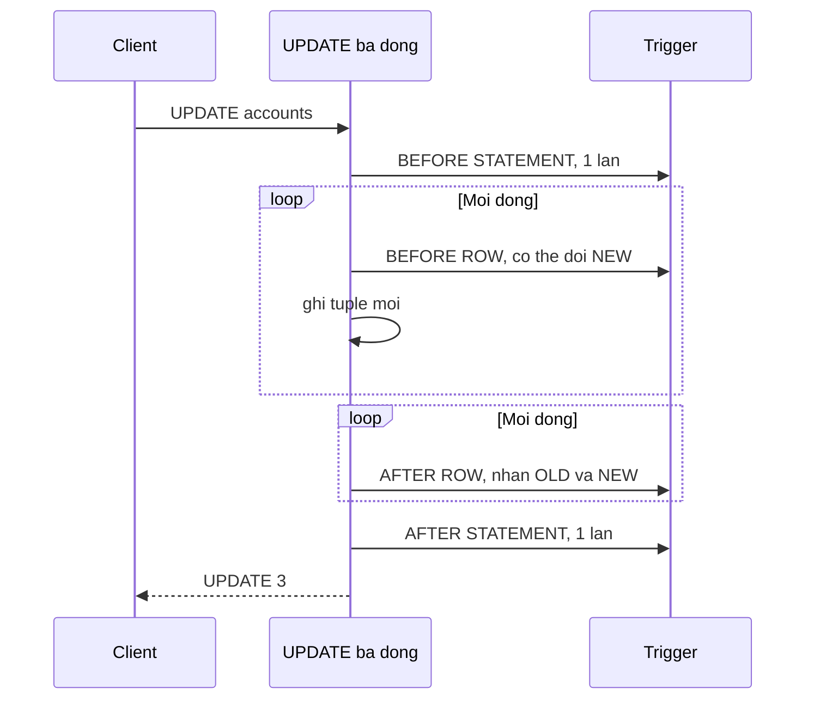
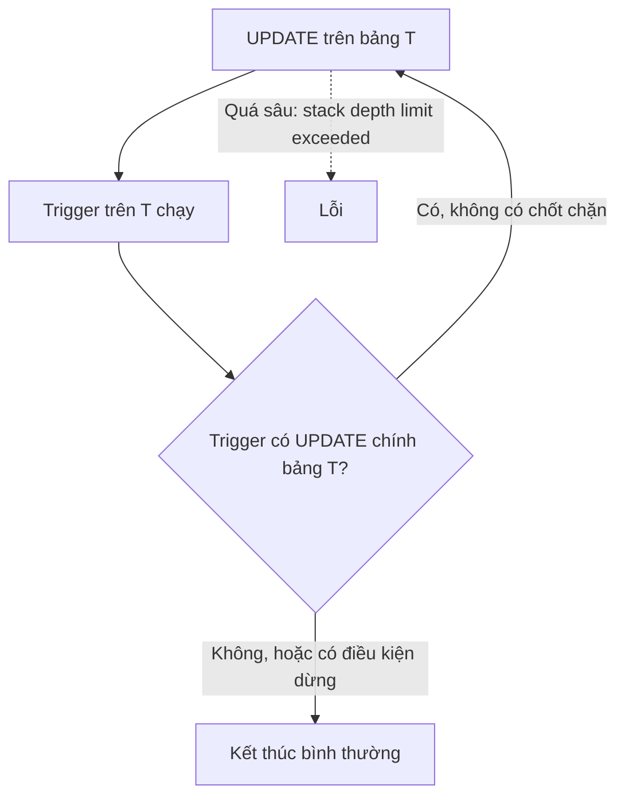
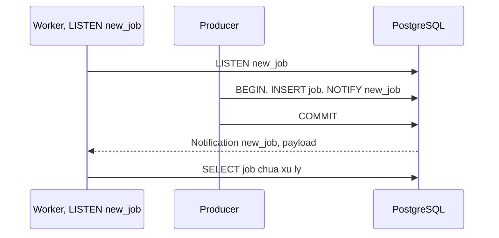
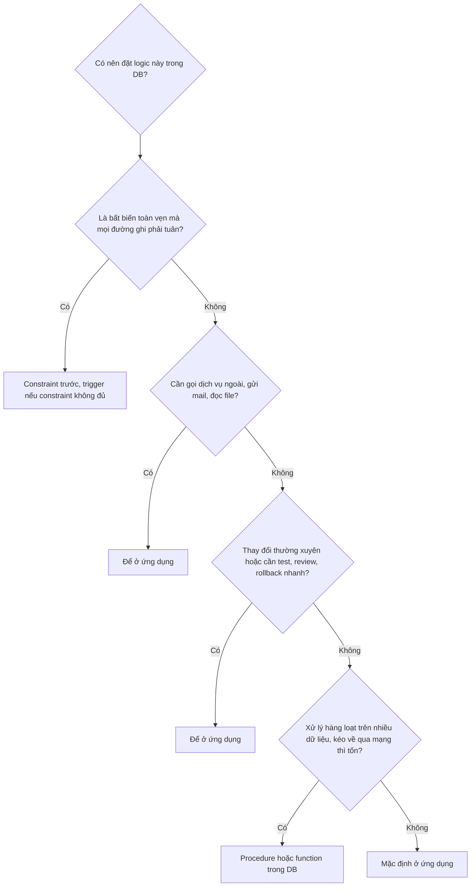

# Function, procedure, trigger và PL/pgSQL

Nền tảng: [DDL, DML, kiểu dữ liệu và constraint trong PostgreSQL](/go?p=02-Database%2Feasy%2Flt-14-ddl-dml-kieu-du-lieu-constraint-pg.md), [Transaction, Isolation và Lock](/go?p=02-Database%2Fmedium%2Flt-04-transaction-isolation-lock.md), [PostgreSQL bên trong: MVCC, WAL và VACUUM](/go?p=02-Database%2Fmedium%2Flt-08-postgresql-mvcc-wal.md) (mô hình kết nối và pooler). Bài này dạy cách viết logic chạy ngay trong PostgreSQL: hàm, thủ tục, trigger, thông báo giữa các phiên và khóa tư vấn, cùng với phần quan trọng không kém là khi nào KHÔNG nên làm vậy.

> Quy ước của bài: ví dụ SQL là _Minh họa_ (chưa chạy thử trên PostgreSQL thật vì môi trường soạn bài không có server). Kết quả được suy ra từ dữ liệu mẫu và tài liệu chính thức, đã rà cú pháp; khi học hãy dán vào PostgreSQL 18 để kiểm chứng.

**Cốt lõi:** Có những quy tắc phải đúng với mọi đường ghi, và những việc tốn nhiều vòng mạng nếu để ứng dụng làm. Function, procedure và trigger đặt logic ngay cạnh dữ liệu, nhưng đổi lại logic đó chạy ẩn trong transaction của người gọi và dùng CPU của nơi đắt nhất.

- Vì function chạy bên trong câu lệnh của người gọi, nên chỉ procedure gọi bằng `CALL` ở cấp cao nhất mới được `COMMIT` giữa chừng.
- Vì trigger gắn vào dữ liệu chứ không vào đường ghi, nên không đường nào né được, nhưng nó nhân chi phí theo số dòng và chạy trước commit.
- Vì DB khó scale ngang và khó test, nên ưu tiên constraint khai báo, rồi trigger nhỏ, còn quy tắc nghiệp vụ hay đổi để ở ứng dụng.



Mô hình tư duy: trigger là phần mở rộng của câu lệnh ghi, nên thay đổi gốc và hệ quả của nó thành công hoặc thất bại như một khối.

**Tóm tắt:**

- Function viết bằng `LANGUAGE sql` (một câu truy vấn, gọn, planner có thể inline) hoặc `LANGUAGE plpgsql` (có biến, rẽ nhánh, vòng lặp, xử lý ngoại lệ); khai báo mức biến đổi `VOLATILE` (mặc định), `STABLE` hay `IMMUTABLE` đúng sự thật.
- `RETURNS TABLE (...)` trả về tập dòng; trong plpgsql dùng `RETURN QUERY`; tên cột đầu ra có thể đụng tên cột bảng và gây lỗi mơ hồ.
- `CREATE PROCEDURE` và `CALL` có từ PostgreSQL 11; khác function ở chỗ có thể `COMMIT` và `ROLLBACK` giữa chừng (khi CALL ở cấp cao nhất, ngoài transaction block), hợp cho xử lý hàng loạt theo lô.
- Trigger là function trả về `trigger`, gắn vào bảng với thời điểm BEFORE hoặc AFTER, mức ROW hoặc STATEMENT; trong ROW trigger có `NEW`, `OLD`, `TG_OP`.
- Hai mẫu phổ biến: audit log (AFTER, ghi `to_jsonb(OLD)` và `to_jsonb(NEW)`) và `updated_at` (BEFORE UPDATE, gán `NEW.updated_at`).
- Bẫy trigger: đệ quy vô hạn khi trigger sửa chính bảng đó, chi phí nhân với số dòng, logic ẩn khó thấy, thứ tự chạy theo tên.
- `LISTEN`/`NOTIFY` đẩy tín hiệu nhẹ giữa các phiên nhưng không bền (listener ngắt thì mất) và gặp khó với pooler ở transaction mode; advisory lock cho khóa theo khóa do ứng dụng định nghĩa.
- Đẩy logic xuống DB hợp với bất biến toàn vẹn và xử lý hàng loạt gần dữ liệu; không hợp với logic nghiệp vụ hay đổi, cần test, version và scale ngang.

## Vấn đề nó giải quyết

Có những việc ứng dụng làm tốt hơn khi nó nằm ngay cạnh dữ liệu:

- **Bất biến mà mọi đường ghi đều phải tuân theo.** Nếu có năm service và một công cụ báo cáo cùng ghi vào bảng `orders`, quy tắc "ghi log mọi thay đổi" hay "luôn cập nhật `updated_at`" nằm trong code ứng dụng sẽ bị bỏ sót ở một nơi nào đó. Trigger nằm ở DB thì không đường ghi nào né được.
- **Giảm vòng đi vòng lại qua mạng.** Một thao tác cần 20 câu lệnh phụ thuộc nhau, nếu từng câu đi qua mạng thì chậm; gói thành một function hoặc procedure chạy trong DB thì một lần gọi.
- **Xử lý hàng loạt.** Dọn hay chuyển hàng chục triệu dòng theo lô nhỏ, commit từng lô để không giữ lock và không phình WAL, mà không phải kéo dữ liệu qua mạng: procedure có `COMMIT` làm được.
- **Tín hiệu giữa các tiến trình.** Báo cho worker biết "có việc mới" mà không cần polling mỗi giây: `LISTEN`/`NOTIFY`.

## Khi nào dùng, khi nào không

| Dùng | Không dùng (hoặc cẩn thận) |
|---|---|
| Bất biến toàn vẹn dữ liệu, audit, `updated_at` | Quy tắc nghiệp vụ thay đổi theo từng tuần, cần review và A/B |
| Xử lý hàng loạt gần dữ liệu (ETL nội bộ, dọn dẹp) | Logic cần gọi API ngoài, gửi mail, đọc file |
| Hàm tiện ích thuần tính toán trên dữ liệu (`IMMUTABLE`) | Logic cần unit test nhanh, debug từng bước, tracing |
| Một thao tác nhiều bước muốn chạy trong một round trip | Hệ thống cần scale ngang: CPU của DB là tài nguyên đắt nhất và khó nhân lên |
| Báo thay đổi nhẹ qua `NOTIFY` | Hàng đợi tin nhắn cần bền, đảm bảo giao: dùng bảng outbox hay message broker |

Phần cuối bài có sơ đồ quyết định chi tiết hơn.

## Các khái niệm cần biết

- **Function (hàm)**: đối tượng có tham số và giá trị trả về, gọi trong câu lệnh (`SELECT f(1)`); chạy trong transaction của người gọi và không được commit.
- **Procedure (thủ tục)**: gọi bằng `CALL`, không có giá trị trả về như function (có thể có tham số `OUT`), được phép điều khiển transaction.
- **PL/pgSQL**: ngôn ngữ thủ tục tích hợp sẵn của PostgreSQL (khối `DECLARE ... BEGIN ... END`).
- **Volatility**: `VOLATILE` (có thể có tác dụng phụ hoặc kết quả đổi mọi lần), `STABLE` (không đổi trong một câu lệnh), `IMMUTABLE` (cùng đầu vào luôn cùng kết quả); planner dùng nó để tối ưu và để cho phép dùng trong index biểu thức.
- **Trigger function**: function không tham số, trả về `trigger`; được gắn vào bảng bằng `CREATE TRIGGER`.
- **ROW level / STATEMENT level**: gọi một lần cho mỗi dòng bị tác động, hay một lần cho cả câu lệnh.
- **NEW / OLD**: dòng sau và dòng trước khi thay đổi (OLD là NULL trong INSERT, NEW là NULL trong DELETE; từ PostgreSQL 11 OLD gán NULL cho INSERT thay vì không xác định).
- **Transition table**: bảng tạm chứa mọi dòng đổi trong câu lệnh, dùng trong trigger STATEMENT bằng `REFERENCING`.
- **LISTEN / NOTIFY**: cơ chế pub/sub nhẹ trong DB, theo kênh.
- **Advisory lock**: khóa do ứng dụng tự đặt tên (một số nguyên), DB không gắn với bảng hay dòng nào.

## 1. CREATE FUNCTION: SQL và PL/pgSQL

### Function SQL

```sql
CREATE FUNCTION order_total(p_order int) RETURNS numeric
LANGUAGE sql STABLE
AS $$
    SELECT coalesce(sum(price * qty), 0) FROM order_items WHERE order_id = p_order;
$$;
```

Với dữ liệu `order_items(order_id, price, qty)` gồm `(1, 50, 2)` và `(1, 30, 1)`: `SELECT order_total(1);` trả `130` (_Minh họa_). Function SQL đơn giản có thể được planner inline vào câu gọi, nên không có chi phí gọi hàm. Từ PostgreSQL 14 có thể viết thân hàm theo chuẩn SQL: `BEGIN ATOMIC SELECT ...; END`, khi đó PostgreSQL phân tích và ghi nhận phụ thuộc vào bảng ngay lúc tạo hàm (đổi tên bảng được theo dõi), thay vì chỉ lưu chuỗi.

### Function PL/pgSQL

```sql
CREATE TABLE accounts (id int PRIMARY KEY, balance numeric NOT NULL CHECK (balance >= 0));
INSERT INTO accounts VALUES (1, 500), (2, 100);

CREATE FUNCTION transfer(p_from int, p_to int, p_amt numeric) RETURNS void
LANGUAGE plpgsql
AS $$
BEGIN
    UPDATE accounts SET balance = balance - p_amt
    WHERE id = p_from AND balance >= p_amt;
    IF NOT FOUND THEN
        RAISE EXCEPTION 'Khong du so du hoac khong co tai khoan %', p_from;
    END IF;

    UPDATE accounts SET balance = balance + p_amt WHERE id = p_to;
    IF NOT FOUND THEN
        RAISE EXCEPTION 'Khong co tai khoan nhan %', p_to;
    END IF;
END;
$$;

SELECT transfer(1, 2, 200);   -- số dư thành 300 và 300
SELECT transfer(1, 2, 1000);  -- ERROR: Khong du so du hoac khong co tai khoan 1
```

Kết quả (_Minh họa_): sau lệnh đầu, `accounts` là `(1, 300)` và `(2, 300)`; lệnh hai báo lỗi và không thay đổi gì. Các điểm cần hiểu:

- `$$ ... $$` là dấu bao thân hàm (dollar quoting), tránh phải nhân đôi dấu nháy đơn.
- `FOUND` là biến đặc biệt: true nếu câu lệnh trước đó có tác động ít nhất một dòng.
- Hàm chạy trong transaction của người gọi. `RAISE EXCEPTION` hủy câu lệnh và, nếu không ai bắt, cả transaction. Khối có mệnh đề `EXCEPTION WHEN ... THEN ...` được bọc bằng một subtransaction nên các thay đổi trong khối bị hoàn tác khi bắt lỗi; dùng có chọn lọc vì subtransaction tốn kém.
- Phép trừ có điều kiện `AND balance >= p_amt` là UPDATE nguyên tử, chống lost update như bài [Transaction, Isolation và Lock](/go?p=02-Database%2Fmedium%2Flt-04-transaction-isolation-lock.md) đã bàn; function không tự thêm khả năng đó, mà chính câu lệnh bên trong mới có.

Các tham số và thuộc tính hay gặp:

| Thành phần | Ý nghĩa |
|---|---|
| `p_from int` | Tham số vào; nên đặt tiền tố (`p_`) để không trùng tên cột |
| `DEFAULT` cho tham số | Cho phép gọi bỏ bớt tham số cuối |
| `OUT`, `INOUT` | Tham số ra; function có OUT có thể trả nhiều giá trị |
| `STRICT` | Trả NULL ngay nếu bất kỳ đối số nào NULL |
| `IMMUTABLE`, `STABLE`, `VOLATILE` | Khai báo mức biến đổi; khai sai gây kết quả sai khi dùng trong index |
| `SECURITY DEFINER` | Chạy bằng quyền của người tạo hàm; phải kèm `SET search_path` (xem bài [bảo mật](/go?p=02-Database%2Fmedium%2Flt-18-role-privilege-rls-bao-mat.md)) |
| `PARALLEL SAFE` | Cho phép dùng trong truy vấn song song |

### RETURNS TABLE

```sql
CREATE FUNCTION top_customers(p_limit int)
RETURNS TABLE (customer_id int, total numeric)
LANGUAGE plpgsql STABLE
AS $$
BEGIN
    RETURN QUERY
    SELECT o.customer_id, sum(o.total)
    FROM orders o
    GROUP BY o.customer_id
    ORDER BY sum(o.total) DESC
    LIMIT p_limit;
END;
$$;

-- orders: (1, cust 1, 100), (2, cust 1, 50), (3, cust 2, 70)
SELECT * FROM top_customers(2);
```

Kết quả (_Minh họa_): `1 | 150` rồi `2 | 70`. Bẫy: trong function trả `TABLE (customer_id ..., total ...)`, các tên `customer_id` và `total` còn là biến, nên nếu viết `SELECT customer_id FROM orders` không có tiền tố bảng sẽ báo lỗi `column reference "customer_id" is ambiguous`. Cách giải: luôn dùng bí danh bảng (`o.customer_id`) như trên, hoặc đặt tên cột đầu ra khác, hoặc đặt `#variable_conflict use_column` ở đầu thân hàm.

**Phải thuộc:** Function chạy trong transaction của người gọi và không thể COMMIT; mức biến đổi mặc định là VOLATILE; `IMMUTABLE` chỉ được khai báo khi cùng đầu vào luôn cùng kết quả (không đọc bảng, không phụ thuộc cài đặt phiên). `RETURNS TABLE` kèm `RETURN QUERY` để trả tập dòng.

## 2. PROCEDURE và CALL, quản lý transaction

Procedure ra đời ở PostgreSQL 11. Điểm khác function cốt lõi: nó được phép `COMMIT` và `ROLLBACK`, nên một lần gọi có thể trải trên nhiều transaction.

```sql
CREATE PROCEDURE archive_old_orders(p_batch int)
LANGUAGE plpgsql
AS $$
DECLARE
    n int;
BEGIN
    LOOP
        WITH moved AS (
            DELETE FROM orders
            WHERE id IN (SELECT id FROM orders
                         WHERE created_at < now() - interval '1 year'
                         LIMIT p_batch)
            RETURNING *
        )
        INSERT INTO orders_archive SELECT * FROM moved;

        GET DIAGNOSTICS n = ROW_COUNT;
        COMMIT;                 -- kết thúc lô, giải phóng lock
        EXIT WHEN n = 0;
    END LOOP;
END;
$$;

CALL archive_old_orders(1000);
```

`orders_archive` giả định có cùng cấu trúc cột với `orders`. Mỗi vòng chuyển tối đa 1000 dòng rồi commit; không giữ lock dài, WAL được tái sử dụng, và nếu bị ngắt giữa chừng thì các lô đã commit vẫn còn hiệu lực. `GET DIAGNOSTICS ... = ROW_COUNT` lấy số dòng của câu lệnh vừa chạy.



Điều kiện để `COMMIT` trong procedure chạy được: `CALL` phải ở cấp cao nhất và không nằm trong một transaction block đã mở (ví dụ sau `BEGIN` thủ công) hoặc trong một function; nếu không sẽ gặp lỗi `invalid transaction termination`. Procedure có `EXCEPTION` block cũng không được COMMIT bên trong block đó. Trong thực tế, nếu client driver bọc mọi câu lệnh trong transaction (autocommit tắt), việc gọi procedure kiểu này sẽ lỗi; cần bật autocommit cho phiên gọi.



**Nền tảng:** Function luôn chạy bên trong transaction của lệnh gọi nên không tự quyết định commit; muốn một đơn vị công việc dài chia thành nhiều transaction nhỏ độc lập, phải dùng procedure gọi bằng `CALL` ở cấp cao nhất.

## 3. Trigger

Trigger gồm hai phần: function trả `trigger`, và lệnh `CREATE TRIGGER` gắn nó vào bảng.

```sql
CREATE TRIGGER ten_trigger
    { BEFORE | AFTER | INSTEAD OF } { INSERT | UPDATE [OF cot] | DELETE | TRUNCATE }
    ON bang
    [ FOR EACH { ROW | STATEMENT } ]
    [ WHEN (dieu_kien) ]
    EXECUTE FUNCTION ten_ham();
```

(`EXECUTE FUNCTION` có từ PostgreSQL 11 thay cho `EXECUTE PROCEDURE` cũ, cũ vẫn dùng được.)

| Loại | Chạy khi nào | Dùng để |
|---|---|---|
| BEFORE ROW | Trước khi ghi từng dòng | Sửa `NEW` (chuẩn hóa, gán `updated_at`), hoặc `RETURN NULL` để bỏ qua dòng đó |
| AFTER ROW | Sau khi cả câu lệnh đã ghi xong, theo từng dòng | Audit, đồng bộ bảng khác; giá trị trả về bị bỏ qua |
| BEFORE/AFTER STATEMENT | Một lần cho cả câu lệnh | Kiểm tra tổng thể; AFTER có thể đọc transition table |
| INSTEAD OF (trên view) | Thay cho thao tác trên view | Làm view có thể ghi |



Đọc sơ đồ: BEFORE ROW chạy xen kẽ với việc ghi từng dòng và còn sửa được dữ liệu sắp ghi. Các trigger AFTER ROW được xếp hàng và chạy sau khi toàn câu lệnh đã ghi xong, nên ở đó đọc bảng sẽ thấy tất cả dòng đã đổi. Nếu có nhiều trigger cùng loại trên một bảng, chúng chạy theo thứ tự tên theo bảng chữ cái.

### Ví dụ 1: `updated_at` (BEFORE UPDATE)

```sql
ALTER TABLE accounts ADD COLUMN updated_at timestamptz NOT NULL DEFAULT now();

CREATE FUNCTION set_updated_at() RETURNS trigger
LANGUAGE plpgsql AS $$
BEGIN
    NEW.updated_at := now();
    RETURN NEW;
END;
$$;

CREATE TRIGGER trg_accounts_updated_at
    BEFORE UPDATE ON accounts
    FOR EACH ROW
    WHEN (OLD.* IS DISTINCT FROM NEW.*)
    EXECUTE FUNCTION set_updated_at();
```

`RETURN NEW` là bắt buộc trong BEFORE ROW nếu muốn dòng (đã sửa) được ghi tiếp; `RETURN NULL` nghĩa là bỏ qua thao tác cho dòng đó. Mệnh đề `WHEN (OLD.* IS DISTINCT FROM NEW.*)` ngăn trigger chạy khi UPDATE không đổi giá trị nào. `now()` trả thời điểm bắt đầu transaction; nếu cần thời điểm thực của lúc ghi trong transaction dài, dùng `clock_timestamp()`.

### Ví dụ 2: audit log (AFTER ROW)

```sql
CREATE TABLE audit_log (
    id         bigint GENERATED ALWAYS AS IDENTITY PRIMARY KEY,
    table_name text        NOT NULL,
    op         text        NOT NULL,
    old_row    jsonb,
    new_row    jsonb,
    changed_by text        NOT NULL DEFAULT current_user,
    changed_at timestamptz NOT NULL DEFAULT now()
);

CREATE FUNCTION audit_row() RETURNS trigger
LANGUAGE plpgsql AS $$
BEGIN
    INSERT INTO audit_log (table_name, op, old_row, new_row)
    VALUES (TG_TABLE_NAME, TG_OP,
            CASE WHEN TG_OP IN ('UPDATE','DELETE') THEN to_jsonb(OLD) END,
            CASE WHEN TG_OP IN ('INSERT','UPDATE') THEN to_jsonb(NEW) END);
    RETURN NULL;   -- AFTER trigger: giá trị trả về bị bỏ qua
END;
$$;

CREATE TRIGGER trg_accounts_audit
    AFTER INSERT OR UPDATE OR DELETE ON accounts
    FOR EACH ROW EXECUTE FUNCTION audit_row();

UPDATE accounts SET balance = balance - 50 WHERE id = 1;
SELECT table_name, op, old_row->>'balance' AS old_bal, new_row->>'balance' AS new_bal
FROM audit_log;
```

Kết quả (_Minh họa_, nếu `accounts.id = 1` đang có `balance = 300`): một dòng `accounts | UPDATE | 300 | 250`. `TG_TABLE_NAME` và `TG_OP` là biến có sẵn trong trigger function, nên một function dùng chung cho nhiều bảng được. `to_jsonb(OLD)` biến cả dòng thành jsonb, linh hoạt qua các lần đổi schema (xem [JSONB](/go?p=02-Database%2Fmedium%2Flt-16-jsonb-array-range-fulltext.md)). Vì ghi audit nằm trong cùng transaction với thay đổi, audit và dữ liệu hoặc cùng commit hoặc cùng rollback.

**Phải thuộc:** Trigger function trả về `trigger`; BEFORE ROW phải `RETURN NEW` (hoặc `NULL` để bỏ dòng), AFTER ROW bỏ qua giá trị trả về. ROW chạy cho từng dòng, STATEMENT chạy một lần. `NEW` và `OLD` chỉ có trong ROW trigger; `TG_OP` cho biết INSERT, UPDATE hay DELETE.

### Statement level và transition table

Khi chỉ cần một hành động cho cả lô thay vì từng dòng (ví dụ cập nhật bảng tổng hợp), dùng trigger statement kèm transition table:

```sql
CREATE TRIGGER trg_orders_stat
    AFTER INSERT ON orders
    REFERENCING NEW TABLE AS new_rows
    FOR EACH STATEMENT EXECUTE FUNCTION refresh_order_stats();
-- trong refresh_order_stats(): SELECT count(*), sum(total) FROM new_rows;
```

Trigger với `REFERENCING` chỉ khai báo được ở mức AFTER. Khi INSERT 100.000 dòng bằng một câu lệnh, ROW trigger gọi hàm 100.000 lần, còn trigger này gọi một lần và gom bằng một truy vấn tập hợp.

### Bẫy của trigger



- **Đệ quy**: trigger trên T làm UPDATE chính T sẽ kích hoạt chính nó vô hạn (cuối cùng lỗi `stack depth limit exceeded`). Chặn bằng `WHEN` đúng điều kiện, hoặc kiểm tra `pg_trigger_depth() = 0` ở đầu hàm; tốt nhất là không UPDATE lại chính dòng đó mà sửa `NEW` trong BEFORE.
- **Hiệu năng**: ROW trigger nhân chi phí với số dòng; một bulk update một triệu dòng chạy một triệu lần hàm, mỗi lần có thể thêm câu INSERT. Dùng `WHEN`, `UPDATE OF cột`, hoặc trigger STATEMENT.
- **Logic ẩn**: người đọc `UPDATE accounts ...` không thấy là còn ghi vào `audit_log`; khó debug, dễ bất ngờ khi nạp dữ liệu hàng loạt hay migration. Ghi chép rõ và liệt kê trigger bằng `\d tên_bảng`.
- **Thứ tự chạy**: nhiều trigger cùng thời điểm chạy theo thứ tự tên; đừng dựa vào thứ tự đó cho logic phụ thuộc nhau.
- **Khóa và deadlock**: trigger ghi sang bảng khác kéo thêm lock; hai luồng đi theo thứ tự bảng ngược nhau có thể deadlock.
- **Trigger có lúc không chạy**: `pg_restore --disable-triggers` tắt trigger khi nạp dữ liệu; còn ở phía nhận của logical replication, trigger thường mặc định không bắn cho dữ liệu được replicate (muốn bắn phải `ALTER TABLE ... ENABLE REPLICA TRIGGER` hoặc `ENABLE ALWAYS TRIGGER`). Audit dựa vào trigger vì vậy phải kiểm tra lại ở các tình huống này.

**Suy luận:** Trigger hấp dẫn vì nó gắn quy tắc vào dữ liệu thay vì vào đường ghi, nên không có đường nào né được. Cũng chính điều đó làm nó nguy hiểm: nó chạy mà người viết câu lệnh không nhìn thấy, nhân theo số dòng, và nằm trong transaction của người gọi nên mọi lỗi và độ trễ của nó đều lan sang họ. Quy tắc đáng nhớ là dùng trigger cho những việc nhỏ, nhanh, xác định và không có ngoại lệ (đóng dấu thời gian, audit, duy trì cột dẫn xuất); phần việc nặng hay có thể thất bại vì lý do ngoài DB thì đưa ra ngoài. Điểm dễ nhầm là nghĩ trigger chạy "sau commit": nó chạy trong transaction, trước khi commit. Hệ quả hành động: đo thời gian bulk update trước và sau khi thêm trigger, và dùng ghi chép để người sau biết có trigger.

## 4. LISTEN/NOTIFY

```sql
-- Phiên A (worker)
LISTEN new_job;

-- Phiên B (producer)
NOTIFY new_job, 'job 42';
-- hoặc trong function/trigger:
SELECT pg_notify('new_job', '{"id":42}');
```



Đọc sơ đồ: thông báo chỉ được gửi khi transaction chứa `NOTIFY` COMMIT; rollback thì không có thông báo nào. Worker sau khi nhận nên truy vấn lại bảng để lấy dữ liệu thật, vì payload nhỏ (giới hạn dưới 8000 byte) và không bền.

Những điều cần biết:

- **Không bền**: nếu listener đang ngắt kết nối lúc `NOTIFY`, nó mất thông báo. Mẫu an toàn: lưu việc vào bảng, dùng `NOTIFY` chỉ để đánh thức, và worker khởi động lại luôn quét bảng.
- **Gom thông báo**: nhiều NOTIFY cùng kênh và cùng payload trong một transaction được gộp thành một.
- **Pooler**: `LISTEN` gắn với phiên, nên không hợp với PgBouncer ở transaction mode (xem [PostgreSQL bên trong](/go?p=02-Database%2Fmedium%2Flt-08-postgresql-mvcc-wal.md)); listener dùng kết nối trực tiếp.
- **Chậm**: một transaction mở lâu đang có NOTIFY chờ làm hàng đợi thông báo đầy, và NOTIFY làm commit tuần tự hóa phần nào, nên không dùng cho luồng cực lớn.

## 5. Advisory lock (giới thiệu)

Advisory lock là khóa mà ứng dụng tự định nghĩa ý nghĩa: DB chỉ bảo đảm hai bên không cùng giữ khóa với cùng một số nguyên. Phù hợp để "chỉ một tiến trình chạy job X tại một thời điểm" hoặc tuần tự hóa việc cập nhật theo một khóa nghiệp vụ không có dòng để `FOR UPDATE`.

```sql
-- Mức transaction: tự nhả khi transaction kết thúc
SELECT pg_advisory_xact_lock(hashtext('job:daily-report'));

-- Thử khóa, không chờ
SELECT pg_try_advisory_lock(42);      -- true nếu lấy được, false nếu người khác đang giữ
SELECT pg_advisory_unlock(42);        -- nhả khóa mức phiên
```

| Biến thể | Nhả khi nào | Ghi chú |
|---|---|---|
| `pg_advisory_lock(key)` | Khi gọi `pg_advisory_unlock` hoặc phiên kết thúc | Dễ quên nhả; không hợp với pooler |
| `pg_advisory_xact_lock(key)` | Cuối transaction | An toàn hơn, nên ưu tiên |
| `pg_try_advisory_lock(key)` | Như `pg_advisory_lock` | Không chờ, trả boolean |

Khóa tính theo số nguyên 64 bit (hoặc hai số 32 bit), dùng `hashtext('tên')` để tạo từ chuỗi. Hai thành phần không liên quan có thể vô tình trùng số, nên thống nhất quy ước đặt khóa trong cả hệ thống. Phần lock theo dòng và deadlock xem [Transaction, Isolation và Lock](/go?p=02-Database%2Fmedium%2Flt-04-transaction-isolation-lock.md).

## 6. Khi nào KHÔNG nên đẩy logic xuống DB



Lý do chính để dè dặt:

- **Scale**: ứng dụng nhân ngang dễ, DB thì khó; CPU dành cho logic nghiệp vụ trong DB là CPU lấy từ chỗ đắt nhất.
- **Phát triển**: IDE, debugger, unit test, code review, CI và feature flag của ứng dụng không áp dụng tốt cho thân hàm lưu trong DB; migration phải nâng version cả hai nơi.
- **Quan sát**: lỗi và độ trễ của trigger, procedure ít xuất hiện trong tracing của ứng dụng.
- **Giam hãm**: logic trong DB khóa bạn vào PostgreSQL (và vào PL/pgSQL), khó tách service.

Ưu tiên theo thứ tự: `NOT NULL`, `CHECK`, `UNIQUE`, FK, exclusion constraint (khai báo, dễ hiểu, được planner biết) trước; rồi mới đến trigger cho thứ constraint không diễn đạt được; rồi function/procedure cho xử lý hàng loạt. Quy tắc nghiệp vụ đổi liên tục ở ứng dụng.

## Bẫy thường gặp

| Bẫy | Hậu quả | Cách tránh |
|---|---|---|
| Đặt tên tham số hoặc cột output trùng tên cột bảng | Lỗi `ambiguous` hoặc đọc nhầm biến | Tiền tố `p_`, bí danh bảng, `#variable_conflict` |
| Khai `IMMUTABLE` cho hàm đọc bảng | Kết quả index sai, plan sai | Dùng `STABLE` hoặc `VOLATILE` |
| Gọi `COMMIT` trong function | Lỗi `invalid transaction termination` | Dùng `PROCEDURE` và `CALL` ở cấp cao nhất |
| Client bật autocommit tắt rồi gọi procedure có COMMIT | Lỗi như trên | Gọi `CALL` ở phiên autocommit |
| Trigger UPDATE chính bảng của nó | Đệ quy, `stack depth limit exceeded` | `WHEN`, `pg_trigger_depth()`, sửa `NEW` trong BEFORE |
| ROW trigger nặng trên bảng nạp hàng loạt | Chậm hàng chục lần | `WHEN`, `UPDATE OF`, STATEMENT trigger, tắt có kiểm soát khi nạp |
| `SECURITY DEFINER` không đặt `search_path` | Lỗ hổng leo thang đặc quyền | `SET search_path = ...` và gọi đối tượng có schema đầy đủ |
| Dùng `NOTIFY` làm hàng đợi bền | Mất việc khi listener ngắt | Bảng công việc, `NOTIFY` chỉ để đánh thức |
| Quên nhả advisory lock mức phiên (nhất là sau pooler) | Khóa kẹt hoặc nhả nhầm phiên | `pg_advisory_xact_lock` |
| Nhét logic nghiệp vụ đổi thường xuyên vào trigger | Khó test, khó debug | Giữ ở ứng dụng |

## Điểm cần nhớ

- Function SQL cho truy vấn gọn và có thể inline; PL/pgSQL khi cần biến, rẽ nhánh, ngoại lệ; khai mức biến đổi đúng.
- `RETURNS TABLE` kèm `RETURN QUERY`; coi chừng trùng tên cột.
- Procedure (từ PG 11) và `CALL` mới được `COMMIT` và `ROLLBACK`; function thì không.
- Trigger: BEFORE sửa `NEW`, AFTER dùng cho audit; ROW chạy từng dòng, STATEMENT chạy một lần với transition table.
- Bẫy trigger: đệ quy, nhân chi phí, logic ẩn, thứ tự theo tên.
- `NOTIFY` chỉ gửi khi COMMIT, không bền; advisory lock ưu tiên mức transaction.
- Ưu tiên constraint khai báo, rồi trigger nhỏ gọn; logic nghiệp vụ đổi nhiều thì ở ứng dụng.

## Phỏng vấn khó: chuỗi hỏi xoáy

Người phỏng vấn senior thường mở bằng câu dễ rồi xoáy xuống cơ chế, đánh đổi và sự cố thật. Câu trả lời tốt luôn đi từ cốt lõi xuống.

### Chuỗi 1: Procedure, COMMIT giữa chừng và xử lý theo lô

1. **Câu mở:** Cần chuyển hàng chục triệu dòng cũ sang bảng archive. Bạn làm trong database như thế nào và vì sao chọn procedure?
2. **Xoáy 1:** Procedure có `COMMIT` nhưng chạy báo `invalid transaction termination`. Bạn kiểm tra những điều kiện nào?
3. **Xoáy 2:** Procedure đang chạy thì bị ngắt giữa chừng. Trạng thái dữ liệu ra sao, và vì sao chia lô lại tốt hơn một câu lệnh khổng lồ?

**Đáp án ngắn:** Tôi viết procedure lặp theo lô: mỗi vòng `DELETE ... LIMIT` rồi `INSERT` vào archive trong một CTE, `GET DIAGNOSTICS ... ROW_COUNT`, `COMMIT`, và thoát khi số dòng bằng 0. Function chạy bên trong một câu lệnh của người gọi nên không thể commit giữa chừng; procedure gọi bằng `CALL` thì được, từ PostgreSQL 11. Lỗi `invalid transaction termination` thường vì `CALL` không ở cấp cao nhất: nằm trong transaction block đã mở bằng `BEGIN`, nằm trong function, hoặc `COMMIT` đặt bên trong khối có `EXCEPTION`. Với driver tắt autocommit và tự bọc mọi câu trong transaction thì cũng lỗi, nên cần gọi `CALL` ở phiên autocommit. Chia lô giữ lock ngắn, để WAL được tái sử dụng và không phình, và các lô đã commit vẫn còn hiệu lực nếu bị ngắt; chạy lại sẽ tiếp tục phần còn lại vì dòng đã chuyển không còn ở bảng nguồn. Một câu lệnh khổng lồ giữ lock và một transaction rất dài, mà transaction dài còn cản VACUUM. Đổi lại, procedure khó test và scale hơn code ứng dụng, nên chỉ dùng cho xử lý hàng loạt gần dữ liệu.

**Sai lầm hay gặp:**

- Nói "function cũng commit được" hoặc không giải thích được vì sao function không được commit.
- Quên các điều kiện của `CALL` ở cấp cao nhất và autocommit của client.
- Chạy một câu `DELETE` khổng lồ rồi ngạc nhiên vì lock lâu và WAL phình.

### Chuỗi 2: Trigger: chạy lúc nào, nhân chi phí và những lúc không chạy

1. **Câu mở:** `updated_at` và audit log nên làm bằng trigger hay ở ứng dụng, và vì sao?
2. **Xoáy 1:** BEFORE ROW và AFTER ROW khác nhau thế nào, trigger chạy trước hay sau commit, và nếu trigger ném lỗi thì sao?
3. **Xoáy 2:** Bảng có trigger audit, đội ghi chú "mọi thay đổi đều có log". Có tình huống nào dữ liệu đổi mà không có dòng audit?

**Đáp án ngắn:** Đây là loại bất biến mọi đường ghi phải tuân, nên trigger hợp lý: năm service và một công cụ báo cáo cùng ghi mà không đường nào né được, trong khi code ứng dụng thì sẽ có chỗ bị bỏ sót. BEFORE ROW chạy xen kẽ việc ghi từng dòng, sửa được `NEW` và phải `RETURN NEW`; `RETURN NULL` thì dòng bị bỏ qua mà không báo lỗi. AFTER ROW dùng cho audit, giá trị trả về bị bỏ qua. Trigger chạy trong transaction của người gọi, trước commit, nên lỗi của nó làm hỏng cả câu lệnh gốc, và audit cùng dữ liệu hoặc cùng commit hoặc cùng rollback. Mặt trái là chi phí nhân theo số dòng: update hai triệu dòng gọi hàm hai triệu lần, giảm bằng `WHEN (OLD.* IS DISTINCT FROM NEW.*)` hoặc trigger STATEMENT với transition table. Audit dựa trigger còn có kẽ hở: `pg_restore --disable-triggers` tắt trigger khi nạp, và ở phía nhận của logical replication trigger mặc định không bắn cho dữ liệu replicate, muốn bắn phải `ENABLE REPLICA TRIGGER` hoặc `ENABLE ALWAYS TRIGGER`. Phải kiểm tra lại ở các tình huống đó.

**Sai lầm hay gặp:**

- Nghĩ trigger chạy sau commit, hoặc quên rằng lỗi trong trigger làm hỏng câu lệnh gốc.
- Trigger UPDATE chính bảng của nó gây đệ quy, thay vì sửa `NEW` trong BEFORE.
- Tin audit bằng trigger là tuyệt đối mà không biết `--disable-triggers` và trigger ở subscriber.

## Câu hỏi tự kiểm tra

Với mỗi câu, thử trả lời theo gợi ý trước rồi mới đọc phần lập luận.

1. Vì sao không thể viết `COMMIT` trong một function nhưng được trong procedure?
   - **Gợi ý suy luận:** function được gọi từ đâu (trong một câu `SELECT`, `WHERE`...)? Việc commit giữa chừng ảnh hưởng gì tới câu lệnh gọi nó?
   - **Lập luận và đáp án:** function chạy bên trong một câu lệnh của người gọi, câu lệnh đó đang nằm trong một transaction và có thể đang dùng kết quả của function ở nhiều nơi; commit giữa chừng phá vỡ tính nguyên tử của câu lệnh gọi. Procedure được `CALL` như một câu lệnh độc lập ở cấp cao nhất nên có thể kết thúc và mở transaction mới giữa chừng.
2. Trigger `BEFORE UPDATE ... FOR EACH ROW` quên `RETURN NEW` (cuối hàm không có RETURN). Điều gì xảy ra?
   - **Gợi ý suy luận:** PL/pgSQL yêu cầu hàm trả giá trị; với BEFORE ROW, giá trị trả về quyết định dòng nào được ghi.
   - **Lập luận và đáp án:** PL/pgSQL báo lỗi `control reached end of trigger procedure without RETURN`. Nếu trả `NULL` thay vì `NEW`, thao tác cho dòng đó bị bỏ qua mà không báo lỗi, một lỗi rất khó thấy.
3. Một trigger audit AFTER ROW trên bảng cập nhật 2 triệu dòng khiến lệnh UPDATE chậm hẳn. Có cách nào giảm?
   - **Gợi ý suy luận:** hàm chạy bao nhiêu lần? Có cần ghi từng dòng riêng không?
   - **Lập luận và đáp án:** hàm chạy 2 triệu lần. Giảm bằng `WHEN (OLD.* IS DISTINCT FROM NEW.*)` để bỏ qua update không đổi gì, hoặc chuyển sang trigger STATEMENT với transition table (`REFERENCING OLD TABLE AS o NEW TABLE AS n`) rồi chèn một lần bằng câu `INSERT ... SELECT`. Lưu ý một trigger với transition table chỉ khai báo cho một loại sự kiện.
4. `NOTIFY` có phù hợp làm hàng đợi xử lý đơn hàng không?
   - **Gợi ý suy luận:** nếu worker khởi động lại đúng lúc có thông báo thì chuyện gì xảy ra? Thông báo được lưu ở đâu?
   - **Lập luận và đáp án:** không đủ. Thông báo không bền và chỉ gửi tới các listener đang kết nối. Phải lưu đơn vào bảng (hoặc outbox) làm nguồn sự thật, dùng `NOTIFY` chỉ để đánh thức, và worker định kỳ hoặc lúc khởi động quét các dòng chưa xử lý.
5. Hai job cron chạy trên hai máy khác nhau, bạn muốn chỉ một cái chạy tại một thời điểm. Dùng gì?
   - **Gợi ý suy luận:** có dòng nào để `SELECT ... FOR UPDATE` không? Muốn khóa tự nhả khi job thất bại thì chọn mức nào?
   - **Lập luận và đáp án:** `pg_try_advisory_xact_lock(hashtext('job:daily-report'))` đầu transaction; nếu trả false, job thoát ngay. Mức transaction bảo đảm khóa tự nhả dù job lỗi hay mất kết nối, và không bị kẹt khi dùng sau pooler.
6. Quy tắc "đơn hàng trên 10 triệu cần duyệt, ngưỡng đổi theo từng chiến dịch" nên ở đâu?
   - **Gợi ý suy luận:** quy tắc đổi thường xuyên không? Cần test, review, feature flag không?
   - **Lập luận và đáp án:** ở tầng ứng dụng (hoặc bảng cấu hình mà ứng dụng đọc). Quy tắc nghiệp vụ đổi thường xuyên không hợp với trigger vì khó test, khó rollback nhanh và ẩn khỏi người đọc code. DB chỉ nên giữ ràng buộc bất biến như `CHECK (amount > 0)`.

Nguồn: tài liệu chính thức PostgreSQL 18 (CREATE FUNCTION, CREATE PROCEDURE, PL/pgSQL, Trigger Functions, CREATE TRIGGER, NOTIFY, Advisory Locks, Release Notes 11 và 14), kiểm tra ngày 2026-10-30.

