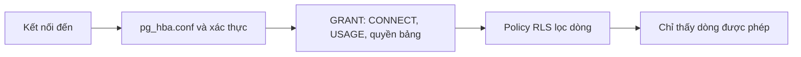
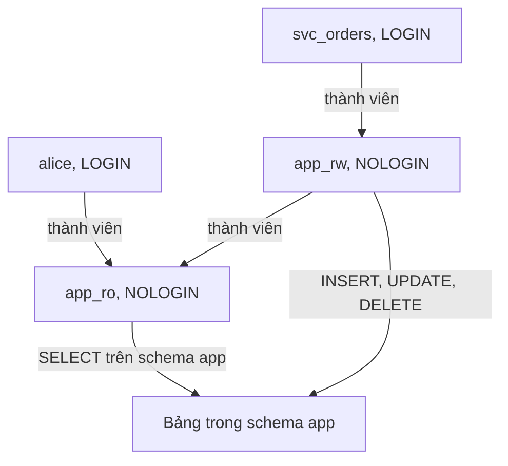
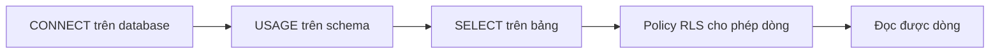
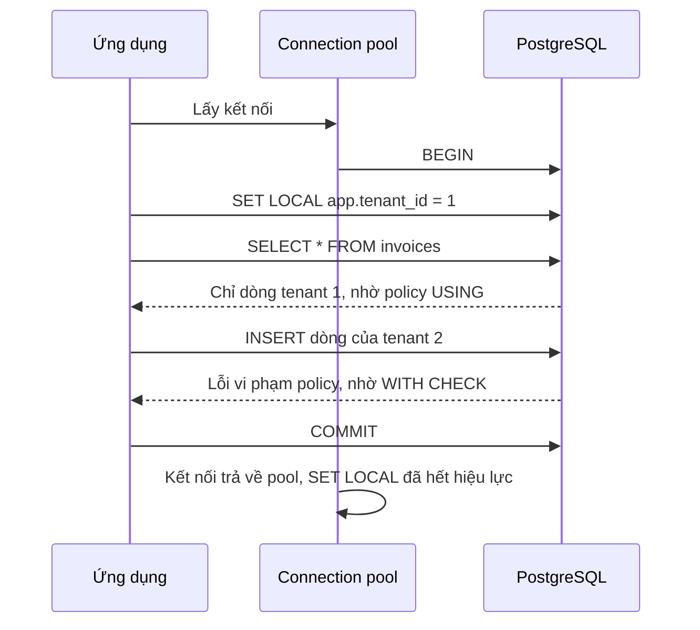
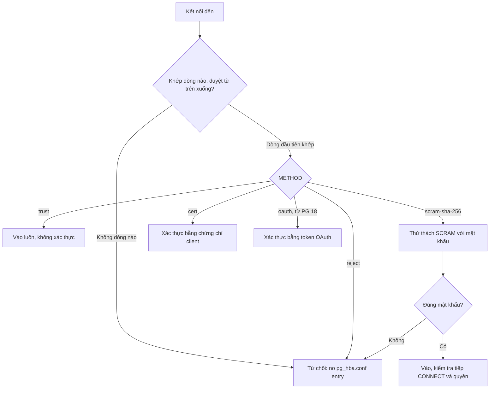
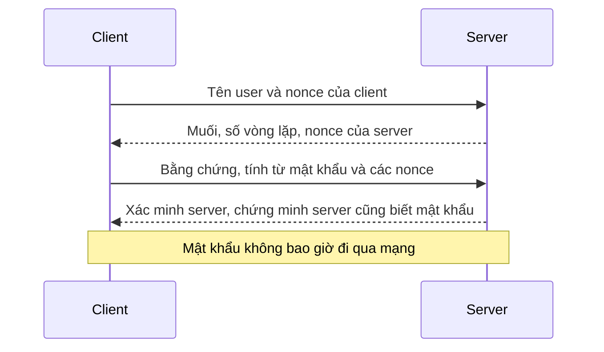
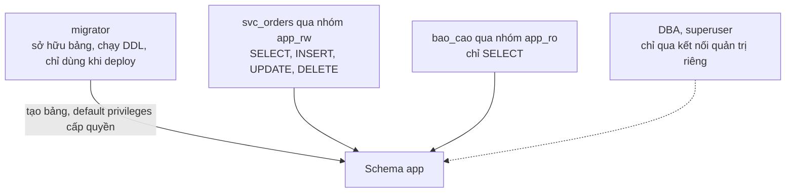
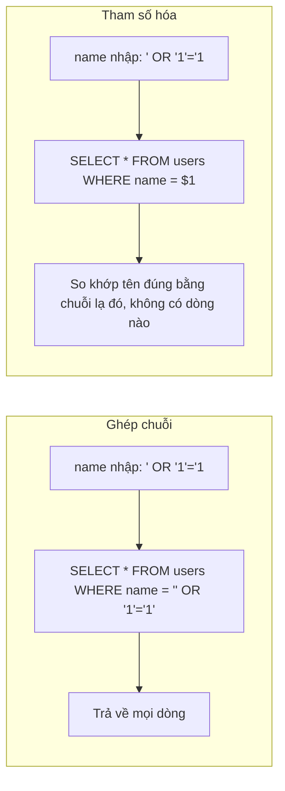
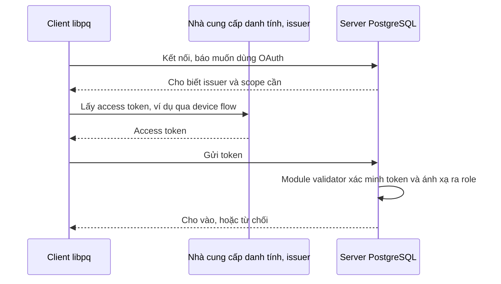

# Role, privilege, Row-Level Security và bảo mật PostgreSQL

Nền tảng: [DDL, DML, kiểu dữ liệu và constraint trong PostgreSQL](/go?p=02-Database%2Feasy%2Flt-14-ddl-dml-kieu-du-lieu-constraint-pg.md), [Function, procedure, trigger và PL/pgSQL](/go?p=02-Database%2Fmedium%2Flt-17-plpgsql-function-trigger.md) (mục `SECURITY DEFINER`), [PostgreSQL bên trong: MVCC, WAL và VACUUM](/go?p=02-Database%2Fmedium%2Flt-08-postgresql-mvcc-wal.md) (mô hình kết nối). Bài này nói về việc ai được vào PostgreSQL, vào bằng cách nào, được làm gì, và được thấy dòng nào; kèm các nguyên tắc để tài khoản của ứng dụng bị lộ cũng không thành thảm họa.

> Quy ước của bài: ví dụ SQL và cấu hình là _Minh họa_ (chưa chạy thử trên PostgreSQL thật vì môi trường soạn bài không có server). Kết quả được suy ra từ tài liệu chính thức và đã rà cú pháp; khi học hãy thử trên PostgreSQL 18 trong môi trường riêng. Riêng phần OAuth ở PostgreSQL 18 (mục 7) còn mới, hãy đối chiếu tên tham số với tài liệu bản 18 trước khi cấu hình thật.

**Cốt lõi:** Một tài khoản bị lộ không được phép biến thành thảm họa, nên PostgreSQL chia kiểm soát thành nhiều lớp độc lập: ai vào được, được làm gì, thấy dòng nào. Nguyên tắc chung là chỉ cấp ít quyền nhất đủ để việc chạy được.

- Vì quyền là chuỗi cổng nối tiếp, nên thiếu `CONNECT`, `USAGE` trên schema hay quyền trên bảng đều bị chặn, và `GRANT ... ON ALL TABLES` chỉ chạm bảng đang có.
- Vì RLS thêm điều kiện theo dòng do chính DB áp, nên `USING` lọc dòng đã có, `WITH CHECK` chặn dòng sắp ghi, còn owner và superuser bypass nên tài khoản ứng dụng không được là owner.
- Vì `pg_hba.conf` lấy dòng đầu tiên khớp, nên dòng cụ thể phải đứng trên dòng chung, kèm `scram-sha-256` và TLS.



Mô hình tư duy: mỗi lớp là một cổng độc lập, và thủng một lớp thì các lớp còn lại vẫn giới hạn thiệt hại.

**Tóm tắt:**

- Trong PostgreSQL chỉ có "role"; "user" là role có quyền `LOGIN`, "group" là role không đăng nhập mà người khác được gán vào (`GRANT group TO user`).
- Quyền đi theo nhiều tầng: kết nối được database (`CONNECT`), thấy được schema (`USAGE`), thao tác được bảng (`SELECT`, `INSERT`...); thiếu một tầng là bị chặn.
- `GRANT` chỉ áp dụng cho đối tượng đang tồn tại; muốn bảng tạo sau tự có quyền thì dùng `ALTER DEFAULT PRIVILEGES`, và nó gắn với role tạo ra đối tượng.
- Từ PostgreSQL 15, người dùng thường không còn quyền `CREATE` trong schema `public` của database; nhưng `PUBLIC` vẫn có `CONNECT` và `EXECUTE` mặc định, nên phải thu hồi chủ động.
- Row-Level Security (RLS) lọc theo dòng bằng policy: `USING` kiểm tra dòng đã có (đọc, sửa, xóa), `WITH CHECK` kiểm tra dòng sắp ghi; bật RLS mà không có policy thì mặc định chặn hết, và owner bypass trừ khi `FORCE`.
- `pg_hba.conf` quyết định phương thức xác thực theo (loại kết nối, database, user, địa chỉ), dòng đầu tiên khớp thì thắng; dùng `scram-sha-256` thay `md5`, vì MD5 bị đánh dấu deprecated từ PostgreSQL 18.
- Mã hóa đường truyền bằng SSL/TLS với `sslmode=verify-full` ở client, không dùng `require` đơn thuần nếu cần chống giả mạo server.
- Tài khoản ứng dụng theo least privilege (không superuser, không sở hữu bảng, chỉ DML); chống SQL injection bằng truy vấn tham số hóa, cộng giới hạn quyền để khi lỡ có lỗ hổng thì thiệt hại nhỏ; PostgreSQL 18 thêm phương thức xác thực `oauth`.

## Vấn đề nó giải quyết

Nếu ứng dụng kết nối bằng tài khoản `postgres` (superuser) cho nhanh, một lỗ hổng SQL injection hay một file cấu hình bị lộ nghĩa là kẻ tấn công đọc, sửa, xóa mọi thứ, thậm chí chạy lệnh trên máy chủ (qua `COPY ... PROGRAM`). Bảo mật tầng database trả lời bốn câu hỏi, mỗi câu một cơ chế:

- Ai được kết nối và chứng minh danh tính thế nào: role, `pg_hba.conf`, SCRAM, SSL, OAuth.
- Được làm gì: `GRANT` và `REVOKE` ở mức database, schema, bảng, cột, hàm.
- Được thấy dòng nào: Row-Level Security, đặc biệt cho hệ thống nhiều tenant dùng chung bảng.
- Khi có sự cố thì thiệt hại tối đa là gì: least privilege, giới hạn tài nguyên theo role.

## Khi nào dùng, khi nào không

| Cơ chế | Dùng khi | Lưu ý |
|---|---|---|
| Role riêng cho từng vai trò | Mọi hệ thống | Luôn tách tài khoản migration, ứng dụng, báo cáo |
| `GRANT` ở mức cột | Cột nhạy cảm (lương, số thẻ) | Đơn giản hơn view cho trường hợp ít |
| RLS | Multi-tenant dùng chung bảng, phân quyền theo dòng | Không thay được kiểm tra quyền ở ứng dụng; có chi phí |
| Schema riêng (hoặc database riêng) cho mỗi tenant | Ít tenant, cần cô lập mạnh, khác schema | Khó quản lý khi hàng nghìn tenant |
| `SECURITY DEFINER` | Cho phép thao tác hẹp, kiểm soát được | Dễ thành lỗ hổng nếu quên `SET search_path` |
| `trust` trong `pg_hba.conf` | Không nên, trừ môi trường thử nghiệm cô lập | Cho vào không cần mật khẩu |

RLS không phải thứ bắt buộc. Nếu ứng dụng có một tầng truy cập dữ liệu duy nhất luôn thêm `WHERE tenant_id = ?`, RLS là lớp bảo hiểm thứ hai, hữu ích vì lập trình viên nào cũng có thể quên một điều kiện.

## Các khái niệm cần biết

- **Role**: thực thể xác thực và sở hữu quyền; vừa là user vừa là group tùy thuộc thuộc tính.
- **Thuộc tính role**: `LOGIN`, `SUPERUSER`, `CREATEDB`, `CREATEROLE`, `REPLICATION`, `BYPASSRLS`; mặc định tất cả tắt (trừ khi ghi khác).
- **Membership**: `GRANT group_role TO member_role`; có thể thừa hưởng quyền tự động (`INHERIT`) hoặc phải `SET ROLE`.
- **Privilege**: quyền cụ thể trên đối tượng (`SELECT`, `INSERT`, `UPDATE`, `DELETE`, `USAGE`, `CREATE`, `CONNECT`, `EXECUTE`...).
- **PUBLIC**: nhóm giả đại diện mọi role; quyền cấp cho `PUBLIC` ai cũng có.
- **Owner**: role sở hữu đối tượng; có mọi quyền trên đó và là người duy nhất `ALTER`, `DROP` được (trừ superuser).
- **Default privileges**: quy tắc cấp quyền tự động cho đối tượng tạo sau này.
- **Policy**: biểu thức điều kiện gắn với bảng cho RLS.
- **`pg_hba.conf`**: file cấu hình xác thực dựa trên host (host-based authentication).
- **SCRAM-SHA-256**: giao thức xác thực mật khẩu bằng thách thức và đáp án, không gửi mật khẩu rõ, không lưu băm yếu.

## 1. Role, user, group

```sql
-- Group role: không đăng nhập, chỉ để gom quyền
CREATE ROLE app_ro NOLOGIN;
CREATE ROLE app_rw NOLOGIN;

-- User: đăng nhập được
CREATE ROLE alice LOGIN PASSWORD 'doi-mat-khau-nay';
CREATE ROLE svc_orders LOGIN PASSWORD 'doi-mat-khau-nay' CONNECTION LIMIT 50;

GRANT app_ro TO alice;
GRANT app_rw TO svc_orders;
```

`CREATE USER` chỉ là `CREATE ROLE ... LOGIN`. Cách làm bền vững: cấp quyền cho group role, rồi gán người vào group; khi nhân sự đổi chỉ cần đổi membership, không phải sửa quyền từng bảng.



Từ PostgreSQL 16, kế thừa quyền được quản lý theo từng membership: `GRANT app_rw TO svc_orders WITH INHERIT TRUE, SET FALSE` nghĩa là svc_orders dùng được quyền của app_rw nhưng không `SET ROLE app_rw` được. Từ bản này, `CREATEROLE` cũng bị thu hẹp: role có `CREATEROLE` chỉ quản lý được các role do nó tạo hoặc được cấp admin option, không còn thành một "superuser nhỏ".

Một số role dựng sẵn hữu ích (có từ PostgreSQL 14): `pg_read_all_data` (đọc mọi bảng, hợp cho tài khoản báo cáo) và `pg_write_all_data`; còn `pg_monitor` cho giám sát. Cấp những role này thay vì cấp `SUPERUSER`.

**Phải thuộc:** Trong PostgreSQL chỉ có role: user là role có `LOGIN`, group là role thường không `LOGIN` mà người khác được `GRANT` vào. `SUPERUSER` bỏ qua mọi kiểm tra quyền (kể cả RLS), nên không bao giờ dùng cho ứng dụng.

## 2. GRANT, REVOKE và ALTER DEFAULT PRIVILEGES

Để một role đọc được bảng `app.orders`, cần đủ ba tầng:



```sql
CREATE SCHEMA app;

GRANT CONNECT ON DATABASE shop TO app_ro, app_rw;
GRANT USAGE ON SCHEMA app TO app_ro, app_rw;

GRANT SELECT ON ALL TABLES IN SCHEMA app TO app_ro;
GRANT SELECT, INSERT, UPDATE, DELETE ON ALL TABLES IN SCHEMA app TO app_rw;
GRANT USAGE, SELECT ON ALL SEQUENCES IN SCHEMA app TO app_rw;   -- để INSERT dùng được serial hoặc identity
```

`ON ALL TABLES IN SCHEMA` chỉ áp dụng cho bảng đang có. Bảng tạo sau không được cấp, và đây là lỗi hay gặp "migration xong, ứng dụng báo permission denied". Giải pháp:

```sql
ALTER DEFAULT PRIVILEGES FOR ROLE migrator IN SCHEMA app
    GRANT SELECT ON TABLES TO app_ro;
ALTER DEFAULT PRIVILEGES FOR ROLE migrator IN SCHEMA app
    GRANT SELECT, INSERT, UPDATE, DELETE ON TABLES TO app_rw;
ALTER DEFAULT PRIVILEGES FOR ROLE migrator IN SCHEMA app
    GRANT USAGE, SELECT ON SEQUENCES TO app_rw;
```

Điểm quan trọng: `FOR ROLE migrator` nghĩa là quy tắc chỉ áp cho đối tượng do `migrator` tạo; nếu bỏ phần này, mặc định là role đang chạy lệnh. Chạy migration bằng một role khác thì quy tắc không phát huy.

Quyền theo cột và thu hồi:

```sql
GRANT SELECT (id, name, email) ON app.customers TO app_ro;   -- ẩn cột salary
REVOKE UPDATE ON app.orders FROM app_rw;
REVOKE ALL ON DATABASE shop FROM PUBLIC;                      -- đóng cửa mặc định
```

Mặc định `PUBLIC` được `CONNECT` và `TEMP` trên database, và `EXECUTE` trên mọi function mới tạo. Hai điều này thường bị quên khi "siết quyền". Để xem quyền: `\dp app.orders` (psql) hay truy vấn `information_schema.role_table_grants`.

### Schema public thay đổi từ PostgreSQL 15

Trước PostgreSQL 15, mọi role có thể `CREATE` bảng trong schema `public` (một lỗ hổng cấu hình kinh điển). Từ PostgreSQL 15: người dùng thường không còn quyền `CREATE` trong schema `public` của database (quyền này chỉ còn với owner của database, qua role `pg_database_owner`), còn `USAGE` thì vẫn có. Hệ quả:

- Ứng dụng không còn tự tạo bảng vào `public` nếu chưa được cấp; hãy tạo schema riêng và cấp rõ ràng.
- Cluster nâng cấp từ bản cũ bằng `pg_upgrade` giữ nguyên quyền cũ, nên phải tự `REVOKE CREATE ON SCHEMA public FROM PUBLIC` (database tạo mới ở bản 15 trở lên thì đã có sẵn).
- Vẫn nên tạo schema ứng dụng riêng thay vì dùng `public`, và đặt `search_path` rõ ràng cho role: `ALTER ROLE svc_orders SET search_path = app;`.

**Nền tảng:** Quyền PostgreSQL là chuỗi cổng nối tiếp: `CONNECT` rồi `USAGE` trên schema rồi quyền trên đối tượng (rồi policy RLS nếu có). `GRANT ... ON ALL TABLES` chỉ đụng bảng hiện có; bảng tương lai cần `ALTER DEFAULT PRIVILEGES` gắn đúng role tạo bảng.

## 3. Row-Level Security (RLS)

Mặc định, quyền `SELECT` trên bảng là thấy hết dòng. RLS thêm một điều kiện theo dòng mà DB tự áp vào mọi truy vấn.

```sql
CREATE TABLE app.invoices (
    id        int PRIMARY KEY,
    tenant_id int NOT NULL,
    amount    numeric NOT NULL
);
INSERT INTO app.invoices VALUES (1, 1, 100), (2, 1, 200), (3, 2, 300);

ALTER TABLE app.invoices ENABLE ROW LEVEL SECURITY;
ALTER TABLE app.invoices FORCE ROW LEVEL SECURITY;   -- áp cả với owner

CREATE POLICY tenant_isolation ON app.invoices
    FOR ALL
    TO app_rw
    USING      (tenant_id = current_setting('app.tenant_id', true)::int)
    WITH CHECK (tenant_id = current_setting('app.tenant_id', true)::int);
```

`current_setting('app.tenant_id', true)` đọc biến cấu hình tùy ý; đối số `true` (missing_ok) khiến trả NULL thay vì lỗi khi chưa đặt, và `tenant_id = NULL` không bao giờ đúng nên policy từ chối hết, đây là hành vi an toàn mặc định.

Ứng dụng đặt ngữ cảnh tenant ở đầu mỗi transaction:

```sql
BEGIN;
SET LOCAL app.tenant_id = '1';          -- hoặc: SELECT set_config('app.tenant_id', '1', true);
SELECT id, amount FROM app.invoices ORDER BY id;
INSERT INTO app.invoices VALUES (4, 2, 50);   -- thử ghi cho tenant khác
COMMIT;
```

Kết quả (_Minh họa_, chạy bằng một role không phải superuser và không `BYPASSRLS`): `SELECT` trả hai dòng `1 | 100` và `2 | 200` (dòng của tenant 2 vô hình); `INSERT` thất bại với `ERROR: new row violates row-level security policy for table "invoices"` vì `WITH CHECK` không thỏa. Transaction ở trạng thái lỗi nên phải `ROLLBACK`.



`SET LOCAL` chỉ có hiệu lực trong transaction hiện tại, nên khi kết nối quay lại pool (kể cả PgBouncer transaction mode), tenant không "dính" sang request kế tiếp. Dùng `SET` thường (mức phiên) với pooler là cách rò dữ liệu giữa các tenant.

Các quy tắc cần thuộc:

| Quy tắc | Ý nghĩa |
|---|---|
| `USING` | Điều kiện cho dòng đã tồn tại: áp với `SELECT`, `UPDATE`, `DELETE` (dòng nào nhìn thấy, sửa, xóa được) |
| `WITH CHECK` | Điều kiện cho dòng sắp ghi: `INSERT`, và dòng mới sau `UPDATE`; thiếu thì dùng `USING` |
| Bật RLS, chưa có policy | Mặc định từ chối hết (default deny) cho role thường |
| Owner của bảng | Bypass RLS, trừ khi `FORCE ROW LEVEL SECURITY` |
| `SUPERUSER`, `BYPASSRLS` | Luôn bypass |
| Nhiều policy | `PERMISSIVE` (mặc định) kết hợp bằng OR; `RESTRICTIVE` kết hợp bằng AND |
| `FOR SELECT/INSERT/UPDATE/DELETE/ALL` | Policy áp theo loại câu lệnh |

Lưu ý khi áp dụng:

- Đánh index với `tenant_id` đứng đầu để điều kiện policy dùng index, nếu không mọi truy vấn quét bảng.
- Khóa ngoại và ràng buộc unique vẫn kiểm tra bỏ qua RLS, có thể rò thông tin hạn chế ("covert channel": thử chèn và xem có báo trùng không). Thiết kế khóa duy nhất kèm `tenant_id` để giảm rủi ro.
- View chạy với quyền của owner của view và có thể bypass RLS của bảng gốc; từ PostgreSQL 15 có `CREATE VIEW ... WITH (security_invoker = true)` để view chạy bằng quyền người gọi.
- RLS không bảo vệ khỏi người dùng có quyền chạy SQL tùy ý như superuser. Nó chỉ hữu ích khi tài khoản ứng dụng không bypass.

**Suy luận:** `USING` và `WITH CHECK` tồn tại thành hai biểu thức vì có hai câu hỏi khác nhau: "dòng này có nằm trong tầm nhìn của tôi không" (áp lên cái đã có) và "dòng tôi sắp tạo ra có hợp lệ không" (áp lên cái sắp có). Khi một policy `FOR ALL` bỏ trống `WITH CHECK`, PostgreSQL dùng lại `USING` làm điều kiện kiểm tra dòng mới, nên `UPDATE ... SET tenant_id = 2` và `INSERT` cho tenant khác vẫn bị chặn. Nhưng khi policy tách theo lệnh (ví dụ chỉ khai `FOR SELECT, UPDATE USING (...)` hoặc một policy `FOR INSERT` không có điều kiện), có đường ghi không bị kiểm tra, và người dùng tenant 1 đẩy được dòng của mình sang tenant khác hoặc chèn dòng cho tenant khác. Vì vậy với policy theo tenant, nên luôn viết cả hai biểu thức tường minh để ý định rõ ràng. Điểm dễ nhầm là tin rằng bật RLS là xong: owner, superuser và role `BYPASSRLS` vẫn thấy hết, và nếu ứng dụng kết nối bằng owner của bảng (chuyện thường gặp vì dùng chung tài khoản migration) thì RLS không có tác dụng gì nếu thiếu `FORCE`. Hệ quả hành động: tài khoản ứng dụng không bao giờ là owner, thêm `FORCE ROW LEVEL SECURITY` khi cần, và viết test kiểm tra tenant A không đọc, ghi được dữ liệu tenant B.

## 4. pg_hba.conf: ai được vào bằng cách nào

`pg_hba.conf` là danh sách quy tắc, duyệt từ trên xuống; **dòng đầu tiên khớp loại kết nối, database, user và địa chỉ sẽ quyết định**, dòng sau không được xét tới (không khớp thì từ chối).

```text
# TYPE     DATABASE  USER        ADDRESS         METHOD
local      all       postgres                    peer
hostssl    shop      svc_orders  10.0.1.0/24     scram-sha-256
hostssl    shop      alice       10.0.9.0/24     scram-sha-256
host       all       all         0.0.0.0/0       reject
```



- `hostssl` chỉ khớp kết nối có SSL; `host` khớp cả có lẫn không; `hostnossl` chỉ khớp không SSL; `local` là socket Unix.
- Phương thức thường gặp: `scram-sha-256` (khuyến nghị cho mật khẩu), `peer` (so tên user hệ điều hành, qua socket), `cert`, `ldap`, `gss`, `trust`, `reject`, `oauth` (từ PostgreSQL 18, mục 7).
- Sửa xong dùng `SELECT pg_reload_conf();` (hoặc `pg_ctl reload`); không cần khởi động lại. Kiểm tra lỗi cú pháp qua `SELECT * FROM pg_hba_file_rules;`.
- Mặc định PostgreSQL chỉ nghe localhost (`listen_addresses`); mở ra mạng là một quyết định bảo mật, nên giới hạn bằng firewall và bằng `pg_hba.conf`, không bao giờ để `0.0.0.0/0` kèm `trust`.

## 5. SCRAM-SHA-256 thay MD5 và SSL

Hai cách lưu và xác thực mật khẩu:

| | MD5 | SCRAM-SHA-256 |
|---|---|---|
| Băm | MD5 của mật khẩu cộng tên user, không muối ngẫu nhiên | PBKDF2 với muối ngẫu nhiên, nhiều vòng lặp |
| Nếu lộ băm lưu trên server | Dùng trực tiếp để đăng nhập (pass-the-hash) | Không dùng ngay được để đăng nhập |
| Trạng thái | Từ PostgreSQL 18 bị đánh dấu deprecated, cảnh báo khi đặt mật khẩu MD5 | Mặc định của `password_encryption` từ PostgreSQL 14 |

Từ PostgreSQL 14 `password_encryption` mặc định là `scram-sha-256`. Mật khẩu cũ đã lưu dạng MD5 vẫn còn cho tới khi được đặt lại, nên khi nâng cấp phải di chuyển chủ động:

```sql
SHOW password_encryption;                 -- mong đợi scram-sha-256
-- Superuser: xem role nào còn băm MD5
SELECT rolname FROM pg_authid WHERE rolpassword LIKE 'md5%';
-- Đặt lại mật khẩu để sinh băm SCRAM
ALTER ROLE svc_orders PASSWORD 'mat-khau-moi';
```

Sau đó đổi `md5` thành `scram-sha-256` trong `pg_hba.conf` rồi reload. Thứ tự này quan trọng: dòng `scram-sha-256` chỉ chấp nhận role có băm SCRAM, còn dòng `md5` chấp nhận cả hai kiểu băm (với băm SCRAM nó tự dùng SCRAM). Driver phải đủ mới (libpq từ 10, JDBC từ 42.2.0) để nói SCRAM.



Đọc sơ đồ: client chứng minh mình biết mật khẩu bằng một giá trị tính từ mật khẩu và các số ngẫu nhiên hai bên trao đổi, không gửi mật khẩu; server cũng chứng minh lại với client, chống server giả mạo ở mức giao thức.

### SSL/TLS

SCRAM chỉ bảo vệ mật khẩu; dữ liệu truy vấn vẫn đi rõ nếu không có TLS. Bật phía server: `ssl = on`, `ssl_cert_file`, `ssl_key_file` (và `ssl_ca_file` nếu xác thực chứng chỉ client). Phía client chọn `sslmode`:

| sslmode | Mã hóa | Kiểm tra chứng chỉ server | Ghi chú |
|---|---|---|---|
| `disable`, `allow`, `prefer` | Không chắc | Không | Có thể bị hạ cấp xuống không mã hóa; `prefer` là mặc định của libpq |
| `require` | Có | Không | Chống nghe lén thụ động, không chống giả mạo server |
| `verify-ca` | Có | Có CA | Chưa kiểm tên máy chủ |
| `verify-full` | Có | CA và tên máy chủ | Nên dùng ở production |

Kết hợp `hostssl` trong `pg_hba.conf` để ép mọi kết nối từ mạng phải qua TLS.

**Phải thuộc:** Dòng đầu tiên khớp trong `pg_hba.conf` thắng. Dùng `scram-sha-256` thay `md5` (MD5 deprecated từ PostgreSQL 18; mặc định `password_encryption` là scram-sha-256 từ PostgreSQL 14); SCRAM bảo vệ mật khẩu, còn TLS bảo vệ dữ liệu, nên cần cả hai, với `sslmode=verify-full` ở client.

## 6. Least privilege cho tài khoản ứng dụng và chống SQL injection ở tầng DB

### Tách tài khoản theo vai trò



Nguyên tắc cho tài khoản ứng dụng (runtime):

- Không `SUPERUSER`, `CREATEDB`, `CREATEROLE`, `REPLICATION`, `BYPASSRLS`.
- Không phải owner của bảng: owner được `ALTER`, `DROP`, `TRUNCATE`, và bypass RLS. Tách riêng `migrator` sở hữu, `app_rw` chỉ DML.
- Không có `CREATE` trên schema; `REVOKE CREATE ON SCHEMA public FROM PUBLIC` nếu dùng bản cũ.
- Chỉ `EXECUTE` các function cần dùng; `REVOKE EXECUTE ... FROM PUBLIC` cho các hàm nhạy cảm.
- Giới hạn tài nguyên theo role để lỗi hay tấn công không kéo sập DB:

```sql
ALTER ROLE svc_orders CONNECTION LIMIT 50;
ALTER ROLE svc_orders SET statement_timeout = '30s';
ALTER ROLE svc_orders SET idle_in_transaction_session_timeout = '60s';
ALTER ROLE svc_orders SET search_path = app;
```

Mật khẩu của tài khoản ứng dụng nên lấy từ kho bí mật (secrets manager), không nằm trong mã nguồn; mỗi môi trường một mật khẩu và có kế hoạch xoay vòng.

### SQL injection

Gốc của lỗi: dữ liệu người dùng được ghép vào chuỗi SQL, nên DB không phân biệt đâu là lệnh, đâu là dữ liệu.



Phòng chống ở ứng dụng là thủ tục bắt buộc (prepared statement, tham số `?` hay `$1`, không nối chuỗi); với ORM, cẩn thận các truy vấn thô và `ORDER BY` dựng từ tham số người dùng. Ở tầng DB còn bốn lớp bổ sung:

1. **Giới hạn thiệt hại bằng quyền** (mục trên): kể cả khi có lỗ hổng, kẻ tấn công chỉ làm được những gì `app_rw` làm được, không `DROP TABLE`, không đọc bảng của người khác, không `COPY ... PROGRAM`.
2. **RLS** để lỗ hổng không vượt ranh giới tenant.
3. **Dynamic SQL trong PL/pgSQL**: tên bảng, tên cột không tham số hóa được, phải dùng `format` với `%I` (định danh) và `%L` (literal), còn giá trị đi qua `USING`:

```sql
EXECUTE format('SELECT count(*) FROM %I.%I WHERE status = $1', p_schema, p_table)
USING p_status
INTO n;
```

   `%I` tự thêm dấu nháy kép khi cần, nên một tên như `x"; DROP TABLE y; --` chỉ thành một định danh vô nghĩa. Nếu tên bảng đến từ người dùng, thêm danh sách trắng.
4. **`SECURITY DEFINER` an toàn**: chạy bằng quyền owner nên phải đặt `SET search_path = pg_catalog, app` (hoặc đường dẫn cố định) trong định nghĩa hàm và gọi đối tượng có tiền tố schema; nếu không, kẻ có quyền tạo đối tượng trong một schema đứng trước trong `search_path` có thể đánh tráo hàm hay bảng. Kèm theo `REVOKE EXECUTE ON FUNCTION ... FROM PUBLIC` rồi chỉ cấp cho role cần.

**Nền tảng:** SQL injection được chặn tận gốc bằng cách tách lệnh khỏi dữ liệu (truy vấn tham số hóa) ở ứng dụng; least privilege ở DB không ngăn được lỗ hổng nhưng giới hạn mức độ thiệt hại. Cần cả hai lớp, vì lớp nào cũng có ngày thủng.

## 7. OAuth authentication mới ở PostgreSQL 18

PostgreSQL 18 thêm phương thức xác thực `oauth` (OAuth 2.0 bearer token) vào `pg_hba.conf`, cho phép tích hợp với nhà cung cấp danh tính của tổ chức (SSO) thay vì quản lý mật khẩu trong DB. Mô hình:



Cấu hình (_Minh họa_, cần đối chiếu với tài liệu bản 18):

```text
# pg_hba.conf
host  shop  all  10.0.0.0/8  oauth  issuer="https://idp.example.com" scope="openid postgres"
```

Điểm cần nhớ, vì đây là tính năng mới và có nhiều phần phối hợp:

- Server không tự biết kiểm tra token của mọi nhà cung cấp: phải cài một **validator module** (thư viện, khai báo bằng tham số `oauth_validator_libraries`) lo việc xác minh token và quyết định role nào ứng với danh tính trong token. PostgreSQL không đi kèm sẵn một validator dùng ngay cho mọi IdP.
- Phía client, libpq cần được build với hỗ trợ OAuth (cần thư viện libcurl) để chạy luồng lấy token; driver khác (JDBC, v.v.) hỗ trợ tới đâu phụ thuộc phiên bản driver, nên kiểm tra trước khi quyết định dùng.
- Vẫn cần role tương ứng trong DB (hoặc cơ chế ánh xạ) cùng các quyền `GRANT` như bình thường: OAuth chỉ thay phần xác thực, không thay phần phân quyền.
- Kết nối vẫn nên qua TLS vì token là bí mật mang theo (bearer).

Đừng quên cùng ở PostgreSQL 18, mật khẩu MD5 bị đánh dấu deprecated, nên hai thay đổi này cho thấy hướng đi: SCRAM cho mật khẩu cục bộ, OAuth cho danh tính tập trung.

## Bẫy thường gặp

| Bẫy | Hậu quả | Cách tránh |
|---|---|---|
| Ứng dụng kết nối bằng `postgres` hay owner của bảng | Lỗ hổng nhỏ thành toàn quyền; bypass RLS | Role riêng chỉ DML, không owner |
| `GRANT ... ON ALL TABLES` rồi mong bảng mới tự có quyền | `permission denied` sau migration | `ALTER DEFAULT PRIVILEGES FOR ROLE <role tạo bảng>` |
| Quên `USAGE` trên schema hay `USAGE` trên sequence | `permission denied for schema` hay khi INSERT có serial | Cấp đủ các tầng |
| Không `REVOKE` từ `PUBLIC` | Mọi role còn `CONNECT`, `EXECUTE` function mới | `REVOKE ALL ON DATABASE ... FROM PUBLIC`, `ALTER DEFAULT PRIVILEGES REVOKE EXECUTE ON FUNCTIONS FROM PUBLIC` |
| Cluster nâng cấp từ PG dưới 15 vẫn cho `CREATE` ở `public` | Ai cũng tạo được bảng | `REVOKE CREATE ON SCHEMA public FROM PUBLIC` |
| Bật RLS mà quên `FORCE` và dùng owner | Policy không có hiệu lực | `FORCE ROW LEVEL SECURITY`, tài khoản không phải owner |
| Policy chỉ có `USING` cho multi-tenant | Ghi được dòng sang tenant khác | Thêm `WITH CHECK` |
| `SET app.tenant_id` mức phiên qua pooler | Tenant dính sang request khác | `SET LOCAL` trong transaction |
| `pg_hba.conf` để `trust` hoặc `0.0.0.0/0` rộng | Ai cũng vào được | `scram-sha-256`, giới hạn địa chỉ, `hostssl` |
| Dòng `reject` hay dòng hẹp đặt sau dòng rộng | Dòng rộng thắng, dòng hẹp không có tác dụng | Đặt dòng cụ thể lên trên |
| Giữ băm MD5 sau nâng cấp | Yếu, sẽ bị loại bỏ ở bản sau | Đặt lại mật khẩu để sinh SCRAM, đổi `pg_hba.conf` |
| `sslmode=require` rồi tưởng chống giả mạo | Bị tấn công man-in-the-middle | `verify-full` kèm CA |
| `SECURITY DEFINER` không đặt `search_path` | Leo thang đặc quyền | `SET search_path` trong hàm |

## Điểm cần nhớ

- Chỉ có role; user là role `LOGIN`, group là role gom quyền; không dùng superuser cho ứng dụng.
- Quyền theo tầng: `CONNECT`, `USAGE` schema, quyền bảng, rồi RLS; `ALTER DEFAULT PRIVILEGES` cho đối tượng tương lai.
- Từ PostgreSQL 15 người dùng thường không còn `CREATE` trong `public`; vẫn thu hồi quyền mặc định của `PUBLIC`.
- RLS: `USING` cho dòng hiện có, `WITH CHECK` cho dòng sắp ghi; default deny; owner bypass trừ `FORCE`; dùng `SET LOCAL` cho tenant.
- `pg_hba.conf`: dòng đầu khớp thắng; `scram-sha-256` thay `md5` (deprecated từ PG 18); `hostssl` kèm `verify-full`.
- Least privilege: tách migrator, app_rw, app_ro; không owner; timeout và giới hạn kết nối theo role.
- SQL injection: tham số hóa là chính, `%I` và `%L` cho dynamic SQL, quyền hẹp để giảm thiệt hại.
- PostgreSQL 18 thêm xác thực `oauth`, cần validator module; vẫn cần `GRANT` như thường.

## Phỏng vấn khó: chuỗi hỏi xoáy

Người phỏng vấn senior thường mở bằng câu dễ rồi xoáy xuống cơ chế, đánh đổi và sự cố thật. Câu trả lời tốt luôn đi từ cốt lõi xuống.

### Chuỗi 1: Row-Level Security cho multi-tenant và những chỗ RLS không bảo vệ

1. **Câu mở:** Bạn dùng RLS để cô lập dữ liệu giữa các tenant dùng chung bảng như thế nào?
2. **Xoáy 1:** Bật RLS và viết policy xong, test bằng tài khoản ứng dụng thì vẫn thấy dữ liệu của tenant khác. Bạn nghi những gì?
3. **Xoáy 2:** Còn đường nào dữ liệu vẫn rò dù RLS đúng, và RLS tốn gì?

**Đáp án ngắn:** Tôi bật RLS trên bảng, viết policy có cả `USING` (dòng đã có: đọc, sửa, xóa) lẫn `WITH CHECK` (dòng sắp ghi) so `tenant_id` với một biến đặt bằng `SET LOCAL` ở đầu mỗi transaction, dùng `current_setting(..., true)` để chưa đặt thì ra NULL và bị từ chối. Nếu vẫn thấy dữ liệu tenant khác, tôi nghi trước hết tài khoản ứng dụng đang bypass: owner của bảng bypass RLS trừ khi `FORCE ROW LEVEL SECURITY`, còn superuser và role `BYPASSRLS` luôn bypass. Chuyện hay gặp là ứng dụng dùng chung tài khoản migration, tức owner. Giải pháp là tài khoản ứng dụng không phải owner, cộng `FORCE` khi cần. Các đường rò khác: view chạy bằng quyền owner của view nên có thể bypass RLS của bảng gốc, từ PostgreSQL 15 dùng `WITH (security_invoker = true)`; khóa ngoại và unique kiểm tra bỏ qua RLS nên có kênh rò hạn chế, nên đưa `tenant_id` vào khóa duy nhất. Chi phí: điều kiện policy áp vào mọi truy vấn nên cần index có `tenant_id` đứng đầu. RLS là lớp bảo hiểm thứ hai, không thay được kiểm tra ở ứng dụng; tôi viết test để tenant A không đọc, không ghi được dữ liệu tenant B.

**Sai lầm hay gặp:**

- Tin "bật RLS là xong", quên owner, superuser và `BYPASSRLS`.
- Dùng `SET` mức phiên thay vì `SET LOCAL` qua pooler, nên tenant dính sang request khác.
- Bỏ `WITH CHECK` hoặc tách policy theo lệnh mà để hở đường ghi.

### Chuỗi 2: Least privilege, SQL injection và SECURITY DEFINER

1. **Câu mở:** Ứng dụng đã dùng truy vấn tham số hóa hết rồi. Bạn còn làm gì ở tầng database để giảm rủi ro SQL injection?
2. **Xoáy 1:** Trong PL/pgSQL cần dynamic SQL mà tên bảng đến từ tham số. Làm sao viết an toàn?
3. **Xoáy 2:** Hàm `SECURITY DEFINER` quên `SET search_path` thì bị khai thác thế nào?

**Đáp án ngắn:** Tham số hóa tách lệnh khỏi dữ liệu và là chặn gốc, nhưng tôi vẫn giả định một lớp nào đó sẽ thủng: bí mật kết nối bị lộ, một đoạn truy vấn thô lọt qua, thư viện bên thứ ba có lỗi. Nên tài khoản ứng dụng theo least privilege: không superuser, không phải owner, chỉ DML trên đúng schema, tách `migrator` với `app_rw` và `app_ro`, đặt `statement_timeout`, giới hạn kết nối theo role. Khi đó lỗ hổng chỉ làm được những gì `app_rw` làm được: không `DROP TABLE`, không `COPY ... PROGRAM`. Với dynamic SQL, tên bảng không tham số hóa được nên dùng `format` với `%I` cho định danh (tự thêm dấu nháy kép khi cần) và `%L` cho literal, còn giá trị đi qua `USING`; nếu tên đến từ người dùng thì thêm danh sách trắng. `SECURITY DEFINER` chạy bằng quyền owner; không đặt `search_path` cố định thì kẻ có quyền tạo đối tượng trong schema đứng trước trong `search_path` có thể đánh tráo hàm hay bảng và chạy với quyền owner, tức leo thang đặc quyền. Cách chữa: `SET search_path = pg_catalog, app`, gọi đối tượng kèm schema, và `REVOKE EXECUTE ... FROM PUBLIC` rồi cấp lại cho đúng role.

**Sai lầm hay gặp:**

- Nói "đã tham số hóa thì không cần quyền hẹp".
- Nối chuỗi tên bảng trong dynamic SQL mà không dùng `%I`, hoặc dùng `%L` cho định danh.
- Dùng `SECURITY DEFINER` mà không biết cần `search_path` cố định và thu hồi `EXECUTE` từ `PUBLIC`.

## Câu hỏi tự kiểm tra

Với mỗi câu, thử trả lời theo gợi ý trước rồi mới đọc phần lập luận.

1. Sau khi chạy migration tạo bảng mới, ứng dụng báo `permission denied for table`, dù trước đó đã `GRANT ... ON ALL TABLES IN SCHEMA app TO app_rw`. Vì sao và sửa thế nào?
   - **Gợi ý suy luận:** `ALL TABLES` được tính vào thời điểm chạy lệnh hay mỗi lần có bảng mới?
   - **Lập luận và đáp án:** lệnh chỉ cấp cho các bảng đang có lúc chạy. Với bảng sau này cần `ALTER DEFAULT PRIVILEGES FOR ROLE <role chạy migration> IN SCHEMA app GRANT ... ON TABLES TO app_rw`; và `GRANT` bổ sung cho bảng vừa tạo. Nhớ rằng quy tắc mặc định gắn với role tạo bảng.
2. Policy `USING (tenant_id = current_setting('app.tenant_id', true)::int)` không có `WITH CHECK` và khai `FOR ALL`. Người dùng tenant 1 có `UPDATE ... SET tenant_id = 2` được không, và nếu policy được tách theo lệnh thì rủi ro nằm ở đâu?
   - **Gợi ý suy luận:** khi không có `WITH CHECK`, biểu thức nào được dùng để kiểm tra dòng mới? Điều gì xảy ra nếu `UPDATE` đổi `tenant_id`?
   - **Lập luận và đáp án:** khi `WITH CHECK` bị bỏ trống, PostgreSQL dùng chính `USING` để kiểm tra dòng mới cho các lệnh ghi, nên `UPDATE` đổi sang tenant 2 bị chặn với policy `FOR ALL`. Rủi ro thực sự thường nằm ở policy tách riêng theo lệnh (ví dụ chỉ khai `FOR SELECT`), khiến `INSERT` và `UPDATE` không bị kiểm tra gì; vì vậy nên khai `FOR ALL` hoặc viết `WITH CHECK` tường minh để ý định rõ ràng.
3. Vì sao dùng `SET app.tenant_id = '1'` (không `LOCAL`) với PgBouncer ở transaction mode là nguy hiểm?
   - **Gợi ý suy luận:** hai request liên tiếp có cùng dùng chung một kết nối thật không? `SET` mức phiên kéo dài bao lâu?
   - **Lập luận và đáp án:** kết nối thật được trả về pool sau mỗi transaction và có thể phục vụ request của tenant khác; `SET` mức phiên còn tồn tại nên tenant mới có thể thừa hưởng nhầm giá trị (nếu quên đặt lại). `SET LOCAL` hết hiệu lực khi transaction kết thúc, nên không rò.
4. `pg_hba.conf` có hai dòng: (1) `host all all 0.0.0.0/0 scram-sha-256` rồi (2) `host shop badguy 203.0.113.5/32 reject`. Dòng (2) có tác dụng không?
   - **Gợi ý suy luận:** PostgreSQL duyệt các dòng theo thứ tự nào, và dừng khi nào?
   - **Lập luận và đáp án:** không. Kết nối từ 203.0.113.5 khớp dòng (1) trước và đi theo phương thức scram-sha-256, nên dòng `reject` không bao giờ được xét. Phải đặt dòng cụ thể trên dòng chung.
5. Một ứng dụng dùng `md5` trong `pg_hba.conf`, mật khẩu role vẫn lưu dạng MD5. Các bước nâng cấp lên SCRAM mà không làm gián đoạn?
   - **Gợi ý suy luận:** dòng `md5` chấp nhận băm kiểu nào? Dòng `scram-sha-256` chấp nhận kiểu nào? Driver có đủ mới không?
   - **Lập luận và đáp án:** kiểm tra driver hỗ trợ SCRAM; đặt `password_encryption = 'scram-sha-256'` (đã là mặc định từ PG 14); đặt lại mật khẩu từng role để sinh băm SCRAM (dòng `md5` vẫn nhận băm SCRAM nên không gián đoạn); khi không còn băm MD5 nào (truy vấn `pg_authid`), đổi `pg_hba.conf` sang `scram-sha-256` và reload.
6. Ứng dụng đã dùng prepared statement khắp nơi, vậy còn cần least privilege ở DB không?
   - **Gợi ý suy luận:** lỗ hổng có thể đến từ đâu ngoài chỗ ghép chuỗi SQL (thư viện, truy vấn thô, tài khoản bị lộ)?
   - **Lập luận và đáp án:** vẫn cần. Prepared statement chặn một lớp lỗ hổng, nhưng bí mật kết nối có thể bị lộ, một đoạn code thô vẫn có thể lọt, hoặc phụ thuộc bên thứ ba có lỗi. Least privilege bảo đảm khi một lớp thủng, thiệt hại bị giới hạn trong quyền tối thiểu của tài khoản đó.

Nguồn: tài liệu chính thức PostgreSQL 18 (Database Roles, Privileges, ALTER DEFAULT PRIVILEGES, Row Security Policies, The pg_hba.conf File, Password Authentication, SSL Support, OAuth Authentication, Release Notes 14, 15, 16 và 18), kiểm tra ngày 2026-10-30.

