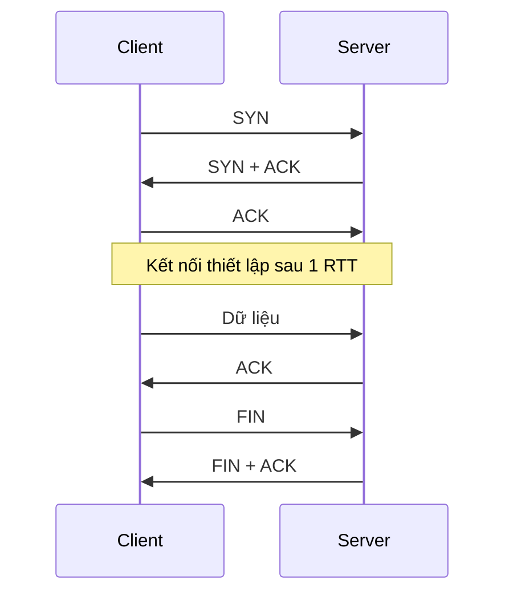
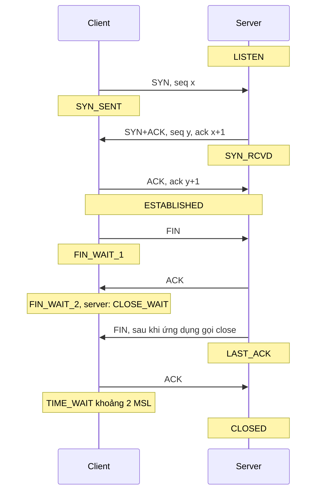
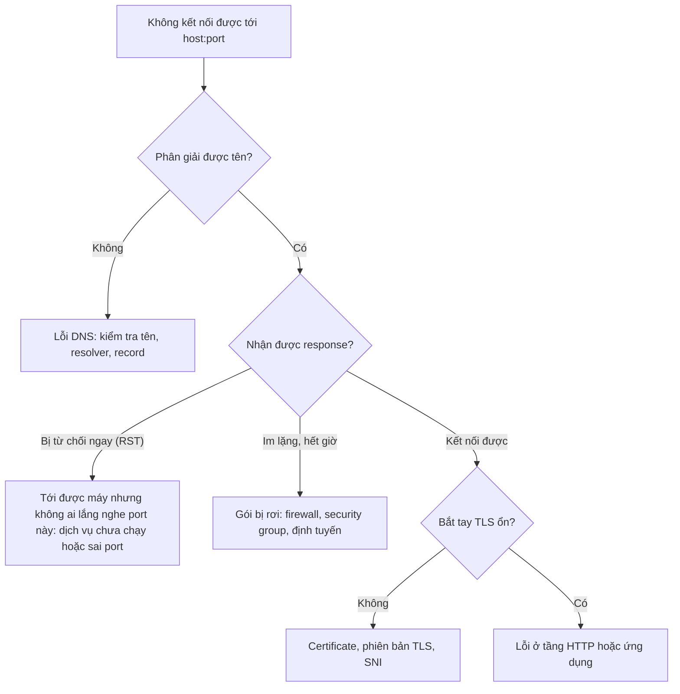
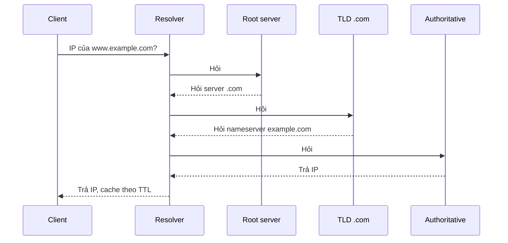
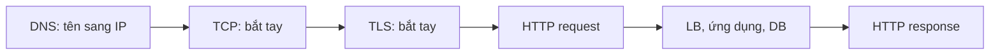

# Mạng cơ bản: TCP/IP, DNS và hành trình của một request

Khi bạn gõ `https://example.com` rồi nhấn Enter, trình duyệt không "biết" server nằm ở đâu. Nó phải tra tên ra địa chỉ, mở một kênh truyền tin cậy, thỏa thuận encryption, rồi mới gửi request. Bài này đi qua chuỗi đó theo đúng thứ tự: DNS, TCP, TLS, HTTP, để khi gặp lỗi "chậm", "không kết nối được" hay "timeout" bạn biết lỗi nằm ở bước nào thay vì ngồi đoán.

**Tóm tắt:**

- Một request đi qua các chặng nối tiếp DNS, TCP, TLS, HTTP; mỗi chặng tốn ít nhất 1 RTT nên mạng xa thì chậm dù băng thông lớn.
- Mạng chia thành các tầng, mỗi tầng chỉ lo một việc; nhờ vậy lỗi được khoanh vùng theo chặng thay vì đoán.
- IP chọn máy, port chọn dịch vụ; TCP đảm bảo đủ và đúng thứ tự, UDP đánh đổi độ tin cậy lấy độ trễ thấp.
- TCP bắt tay 3 gói, đóng kết nối 4 gói; `CLOSE_WAIT` tăng mãi là lỗi code của bạn, còn `TIME_WAIT` nhiều thường chỉ do mở/đóng kết nối ngắn quá nhiều.
- Connection refused (nhận RST ngay), timeout (gói bị bỏ im lặng) và lỗi DNS có nguyên nhân và người sửa hoàn toàn khác nhau.
- DNS là hệ thống phân cấp (root, TLD, authoritative) cache theo TTL, nên đổi record không có hiệu lực tức thì; hạ TTL trước khi chuyển IP.
- Đo từng chặng bằng `dig` và `curl -w`, và luôn đặt timeout cho mọi cuộc gọi mạng thay vì để mặc định vô hạn.

## Mạng là gì và vì sao chia thành tầng

Mạng được xếp thành các **tầng** (layer), mỗi tầng lo đúng một việc và chỉ nói chuyện với tầng liền kề. Ví dụ đời thường: bạn gửi thư. Bạn viết nội dung (tầng ứng dụng), bưu điện đóng thùng và ghi địa chỉ nhận (tầng mạng), xe tải chạy trên đường cụ thể (tầng liên kết). Người viết thư không cần biết xe tải đi đường nào. Nhờ vậy ta thay Wi-Fi bằng cáp mà HTTP không phải sửa gì.

Hai thành phần bạn gặp nhiều nhất:

- **TCP** (Transmission Control Protocol) lo việc dữ liệu tới **đủ** và **đúng thứ tự**. Nếu một gói bị mất, TCP tự gửi lại. Gần như mọi thứ cần chính xác (web, API, kết nối database) chạy trên TCP.
- **DNS** (Domain Name System) là "danh bạ" của Internet: dịch tên miền như `example.com` ra địa chỉ IP như `203.0.113.10`, vì máy tính định tuyến bằng IP chứ không bằng tên.

**Nền tảng:** Một request đi qua các chặng nối tiếp DNS, TCP, TLS, HTTP, mỗi chặng tốn ít nhất 1 RTT. Mỗi tầng chỉ lo một việc và chỉ nói chuyện với tầng liền kề, nên khi có lỗi bạn khoanh vùng theo từng chặng thay vì đoán.

## Vì sao cần hiểu chuỗi này

Một request đi qua nhiều chặng nối tiếp: DNS, TCP, TLS, HTTP. Lỗi ở chặng nào thì triệu chứng khác nhau (không phân giải được tên, bị từ chối kết nối, treo không response, lỗi certificate). Hiểu chuỗi này thì bạn chọn đúng công cụ để soi từng bước (`dig`, `ping`, `curl -v`), thay vì chỉ thử khởi động lại và hy vọng.

## Khi nào cần đào sâu, khi nào không

Cần đào sâu khi gỡ lỗi kết nối, thiết kế hệ thống phân tán, cấu hình load balancer và firewall, hoặc khi phải giải thích vì sao một call chậm. Khi chỉ gọi một API bình thường và mọi thứ chạy tốt thì bạn không cần nhớ chi tiết, nhưng lúc có sự cố mạng thì kiến thức này rất đáng giá.

## Các khái niệm cần biết

| Từ khóa | Là gì | Vì sao quan trọng |
|---|---|---|
| **IP** | Địa chỉ của một máy trên mạng (IPv4 như `203.0.113.10`, IPv6 dài hơn) | Là thứ router dùng để chuyển packet tới đúng máy |
| **Port** | Số từ 0 đến 65535 xác định process nhận dữ liệu trên một máy | Một máy chạy nhiều dịch vụ cùng lúc; IP chọn máy, port chọn dịch vụ (ví dụ 443 là HTTPS) |
| **Packet (packet)** | Mẩu dữ liệu nhỏ mà mạng thực sự truyền | Dữ liệu lớn bị cắt thành nhiều gói, có thể mất hoặc đến sai thứ tự; TCP sinh ra để xử lý chuyện này |
| **SYN / ACK / FIN** | Cờ trong header TCP: SYN mở kết nối, ACK xác nhận đã nhận, FIN báo đóng | Là "ngôn ngữ" của bắt tay và đóng kết nối ở các sơ đồ phía dưới |
| **seq / ack** | Số thứ tự byte gửi đi và số byte tiếp theo bên nhận mong đợi | Nhờ đó bên nhận sắp đúng thứ tự và phát hiện thiếu gói để yêu cầu gửi lại |
| **RTT** (round-trip time) | Thời gian một gói đi tới đích và nhận response về | Mỗi bước bắt tay tốn ít nhất 1 RTT, nên mạng xa thì chậm dù băng thông lớn |
| **Resolver** | Server DNS làm thay client việc truy vấn (thường của nhà mạng hoặc `8.8.8.8`) | Client chỉ hỏi resolver; resolver lần lượt hỏi root, TLD, authoritative rồi cache kết quả |
| **TTL** (time to live) | Số giây một record DNS được phép nằm trong cache | TTL dài giảm tải nhưng đổi IP lâu có hiệu lực; TTL ngắn thì ngược lại |
| **Keep-alive** | Giữ kết nối mở để dùng lại cho nhiều request | Bỏ được chi phí bắt tay lặp lại |
| **TTFB** (time to first byte) | Thời gian từ lúc gửi request tới lúc nhận byte đầu của response | Cho biết server xử lý nhanh hay chậm |
| **NAT** | Nhiều máy nội bộ dùng chung một IP công khai khi ra Internet | Lý do IPv4 chưa cạn hẳn, nhưng cũng là lý do máy ngoài không tự kết nối vào máy trong được |
| **MSL** (maximum segment lifetime) | Thời gian tối đa một packet có thể "sống" trên mạng | Là căn cứ cho thời gian giữ `TIME_WAIT` |

**Phải thuộc:** IP chọn máy, port chọn dịch vụ (port từ 0 đến 65535). Port quen thuộc: 80 HTTP, 443 HTTPS, 22 SSH, 5432 PostgreSQL, 3306 MySQL, 6379 Redis. Bắt tay TCP gồm 3 gói (SYN, SYN+ACK, ACK), đóng kết nối gồm 4 gói (FIN, ACK, FIN, ACK).

## Mô hình tầng (TCP/IP)

| Tầng | Vai trò | Giao thức |
|---|---|---|
| Ứng dụng | Dữ liệu nghiệp vụ | HTTP, DNS, gRPC, SMTP |
| Giao vận | Truyền giữa các process, qua port | TCP, UDP, QUIC |
| Mạng | Định tuyến giữa các máy theo IP | IP, ICMP |
| Liên kết | Truyền trong cùng mạng | Ethernet, Wi-Fi |

## TCP và UDP

| | TCP | UDP |
|---|---|---|
| Kết nối | Có (bắt tay 3 bước) | Không |
| Tin cậy, đúng thứ tự | Có (đánh số, ACK, gửi lại) | Không |
| Kiểm soát tắc nghẽn | Có | Không |
| Độ trễ | Cao hơn | Thấp |
| Dùng cho | Web, API, DB | DNS, video trực tiếp, game, QUIC |

**Phải thuộc:** TCP hướng kết nối, đảm bảo đủ và đúng thứ tự (đánh số seq, ACK, gửi lại), có kiểm soát tắc nghẽn; UDP không kết nối, không đảm bảo, nhưng độ trễ thấp. Câu so sánh TCP với UDP là câu phỏng vấn kinh điển.



State đáng biết: `TIME_WAIT` (nhiều kết nối ngắn đóng liên tục làm cạn port), `CLOSE_WAIT` (ứng dụng quên đóng kết nối). Công cụ: `ss -tan`, `netstat`.

### Bắt tay và đóng kết nối chi tiết

Sơ đồ trên rút gọn. Bản đầy đủ có số thứ tự (seq, ack) và state hai đầu; đóng kết nối là **4 gói** vì mỗi chiều đóng riêng (client là bên đóng trước):



| State | Ở đâu | Ý nghĩa và dấu hiệu bất thường |
|---|---|---|
| `SYN_SENT` kéo dài | Client | Gói SYN không được đáp: firewall chặn hoặc server không tới được |
| `CLOSE_WAIT` tăng mãi | Bên **bị** đóng | Đối phương đã đóng, ứng dụng của bạn chưa gọi `close()`: rò kết nối (lỗi ở code mình) |
| `TIME_WAIT` rất nhiều | Bên **chủ động** đóng | Bình thường sau mỗi kết nối ngắn, giữ port khoảng 60 giây trên Linux để gói lạc không lẫn sang kết nối mới; quá nhiều thì dùng keep-alive hoặc connection pool |
| `SYN_RECV` nhiều | Server | Dấu hiệu SYN flood hoặc backlog đầy |

**Phải thuộc:** `CLOSE_WAIT` tăng mãi là lỗi code của bạn (quên `close()`); `TIME_WAIT` thường chỉ là hệ quả của việc mở/đóng kết nối ngắn quá nhiều (giữ khoảng 60 giây trên Linux, khoảng 2 MSL).

Hệ quả thực tế: `CLOSE_WAIT` tăng mãi sẽ làm cạn file descriptor của process và ứng dụng bắt đầu báo "Too many open files"; `TIME_WAIT` quá nhiều làm cạn port tạm (ephemeral port) và client không mở được kết nối mới tới cùng một đích.

**Suy luận:** TCP phải đánh số byte và xác nhận từng đoạn vì mạng bên dưới (IP) chỉ chuyển gói theo kiểu "cố gắng hết sức": gói có thể mất, trùng hoặc đến sai thứ tự. Muốn đánh số được thì hai bên phải thống nhất số thứ tự khởi đầu, mà mỗi bên chỉ tự chọn được số của mình, nên cần đủ ba gói: SYN mang số của client, SYN+ACK vừa xác nhận số đó vừa mang số của server, ACK cuối xác nhận số của server. Từ đó suy ra hai hệ quả. Thứ nhất, mọi kết nối mới tốn ít nhất 1 RTT trước khi gửi được dữ liệu, nên keep-alive và connection pool đáng giá hơn bạn tưởng. Thứ hai, kết nối là hai chiều độc lập (mỗi chiều có FIN và ACK riêng), nên đóng cần 4 gói và bên đóng trước phải ở lại `TIME_WAIT` khoảng 2 MSL để gói lạc của kết nối cũ không lẫn vào kết nối mới trùng cặp IP và port. Chỗ dễ nhầm là coi `TIME_WAIT` như lỗi: nó nằm ở bên chủ động đóng và là cơ chế bảo vệ, chỉ trở thành vấn đề khi bạn mở/đóng quá nhiều kết nối ngắn. Ngược lại `CLOSE_WAIT` nằm ở bên bị đóng, nghĩa là đối phương đã đóng mà code của bạn chưa gọi `close()`, và hệ thống sẽ không tự dọn. Khi review, hãy kiểm tra try-with-resources cho mọi socket và connection, và dùng pool thay vì mở kết nối mới cho từng request.

Khi gặp lỗi kết nối, hãy dùng sơ đồ quyết định sau để thu hẹp nguyên nhân:



**Phải thuộc:** "Connection refused" (nhận RST ngay, không ai lắng nghe port) khác "timeout" (gói bị bỏ im lặng, thường do firewall, security group hoặc định tuyến) và khác lỗi DNS (không phân giải được tên).

Đọc sơ đồ: ba kết cục đầu (DNS lỗi, từ chối, im lặng) nghe giống nhau với người dùng ("không vào được") nhưng nguyên nhân và người phải sửa hoàn toàn khác nhau. Gói `RST` là cách một máy báo "không có ai ở port này" nên bạn nhận lỗi ngay; còn firewall thường **âm thầm bỏ gói** nên bạn phải chờ tới khi hết thời gian.

## DNS



**Nền tảng:** DNS là hệ thống phân cấp (root, TLD, authoritative) và được cache ở mọi tầng theo TTL. Client chỉ hỏi resolver, resolver mới lần lượt đi hỏi và nhớ kết quả; vì cache nên đổi record không có hiệu lực tức thì.

Trước khi hỏi resolver, client kiểm tra cache của trình duyệt và hệ điều hành; resolver thường là của nhà mạng hoặc `8.8.8.8`.

| Record | Ý nghĩa |
|---|---|
| A / AAAA | Tên → địa chỉ IPv4 / IPv6 |
| CNAME | Bí danh trỏ tới tên khác |
| MX | Server thư |
| TXT | Văn bản (authentication SPF, xác minh tên miền) |
| NS | Server tên của vùng |

**TTL** quyết định thời gian cache: TTL dài giảm tải nhưng đổi IP lâu có hiệu lực. DNS cũng dùng để load balancing thô (nhiều record A) và định tuyến theo vùng.

Khi nào chỉnh TTL? Trước một lần chuyển hệ thống sang IP mới, hãy hạ TTL xuống thấp (ví dụ 60 giây) từ vài ngày trước để khi đổi IP thì người dùng sang IP mới nhanh; xong việc thì nâng lại để giảm tải truy vấn. Nếu quên, một số người dùng vẫn bị trỏ về IP cũ hàng giờ. Ghi chú: **authoritative server** là server giữ record gốc của tên miền (nguồn sự thật), còn **TLD** là phần đuôi như `.com`, `.vn`.

### Soi DNS bằng `dig`

Lưu ý: toàn bộ output dưới đây là **minh họa** (tên, IP, số giây là giá trị mẫu), không phải kết quả thật.

```bash
$ dig www.example.com A
;; ->>HEADER<<- opcode: QUERY, status: NOERROR, id: 4711
;; ANSWER SECTION:
www.example.com.   300   IN   A   203.0.113.10
;; Query time: 23 msec
;; SERVER: 8.8.8.8#53(8.8.8.8)
```

| Phần | Cách đọc |
|---|---|
| `status: NOERROR` | Truy vấn thành công; `NXDOMAIN` là tên không tồn tại; `SERVFAIL` là server tên gặp lỗi |
| Cột `300` | TTL còn lại (giây); chạy lại ngay sẽ thấy số này giảm dần nếu đang đọc từ cache của resolver |
| `IN A` | Class Internet, record A |
| `Query time` | Thời gian hỏi resolver; lần đầu lâu, lần sau (cache) thường vài ms |
| `SERVER` | Resolver đã trả lời |

Các lệnh hay dùng:

```bash
# đi từ root xuống TLD rồi authoritative, thấy từng bước của sơ đồ trên
dig +trace www.example.com
# hỏi thẳng một resolver cụ thể, so với resolver nội bộ
dig @8.8.8.8 www.example.com
dig example.com MX +short           # chỉ in kết quả
nslookup -type=TXT example.com      # tương đương, có sẵn trên Windows
```

Cùng một tên trả IP khác nhau giữa hai resolver thường là do record chưa lan hết (TTL) hoặc định tuyến theo vùng (GeoDNS).

## Hành trình của một request



Mỗi bước tốn ít nhất một RTT; mạng chậm thì tổng độ trễ chủ yếu là số lần đi-về, không phải băng thông. Vì vậy: giữ kết nối sống (keep-alive), dùng CDN để đưa server gần người dùng, giảm số call.

### Đo từng chặng bằng `curl`

```bash
curl -o /dev/null -s -w 'dns=%{time_namelookup} tcp=%{time_connect} tls=%{time_appconnect} ttfb=%{time_starttransfer} total=%{time_total}\n' https://api.example.com/health
```

Output minh họa (giây, các mốc là **cộng dồn** từ lúc bắt đầu):

```text
dns=0.012 tcp=0.045 tls=0.110 ttfb=0.180 total=0.185
```

| Chặng | Cách tính | Từ ví dụ |
|---|---|---|
| DNS | `time_namelookup` | 12 ms |
| TCP bắt tay | `time_connect - time_namelookup` | 33 ms (khoảng 1 RTT) |
| TLS bắt tay | `time_appconnect - time_connect` | 65 ms |
| Server xử lý + mạng | `time_starttransfer - time_appconnect` | 70 ms |
| Tải body | `time_total - time_starttransfer` | 5 ms |

Chặng nào phình ra thì nghi chỗ đó: DNS chậm (resolver, TTL 0), TCP chậm (xa hoặc mất gói), TLS chậm (nhiều RTT, certificate lớn), `ttfb` chậm (server hoặc DB). `curl -v` in thêm từng bước (`* Trying`, `* Connected to`, `* SSL connection using`, header) để biết kết nối dừng ở đâu.

Mã thoát của `curl` cũng cho biết bước hỏng: 6 là không phân giải được tên, 7 là không kết nối được (từ chối), 28 là hết thời gian chờ, 35 là lỗi bắt tay TLS, 60 là certificate không tin cậy.

### Phân biệt từ chối, timeout, lỗi DNS trong Java

```java
static String probe(String host, int port) {
    try (Socket s = new Socket()) {
        s.connect(new InetSocketAddress(host, port), 2000);   // timeout kết nối 2 giây
        s.setSoTimeout(3000);                                  // timeout đọc 3 giây
        return "connected";
    } catch (SocketTimeoutException e) {
        // gói tin biến mất: firewall, định tuyến
        return "TIMEOUT: " + e.getMessage();
    } catch (ConnectException e) {
        // tới được máy nhưng không ai lắng nghe
        return "REFUSED: " + e.getMessage();
    } catch (UnknownHostException e) {
        // tên không phân giải được
        return "DNS FAIL: " + e.getMessage();
    } catch (IOException e) {
        return "IO: " + e.getMessage();
    }
}
```

Đã chạy: port có `ServerSocket` lắng nghe cho `connected`; `127.0.0.1:9` (không ai nghe) cho `REFUSED` với thông điệp `Connection refused`; tên `khong-ton-tai.invalid` cho `DNS FAIL`. Nhánh `TIMEOUT` chưa chạy được ở đây vì cần một địa chỉ làm rơi gói; thông điệp thường là `Connect timed out` (quá hạn khi kết nối) hoặc `Read timed out` (quá hạn khi đọc). Hai loại timeout này đặt riêng: `connect(addr, ms)` và `setSoTimeout(ms)`; quên cái thứ hai thì đọc có thể treo vô hạn.

## Địa chỉ và port

Phần này gom các con số bạn sẽ gặp liên tục khi cấu hình firewall, security group hay chuỗi kết nối.

- IPv4 (32 bit) cạn kiệt, dùng NAT; IPv6 (128 bit).
- Dải riêng: `10.0.0.0/8`, `172.16.0.0/12`, `192.168.0.0/16`. CIDR (cách viết dải địa chỉ dạng `địa chỉ/số bit mạng`) `/24` nghĩa là 24 bit mạng, 256 địa chỉ; `/16` là 65.536 địa chỉ. Bạn dùng CIDR khi khai báo subnet hoặc luật firewall, ví dụ cho phép `10.0.1.0/24` truy cập database.
- Port quen thuộc: 80 HTTP, 443 HTTPS, 22 SSH, 5432 PostgreSQL, 3306 MySQL, 6379 Redis.

## Điều cần nhớ

- Mọi call mạng cần **timeout** và chính sách thử lại; đừng để mặc định vô hạn.
- Công cụ gỡ lỗi: `ping`, `traceroute`, `dig`, `curl -v`, `tcpdump`, Wireshark.

