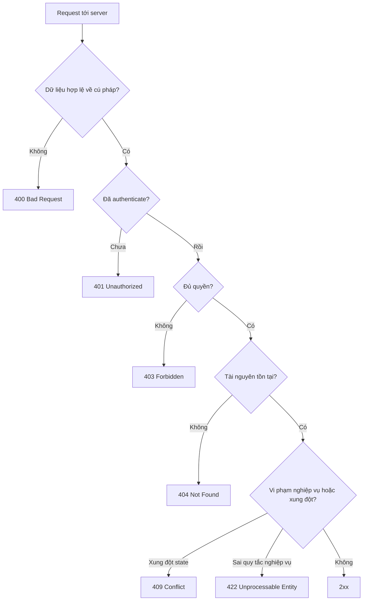
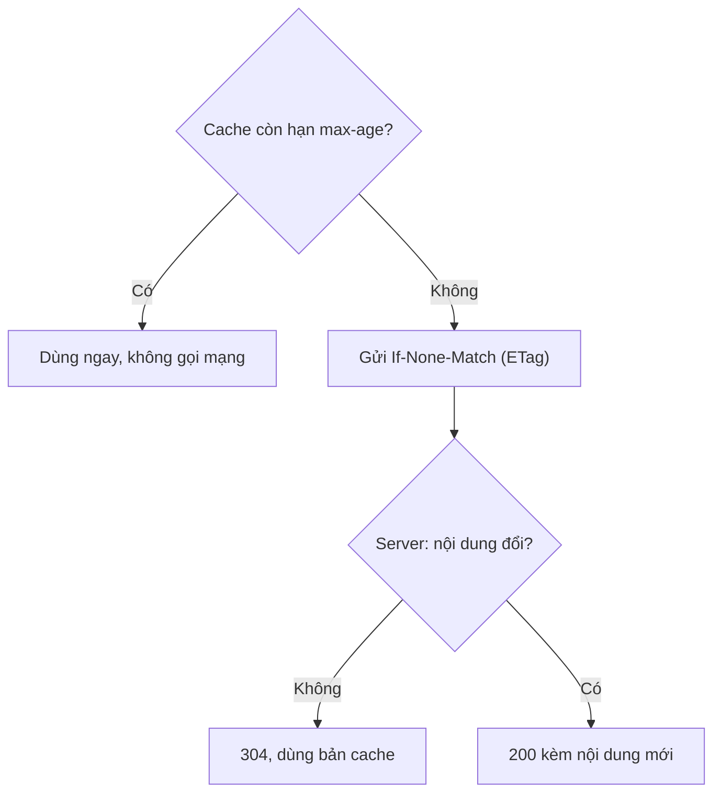
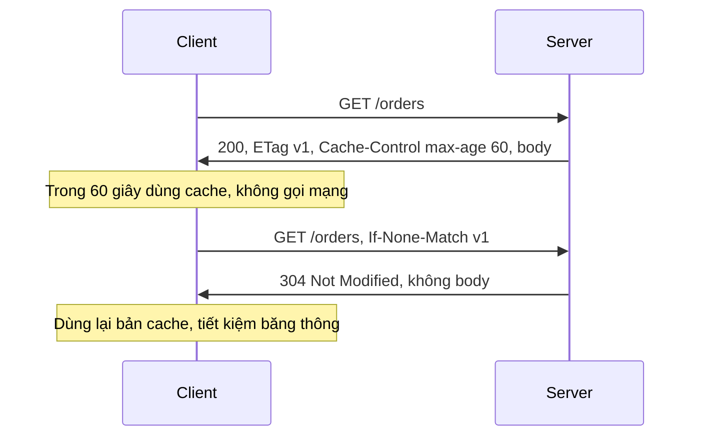
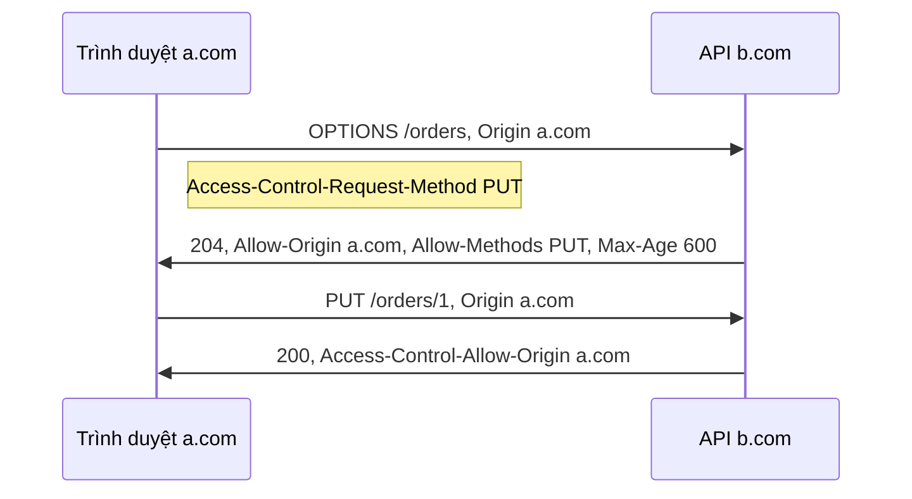
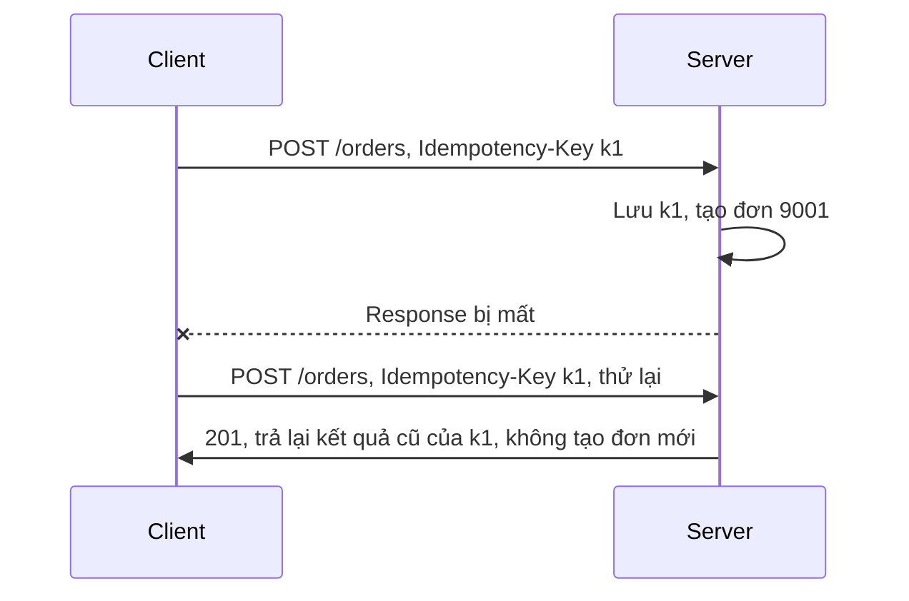

# HTTP chi tiết

Mỗi lần bạn mở một trang web hay gọi một API, trình duyệt hoặc ứng dụng của bạn đang "nói chuyện" với server bằng HTTP. Bài này giải thích ngôn ngữ đó: một request gồm những gì, server trả lời ra sao, và những quy ước (method, status code, header) mà cả hai bên phải hiểu giống nhau thì hệ thống mới chạy đúng.

**Tóm tắt:**

- HTTP là giao thức hỏi đáp stateless; mọi cơ chế nhớ người dùng (cookie, session, token) đều được thêm lên trên.
- GET, HEAD, OPTIONS là safe và idempotent; PUT, DELETE idempotent; POST không idempotent nên retry POST cần idempotency key.
- Status code theo nhóm: 4xx là lỗi client (đừng thử lại y nguyên), 5xx là lỗi server (có thể thử lại); 401 là chưa biết bạn là ai, 403 là biết nhưng không cho.
- Cache có hai tầng: `max-age` quyết định có gọi mạng hay không, ETag với `If-None-Match` quyết định có phải tải lại body hay không (304).
- Session cookie cần đủ ba cờ `HttpOnly`, `Secure`, `SameSite` để giảm hậu quả của XSS, lộ qua HTTP và CSRF.
- CORS là cơ chế của trình duyệt chứ không phải bảo mật phía server; preflight `OPTIONS` hay bị filter authentication chặn nhầm.
- Retry chỉ an toàn với thao tác idempotent, kèm backoff và jitter; luôn đặt timeout ở client.

## HTTP là gì?

HTTP là giao thức dạng hỏi đáp: client gửi một **request**, server trả một **response**. Điểm cốt lõi là HTTP **không lưu state** (stateless): mỗi request đứng riêng, server không tự nhớ request trước là của ai. Ví dụ đời thường: bạn gọi tổng đài mà mỗi lần gọi lại gặp một nhân viên mới, nên mỗi lần bạn phải nói lại tên và mã khách hàng. Cái "mã khách hàng" đó chính là cookie hoặc token ở các bài sau. Web và hầu hết API (REST) đều chạy trên HTTP.

**Nền tảng:** HTTP là giao thức hỏi đáp **stateless**: mỗi request đứng riêng, server không tự nhớ ai là ai. Mọi cơ chế "nhớ người dùng" (cookie, session, token) đều được thêm lên trên để bù cho điều này.

## Vì sao cần hiểu chi tiết

Những lỗi hay gặp đều đến từ việc dùng sai quy ước:

- Dùng sai method thì khi retry có thể tạo trùng đơn hàng (ví dụ thử lại một `POST` tạo đơn).
- Trả sai status code thì client không biết lỗi do ai: do nó gửi sai (4xx, không nên thử lại y nguyên) hay do server (5xx, có thể thử lại).
- Quên header cache thì hoặc hệ thống chậm vì tải lại mọi thứ, hoặc người dùng thấy dữ liệu cũ.

Hiểu HTTP rồi thì bạn thiết kế API đúng chuẩn và gỡ lỗi nhanh hơn.

## Khi nào dùng, khi nào không

HTTP phù hợp cho mọi API REST, trang web và tích hợp giữa các hệ thống theo mô hình hỏi đáp. Nó **không** hợp khi server cần chủ động đẩy dữ liệu liên tục tới client (chat, giá cổ phiếu thời gian thực): lúc đó hãy xem WebSocket hoặc SSE (xem bài HTTP/2, HTTP/3 và realtime).

## Cách dùng đúng, tóm tắt

Dùng đúng ngữ nghĩa: `GET` chỉ đọc, `POST` tạo hoặc thực hiện hành động, `PUT` và `DELETE` là idempotent (gọi lặp cho cùng kết quả). Trả status code đúng nhóm (2xx, 4xx, 5xx). Dùng header để điều khiển cache (`Cache-Control`, `ETag`) và kiểu nội dung (`Content-Type`). Các phần dưới đi qua từng thứ một.

## Các khái niệm cần biết

| Từ khóa | Là gì | Vì sao quan trọng |
|---|---|---|
| **Header** | Cặp `Tên: giá trị` đi kèm request/response, mô tả "siêu dữ liệu" (kiểu nội dung, authentication, cache) | Điều khiển hành vi mà không cần đụng vào body |
| **Idempotent** | Gọi một thao tác nhiều lần cho kết quả cuối cùng giống gọi một lần | Quyết định thao tác có an toàn để thử lại khi mạng lỗi hay không |
| **Safe (an toàn)** | Thao tác không làm đổi state trên server | Proxy và trình duyệt có thể gọi trước hoặc cache mà không sợ gây hại |
| **ETag** | Chuỗi định danh phiên bản của một nội dung (thường là hash) | Cho phép hỏi "nội dung đổi chưa?" thay vì tải lại toàn bộ |
| **Preflight** | Request `OPTIONS` mà trình duyệt tự gửi trước một call cross-origin "không đơn giản" | Là nơi nhiều lỗi CORS phát sinh |
| **Origin** | Bộ ba scheme + host + port của trang (ví dụ `https://a.com:443`) | CORS và cookie đều dựa trên origin |
| **Idempotency key** | Mã duy nhất client sinh ra cho mỗi ý định tạo, gửi lại nguyên vẹn khi retry | Chống tạo trùng khi `POST` bị thử lại |
| **Backoff, jitter** | Chờ lâu dần giữa các lần thử lại (backoff), cộng thêm độ lệch ngẫu nhiên (jitter) | Tránh hàng loạt client cùng thử lại một lúc làm server sập thêm |

## Cấu trúc

```text
POST /api/orders HTTP/1.1
Host: shop.example.com
Content-Type: application/json
Authorization: Bearer eyJ...

{"productId": 7, "qty": 2}
```

Dòng đầu là **request line** (method, đường dẫn, phiên bản), tiếp theo là các header, một dòng trống, rồi body. Response có cấu trúc tương tự: status line (ví dụ `HTTP/1.1 201 Created`), header, và body. Phần dưới cho thấy chính xác điều này qua `curl -v`.

### Đọc output `curl -v`

```bash
curl -v -X POST https://shop.example.com/api/orders \
  -H 'Content-Type: application/json' -d '{"productId":7,"qty":2}'
```

Output **minh họa** (rút gọn, giá trị mẫu):

```text
*   Trying 203.0.113.10:443...
* Connected to shop.example.com (203.0.113.10) port 443
* SSL connection using TLSv1.3 / TLS_AES_256_GCM_SHA384
> POST /api/orders HTTP/1.1
> Host: shop.example.com
> Content-Type: application/json
> Content-Length: 24
>
< HTTP/1.1 201 Created
< Location: /api/orders/9001
< Content-Type: application/json
< Cache-Control: no-store
<
{"id":9001,"status":"NEW"}
```

| Ký hiệu | Ý nghĩa |
|---|---|
| `*` | Thông tin của chính curl (DNS, TCP, TLS), không đi qua mạng |
| `>` | Dòng request mà curl **gửi đi** |
| `<` | Dòng response mà curl **nhận về** |
| `201` + `Location` | Tạo mới thành công, `Location` chỉ tới tài nguyên vừa tạo |

Đọc nhanh khi gỡ lỗi: dừng ở `* Trying` là chưa kết nối được (mạng, firewall); dừng sau `SSL` là lỗi certificate hoặc phiên bản TLS; có `<` mà mã 4xx/5xx thì lỗi nằm ở tầng ứng dụng.

## Phương thức

| Method | Ngữ nghĩa | An toàn | Idempotent |
|---|---|---|---|
| GET | Đọc | Có | Có |
| HEAD | Như GET, không body | Có | Có |
| POST | Tạo, hành động | Không | **Không** |
| PUT | Thay thế toàn bộ | Không | Có |
| PATCH | Sửa một phần | Không | Thường không đảm bảo |
| DELETE | Xóa | Không | Có |
| OPTIONS | Hỏi khả năng (CORS preflight) | Có | Có |

**Phải thuộc:** GET, HEAD, OPTIONS là safe và idempotent; PUT và DELETE idempotent nhưng không safe; POST không idempotent; PATCH thường không đảm bảo idempotent.

*An toàn:* không đổi state. *Idempotent:* gọi lặp lại cho cùng kết quả, nên an toàn để thử lại. Hệ quả thực tế: nếu bạn tự động thử lại một `POST` không idempotent sau khi mất kết nối, khách có thể bị tạo hai đơn hàng hoặc bị trừ tiền hai lần. POST cần idempotency key khi thử lại có thể gây trùng (xem [Distributed lock và Idempotency](/go?p=01-Spring-Boot%2Fhard%2Flt-26-distributed-lock-idempotency.md)).

## Status code

| Nhóm | Mã hay dùng |
|---|---|
| 2xx thành công | 200 OK, 201 Created, 202 Accepted, 204 No Content |
| 3xx chuyển hướng | 301 vĩnh viễn, 302/307 tạm thời, 304 Not Modified |
| 4xx lỗi client | 400 sai dữ liệu, 401 chưa authenticate, 403 không đủ quyền, 404 không có, 409 xung đột, 422 sai nghiệp vụ, 429 quá giới hạn |
| 5xx lỗi server | 500 lỗi chung, 502 gateway nhận response xấu, 503 quá tải/bảo trì, 504 gateway hết thời gian chờ |

**Phải thuộc:** **401** là "bạn là ai?" (chưa authenticate), **403** là "tôi biết bạn, nhưng không cho phép" (thiếu quyền). Nhóm mã: 2xx thành công, 3xx chuyển hướng, 4xx lỗi client (không thử lại y nguyên), 5xx lỗi server (có thể thử lại). 502 là gateway nhận response xấu, 504 là gateway hết thời gian chờ.

Cách chọn mã cho một lỗi thường gặp:



Đọc sơ đồ từ trên xuống: server kiểm tra theo thứ tự rẻ nhất và quan trọng nhất trước (định dạng, danh tính, quyền) rồi mới tới nghiệp vụ. Một lưu ý thực tế: với tài nguyên người dùng không được phép biết là có tồn tại, nhiều hệ thống trả 404 thay vì 403 để không lộ thông tin.

## Header quan trọng

| Header | Ý nghĩa |
|---|---|
| `Content-Type`, `Accept` | Định dạng gửi và nhận |
| `Authorization` | Credential |
| `Cache-Control`, `ETag`, `If-None-Match` | Điều khiển cache |
| `Cookie`, `Set-Cookie` | Session state |
| `Origin`, `Access-Control-*` | CORS |
| `X-Forwarded-For`, `Forwarded` | IP thật của client qua proxy |
| `Retry-After` | Khi nào thử lại (429, 503) |

## Cache HTTP



**Phải thuộc:** `max-age` quyết định có gọi mạng hay không; ETag với `If-None-Match` quyết định có phải tải lại body hay không (304 Not Modified, không body). `no-cache` nghĩa là "luôn xác nhận lại", còn `no-store` mới là "không lưu".

`Cache-Control: public, max-age=31536000, immutable` cho file tĩnh có hash trong tên; `no-store` cho dữ liệu nhạy cảm; `no-cache` nghĩa là "luôn xác nhận lại", không phải "không lưu".

### Request có điều kiện (ETag) từng bước



Client gọi bằng `HttpClient` của JDK 11 trở lên; server mẫu và client chạy cùng một chương trình (đã chạy, in `200 "v1" {"id":1}` rồi `304 bodyLen=0`):

```java
HttpClient client = HttpClient.newBuilder()
        .connectTimeout(Duration.ofSeconds(2)).build();            // timeout kết nối
HttpRequest req = HttpRequest.newBuilder(URI.create(url))
        // timeout cả request
        .timeout(Duration.ofSeconds(5))
        .header("Accept", "application/json").GET().build();
HttpResponse<String> r = client.send(req, HttpResponse.BodyHandlers.ofString());
String etag = r.headers().firstValue("ETag").orElse("");

HttpRequest again = HttpRequest.newBuilder(req.uri())
        // gửi lại có điều kiện
        .header("If-None-Match", etag).GET().build();
HttpResponse<String> r2 = client.send(again, HttpResponse.BodyHandlers.ofString());
// r2.statusCode() == 304 khi nội dung chưa đổi; body rỗng
```

Hai tầng cache: `max-age` quyết định **có gọi mạng không**; ETag quyết định **có phải tải lại body không**. `HttpClient` của JDK không tự cache; trình duyệt thì có. Mặc định `HttpClient` không đặt timeout, nên phải tự đặt như trên.

## Cookie

Vì HTTP không nhớ ai là ai, server dùng **cookie** để "đóng dấu" client: server gửi `Set-Cookie`, trình duyệt lưu và tự gửi lại qua header `Cookie` ở các request sau cùng origin. Dùng cho login session; không nên nhét dữ liệu nhạy cảm dạng thô vào cookie. Thuộc tính quan trọng: `HttpOnly` (JavaScript không đọc được), `Secure` (chỉ qua HTTPS), `SameSite=Lax|Strict` (giảm CSRF, tức là việc trang độc hại lừa trình duyệt gửi request kèm cookie của bạn), `Max-Age`, `Path`, `Domain`. Thiếu `HttpOnly` thì một lỗ hổng XSS có thể đánh cắp session cookie; thiếu `Secure` thì cookie có thể lộ trên đường truyền không encrypt.

**Phải thuộc:** Session cookie cần đủ ba cờ `HttpOnly` (chống JavaScript đọc, giảm hậu quả XSS), `Secure` (chỉ qua HTTPS), `SameSite` (giảm CSRF).

## CORS

**CORS** (Cross-Origin Resource Sharing) sinh ra vì trình duyệt mặc định chặn một trang đọc dữ liệu từ origin khác (same-origin policy), để trang độc hại không đọc được dữ liệu của bạn ở site khác. Khi bạn thật sự có frontend và API ở hai origin, cần cấu hình CORS ở server. Cụ thể: trình duyệt chặn trang ở `a.com` gọi API ở `b.com` trừ khi `b.com` cho phép bằng `Access-Control-Allow-Origin`. Request "không đơn giản" gửi trước một `OPTIONS` (preflight). CORS là cơ chế **của trình duyệt**, không phải bảo mật phía server (curl vẫn gọi được).

**Nền tảng:** CORS không chặn request tới server, nó chỉ quyết định trình duyệt có cho JavaScript của trang đọc response từ origin khác hay không. Gốc của nó là same-origin policy (origin = scheme + host + port).



Preflight xuất hiện khi dùng method ngoài GET/HEAD/POST đơn giản, hoặc header tùy biến như `Authorization`, hoặc `Content-Type: application/json`. `Access-Control-Max-Age` cho phép trình duyệt nhớ kết quả, đỡ gọi `OPTIONS` mỗi lần. Gửi kèm cookie (`credentials: include`) thì server **không** được trả `Access-Control-Allow-Origin: *`; phải nêu đích danh origin và thêm `Access-Control-Allow-Credentials: true`. Lỗi thường gặp: server trả 401/403 cho `OPTIONS` vì filter authentication chặn preflight (preflight không mang `Authorization`).

**Suy luận:** Vì cookie được trình duyệt tự đính kèm vào mọi request tới một origin, một trang độc hại ở origin khác có thể bắt trình duyệt của nạn nhân gửi request kèm cookie hợp lệ và đọc luôn response nếu không có rào chắn. Same-origin policy ra đời để chặn đúng bước đọc đó, nên mặc định JavaScript của `a.com` không đọc được response của `b.com`. CORS là cách `b.com` chủ động nới rào chắn này cho những origin nó tin, nên mọi quyết định nằm ở trình duyệt chứ không ở server. Từ đó suy ra ba hệ quả. Thứ nhất, curl hay Postman không bao giờ gặp lỗi CORS, nên "gọi được bằng curl" chẳng chứng minh gì về CORS. Thứ hai, request "không đơn giản" (method ngoài GET/HEAD/POST, header tùy biến, JSON) có thể gây tác dụng phụ trên server, nên trình duyệt hỏi trước bằng preflight `OPTIONS` và chỉ gửi request thật khi server đồng ý. Thứ ba, `Access-Control-Allow-Origin: *` không đi cùng cookie vì nếu cho phép mọi origin đọc response có credential thì rào chắn không còn nghĩa. Chỗ dễ nhầm nhất là coi CORS như tính năng bảo mật của API: request vẫn tới server và có thể đã chạy xong, CORS chỉ che response khỏi JavaScript. Khi review, hãy whitelist origin cụ thể, cho preflight đi qua filter authentication, và vẫn kiểm tra quyền ở server.

## Thử lại và idempotency key

Client mất kết nối sau khi gửi `POST` không biết server đã xử lý chưa. Thử lại bừa có thể tạo hai đơn hàng.



| Tình huống | Thử lại được không |
|---|---|
| `GET`, `PUT`, `DELETE`, timeout hoặc 5xx | Có (idempotent); nên backoff có jitter |
| `POST` không có key | Không nên, trừ khi nghiệp vụ chịu được trùng |
| `POST` có `Idempotency-Key` | Có; server lưu key kèm kết quả trong khoảng thời gian giới hạn |
| 4xx (trừ 408, 429) | Không: gửi lại y nguyên vẫn sai |
| 429 hoặc 503 kèm `Retry-After` | Có, chờ đúng thời gian đó |

Key do client sinh (thường UUID) và giữ nguyên qua các lần thử lại; server dùng ràng buộc duy nhất trên key để chống trùng, kể cả khi hai lần thử đến cùng lúc.

## Điều cần nhớ

- Đặt timeout ở client; giữ kết nối sống; nén (gzip, br) cho văn bản.
- Dùng đúng status code: client gặp 5xx thường thử lại được, 4xx thì không.
- Thiết kế REST: tài nguyên là danh từ, hành động là method, status code nói lên kết quả.

