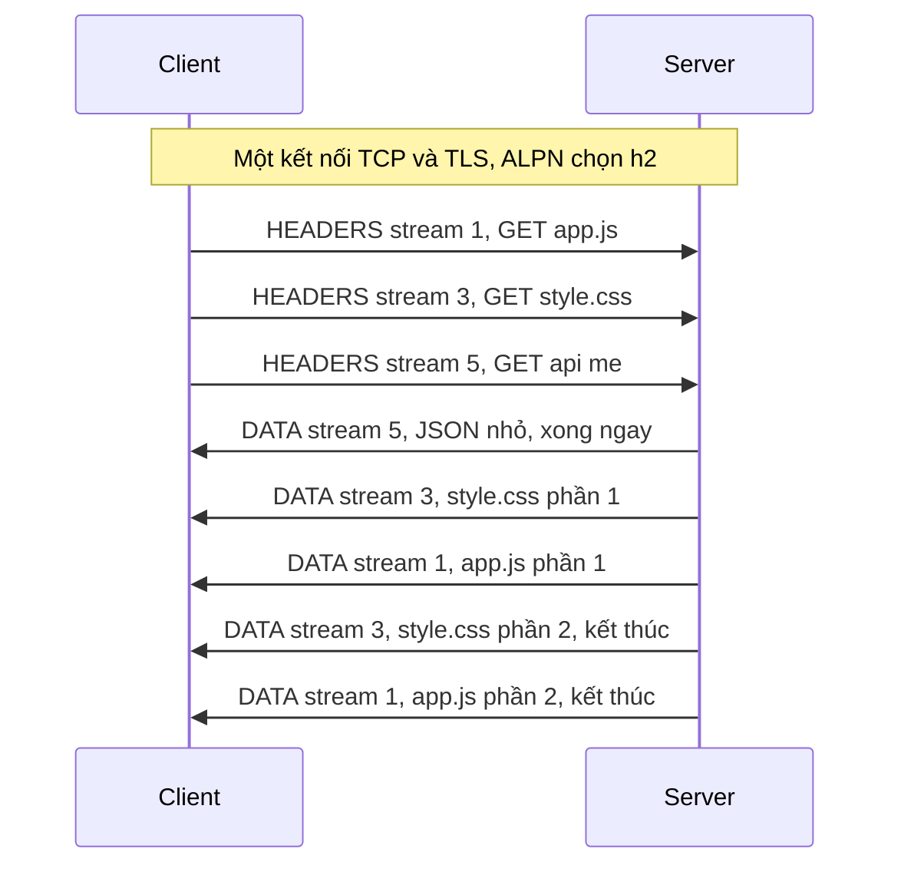
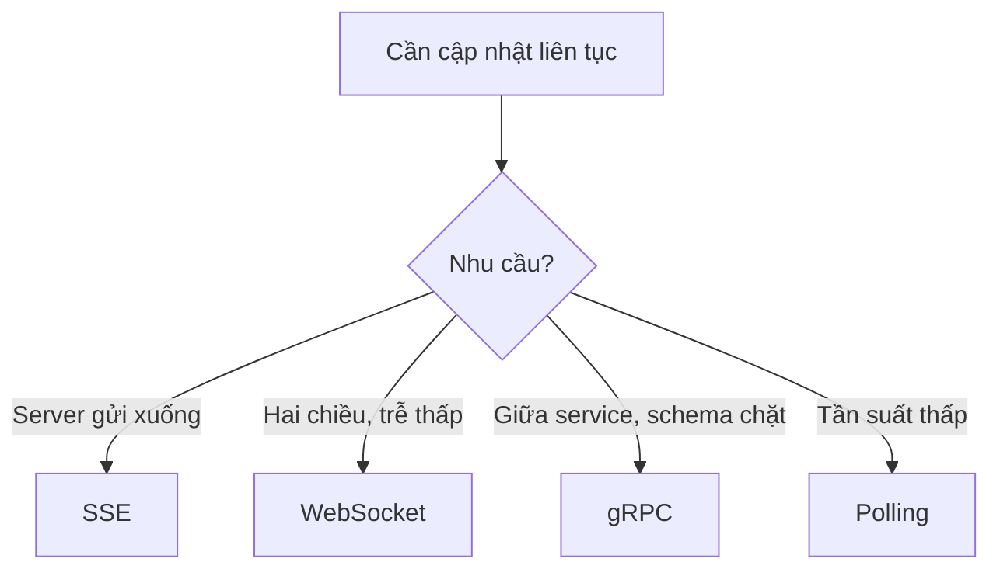
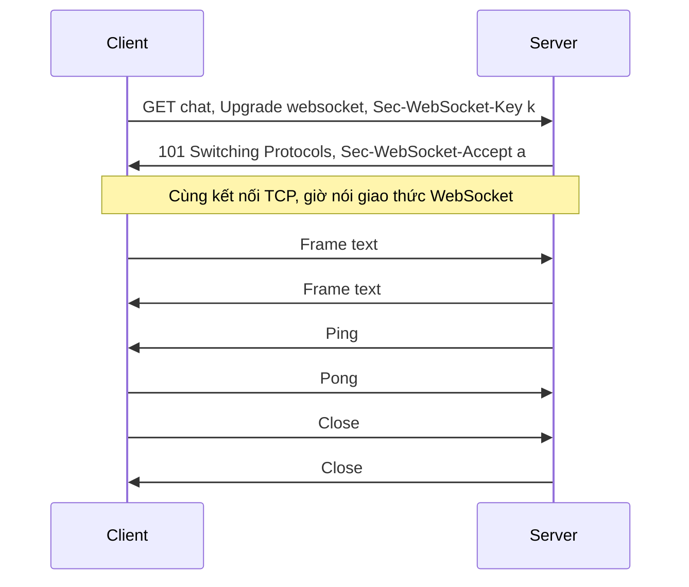
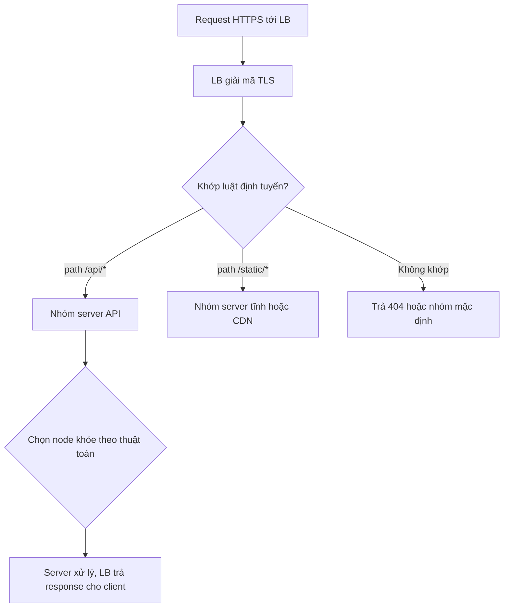
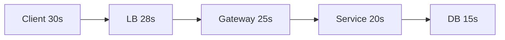
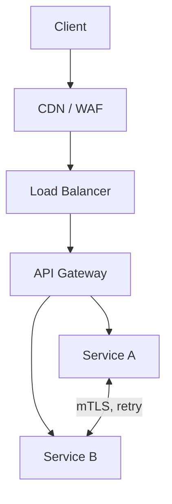

# HTTP/2, HTTP/3, thời gian thực và Load Balancer

Bài này trả lời ba câu hỏi nối tiếp nhau. Thứ nhất, HTTP/1.1, HTTP/2 và HTTP/3 khác nhau ở đâu và mỗi bản ra đời để sửa vấn đề gì. Thứ hai, khi server cần "đẩy" dữ liệu cho client liên tục (chat, thông báo, giá cả) thì chọn công nghệ nào: polling, SSE, WebSocket hay gRPC. Thứ ba, khi có nhiều server phía sau, load balancer (LB) tầng 4 và tầng 7 chia tải ra sao.

**Tóm tắt:**

- Cả ba thế hệ HTTP cùng một mục tiêu: giảm số lượt đi-về (RTT) và dùng một kết nối cho nhiều request.
- HTTP/2 multiplexing nhiều stream trên một kết nối TCP nhưng vẫn kẹt head-of-line blocking ở tầng TCP; HTTP/3 chạy trên QUIC (UDP) nên mất gói chỉ ảnh hưởng một stream.
- Chọn kênh realtime theo hướng dữ liệu: server đẩy một chiều dùng SSE, hai chiều trễ thấp dùng WebSocket, giữa các service schema chặt dùng gRPC, cập nhật thưa dùng polling.
- WebSocket bắt đầu bằng HTTP Upgrade (`101`), rồi sống lâu và stateful nên cần heartbeat, reconnect có backoff và sticky session hoặc pub/sub khi nhiều server.
- L4 chỉ nhìn IP và port (nhanh), L7 đọc được URL, header, cookie nên route theo nội dung và terminate TLS được (chậm hơn).
- `hash(key) % N` làm gần như mọi key đổi node khi N đổi; consistent hashing chỉ di chuyển khoảng 1/N số key.
- Timeout phải giảm dần từ ngoài vào trong, nếu không tầng trong làm việc vô ích và retry khuếch đại tải.

## Vấn đề nó giải quyết

Chọn sai giao thức là trả giá bằng độ trễ và số kết nối. Ví dụ dùng polling (client cứ vài giây hỏi server một lần) cho ứng dụng chat thì phần lớn request trả về "không có gì mới", tốn tài nguyên vô ích mà tin nhắn vẫn đến trễ. Hoặc đặt LB tầng 4 trong khi bạn cần route `/api/orders` về một nhóm server và `/api/users` về nhóm khác thì không làm được, vì tầng 4 không đọc được URL.

## Khi nào dùng cái nào

- Chỉ cần server đẩy **một chiều** xuống client: SSE đơn giản hơn WebSocket nhiều (chạy trên HTTP thường, tự nối lại).
- Cần **hai chiều** độ trễ thấp giữa trình duyệt và server (chat, game): WebSocket.
- Cần giao tiếp nhanh, data contract chặt giữa các service: cân nhắc gRPC. Không hợp để gọi thẳng từ trình duyệt.
- Cập nhật rất thưa (vài phút một lần): polling là đủ, đừng phức tạp hóa.
- Chia tải: L4 khi cần nhanh và đơn giản, L7 khi cần route theo nội dung HTTP, terminate TLS, hay gắn chính sách theo URL.

Phần còn lại giải thích từng thứ theo hướng đó: mỗi thế hệ HTTP giải quyết gì, mỗi kênh thời gian thực đánh đổi gì, và LB chia tải thế nào.

## Các khái niệm cần biết

| Từ khóa | Là gì | Vì sao quan trọng |
|---|---|---|
| **Head-of-line blocking** | Một mục ở đầu queue bị kẹt làm mọi mục phía sau phải chờ | HTTP/1.1 chặn ở tầng ứng dụng (phải trả theo thứ tự), HTTP/2 vẫn chặn ở tầng TCP, HTTP/3 loại bỏ |
| **Multiplexing** | Chạy nhiều request/response xen kẽ trên cùng một kết nối | Một kết nối là đủ, không cần mở 6 kết nối parallel như HTTP/1.1 |
| **Stream, frame** | Stream là một cặp request-response logic; frame là mẩu dữ liệu nhỏ của stream được gửi xen kẽ | Là đơn vị mà HTTP/2 và QUIC dùng để multiplexing |
| **HPACK, QPACK** | Thuật toán nén header của HTTP/2 và HTTP/3 | Header lặp lại (cookie, user-agent) mỗi request rất tốn; nén giảm đáng kể |
| **QUIC** | Giao thức truyền tải chạy trên UDP, tự lo tin cậy, encryption (TLS 1.3 tích hợp) và nhiều stream độc lập | Nền tảng của HTTP/3; cho phép mất gói chỉ ảnh hưởng một stream |
| **ALPN** | Phần mở rộng của TLS để hai bên thỏa thuận giao thức tầng ứng dụng (h2, http/1.1) ngay trong bắt tay | Nhờ đó không tốn thêm lượt đi-về để chọn HTTP/2 |
| **0-RTT** | Gửi dữ liệu ngay trong gói đầu khi tái kết nối tới server đã biết | Giảm độ trễ, nhưng dữ liệu 0-RTT có thể bị phát lại nên chỉ nên cho request idempotent |
| **Heartbeat / ping-pong** | Thông điệp nhỏ gửi định kỳ để chứng tỏ kết nối còn sống | LB và proxy cắt kết nối nhàn rỗi nên cần nó |
| **TLS termination** | Điểm giải mã HTTPS; sau đó traffic nội bộ đi tiếp dạng thường hoặc encrypt lại | Để LB đọc được HTTP (L7) thì LB phải giải mã |
| **Sticky session** | LB luôn đưa cùng một client về cùng một server | Cần khi server giữ state cục bộ (WebSocket, session trong memory), nhưng làm chia tải kém đều |
| **Health check** | LB gọi định kỳ vào server để biết còn khỏe không | Loại node hỏng khỏi vòng chia tải, tránh trả lỗi cho người dùng |
| **mTLS** | TLS hai chiều: cả client lẫn server đều xuất trình certificate | Service nội bộ authenticate lẫn nhau, thường do service mesh lo |

## HTTP/1.1, 2, 3

| | HTTP/1.1 | HTTP/2 | HTTP/3 |
|---|---|---|---|
| Truyền tải | TCP | TCP | **QUIC trên UDP** |
| Nhiều request cùng kết nối | Hạn chế, head-of-line blocking | **Multiplexing** | Multiplexing, không chặn lẫn nhau |
| Header | Văn bản, lặp lại | Nén (HPACK) | Nén (QPACK) |
| Head-of-line blocking ở tầng truyền | Có | **Vẫn còn** (mất một gói chặn mọi stream) | Không (mỗi stream độc lập) |
| Bắt tay | TCP + TLS (2-3 RTT) | TCP + TLS | 1 RTT, 0-RTT khi tái kết nối |
| Chuyển mạng (Wi-Fi sang 4G) | Kết nối đứt | Kết nối đứt | Giữ được (connection ID) |

Vấn đề của HTTP/1.1 là mỗi kết nối chỉ xử lý được một request tại một thời điểm, nên trình duyệt mở khoảng 6 kết nối parallel tới mỗi host và người ta phải gộp file, chia nhiều tên miền để lách. HTTP/2 sửa bằng multiplexing, nhưng vì vẫn chạy trên TCP nên còn kẹt ở tầng truyền. HTTP/3 chuyển sang QUIC để dứt điểm điều đó. Khi nào dùng: bật HTTP/2 và HTTP/3 ở CDN hoặc reverse proxy gần như luôn có lợi; chỉ cần cân nhắc khi mạng của bạn chặn UDP 443 (khi đó trình duyệt tự quay về TCP).

**Phải thuộc:** HTTP/1.1 chạy trên TCP, mỗi kết nối xử lý một request tại một thời điểm. HTTP/2 chạy trên TCP, có multiplexing và nén header HPACK nhưng vẫn kẹt head-of-line blocking ở tầng TCP. HTTP/3 chạy trên QUIC (UDP), mỗi stream độc lập nên mất gói chỉ ảnh hưởng một stream, tích hợp TLS 1.3 và giữ được kết nối khi đổi mạng.

**Nền tảng:** Cả ba thế hệ cùng một mục tiêu: giảm số lượt đi-về (RTT) và tận dụng một kết nối. HTTP/2 sửa vấn đề ở tầng HTTP, HTTP/3 sửa nốt vấn đề ở tầng truyền tải (TCP) bằng cách đổi sang QUIC.

Hệ quả thực tế: với HTTP/2 một kết nối là đủ, bỏ mẹo của HTTP/1 (gộp file, nhiều tên miền). Hầu hết cấu hình ở CDN/proxy, ứng dụng ít phải đổi.

### HTTP/2 multiplexing trên một kết nối

Mỗi request-response là một **stream** có số hiệu (client mở stream số lẻ), chia thành các **frame** xen kẽ trên cùng một kết nối TCP:



Response nhỏ về trước dù được request sau, không phải xếp hàng như HTTP/1.1. Nhưng cả ba stream đi chung một byte stream TCP: mất một gói thì TCP giữ lại mọi byte phía sau cho đến khi gửi lại xong, nên **mọi stream cùng khựng**. HTTP/3 giải quyết bằng cách mỗi stream của QUIC có thứ tự riêng, mất gói của stream này không chặn stream khác. Ngoài ra HTTP/2 có flow control theo stream và độ ưu tiên.

**Suy luận:** HTTP/1.1 xử lý một request mỗi lần trên mỗi kết nối, nên trình duyệt phải mở nhiều kết nối parallel và lập trình viên phải gộp file, chia domain để lách. HTTP/2 bỏ giới hạn này bằng cách chia mỗi request thành stream rồi gửi các frame xen kẽ trên một kết nối, nên response nhỏ không phải chờ response lớn. Nhưng TCP chỉ thấy một dòng byte liên tục và đảm bảo giao đúng thứ tự cho tầng trên; khi một gói mất, TCP giữ lại mọi byte phía sau, kể cả byte thuộc stream khác không liên quan. Vì vậy multiplexing ở tầng HTTP không cứu được head-of-line blocking nằm ở tầng truyền, và trên mạng nhiều mất gói thì HTTP/2 một kết nối đôi khi còn tệ hơn HTTP/1.1 nhiều kết nối. HTTP/3 sửa tận gốc bằng cách bỏ TCP: QUIC chạy trên UDP và tự quản thứ tự theo từng stream, nên mất gói chỉ làm chậm đúng stream đó; việc tích hợp TLS 1.3 và connection ID còn giúp bắt tay nhanh hơn và giữ kết nối khi đổi mạng. Điểm dễ nhầm là nghĩ HTTP/2 "luôn nhanh hơn": nó nhanh vì bớt số kết nối và nén header, không phải vì loại được chặn đầu hàng. Hệ quả khi vận hành: với HTTP/2 hãy bỏ mẹo gộp file và nhiều domain, bật HTTP/3 ở CDN hoặc proxy, và nhớ mở UDP 443 trên firewall nếu muốn dùng nó.

Kiểm tra giao thức đã thương lượng (output **minh họa**, định dạng thay đổi theo bản curl):

```bash
curl -sv --http2 -o /dev/null https://example.com 2>&1 | grep -E 'ALPN|using HTTP|^< HTTP|alt-svc'
```

```text
* ALPN: curl offers h2,http/1.1
* ALPN: server accepted h2
* using HTTP/2
< HTTP/2 200
< alt-svc: h3=":443"; ma=86400
```

| Dòng | Ý nghĩa |
|---|---|
| `ALPN: server accepted h2` | Giao thức tầng ứng dụng được chọn ngay trong bắt tay TLS |
| `< HTTP/2 200` | Response chạy trên HTTP/2 (không còn dòng `HTTP/1.1`) |
| `alt-svc: h3=":443"` | Server quảng bá HTTP/3 trên UDP 443; trình duyệt biết qua header này sau lần đầu dùng HTTP/2 rồi thử QUIC, hỏng thì quay lại TCP |

HTTP/3 yêu cầu UDP 443 mở trên firewall; `curl --http3` chỉ chạy nếu bản curl được build kèm hỗ trợ QUIC.

## Kênh thời gian thực



| Công nghệ | Đặc điểm | Lưu ý |
|---|---|---|
| **WebSocket** | Kết nối hai chiều lâu dài | Cần xử lý kết nối đứt, heartbeat, mở rộng nhiều server (sticky hoặc pub/sub) |
| **SSE** | Một chiều server → client qua HTTP | Đơn giản, tự động nối lại |
| **gRPC** | HTTP/2 + Protobuf, `.proto` contract, streaming | Khó dùng trực tiếp từ trình duyệt (cần gRPC-Web) |
| **REST/JSON** | Phổ biến, dễ gỡ lỗi | Dư thừa so với nhị phân |

**Phải thuộc:** Chọn kênh thời gian thực theo hướng dữ liệu: server đẩy một chiều thì SSE, hai chiều trễ thấp thì WebSocket, giữa các service với schema chặt thì gRPC, cập nhật thưa thì polling.

Cách đọc sơ đồ: câu hỏi đầu tiên là dữ liệu chảy theo hướng nào. Nếu chỉ server gửi xuống (thông báo, tiến độ job) thì SSE rẻ nhất. WebSocket tốn công vận hành hơn (giữ kết nối, mở rộng nhiều server) nên chỉ dùng khi thật sự cần chiều ngược lại với độ trễ thấp. Chọn sai theo hướng "WebSocket cho mọi thứ" thường dẫn tới hàng chục nghìn kết nối dài hạn khó load balancing và khó deploy lại mà không làm đứt người dùng.

Liên hệ: [Chat System](/go?p=15-System%20Design%2Fmedium%2F02-chat-system.md).

### WebSocket: nâng cấp từ HTTP

WebSocket bắt đầu bằng một request HTTP bình thường xin "nâng cấp" giao thức. Nếu server đồng ý (mã `101`), cùng kết nối TCP đó chuyển sang nói giao thức WebSocket, hai bên gửi **frame** cho nhau bất cứ lúc nào mà không cần request mới. Sơ đồ sau cho thấy toàn bộ lifecycle:



Request và response bắt tay:

```text
GET /chat HTTP/1.1
Host: app.example.com
Upgrade: websocket
Connection: Upgrade
Sec-WebSocket-Key: dGhlIHNhbXBsZSBub25jZQ==
Sec-WebSocket-Version: 13

HTTP/1.1 101 Switching Protocols
Upgrade: websocket
Connection: Upgrade
Sec-WebSocket-Accept: s3pPLMBiTxaQ9kYGzzhZRbK+xOo=
```

**Nền tảng:** WebSocket bắt đầu bằng một request HTTP thường xin nâng cấp (`Upgrade: websocket`); server đồng ý bằng `101 Switching Protocols`, sau đó cùng kết nối TCP đó chuyển sang gửi frame hai chiều. Vì kết nối sống lâu và stateful nên mở rộng nhiều server cần sticky session hoặc kênh pub/sub.

`Accept` = Base64(SHA-1(`Key` + GUID cố định `258EAFA5-E914-47DA-95CA-C5AB0DC85B11`)). Mục đích chỉ là chứng tỏ server hiểu WebSocket (tránh proxy trả lời nhầm), không phải authentication. Tính bằng Java (đã chạy, khớp ví dụ trong RFC 6455):

```java
MessageDigest sha1 = MessageDigest.getInstance("SHA-1");
byte[] d = sha1.digest((key + "258EAFA5-E914-47DA-95CA-C5AB0DC85B11").getBytes(StandardCharsets.US_ASCII));
String accept = Base64.getEncoder().encodeToString(d);   // s3pPLMBiTxaQ9kYGzzhZRbK+xOo=
```

Client dùng `java.net.http` (JDK 11 trở lên; mẫu, chưa chạy vì cần server):

```java
WebSocket ws = HttpClient.newHttpClient().newWebSocketBuilder()
    .buildAsync(URI.create("wss://app.example.com/chat"), new WebSocket.Listener() {
        @Override public void onOpen(WebSocket w) { w.request(1); }
        @Override public CompletionStage<?> onText(WebSocket w, CharSequence data, boolean last) {
            System.out.println(data);
            // xin thêm một thông điệp, nếu không sẽ dừng nhận
            w.request(1);
            return null;
        }
    }).join();
ws.sendText("xin chao", true);
```

Lưu ý `w.request(1)`: `java.net.http.WebSocket` dùng cơ chế **backpressure** (bên nhận chủ động báo đã sẵn sàng nhận thêm bao nhiêu thông điệp). Nếu bạn quên gọi, listener nhận đúng thông điệp đầu rồi im, trông như kết nối "treo".

Vận hành: LB và proxy có thời gian chờ nhàn rỗi (thường vài chục giây đến vài phút), nên gửi `ping` định kỳ để giữ kết nối; client phải tự nối lại có backoff khi đứt; bắt tay authentication bằng cookie hoặc token ở bước HTTP đầu (trình duyệt không cho đặt header tùy ý cho `WebSocket`), và kiểm tra `Origin` để chống chiếm quyền WebSocket từ site khác.

SSE đơn giản hơn: một response HTTP không đóng, mỗi event là một khối văn bản kết thúc bằng dòng trống:

```text
HTTP/1.1 200 OK
Content-Type: text/event-stream
Cache-Control: no-cache

id: 41
event: order
data: {"id":9001,"status":"PAID"}

```

Trình duyệt `EventSource` tự nối lại và gửi header `Last-Event-ID: 41`, nên server có thể phát lại phần bị lỡ.

## Load Balancer tầng 4 và tầng 7

| | L4 | L7 |
|---|---|---|
| Nhìn vào | IP, port, TCP | HTTP: URL, header, cookie |
| Tốc độ | Rất nhanh | Chậm hơn, nhiều tính năng |
| Định tuyến theo nội dung | Không | Có (theo path, host, header) |
| TLS termination | Thường không | Có |
| Ví dụ | AWS NLB, HAProxy (tcp mode) | AWS ALB, Nginx, Envoy |

**Phải thuộc:** L4 chỉ nhìn IP và port (nhanh, không đọc được URL); L7 đọc HTTP (path, host, header, cookie) nên route theo nội dung và terminate TLS được, đổi lại chậm hơn. Ví dụ: AWS NLB là L4, AWS ALB, Nginx, Envoy là L7.

Hình dung LB L7 như lễ tân đọc phiếu rồi hướng dẫn khách tới đúng phòng, còn L4 như bảo vệ chỉ nhìn số nhà rồi cho vào. Đường đi của một request qua LB L7:



Đọc sơ đồ: LB phải giải mã TLS thì mới đọc được path và header; sau đó mới chọn nhóm server, và trong nhóm chỉ chọn node vượt qua health check. L4 bỏ qua bước giải mã nên nhanh hơn nhưng chỉ chia theo IP và port.

Việc LB làm: health check, loại node hỏng, phân phối (round robin, ít kết nối nhất, consistent hashing), giới hạn, thử lại, rút kết nối êm (connection draining) khi deploy.

### Consistent hashing: vì sao không dùng modulo

Muốn một key (người dùng, session) luôn về cùng một node (cache, WebSocket) thì hash key. Với `hash(key) % N`, thêm node làm `N` đổi nên **gần như mọi key đổi node**. Consistent hashing đặt node lên một hash ring, key đi tới node gặp đầu tiên theo chiều kim đồng hồ; thêm node chỉ lấy một phần key của hàng xóm.

```java
class Ring {
    private final TreeMap<Long, String> ring = new TreeMap<>();
    // số virtual node mỗi node, để chia đều
    private final int vnodes;
    Ring(int vnodes) { this.vnodes = vnodes; }
    static long hash(String s) throws Exception {
        byte[] d = MessageDigest.getInstance("MD5").digest(s.getBytes(StandardCharsets.UTF_8));
        long h = 0; for (int i = 0; i < 8; i++) h = (h << 8) | (d[i] & 0xff);
        return h;
    }
    void add(String node) throws Exception {
        for (int i = 0; i < vnodes; i++) ring.put(hash(node + "#" + i), node);
    }
    String get(String key) throws Exception {
        // node đầu tiên có vị trí >= hash(key)
        Map.Entry<Long, String> e = ring.ceilingEntry(hash(key));
        // hết vòng thì quay về đầu
        return (e != null ? e : ring.firstEntry()).getValue();
    }
}
```

Thử với 10000 key `user0..user9999`, đi từ 3 node (A, B, C) lên 4 node (thêm D), 100 virtual node mỗi node (đã chạy):

| Cách | Key đổi node | Ghi chú |
|---|---|---|
| `hash % N`, N từ 3 lên 4 | 75% | gần như mọi key bị xáo trộn, cache lạnh hàng loạt |
| Consistent hashing | 23% | gần với lý thuyết 1/4; số key mỗi node sau khi thêm D: A 2517, B 2513, C 2578, D 2392 |

**Phải thuộc:** `hash(key) % N` đổi gần như mọi key khi N đổi; consistent hashing (hash ring cùng virtual node) chỉ di chuyển khoảng 1/N số key khi thêm hoặc bớt một node.

Không có virtual node thì phân bố rất lệch vì chỉ có vài điểm trên vòng. Dùng cho: cache phân tán, sharding, session routing (xem [Consistent Hashing](/go?p=15-System%20Design%2Feasy%2Flt-09-consistent-hashing.md)).

**Suy luận:** Với `hash(key) % N`, vị trí của mỗi key là hàm của N, nên chỉ cần N đổi từ 3 sang 4 thì phần lớn key đổi node (75% trong thí nghiệm trên), tức cache lạnh hàng loạt và DB phía sau phải gánh một cơn bão request đúng lúc bạn đang scale. Consistent hashing tách vị trí của key khỏi N: cả key lẫn node đều được hash lên cùng một vòng, key thuộc về node gặp đầu tiên theo chiều kim đồng hồ, nên thêm một node chỉ cướp các key nằm trong khoảng vòng ngay trước nó. Kết quả là chỉ khoảng 1/N số key phải di chuyển, đúng phần tối thiểu cần chuyển để nhà mới có việc. Nhưng nếu mỗi node chỉ có một điểm trên vòng thì các khoảng sẽ rất lệch, một node có thể gánh gấp nhiều lần node khác; virtual node giải quyết bằng cách rải mỗi node thành hàng trăm điểm nhỏ để tải trung bình đều lại và, khi một node chết, phần của nó được chia cho nhiều node thay vì dồn vào một hàng xóm. Điểm dễ nhầm là tưởng consistent hashing "không xáo trộn gì": vẫn có key bị đổi chỗ (23% trong thí nghiệm), chỉ là ít và có thể dự đoán được. Khi thiết kế cache hay sharding, hãy dùng consistent hashing với đủ virtual node và chuẩn bị warm-up cho node mới thay vì mong cache không bao giờ trượt.

### Timeout giảm dần từ ngoài vào trong



Số liệu minh họa. Nếu timeout bên trong **lớn hơn** bên ngoài, tầng ngoài bỏ cuộc và trả 504 hoặc thử lại, trong khi tầng trong vẫn làm tiếp việc đã vô ích, rồi bị nhân lên bởi các lần thử lại (khuếch đại tải). Kèm theo: chỉ thử lại thao tác idempotent, có backoff và giới hạn tổng số lần, và dùng "ngân sách thời gian" truyền xuống (deadline) để tầng trong biết còn bao nhiêu thời gian.

## Reverse proxy, API Gateway, Service Mesh



Mỗi lớp trong chuỗi trên có một vai trò riêng, dùng khi bạn cần đúng thứ đó chứ không phải lúc nào cũng cần đủ tất cả:

- **Reverse proxy** (Nginx): nhận request thay server, nén, cache, kết thúc TLS.
- **API Gateway:** điểm vào cho API: authentication, rate limiting, chuyển đổi.
- **Service mesh:** proxy sidecar bên cạnh mỗi service lo mTLS, retry, quan sát giữa các service.
- **CDN:** phân phối nội dung tĩnh gần người dùng, giảm tải origin.

Khi nào không cần: hệ thống nhỏ với vài service thì service mesh thường là quá tay (thêm một proxy cho mỗi service, tăng độ phức tạp vận hành); một LB cộng reverse proxy là đủ.

## Điều cần nhớ

- Giữ kết nối sống và dùng lại; mỗi kết nối mới tốn nhiều RTT.
- Với WebSocket nhiều instance, state "ai đang kết nối vào server nào" cần kho dùng chung hoặc kênh pub/sub.
- Timeout giữa các tầng (client, LB, gateway, service) phải **giảm dần từ ngoài vào trong**, nếu không sinh ra thử lại thừa và lỗi 504 khó hiểu.
- Header `X-Forwarded-*` chỉ đáng tin khi do proxy tin cậy đặt.

