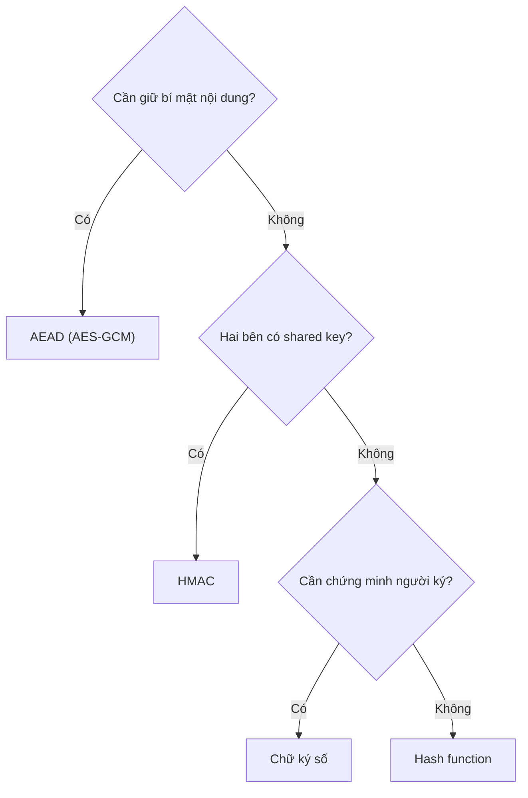
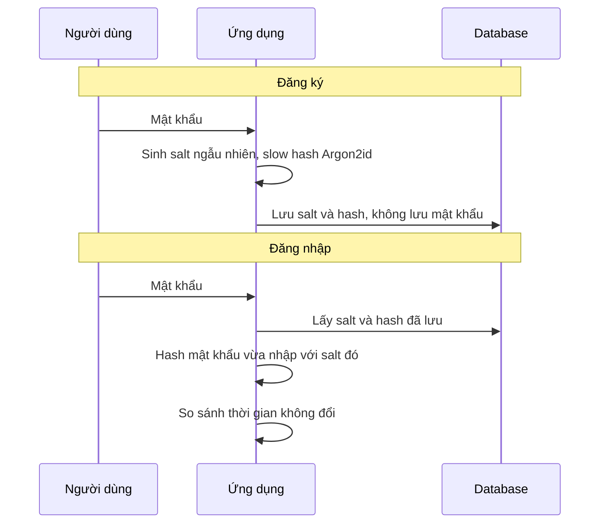
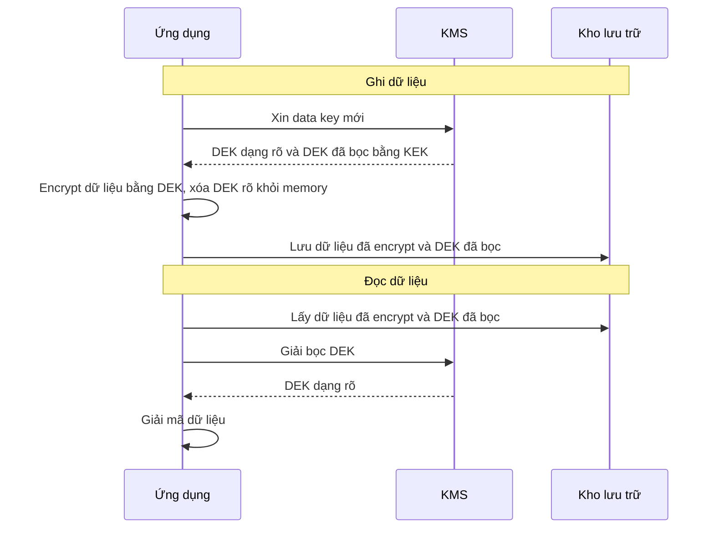
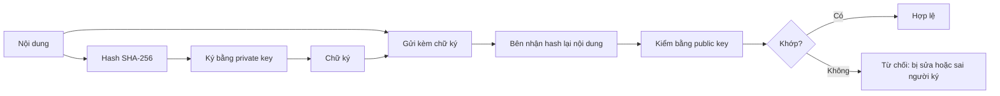

# Mật mã học ứng dụng và bảo mật hệ thống

Bảo mật hệ thống có hai nửa. Nửa thứ nhất là **mật mã học ứng dụng**: những công cụ toán học dựng sẵn (hash function, encryption, chữ ký số) để giữ bí mật, phát hiện sửa đổi và chứng minh nguồn gốc dữ liệu. Nửa thứ hai là **bảo vệ cả hệ thống**: giữ bí mật (secret) như mật khẩu DB và API key an toàn, tin được vào thư viện bên thứ ba, và nghĩ trước xem ai có thể tấn công vào đâu (threat model). Bài này nối hai nửa đó lại.

**Tóm tắt:**

- Chọn công cụ theo mục đích: hash để nhận dạng và kiểm tra toàn vẹn, encryption để giữ bí mật, HMAC để chống sửa khi hai bên có shared key, chữ ký số để chứng minh nguồn gốc.
- Hash không phải encryption vì không đảo ngược được; mật khẩu dùng slow hash có salt (Argon2id, bcrypt), không dùng MD5 hay SHA-256 đơn thuần.
- Encrypt dữ liệu bằng AEAD (AES-GCM, ChaCha20-Poly1305) với IV ngẫu nhiên mới mỗi lần; lặp IV với cùng key là thảm họa và ECB thì không được dùng.
- Envelope encryption dùng hai tầng key: DEK encrypt dữ liệu, KEK trong KMS/HSM bọc DEK, nên rotate KEK không cần encrypt lại toàn bộ dữ liệu.
- Sự cố thật hiếm khi do thuật toán bị phá mà do bí mật bị lộ, lỗi cấu hình và dependency cũ; encrypt mà key nằm cạnh dữ liệu thì chỉ là trang trí.
- Chuỗi cung ứng cần pin version, quét dependency, kho nội bộ ưu tiên và quyền tối thiểu cho pipeline.
- Threat modeling với STRIDE nên làm trước khi viết code; Zero Trust và phòng thủ nhiều lớp vì kẻ tấn công thường đã ở sẵn trong mạng.

## Vấn đề nó giải quyết

Dùng sai mật mã còn tệ hơn không dùng, vì nó tạo cảm giác an toàn giả. Ví dụ điển hình: lưu mật khẩu bằng MD5 (kẻ tấn công dò ngược hàng tỷ giá trị mỗi giây), hoặc encrypt dữ liệu nhưng để key ngay cạnh dữ liệu (lấy được dữ liệu là lấy luôn key). Trong thực tế, sự cố lớn hiếm khi do thuật toán bị phá; chúng thường đến từ secret bị commit lên git, hoặc một thư viện dependency bị cài mã độc.

## Khi nào dùng và nguyên tắc chọn

Dùng khi bạn lưu dữ liệu nhạy cảm, ký và kiểm tra toàn vẹn, thiết kế kiến trúc, hoặc quản lý key. Nguyên tắc lớn nhất: việc nào đã có thư viện hoặc dịch vụ chuẩn làm sẵn thì dùng, **đừng tự viết** thuật toán hay giao thức. Chọn đúng công cụ cho đúng việc: hash cho mật khẩu (loại chậm) và kiểm tra toàn vẹn, encryption cho bảo mật nội dung, chữ ký cho authentication nguồn. Quản lý key bằng một dịch vụ riêng (KMS, vault), không để trong code.

## Các khái niệm cần biết

| Từ khóa | Là gì | Vì sao quan trọng |
|---|---|---|
| **Hash function** | Hàm biến dữ liệu bất kỳ thành một chuỗi độ dài cố định, một chiều, đổi 1 bit đầu vào thì kết quả đổi hoàn toàn | Nhận dạng và kiểm tra toàn vẹn; không phải encryption vì không "giải" ngược được |
| **Salt** | Chuỗi ngẫu nhiên riêng cho mỗi mật khẩu, trộn vào trước khi hash | Hai người cùng mật khẩu vẫn ra hash khác nhau, và bảng dò dựng sẵn (rainbow table) vô dụng |
| **Slow hash** (Argon2id, bcrypt, scrypt) | Hash function cố ý tốn thời gian/memory, có tham số điều chỉnh độ khó | Kẻ tấn công thử mỗi mật khẩu rất tốn kém; SHA-256 nhanh nên không hợp cho mật khẩu |
| **Symmetric encryption** | Một shared key dùng để encrypt và decrypt | Nhanh, dùng cho dữ liệu lớn; khó ở chỗ chia sẻ key an toàn |
| **Asymmetric encryption** | Key pair gồm public key và private key; key này encrypt thì chỉ key kia giải được | Giải bài toán chia sẻ key và là nền tảng của chữ ký số |
| **IV / nonce** | Số dùng một lần đi kèm mỗi lần encrypt | Cho phép cùng key encrypt nhiều thông điệp an toàn; **lặp lại với GCM là thảm họa** |
| **AEAD** | Encryption có authentication: vừa giữ bí mật vừa phát hiện sửa đổi (AES-GCM, ChaCha20-Poly1305) | Chế độ mặc định nên chọn; chế độ không authentication cho phép kẻ tấn công sửa bản mã mà không bị phát hiện |
| **AAD** | Dữ liệu kèm theo, được authenticate nhưng không encrypt | Gắn bản mã với ngữ cảnh (id người dùng), chống tráo record |
| **ECB** | Mode encrypt từng block độc lập | Khối giống nhau cho bản mã giống nhau nên lộ mẫu dữ liệu; không dùng |
| **MAC / HMAC** | Authentication tag tính từ nội dung và một shared key | Chứng minh nội dung không bị sửa bởi người ngoài shared key |
| **Chữ ký số** | Ký bằng private key, kiểm bằng public key | Ai cũng kiểm được nhưng chỉ chủ signing key được; chống chối bỏ (non-repudiation) |
| **Timing attack** | Đoán bí mật qua việc so sánh dừng sớm nhanh hơn so sánh đến cuối | Là lý do dùng `MessageDigest.isEqual` |
| **KMS / HSM** | Dịch vụ / thiết bị phần cứng giữ key, chỉ cho phép dùng key chứ không cho xuất ra | Root key không bao giờ nằm trong memory ứng dụng |
| **DEK / KEK** | Data key (encrypt dữ liệu) / master key (bọc DEK) | Nền tảng của envelope encryption, giúp rotate key rẻ |
| **SBOM** | Danh mục thành phần phần mềm (mọi thư viện và phiên bản) | Khi có CVE mới, tra ngay mình có bị ảnh hưởng không |

## Chọn công cụ đúng

| Mục tiêu | Công cụ | Ví dụ |
|---|---|---|
| Kiểm tra toàn vẹn dữ liệu | **Hash function** | SHA-256 |
| Lưu mật khẩu | **Slow hash có salt** | Argon2id, bcrypt |
| Giữ bí mật dữ liệu | **Symmetric encryption** | AES-GCM, ChaCha20-Poly1305 |
| Trao đổi key qua kênh công khai | Asymmetric encryption/ECDH | X25519, ECDHE |
| Chứng minh nguồn gốc, không chối bỏ | **Chữ ký số** | Ed25519, ECDSA, RSA-PSS |
| Chống giả mạo thông điệp với shared key | **MAC** | HMAC-SHA256 |

**Phải thuộc:** Hash (một chiều, không key) để nhận dạng và kiểm tra toàn vẹn; encryption (hai chiều, có key) để giữ bí mật; HMAC (hash có shared key) để chống sửa; chữ ký số (private key ký, public key kiểm) để chứng minh nguồn gốc và chống chối bỏ. Hash không phải encryption. Mật khẩu dùng slow hash có salt, không dùng SHA-256 trần.

**Nền tảng:** Symmetric encryption nhanh nhưng khó chia sẻ key; asymmetric giải bài toán chia sẻ key nhưng chậm. Vì vậy thực tế luôn kết hợp: dùng asymmetric để thỏa thuận hoặc bọc key, dùng symmetric (AEAD) để encrypt dữ liệu thật. Đây cũng là cách TLS và envelope encryption hoạt động.



HMAC phát hiện nội dung bị sửa khi hai bên cùng giữ bí mật chung; chữ ký số cho phép ai cũng kiểm tra được; hash function đơn giản chỉ để nhận dạng nội dung.

Riêng mật khẩu có quy trình riêng vì ta không bao giờ cần lấy lại mật khẩu gốc, chỉ cần kiểm tra người dùng nhập có khớp không:



Đọc sơ đồ: ứng dụng không lưu mật khẩu mà chỉ lưu kết quả hash kèm salt. Nếu database bị lộ, kẻ tấn công vẫn phải dò từng mật khẩu một với chi phí cao nhờ slow hash và salt riêng. Thư viện chuẩn (ví dụ `BCryptPasswordEncoder` của Spring Security) tự lo việc sinh salt và đóng gói chung vào chuỗi kết quả.

## Nguyên tắc vàng

1. **Không tự phát minh thuật toán hay giao thức**; dùng thư viện chuẩn (JCA, Bouncy Castle, libsodium, Tink).
2. Dùng chế độ **AEAD** (GCM): vừa encrypt vừa authenticate. Không dùng ECB; không tái sử dụng nonce/IV với cùng key.
3. Số ngẫu nhiên bảo mật: `SecureRandom`, **không** dùng `Random`.
4. So sánh bí mật bằng hàm **thời gian không đổi** (`MessageDigest.isEqual`).
5. Hash không phải encryption: không đảo ngược được; fast hash không phù hợp mật khẩu.

## Ví dụ Java cho từng công cụ

Tất cả đoạn dưới đây đã chạy trên JDK 11 và dùng thư viện JDK (JCA).

### Hash, HMAC

```java
MessageDigest md = MessageDigest.getInstance("SHA-256");
byte[] digest = md.digest("hello".getBytes(StandardCharsets.UTF_8));
// hex: 2cf24dba5fb0a30e26e83b2ac5b9e29e1b161e5c1fa7425e73043362938b9824

Mac mac = Mac.getInstance("HmacSHA256");
mac.init(new SecretKeySpec(secretBytes, "HmacSHA256"));
// 32 byte
byte[] tag = mac.doFinal("amount=100&to=42".getBytes(StandardCharsets.UTF_8));
```

Khác biệt: SHA-256 không có key nên ai cũng tính lại được (chỉ để nhận dạng nội dung); HMAC cần key nên chỉ bên có key mới tạo hoặc kiểm tra được tag. Dùng HMAC để ký webhook, cookie, token. Khi kiểm tra, so sánh bằng `MessageDigest.isEqual(tagA, tagB)`, không dùng `Arrays.equals` hay `String.equals` (rò rỉ thời gian).

### Encrypt bằng AES-GCM đúng cách

```java
static byte[] encrypt(SecretKey key, byte[] plain, byte[] aad) throws Exception {
    byte[] iv = new byte[12];
    // IV mới cho mỗi lần encrypt
    new SecureRandom().nextBytes(iv);
    Cipher c = Cipher.getInstance("AES/GCM/NoPadding");
    c.init(Cipher.ENCRYPT_MODE, key, new GCMParameterSpec(128, iv));
    // dữ liệu kèm theo: được authenticate nhưng không encrypt
    c.updateAAD(aad);
    // bản mã + authentication tag 16 byte
    byte[] ct = c.doFinal(plain);
    // lưu IV cùng bản mã
    return ByteBuffer.allocate(iv.length + ct.length).put(iv).put(ct).array();
}
static byte[] decrypt(SecretKey key, byte[] blob, byte[] aad) throws Exception {
    Cipher c = Cipher.getInstance("AES/GCM/NoPadding");
    c.init(Cipher.DECRYPT_MODE, key, new GCMParameterSpec(128, blob, 0, 12));
    c.updateAAD(aad);
    // sai thẻ thì ném AEADBadTagException
    return c.doFinal(blob, 12, blob.length - 12);
}
```

Kết quả khi chạy (key AES-256, `aad = "user:42"`, bản rõ 17 byte):

| Thử nghiệm | Kết quả |
|---|---|
| Encrypt rồi decrypt với đúng key và `aad` | Lấy lại đúng bản rõ; độ dài blob 45 = 12 (IV) + 17 + 16 (tag) |
| Encrypt hai lần cùng bản rõ, cùng key | Hai blob **khác nhau** (IV ngẫu nhiên khác nhau) |
| Đảo một bit trong blob rồi giải mã | Ném `AEADBadTagException`: phát hiện sửa đổi |

**Phải thuộc:** Encrypt dữ liệu dùng AEAD (AES-GCM hoặc ChaCha20-Poly1305), IV 12 byte ngẫu nhiên mới cho mỗi lần encrypt (lặp IV với cùng key là thảm họa), không dùng ECB, số ngẫu nhiên bảo mật phải là `SecureRandom`.

`aad` gắn bản mã với ngữ cảnh (ví dụ id người dùng): chuyển blob của người này sang record của người khác thì giải mã thất bại. Rủi ro lớn nhất của GCM là **dùng lại IV với cùng key**, làm lộ quan hệ giữa các bản rõ và cho phép giả mạo; IV ngẫu nhiên 96 bit an toàn với số lượng thông điệp vừa phải mỗi key, còn khối lượng lớn thì rotate key hoặc dùng bộ đếm.

### Envelope encryption thu nhỏ

Vấn đề đặt ra: nếu encrypt mọi dữ liệu bằng một key duy nhất thì khi cần rotate key phải encrypt lại toàn bộ, và key đó lộ là mất hết. Cách giải quyết là dùng hai tầng key: mỗi record (hoặc file) có data key DEK riêng; DEK lại được "bọc" (encrypt) bằng master key KEK nằm trong KMS. Dùng khi dữ liệu lớn hoặc nhiều, cần rotate key định kỳ hoặc tuân thủ quy định. Với một vài giá trị nhỏ thì gọi thẳng KMS encrypt là đủ.



Đoạn Java dưới là phiên bản thu nhỏ của flow này:

```java
// data key, mỗi record hoặc mỗi file một key
SecretKey dek = kg.generateKey();
// encrypt dữ liệu bằng DEK
byte[] data = encrypt(dek, plain, aad);
// KEK bọc DEK
byte[] wrappedDek = encrypt(kek, dek.getEncoded(), "dek".getBytes(StandardCharsets.UTF_8));
// Lưu: data + wrappedDek. KEK nằm trong KMS/HSM, ứng dụng nhờ KMS giải bọc DEK khi cần.
```

**Nền tảng:** Envelope encryption dùng hai tầng key: DEK encrypt dữ liệu, KEK (nằm trong KMS/HSM) bọc DEK. Nhờ đó rotate KEK chỉ cần bọc lại các DEK nhỏ, không phải encrypt lại toàn bộ dữ liệu.

Đã chạy: giải bọc `wrappedDek` bằng KEK cho lại đúng DEK. Lợi ích: rotate KEK chỉ cần bọc lại các DEK nhỏ, không phải encrypt lại toàn bộ dữ liệu; một DEK lộ chỉ ảnh hưởng một phần dữ liệu. Trong sản phẩm KEK không bao giờ ở trong memory ứng dụng, mọi thao tác bọc/giải bọc là một lời gọi sang KMS.

**Suy luận:** Một key càng dùng nhiều thì càng có nhiều bản mã để kẻ tấn công phân tích, càng có nhiều nơi để key bị lộ, và rotate nó càng đắt vì phải encrypt lại mọi thứ nó từng bảo vệ. Vì vậy đừng dùng một key duy nhất cho tất cả dữ liệu. Nhưng nếu mỗi record có một key riêng thì bạn lại phải lưu và bảo vệ hàng triệu key, và vấn đề chỉ dời chỗ. Envelope encryption giải bằng cách tách hai vai: DEK nhiều, rẻ, sống ngắn, nằm cạnh dữ liệu dưới dạng đã bọc; KEK ít, quý, nằm trong KMS/HSM và không bao giờ rời đó. Từ thiết kế này suy ra các hệ quả. Rotate KEK chỉ cần bọc lại các DEK nhỏ thay vì encrypt lại terabyte dữ liệu; một DEK lộ chỉ ảnh hưởng một record; và quyền đọc dữ liệu có thể thu hồi bằng cách thu hồi quyền dùng KEK trong KMS, kể cả khi ai đó đã chép được toàn bộ kho lưu trữ. Điểm dễ nhầm là nghĩ bọc DEK bằng KEK "thêm một lớp encrypt cho chắc": giá trị thật nằm ở chỗ KEK ở một nơi khác, có kiểm soát truy cập và audit riêng, còn nếu KEK nằm cùng chỗ với DEK (ví dụ trong cùng file cấu hình) thì bạn chỉ vừa tạo thêm phức tạp mà không thêm an toàn. Khi review, hãy kiểm tra KEK không nằm trong code hay memory ứng dụng lâu dài, mọi lần giải bọc đều đi qua KMS và có log, và có quy trình rotate được diễn tập thật.

### Chữ ký số

Chữ ký số trả lời câu hỏi "ai tạo ra nội dung này và có bị sửa không". Người ký hash nội dung rồi ký bằng private key; bất kỳ ai có public key đều kiểm được. Dùng cho hợp đồng pháp lý, bản phát hành phần mềm, token JWT dạng asymmetric, webhook cần chống chối bỏ.



```java
Signature s = Signature.getInstance("SHA256withECDSA");
s.initSign(privateKey); s.update(message);
byte[] sig = s.sign();

Signature v = Signature.getInstance("SHA256withECDSA");
v.initVerify(publicKey); v.update(message);
// true với đúng thông điệp
boolean ok = v.verify(sig);
```

Đã chạy: chữ ký trên `"hop dong v1"` kiểm tra `true` với đúng nội dung và `false` khi nội dung đổi thành `"hop dong v2"`. Khác HMAC: người **kiểm tra** chỉ cần public key nên không thể tự tạo chữ ký, vì vậy chữ ký chứng minh nguồn gốc cho nhiều bên (và chống chối bỏ), HMAC thì không (ai có shared key cũng ký được). (JDK 15 trở lên có thêm `Ed25519`, JDK 11 chưa có.)

### Những lỗi mật mã hay gặp

| Mã sai | Vì sao sai | Cách đúng |
|---|---|---|
| `MessageDigest.getInstance("MD5")` cho mật khẩu | Fast hash, dò hàng tỷ lần mỗi giây | Argon2id hoặc bcrypt |
| `Cipher.getInstance("AES")` (không nêu chế độ) | Thường mặc định thành ECB: các khối giống nhau cho bản mã giống nhau | `AES/GCM/NoPadding` |
| IV là hằng số hoặc `new byte[12]` mãi | Lặp IV, phá GCM | IV ngẫu nhiên mới mỗi lần |
| `new Random().nextBytes(key)` | Có thể đoán trước | `SecureRandom` hoặc `KeyGenerator` |
| `tag.equals(expected)` | Rò rỉ thời gian | `MessageDigest.isEqual` |
| Hard-code key trong mã nguồn | Lộ qua git, bản dịch | Kho bí mật, biến môi trường do hệ thống cấp |

## Quản lý key và bí mật

Bí mật là thứ duy nhất ngăn kẻ lạ vào hệ thống, nên cách bạn lưu và luân chuyển nó quan trọng hơn thuật toán nào được dùng. Lifecycle một bí mật (API key, mật khẩu DB, signing key): lưu trong kho bí mật (Vault, AWS Secrets Manager, KMS), cấp cho ứng dụng lúc chạy với quyền tối thiểu, xoay vòng định kỳ, kiểm toán ai truy cập khi nào.

- **Không** để bí mật trong mã nguồn, file cấu hình commit lên git, hay log. Đã lỡ commit: coi như **đã lộ**, thu hồi và tạo mới.
- **Envelope encryption:** dữ liệu đã encrypt bằng data key (DEK); DEK được encrypt bằng master key (KEK) giữ trong KMS/HSM. Rotate KEK không cần encrypt lại toàn bộ dữ liệu.
- Phân tách môi trường: key dev khác prod.
- Quét bí mật tự động trong CI (gitleaks, trufflehog).

## Encrypt dữ liệu

Dữ liệu có thể bị lấy ở ba state, mỗi state cần biện pháp riêng. Encryption khi lưu bảo vệ trước việc mất đĩa hoặc bản backup, nhưng **không** bảo vệ nếu kẻ tấn công vào được ứng dụng đang chạy (lúc đó DB tự giải mã cho ứng dụng), nên với dữ liệu rất nhạy cảm cần thêm column encryption ở tầng ứng dụng. (TDE, Transparent Data Encryption, là tính năng DB tự encrypt file dữ liệu trên đĩa.)

| State | Biện pháp |
|---|---|
| **Khi truyền** | TLS (xem [HTTPS và TLS](/go?p=03-Network-Security%2Fmedium%2Flt-03-https-tls.md)) |
| **Khi lưu** | Disk encryption/DB (TDE), column encryption nhạy cảm ở tầng ứng dụng |
| **Khi dùng** | Giảm thời gian giữ trong memory, che dữ liệu trong log và giao diện |

Với dữ liệu cá nhân: giảm thiểu dữ liệu thu thập, che/token hóa số thẻ, tuân thủ quy định (GDPR, PCI DSS), có chính sách lưu giữ và xóa.

## Bảo mật chuỗi cung ứng phần mềm

Phần mềm hiện đại phần lớn là thư viện của người khác, nên kẻ tấn công nhắm vào chuỗi cung ứng thay vì code của bạn. **Typosquatting** là đăng gói độc hại với tên gần giống gói thật (ví dụ thiếu một chữ cái). **Dependency confusion** là đăng lên kho công khai một gói trùng tên với gói nội bộ của bạn nhưng phiên bản cao hơn, để công cụ build kéo nhầm.

| Rủi ro | Biện pháp |
|---|---|
| Thư viện có lỗ hổng đã biết | Quét dependency, cập nhật đều, SBOM |
| Gói độc hại (typosquatting, dependency confusion) | Pin version, kho nội bộ ưu tiên, kiểm tra nguồn |
| Pipeline CI/CD bị chiếm | Quyền tối thiểu cho runner, bí mật không in log, phê duyệt thay đổi pipeline |
| Image/container không tin cậy | Ảnh nền nhỏ, quét lỗ hổng, ký image, không chạy bằng root |

## Mô hình đe dọa (Threat Modeling)

Threat modeling là việc ngồi lại **trước khi** viết code (hoặc trước khi mở rộng tính năng) để tìm các điểm yếu từ thiết kế, khi sửa còn rẻ. Dùng cho mỗi tính năng có dữ liệu nhạy cảm hoặc ranh giới tin cậy mới (ví dụ bắt đầu nhận webhook từ bên ngoài). Trả lời bốn câu: *Đang xây gì? Có thể sai ở đâu? Làm gì với chúng? Đã làm đủ tốt chưa?* STRIDE là danh sách kiểm: **S**poofing (giả mạo), **T**ampering (sửa đổi), **R**epudiation (chối bỏ), **I**nformation disclosure (lộ thông tin), **D**enial of service (từ chối dịch vụ), **E**levation of privilege (nâng đặc quyền). **Phải thuộc:** STRIDE gồm sáu loại đe dọa: Spoofing (giả mạo), Tampering (sửa đổi), Repudiation (chối bỏ), Information disclosure (lộ thông tin), Denial of service (từ chối dịch vụ), Elevation of privilege (nâng đặc quyền).

Vẽ sơ đồ data flow, đánh dấu **ranh giới tin cậy** (chỗ dữ liệu đi từ vùng ít tin cậy sang vùng tin cậy hơn, ví dụ từ Internet vào API), và xét từng flow qua sáu chữ cái trên. Ví dụ: flow "client gửi token" dễ dính Spoofing (giả token) và Information disclosure (token lộ qua log).

## Zero Trust và phòng thủ nhiều lớp

**Zero Trust** nghĩa là không coi vị trí trong mạng là bằng chứng của sự tin cậy. **Phòng thủ nhiều lớp** (defense in depth) nghĩa là một lớp bị vượt qua thì còn lớp khác chặn. Lý do: kẻ tấn công thường đã ở sẵn trong mạng (qua một máy bị nhiễm, một credential bị lộ), nên "firewall ngoài" không đủ. Cụ thể:

- Không tin mặc định vì "ở trong mạng nội bộ": authentication và authorization mọi call (mTLS, token dịch vụ).
- Phân đoạn mạng, đặc quyền tối thiểu, ghi log và cảnh báo bất thường.
- Chuẩn bị cho vi phạm: kế hoạch ứng phó sự cố, khả năng thu hồi key nhanh, backup bất biến.

## Điều cần nhớ

- Hầu hết sự cố bảo mật là lỗi cấu hình, bí mật bị lộ, và dependency cũ, không phải thuật toán bị phá.
- Luôn hỏi: "bí mật này lưu ở đâu, ai đọc được, xoay thế nào, lộ thì sao?"
- Encryption mà key nằm cạnh dữ liệu thì chỉ là trang trí.

