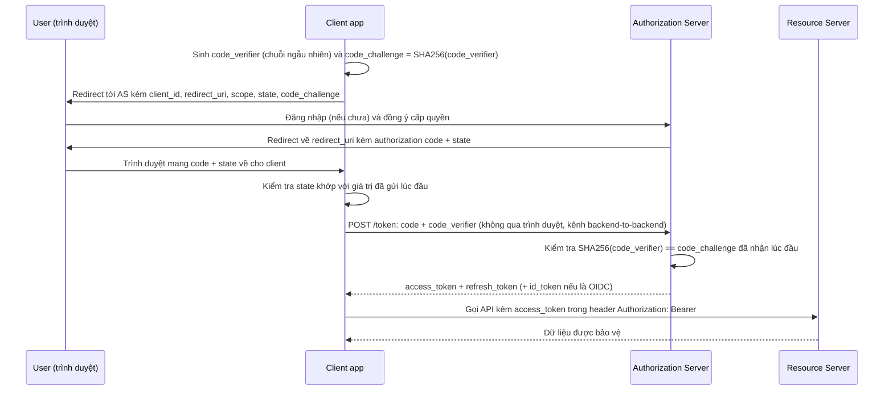
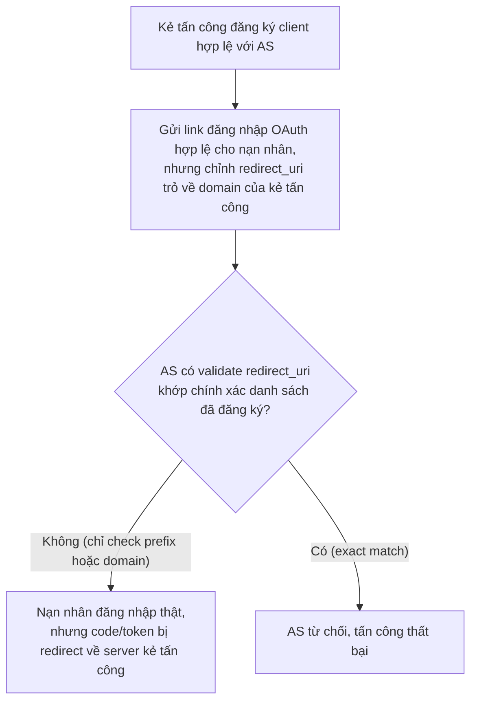

# OAuth2 và OIDC ở mức giao thức

Bài [Authentication, Session và Token](/go?p=03-Network-Security%2Fmedium%2Flt-05-xac-thuc-phien-token.md) đã nhắc OAuth2/OIDC "trong một câu"; bài [Spring Boot: OAuth2 và OpenID Connect](/go?p=01-Spring-Boot%2Fmedium%2Flt-20-oauth2-oidc.md) nói cách dùng trong framework. Bài này ở giữa hai bài đó: hiểu đúng **giao thức HTTP thuần** phía sau — thứ tự request/response thật sự, vì sao mỗi bước tồn tại, và những lỗ hổng kinh điển — để khi gặp một hệ thống không dùng Spring (hoặc một bug OAuth lạ), bạn vẫn đọc được luồng và biết chỗ nào đáng nghi.

**Tóm tắt:**

- OAuth2 giải quyết bài toán **ủy quyền** (authorization): cho phép ứng dụng A truy cập tài nguyên của người dùng trên dịch vụ B, mà không cần người dùng đưa mật khẩu của B cho A.
- OIDC (OpenID Connect) xây trên OAuth2 để giải quyết **xác thực** (authentication): thêm `id_token` (JWT) khẳng định "người dùng này là ai", việc OAuth2 gốc không định nghĩa.
- Authorization Code là flow chuẩn hiện nay cho mọi ứng dụng có backend hoặc không có backend an toàn (SPA, mobile); Implicit flow đã bị khai tử vì trả access token thẳng qua URL, dễ bị đánh cắp.
- PKCE (Proof Key for Code Exchange) bắt buộc với client không giữ được bí mật (SPA, mobile app) để chống việc một ứng dụng độc hại đánh cắp authorization code giữa chừng.
- access_token dùng để gọi API (đại diện "được phép làm gì"); refresh_token dùng để xin access_token mới mà không bắt người dùng đăng nhập lại; id_token (chỉ có ở OIDC) là JWT khẳng định danh tính, không dùng để gọi API.
- JWT gồm ba phần `header.payload.signature`; validate đúng cách nghĩa là kiểm tra cả chữ ký (đúng khóa, đúng thuật toán) lẫn các claim `exp` (hết hạn chưa), `aud` (đúng đối tượng nhận chưa), `iss` (đúng nơi phát hành chưa) — thiếu bất kỳ bước nào đều là lỗ hổng.
- Lỗ hổng kinh điển: open redirect (redirect_uri không được validate chặt, kẻ tấn công đổi hướng code/token về server của mình), token leakage qua `Referer` header (token nhét trong URL bị lộ khi trang gọi tài nguyên bên thứ ba), và CSRF trên callback (thiếu tham số `state` khiến kẻ tấn công gắn tài khoản của mình vào session nạn nhân).
- `state` chống CSRF trên callback, `nonce` (ở OIDC) chống replay attack trên id_token; hai tham số này dễ bị bỏ quên vì flow vẫn "chạy được" khi thiếu chúng, chỉ không an toàn.

## Vấn đề nó giải quyết

Trước OAuth2, cách duy nhất để ứng dụng A dùng dữ liệu của bạn trên dịch vụ B là bạn đưa **mật khẩu của B** cho A (gọi là "password anti-pattern"). A có toàn quyền như bạn trên B mãi mãi, bạn không thu hồi được quyền riêng của A mà không đổi mật khẩu. OAuth2 tách việc đó ra: bạn đăng nhập **trực tiếp trên B** (A không bao giờ thấy mật khẩu), B cấp cho A một token có phạm vi và thời hạn giới hạn (scope, expiry), và bạn thu hồi được token đó bất cứ lúc nào mà không ảnh hưởng mật khẩu hay các ứng dụng khác.

## Ba vai trò và một thắc mắc thường gặp

| Vai trò | Là ai | Ví dụ |
|---|---|---|
| **Resource Owner** | Người dùng, chủ sở hữu dữ liệu | Bạn |
| **Client** | Ứng dụng muốn truy cập dữ liệu | Ứng dụng "Đăng nhập bằng Google" |
| **Authorization Server** | Nơi xác thực người dùng và cấp token | accounts.google.com |
| **Resource Server** | Nơi chứa dữ liệu, kiểm tra token khi nhận request | Google Calendar API |

Thắc mắc thường gặp: "Authorization Server và Resource Server có phải luôn là một?" — Không bắt buộc. Với Google, cả hai đều là Google nhưng là hai service nội bộ khác nhau; trong một công ty, Authorization Server có thể là Keycloak còn Resource Server là API nội bộ của chính công ty, chỉ cần Resource Server tin tưởng token do Authorization Server đó phát hành.

## Authorization Code + PKCE: luồng chi tiết



Đọc kỹ thứ tự: **authorization code chỉ đi qua trình duyệt** (URL redirect), còn **token thật sự (access_token, refresh_token) chỉ đi qua kênh backend-to-backend** (`POST /token`), không bao giờ lộ ra URL hay lịch sử trình duyệt. Đây là lý do code dùng một lần rồi hết hạn rất nhanh (thường vài chục giây đến vài phút): nó chỉ là một "phiếu đổi token", không phải token thật.

**Phải thuộc:** `code_verifier` do client tự sinh và giữ bí mật (không gửi ở bước redirect đầu); `code_challenge = SHA256(code_verifier)` được gửi công khai qua URL ở bước đầu. Ở bước đổi code lấy token, client phải gửi lại `code_verifier` gốc; Authorization Server tự hash lại và so với `code_challenge` đã nhận trước đó. Nếu một ứng dụng độc hại đánh cắp được authorization code (qua redirect_uri bị lừa, hoặc log), nó vẫn không đổi được code thành token vì không biết `code_verifier` gốc.

## Vì sao Implicit flow bị khai tử

Implicit flow (cũ, trước khi PKCE phổ biến) được thiết kế cho SPA không có backend: thay vì đổi code lấy token qua một request backend riêng, Authorization Server trả **thẳng access_token qua URL fragment** (`#access_token=...`) ngay ở bước redirect.

| | Authorization Code + PKCE | Implicit (đã khai tử) |
|---|---|---|
| Token lộ ra URL? | Không (chỉ code lộ, code vô dụng nếu thiếu code_verifier) | Có — access_token nằm thẳng trong URL |
| Token bị lưu vào lịch sử trình duyệt, log proxy, `Referer` header? | Không | Có nguy cơ cao |
| Refresh token | Có thể cấp an toàn | Không cấp được an toàn (không có kênh backend để giữ bí mật) |
| Khuyến nghị hiện tại (OAuth 2.1) | Dùng cho mọi loại client | Loại bỏ hoàn toàn |

**Suy luận:** Token nằm trong URL fragment (`#...`) tưởng là an toàn vì fragment không được gửi lên server khi điều hướng (chỉ xử lý phía client), nhưng nó vẫn bị lưu trong lịch sử trình duyệt, có thể bị đọc bởi extension trình duyệt độc hại, và một số thiết lập proxy/log vẫn vô tình ghi lại toàn bộ URL kể cả fragment. Authorization Code tách token ra khỏi URL hoàn toàn: thứ duy nhất đi qua URL là một code dùng-một-lần, vô dụng nếu không có `code_verifier` tương ứng (PKCE) hoặc client secret (confidential client).

## access_token, refresh_token, id_token: khác nhau ở đâu

| Token | Ai cấp | Dùng để làm gì | Thời hạn thường gặp |
|---|---|---|---|
| **access_token** | Authorization Server | Gọi Resource Server để lấy dữ liệu; Resource Server chỉ cần xác thực token này, không cần biết người dùng đăng nhập thế nào | Ngắn (vài phút đến vài giờ) |
| **refresh_token** | Authorization Server | Đổi lấy access_token mới khi access_token hết hạn, không bắt người dùng đăng nhập lại | Dài (vài ngày đến vài tháng), có thể thu hồi |
| **id_token** (chỉ OIDC) | Authorization Server | Khẳng định danh tính người dùng cho **client** (không gửi cho Resource Server); là JWT chứa claim `sub` (user id), `name`, `email`... | Ngắn, dùng một lần ngay khi đăng nhập |

**Phải thuộc:** `access_token` trả lời "client này được phép làm gì trên Resource Server"; `id_token` trả lời "ai vừa đăng nhập, cho client biết". Lỗi thường gặp của người mới: dùng `id_token` để gọi API thay vì `access_token` — sai mục đích thiết kế, vì `id_token` không có scope/quyền hạn, chỉ là tờ khai danh tính.

## JWT: cấu trúc và validate đúng cách

```text
eyJhbGciOiJSUzI1NiJ9.eyJzdWIiOiJ1c2VyLTQyIiwiYXVkIjoiYXBpLmV4YW1wbGUuY29tIiwiaXNzIjoiaHR0cHM6Ly9hdXRoLmV4YW1wbGUuY29tIiwiZXhwIjoxNzM1Njg5NjAwfQ.<chữ_ký>
```

| Phần | Nội dung (đã giải mã base64, chỉ là ví dụ minh họa) |
|---|---|
| Header | `{"alg": "RS256"}` — thuật toán ký |
| Payload | `{"sub": "user-42", "aud": "api.example.com", "iss": "https://auth.example.com", "exp": 1735689600}` |
| Signature | Chữ ký, tính từ header + payload bằng private key (RS256) hoặc shared secret (HS256) |

Các bước validate **bắt buộc** khi Resource Server nhận một JWT access_token (hoặc id_token):

1. **Kiểm tra chữ ký** bằng public key của Authorization Server (lấy qua endpoint JWKS công khai, không hard-code) — đảm bảo token không bị sửa và đúng là do Authorization Server này phát hành.
2. **Kiểm tra `exp`** (expiration) — token hết hạn chưa.
3. **Kiểm tra `aud`** (audience) — token này có được phát hành **cho chính Resource Server này** không, hay cho một API khác (nếu không kiểm tra, một token hợp lệ cấp cho API khác vẫn được chấp nhận ở đây — lỗ hổng "confused deputy").
4. **Kiểm tra `iss`** (issuer) — token đến từ đúng Authorization Server mà bạn tin tưởng, không phải một server giả mạo tự ký bằng key khác.

**Phải thuộc:** Thiếu bước kiểm tra `aud` là lỗ hổng rất dễ mắc và khó phát hiện khi test thủ công, vì token vẫn "hợp lệ" về chữ ký và hạn dùng — chỉ là nó được cấp cho một audience khác. Hậu quả: một token hợp lệ của Service X vô tình dùng gọi được Service Y nếu cả hai tin cùng một Authorization Server mà không kiểm tra `aud`.

```java
// Minh họa logic validate, không phải code chạy độc lập
Jws<Claims> jws = Jwts.parserBuilder()
    .setSigningKeyResolver(jwksKeyResolver)   // lấy public key theo "kid" trong header, từ JWKS endpoint
    .build()
    .parseClaimsJws(token);                    // tự kiểm tra chữ ký và exp, ném lỗi nếu sai/hết hạn

Claims claims = jws.getBody();
if (!"api.example.com".equals(claims.getAudience())) {
    throw new JwtException("Token không dành cho API này (sai aud)");
}
if (!"https://auth.example.com".equals(claims.getIssuer())) {
    throw new JwtException("Token không đến từ issuer tin cậy");
}
```

## Lỗ hổng kinh điển

### Open redirect qua `redirect_uri`



Nếu Authorization Server chỉ kiểm tra `redirect_uri` theo kiểu "cùng domain" hoặc "khớp tiền tố" thay vì khớp **chính xác tuyệt đối** với danh sách đã đăng ký trước, kẻ tấn công có thể đăng ký thêm một path con (`https://client.example.com/evil`) hoặc lợi dụng open redirect sẵn có trên chính domain client, khiến code/token hợp lệ của nạn nhân bị chuyển hướng về nơi kẻ tấn công kiểm soát. **Phòng:** Authorization Server luôn validate `redirect_uri` khớp chính xác (exact string match) với danh sách đã đăng ký, không chấp nhận wildcard hay prefix matching.

### Token leakage qua `Referer` header

Nếu token (hoặc authorization code) từng xuất hiện trong URL của trang, và trang đó có link hoặc tài nguyên (ảnh, script) trỏ tới domain thứ ba, trình duyệt mặc định gửi URL hiện tại trong header `Referer` của request tới domain thứ ba đó — vô tình làm lộ token cho bên không liên quan. **Phòng:** không đặt token nhạy cảm vào URL (đây cũng là lý do Implicit flow bị bỏ); nếu bắt buộc phải dùng redirect mang theo giá trị nhạy cảm, đặt `Referrer-Policy: no-referrer` trên trang đó.

### CSRF trên callback khi thiếu `state`

Không có `state`, kẻ tấn công có thể tự khởi tạo luồng OAuth bằng **tài khoản của chính hắn**, lấy được authorization code hợp lệ của hắn, rồi lừa nạn nhân mở link callback đó (ví dụ qua iframe hoặc link trong email). Trình duyệt nạn nhân (đang có session đăng nhập sẵn trên ứng dụng client) hoàn tất bước đổi code — kết quả là **tài khoản OAuth của kẻ tấn công bị gắn vào session của nạn nhân**. Hậu quả tùy ứng dụng: ví dụ nếu ứng dụng dùng OAuth để "liên kết tài khoản ngân hàng", nạn nhân vô tình thao tác trên dữ liệu của kẻ tấn công mà tưởng là của mình.

**Phải thuộc:** `state` là một giá trị ngẫu nhiên client tự sinh trước khi redirect, lưu lại (session hoặc cookie), và bắt buộc phải khớp khi nhận callback. Nó không mã hóa gì, chỉ đảm bảo "callback này đúng là kết quả của luồng mà **chính trình duyệt này** vừa khởi tạo", chặn được việc gắn nhầm kết quả OAuth của người khác vào session của mình. Ở OIDC, `nonce` làm việc tương tự nhưng gắn vào `id_token` để chống replay (dùng lại một id_token cũ đã phát hành trước đó).

## Điều cần nhớ

- OAuth2 giải quyết ủy quyền (client được làm gì trên resource của user); OIDC thêm `id_token` để giải quyết xác thực (client biết đang nói chuyện với ai).
- Authorization Code + PKCE là flow chuẩn cho mọi loại client hiện nay; Implicit flow bị khai tử vì để lộ token qua URL.
- access_token dùng để gọi API, refresh_token dùng để xin access_token mới, id_token chỉ dùng để client biết danh tính người dùng — không gọi API bằng id_token.
- Validate JWT đúng cách luôn gồm bốn bước: chữ ký, `exp`, `aud`, `iss`; thiếu `aud` là lỗ hổng confused-deputy dễ bị bỏ sót nhất.
- `redirect_uri` phải validate khớp chính xác tuyệt đối; `state` chống CSRF trên callback; `nonce` (OIDC) chống replay trên id_token — cả ba đều "không bắt buộc để flow chạy" nên rất dễ bị bỏ quên khi code vội.
