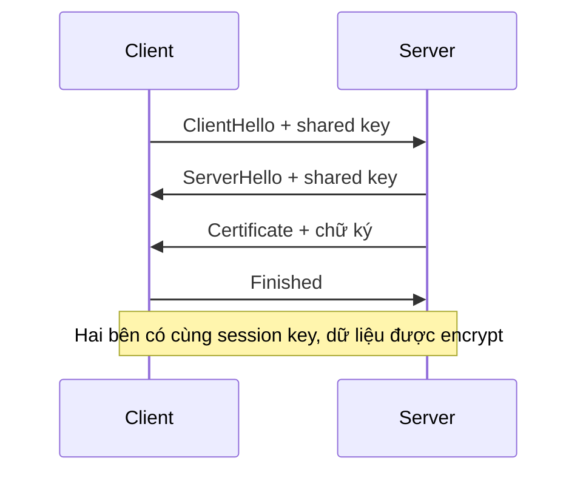
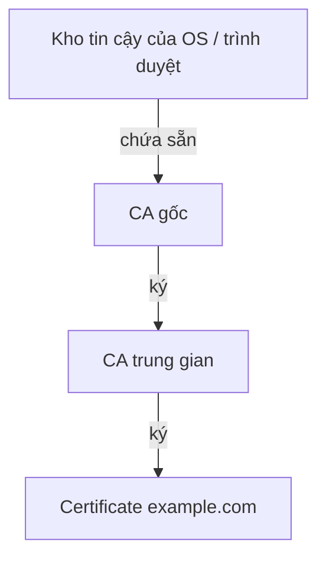
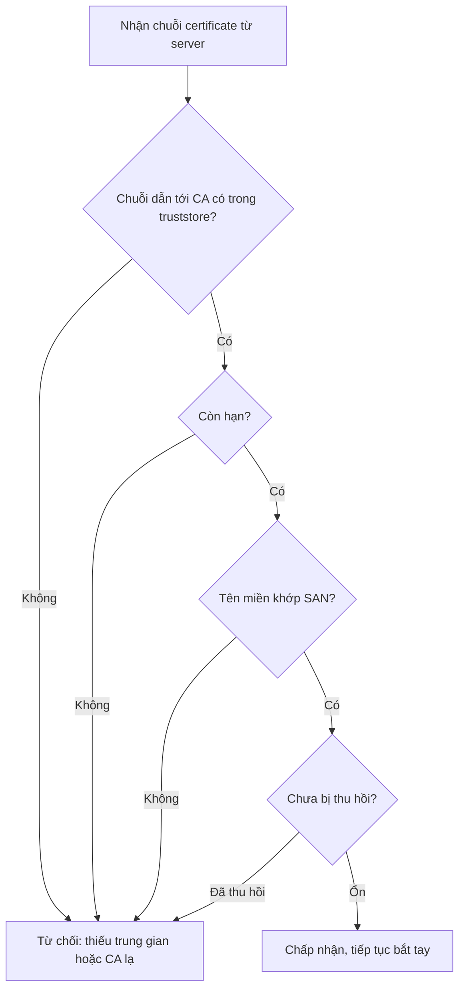

# HTTPS và TLS

Hãy tưởng tượng bạn gửi thư qua nhiều bưu điện mà ai cũng có thể mở phong bì ra đọc, sửa rồi dán lại, thậm chí đưa thư cho một người giả danh người nhận. HTTP thường giống như vậy. TLS (Transport Layer Security) là lớp "niêm phong và kiểm tra danh tính" đặt giữa client và server; **HTTPS chính là HTTP chạy trên TLS**.

**Tóm tắt:**

- TLS chặn ba việc kẻ ở giữa có thể làm với HTTP thường: đọc (bí mật), sửa (toàn vẹn) và giả mạo server (authentication).
- Asymmetric encryption chậm nên chỉ dùng để authentication và thỏa thuận key; dữ liệu thật được encrypt bằng symmetric key nhanh.
- Bắt tay TLS 1.3 chỉ tốn 1 RTT và luôn dùng ECDHE, nên luôn có forward secrecy: trộm private key của server về sau không giải mã được lưu lượng cũ.
- Private key của server chỉ dùng để ký (CertificateVerify), không dùng để encrypt dữ liệu.
- Client tin certificate khi chuỗi ký dẫn tới CA trong truststore, còn hạn, tên miền khớp SAN và chưa bị thu hồi.
- mTLS cho client cũng đưa certificate, thường dùng giữa các service.
- Lỗi vận hành hay gặp nhất là certificate hết hạn hoặc thiếu CA trung gian; theo dõi `notAfter` và đưa vào monitoring.

## Vấn đề TLS giải quyết

Với HTTP thường, bất kỳ ai ngồi giữa đường (wifi quán cà phê, router lạ, nhà mạng) đều có thể làm ba việc: đọc được mật khẩu và dữ liệu, sửa nội dung trên đường đi (chèn quảng cáo, mã độc), hoặc dựng một server giả mạo để bạn nhập mật khẩu vào đó. TLS chặn cả ba việc, tương ứng với ba bảo đảm ở phần tiếp theo: bí mật, toàn vẹn, authentication.

## Khi nào dùng

Dùng cho mọi dịch vụ, kể cả nội bộ theo tư duy "zero trust" (không tin mạng nội bộ). Trình duyệt hiện đại cảnh báo trang HTTP và nhiều API, kể cả tính năng trình duyệt (như Service Worker, geolocation), yêu cầu HTTPS. Gần như không có tình huống nào nên bỏ qua; chi phí hiệu năng của TLS 1.3 là nhỏ.

## Cách hoạt động trong một câu

Hai bên thực hiện một **bắt tay** (handshake): client kiểm tra certificate của server để biết đúng server, hai bên thỏa thuận ra cùng một secret key, rồi toàn bộ dữ liệu sau đó được symmetric encryption bằng key vừa thỏa thuận. Certificate được cấp qua CA (ví dụ Let's Encrypt) và phải nhớ gia hạn trước khi hết hạn, nếu không người dùng thấy cảnh báo đỏ.

**Nền tảng:** TLS dùng encryption **asymmetric** (public key, chậm) chỉ để authentication và thỏa thuận key, rồi chuyển sang encryption **symmetric** (nhanh) bằng session key vừa thỏa thuận để encrypt dữ liệu. HTTPS chính là HTTP chạy trên TLS.

## Các khái niệm cần biết

| Từ khóa | Là gì | Vì sao quan trọng |
|---|---|---|
| **Certificate** | File gắn một tên miền với một public key, có chữ ký của CA | Là bằng chứng "public key này thuộc về example.com" |
| **CA** (Certificate Authority) | Tổ chức được trình duyệt và hệ điều hành tin tưởng, chuyên ký certificate | Nếu không có CA, bất kỳ ai cũng tự nhận là bất kỳ tên miền nào |
| **Cipher suite** | Bộ thuật toán hai bên thống nhất dùng (key exchange, encryption, hash) | Bộ yếu thì cả kênh yếu; cần tắt các bộ cũ |
| **ECDHE** | Cách hai bên tự tính ra cùng một bí mật từ public key tạm của nhau, người nghe lén không tính được | Cho forward secrecy |
| **Forward secrecy** | Session key tạm bị hủy sau session, nên lộ private key của server sau này không giải mã được lưu lượng cũ | Chặn kịch bản "ghi lại lưu lượng hôm nay, trộm key năm sau" |
| **SNI** | Tên miền client muốn tới, gửi trong ClientHello | Một IP phục vụ nhiều tên miền vẫn chọn đúng certificate |
| **SAN** | Danh sách tên miền (và IP) mà certificate có hiệu lực | Client so tên đang gọi với SAN; lệch là lỗi "tên không khớp" |
| **HSTS** | Header `Strict-Transport-Security` bảo trình duyệt chỉ dùng HTTPS với site này | Chặn kẻ ở giữa ép hạ xuống HTTP |
| **mTLS** | TLS hai chiều, client cũng đưa certificate | Service authenticate lẫn nhau |
| **Truststore** | Danh sách CA mà một JVM hoặc hệ điều hành tin | Thiếu CA thì lỗi `PKIX path building failed` |

## Ba bảo đảm

TLS cho bạn đúng ba thứ sau; cần phân biệt rõ vì mỗi thứ chống một loại tấn công khác nhau.

| Bảo đảm | Ý nghĩa |
|---|---|
| Bí mật | Người ngoài không đọc được nội dung |
| Toàn vẹn | Nội dung không bị sửa mà không bị phát hiện |
| Authentication | Bạn đang nói chuyện với đúng server (và tùy chọn đúng client) |

**Phải thuộc:** TLS đem lại ba bảo đảm: bí mật (chống nghe lén), toàn vẹn (chống sửa), authentication (chống giả mạo server). TLS 1.3 bắt tay chỉ 1 RTT và bắt buộc trao đổi key tạm (ECDHE), nên luôn có forward secrecy.

## Bắt tay TLS 1.3

Vấn đề đặt ra: client và server chưa từng gặp nhau, chỉ có một đường truyền công khai mà ai cũng nghe được. Làm sao để hai bên có chung một secret key mà không ai nghe lén tính ra? Câu trả lời là trao đổi public key tạm (ECDHE) như trong sơ đồ sau.



ClientHello nêu phiên bản và thuật toán hỗ trợ; ServerHello chọn thuật toán; chữ ký chứng minh server sở hữu private key (phần này đã encrypt).

TLS 1.3 chỉ cần 1 RTT (và 0-RTT cho session tái sử dụng, có rủi ro phát lại). Ý tưởng cốt lõi:

- **Key exchange** (ECDHE): hai bên tự tính ra cùng một secret key mà người nghe lén không tính được. Có **bí mật chuyển tiếp** (forward secrecy): lộ private key của server về sau không giải mã được lưu lượng cũ.
- **Symmetric encryption** (AES-GCM, ChaCha20) cho dữ liệu: nhanh.
- **Certificate** liên kết tên miền với public key, được một CA tin cậy ký.

### Bắt tay TLS 1.3 chính xác hơn

Sơ đồ trên gộp bước. Bản đầy đủ, ghi rõ phần nào đã encrypt:

```mermaid
sequenceDiagram
    participant C as Client
    participant S as Server
    Note over C,S: Sau TCP bắt tay, 1 RTT cho TLS
    C->>S: ClientHello, gồm cipher suite, key share X25519, SNI, ALPN
    S->>C: ServerHello, gồm cipher suite đã chọn và key share của server
    Note over C,S: Từ đây cả hai tính handshake key, mọi thứ dưới đây được encrypt
    S->>C: EncryptedExtensions
    S->>C: Certificate, chuỗi certificate
    S->>C: CertificateVerify, chữ ký trên toàn bộ bắt tay
    S->>C: Finished
    C->>S: Finished
    Note over C,S: Application key, bắt đầu gửi dữ liệu HTTP
    C->>S: Dữ liệu ứng dụng đã encrypt
```



| Thành phần | Vai trò |
|---|---|
| Key share (ECDHE) | Mỗi bên gửi public key **tạm** (dùng một lần); cả hai tính ra cùng bí mật chung |
| SNI | Tên miền client muốn tới, để server (hoặc LB) một IP chọn đúng certificate; gửi trong ClientHello |
| ALPN | Thương lượng giao thức tầng trên (`h2` hay `http/1.1`) ngay trong bắt tay |
| `CertificateVerify` | Chữ ký bằng **private key** của server: chứng minh server giữ key ứng với certificate |
| `Finished` | Authentication code trên toàn bộ nội dung bắt tay: phát hiện kẻ ở giữa sửa thương lượng (hạ cấp) |

Vì shared key là tạm và bị hủy sau session, kẻ chép lưu lượng rồi về sau trộm được private key của server vẫn không giải mã được (forward secrecy). Private key của server chỉ dùng để **ký**, không dùng để encrypt dữ liệu.

**Nền tảng:** Public key tạm (ECDHE) cho phép hai bên chưa từng gặp nhau tự tính ra cùng một bí mật trên đường truyền công khai; chữ ký bằng private key của server (CertificateVerify) chứng minh đúng server đang nói chuyện, chứ không phải kẻ chen vào giữa.

Ví dụ ngắn bằng Java: hai bên tự sinh key pair X25519 tạm, trao đổi public key và tính ra cùng một bí mật 32 byte (đã chạy trên JDK 11, in `true len=32`):

```java
KeyPairGenerator g = KeyPairGenerator.getInstance("X25519");
KeyPair client = g.generateKeyPair(), server = g.generateKeyPair();   // key tạm mỗi bên
KeyAgreement kc = KeyAgreement.getInstance("X25519");
// client dùng private key + public key của server
kc.init(client.getPrivate()); kc.doPhase(server.getPublic(), true);
KeyAgreement ks = KeyAgreement.getInstance("X25519");
ks.init(server.getPrivate()); ks.doPhase(client.getPublic(), true);
System.out.println(Arrays.equals(kc.generateSecret(), ks.generateSecret()));   // true
```

Trong TLS thật bí mật này đi qua hàm key derivation (HKDF) để ra các key encrypt cụ thể, không dùng trực tiếp. Kẻ nghe lén chỉ thấy hai public key, không suy ra được bí mật.

**Suy luận:** Hai bên chưa từng gặp nhau nên không thể có sẵn một secret key chung, mà gửi key qua đường truyền công khai thì ai cũng thấy. ECDHE giải bài toán này bằng toán học: mỗi bên chỉ gửi public key tạm, giữ private key tạm trong memory, và cả hai tự tính ra cùng một bí mật mà người nghe lén không thể tính ngược. Nhưng ECDHE một mình không chứng minh bạn đang nói với đúng server, vì kẻ đứng giữa cũng có thể làm ECDHE với cả hai phía; vì thế server phải ký toàn bộ bắt tay bằng private key gắn với certificate, và client kiểm tra chữ ký đó theo chuỗi CA. Hai việc tách biệt này kéo theo hệ quả đáng nhớ. Thứ nhất, vì key trao đổi là tạm và bị hủy sau session, private key dài hạn của server không bao giờ được dùng để encrypt dữ liệu, nên lộ nó về sau chỉ cho phép giả mạo server từ thời điểm đó chứ không giải mã được lưu lượng đã ghi. Thứ hai, asymmetric chậm nên sau bắt tay mọi dữ liệu chuyển sang symmetric key vừa tính ra. Điểm dễ nhầm là tưởng HTTPS "mã hóa bằng certificate": certificate chỉ gắn tên miền với public key và chứng minh danh tính, còn việc encrypt dữ liệu do session key đảm nhiệm. Khi vận hành, hãy tắt TLS cũ và cipher suite yếu, gia hạn certificate tự động, và bảo vệ private key như bí mật quan trọng nhất.

## Chuỗi tin cậy certificate

Làm sao client biết public key trong certificate thật sự là của `example.com`? Vì certificate được một CA ký, và CA đó (hoặc CA cấp trên của nó) đã nằm sẵn trong kho tin cậy của hệ điều hành hay trình duyệt. Client lần theo chữ ký từ certificate của site lên CA trung gian rồi lên CA gốc; nếu chuỗi liền mạch và gốc được tin thì certificate được chấp nhận.



**Phải thuộc:** Client chấp nhận certificate khi đủ bốn điều kiện: chuỗi ký dẫn tới CA có trong truststore, còn hạn, tên miền khớp SAN, chưa bị thu hồi.

Client kiểm tra: chữ ký chuỗi hợp lệ, chưa hết hạn, **tên miền khớp** (SAN), chưa bị thu hồi. Certificate tự ký chỉ hợp lý trong môi trường mình kiểm soát. Quy trình client quyết định có tin certificate hay không:



## mTLS (authentication hai chiều)

Trong TLS thường, chỉ server phải chứng minh danh tính; client vô danh (danh tính của người dùng được xử lý ở tầng ứng dụng bằng mật khẩu, token). Với mTLS, client cũng đưa certificate để server authenticate. Dùng cho giao tiếp giữa các service (service mesh như Istio, Linkerd) và API đối tác nhạy cảm.

## Deployment thực tế

| Việc | Cách |
|---|---|
| Lấy certificate miễn phí, tự gia hạn | Let's Encrypt (ACME) |
| Nơi kết thúc TLS (TLS termination) | Load balancer, ingress hoặc reverse proxy; phía sau có thể là HTTP trong mạng tin cậy hoặc TLS lại (nếu không tin mạng nội bộ thì encrypt lại, nếu không dữ liệu chạy trần phía sau LB) |
| Buộc dùng HTTPS | Chuyển hướng 80 → 443, header `Strict-Transport-Security` (HSTS) |
| Phiên bản/thuật toán | Chỉ cho TLS 1.2 trở lên, tắt thuật toán yếu |

## Lỗi thường gặp

Khi một kết nối HTTPS hỏng, hiện tượng thường rơi vào các nguyên nhân sau; mã thoát `curl` 35 (lỗi bắt tay) và 60 (certificate không tin cậy) là dấu hiệu nhanh.

| Lỗi | Nguyên nhân |
|---|---|
| Certificate hết hạn | Thiếu tự động gia hạn và cảnh báo |
| Tên không khớp | Truy cập bằng IP/tên khác với SAN |
| Thiếu certificate trung gian | Server không gửi đủ chuỗi |
| Java: `PKIX path building failed` | Truststore thiếu CA hoặc certificate nội bộ chưa import |
| Tắt kiểm tra certificate "cho chạy được" | Mở cửa cho tấn công man-in-the-middle; không bao giờ làm ở production |

## Kiểm tra và gỡ lỗi TLS

### `openssl s_client`

```bash
openssl s_client -connect example.com:443 -servername example.com -brief </dev/null
```

Output **minh họa** (tùy server và version OpenSSL):

```text
CONNECTION ESTABLISHED
Protocol version: TLSv1.3
Ciphersuite: TLS_AES_256_GCM_SHA384
Peer certificate: CN = example.com
Hash used: SHA256
Signature type: ECDSA
Verification: OK
Server Temp Key: X25519, 253 bits
```

| Dòng | Cách đọc |
|---|---|
| `Protocol version` | `TLSv1.3` tốt; `TLSv1.0/1.1` là cấu hình yếu cần tắt |
| `Ciphersuite` | Thuật toán encrypt dữ liệu (AES-GCM hoặc ChaCha20-Poly1305 là ổn) |
| `Peer certificate` | Chủ thể của certificate lá; đối chiếu với tên miền đang gọi |
| `Verification: OK` | Chuỗi tin cậy hợp lệ với kho tin cậy của máy chạy lệnh; `error` kèm lý do (hết hạn, tự ký, thiếu trung gian) |
| `Server Temp Key` | Key tạm ECDHE, bằng chứng của forward secrecy |

Không dùng `-servername` thì server nhiều tên miền trên một IP có thể trả nhầm certificate. Xem hạn và tên trong certificate:

```bash
openssl s_client -connect example.com:443 -servername example.com </dev/null 2>/dev/null \
  | openssl x509 -noout -subject -dates -ext subjectAltName
```

Output minh họa: `subject=CN = example.com`, `notBefore=...`, `notAfter=...`, và danh sách `DNS:example.com, DNS:www.example.com`. Gắn kiểm tra `notAfter` này vào monitoring để cảnh báo trước vài tuần.

### Với Java

Lỗi `PKIX path building failed` nghĩa là JVM không dựng được chuỗi từ certificate server tới một CA trong **truststore** của nó. Cách xử lý đúng là thêm CA nội bộ, không tắt kiểm tra:

```bash
keytool -importcert -alias internal-ca -file internal-ca.crt -keystore truststore.jks
java -Djavax.net.ssl.trustStore=truststore.jks -Djavax.net.ssl.trustStorePassword=changeit -jar app.jar
# in từng bước bắt tay, thấy ở bước nào hỏng
java -Djavax.net.debug=ssl:handshake -jar app.jar
```

Giao thức mặc định thay đổi theo bản JDK; kiểm tra bằng `SSLContext.getDefault().getDefaultSSLParameters().getProtocols()` (trên JDK 11 dùng để thử cho ra `[TLSv1.3, TLSv1.2]`). Truststore mặc định của JDK nằm ở `$JAVA_HOME/lib/security/cacerts`; thêm CA riêng vào truststore tách biệt tốt hơn sửa file này, vì nâng JDK sẽ mất thay đổi.

## Điều cần nhớ

- Private key không rời server; certificate công khai thì chia sẻ thoải mái.
- Theo dõi ngày hết hạn certificate như một chỉ số vận hành.
- HTTPS bảo vệ đường truyền, **không** bảo vệ khỏi lỗi ứng dụng (SQL injection, XSS vẫn xảy ra).

