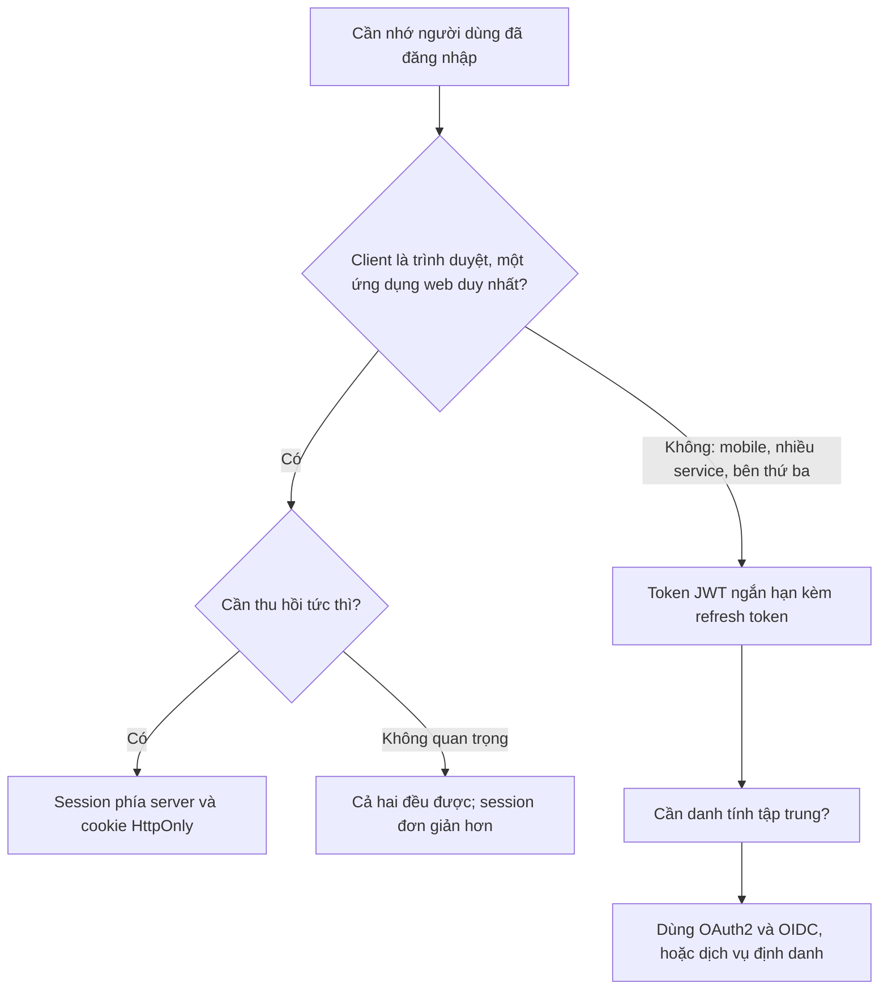
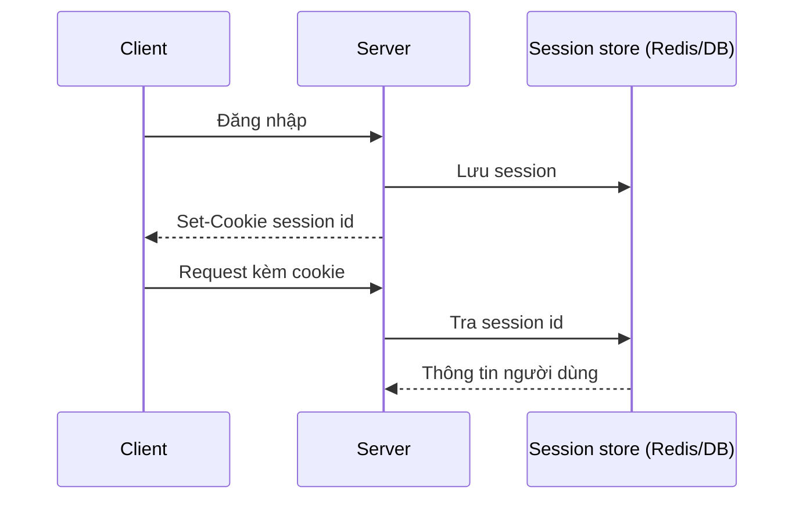
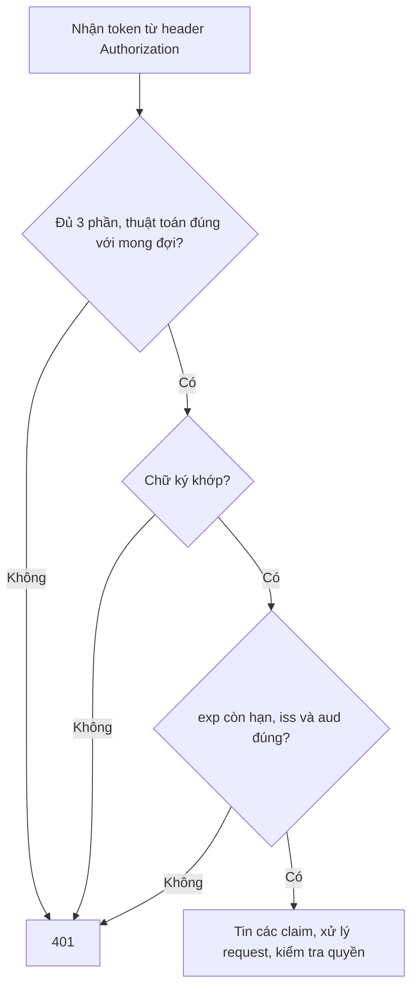
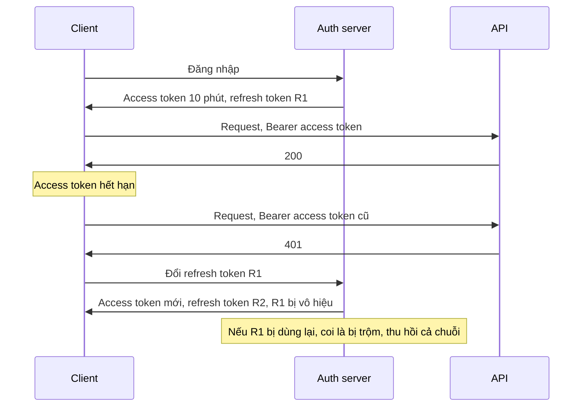

# Authentication, Session và Token

Khi bạn đăng nhập vào một website, hệ thống phải làm hai việc. Việc thứ nhất là **authentication**: kiểm tra "bạn là ai" bằng mật khẩu hay thứ gì đó tương đương. Việc thứ hai là **nhớ** kết quả đó qua các request sau, bằng **session** hoặc **token**. Bài này giải thích cả hai việc, các lựa chọn và bẫy của từng cách.

**Tóm tắt:**

- Authentication trả lời "bạn là ai" (sai thì 401), authorization trả lời "bạn được làm gì" (sai thì 403); luôn authentication trước.
- Vì HTTP stateless, sau khi đăng nhập phải gửi kèm bằng chứng ở mọi request: session id (state ở server, dễ thu hồi) hoặc token tự chứa như JWT (dễ mở rộng, khó thu hồi).
- Mật khẩu chỉ lưu bằng slow hash có salt (Argon2id, bcrypt), không bao giờ lưu rõ hay dùng MD5/SHA-256 đơn thuần.
- JWT chỉ được ký chứ không encrypt, nên ai cũng đọc được payload; khi nhận phải cố định thuật toán, kiểm tra chữ ký rồi mới kiểm tra `exp`, `iss`, `aud`.
- Access token ngắn hạn kèm refresh token xoay vòng; refresh token bị dùng lại là tín hiệu bị trộm.
- Web, SPA và mobile dùng Authorization Code + PKCE; OAuth2 là ủy quyền, OIDC thêm danh tính.
- Sinh lại session id sau khi đăng nhập để chống session fixation, thêm MFA cho tài khoản quan trọng.

## Vì sao cần cơ chế này

HTTP không nhớ gì giữa các request (xem bài HTTP chi tiết). Nếu không có cơ chế nhớ, mọi request đều phải gửi lại mật khẩu, vừa bất tiện vừa nguy hiểm. Nhưng chọn sai cách nhớ cũng gây hại: token dễ bị đánh cắp, mật khẩu lưu sai làm lộ hàng loạt tài khoản, hoặc session dính vào một server nên khi mở rộng thêm server thì người dùng bị đăng xuất.

**Nền tảng:** Đăng nhập chỉ xảy ra một lần; sau đó "bằng chứng đã đăng nhập" (session id hoặc token) được gửi kèm mọi request. Hai cách giữ bằng chứng này là hai thái cực: state ở server (session, dễ thu hồi) hoặc state nằm trong token tự chứa (JWT, dễ mở rộng, khó thu hồi).

## Khi nào dùng cái nào

Mọi ứng dụng có đăng nhập đều cần. Nên chọn như sau:

- **Session phía server** (server giữ session, client chỉ cầm một mã) hợp với web truyền thống: dễ thu hồi tức thì (xóa session là xong).
- **Token tự chứa như JWT** hợp với API hoặc nhiều service, mobile, vì server không cần session store chung; đổi lại khó thu hồi trước hạn.
- Dù chọn cách nào: lưu mật khẩu bằng hash chậm có salt (bcrypt, Argon2), không bao giờ lưu nguyên văn; và thêm multi-factor authentication (MFA) cho tài khoản quan trọng.



Đọc sơ đồ: câu hỏi quyết định là ai là client và bạn có cần "đá" một người dùng ra ngay lập tức hay không. Nhiều hệ thống thực tế dùng kết hợp: người dùng web giữ session cookie, còn service nội bộ giao tiếp bằng token.

## Các khái niệm cần biết

| Từ khóa | Là gì | Vì sao quan trọng |
|---|---|---|
| **Session** | Record trên server về người dùng đã đăng nhập, client giữ một mã (session id) trong cookie | Thu hồi dễ; nhưng cần kho chung khi có nhiều server |
| **JWT** (JSON Web Token) | Token gồm `header.payload.signature`, server kiểm tra chữ ký mà không cần tra DB | Phù hợp hệ thống phân tán; payload ai cũng đọc được |
| **Claim** | Một trường trong payload (`sub` là chủ thể, `exp` là hạn, `iss` là bên phát hành, `aud` là audience nhận) | Server phải kiểm tra các claim này, không chỉ chữ ký |
| **Access token / refresh token** | Access token ngắn hạn để gọi API; refresh token dài hạn chỉ để xin access token mới | Access token bị trộm chỉ dùng được vài phút |
| **Salt** | Chuỗi ngẫu nhiên riêng mỗi mật khẩu trộn vào trước khi hash | Chống bảng tra dựng sẵn, làm hai hash khác nhau dù cùng mật khẩu |
| **Session fixation** | Kẻ tấn công ép nạn nhân dùng một session id mà hắn biết trước | Phòng bằng cách sinh session id mới sau khi đăng nhập |
| **OAuth2 / OIDC** | OAuth2 là giao thức ủy quyền truy cập; OIDC thêm lớp danh tính (id token) | Đăng nhập bằng Google, hay cấp quyền cho ứng dụng bên thứ ba |
| **PKCE** | Cơ chế bằng cặp `code_verifier` và `code_challenge` buộc người đổi `code` lấy token phải là chính ứng dụng đã bắt đầu flow | Bảo vệ ứng dụng không giữ được bí mật (SPA, mobile) |
| **MFA / TOTP** | Multi-factor authentication; TOTP là mã 6 số đổi mỗi 30 giây từ ứng dụng authenticator | Mật khẩu bị lộ vẫn chưa đủ để vào tài khoản |

## Authentication và authorization

| | Authentication | Authorization |
|---|---|---|
| Câu hỏi | Bạn là ai? | Bạn được làm gì? |
| Kết quả sai | 401 | 403 |

**Phải thuộc:** Authentication trả lời "bạn là ai?" (sai thì 401); Authorization trả lời "bạn được làm gì?" (sai thì 403). Authentication trước, authorization sau.

Hai việc này luôn đi theo thứ tự: authentication xong mới xét quyền. Nhầm lẫn thường gặp là trả 401 cho cả hai, khiến client không biết nên đăng nhập lại (401) hay xin thêm quyền (403).

## Lưu mật khẩu

Vấn đề đặt ra: server cần kiểm tra mật khẩu nhưng không được giữ mật khẩu gốc, vì nếu database bị lộ thì mọi tài khoản mất theo. Cách giải quyết là chỉ lưu kết quả hash một chiều và hash lại mật khẩu người dùng nhập để so khớp.

- **Không bao giờ** lưu rõ hoặc dùng fast hash (MD5, SHA-256 đơn thuần).
- Dùng **slow hash có salt**: **Argon2id**, **bcrypt** hoặc scrypt; salt ngẫu nhiên mỗi người dùng; tham số chi phí chỉnh được theo thời gian.
- Chống đoán mật khẩu: rate limiting, lockout tạm, kiểm tra mật khẩu phổ biến/đã lộ, MFA.

**Phải thuộc:** Mật khẩu chỉ lưu bằng hash chậm có salt (Argon2id, bcrypt, scrypt, PBKDF2), không bao giờ lưu rõ hay dùng MD5/SHA-256 đơn thuần. Salt ngẫu nhiên riêng cho mỗi mật khẩu; so khớp bằng hàm thời gian không đổi.

Vì sao chậm lại tốt: kẻ trộm được bảng hash sẽ thử đoán ngoại tuyến hàng tỷ lần mỗi giây với SHA-256, nhưng chỉ vài lần mỗi giây nếu mỗi lần hash tốn hàng trăm ms. Salt ngẫu nhiên làm hai người cùng mật khẩu ra hai hash khác nhau và vô hiệu bảng tra dựng sẵn.

**Suy luận:** Server không bao giờ cần biết mật khẩu gốc, chỉ cần biết một người dùng nhập vào có sinh ra đúng giá trị hash đã lưu hay không, nên hash một chiều là đủ. Nhưng kẻ tấn công sau khi lấy được bảng hash không cần đảo ngược nó: hắn thử đoán từng mật khẩu thông dụng, hash rồi so khớp, và việc này chạy ngoại tuyến với tốc độ của GPU. Vì thế độ an toàn của mật khẩu phụ thuộc vào chi phí mỗi lần đoán chứ không chỉ vào việc hash là một chiều. Hash nhanh như SHA-256 được thiết kế để rẻ nên cho phép hàng tỷ lần đoán mỗi giây; slow hash như Argon2id, bcrypt cố ý tốn thời gian và memory để đẩy chi phí đó lên hàng nghìn lần. Salt giải quyết một vấn đề khác: nếu không có nó, hai người cùng mật khẩu có cùng hash và kẻ tấn công dùng một bảng tính sẵn cho tất cả, còn salt riêng mỗi người buộc hắn phải đoán lại từng tài khoản. Chỗ dễ nhầm là nghĩ salt cần giữ bí mật, trong khi nó được lưu ngay cạnh hash và chỉ có tác dụng làm vô hiệu bảng dựng sẵn. Hệ quả khi review: mọi chỗ dùng MD5, SHA-1 hay SHA-256 đơn thuần cho mật khẩu đều là lỗi, chi phí hash phải chỉnh được theo thời gian, và đăng nhập cần rate limit vì slow hash cũng là một vector tiêu tốn CPU.

```java
// Với Spring Security: PasswordEncoder pe = new BCryptPasswordEncoder(12);   (hoặc Argon2PasswordEncoder)
// String stored = pe.encode(raw);      // chuỗi đã chứa salt và chi phí
// boolean ok = pe.matches(raw, stored);

// JDK có sẵn PBKDF2 (minh họa nguyên lý salt + lặp nhiều vòng), đã chạy:
byte[] salt = new byte[16];
// salt ngẫu nhiên mỗi người dùng
new SecureRandom().nextBytes(salt);
byte[] hash = SecretKeyFactory.getInstance("PBKDF2WithHmacSHA256")
        .generateSecret(new PBEKeySpec(password.toCharArray(), salt, 210_000, 256))
        // 32 byte; lưu cùng salt và số vòng
        .getEncoded();
```

Chạy thử với 210000 vòng tốn khoảng vài trăm ms trên máy thử (đã chạy, tùy máy; con số vòng lặp khuyến nghị thay đổi theo thời gian, đối chiếu hướng dẫn OWASP hiện hành). Khi kiểm tra, hash lại mật khẩu nhập vào bằng đúng salt và số vòng đã lưu rồi so sánh bằng hàm thời gian không đổi (`MessageDigest.isEqual`), không dùng `equals`. BCrypt giới hạn đầu vào 72 byte; Argon2id là lựa chọn ưu tiên khi thư viện hỗ trợ.

## Session phía server và Token



Vấn đề của mô hình này là session store: khi có nhiều server, mọi server phải tra được cùng một kho (Redis, DB), nếu không người dùng đăng nhập ở server A sẽ bị coi như chưa đăng nhập ở server B. Đó là lý do JWT ra đời. Với JWT, server không lưu gì: sau khi đăng nhập client giữ token, mỗi request server chỉ kiểm tra chữ ký và hạn của token.

| | Session + cookie | JWT |
|---|---|---|
| State | Phía server | Trong token |
| Thu hồi tức thì | **Dễ** (xóa session) | Khó (cần danh sách đen hoặc hạn ngắn) |
| Mở rộng | Cần session store chung | Không cần session store |
| Phù hợp | Web truyền thống, thu hồi quan trọng | API, nhiều dịch vụ, mobile |
| Rủi ro chính | CSRF, session fixation | Lộ token, không thu hồi, lưu ở nơi XSS đọc được |

**Phải thuộc:** So sánh kinh điển: session lưu state ở server (thu hồi tức thì, cần session store chung khi nhiều server); JWT không lưu state ở server (mở rộng dễ, khó thu hồi trước hạn). JWT chỉ được ký, không được encrypt, nên ai cũng đọc được payload.

**Suy luận:** Session và JWT khác nhau ở chỗ ai giữ sự thật về "người này còn đăng nhập hay không". Với session, sự thật nằm ở session store của server, nên xóa một record là người đó mất quyền ngay, nhưng đổi lại mọi server phải tra được cùng một store, và store trở thành điểm cần nhân rộng và bảo vệ. Với JWT, sự thật được đóng gói vào token và bảo đảm bằng chữ ký, nên server nào có key cũng kiểm tra được mà không cần tra DB; đổi lại server không còn nơi nào để "rút" token trước hạn, vì token vẫn hợp lệ về mặt chữ ký cho tới `exp`. Từ đây suy ra hệ quả: muốn thu hồi JWT thì phải thêm lại một state phía server (danh sách đen, version của user), tức là bạn đang đánh đổi ngược lại lợi thế stateless; còn nếu giữ nguyên stateless thì phải chấp nhận cửa sổ rủi ro bằng đúng tuổi thọ access token, nên access token mới phải ngắn và refresh token mới phải xoay vòng. Điểm dễ nhầm có hai: coi JWT là "an toàn hơn" vì có chữ ký, trong khi chữ ký chỉ chống sửa chứ không chống bị đọc hay bị trộm; và đặt JWT trong `localStorage` rồi tin rằng không cần lo CSRF, trong khi XSS lại đọc được ngay. Khi thiết kế, hãy chọn session cho web một origin cần thu hồi tức thì, chỉ dùng JWT khi thực sự cần nhiều service kiểm tra độc lập, và luôn đặt token trong cookie `HttpOnly` nếu chạy trên trình duyệt.

## Cơ chế bên trong JWT

JWT gồm ba phần Base64URL nối bằng dấu chấm: `header.payload.signature`. Với HS256, chữ ký là `HMAC-SHA256(header.payload, secret key)`. Header mẫu `{"alg":"HS256","typ":"JWT"}` encode thành `eyJhbGciOiJIUzI1NiIsInR5cCI6IkpXVCJ9`; payload chỉ là JSON được encode Base64URL nên **ai cũng đọc được**.

```java
static final Base64.Encoder B64 = Base64.getUrlEncoder().withoutPadding();

static String hmac(String data, byte[] key) throws Exception {
    Mac mac = Mac.getInstance("HmacSHA256");
    mac.init(new SecretKeySpec(key, "HmacSHA256"));
    return B64.encodeToString(mac.doFinal(data.getBytes(StandardCharsets.UTF_8)));
}
static String sign(String payloadJson, byte[] key) throws Exception {
    String h = B64.encodeToString("{\"alg\":\"HS256\",\"typ\":\"JWT\"}".getBytes(StandardCharsets.UTF_8));
    String p = B64.encodeToString(payloadJson.getBytes(StandardCharsets.UTF_8));
    return h + "." + p + "." + hmac(h + "." + p, key);
}
static boolean verify(String token, byte[] key) throws Exception {
    String[] parts = token.split("\\.");
    if (parts.length != 3) return false;
    String header = new String(Base64.getUrlDecoder().decode(parts[0]), StandardCharsets.UTF_8);
    // chỉ chấp nhận thuật toán mong đợi
    if (!header.contains("\"alg\":\"HS256\"")) return false;
    byte[] expected = hmac(parts[0] + "." + parts[1], key).getBytes(StandardCharsets.UTF_8);
    byte[] actual = parts[2].getBytes(StandardCharsets.UTF_8);
    // thời gian không đổi
    return MessageDigest.isEqual(expected, actual);
}
```

Kết quả khi chạy: token ký bằng key thật được `verify` trả `true`. Đổi payload thành `"role":"ADMIN"` mà giữ nguyên chữ ký thì `false` (chữ ký không còn khớp nội dung). Token có header `alg: none` và chữ ký rỗng cũng `false`.

| Cuộc tấn công | Vì sao thất bại hoặc thành công |
|---|---|
| Sửa payload | Thất bại: không có key để tính lại chữ ký |
| Đổi `alg` thành `none` | Thành công **nếu** thư viện tin header; vì vậy phải cố định thuật toán phía server |
| Hoán đổi RS256 sang HS256, dùng public key làm key HMAC | Thành công với thư viện cẩu thả; cùng cách phòng: cố định thuật toán theo key |
| Lấy trộm token | Thành công cho tới khi hết hạn: nên token ngắn hạn, HTTPS, không để ở nơi XSS đọc được |

**Phải thuộc:** Khi nhận JWT phải kiểm tra theo thứ tự: thuật toán đúng với mong đợi (cố định phía server, từ chối `alg: none`), chữ ký, rồi các claim `exp`, `iss`, `aud`. Chỉ kiểm tra chữ ký là chưa đủ.

Quy trình server kiểm tra một JWT nhận được, theo thứ tự:



Hàm trên cố tình tối giản: thiếu kiểm tra `exp`, `iss`, `aud`. Trong sản phẩm dùng thư viện đã được kiểm chứng (Nimbus JOSE, jjwt, Spring Security Resource Server) và để thư viện làm các bước kiểm tra này.

### Access token ngắn hạn và refresh token xoay vòng



Vấn đề đặt ra: access token ngắn hạn thì an toàn nhưng bắt người dùng đăng nhập lại mỗi 10 phút thì không chấp nhận được. Refresh token giải quyết bằng cách cho client xin access token mới mà không cần mật khẩu. Vì refresh token sống lâu nên nó là mục tiêu giá trị; **xoay vòng** (rotation) nghĩa là mỗi lần đổi, refresh token cũ bị vô hiệu và nhận cái mới. Xoay vòng làm refresh token bị trộm có tuổi thọ ngắn: kẻ trộm và người dùng thật sẽ tranh nhau dùng cùng một token, và việc tái sử dụng là tín hiệu để thu hồi.

## Cách dùng JWT an toàn

- Access token ngắn hạn (phút), kèm refresh token dài hạn được xoay vòng và có thể thu hồi.
- Kiểm tra chữ ký, `exp`, `iss`, `aud`; **cố định thuật toán** mong đợi, từ chối `alg: none`.
- Payload chỉ được **ký**, không encrypt: đừng đặt dữ liệu nhạy cảm.
- Lưu trên trình duyệt: cookie `HttpOnly; Secure; SameSite` an toàn hơn `localStorage` (XSS đọc được).
- Signing key lấy từ kho bí mật, hỗ trợ rotate key (`kid`).

## OAuth2 và OIDC trong một câu

Ủy quyền cho ứng dụng truy cập tài nguyên mà không chia sẻ mật khẩu (ví dụ cho một app lịch đọc lịch Google của bạn mà app không biết mật khẩu Google); OIDC thêm danh tính người dùng (để "Đăng nhập bằng Google"). Dùng khi bạn cần đăng nhập một lần cho nhiều ứng dụng hoặc tích hợp bên thứ ba; nếu chỉ có một ứng dụng với tài khoản riêng thì session thường là đủ. Flow chuẩn: Authorization Code + PKCE. Chi tiết: [OAuth2 và OIDC](/go?p=01-Spring-Boot%2Fmedium%2Flt-20-oauth2-oidc.md), [Spring Security và JWT](/go?p=01-Spring-Boot%2Fmedium%2Flt-06-spring-security-jwt.md).

### Authorization Code + PKCE từng bước

**Phải thuộc:** OAuth2 là ủy quyền (cấp quyền truy cập mà không chia sẻ mật khẩu), OIDC thêm danh tính (id token) trên OAuth2. Flow chuẩn cho web, SPA và mobile là Authorization Code + PKCE.

Flow gồm bốn chặng: ứng dụng sinh `code_verifier` ngẫu nhiên và gửi trước `code_challenge` (hash SHA-256 của nó) cùng `state` khi chuyển hướng người dùng sang Auth server; người dùng đăng nhập và đồng ý; Auth server chuyển hướng về `redirect_uri` kèm `code`, ứng dụng kiểm tra `state` khớp; cuối cùng ứng dụng đổi `code` lấy token bằng cách gửi kèm `code_verifier`, và Auth server chỉ cấp token khi hash của verifier bằng challenge đã lưu. Nhờ vậy kẻ chặn được `code` trên đường chuyển hướng cũng không đổi được token. Sơ đồ đầy đủ, bảng ý nghĩa `state`, `nonce`, `code_challenge`, `redirect_uri`, và đoạn mã JDK tạo cặp PKCE (đã chạy, kèm vector kiểm thử RFC 7636) ở bài [OAuth2 và OIDC](/go?p=01-Spring-Boot%2Fmedium%2Flt-20-oauth2-oidc.md).

## Multi-factor authentication (MFA)

| Yếu tố | Ví dụ |
|---|---|
| Thứ bạn biết | Mật khẩu, PIN |
| Thứ bạn có | Ứng dụng TOTP, hardware key, passkey |
| Thứ bạn là | Sinh trắc học |

MFA quan trọng vì mật khẩu thường bị lộ qua lừa đảo hoặc dùng lại giữa các site; yếu tố thứ hai khiến mật khẩu lộ riêng lẻ chưa đủ để chiếm tài khoản. SMS OTP yếu hơn TOTP/hardware key (đổi SIM, lừa đảo). **Passkey/WebAuthn** chống lừa đảo vì gắn với tên miền.

## Quản lý session

Session là thứ kẻ tấn công muốn chiếm sau khi đăng nhập, nên lifecycle của nó cần được quản lý chặt:

- Sinh lại session id sau khi đăng nhập (chống session fixation: nếu không, kẻ đã biết id trước đó trở thành người dùng đã đăng nhập).
- Hết hạn không hoạt động và hết hạn tuyệt đối; đăng xuất hủy session ở server.
- Đổi mật khẩu thì vô hiệu mọi session/refresh token cũ.

## Điều cần nhớ

- Đừng tự viết hệ thống authentication nếu có thể dùng dịch vụ định danh (Keycloak, Auth0, Cognito).
- Thông báo lỗi đăng nhập chung ("sai tên hoặc mật khẩu") để không lộ tài khoản có tồn tại.
- Ghi log event authentication để phát hiện bất thường.

