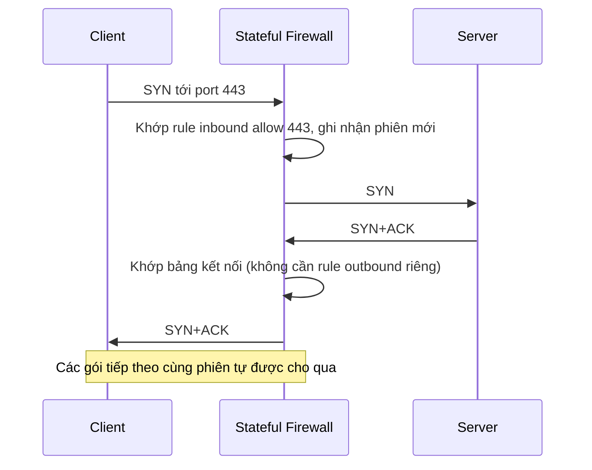
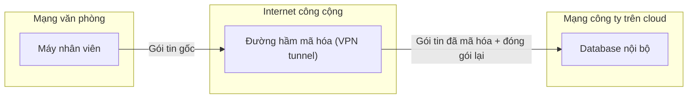
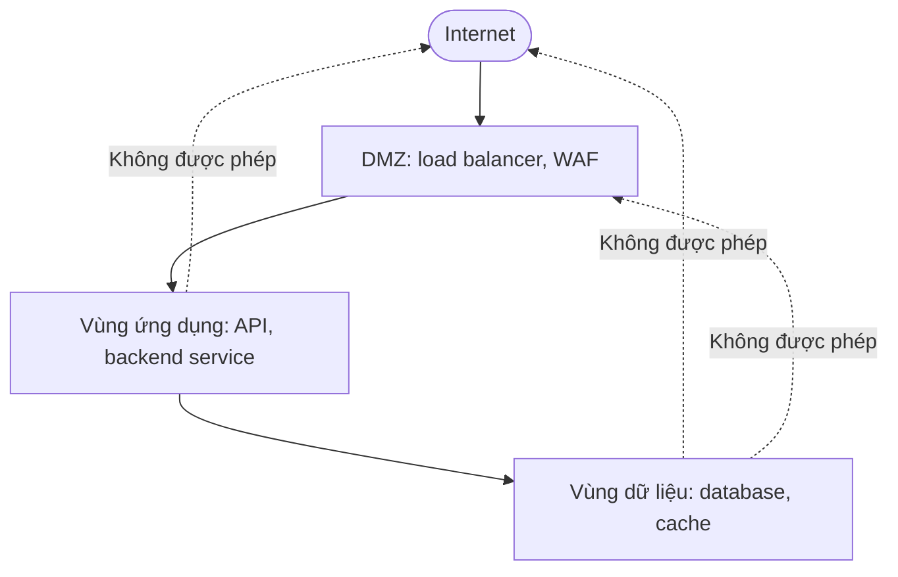
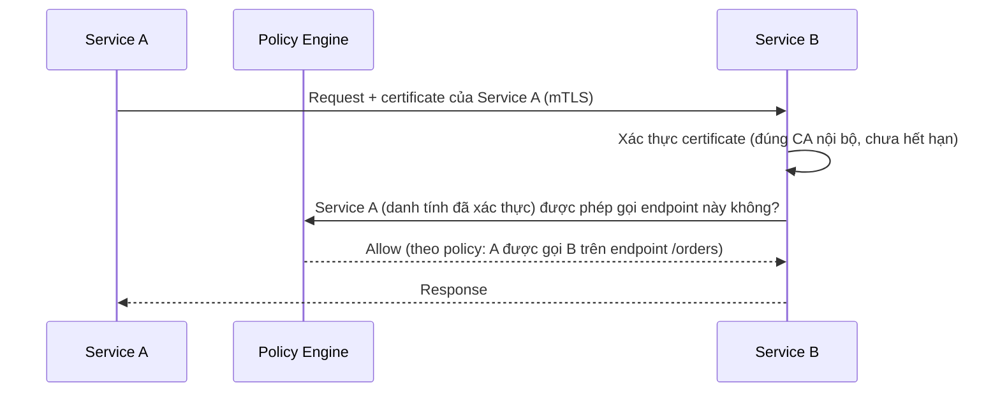

# Firewall, VPN và Zero Trust network

Một kiến trúc sư mới thường nghĩ: "server đặt trong VPC riêng, có security group, vậy là an toàn". Thực tế phần lớn sự cố rò rỉ dữ liệu không đến từ việc "bị bẻ khóa firewall" mà từ một rule mở quá rộng (`0.0.0.0/0` trên port quản trị), một VPN tĩnh không ai review lại sau nhiều năm, hoặc một máy nội bộ bị nhiễm rồi đi lại tự do vì "đã ở trong mạng công ty thì được tin". Bài này đi từ firewall và VPN cổ điển (chặn theo địa chỉ) đến Zero Trust (xác thực theo danh tính, bất kể vị trí mạng), để bạn biết khi nào một rule "đóng cổng" là đủ và khi nào nó chỉ là ảo giác an toàn.

**Tóm tắt:**

- Firewall stateless lọc từng gói theo rule tĩnh (nhanh, không nhớ kết nối); stateful theo dõi cả phiên nên tự cho phép gói trả lời mà không cần rule ngược.
- Trên cloud, Security Group là stateful và gắn theo instance; Network ACL là stateless và gắn theo subnet, hai lớp bổ sung nhau chứ không thay nhau.
- VPN tạo một đường hầm mã hóa qua mạng công cộng; site-to-site nối hai mạng, remote access nối một máy vào mạng.
- IPsec mã hóa ở tầng IP nên "trong suốt" với ứng dụng nhưng cấu hình phức tạp; WireGuard đơn giản hơn, dùng cặp khóa cố định và mã hóa hiện đại, đang thay dần IPsec cho use case mới.
- Network segmentation (chia mạng thành vùng theo mức tin cậy) giới hạn thiệt hại khi một máy bị chiếm: kẻ tấn công vào được một vùng không tự động đi được sang vùng khác.
- Zero Trust không coi "đang ở trong mạng nội bộ" là bằng chứng tin cậy; mọi request đều phải xác thực danh tính (mTLS, token) và được policy engine duyệt theo ngữ cảnh, không chỉ theo IP nguồn.
- Triển khai Zero Trust thực tế dựa trên ba trụ cột: định danh mạnh cho người và dịch vụ (mTLS, SSO), policy engine trung tâm quyết định cho phép/từ chối, và ghi log đủ để điều tra sau sự cố.
- Lỗi phổ biến nhất không phải thiếu công cụ mà là rule mở quá rộng rồi không ai dọn lại: audit định kỳ quan trọng hơn thêm công cụ mới.

## Vấn đề nó giải quyết

Mạng mặc định cho phép mọi máy nói chuyện với mọi máy. Nếu không chặn gì, một server web bị chiếm có thể quét toàn bộ mạng nội bộ và kết nối thẳng tới database. Firewall giới hạn "ai được nói chuyện với ai, qua port nào"; VPN mở rộng "mạng nội bộ" một cách an toàn qua Internet công cộng mà không cần đường truyền riêng (leased line) đắt đỏ; Zero Trust trả lời câu hỏi mà firewall theo địa chỉ không trả lời được: "nếu kẻ tấn công đã ở trong mạng rồi thì sao?"

## Khi nào dùng cái nào

- **Firewall / Security Group**: luôn luôn, là lớp phòng thủ cơ bản nhất, miễn phí trên mọi cloud.
- **VPN site-to-site**: khi hai mạng riêng (ví dụ văn phòng và VPC) cần nói chuyện liên tục như một mạng.
- **VPN remote access**: khi nhân viên làm việc từ xa cần vào tài nguyên nội bộ; đang dần được thay bằng Zero Trust access (không cần "vào mạng" nữa, chỉ xác thực theo từng ứng dụng).
- **Zero Trust**: khi hệ thống đủ lớn để một máy bị chiếm là rủi ro nghiêm trọng (microservices nội bộ, dữ liệu nhạy cảm), hoặc khi nhân sự làm việc từ nhiều nơi nên "biên giới mạng" không còn rõ ràng.

## Các khái niệm cần biết

| Từ khóa | Là gì | Vì sao quan trọng |
|---|---|---|
| **Stateful** | Firewall nhớ trạng thái từng kết nối (đã thấy SYN chưa, thuộc phiên nào) | Chỉ cần 1 rule inbound, gói trả lời tự được cho qua |
| **Stateless** | Lọc từng gói độc lập, không nhớ gì | Phải khai rule cho cả hai chiều, dễ sai nhưng nhanh và đơn giản để audit |
| **Security Group** | Firewall stateful gắn vào instance/ENI trên cloud | Lớp lọc gần tài nguyên nhất, mặc định deny inbound |
| **NACL** (Network ACL) | Firewall stateless gắn vào subnet | Lớp lọc ở biên subnet, đánh giá theo thứ tự rule number |
| **VPN** | Đường hầm mã hóa qua mạng công cộng, giả lập một mạng riêng | Thay thế đường truyền riêng đắt tiền, vẫn giữ tính riêng tư |
| **IPsec** | Bộ giao thức mã hóa ở tầng IP (ESP, AH, IKE) | Trong suốt với tầng ứng dụng, chuẩn cũ, nhiều thiết bị hỗ trợ |
| **WireGuard** | VPN hiện đại, mã nguồn nhỏ, dùng khóa công khai cố định | Cấu hình đơn giản hơn IPsec nhiều lần, hiệu năng tốt |
| **Segmentation** | Chia mạng thành vùng (DMZ, app, data) cách ly nhau | Giới hạn phạm vi di chuyển ngang (lateral movement) của kẻ tấn công |
| **mTLS** | TLS hai chiều: cả client và server đều trình certificate | Dịch vụ xác thực lẫn nhau, không chỉ client xác thực server như HTTPS thường |
| **Policy engine** | Thành phần trung tâm quyết định cho phép/từ chối một request dựa trên danh tính + ngữ cảnh | Trái tim của Zero Trust, thay cho "cho phép theo dải IP" |
| **Lateral movement** | Kẻ tấn công di chuyển từ máy đã chiếm sang máy khác trong mạng | Segmentation và Zero Trust đều nhắm vào việc chặn bước này |

**Phải thuộc:** Security Group là stateful và gắn theo instance (mặc định deny inbound, allow outbound); NACL là stateless và gắn theo subnet, đánh giá theo rule number từ thấp đến cao. Hai lớp này độc lập nhau: một request phải qua được cả NACL của subnet lẫn Security Group của instance.

## Firewall: stateful vs stateless

Stateless firewall lọc từng gói như một bảo vệ chỉ nhìn một tờ giấy duy nhất mỗi lần: nó không nhớ gói trước đó là gì. Vì vậy muốn cho phép một kết nối TCP, bạn phải khai hai rule: inbound cho gói SYN đi vào, và outbound cho gói trả lời đi ra (hoặc ngược lại tùy chiều khởi tạo). Quên rule chiều trả lời thì kết nối "nửa chừng": SYN đi lọt nhưng SYN+ACK bị chặn, client vẫn chờ rồi timeout.

Stateful firewall nhớ bảng kết nối (connection tracking): khi thấy gói SYN được allow đi qua, nó tự ghi nhận "phiên này đang mở" và tự cho phép gói trả lời thuộc phiên đó, dù không có rule nào khai rõ chiều ngược lại. Đây là lý do Security Group trên AWS/GCP chỉ cần rule inbound cho hầu hết trường hợp: outbound trả lời được tự động cho qua.



**Suy luận:** Vì stateless không nhớ gì nên nó phải tin vào cờ TCP mỗi gói để suy ra trạng thái (ví dụ chặn gói có cờ SYN nhưng không có ACK đi từ ngoài vào, coi đó là gói mở kết nối mới); kỹ thuật này gọi là "established/related" rule trên `iptables`. Hệ quả là rule stateless phức tạp và dễ sai hơn, nhưng bù lại nó không giữ trạng thái nên chịu tải tốt hơn khi có rất nhiều kết nối ngắn — đây là lý do NACL (biên subnet, lưu lượng lớn) chọn stateless còn Security Group (sát ứng dụng, cần đúng) chọn stateful.

## Security Group và Network ACL

| | Security Group | NACL |
|---|---|---|
| Gắn vào | Instance / ENI | Subnet |
| Stateful | Có | Không |
| Rule | Chỉ allow | Allow và deny |
| Thứ tự đánh giá | Tất cả rule khớp được gộp (không có thứ tự) | Theo rule number tăng dần, dừng ở rule khớp đầu tiên |
| Mặc định | Deny toàn bộ inbound, allow toàn bộ outbound | Allow toàn bộ (trừ khi bạn đổi) |

Hai lớp này không thay thế nhau mà xếp chồng: một gói đi vào instance phải vượt qua NACL của subnet trước, rồi mới tới Security Group của instance. NACL hữu ích để chặn cứng một dải IP xấu ở biên (ví dụ chặn hẳn một quốc gia) mà không cần sửa từng Security Group; Security Group hữu ích để khai chính sách theo từng loại server (web server mở 443, database chỉ nhận từ security group của app).

**Phải thuộc:** Vì NACL stateless, nếu bạn mở inbound port 443 trên NACL, bạn phải tự mở thêm outbound ở dải ephemeral port (thường `1024-65535`) để gói trả lời đi ra được; quên bước này là lỗi kinh điển khi mới cấu hình NACL.

## VPN: site-to-site và remote access



- **Site-to-site VPN**: nối hai mạng (ví dụ văn phòng và VPC) liên tục, hai bên có thiết bị VPN gateway cố định. Dùng khi nhiều máy ở cả hai phía cần nói chuyện thường xuyên.
- **Remote access VPN**: một máy cá nhân (nhân viên làm từ xa) kết nối vào mạng công ty. Dùng phần mềm client (OpenVPN, WireGuard client, AnyConnect).

Nguyên lý chung: gói tin gốc được đóng gói (encapsulate) bên trong một gói mới, mã hóa phần nội dung, rồi gửi qua mạng công cộng; đầu nhận giải mã và "tháo gói" để lấy lại gói gốc. Với bên ngoài nhìn vào, họ chỉ thấy lưu lượng mã hóa giữa hai gateway, không biết nội dung bên trong là gì.

### Cơ chế bên trong IPsec và WireGuard

| | IPsec | WireGuard |
|---|---|---|
| Tầng hoạt động | Tầng IP (trong suốt với ứng dụng) | Cũng tầng IP, nhưng cài như một network interface ảo |
| Trao đổi khóa | IKE (Internet Key Exchange), nhiều bước, nhiều tùy chọn thuật toán | Noise Protocol Framework, một bộ thuật toán cố định (không cho chọn) |
| Cấu hình | Phức tạp: chọn thuật toán, policy, phase 1/phase 2 | Đơn giản: mỗi bên có cặp khóa public/private, như SSH key |
| Dòng code | Hàng chục nghìn dòng (nhiều CVE lịch sử) | Khoảng 4.000 dòng, dễ audit |
| Hiệu năng | Tốt, nhưng overhead đàm phán khi thiết lập | Thường nhanh hơn, kết nối lại nhanh khi đổi mạng (roaming) |

**Phải thuộc:** IPsec cho phép chọn nhiều thuật toán (linh hoạt nhưng dễ cấu hình sai, chọn thuật toán yếu); WireGuard cố định một bộ thuật toán hiện đại (ChaCha20, Curve25519) nên không có chỗ để cấu hình sai, đánh đổi là không tùy biến được thuật toán.

Cấu hình WireGuard tối giản (minh họa, không phải giá trị thật):

```ini
# Trên máy A
[Interface]
PrivateKey = <khoa_rieng_cua_A>
Address = 10.8.0.1/24
ListenPort = 51820

[Peer]
PublicKey = <khoa_cong_khai_cua_B>
AllowedIPs = 10.8.0.2/32
Endpoint = b.example.com:51820
```

Đọc cấu hình: mỗi bên chỉ cần biết khóa công khai của bên kia (giống trao đổi SSH key), không cần certificate authority hay IKE phức tạp. `AllowedIPs` vừa là "tôi chấp nhận gói từ IP ảo nào" vừa là "gói gửi tới IP ảo nào thì đi qua peer này" — nó đóng cả vai trò routing lẫn access control trong một dòng.

## Network segmentation thực chiến



Nguyên tắc: mỗi vùng chỉ được nói chuyện với vùng liền kề theo đúng một chiều nghiệp vụ, không có đường tắt. DMZ (demilitarized zone) là vùng duy nhất Internet chạm tới trực tiếp; nó không được phép tự ý khởi tạo kết nối vào vùng dữ liệu. Vùng ứng dụng gọi được vùng dữ liệu, nhưng vùng dữ liệu không bao giờ tự khởi tạo kết nối ra ngoài (nếu có traffic như vậy, đó gần như chắc chắn là dấu hiệu bị chiếm và đang gửi dữ liệu ra ngoài — exfiltration).

**Phải thuộc:** Segmentation không ngăn được kẻ tấn công xâm nhập vùng đầu tiên, nó giới hạn **thiệt hại sau khi** đã xâm nhập bằng cách chặn di chuyển ngang (lateral movement) sang vùng khác. Vì vậy luôn kết hợp với giám sát: traffic bất thường đi ngược chiều (từ Data ra DMZ) phải cảnh báo ngay.

## Từ Zero Trust đến triển khai: mTLS và policy engine

Zero Trust và phòng thủ nhiều lớp (defense in depth) đã được giới thiệu ở bài mật mã học ứng dụng: không tin một request chỉ vì nó "đến từ mạng nội bộ", vì kẻ tấn công thường đã chiếm được một máy bên trong trước khi tấn công tiếp. Phần này nói về **cách triển khai cụ thể**, không nhắc lại triết lý.



Ba thành phần cần có:

1. **Định danh mạnh cho dịch vụ**: mỗi service có certificate riêng (thường do một CA nội bộ cấp tự động, xoay vòng ngắn hạn), dùng cho mTLS khi gọi nhau. Không dùng IP để nhận diện "đây là service nào" vì IP có thể đổi (container, autoscale).
2. **Policy engine tập trung**: thay vì mỗi service tự viết logic "ai được gọi tôi", một service mesh (Istio, Linkerd) hoặc API gateway trung tâm giữ policy dạng khai báo (`Service A được gọi Service B trên endpoint /orders, method GET`) và việc tuân thủ được enforce ở mọi điểm, không phụ thuộc từng team tự nhớ.
3. **Log đủ để điều tra**: mọi quyết định allow/deny được ghi lại kèm danh tính, endpoint, thời điểm — khi có sự cố, truy vết được chính xác request nào từ service nào.

**Phải thuộc:** mTLS khác HTTPS thông thường ở chỗ **cả hai chiều** đều trình certificate; HTTPS thường chỉ server trình certificate, client thì ẩn danh hoặc xác thực bằng cách khác (session, token). Trong Zero Trust, mTLS trả lời câu hỏi "ai đang gọi tôi" ở tầng kết nối, còn policy engine trả lời "người đó có được phép làm việc này không" ở tầng nghiệp vụ.

## Checklist audit định kỳ

- Không có rule nào mở `0.0.0.0/0` vào port quản trị (22, 3389, cổng quản lý database) — chỉ mở cho dải IP cụ thể hoặc qua VPN/bastion.
- Security Group của database chỉ chấp nhận từ Security Group của app, không chấp nhận theo IP tĩnh (IP instance đổi khi scale).
- VPN remote access bắt buộc MFA; certificate/key của nhân viên nghỉ việc bị thu hồi ngay trong ngày.
- Traffic đi ngược chiều segmentation (Data → DMZ, Data → Internet) có cảnh báo tự động, không chỉ dựa vào review thủ công.
- Rule không dùng nữa (server đã xóa, nhân viên đã nghỉ) được dọn định kỳ, không chỉ "thêm vào, không bao giờ xóa".

## Điều cần nhớ

- Stateful (Security Group) nhớ phiên, chỉ cần rule 1 chiều; stateless (NACL) lọc từng gói, phải khai cả hai chiều.
- VPN mã hóa và đóng gói lại gói tin để giả lập mạng riêng qua Internet công cộng; WireGuard đơn giản và hiện đại hơn IPsec nhưng không cho tùy biến thuật toán.
- Segmentation giới hạn thiệt hại sau khi đã bị xâm nhập bằng cách chặn di chuyển ngang; vùng dữ liệu không bao giờ được tự khởi tạo kết nối ra ngoài.
- Zero Trust triển khai bằng ba trụ cột: định danh mạnh (mTLS giữa service), policy engine trung tâm, và log đủ để điều tra — không phải một sản phẩm đơn lẻ mà là một kiến trúc.
- Lỗ hổng thực tế thường không phải thiếu công cụ mà là rule cũ không ai dọn: audit định kỳ quan trọng như triển khai công cụ mới.
