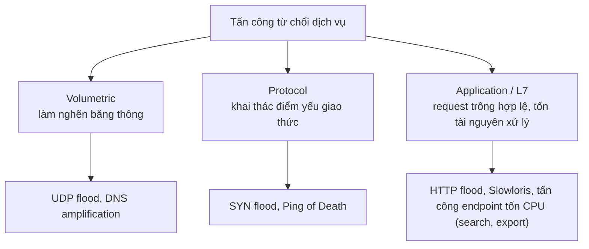
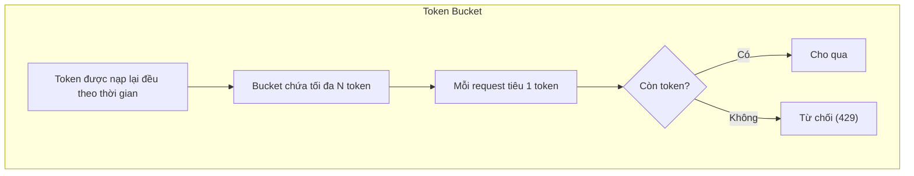
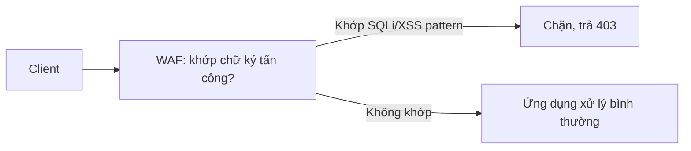

# DDoS, Rate Limiting và WAF

Một buổi sáng traffic tăng gấp 50 lần bình thường: có thể là bài viết của bạn lên trang nhất, hoặc có thể là tấn công. Phân biệt sai thì hoặc chặn nhầm người dùng thật (mất doanh thu), hoặc để sập hệ thống vì tưởng đó là "khách hàng nhiệt tình". Bài này đi qua các loại tấn công từ chối dịch vụ, cách phòng thủ theo từng tầng, và cách tự viết rate limiting đúng thay vì chỉ dựa vào "giới hạn X request mỗi giây" một cách mơ hồ.

**Tóm tắt:**

- DDoS chia ba tầng: volumetric (làm nghẽn băng thông), protocol (khai thác điểm yếu giao thức như SYN flood), và application/L7 (giả làm request hợp lệ nhưng tốn tài nguyên xử lý).
- Volumetric và protocol thường bị chặn ở biên mạng (CDN, nhà cung cấp chống DDoS) vì cần băng thông lớn hơn kẻ tấn công; L7 phải chặn ở tầng ứng dụng vì request trông "hợp lệ".
- Rate limiting giới hạn số request trong một cửa sổ thời gian; thuật toán phổ biến là token bucket (cho phép burst) và sliding window (mượt hơn fixed window, tránh hiệu ứng "dồn cục ở ranh giới cửa sổ").
- Giới hạn nên áp theo nhiều khóa cùng lúc (IP, user, API key) vì một kẻ tấn công phân tán từ nhiều IP sẽ vượt qua giới hạn chỉ theo IP.
- WAF lọc request theo chữ ký tấn công đã biết (SQL injection, XSS pattern) ở tầng HTTP, trước khi request chạm tới code ứng dụng; nó bổ sung chứ không thay thế việc validate input đúng cách trong code.
- SYN cookie cho phép server trả lời bắt tay TCP mà không cần giữ trạng thái cho tới khi ACK cuối cùng tới, chặn được SYN flood cổ điển mà không tốn bộ nhớ.
- Traffic spike hợp lệ thường tăng dần, đến từ nhiều IP tự nhiên và hành vi đa dạng (xem nhiều trang khác nhau); tấn công thường tăng đột ngột, tập trung vào một endpoint, và hành vi lặp lại máy móc.
- Rate limit trả về 429 kèm header `Retry-After` để client (nhất là client tử tế) biết chờ bao lâu thay vì thử lại dồn dập ngay lập tức.

## Vấn đề nó giải quyết

Hệ thống có giới hạn tài nguyên (băng thông, số kết nối, CPU xử lý request). Tấn công từ chối dịch vụ (DoS) khai thác đúng giới hạn đó: gửi đủ nhiều hoặc đủ "khó xử lý" để làm cạn tài nguyên, khiến người dùng thật không dùng được dịch vụ. DDoS (distributed) là DoS thực hiện từ nhiều nguồn cùng lúc (botnet) nên khó chặn chỉ bằng cách cấm một IP.

## Khi nào dùng cái nào

- **Chống volumetric/protocol**: luôn cần một lớp ở biên (CDN hoặc dịch vụ chống DDoS chuyên dụng), vì chặn ở server của bạn thì đường truyền tới server đã nghẽn trước khi gói tới được code chặn.
- **Rate limiting tầng ứng dụng**: luôn cần, kể cả khi không bị tấn công — bảo vệ API khỏi một client lỗi gọi vòng lặp vô hạn, hoặc một người dùng dùng quá mức gói dịch vụ.
- **WAF**: khi expose API/web ra Internet công khai, đặc biệt nếu chưa chắc mọi input đã được validate kỹ ở tầng code (WAF là lưới an toàn thứ hai, không phải thứ nhất).

## Các loại tấn công DDoS



| Loại | Cơ chế | Chặn ở đâu |
|---|---|---|
| **Volumetric** | Gửi lượng dữ liệu khổng lồ (UDP flood) hoặc khuếch đại (DNS amplification: gửi query nhỏ tới DNS server mở, giả IP nạn nhân, server trả lời lớn gấp nhiều lần về nạn nhân) | Biên mạng, nhà cung cấp có băng thông đủ lớn để hấp thụ |
| **Protocol** | SYN flood: gửi nhiều SYN, không bao giờ gửi ACK cuối, làm server giữ hàng loạt kết nối nửa chừng (half-open) tới khi cạn bộ nhớ | Firewall/load balancer có SYN cookie, hoặc thiết bị chống DDoS |
| **Application (L7)** | Gửi request HTTP hợp lệ về mặt giao thức nhưng cố tình tốn tài nguyên: gọi liên tục một endpoint nặng (tìm kiếm phức tạp, export báo cáo), hoặc Slowloris (mở kết nối, gửi header cực chậm để giữ connection sống lâu) | Tầng ứng dụng: rate limiting, WAF, timeout |

**Phải thuộc:** Volumetric và protocol tấn công **hạ tầng mạng**, cần chặn trước khi gói tới được server của bạn (vì băng thông của bạn không đủ chống); application/L7 tấn công **logic ứng dụng** bằng request hợp lệ, nên phải chặn bằng rate limiting và kiểm tra hành vi ở tầng ứng dụng, firewall mạng không giúp được vì gói tin "không có gì sai" về mặt giao thức.

### SYN cookie: chặn SYN flood mà không tốn bộ nhớ

Bình thường server nhận SYN thì cấp phát bộ nhớ lưu trạng thái kết nối (half-open) rồi chờ ACK. SYN flood gửi rất nhiều SYN, không bao giờ ACK, làm cạn bộ nhớ đó (hàng đợi backlog đầy, không nhận được kết nối hợp lệ mới). SYN cookie né việc giữ trạng thái: server mã hóa thông tin cần thiết (thời gian, thông số kết nối) **ngay trong số thứ tự (seq number)** của gói SYN+ACK gửi về, không lưu gì ở server. Khi ACK hợp lệ cuối cùng quay lại (kẻ tấn công giả mạo thì không bao giờ gửi), server giải mã lại thông tin từ chính số đó để tái tạo kết nối — không cần tra bảng, không tốn bộ nhớ chờ.

## Rate limiting: token bucket và sliding window



**Fixed window** (chia thời gian thành khối cố định, ví dụ mỗi phút một khối, đếm request trong khối) đơn giản nhưng có lỗ hổng ở ranh giới: client có thể gửi hết giới hạn vào cuối khối 1 rồi gửi tiếp hết giới hạn vào đầu khối 2, tạo ra gấp đôi giới hạn thật trong một khoảng ngắn quanh ranh giới.

**Token bucket** cho phép burst có kiểm soát: bucket chứa tối đa N token, mỗi request tiêu 1 token, token được nạp lại đều đặn theo thời gian (ví dụ 10 token/giây). Nếu client im lặng một lúc rồi gửi dồn, họ vẫn được xử lý ngay tới hết số token tích lũy, sau đó bị giới hạn theo tốc độ nạp — mô phỏng đúng ý "cho phép bùng nổ ngắn, không cho phép duy trì tốc độ cao".

**Sliding window** (log hoặc counter trượt) đếm request trong N giây gần nhất tính từ **thời điểm hiện tại**, không phải từ một ranh giới cố định, nên không bị lỗ hổng của fixed window nhưng tốn bộ nhớ hơn (phải lưu dấu thời gian từng request, hoặc xấp xỉ bằng cách nội suy giữa khối hiện tại và khối trước).

**Phải thuộc:** Fixed window dễ cài nhưng cho phép vượt gấp đôi giới hạn quanh ranh giới khối; token bucket cho phép burst có kiểm soát (đúng với hành vi người dùng thật: đọc một lúc rồi bấm dồn dập); sliding window chính xác nhất nhưng tốn tài nguyên lưu trữ nhất. Chọn theo mức độ cần chính xác, không phải cứ phức tạp hơn là tốt hơn.

### Token bucket bằng Redis (atomic bằng Lua)

Rate limiting phân tán (nhiều instance ứng dụng cùng chia sẻ một giới hạn) cần một nơi lưu trạng thái chung; dùng `INCR` + `EXPIRE` riêng lẻ có race condition giữa hai lệnh, nên gộp logic vào một script Lua chạy nguyên tử trên Redis:

```lua
-- KEYS[1] = rate limit key cho client này
-- ARGV[1] = sức chứa bucket, ARGV[2] = tốc độ nạp token/giây, ARGV[3] = thời điểm hiện tại (giây)
local capacity = tonumber(ARGV[1])
local refill_rate = tonumber(ARGV[2])
local now = tonumber(ARGV[3])

local bucket = redis.call('HMGET', KEYS[1], 'tokens', 'last_refill')
local tokens = tonumber(bucket[1]) or capacity
local last_refill = tonumber(bucket[2]) or now

-- nạp thêm token theo thời gian đã trôi qua, không vượt quá capacity
local elapsed = math.max(0, now - last_refill)
tokens = math.min(capacity, tokens + elapsed * refill_rate)

if tokens >= 1 then
    tokens = tokens - 1
    redis.call('HMSET', KEYS[1], 'tokens', tokens, 'last_refill', now)
    redis.call('EXPIRE', KEYS[1], 3600)
    return 1   -- cho qua
else
    redis.call('HMSET', KEYS[1], 'tokens', tokens, 'last_refill', now)
    redis.call('EXPIRE', KEYS[1], 3600)
    return 0   -- từ chối
end
```

Gọi từ Java qua Lettuce (giả định `redisCommands` đã có sẵn):

```java
String script = /* nội dung file lua ở trên */ "";
List<String> keys = List.of("ratelimit:user:" + userId);
List<String> args = List.of("100", "10", String.valueOf(Instant.now().getEpochSecond()));
Long allowed = redisCommands.eval(script, ScriptOutputType.INTEGER, keys.toArray(new String[0]), args.toArray(new String[0]));
if (allowed == 0) {
    throw new TooManyRequestsException(); // ánh xạ sang HTTP 429
}
```

**Suy luận:** Lý do phải gộp toàn bộ logic (đọc, tính toán, ghi) vào một script Lua thay vì gọi nhiều lệnh Redis riêng lẻ từ Java: Redis chạy mỗi lệnh đơn lẻ nguyên tử, nhưng giữa hai lệnh riêng biệt (ví dụ đọc token, rồi ghi lại sau khi tính) một request khác có thể xen vào và đọc giá trị cũ, dẫn tới cả hai request đều đếm "còn token" dù thực ra chỉ còn đủ cho một request — bug race condition kinh điển của rate limiting tự viết tay. Script Lua chạy trọn vẹn như một đơn vị nguyên tử trên Redis, nên không có request nào khác chen vào giữa chừng.

## Áp giới hạn theo nhiều khóa cùng lúc

Một kẻ tấn công phân tán (botnet, hoặc đơn giản là đổi IP qua proxy) sẽ vượt qua giới hạn chỉ-theo-IP dễ dàng. Thiết kế thực chiến thường áp đồng thời nhiều lớp giới hạn, lớp nào chạm trước thì chặn:

| Khóa giới hạn | Mục đích | Ví dụ ngưỡng |
|---|---|---|
| Theo IP | Chặn một nguồn gửi quá nhiều, kể cả chưa đăng nhập | 100 request/phút |
| Theo user/account | Chặn một tài khoản bị lạm dụng dù đổi IP liên tục | 1000 request/giờ |
| Theo API key | Thực thi đúng gói dịch vụ đã trả tiền (free tier vs paid tier) | Theo gói: 1k/ngày hoặc 1M/ngày |
| Theo endpoint | Endpoint nặng (search, export, gửi email) cần ngưỡng riêng thấp hơn endpoint nhẹ (health check) | Export: 5/phút; health check: không giới hạn |

**Phải thuộc:** Giới hạn chỉ theo IP là lớp yếu nhất vì IP dễ đổi (proxy, botnet, NAT khiến nhiều người dùng thật chung một IP công ty); luôn kết hợp thêm giới hạn theo danh tính (user, API key) ở những endpoint quan trọng.

## WAF: lớp lọc trước khi chạm code

WAF (Web Application Firewall) đứng trước ứng dụng (thường tích hợp sẵn trong CDN hoặc load balancer L7), kiểm tra nội dung request HTTP (URL, header, body) theo các chữ ký tấn công đã biết, và chặn trước khi request chạm tới code của bạn.



Ví dụ chữ ký WAF chặn: request có `' OR '1'='1` trong tham số (dấu hiệu SQL injection cổ điển), hoặc `<script>` trong input (dấu hiệu XSS). WAF còn chặn được theo rule tùy biến: giới hạn kích thước body, chặn user-agent của bot đã biết, chặn theo địa lý (geo-blocking).

**Phải thuộc:** WAF là lớp phòng thủ **bổ sung**, không thay thế việc validate input và dùng prepared statement trong code. Lý do: WAF dựa trên chữ ký đã biết nên bỏ lọt được kỹ thuật né tránh mới (obfuscation), và nó không hiểu logic nghiệp vụ của bạn (không biết "endpoint này không bao giờ nên nhận quá 10 item trong giỏ hàng" — đó là việc của code). Coi WAF như một lưới an toàn thứ hai, lưới thứ nhất vẫn phải là code đúng.

## Phân biệt traffic spike hợp lệ với tấn công

| Dấu hiệu | Spike hợp lệ | Tấn công |
|---|---|---|
| Tốc độ tăng | Tăng dần theo lan truyền (chia sẻ mạng xã hội) | Tăng đột ngột gần như thẳng đứng |
| Phân bố endpoint | Đa dạng (trang chủ, chi tiết sản phẩm, ảnh...) | Tập trung vào 1-2 endpoint cụ thể, thường là endpoint nặng |
| Hành vi | Người thật: thời gian đọc giữa các request, di chuột, điều hướng đa dạng | Máy móc: khoảng cách giữa các request đều tăm tắp, cùng một path lặp lại |
| User-Agent / nguồn | Đa dạng trình duyệt, nhiều IP tự nhiên (ISP khác nhau) | Thường tập trung ở vài dải IP cloud/datacenter, hoặc user-agent bất thường |
| Tỷ lệ lỗi | Thấp (CDN cache đáp ứng tốt) | Tỷ lệ lỗi 5xx/429 tăng cao vì cố tình chọc vào điểm yếu |

Thực chiến, đội vận hành không quyết định "chặn hay không" chỉ bằng một chỉ số, mà dùng dashboard tổng hợp (request/giây theo endpoint, theo IP, tỷ lệ lỗi) và cân nhắc: nếu nghi ngờ nhưng chưa chắc, ưu tiên rate limit mềm (trả 429 kèm `Retry-After`) hơn là chặn cứng (403/block IP), vì rate limit mềm vẫn để lọt người dùng thật khi họ giảm tốc độ, trong khi chặn cứng có thể chặn luôn người dùng thật dùng chung IP với kẻ tấn công (ví dụ NAT của một công ty lớn).

## Điều cần nhớ

- DDoS chia ba tầng: volumetric và protocol chặn ở biên mạng vì cần băng thông lớn hơn kẻ tấn công; application/L7 phải chặn ở tầng ứng dụng vì request trông hợp lệ.
- SYN cookie chặn SYN flood mà không giữ trạng thái: thông tin kết nối được mã hóa ngay trong seq number của SYN+ACK.
- Token bucket cho phép burst có kiểm soát; sliding window chính xác hơn fixed window ở ranh giới cửa sổ nhưng tốn tài nguyên hơn; rate limiting phân tán cần Lua script để tránh race condition.
- Luôn giới hạn theo nhiều khóa cùng lúc (IP, user, API key, endpoint); giới hạn chỉ theo IP là lớp yếu nhất.
- WAF là lớp lọc bổ sung dựa trên chữ ký đã biết, không thay thế validate input và prepared statement trong code.
