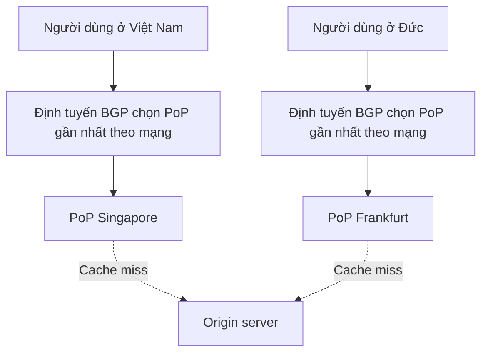
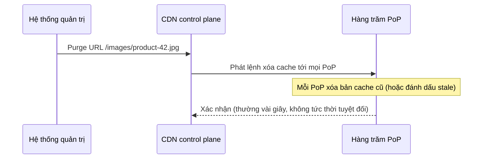
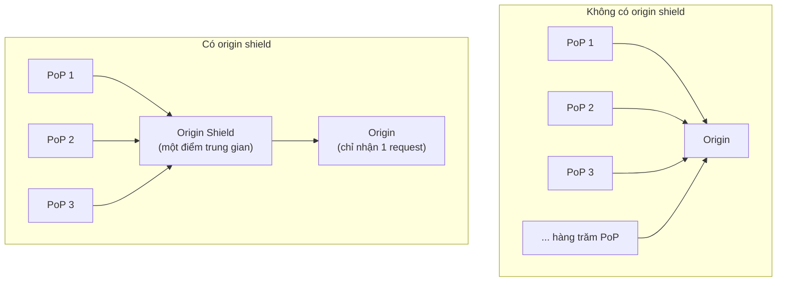

# CDN và Edge Caching

Bài [HTTP/2, HTTP/3, thời gian thực và Load Balancer](/go?p=03-Network-Security%2Fhard%2Flt-06-http2-3-realtime-lb.md) đã nói về load balancer tầng 4/tầng 7, reverse proxy và service mesh — những thành phần đứng **trước server của bạn**, trong hạ tầng bạn kiểm soát. CDN giải quyết một vấn đề khác: làm sao phục vụ người dùng ở Tokyo nhanh như người dùng ở cạnh datacenter, khi tốc độ ánh sáng không đổi và RTT tỉ lệ với khoảng cách vật lý. Bài này tập trung vào cơ chế CDN: cache ở đâu, khi nào cache đúng, và làm sao "xóa cache" trên hàng trăm điểm khắp thế giới mà không mất nhiều phút.

**Tóm tắt:**

- CDN đặt bản sao nội dung tại nhiều điểm (edge location, PoP) gần người dùng về mặt địa lý, nên request không cần đi hết chặng đường tới server gốc (origin) mỗi lần.
- Anycast/GeoDNS định tuyến người dùng tới PoP gần nhất mà không cần biết trước IP cụ thể; cùng một địa chỉ IP trả về từ nhiều nơi trên thế giới.
- Nội dung tĩnh (ảnh, CSS, JS, video) cache tốt vì không đổi theo từng người dùng; nội dung động (giỏ hàng, trang cá nhân hóa) thường không cache được trực tiếp, nhưng có thể cache một phần qua edge compute.
- Cache key quyết định hai request có được coi là "cùng một nội dung" không; mặc định dựa trên URL, nhưng cấu hình sai (quên vary theo header `Accept-Encoding`, cookie) gây lỗi nghiêm trọng: trả nhầm nội dung của người này cho người khác.
- Cache invalidation (xóa/làm mới cache khi nội dung đổi) có hai cách: chờ hết TTL (đơn giản, có độ trễ), hoặc purge chủ động (tức thời nhưng cần gọi API cho toàn bộ PoP).
- Origin shield là một lớp cache trung gian giữa edge và origin, gom nhiều edge PoP lại gọi chung một lần tới origin khi cache miss, tránh "thundering herd" làm sập origin lúc nội dung mới hết hạn đồng loạt.
- CDN cũng hấp thụ một phần tấn công DDoS: lưu lượng dừng lại ở edge (được cache hoặc bị chặn bởi WAF tích hợp) trước khi chạm tới origin, vì tổng băng thông của CDN lớn hơn nhiều so với một server đơn lẻ.
- `Cache-Control`, `ETag`, `Last-Modified` là các header HTTP (đã học ở bài HTTP chi tiết) điều khiển CDN cache bao lâu và cách revalidate; CDN không tự "biết" nên cache gì nếu origin không khai đúng header.

## Vấn đề nó giải quyết

Độ trễ mạng tỉ lệ thuận với khoảng cách vật lý (ánh sáng trong cáp quang đi khoảng 200.000 km/s, nên 10.000 km tốn khoảng 50ms một chiều, 100ms khứ hồi — chưa kể các chặng trung gian). Nếu origin đặt ở Singapore, người dùng ở São Paulo chịu ít nhất vài trăm ms chỉ để gói tin đi tới nơi, trước khi server kịp xử lý gì. CDN giải quyết bằng cách **di chuyển dữ liệu tới gần người dùng trước**, thay vì bắt người dùng đi xa tới dữ liệu.

## Khi nào dùng, khi nào không

- **Nên dùng**: tài nguyên tĩnh (ảnh, video, CSS/JS, file tải xuống), API có response giống nhau cho nhiều người dùng (danh mục sản phẩm công khai), trang nội dung ít đổi (blog, tài liệu).
- **Cân nhắc kỹ**: nội dung cá nhân hóa theo từng người dùng (giỏ hàng, dashboard) — cache sai sẽ lộ dữ liệu người khác; cần cache key đúng hoặc tách riêng phần cá nhân hóa ra khỏi phần cache được.
- **Không cache**: thao tác có side effect (POST đặt hàng, thanh toán) — những request này phải luôn chạm tới origin.

## Anycast và GeoDNS: tới PoP gần nhất bằng cách nào

**Anycast**: nhiều server ở nhiều nơi trên thế giới quảng bá **cùng một địa chỉ IP** qua BGP (giao thức định tuyến giữa các mạng lớn). Khi một người dùng gửi gói tới địa chỉ đó, hạ tầng định tuyến Internet (không phải CDN) tự chọn đường đi "gần nhất" theo số chặng mạng, và gói tin tới PoP gần người dùng nhất về mặt định tuyến — không nhất thiết là gần nhất theo khoảng cách địa lý thẳng, vì nó phụ thuộc cấu trúc mạng thực tế.

**GeoDNS**: thay vì một IP dùng chung, DNS trả về **IP khác nhau** tùy vị trí địa lý của resolver gửi truy vấn (suy ra từ IP của resolver). Đơn giản hơn anycast về mặt vận hành nhưng kém chính xác hơn (dựa vào vị trí của resolver DNS, không phải vị trí thật của client, và không phản ứng nhanh khi một PoP gặp sự cố).

**Phải thuộc:** Anycast định tuyến ở tầng mạng (BGP, một IP dùng chung, phản ứng nhanh khi một PoP sập vì BGP tự route traffic sang PoP khác); GeoDNS định tuyến ở tầng DNS (nhiều IP khác nhau theo vùng, đơn giản hơn nhưng cache DNS theo TTL khiến phản ứng chậm hơn khi cần đổi vùng phục vụ).

## Cache key: điều gì được cache như "cùng một thứ"

Edge PoP lưu nội dung đã cache gắn với một **cache key**. Mặc định, nhiều CDN chỉ lấy host + path làm key, bỏ qua query string, header, cookie — đây là nguồn gốc của nhiều lỗi nghiêm trọng.

| Tình huống cấu hình sai | Hậu quả |
|---|---|
| Quên `Vary: Accept-Encoding` | Client không hỗ trợ gzip nhận nhầm response đã nén của client khác (cùng URL), có thể không giải nén được |
| Cache theo path nhưng bỏ qua cookie trong khi response thực tế đổi theo cookie (ví dụ theo session) | Người dùng A thấy nội dung cá nhân hóa của người dùng B — rò rỉ dữ liệu nghiêm trọng |
| Cache bỏ qua query string trong khi API dùng query string để lọc dữ liệu (`?userId=123`) | Mọi người dùng nhận cùng một kết quả của người dùng đầu tiên gọi |
| Cache response lỗi (500) vì origin trả lỗi kèm `Cache-Control: public, max-age=3600` nhầm | Toàn bộ người dùng tiếp theo nhận lỗi trong suốt 1 giờ dù origin đã hết lỗi |

**Phải thuộc:** Cache key phải phản ánh đúng **mọi yếu tố khiến response khác nhau**. Nếu response đổi theo header hoặc cookie, phải khai `Vary` đúng hoặc đưa yếu tố đó vào cache key; nếu response đổi theo query string, không được cấu hình CDN bỏ qua query string. Lỗi cache key là lớp lỗi nguy hiểm nhất của CDN vì hậu quả là rò rỉ dữ liệu, không chỉ là hiệu năng.

## Cache invalidation: xóa cache đúng lúc

Hai chiến lược, thường dùng kết hợp:

1. **TTL-based (passive)**: origin khai `Cache-Control: max-age=N`; sau N giây, PoP tự coi bản cache là "stale" và đi hỏi lại origin (hoặc dùng `ETag`/`Last-Modified` để revalidate: hỏi "còn mới không?", origin trả `304 Not Modified` nếu chưa đổi, tiết kiệm băng thông vì không phải gửi lại toàn bộ nội dung).
2. **Purge chủ động (active)**: khi nội dung đổi đột xuất (sửa bài viết, cập nhật ảnh sản phẩm), gọi API của CDN để xóa cache theo URL hoặc theo tag, trên **toàn bộ** PoP ngay lập tức, không chờ TTL hết hạn.

**Phải thuộc:** Purge không phải tức thời tuyệt đối trên mọi CDN (có độ trễ lan truyền vài giây đến vài chục giây tùy nhà cung cấp); với nội dung cần chính xác ngay (giá sản phẩm thay đổi theo giây), nên đặt `max-age` ngắn kết hợp revalidate (`ETag`) thay vì chỉ trông cậy vào purge.

### Thundering herd và origin shield

Khi một nội dung được nhiều PoP cùng cache và TTL của tất cả hết hạn gần như đồng thời (ví dụ deploy mới làm toàn bộ cache bị purge cùng lúc), mỗi PoP riêng biệt sẽ tự đi hỏi lại origin — hàng trăm request đổ về origin cùng lúc cho **cùng một nội dung**, có thể làm sập origin dù bình thường origin xử lý tốt.

**Origin shield** là một lớp cache trung gian (thường đặt gần origin về mặt địa lý) mà mọi PoP phải đi qua khi cache miss, thay vì gọi thẳng origin. Khi nhiều PoP cùng miss một nội dung gần như đồng thời, origin shield gộp lại (request coalescing): chỉ request đầu tiên thật sự đi tới origin, các request miss sau đó trong lúc đang chờ được giữ lại và dùng chung kết quả khi nó về, thay vì mỗi cái tự gọi origin riêng.

**Phải thuộc:** Origin shield không phải thêm một tầng cache để nhanh hơn, mà để **giảm số lượng request tới origin** từ "hàng trăm PoP × mỗi PoP một request" xuống gần "một request" mỗi khi cache miss đồng loạt — bảo vệ origin khỏi thundering herd.

## CDN hấp thụ DDoS

Vì CDN có tổng băng thông và năng lực xử lý lớn hơn nhiều một origin đơn lẻ (hàng trăm PoP trên toàn cầu), phần lớn lưu lượng tấn công volumetric dừng lại ở edge: nội dung tĩnh đã có sẵn trong cache nên phục vụ ngay không chạm origin; WAF tích hợp ở edge chặn request độc hại trước khi đi xa hơn; với tấn công nhắm vào một PoP cụ thể, anycast cho phép BGP tự định tuyến traffic sang PoP khác (traffic re-routing) gần như ngay lập tức. Đây là lý do nhiều hệ thống đặt toàn bộ traffic công khai sau một CDN ngay cả khi không quan tâm tới hiệu năng cache — nó đồng thời là lớp chống DDoS giá rẻ nhất.

## Điều cần nhớ

- CDN rút ngắn khoảng cách vật lý bằng cách đặt bản sao nội dung ở nhiều PoP; anycast định tuyến ở tầng BGP (nhanh, phản ứng tốt khi sự cố), GeoDNS định tuyến ở tầng DNS (đơn giản hơn, phản ứng chậm hơn).
- Cache key phải phản ánh đúng mọi yếu tố làm response khác nhau (header, cookie, query string); sai cache key là lỗi rò rỉ dữ liệu, không chỉ lỗi hiệu năng.
- Invalidation kết hợp TTL (đơn giản, có độ trễ) và purge chủ động (nhanh hơn nhưng không tức thời tuyệt đối trên mọi PoP).
- Origin shield gộp nhiều request miss đồng thời từ các PoP thành một request tới origin, chống thundering herd khi cache hết hạn đồng loạt.
- CDN đồng thời là lớp chống DDoS: băng thông và WAF ở edge hấp thụ phần lớn tấn công trước khi chạm origin.
