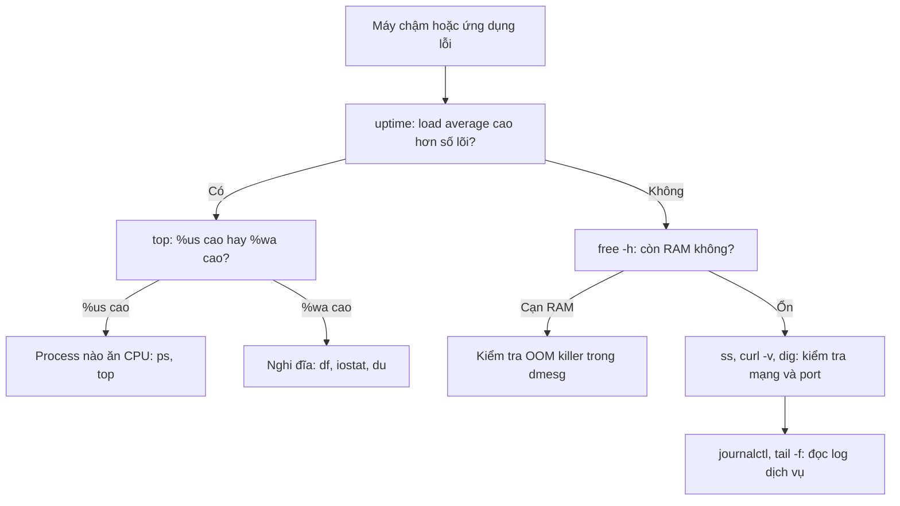
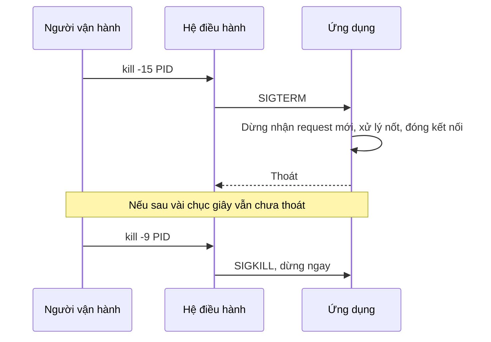

# Linux và dòng lệnh cơ bản

## Linux là gì và vì sao lập trình viên cần nó?

Linux là hệ điều hành mà hầu hết server, container và máy trên cloud đang chạy. Khác với máy tính cá nhân, trên server bạn gần như không có giao diện đồ họa (GUI). Bạn làm việc qua **shell**, tức một chương trình nhận lệnh bạn gõ (thường là `bash`) rồi nhờ hệ điều hành thực hiện. Có thể hình dung shell như quầy lễ tân: bạn đưa request bằng chữ, lễ tân chuyển cho đúng bộ phận và trả kết quả về.

Vấn đề thực tế là thế này: production hỏng lúc nửa đêm và bạn chỉ có một cửa sổ SSH (kết nối từ xa an toàn vào server). Nếu không biết đọc log, xem process, kiểm tra ổ đĩa hay RAM thì bạn không biết bắt đầu từ đâu. Ngoài ra Dockerfile và script CI cũng toàn là lệnh Linux, nên kỹ năng này được dùng lại ở mọi bài sau trong phần DevOps.

Bạn dùng kiến thức bài này khi SSH vào server, đọc log, chẩn đoán CPU/RAM/đĩa/mạng, viết Dockerfile và pipeline CI. Việc lặp lại nhiều lần thì đừng gõ tay mà viết thành script (xem mục "Shell script an toàn"). Bài đi theo thứ tự: cấu trúc thư mục và authorization (`chmod`, `chown`), nối lệnh bằng pipe để xử lý văn bản (`grep`, `awk`, `sort`), các lệnh chẩn đoán (`df`, `free`, `ss`, `journalctl`, `tail -f`), rồi process và signal (`ps`, `top`, `kill`).

**Nền tảng:** Trong Linux "mọi thứ là file" và mọi chương trình là một process có PID; shell chỉ là chương trình nhận lệnh rồi nhờ kernel làm. Nhờ đó các lệnh nhỏ (đọc file, lọc, đếm) ghép được với nhau bằng pipe, đây là cách chẩn đoán trên server.

**Tóm tắt:**

- Trên server bạn làm việc qua shell; mọi thứ là file và mọi chương trình là một process có PID, nên các lệnh nhỏ ghép được với nhau bằng pipe.
- Quyền file gồm ba nhóm (chủ, nhóm, người khác) với bit đọc 4, ghi 2, thực thi 1; dùng quyền tối thiểu, không `chmod 777`, không chạy dịch vụ bằng root.
- Chẩn đoán theo thứ tự tài nguyên: load average so với số lõi, rồi CPU hay chờ đĩa, RAM, mạng, cuối cùng là log của dịch vụ.
- Mẫu thống kê `sort | uniq -c | sort -rn` phải `sort` trước vì `uniq` chỉ gộp dòng liền kề.
- SIGTERM (15) nhờ process tắt êm, SIGKILL (9) buộc dừng ngay nên chỉ dùng sau cùng; Docker và Kubernetes cũng gửi SIGTERM trước.
- OOM killer của kernel tự giết process khi hết RAM, nên ứng dụng "tự biến mất" mà không có lỗi trong log của nó thì xem `dmesg`.
- Script bash nghiêm túc mở đầu bằng `set -euo pipefail`, luôn đặt biến trong nháy kép, và dùng SSH key thay mật khẩu.

## Các khái niệm cần biết

- **Process**: một chương trình đang chạy, có số định danh **PID**. Mọi việc như theo dõi, tắt, giới hạn tài nguyên đều thao tác trên PID.
- **Signal**: thông điệp ngắn hệ điều hành gửi cho process, ví dụ SIGTERM ("hãy tắt") hoặc SIGKILL ("bị buộc tắt"). Dùng khi cần dừng ứng dụng, xem mục "Process và signal".
- **Pipe `|`**: nối đầu ra của lệnh trước vào đầu vào lệnh sau, nhờ đó ghép các lệnh nhỏ thành công cụ phân tích mạnh. Ví dụ `grep ERROR app.log | wc -l` đếm số dòng lỗi.
- **systemd / `systemctl`**: trình quản lý dịch vụ của hầu hết bản phân phối hiện đại; nó khởi động ứng dụng, có thể tự chạy lại khi chết và gom log vào `journalctl`.
- **OOM killer**: cơ chế của kernel tự giết process khi RAM cạn để cứu cả hệ thống. Dấu hiệu là ứng dụng "tự biến mất" mà không có lỗi trong log của nó, còn `dmesg` có dòng `Out of memory`.
- **Load average**: số process đang chạy hoặc chờ trung bình trong 1, 5, 15 phút, dùng để biết máy có quá tải không (giải thích kỹ ở phần ví dụ bên dưới).
- **Bastion / jump host**: máy trung gian duy nhất mở ra Internet; muốn vào mạng nội bộ phải SSH qua nó. Dùng để giảm bề mặt tấn công.

## Hệ thống file và quyền

| Đường dẫn | Nội dung |
|---|---|
| `/etc` | Cấu hình |
| `/var/log` | Log |
| `/tmp` | Tạm |
| `/home`, `/root` | Thư mục người dùng |
| `/proc`, `/sys` | Thông tin kernel và process (giả lập) |

Quyền `rwxr-xr--`: chủ sở hữu, nhóm, người khác; mỗi nhóm đọc (4), ghi (2), thực thi (1). `chmod 640 file`, `chown user:group file`. Nguyên tắc: **quyền tối thiểu**, đừng `chmod 777`, đừng chạy dịch vụ bằng root.

**Phải thuộc:** Quyền file gồm ba nhóm (chủ, nhóm, người khác), mỗi nhóm cộng các bit đọc 4, ghi 2, thực thi 1. Ví dụ `750` là chủ 7 (rwx), nhóm 5 (r-x), người khác 0; `600` cho file bí mật; thư mục cần `x` mới `cd` vào được.

## Lệnh đọc và xử lý văn bản

```bash
tail -f app.log                         # theo dõi log trực tiếp
grep -n "ERROR" app.log | tail -20      # lọc
grep -c "timeout" app.log               # đếm
# thống kê mã trạng thái
awk '{print $9}' access.log | sort | uniq -c | sort -rn | head
sed -n '100,200p' file                  # in dòng 100-200
find / -name "*.log" -mtime +7          # tìm tệp cũ
```

Pipe `|` nối đầu ra của lệnh này vào đầu vào lệnh sau; `>` ghi đè, `>>` ghi nối thêm, `2>&1` gộp lỗi vào đầu ra thường.

**Phải thuộc:** Cú pháp chuyển hướng: `|` nối lệnh, `>` ghi đè, `>>` ghi nối, `2>&1` gộp stderr vào stdout. Mẫu thống kê kinh điển: `sort | uniq -c | sort -rn` (phải `sort` trước `uniq -c` vì `uniq` chỉ gộp các dòng liền kề).

## Chẩn đoán hệ thống

Khi máy chậm hoặc ứng dụng có vấn đề, đừng đoán mò. Hãy kiểm tra lần lượt từng loại tài nguyên (CPU, memory, đĩa, mạng) để khoanh vùng nguyên nhân trước khi sửa. Sơ đồ dưới đây là thứ tự suy nghĩ gợi ý.



Đọc sơ đồ: bắt đầu từ load average để biết máy có đang quá tải không. Nếu có thì tách ra CPU thật sự bận (`%us`) hay đang chờ đĩa (`%wa`). Nếu không quá tải thì chuyển sang RAM, mạng và cuối cùng là log của chính dịch vụ.

| Tài nguyên | Lệnh |
|---|---|
| CPU | `top`, `htop`, `uptime` (load average) |
| Memory | `free -h`, `vmstat`; OOM killer trong `dmesg` |
| Đĩa | `df -h` (dung lượng), `du -sh` (thư mục lớn), `iostat` |
| Mạng | `ss -tan`, `curl -v`, `dig`, `ping`, `traceroute` |
| Process | `ps aux`, `lsof -p`, `strace` |

| Việc | Lệnh |
|---|---|
| Ai đang giữ port 8080 | `ss -ltnp \| grep 8080` hoặc `lsof -i :8080` |
| Process ăn nhiều RAM nhất | `ps aux --sort=-%mem \| head` |
| Đĩa đầy do đâu | `du -ah / 2>/dev/null \| sort -rh \| head -20` |
| Log hệ thống của dịch vụ | `journalctl -u myapp -f` |
| Điều khiển dịch vụ | `systemctl status\|start\|restart myapp` |

**Phải thuộc:** **Load average** là số process đang chạy hoặc chờ trung bình trong 1, 5, 15 phút; so sánh với số lõi CPU (load lớn hơn số lõi là quá tải). **OOM killer** của kernel giết process khi hết RAM (container bị `OOMKilled` là trường hợp tương tự).

## Đọc output: ví dụ minh họa

**Quyền file** (`ls -l`): ký tự đầu là loại (`-` file, `d` thư mục), sau đó ba nhóm `rwx` cho chủ, nhóm, người khác.

```text
-rwxr-x---  1 app  devs  1520 Oct 27 10:00 deploy.sh
```

Chủ `app` đọc/ghi/chạy (7), nhóm `devs` đọc/chạy (5), người khác không có quyền (0), tức `chmod 750`. Thư mục cần quyền `x` mới `cd` vào được. File chứa mật khẩu nên là `600`.

**Ai giữ port 8080** (output minh họa):

```text
$ ss -ltnp | grep 8080
LISTEN 0 100 *:8080 *:*  users:(("java",pid=4321,fd=45))
$ ps -o pid,etime,rss,cmd -p 4321
  PID     ELAPSED   RSS CMD
 4321    02:15:10 812340 java -jar app.jar
```

Đọc: process `java` PID 4321 đang nghe port 8080, chạy 2 giờ 15 phút, RSS khoảng 800 MB. Lỗi `Address already in use` khi khởi động nghĩa là port này đã có chủ; `kill -15 4321` rồi chạy lại. Cần `sudo` mới thấy process của người dùng khác.

**Load average** (output minh họa):

```text
$ uptime
 10:42:07 up 12 days,  load average: 7.80, 6.10, 3.20
$ nproc
4
```

Ba số là trung bình 1, 5, 15 phút. Máy 4 lõi mà load 7.8 nghĩa là trung bình gần gấp đôi số lõi đang chờ CPU (hoặc chờ I/O, vì Linux tính cả process ở state D). Chiều tăng (3.2 rồi 6.1 rồi 7.8) cho thấy đang xấu đi. Bước tiếp theo: `top` xem `%us` (CPU người dùng) so với `%wa` (chờ I/O); `%wa` cao thì nghi đĩa, không phải CPU.

**Pipe thống kê log** (đã chạy xác nhận với `access.log` 6 dòng ở định dạng combined, trường `$9` là status code):

```bash
awk '{print $9}' access.log | sort | uniq -c | sort -rn
#       3 200
#       1 500
#       1 404
#       1 201
awk '$9 >= 500 {c++} END {print c+0 " loi 5xx"}' access.log   # đếm có điều kiện
awk '{print $1}' access.log | sort | uniq -c | sort -rn | head -3   # IP gọi nhiều nhất
```

Quy tắc nhớ: `sort` trước `uniq -c` (vì `uniq` chỉ gộp các dòng liền kề), `sort -rn` để xếp số giảm dần.

## Process và signal

Signal là cách hệ điều hành "nói chuyện" với process. Hai signal bạn dùng nhiều nhất:

- `kill -15 PID` (SIGTERM) là lời nhờ lịch sự: "hãy tắt". Ứng dụng nhận được có thể đóng kết nối, ghi nốt dữ liệu rồi thoát (tắt êm, graceful shutdown).
- `kill -9` (SIGKILL) buộc dừng ngay, process không có cơ hội dọn dẹp và không bắt được signal này. Chỉ dùng khi SIGTERM không có tác dụng. Hệ quả nếu lạm dụng: mất dữ liệu đang ghi dở, để lại lock file, kết nối treo.
- Ứng dụng nên bắt SIGTERM để tắt êm (Spring: `server.shutdown=graceful`). Docker và Kubernetes cũng gửi SIGTERM trước, đợi một khoảng rồi mới SIGKILL.
- Process nền: `nohup` chỉ phù hợp việc tạm thời; với dịch vụ chạy lâu dài hãy dùng `systemd` hoặc container để nó tự khởi động lại và có log tập trung.

**Phải thuộc:** SIGTERM (15) là yêu cầu tắt lịch sự, ứng dụng bắt được để tắt êm; SIGKILL (9) buộc dừng ngay, không bắt được. Luôn thử SIGTERM trước. Docker và Kubernetes cũng gửi SIGTERM rồi mới SIGKILL sau thời gian chờ.



**Suy luận:** Kernel không biết gì về dữ liệu đang ghi dở hay kết nối đang mở của ứng dụng, chỉ ứng dụng mới biết cách dọn dẹp an toàn. Vì vậy hệ điều hành chia việc dừng process thành hai bước: SIGTERM là lời nhờ mà process có thể bắt (handler) để tự đóng kết nối, ghi nốt dữ liệu rồi thoát, còn SIGKILL do chính kernel thi hành nên process không bắt được, không chạy được bất kỳ đoạn code dọn dẹp nào. Từ đó suy ra thứ tự đúng: luôn thử SIGTERM, đợi một khoảng hợp lý, chỉ khi không thoát mới dùng SIGKILL. Cũng vì vậy Docker và Kubernetes gửi SIGTERM, chờ hết `terminationGracePeriodSeconds` rồi mới SIGKILL, và ứng dụng chỉ tắt êm được nếu thực sự xử lý SIGTERM (Spring dùng `server.shutdown=graceful`). Chỗ dễ nhầm là script khởi động bọc ứng dụng trong shell: process nhận SIGTERM là shell chứ không phải JVM, nên ứng dụng không bao giờ được báo tắt và cuối cùng bị SIGKILL; cách sửa là dùng `exec java ...` hoặc định dạng exec của `ENTRYPOINT`. Khi review Dockerfile và script deploy, hãy kiểm tra PID 1 là chính ứng dụng và thời gian chờ đủ lâu cho request đang xử lý.

## Shell script an toàn

```bash
#!/usr/bin/env bash
set -euo pipefail      # dừng khi lỗi, biến chưa gán, lỗi trong pipe
trap 'echo "lỗi ở dòng $LINENO" >&2' ERR
```

**Phải thuộc:** Đầu mọi script bash nghiêm túc: `set -euo pipefail` (`-e` dừng khi lệnh lỗi, `-u` biến chưa gán là lỗi, `pipefail` cả pipe lỗi nếu một lệnh trong đó lỗi) và luôn đặt biến trong nháy kép `"$var"`.

Ý nghĩa từng cờ: `-e` dừng script ngay khi một lệnh trả mã lỗi, `-u` coi biến chưa gán là lỗi (tránh `rm -rf "$DIR/"` khi `DIR` rỗng thành xóa gốc), `-o pipefail` làm cả pipe thất bại nếu bất kỳ lệnh nào trong pipe lỗi (mặc định chỉ xét lệnh cuối). `trap ... ERR` chạy một đoạn lệnh khi có lỗi, hữu ích để in dòng gây lỗi.

Luôn đặt biến trong dấu nháy kép (`"$var"`) để tên file có dấu cách không bị tách thành nhiều tham số, và kiểm tra tham số đầu vào. Khi script đủ phức tạp (nhiều nhánh, xử lý dữ liệu có cấu trúc), nên chuyển sang Python hoặc công cụ chuyên dụng thay vì cố nhồi vào bash.

## SSH

SSH là giao thức đăng nhập từ xa có encryption. Cách làm an toàn: dùng **SSH key** (một cặp public key và private key; server giữ public key, bạn giữ private key) thay mật khẩu, tắt đăng nhập root và mật khẩu, bastion/jump host cho mạng nội bộ, `~/.ssh/config` cho tên rút gọn. Không chia sẻ private key.

## Điều cần nhớ

- "Mọi thứ là file": cấu hình, thiết bị, process đều đọc được như file.
- Trước khi sửa trên production: backup cấu hình, thay đổi từng bước, ghi lại đã làm gì.
- Học vài công cụ rất kỹ (`grep`, `awk`, `sed`, `ss`, `journalctl`) hơn là nhiều công cụ nông.

