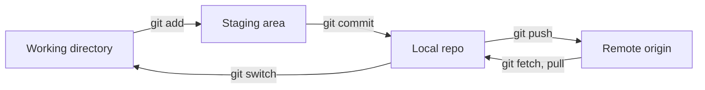
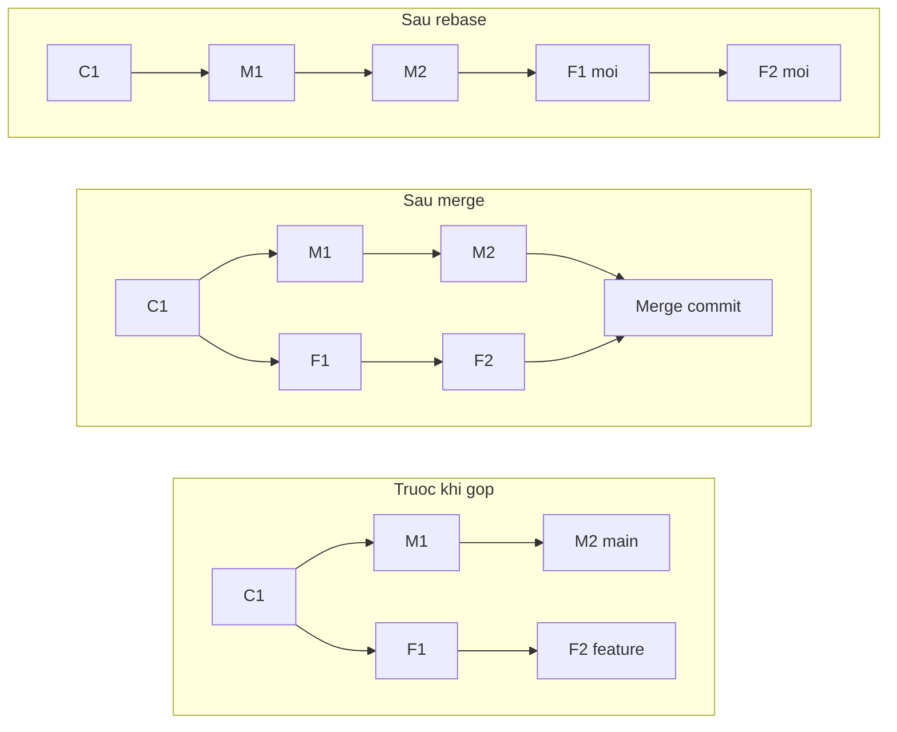
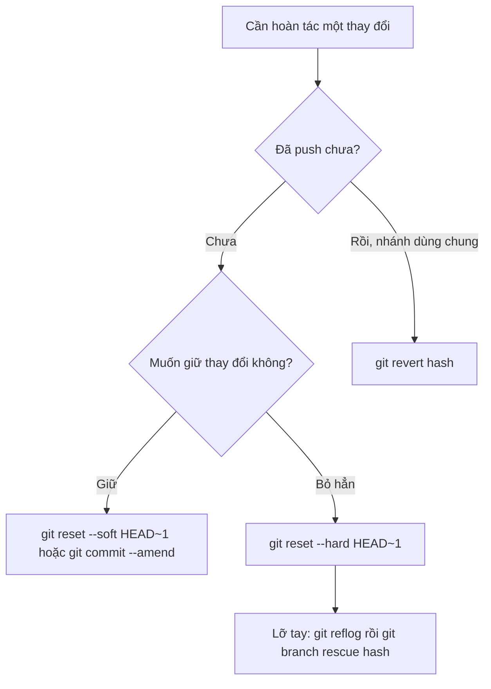

# Git

## Git là gì và giải quyết vấn đề gì?

Git là công cụ lưu lịch sử code. Mỗi lần **commit** là một ảnh chụp của cả dự án tại thời điểm đó, và các commit nối với nhau thành một đồ thị (mỗi commit trỏ tới commit trước nó). Điểm khác biệt quan trọng là Git phân tán: mỗi máy đều giữ bản đầy đủ lịch sử, nên bạn commit, xem lịch sử, tạo nhánh ngay trên máy mà không cần mạng.

Hãy tưởng tượng không có Git. Nhiều người sửa chung một file sẽ đè lên nhau, sửa hỏng thì không quay lại được, và không ai biết dòng code này ai viết, vì sao. Cách "chữa" bằng cách copy thư mục `du-an-final-v2-that-su-final` rất nhanh thành mớ hỗn độn. Có Git thì bạn tách nhánh thử ý tưởng thoải mái, hỏng thì bỏ nhánh, tốt thì gộp lại.

Bạn nên dùng Git ở hầu như mọi dự án, kể cả dự án một người. Chỗ Git không hợp là file nhị phân lớn (video, model học máy): mỗi lần đổi, kho lưu lại cả bản mới nên kho phình rất nhanh. Khi đó hãy dùng Git LFS hoặc nơi lưu trữ riêng. Để dùng tốt, bạn cần hiểu ba vùng (working directory, staging, repository) và việc commit là một đồ thị; làm việc bằng nhánh, gộp bằng `merge` hoặc `rebase`, và biết cứu khi lỡ tay (`reflog`, `reset`, `revert`). Quy tắc vàng: không rebase nhánh đã push cho người khác dùng.

**Nền tảng:** Git lưu lịch sử như một đồ thị các ảnh chụp (commit), mỗi commit trỏ tới commit cha; nhánh và HEAD chỉ là con trỏ vào đồ thị đó. Hiểu điều này thì merge, rebase, reset, reflog đều trở thành "di chuyển con trỏ" và dễ suy luận, thay vì là các lệnh thần bí.

**Tóm tắt:**

- Commit là ảnh chụp toàn bộ dự án kèm con trỏ tới commit cha; nhánh và HEAD chỉ là con trỏ, nên tạo nhánh gần như tức thì.
- Ba vùng: working directory, staging area, repository; `git pull` là `fetch` cộng gộp vào nhánh hiện tại.
- Merge giữ nguyên lịch sử bằng commit gộp; rebase phát lại commit của bạn thành commit mới (hash khác) cho lịch sử tuyến tính.
- Không rebase hay viết lại lịch sử đã chia sẻ; khi buộc phải ghi đè nhánh cá nhân thì dùng `--force-with-lease`.
- Chưa push thì được sửa lịch sử (`reset`, `amend`); đã push lên nhánh dùng chung thì chỉ `revert`.
- Lỡ tay thì `git reflog` tìm lại commit "đã mất" rồi `git branch rescue`; reflog chỉ có ở máy cục bộ và không cứu được phần chưa từng commit.
- Chọn chiến lược nhánh theo cách phát hành (trunk-based, GitHub Flow, Git Flow); bí mật lỡ commit coi như đã lộ dù đã xóa.

## Các khái niệm cần biết

- **Commit**: một ảnh chụp toàn bộ dự án kèm tác giả, message và con trỏ tới commit cha. Định danh bằng hash, ví dụ `66d5aec`. Đổi bất cứ thứ gì trong commit là ra hash khác.
- **Branch**: chỉ là một con trỏ có tên tới một commit. Vì vậy tạo nhánh gần như tức thì và rẻ.
- **HEAD**: con trỏ tới nơi bạn đang đứng (thường là nhánh hiện tại).
- **Remote / origin**: bản sao kho ở server (GitHub, GitLab...) mà bạn đẩy lên và lấy về. `origin` là tên mặc định.
- **Staging area (index)**: vùng đệm chứa những thay đổi bạn đã chọn để đưa vào commit kế tiếp. Dùng để commit gọn từng ý thay vì "mọi thứ đang sửa dở".
- **Fast-forward**: khi nhánh đích chưa có commit mới nào, gộp chỉ là dời con trỏ lên, không cần commit gộp.
- **Squash**: nén nhiều commit của nhánh tính năng thành một khi gộp, để lịch sử `main` gọn.
- **Reflog**: log các lần `HEAD` di chuyển trên máy bạn, là lưới an toàn khi lỡ tay (xem mục cứu commit).
- **Stash**: ngăn tạm để cất thay đổi chưa commit, ví dụ khi cần chuyển nhánh gấp.
- **Cherry-pick, bisect**: sao chép một commit sang nhánh khác; tìm commit gây lỗi bằng chia đôi lịch sử (có ví dụ bên dưới).

## Mô hình ba vùng



Commit là **ảnh chụp** toàn bộ dự án kèm con trỏ tới commit cha, định danh bằng hash. Nhánh chỉ là **con trỏ** tới một commit, nên tạo nhánh gần như tức thì.

**Phải thuộc:** Ba vùng: working directory, staging area (index), repository. `git add` chuyển từ working sang staging, `git commit` chốt vào repo cục bộ, `git push` đưa lên remote. `git pull` = `git fetch` + gộp vào nhánh hiện tại.

Đọc sơ đồ: sửa file ở working directory, `git add` chuyển thay đổi đã chọn sang staging, `git commit` chốt chúng vào repo cục bộ, `git push` mới đưa lên remote. Chiều ngược lại, `git fetch` chỉ tải commit mới về còn `git pull` là fetch cộng gộp vào nhánh hiện tại.

## Lệnh hằng ngày

Một vòng làm việc điển hình: tạo nhánh, sửa, chọn phần cần commit, cập nhật theo `main`, đẩy lên.

```bash
git status
git switch -c feature/login          # tạo và chuyển nhánh
git add -p                           # chọn từng phần thay đổi để commit
git commit -m "Thêm đăng nhập bằng email"
git fetch origin && git rebase origin/main
git push -u origin feature/login
git log --oneline --graph --decorate
git diff --staged
```

## Merge và Rebase

Vấn đề đặt ra: nhánh `feature` của bạn rẽ ra từ `main`, trong lúc đó `main` có thêm commit. Bạn cần gộp hai dòng lịch sử lại. Git có hai cách: `merge` (nối hai dòng bằng một commit gộp) và `rebase` (phát lại commit của bạn lên đỉnh mới của `main`). Bảng dưới so sánh.

| | Merge | Rebase |
|---|---|---|
| Cách làm | Tạo commit gộp hai nhánh | Phát lại commit của bạn lên đầu nhánh đích |
| Lịch sử | Giữ nguyên, có "nhánh rẽ" | **Tuyến tính**, sạch hơn |
| Rủi ro | Ít | Viết lại lịch sử: không rebase nhánh đã chia sẻ cho người khác |
| Dùng khi | Gộp nhánh tính năng vào `main` (có thể squash) | Cập nhật nhánh cá nhân với `main` trước khi gộp |

**Phải thuộc:** Merge giữ nguyên lịch sử và tạo commit gộp; rebase phát lại commit của bạn lên đỉnh nhánh đích, cho lịch sử tuyến tính nhưng viết lại lịch sử (tạo commit mới, hash khác). Quy tắc vàng: không rebase nhánh đã chia sẻ cho người khác.

Quy tắc: **không viết lại lịch sử đã đẩy lên nhánh dùng chung**. Dùng `git push --force-with-lease` thay `--force` khi buộc phải ghi đè nhánh cá nhân.

### Hình dung merge và rebase

Cùng một tình huống: `main` có thêm commit M1, M2 sau khi bạn rẽ nhánh `feature` (F1, F2).



Rebase không di chuyển F1, F2 mà **tạo commit mới** (F1', F2') có hash khác, rồi đưa nhãn nhánh sang đó. Vì vậy ai đã lấy F1, F2 cũ sẽ bị lệch lịch sử, đó là lý do không rebase nhánh chia sẻ.

**Suy luận:** Hash của một commit được tính từ nội dung, tác giả, message và hash của commit cha, nên chỉ cần đổi commit cha là mọi commit phía sau đều đổi hash. Đó là lý do lịch sử Git không thể "sửa" mà chỉ có thể thay bằng một chuỗi commit mới. Rebase phát lại F1, F2 lên đỉnh mới của `main`, nghĩa là cha của F1 đã đổi nên F1 và F2 trở thành các commit mới F1' và F2', còn F1, F2 cũ chỉ còn nằm trong reflog. Với nhánh chỉ mình bạn dùng điều này vô hại và còn cho lịch sử tuyến tính dễ đọc. Nhưng nếu người khác đã lấy F1, F2 cũ về, nhánh của họ vẫn dựa trên chuỗi hash cũ, và khi họ gộp với nhánh đã rebase của bạn, Git thấy hai chuỗi commit khác nhau cùng sửa một nội dung nên sinh xung đột hoặc commit trùng lặp. Từ đó suy ra quy tắc vàng, và cũng suy ra vì sao `revert` an toàn trên nhánh chung: nó chỉ thêm một commit mới ở cuối, không đụng tới hash nào đã có. Điểm dễ nhầm là nghĩ `--force` chỉ "đẩy lên cho đồng bộ"; thực tế nó ghi đè lịch sử trên remote và có thể xóa commit của đồng đội, nên `--force-with-lease` (chỉ ghi đè khi remote vẫn như bạn đã thấy) mới là mặc định hợp lý. Khi làm việc nhóm, hãy rebase nhánh cá nhân trước khi mở pull request, bảo vệ `main` khỏi force push, và dùng `revert` để hoàn tác thay đổi đã gộp.

### Giải quyết xung đột (đã chạy xác nhận với Git 2.34)

Hai nhánh cùng sửa dòng `timeout` trong `app.conf`; chạy `git rebase main` trên `feature`:

```text
Could not apply c363459... f1
<<<<<<< HEAD
timeout=20          <- phía main (đích đang được phát lại lên)
=======
timeout=30          <- commit của bạn (f1)
>>>>>>> c363459 (f1)
```

Trong lúc rebase, `HEAD` là phía đích (`main`), còn phần dưới `=======` là commit của bạn; khi `merge` thì ngược lại (`HEAD` là nhánh bạn đang đứng). Quy trình: sửa file thành giá trị đúng và xóa các dấu, rồi:

```bash
git add app.conf
git rebase --continue      # hoặc git rebase --abort để quay lại như chưa làm gì
```

`git status` hiện `UU` cho file còn xung đột. Với `merge` thì kết thúc bằng `git commit`.

### Cứu commit bằng reflog (đã chạy xác nhận)

`reflog` ghi mọi lần `HEAD` di chuyển trên máy bạn, kể cả sau `reset --hard`:

```text
$ git reset --hard HEAD~1
$ git reflog
3f6f708 HEAD@{0}: reset: moving to HEAD~1
66d5aec HEAD@{1}: checkout: moving from main to feature
...
66d5aec HEAD@{3}: commit: f1          <- commit "đã mất"
$ git branch rescue 66d5aec           # hoặc git reset --hard 66d5aec
```

Commit chỉ thật sự mất sau khi bị dọn rác (mặc định mục reflog chưa tham chiếu giữ khoảng 30 đến 90 ngày, tùy cấu hình). Reflog chỉ có ở máy cục bộ, không đẩy lên remote.

### Cherry-pick và bisect

```bash
# sao chép đúng một commit sang nhánh hiện tại (tạo commit mới, hash khác)
git cherry-pick 9fceb02
# thêm dòng "cherry picked from" để truy vết, hữu ích khi vá hotfix
git cherry-pick -x 9fceb02

git bisect start
git bisect bad                 # commit hiện tại đang lỗi
git bisect good v1.4.0         # bản này còn tốt
# Git checkout commit giữa; bạn test rồi gõ git bisect good hoặc bad
git bisect run ./mvnw -q test  # hoặc tự động hóa bằng lệnh trả về exit code 0 là good
git bisect reset               # quay về nhánh ban đầu
```

Bisect chia đôi khoảng lịch sử nên 1000 commit chỉ cần khoảng 10 lần thử (log2 1000).

## Chiến lược nhánh

Git không bắt bạn theo quy ước nào, nên đội cần chọn một mô hình để mọi người làm việc cùng nhịp. Chọn theo cách bạn phát hành: phát hành liên tục thì nhánh càng ngắn càng tốt; phát hành theo phiên bản thì cần nhánh `release` và `hotfix`.

| Mô hình | Đặc điểm | Hợp với |
|---|---|---|
| **Trunk-based** | Nhánh ngắn, gộp vào `main` thường xuyên, feature flag | CI/CD liên tục, đội trưởng thành |
| GitHub Flow | `main` luôn deploy được, nhánh tính năng + pull request | Đa số đội |
| Git Flow | `develop`, `release`, `hotfix` | Phát hành theo phiên bản định kỳ |

## Cứu hộ

Chọn lệnh theo câu hỏi "commit đó đã được chia sẻ với người khác chưa?". Chưa chia sẻ thì thoải mái sửa lịch sử (`reset`, `amend`); đã đẩy lên nhánh dùng chung thì chỉ dùng `revert`, vì nó thêm commit mới thay vì viết lại lịch sử. Dùng `reset --hard` sai sẽ làm mất thay đổi chưa commit, và không có reflog nào cứu được phần chưa từng được commit.

**Phải thuộc:** Chưa push thì được sửa lịch sử (`reset`, `commit --amend`); đã push lên nhánh dùng chung thì chỉ dùng `git revert` (tạo commit đảo ngược). `reset --soft` giữ thay đổi, `reset --hard` bỏ hẳn thay đổi; lỡ tay thì `git reflog`.



| Tình huống | Cách xử lý |
|---|---|
| Commit nhầm, chưa push | `git reset --soft HEAD~1` (giữ thay đổi) |
| Sửa commit cuối | `git commit --amend` |
| Hoàn tác commit đã push | `git revert <hash>` (tạo commit đảo ngược, an toàn) |
| "Mất" commit sau reset/rebase | `git reflog` tìm lại rồi `git branch rescue <hash>` |
| Lấy một commit từ nhánh khác | `git cherry-pick <hash>` |
| Tạm cất thay đổi | `git stash` / `git stash pop` |
| Tìm commit gây lỗi | `git bisect` (tìm kiếm nhị phân qua lịch sử) |
| Giải quyết xung đột | Sửa dấu `<<<<<<<`, `git add`, `git rebase --continue` hoặc `git commit` |

## Commit message tốt

Một dòng tóm tắt ngắn ở thể mệnh lệnh, dòng trống, rồi giải thích **vì sao** (không chỉ cái gì). Commit nhỏ, một ý, build vẫn xanh. Định dạng Conventional Commits (`feat:`, `fix:`) giúp tự động sinh changelog.

## Điều cần nhớ

- `.gitignore` cho file sinh ra và bí mật; **bí mật lỡ commit coi như đã lộ** dù đã xóa (vẫn nằm trong lịch sử).
- Bảo vệ nhánh `main`: bắt buộc review và CI xanh trước khi gộp.
- File lớn/nhị phân dùng Git LFS hoặc kho lưu trữ riêng.
- Nhánh sống lâu gây xung đột lớn: gộp thường xuyên, giữ thay đổi nhỏ.

