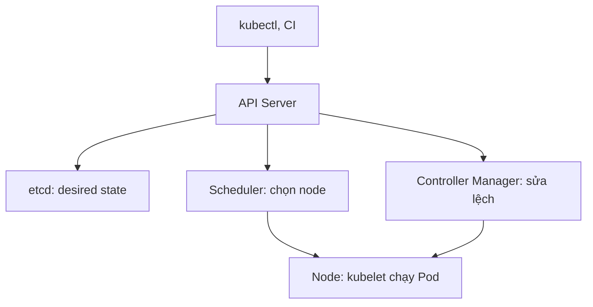
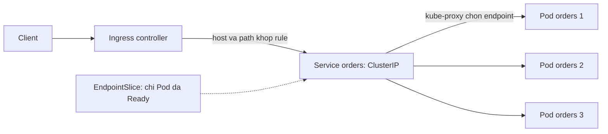
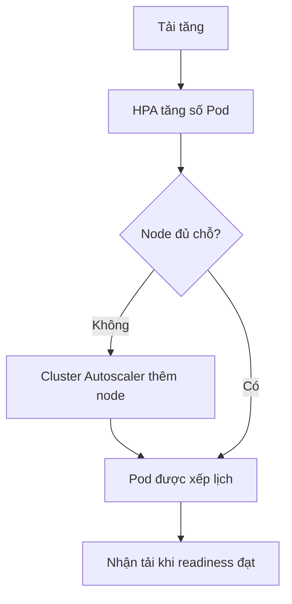

# Kubernetes vận hành

## Kubernetes là gì?

Kubernetes (viết tắt K8s) là hệ thống điều phối container trên một cluster nhiều máy. Bạn không bảo nó "chạy container này trên máy kia" mà khai báo kết quả mong muốn, ví dụ "tôi muốn 3 replica của service này". Kubernetes tự xếp **Pod** (đơn vị chạy nhỏ nhất, bọc một hay vài container) vào máy phù hợp, Pod chết thì tạo lại, cần thêm thì scale. Có thể hình dung nó như một quản đốc công trường: bạn đưa bản vẽ (YAML), quản đốc liên tục nhìn công trường thật và điều người, vật liệu cho đến khi khớp bản vẽ.

**Tóm tắt:**

- Kubernetes vận hành theo mô hình declarative: bạn khai báo desired state bằng YAML, các controller liên tục so với actual state và sửa lệch (reconciliation loop).
- Mọi thành phần chỉ nói chuyện với API Server; etcd lưu toàn bộ desired state nên mất etcd là mất "bản vẽ".
- Quan hệ chính: Deployment tạo ReplicaSet, ReplicaSet tạo Pod; Service chọn Pod bằng label selector và chỉ gửi traffic tới Pod đã Ready; Ingress định tuyến HTTP vào Service.
- `requests` là lượng đảm bảo dùng để xếp lịch, `limits` là trần: vượt limit memory thì `OOMKilled` (exit code 137), vượt limit CPU thì chỉ bị throttle.
- Liveness fail thì restart container, readiness fail thì ngừng gửi traffic; liveness không được kiểm tra dependency ngoài như DB.
- Graceful shutdown là gỡ endpoint, `preStop`, SIGTERM, chờ `terminationGracePeriodSeconds` rồi mới SIGKILL; ứng dụng phải stateless và khởi động nhanh để scale.
- Gỡ lỗi theo status của Pod: `get pods`, `describe pod` (Events, Last State), `logs --previous`, `get endpoints`; K8s là gánh nặng vận hành nên ứng dụng nhỏ thì dùng Compose hoặc managed service.

## Vấn đề nó giải quyết

Có vài chục container trên nhiều máy mà tự quản thì bạn phải tự xử lý: máy nào còn chỗ, container chết thì ai khởi động lại, deploy bản mới sao cho không downtime, một máy cháy thì chuyển tải đi đâu. Kubernetes làm những việc đó bằng một vòng lặp duy nhất gọi là **reconciliation loop**: các controller liên tục so actual state với state bạn khai báo, thấy lệch thì sửa. Đây là chìa khóa để hiểu mọi hành vi của K8s: bạn xóa tay một Pod của Deployment, nó lại xuất hiện vì thực tế (2 Pod) lệch khai báo (3 Pod).

## Khi nào nên dùng, khi nào không

Dùng khi có nhiều service, cần scale tự động và sẵn sàng cao. Không dùng khi ứng dụng nhỏ vài container: Docker Compose hoặc dịch vụ managed đơn giản hơn nhiều, còn Kubernetes sẽ là gánh nặng vận hành (nâng cấp cluster, mạng, bảo mật, chi phí học). Để dùng tốt bạn cần nắm các object cốt lõi (Pod, Deployment, Service, Ingress, ConfigMap, Secret), cấu hình `requests/limits`, liveness/readiness probe, HPA, rolling update và biết rollback bằng `kubectl rollout undo`.

## Các khái niệm cần biết

- **Declarative**: bạn mô tả desired state bằng YAML rồi `kubectl apply`, thay vì ra lệnh từng bước. Chạy lại cùng YAML nhiều lần cho cùng kết quả.
- **Node**: một máy (vật lý hoặc ảo) trong cluster; **control plane** là nhóm thành phần ra quyết định (API Server, etcd, Scheduler, Controller Manager), còn **kubelet** là agent trên mỗi node thực sự chạy Pod.
- **etcd**: kho key-value lưu toàn bộ desired state của cluster; mất etcd là mất "bản vẽ".
- **Label và selector**: label gắn vào object (`app: orders`) và selector theo label. Service tìm Pod, Deployment quản lý Pod đều qua đây; gõ sai label thì Service không có endpoint nào.
- **Rolling update**: thay Pod bản cũ bằng bản mới từng bước để luôn còn Pod phục vụ. `maxSurge` là số Pod thừa được tạo thêm, `maxUnavailable` là số Pod được phép thiếu trong lúc cập nhật.
- **Taint và toleration**: taint "đánh dấu" node để đẩy Pod ra xa (ví dụ node dành riêng cho GPU), chỉ Pod có toleration tương ứng mới được xếp vào.
- **PodDisruptionBudget (PDB)**: giới hạn số Pod được phép ngừng cùng lúc khi bảo trì chủ động (drain node), tránh hạ cả dịch vụ.
- **Throttle**: khi CPU vượt limit, process không bị giết mà bị cho chạy chậm lại.

**Nền tảng:** Kubernetes vận hành theo mô hình khai báo cộng reconciliation loop: bạn mô tả desired state (YAML), các controller liên tục so sánh với thực tế và sửa lệch. Nhờ vậy Pod chết thì được tạo lại, và xóa tay một Pod của Deployment thì nó tự xuất hiện lại.

## Kiến trúc

Sơ đồ dưới cho thấy đường đi của một request từ `kubectl` đến Pod. Mọi thành phần chỉ nói chuyện với API Server, không gọi nhau trực tiếp.



Tư duy cốt lõi: **khai báo** desired state (YAML); các controller liên tục so sánh với thực tế và sửa lệch (reconciliation loop).

Đọc sơ đồ: `kubectl` gửi YAML tới API Server, nơi lưu desired state vào etcd. Scheduler thấy Pod chưa có chỗ nên chọn node dựa trên `requests` và các ràng buộc; Controller Manager theo dõi số replica thật so với khai báo; kubelet trên node được chọn kéo image và chạy container.

**Suy luận:** Hệ thống phân tán luôn có thứ hỏng bất ngờ: node chết, Pod bị OOM, mạng mất kết nối, và một script ra lệnh từng bước sẽ sai ngay khi trạng thái thật khác với giả định lúc viết lệnh. Kubernetes tránh điều đó bằng cách chỉ lưu "điều bạn muốn" (desired state trong etcd) và giao cho các controller chạy vòng lặp vô hạn: đọc actual state, so với desired state, làm đúng một bước để rút ngắn khoảng cách, rồi lặp lại. Vì mỗi controller chỉ quan tâm một loại object và chỉ nói chuyện qua API Server, một thành phần chết thì khi sống lại nó đọc lại desired state và tiếp tục, không cần nhớ đang làm dở bước nào. Từ đó suy ra nhiều hành vi khó hiểu: xóa tay một Pod thì Pod mới xuất hiện, vì ReplicaSet thấy 2 so với 3; `kubectl apply` chạy lại nhiều lần vẫn cho cùng kết quả vì nó chỉ cập nhật desired state; và sửa trực tiếp trên cluster mà không sửa YAML sẽ bị controller kéo ngược về khai báo ban đầu. Điểm dễ nhầm là coi Kubernetes như công cụ chạy lệnh: `kubectl apply` thành công chỉ nghĩa là desired state đã được ghi nhận, chưa phải Pod đã chạy và sẵn sàng, nên pipeline phải đợi `rollout status`. Khi vận hành, hãy xem YAML trong Git là nguồn sự thật, xử lý sự cố bằng cách hỏi "controller nào chịu trách nhiệm và nó đang thấy gì" (qua `describe` và Events), và tránh sửa tay trên cluster.

## Object cốt lõi

Bảng dưới liệt kê các object bạn gặp hàng ngày. Quan hệ chính: Deployment tạo ReplicaSet, ReplicaSet tạo Pod; Service trỏ vào Pod qua label; Ingress trỏ vào Service.

**Phải thuộc:** Chuỗi quan hệ: Deployment tạo ReplicaSet, ReplicaSet tạo Pod; Service chọn Pod bằng label selector và chỉ gửi lưu lượng tới Pod đã Ready; Ingress định tuyến HTTP từ ngoài vào Service. Deployment cho ứng dụng stateless, StatefulSet cho ứng dụng cần danh tính và đĩa ổn định.

| Object | Vai trò |
|---|---|
| **Pod** | Đơn vị chạy nhỏ nhất: một hoặc vài container dùng chung mạng/đĩa |
| **Deployment** | Quản lý số replica và rolling update cho Pod stateless |
| **StatefulSet** | Pod có danh tính ổn định và đĩa riêng (DB, Kafka) |
| **Service** | Địa chỉ ổn định và load balancing cho một nhóm Pod |
| **Ingress** | Định tuyến HTTP từ ngoài vào Service |
| **ConfigMap / Secret** | Cấu hình / bí mật tách khỏi image |
| **HPA** | Tự mở rộng số Pod theo CPU hoặc chỉ số |
| **Job / CronJob** | Tác vụ chạy một lần / theo lịch |

## Manifest mẫu cho ứng dụng Spring Boot

Hãy xem một Deployment hoàn chỉnh. Chú ý ba điểm: `maxUnavailable: 0` nghĩa là cập nhật không bao giờ làm giảm số Pod đang phục vụ; `requests` bằng `limits` cho memory để tránh bị đuổi sớm; hai probe trỏ vào endpoint của Spring Boot Actuator.

```yaml
apiVersion: apps/v1
kind: Deployment
metadata: { name: orders }
spec:
  replicas: 3
  strategy: { type: RollingUpdate, rollingUpdate: { maxUnavailable: 0, maxSurge: 1 } }
  selector: { matchLabels: { app: orders } }
  template:
    metadata: { labels: { app: orders } }
    spec:
      terminationGracePeriodSeconds: 45
      containers:
        - name: orders
          image: registry.example.com/orders:1.4.2
          ports: [{ containerPort: 8080 }]
          envFrom: [{ configMapRef: { name: orders-config } }]
          resources:
            requests: { cpu: "500m", memory: "768Mi" }
            limits:   { memory: "768Mi" }
          readinessProbe: { httpGet: { path: /actuator/health/readiness, port: 8080 } }
          livenessProbe:  { httpGet: { path: /actuator/health/liveness,  port: 8080 } }
```

### Flow của request tới Pod



Service chọn Pod bằng **label selector**; danh sách endpoint chỉ gồm Pod đang `Ready` (readiness đạt). Do đó Pod fail readiness vẫn chạy nhưng không nhận lưu lượng.

### Service, Ingress, ConfigMap, Secret, HPA tối thiểu

Đi kèm Deployment ở trên (cú pháp YAML đã kiểm bằng parser, chưa áp vào cluster thật):

```yaml
apiVersion: v1
kind: ConfigMap
metadata: { name: orders-config }
data:
  SPRING_PROFILES_ACTIVE: prod
  SERVER_SHUTDOWN: graceful
---
apiVersion: v1
kind: Secret
metadata: { name: orders-db }
type: Opaque
# chỉ để minh họa; thực tế lấy từ Vault, Sealed Secrets, External Secrets
stringData:
  SPRING_DATASOURCE_PASSWORD: change-me
---
apiVersion: v1
kind: Service
metadata: { name: orders }
spec:
  selector: { app: orders }       # phải khớp label của Pod
  ports: [{ port: 80, targetPort: 8080 }]
---
apiVersion: networking.k8s.io/v1
kind: Ingress
metadata: { name: orders }
spec:
  ingressClassName: nginx
  rules:
    - host: orders.example.com
      http:
        paths:
          - path: /
            pathType: Prefix
            backend: { service: { name: orders, port: { number: 80 } } }
---
apiVersion: autoscaling/v2
kind: HorizontalPodAutoscaler
metadata: { name: orders }
spec:
  scaleTargetRef: { apiVersion: apps/v1, kind: Deployment, name: orders }
  minReplicas: 3
  maxReplicas: 10
  metrics:
    - type: Resource
      resource: { name: cpu, target: { type: Utilization, averageUtilization: 70 } }
```

Ghi chú: Secret mặc định chỉ được encode base64, **không** phải encryption thật; cần bật encryption cho etcd và RBAC chặt. Để Deployment dùng Secret, thêm `secretRef: { name: orders-db }` vào `envFrom`. HPA tính `Utilization` theo `requests` CPU, nên Pod phải có `requests.cpu` (Deployment mẫu có `500m`) và cần metrics-server.

## Tài nguyên và lập lịch

Scheduler chỉ biết những gì bạn khai báo, nên `requests` và `limits` quyết định cả việc Pod được xếp ở đâu lẫn việc nó bị xử lý thế nào khi node chật.

**Phải thuộc:** `requests` là lượng đảm bảo dùng để xếp lịch; `limits` là trần. Vượt limit memory thì bị `OOMKilled` (exit code 137), vượt limit CPU thì chỉ bị throttle chứ không bị giết.

- `requests`: lượng đảm bảo, dùng để **xếp lịch**; `limits`: trần. Vượt giới hạn **memory** thì bị `OOMKilled`; vượt giới hạn CPU thì bị **throttle**, gây độ trễ khó hiểu. Đặt `requests` quá thấp thì node bị nhồi quá tải; quá cao thì lãng phí và Pod `Pending`.
- QoS (class chất lượng dịch vụ): Guaranteed (mọi container đều khai báo requests = limits cho cả CPU và memory), Burstable (có khai báo nhưng không đủ điều kiện Guaranteed; Deployment mẫu ở trên chỉ đặt limit memory nên thuộc class này), BestEffort (không khai báo gì). Khi node thiếu tài nguyên, Pod bị đuổi theo thứ tự ngược lại: BestEffort trước, Guaranteed sau cùng.
- Tách phần cứng và ưu tiên: `nodeSelector` (chọn node theo label), affinity (ưu tiên hoặc ép đặt Pod gần hay xa nhau), taint/toleration, `PodDisruptionBudget` để cập nhật node không hạ quá nhiều replica.

## Probe và lifecycle

Probe là cách Kubernetes hỏi ứng dụng "bạn còn ổn không". Ba loại trả lời ba câu hỏi khác nhau:

| Probe | Thất bại thì |
|---|---|
| **liveness** | Khởi động lại container |
| **readiness** | Ngừng gửi lưu lượng tới Pod |
| **startup** | Cho ứng dụng khởi động chậm thời gian trước khi kiểm tra liveness |

**Phải thuộc:** Liveness thất bại thì khởi động lại container; readiness thất bại thì ngừng gửi lưu lượng tới Pod (không restart); startup cho ứng dụng khởi động chậm thời gian trước khi liveness bắt đầu kiểm tra. Liveness chỉ kiểm tra process có treo không, đừng đưa dependency ngoài (DB) vào liveness.

Quy tắc cốt lõi: liveness chỉ kiểm tra "process có bị treo không", còn readiness mới kiểm tra dependency. Lý do, sơ đồ phối hợp ba probe và endpoint Actuator tương ứng nằm ở [Docker và Kubernetes cho Spring Boot](/go?p=01-Spring-Boot%2Fhard%2Flt-29-docker-kubernetes.md).

**Suy luận:** Hai probe gắn với hai hành động có chi phí rất khác nhau. Liveness fail dẫn tới restart container, một hành động nặng và phá hủy state trong memory; readiness fail chỉ rút Pod khỏi danh sách endpoint, nhẹ và đảo ngược được ngay khi Pod khỏe lại. Vì vậy liveness chỉ nên trả lời câu hỏi "process này có bị kẹt không thể tự hồi phục không", còn "tôi có đang gọi được DB không" thuộc về readiness. Nếu bạn đặt kiểm tra DB vào liveness, khi DB chậm thì mọi Pod cùng fail liveness và cùng restart, restart không sửa được DB mà còn làm mất cache, tạo thêm tải khởi động lên chính DB đang yếu, và biến sự cố nhỏ thành sự cố toàn hệ thống. Ngược lại, với readiness fail vì DB chậm, Pod chỉ ngừng nhận traffic và tự quay lại khi DB ổn, đúng như thiết kế. Điểm dễ nhầm khác là liveness quá nhạy: timeout ngắn và ứng dụng JVM đang GC dài cũng bị restart oan, nên cần startup probe cho giai đoạn khởi động chậm và ngưỡng đủ rộng. Khi review manifest, hãy kiểm tra liveness không phụ thuộc dịch vụ ngoài, readiness phản ánh đúng khả năng nhận request, và `terminationGracePeriodSeconds` đủ dài cho request đang xử lý.

Graceful shutdown: Kubernetes gỡ Pod khỏi endpoints, chạy `preStop`, gửi SIGTERM, đợi tối đa `terminationGracePeriodSeconds`, rồi mới SIGKILL. Việc gỡ endpoints và gửi SIGTERM diễn ra gần như parallel, nên một số nơi vẫn có thể gửi request tới Pod vài giây; cần `preStop` ngắn để cho thời gian lan truyền. Sơ đồ tuần tự từng bước và cấu hình `server.shutdown: graceful` ở bài Spring Boot đã nêu.

## Mở rộng

Có hai tầng scale độc lập: HPA tăng số Pod, còn Cluster Autoscaler tăng số node khi Pod không còn chỗ xếp. Chỉ có tầng đầu thì Pod mới `Pending`; chỉ có tầng sau thì không ai yêu cầu thêm node.



Ứng dụng phải **stateless**, khởi động nhanh, và các dependency (pool DB) chịu được số Pod tăng: số Pod × pool mỗi Pod không được vượt giới hạn kết nối DB.

## Gỡ lỗi

Khi có sự cố, hãy bắt đầu từ status của Pod rồi đi theo bảng dưới. Mỗi status chỉ ra một nhóm nguyên nhân khác nhau (chưa xếp được, chạy rồi chết, không kéo được image, hay chạy được nhưng không nhận lưu lượng).

| Triệu chứng | Kiểm tra |
|---|---|
| `Pending` | `kubectl describe pod`: thiếu tài nguyên, taint, PVC chưa gắn |
| `CrashLoopBackOff` | `kubectl logs --previous`: lỗi khởi động, cấu hình sai |
| `OOMKilled` | Tăng giới hạn memory, chỉnh heap JVM dưới giới hạn |
| `ImagePullBackOff` | Tên image, credential registry |
| Service không thông | Label selector khớp Pod, `kubectl get endpoints`, readiness |
| Lỗi 502/503 ngắn lúc deploy | Thiếu `preStop` hoặc chưa graceful shutdown: xem [graceful shutdown cho Spring Boot](/go?p=01-Spring-Boot%2Fhard%2Flt-29-docker-kubernetes.md) |
| Chậm bất thường | CPU throttling, `kubectl top`, tắc nghẽn ở downstream |

Lệnh nền tảng: `kubectl get|describe|logs|exec|rollout status|rollout undo`, `port-forward`.

### Đọc output chẩn đoán (minh họa)

**CrashLoopBackOff:** container khởi động rồi thoát liên tục; K8s tăng dần thời gian chờ giữa các lần restart (tối đa khoảng 5 phút).

```text
$ kubectl get pods -l app=orders
NAME             READY   STATUS             RESTARTS      AGE
orders-7d9-abc   0/1     CrashLoopBackOff   6 (40s ago)   8m
$ kubectl logs orders-7d9-abc --previous
... Caused by: java.net.UnknownHostException: db
$ kubectl describe pod orders-7d9-abc | grep -A6 "Last State"
    Last State:   Terminated
      Reason:     Error
      Exit Code:  1
```

`--previous` là chìa khóa vì log của lần chạy hiện tại có thể còn trống. Exit code 1 là lỗi ứng dụng; 137 là bị SIGKILL (thường OOM); 143 là SIGTERM.

**OOMKilled:**

```text
    Last State:   Terminated
      Reason:     OOMKilled
      Exit Code:  137
    Restart Count: 4
```

Hướng xử lý: so sánh `kubectl top pod` với `limits.memory`; kiểm tra heap (`-XX:MaxRAMPercentage`) cộng metaspace, thread, direct buffer; tăng giới hạn hoặc sửa rò rỉ. Cách chia ngân sách memory giữa heap và phần ngoài heap xem [Memory JVM và GC](/go?p=01-Spring-Boot%2Fhard%2Flt-23-jvm-memory-gc.md).

**Pending:**

```text
$ kubectl describe pod orders-7d9-xyz
Events:
  Warning  FailedScheduling  0/3 nodes are available: 3 Insufficient memory.
```

Đọc phần `Events` ở cuối `describe`: `Insufficient cpu/memory` (requests quá lớn hoặc cluster đầy), `node(s) had untolerated taint`, hoặc `unbound immediate PersistentVolumeClaims`. Hướng xử lý: giảm requests, thêm node hoặc bật Cluster Autoscaler, thêm toleration, sửa StorageClass.

Quy trình chung: `get pods` (status) rồi `describe pod` (Events, Last State) rồi `logs --previous` (nguyên nhân trong ứng dụng) rồi `get endpoints` (Service có nhận Pod nào không).

## Điều cần nhớ

- Đừng đặt `limits` CPU quá chặt cho ứng dụng JVM; theo dõi throttling.
- Cấu hình bảo mật: không chạy root, `readOnlyRootFilesystem`, NetworkPolicy, RBAC tối thiểu, Secret không để trong Git thuần.
- Bắt đầu dịch vụ được quản lý (EKS, GKE, AKS) thay vì tự dựng cluster.
- Xem bài [Docker và Kubernetes cho Spring Boot](/go?p=01-Spring-Boot%2Fhard%2Flt-29-docker-kubernetes.md) và [CI/CD](/go?p=04-DevOps%2Fmedium%2Flt-03-ci-cd.md).

