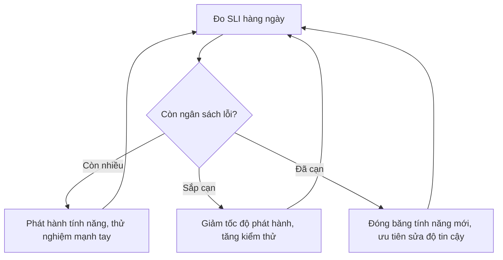
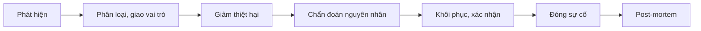

# Xử lý sự cố, SRE và vận hành bền vững

## SRE là gì và vì sao cần?

SRE (Site Reliability Engineering) là cách tiếp cận coi độ tin cậy là một tính năng có thể đo và quản lý bằng số, thay vì cảm giác "hệ thống hôm nay ổn". Bài này gom ba việc đi liền nhau: đo độ tin cậy (SLI/SLO), ứng phó sự cố theo quy trình, và họp rút kinh nghiệm để lần sau không lặp lại.

Vấn đề cần giải quyết: hệ thống nào rồi cũng hỏng. Nếu không đo thì bạn không biết "đủ ổn" là mức nào, nên đội phát triển và đội vận hành cãi nhau bằng ý kiến. Nếu không có quy trình thì sự cố biến thành mười người nhảy vào cùng sửa, không ai điều phối, mỗi người đổi một thứ và làm mọi thứ khó hiểu hơn. Cuối cùng lỗi cũ lặp lại vì không ai ghi lại bài học.

Bạn dùng kiến thức này khi trực on-call (luân phiên túc trực để xử lý sự cố), thiết kế cảnh báo, ngay sau mỗi sự cố, và khi lập kế hoạch độ tin cậy. Đừng đặt SLO 99,99% cho hệ thống nội bộ ít người dùng: chi phí để đạt thêm mỗi "số 9" tăng rất nhanh mà người dùng không cảm nhận được khác biệt. Tóm tắt cách làm: đặt SLO bằng số và dùng error budget để cân bằng giữa ra tính năng và ổn định; cảnh báo theo triệu chứng người dùng thấy chứ không theo từng chỉ số máy; khi có sự cố thì phân vai (incident commander, người sửa, người liên lạc), giảm thiệt hại trước, tìm nguyên nhân sau; post-mortem không đổ lỗi cho cá nhân.

**Tóm tắt:**

- SRE coi độ tin cậy là tính năng đo được bằng số: SLI là chỉ số đo, SLO là mục tiêu nội bộ cho SLI, SLA là cam kết với khách hàng và thường có phạt.
- Độ tin cậy 100% không đạt được và không đáng theo đuổi; ngân sách lỗi (1 trừ SLO) biến tranh luận "ổn định hay tính năng mới" thành quyết định dựa trên số liệu.
- 99,9% một tháng cho phép khoảng 43 phút ngừng, 99,99% khoảng 4,3 phút; mỗi "số 9" thêm vào đắt lên rất nhanh.
- Cảnh báo theo triệu chứng người dùng thấy và theo burn rate, mỗi cảnh báo phải cần hành động ngay và có runbook.
- Khi có sự cố: phân vai (Incident Commander, người xử lý, người liên lạc), giảm thiệt hại và khôi phục trước (rollback, tắt feature flag), tìm nguyên nhân gốc sau.
- Chẩn đoán bắt đầu bằng câu hỏi "điều gì vừa đổi" và bốn golden signals: latency, traffic, errors, saturation.
- Thiết kế để lỗi không lan: bulkhead, timeout, retry có backoff và jitter, circuit breaker; post-mortem hỏi hệ thống nào cho phép lỗi chứ không hỏi ai làm hỏng.

## Các khái niệm cần biết

- **On-call**: người được phân công sẵn sàng nhận cảnh báo và xử lý sự cố ngoài giờ theo lịch luân phiên.
- **Runbook**: tài liệu từng bước "cảnh báo X xuất hiện thì làm gì". Giúp người trực xử lý được cả khi không phải người viết ra hệ thống.
- **Incident Commander (IC)**: người điều phối sự cố, không trực tiếp sửa mà quyết định ưu tiên, giao việc và giữ mọi người sync.
- **Burn rate**: ngân sách lỗi đang bị tiêu nhanh gấp bao nhiêu lần mức "vừa đủ hết cuối kỳ". Burn rate 1 nghĩa là tiêu đúng mức cho phép; 14,4 nghĩa là ngân sách tháng sẽ hết trong khoảng 2 ngày. Dùng để cảnh báo sớm khi sự cố nghiêm trọng mà không báo ồn cho dao động nhỏ.
- **p99 latency**: 99% request nhanh hơn giá trị này; phản ánh trải nghiệm của nhóm chậm nhất thay vì trung bình che mất.
- **Bulkhead**: tách tài nguyên (thread pool, connection pool) theo từng dependency để một chỗ chậm không kéo sập cả hệ thống, giống vách ngăn khoang tàu.
- **Circuit breaker**: khi dependency lỗi liên tục thì tạm ngừng gọi và trả lỗi ngay (hoặc giá trị dự phòng), cho dependency thời gian hồi phục.
- **Backoff và jitter**: retry với thời gian chờ tăng dần (backoff) cộng thêm độ ngẫu nhiên (jitter) để nhiều client không cùng thử lại một lúc và làm sập dịch vụ vừa hồi phục.
- **Canary**: phát hành bản mới cho một phần nhỏ người dùng trước, ổn mới mở rộng.
- **Chaos engineering**: chủ động gây lỗi có kiểm soát (tắt một instance, làm chậm mạng) để kiểm chứng hệ thống chịu lỗi thật sự.

## SLI, SLO, SLA và ngân sách lỗi

| | Ý nghĩa | Ví dụ |
|---|---|---|
| **SLI** | Chỉ số đo chất lượng dịch vụ | Tỷ lệ request thành công; p99 latency |
| **SLO** | Mục tiêu nội bộ cho SLI | 99,9% thành công trong 30 ngày |
| **SLA** | Cam kết với khách hàng, thường có phạt | 99,5%, hoàn tiền nếu vi phạm |
| **Ngân sách lỗi** | `1 - SLO` | 0,1% ≈ 43 phút ngừng mỗi tháng |

**Phải thuộc:** SLI là chỉ số đo (ví dụ tỷ lệ request thành công), SLO là mục tiêu nội bộ cho SLI (ví dụ 99,9% trong 30 ngày), SLA là cam kết với khách hàng và thường có phạt. Ngân sách lỗi = 1 trừ SLO; 99,9% một tháng tương đương khoảng 43 phút ngừng, 99,99% khoảng 4,3 phút.

**Nền tảng:** Độ tin cậy 100% không đạt được và không đáng theo đuổi, nên SRE đo độ tin cậy bằng số (SLI/SLO) và chấp nhận một ngân sách lỗi. Ngân sách này biến cuộc tranh luận "ổn định hay tính năng mới" thành quyết định dựa trên số liệu.

Ngân sách lỗi biến "ổn định hay tính năng mới?" thành quyết định bằng số: còn ngân sách thì phát hành mạnh tay; cạn thì ưu tiên độ tin cậy.

Ví dụ cụ thể: SLO là 99,9% request thành công trong 30 ngày, hệ thống nhận 10 triệu request mỗi tháng. Ngân sách lỗi là 0,1%, tức 10.000 request được phép lỗi. Nếu một lần deploy lỗi làm hỏng 6.000 request thì bạn đã dùng 60% ngân sách chỉ trong một sự cố, và tháng đó nên chậm lại việc phát hành tính năng mạo hiểm.

Đọc sơ đồ: SLO không phải con số để báo cáo mà là cái van điều tiết tốc độ phát hành. Khi ngân sách cạn, đội thống nhất từ trước (không phải thương lượng lúc căng thẳng) rằng độ tin cậy được ưu tiên.

**Suy luận:** Mỗi "số 9" thêm vào cắt ngân sách lỗi đi 10 lần nhưng chi phí để đạt nó tăng gần như theo cấp số nhân: từ 99,9% lên 99,99% bạn phải loại bỏ điểm lỗi duy nhất, tự động hóa failover, và chấp nhận phát hành chậm hơn. Trong khi đó người dùng thường không phân biệt nổi 43 phút với 4 phút ngừng mỗi tháng, vì chính mạng, thiết bị và dependency của họ đã kém tin cậy hơn thế. Vì vậy 100% là mục tiêu sai: nó đòi hỏi đóng băng mọi thay đổi, mà phần lớn sự cố lại do thay đổi gây ra. SLO ra đời để chọn một mức "đủ ổn" có chủ ý, và ngân sách lỗi cho phép đội đổi độ tin cậy dư thừa lấy tốc độ phát hành: còn ngân sách thì được rủi ro, cạn thì dừng và sửa. Điểm dễ nhầm là nhầm SLO với SLA: SLO nên chặt hơn SLA để bạn có vùng đệm cảnh báo trước khi phải đền tiền, và SLO phải đo ở nơi người dùng cảm nhận (tỷ lệ request thành công, latency p99) chứ không phải CPU hay uptime của từng máy. Một ngưỡng đo trung bình cũng che mất nhóm chậm nhất, nên latency cần xem theo percentile. Khi thiết kế, hãy bắt đầu từ một vài SLO gắn với hành trình quan trọng nhất của người dùng, gắn burn rate vào cảnh báo, và thỏa thuận trước với đội sản phẩm chính sách khi ngân sách cạn.

| SLO tháng | Thời gian ngừng cho phép |
|---|---|
| 99% | khoảng 7,2 giờ |
| 99,9% | khoảng 43 phút |
| 99,99% | khoảng 4,3 phút |

## Cảnh báo tốt

Vấn đề đặt ra: cảnh báo quá nhiều thì người trực quen và bỏ qua (alert fatigue), cảnh báo quá ít thì người dùng báo lỗi trước đội kỹ thuật. Nguyên tắc dưới đây giúp cân bằng.

- Cảnh báo theo **triệu chứng người dùng thấy** (tỷ lệ lỗi, latency), không theo từng nguyên nhân kỹ thuật (CPU 80%).
- Mỗi cảnh báo đánh thức người trực phải **cần hành động ngay** và có hướng dẫn xử lý (runbook).
- Cảnh báo **đốt ngân sách nhanh** (burn rate) nhiều cửa sổ thời gian để cân bằng nhạy và ồn.
- Cảnh báo ồn khiến người trực bỏ qua: rà soát và xóa định kỳ.

## Quy trình ứng phó sự cố

Khi chuông reo lúc nửa đêm, điều dễ làm sai nhất là lao vào tìm nguyên nhân. Quy trình dưới đây ép bạn làm theo thứ tự: biết ai làm gì, chặn thiệt hại, rồi mới đào sâu.

Giảm thiệt hại gồm rollback, tắt feature flag, chuyển lưu lượng. Vai trò gồm Incident Commander, người xử lý, người liên lạc.

**Phải thuộc:** Khi có sự cố: giảm thiệt hại và khôi phục trước (rollback, tắt feature flag, chuyển lưu lượng), tìm nguyên nhân gốc sau. Phân vai rõ: Incident Commander điều phối, người xử lý sửa, người liên lạc thông báo.

Thứ tự ưu tiên: **giảm thiệt hại và khôi phục trước, tìm nguyên nhân gốc sau**. Rollback thường nhanh hơn "sửa tại chỗ".

**Suy luận:** Trong sự cố, mỗi phút ngừng đều tính tiền và uy tín, trong khi nguyên nhân gốc thường cần thời gian và thông tin mà bạn chưa có. Vì vậy mục tiêu đầu tiên là chặn thiệt hại, không phải hiểu tại sao. Phần lớn sự cố bắt đầu ngay sau một thay đổi (deploy, cấu hình, feature flag), nên đảo ngược thay đổi đó là hành động nhanh, ít rủi ro, và còn bảo toàn bằng chứng để phân tích sau; ngược lại, "sửa tại chỗ" khi chưa hiểu nguyên nhân thường là đổi thêm một thứ vào hệ thống đang bất ổn, làm khó xác định điều gì đã tác động điều gì. Từ đó suy ra vì sao phải phân vai: nếu mười người cùng đổi thứ khác nhau thì không ai biết thay đổi nào làm tốt hay xấu đi, nên Incident Commander giữ quyền quyết định và một người duy nhất thực hiện thay đổi, người liên lạc lo thông báo để người sửa không bị ngắt quãng. Điểm dễ nhầm là coi việc khôi phục xong là hết việc: nguyên nhân gốc vẫn còn, và nếu không có post-mortem với hành động khắc phục có chủ và hạn thì lỗi cũ sẽ quay lại. Khi thiết kế quy trình, hãy bảo đảm mọi thay đổi có thể rollback nhanh (migration tương thích ngược, feature flag), runbook ghi sẵn bước giảm thiệt hại, và ghi dòng thời gian ngay trong lúc xử lý.

## Chẩn đoán có hệ thống

Chẩn đoán tốt là thu hẹp không gian tìm kiếm có phương pháp thay vì thử ngẫu nhiên. Năm bước gợi ý:

1. Điều gì **đã đổi** gần đây? (deploy, cấu hình, lưu lượng, dependency bên thứ ba)
2. Phạm vi: toàn bộ hay một vùng/khách/endpoint?
3. Dùng bốn golden signals: **latency** (request mất bao lâu), **traffic** (bao nhiêu request), **errors** (tỷ lệ thất bại), **saturation** (tài nguyên đầy đến đâu, ví dụ pool kết nối, queue, CPU).
4. Đi từ ngoài vào trong: CDN/LB → gateway → service → DB, tìm tầng bắt đầu bất thường (trace giúp ở đây).
5. Ghi lại dòng thời gian trong lúc xử lý.

**Phải thuộc:** Bốn golden signals: latency, traffic, errors, saturation. Câu hỏi đầu tiên khi chẩn đoán luôn là "điều gì vừa thay đổi?".

Công cụ: dashboard (Grafana), log tập trung, trace (OpenTelemetry), profiler. Cách bật metric, trace, log trong Spring Boot: [Observability](/go?p=01-Spring-Boot%2Fmedium%2Flt-19-observability.md). Khi nghi ngờ nằm trong JVM (CPU cao, treo, rò rỉ memory) thì lấy bằng chứng bằng thread dump, heap dump, JFR: [Công cụ chẩn đoán JVM](/go?p=08-Java%2FJava-Core%2Fhard%2Flt-32-cong-cu-chan-doan-jvm.md). Pod chết hoặc không Ready: bảng gỡ lỗi ở [Kubernetes vận hành](/go?p=04-DevOps%2Fhard%2Flt-06-kubernetes-van-hanh.md).

## Post-mortem không đổ lỗi

Post-mortem là buổi họp và tài liệu sau sự cố nhằm hiểu hệ thống đã để lỗi xảy ra như thế nào. Nếu buổi họp biến thành tìm người có lỗi, lần sau mọi người sẽ che giấu thông tin và bạn mất nguồn dữ liệu quý nhất. Cấu trúc gợi ý:

| Mục | Nội dung |
|---|---|
| Tóm tắt và tác động | Ai bị ảnh hưởng, bao lâu |
| Dòng thời gian | Event theo mốc giờ |
| Nguyên nhân gốc và yếu tố góp phần | Hệ thống cho phép lỗi xảy ra như thế nào |
| Điều làm tốt, điều may mắn | |
| Hành động khắc phục | Có người chịu trách nhiệm và hạn |

Hỏi "**hệ thống hay quy trình nào** cho phép điều này?" thay vì "ai làm hỏng?". Kỹ thuật "5 Whys" đào tới nguyên nhân hệ thống.

## Độ tin cậy trong thiết kế

Xử lý sự cố giỏi là cần, nhưng tốt hơn là thiết kế để sự cố nhỏ không lan thành sự cố lớn. Các kỹ thuật dưới đây giải quyết cùng một vấn đề: một thành phần hỏng không được kéo theo cả hệ thống. Chọn kỹ thuật theo rủi ro: retry chỉ an toàn với thao tác idempotent (gọi nhiều lần cho cùng kết quả), còn retry không giới hạn có thể biến một dependency chậm thành bão request.

- **Giảm bán kính ảnh hưởng:** cô lập (bulkhead), deploy canary, giới hạn theo vùng/khách.
- **Chịu lỗi dependency:** timeout, retry có backoff và jitter, circuit breaker, degrade gracefully.
- **Dự phòng:** nhiều instance, nhiều vùng, không có điểm lỗi duy nhất.
- **Chaos engineering**: chủ động gây lỗi có kiểm soát để kiểm chứng.
- **Dung lượng:** kiểm thử tải, dự báo, rate limiting và queue có giới hạn.
- Diễn tập khôi phục (DB, cả vùng) định kỳ.

## Trực (on-call) bền vững

Luân phiên công bằng, runbook rõ, mức cảnh báo hợp lý, bàn giao ca, bù thời gian nghỉ, và giảm dần gánh nặng bằng cách sửa nguyên nhân lặp lại.

## Điều cần nhớ

- Không có SLO thì mọi cuộc tranh luận về độ tin cậy chỉ là ý kiến.
- 100% không phải mục tiêu hợp lý: chi phí tăng phi mã, và dependency của bạn cũng không đạt.
- Mỗi sự cố là dữ liệu miễn phí để cải thiện hệ thống; không học thì sẽ trả giá lần nữa.

