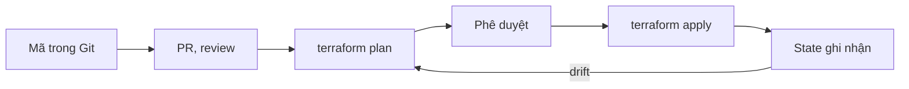
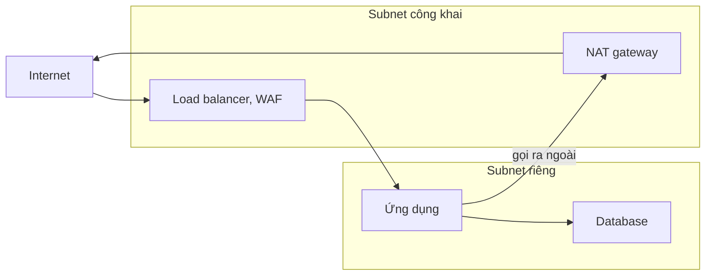

# Infrastructure as Code (IaC) và nền tảng cloud

## IaC và cloud là gì?

**IaC (Infrastructure as Code)** là viết hạ tầng (server, mạng, DB...) thành file code lưu trong Git, ví dụ với Terraform. **Cloud** là việc thuê máy, lưu trữ, mạng của nhà cung cấp (AWS, Azure, GCP) và trả theo mức dùng thay vì tự mua máy. Hai thứ này đi cùng nhau vì cloud cho phép tạo tài nguyên bằng API, và IaC là cách gọi các API đó có kiểm soát.

**Tóm tắt:**

- IaC viết hạ tầng thành code trong Git nên thay đổi hạ tầng đi qua pull request, có review và lịch sử, và dựng lại môi trường chỉ bằng một lệnh.
- Terraform là declarative: bạn mô tả state đích, công cụ so với state để tự tính phần cần tạo, sửa, xóa; luôn đọc kỹ `plan`, nhất là dòng `destroy` hoặc `must be replaced`.
- State là bản đồ giữa mã và tài nguyên thật, chứa bí mật, phải để ở backend từ xa có lock và được encrypt; để ở máy cá nhân thì đồng nghiệp sẽ tạo trùng hoặc ghi đè nhau.
- Drift là hạ tầng bị sửa ngoài mã; không sửa tay trên console sau khi đã quản lý bằng code.
- Mô hình cloud theo mức bạn tự quản lý giảm dần: IaaS, CaaS, PaaS, FaaS, SaaS; càng lên cao càng ít vận hành nhưng càng dễ bị vendor lock-in.
- Mẫu mạng chuẩn: load balancer ở subnet công khai, ứng dụng và DB ở subnet riêng, NAT gateway cho đi ra mà không cho đi vào, security group chỉ mở đúng port và đúng nguồn.
- IAM dùng role gắn vào dịch vụ và quyền tối thiểu thay vì access key dài hạn; chi phí ẩn nằm ở egress, NAT, log và đĩa không gắn.

## Vấn đề nó giải quyết

Hãy tưởng tượng hạ tầng được dựng bằng cách bấm tay trên console. Sau sáu tháng không ai nhớ đã bấm gì; môi trường staging và production lệch nhau nên "chạy được ở staging, hỏng ở production"; và khi mất một môi trường thì không dựng lại được. Viết thành code thì thay đổi hạ tầng cũng đi qua pull request, có review, có lịch sử Git để biết ai đổi gì và vì sao, và dựng lại môi trường chỉ bằng một lệnh.

## Khi nào dùng, khi nào không

Dùng khi dựng môi trường mới, replicate sang region hoặc account khác, hay quản lý thay đổi hạ tầng trong nhóm. Thử nghiệm nhanh một lần, vứt đi ngay thì bấm console cũng được, nhưng phần nào đi production thì nên chuyển thành code. Cách làm: khai báo state mong muốn, chạy `terraform plan` để xem sẽ đổi gì, rồi `apply` qua pipeline chứ không chạy tay trên máy cá nhân. Lưu state ở chỗ chung có lock. Khi thiết kế phần cloud, đi theo các trụ cột: bảo mật, độ tin cậy, hiệu năng, chi phí, vận hành.

## Các khái niệm cần biết

- **Declarative**: bạn mô tả đích đến ("có một DB Postgres Multi-AZ"), công cụ tự tính các bước để đến đó. Khác với script lệnh tạo từng thứ, chạy lần hai sẽ lỗi vì đã tồn tại.
- **Provider**: plugin để Terraform nói chuyện với một nền tảng (AWS, Azure, Kubernetes...).
- **State**: file ghi lại tài nguyên thật nào ứng với khối mã nào. Mất hoặc hỏng state thì Terraform không biết mình đang quản lý gì và có thể tạo trùng hoặc xóa nhầm.
- **Plan**: bản xem trước thay đổi (tạo, sửa, xóa gì) trước khi áp dụng. Đọc plan kỹ, nhất là dòng `destroy` hoặc `must be replaced`.
- **Multi-AZ / AZ (Availability Zone)**: AZ là một cụm trung tâm dữ liệu độc lập trong cùng vùng; Multi-AZ là chạy bản dự phòng ở AZ khác để sống sót khi một AZ sập.
- **VPC, subnet, security group**: mạng riêng ảo của bạn trên cloud, các phân vùng bên trong nó, và firewall gắn với tài nguyên (xem phần mạng bên dưới).
- **IAM**: hệ thống định danh và authorization: ai (người dùng, vai trò) được làm gì trên tài nguyên nào.
- **Egress**: lưu lượng đi ra khỏi cloud, thường bị tính phí và hay là khoản chi phí bất ngờ.

## IaC

Quy trình làm việc chuẩn của một thay đổi hạ tầng giống hệt quy trình thay đổi code: sửa mã, mở pull request, xem `plan`, được duyệt rồi mới `apply`. Mũi tên "drift" quay lại cho thấy hạ tầng thật có thể bị ai đó sửa ngoài mã, và lần `plan` kế tiếp sẽ phát hiện chênh lệch.



```hcl
resource "aws_db_instance" "main" {
  identifier          = "orders-db"
  engine              = "postgres"
  instance_class      = "db.m6g.large"
  allocated_storage   = 100
  multi_az            = true
  storage_encrypted   = true
  deletion_protection = true
}
```

**Nền tảng:** IaC là mô hình khai báo: bạn mô tả state đích, công cụ so sánh với state (bản đồ giữa mã và tài nguyên thật) rồi tự tính phần cần tạo, sửa, xóa. Vì vậy state là tài sản quan trọng nhất của Terraform và phải được bảo vệ.

Khối trên khai báo một DB Postgres có dự phòng khác AZ, disk encryption và chống xóa nhầm. Bạn không viết bước "tạo DB"; chỉ mô tả đích, còn Terraform so với state để biết cần tạo mới hay sửa.

State nên đặt ở nơi dùng chung có lock (backend từ xa) để hai người không `apply` cùng lúc:

```hcl
terraform {
  backend "s3" {
    bucket       = "my-company-tfstate"
    key          = "prod/orders/terraform.tfstate"
    region       = "ap-southeast-1"
    encrypt      = true
    use_lockfile = true   # lock bằng file trên S3 (thử nghiệm từ Terraform 1.10, ổn định từ 1.11); bản cũ dùng dynamodb_table
  }
}
```

**Phải thuộc:** Quy trình Terraform: viết mã, `terraform plan` (xem trước, đọc kỹ dòng destroy hoặc replace), duyệt, rồi `terraform apply` qua pipeline. State đặt ở backend từ xa có lock, được encrypt và chứa bí mật nên phải bảo vệ như dữ liệu nhạy cảm.

Hệ quả nếu để state ở máy cá nhân: đồng nghiệp chạy `apply` với state khác sẽ tạo trùng tài nguyên hoặc ghi đè thay đổi của nhau.

**Suy luận:** Terraform không có cách nào hỏi cloud "tài nguyên nào là của khối mã này", vì tên trong mã và ID thật do cloud cấp không tự khớp nhau. Nó cần một bản ghi nhớ ánh xạ giữa hai bên, và đó là state. Từ đó suy ra mọi tính chất của state. Thứ nhất, state phải là một bản duy nhất dùng chung: nếu hai người có hai bản state khác nhau thì mỗi người thấy một thế giới khác, một người tạo tài nguyên mà người kia không biết và lần `apply` sau sẽ tạo trùng hoặc xóa nhầm; đó là lý do cần backend từ xa và lock để hai `apply` không chạy chồng nhau. Thứ hai, state chứa chính các giá trị mà tài nguyên trả về, kể cả mật khẩu DB hay key được sinh ra, nên nó phải được encrypt và kiểm soát truy cập như một bí mật, không commit lên Git. Thứ ba, `plan` là phép so sánh ba bên (mã, state, hạ tầng thật), nên khi ai đó sửa tay trên console thì lần `plan` sau thấy drift và đề nghị sửa ngược, chứ không phải bỏ qua. Điểm dễ nhầm là đọc `plan` lướt qua: một thay đổi tưởng nhỏ như đổi tên hoặc đổi một thuộc tính bắt buộc tạo lại có thể hiện thành `must be replaced`, nghĩa là xóa rồi tạo lại, và với DB hay disk thì đó là mất dữ liệu. Khi review, hãy chặn mọi `destroy` không chủ đích, bật `deletion_protection` cho tài nguyên quan trọng, chạy `apply` chỉ qua pipeline, và tách state theo môi trường để một lệnh sai không chạm vào production.

| Khái niệm | Điều cần biết |
|---|---|
| **Declarative** | Mô tả "cái gì", công cụ tính "làm thế nào" |
| **State** | Bản đồ mã ↔ tài nguyên thật; lưu từ xa, có lock, **chứa bí mật**: bảo vệ như dữ liệu nhạy cảm |
| **Module** | Đóng gói hạ tầng tái sử dụng |
| **Drift** | Hạ tầng bị sửa ngoài mã: phát hiện và sync lại |
| **Idempotent** | Chạy lại nhiều lần cho cùng kết quả |

Công cụ: Terraform/OpenTofu, Pulumi (dùng ngôn ngữ lập trình), CloudFormation, Ansible (cấu hình máy). Quy tắc: không sửa tay trên console sau khi đã quản lý bằng mã.

## Mô hình cloud

Câu hỏi chọn nền tảng thực chất là "tôi muốn tự quản lý đến tầng nào". Bảng dưới xếp theo mức bạn phải tự quản lý từ nhiều đến ít.

| Tầng | Bạn quản lý | Ví dụ |
|---|---|---|
| IaaS | Hệ điều hành trở lên | EC2, máy ảo |
| CaaS | Container | EKS/GKE/AKS |
| PaaS | Chỉ ứng dụng | App Service, Elastic Beanstalk |
| FaaS (serverless) | Chỉ function | Lambda |
| SaaS | Không gì cả | Dịch vụ dùng sẵn |

Đi lên tầng cao thì ít vận hành hơn nhưng ít kiểm soát hơn và dễ bị vendor lock-in.

**Phải thuộc:** Thứ tự mô hình đám mây theo mức bạn tự quản lý giảm dần: IaaS (từ hệ điều hành trở lên), CaaS (container), PaaS (chỉ ứng dụng), FaaS (chỉ function), SaaS (không gì cả).

## Các khối dựng cơ bản

| Nhóm | Ví dụ |
|---|---|
| Tính toán | VM, container, function |
| Lưu trữ | Object storage (S3), đĩa khối, hệ thống file |
| Mạng | VPC, subnet công khai/riêng tư, NAT, security group, DNS, CDN, load balancer |
| Dữ liệu | managed DB, cache, queue, kho phân tích |
| Định danh | IAM: người dùng, vai trò, chính sách |
| Quan sát và bảo mật | Log, metric, KMS, quản lý bí mật, WAF |

## Mạng cloud điển hình



**Phải thuộc:** Mẫu mạng chuẩn: load balancer (và WAF) ở subnet công khai; ứng dụng và DB ở subnet riêng; NAT gateway cho phép đi ra mà không cho kết nối đi vào; DB không có địa chỉ công khai; security group chỉ mở đúng port, đúng nguồn (tránh `0.0.0.0/0`).

Nguyên tắc: chỉ đặt ở subnet công khai thứ thực sự cần; DB không có địa chỉ công khai; security group mở đúng port, đúng nguồn.

Đọc sơ đồ: người dùng từ Internet chỉ chạm tới load balancer (có thể kèm WAF, firewall ứng dụng web) ở subnet công khai. Ứng dụng và DB nằm ở subnet riêng nên không ai từ ngoài kết nối thẳng được. Khi ứng dụng cần gọi ra ngoài (API bên thứ ba, tải gói), nó đi qua NAT gateway: NAT cho phép đi ra mà không cho kết nối đi vào. Hệ quả của sai sót phổ biến: gán địa chỉ công khai cho DB và mở security group `0.0.0.0/0` là cách dữ liệu bị lộ nhiều nhất.

## IAM: đặc quyền tối thiểu

Dùng **role** gắn vào dịch vụ thay vì access key dài hạn; chính sách cấp đúng hành động và tài nguyên cần; bật MFA cho người dùng; tách tài khoản theo môi trường. Lỗi phổ biến nhất: quyền `*` quá rộng và access key lộ trong mã.

## Các trụ cột thiết kế (Well-Architected)

Well-Architected là bộ nguyên tắc thiết kế do các nhà cung cấp cloud (AWS đặt tên, Azure và GCP có bộ tương tự) đưa ra. Dùng nó như danh sách câu hỏi để rà soát thiết kế, không phải thủ tục bắt buộc.

| Trụ cột | Câu hỏi chính |
|---|---|
| Reliability | Chịu lỗi một vùng/AZ không? Khôi phục thế nào? |
| Security | Dữ liệu và quyền truy cập được bảo vệ ra sao? |
| Performance efficiency | Chọn đúng loại tài nguyên và mở rộng đúng cách? |
| Cost optimization | Có đang trả tiền cho thứ không dùng? |
| Operational excellence | Quan sát, tự động hóa, học từ sự cố? |

## Chi phí

- Gắn tag cho mọi tài nguyên theo đội/dự án để phân bổ chi phí.
- Chi phí ẩn: truyền dữ liệu ra ngoài (egress), NAT, log, đĩa không gắn.
- Tắt môi trường không dùng ngoài giờ; đặt ngân sách và cảnh báo; cam kết dài hạn cho tải ổn định, spot cho tải chịu gián đoạn.

## Điều cần nhớ

- Mọi thứ trong hạ tầng đều nên tái tạo được từ mã trong thời gian ngắn.
- Tách state/môi trường để một lệnh sai không xóa cả production; bật bảo vệ xóa cho tài nguyên quan trọng.
- Thiết kế đa vùng tăng độ tin cậy nhưng tăng mạnh độ phức tạp: chỉ làm khi yêu cầu kinh doanh đòi hỏi.

