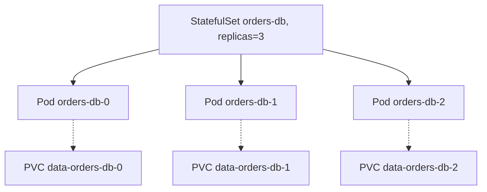
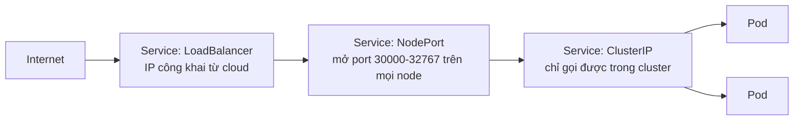

# Kubernetes: Storage, StatefulSet và Networking nâng cao

Bài "Kubernetes vận hành" đã nói Pod là thứ dùng một lần: Deployment coi mọi Pod là bản sao giống hệt nhau, xóa Pod này thì tạo Pod khác thay thế, không ai quan tâm Pod nào là Pod nào. Điều đó hoàn hảo cho một ứng dụng stateless, nhưng một database, một broker Kafka hay một node Elasticsearch thì khác: nó cần giữ đúng định danh, đúng đĩa dữ liệu của nó qua mỗi lần restart, và các node còn lại cần biết "node số 2" cụ thể là node nào để đồng bộ dữ liệu. Bài này đi vào ba thứ Deployment không cung cấp: lưu trữ bền vững, định danh ổn định (StatefulSet), và cách các Pod thật sự nói chuyện với nhau qua mạng (Service type, NetworkPolicy, DNS nội bộ).

**Tóm tắt:**

- Volume của Pod thường biến mất theo Pod (`emptyDir`); muốn dữ liệu sống qua restart phải dùng PersistentVolume (PV) qua PersistentVolumeClaim (PVC), do StorageClass cấp phát động.
- StatefulSet cấp cho mỗi Pod một tên thứ tự cố định (`app-0`, `app-1`, ...) và một PVC riêng gắn liền với tên đó suốt vòng đời, thay vì Pod vô danh như ở Deployment.
- Headless Service (`clusterIP: None`) không cân bằng tải mà trả thẳng địa chỉ IP từng Pod qua DNS, để các thành viên StatefulSet tự tìm và nói chuyện với đúng Pod kia.
- Bốn loại Service có phạm vi khác nhau: `ClusterIP` (nội bộ cluster), `NodePort` (mở port trên mọi node), `LoadBalancer` (xin LB từ cloud), `ExternalName` (chỉ là CNAME DNS) — chọn sai loại là lỗi "không vào được từ ngoài" kinh điển.
- CoreDNS cấp cho mỗi Service một tên ổn định dạng `<service>.<namespace>.svc.cluster.local`; Pod không bao giờ nên gọi thẳng IP vì IP của Pod đổi mỗi lần tạo lại.
- Mặc định mọi Pod trong cluster gọi được nhau; `NetworkPolicy` áp "default deny" rồi mở từng luồng theo label, giống firewall rule nhưng khai báo bằng YAML và do CNI plugin thực thi.
- Tự chạy database trong Kubernetes được nhưng tốn chi phí vận hành (backup, failover, vá bản vá) rất khác ứng dụng stateless; đa số đội chọn managed database và chỉ để K8s quản lý tầng ứng dụng.

## Vấn đề nó giải quyết

Một ReplicaSet coi ba Pod của nó là giống hệt nhau và có thể xóa-tạo lại bất kỳ lúc nào theo bất kỳ thứ tự nào. Với ứng dụng stateless (API đọc config, không giữ trạng thái) điều đó ổn. Nhưng một cụm 3 node của một hệ cơ sở dữ liệu phân tán cần: (1) đĩa riêng không bị mất khi Pod bị xóa và tạo lại, (2) tên/định danh không đổi để các node còn lại biết ai là ai, (3) thứ tự khởi động (node đầu đàn lên trước). Deployment không có khái niệm thứ tự hay định danh bền; đó là lý do Kubernetes có một object riêng, StatefulSet.

## Các khái niệm cần biết

| Khái niệm | Là gì | Vì sao quan trọng |
|---|---|---|
| **PV** (PersistentVolume) | Một vùng lưu trữ thật (đĩa cloud, NFS...) đã được cấp phát trong cluster | Tồn tại độc lập với Pod; Pod bị xóa thì PV vẫn còn |
| **PVC** (PersistentVolumeClaim) | "Đơn xin" một PV với dung lượng và access mode nhất định | Pod không xin PV trực tiếp mà xin qua PVC; tách rời "ai cần gì" khỏi "đĩa nào có sẵn" |
| **StorageClass** | Khuôn mẫu cấp phát PV tự động (loại đĩa, tốc độ IOPS) | Không cần admin tạo tay từng PV; PVC xin là có ngay (dynamic provisioning) |
| **Access mode** | `ReadWriteOnce` (1 node), `ReadWriteMany` (nhiều node), `ReadOnlyMany` | Đĩa cloud thường chỉ `RWO`; cần nhiều Pod cùng ghi phải dùng NFS/EFS (`RWX`) |
| **StatefulSet** | Giống Deployment nhưng cấp tên thứ tự cố định và PVC riêng cho mỗi Pod | Dùng cho workload có trạng thái: database, broker, cụm cần biết "ai là ai" |
| **Headless Service** | Service với `clusterIP: None`, không cân bằng tải | Trả DNS về IP từng Pod cụ thể để StatefulSet tự định tuyến tới đúng thành viên |
| **NetworkPolicy** | Luật cho phép/chặn traffic giữa các Pod theo label, namespace | Mặc định mọi Pod gọi nhau được; đây là cách áp "ai được gọi ai" |
| **CNI** (Container Network Interface) | Plugin cấp IP cho Pod và thực thi NetworkPolicy (Calico, Cilium...) | NetworkPolicy chỉ là khai báo; CNI mới là thứ thật sự chặn gói tin |

## Volume tạm và volume bền

Mặc định, một `emptyDir` sống cùng vòng đời Pod: Pod bị xóa (kể cả do StatefulSet xóa để tạo lại) thì dữ liệu mất theo. Muốn dữ liệu sống qua việc Pod bị xóa-tạo lại, phải tách lưu trữ ra khỏi vòng đời Pod bằng PV/PVC:

```yaml
apiVersion: v1
kind: PersistentVolumeClaim
metadata:
  name: data-orders-db-0
spec:
  accessModes: ["ReadWriteOnce"]
  storageClassName: gp3
  resources:
    requests:
      storage: 20Gi
```

**Nền tảng:** PVC là một yêu cầu, không phải đĩa. StorageClass nói với cloud "hãy tạo một đĩa gp3 20Gi và gắn vào đây"; Kubernetes tự tạo PV khớp yêu cầu (dynamic provisioning), bạn không cần biết đĩa vật lý nằm đâu.

**Phải thuộc:** PV tồn tại độc lập với Pod (xóa Pod không xóa PV); access mode phổ biến nhất của đĩa cloud là `ReadWriteOnce` — chỉ một node mount ghi được tại một thời điểm, nên không dùng để chia sẻ file giữa nhiều Pod chạy trên nhiều node khác nhau.

## StatefulSet: định danh ổn định cho Pod có trạng thái



Khác biệt cốt lõi với Deployment:

| | Deployment | StatefulSet |
|---|---|---|
| Tên Pod | Ngẫu nhiên (`app-7d9f8-x2k1p`) | Thứ tự cố định (`orders-db-0`, `orders-db-1`...) |
| PVC | Pod mới không tự nối lại PVC của Pod cũ | Mỗi ordinal giữ PVC riêng suốt vòng đời, kể cả khi Pod bị xóa tạo lại |
| Thứ tự khởi động/xóa | Song song, không đảm bảo thứ tự | Tuần tự: `-0` lên trước `-1`, xóa thì `-2` xuống trước |
| DNS | Qua Service thường | Qua headless Service, mỗi Pod có DNS riêng |

```yaml
apiVersion: apps/v1
kind: StatefulSet
metadata:
  name: orders-db
spec:
  serviceName: orders-db-headless
  replicas: 3
  selector:
    matchLabels: { app: orders-db }
  template:
    metadata:
      labels: { app: orders-db }
    spec:
      containers:
        - name: db
          image: postgres:16
          volumeMounts:
            - { name: data, mountPath: /var/lib/postgresql/data }
  volumeClaimTemplates:
    - metadata: { name: data }
      spec:
        accessModes: ["ReadWriteOnce"]
        storageClassName: gp3
        resources: { requests: { storage: 20Gi } }
```

`volumeClaimTemplates` là chỗ khác Deployment nhất: mỗi Pod sinh ra từ đây tự động có một PVC riêng tên `data-orders-db-0`, `data-orders-db-1`... Xóa Pod `orders-db-1` thì StatefulSet tạo lại đúng Pod tên `orders-db-1` và gắn lại đúng PVC `data-orders-db-1` — dữ liệu không mất và danh tính không đổi.

**Suy luận:** Deployment được thiết kế cho giả định "mọi bản sao thay thế được cho nhau", nên nó tối ưu tốc độ: tạo hoặc xóa Pod song song, không PVC riêng, không thứ tự. Một cụm có trạng thái phá vỡ đúng giả định đó — các node biết nhau bằng tên/vị trí (ví dụ node 0 là primary) và dữ liệu không được phép lẫn giữa các node. Nếu dùng Deployment cho việc này, Pod mới sinh ra sẽ có tên ngẫu nhiên và PVC trống, tức là một "node đồng bộ dữ liệu" vừa mất danh tính vừa mất dữ liệu cùng lúc. StatefulSet giải quyết đúng hai thứ đó: đặt tên theo thứ tự cố định và gắn PVC theo đúng thứ tự ấy, không phải theo Pod. Hệ quả thực tế: StatefulSet chậm hơn khi scale (phải tuần tự) và khi xóa phải xóa tay PVC nếu muốn dọn sạch dữ liệu (Kubernetes mặc định không tự xóa PVC để tránh mất dữ liệu nhầm).

## Headless Service và DNS nội bộ

Service thường (`ClusterIP`) cân bằng tải: bạn gọi một IP ảo, Kubernetes ngẫu nhiên chuyển tới một trong các Pod phía sau — phù hợp khi Pod nào trả lời cũng như nhau. StatefulSet thường cần điều ngược lại: biết chính xác đang nói chuyện với Pod nào.

```yaml
apiVersion: v1
kind: Service
metadata:
  name: orders-db-headless
spec:
  clusterIP: None
  selector: { app: orders-db }
  ports: [{ port: 5432 }]
```

Với `clusterIP: None`, CoreDNS không trả một IP ảo duy nhất mà trả thẳng danh sách IP của từng Pod, và mỗi Pod của StatefulSet còn có thêm một tên DNS riêng:

```text
orders-db-0.orders-db-headless.default.svc.cluster.local
orders-db-1.orders-db-headless.default.svc.cluster.local
```

**Phải thuộc:** Tên DNS đầy đủ của một Service luôn có dạng `<service>.<namespace>.svc.cluster.local`; trong cùng namespace chỉ cần gọi tên Service là đủ, DNS nội bộ (CoreDNS) tự thêm phần còn lại. Pod không nên hard-code IP của Pod khác vì IP đổi mỗi lần Pod bị tạo lại — luôn gọi qua tên DNS của Service.

## Service type: nội bộ hay ra ngoài



| Loại | Phạm vi | Khi nào dùng |
|---|---|---|
| `ClusterIP` (mặc định) | Chỉ trong cluster | Giao tiếp giữa các service nội bộ (API gọi DB) |
| `NodePort` | Mọi node, port cố định 30000-32767 | Test nhanh, môi trường không có LB của cloud |
| `LoadBalancer` | Internet, qua LB thật của cloud (ELB, Cloud LB) | Service public cần IP/DNS ổn định từ ngoài |
| `ExternalName` | Chỉ là một bản ghi CNAME | Trỏ một tên nội bộ sang một dịch vụ ngoài cluster (ví dụ DB managed) |

**Phải thuộc:** `LoadBalancer` thực chất tạo thêm một `NodePort` rồi xin cloud cấp một load balancer thật trỏ vào các NodePort đó — ba loại trên là các lớp bọc lên nhau, không phải ba cơ chế độc lập. Expose nhầm `NodePort` ra Internet khi lẽ ra chỉ cần `ClusterIP` là lỗi bảo mật thường gặp.

## NetworkPolicy: ai được gọi ai

Mặc định, Kubernetes **không** cô lập mạng: mọi Pod gọi được mọi Pod khác trong cluster bất kể namespace. Với một cluster nhiều team dùng chung, Pod của team A gọi thẳng được database của team B nếu biết tên Service — đây là rủi ro thật, không phải lý thuyết.

```yaml
apiVersion: networking.k8s.io/v1
kind: NetworkPolicy
metadata:
  name: deny-all
  namespace: payments
spec:
  podSelector: {}        # áp dụng cho mọi Pod trong namespace
  policyTypes: ["Ingress"]
---
apiVersion: networking.k8s.io/v1
kind: NetworkPolicy
metadata:
  name: allow-from-api
  namespace: payments
spec:
  podSelector: { matchLabels: { app: payments-db } }
  policyTypes: ["Ingress"]
  ingress:
    - from:
        - podSelector: { matchLabels: { app: payments-api } }
      ports: [{ port: 5432 }]
```

Khối đầu chặn hết (`podSelector: {}` chọn mọi Pod, không `ingress` nào được khai = chặn mọi chiều vào); khối sau mở đúng một luồng: chỉ Pod có nhãn `app: payments-api` được gọi vào cổng 5432 của `payments-db`.

**Nền tảng:** NetworkPolicy chỉ là khai báo YAML; nó không tự có tác dụng nếu CNI plugin của cluster không hỗ trợ (ví dụ Calico, Cilium có hỗ trợ; một số plugin mặc định của nhà cung cấp managed K8s thì không). Luôn kiểm tra CNI trước khi dựa vào NetworkPolicy để bảo mật.

## Khi nào không nên tự chạy database trong Kubernetes

StatefulSet làm được, nhưng "làm được" khác "nên làm". Tự vận hành một cụm database trong K8s nghĩa là bạn phải tự lo: backup định kỳ và test phục hồi, failover khi node chết, vá lỗi bảo mật của chính engine database, mở rộng đĩa không downtime. Một dịch vụ managed (RDS, Cloud SQL, Aurora) làm sẵn toàn bộ việc đó.

**Suy luận:** Giá trị của K8s là tự động hóa cho workload *thay thế được*: Pod chết thì tạo Pod khác giống hệt, không mất gì. Một node database không thay thế được theo nghĩa đó — nó mang dữ liệu duy nhất, và "tạo lại cho giống" không tự động phục hồi được tính nhất quán dữ liệu nếu failover sai cách (ví dụ hai node cùng tưởng mình là primary — split-brain). StatefulSet giải quyết đúng phần hạ tầng (định danh, đĩa), nhưng phần nghiệp vụ khó nhất của một database phân tán (bầu primary, đồng bộ, phục hồi đúng thứ tự) vẫn phải do chính engine database hoặc một operator chuyên dụng (ví dụ Zalando Postgres Operator) xử lý, không phải do StatefulSet. Vì vậy quy tắc thực dụng: dùng managed service cho dữ liệu quan trọng khi có thể; chỉ tự vận hành trong K8s khi có đội vận hành chuyên trách hoặc dùng operator đã được kiểm chứng.

## Điều cần nhớ

- PV/PVC tách lưu trữ khỏi vòng đời Pod; StatefulSet gắn đúng PVC với đúng ordinal qua mọi lần tạo lại, Deployment thì không.
- Headless Service (`clusterIP: None`) trả DNS về từng Pod, dùng khi cần gọi đích danh một thành viên cụ thể trong cụm.
- Bốn loại Service (`ClusterIP`, `NodePort`, `LoadBalancer`, `ExternalName`) là các lớp bọc nhau tăng dần phạm vi; expose nhầm loại là lỗi bảo mật phổ biến.
- NetworkPolicy mặc định không chặn gì; phải khai báo "deny all" rồi mở từng luồng, và chỉ có tác dụng nếu CNI của cluster hỗ trợ.
- Tự chạy database có trạng thái trong K8s là việc vận hành nặng; cân nhắc managed service trước khi tự làm.
