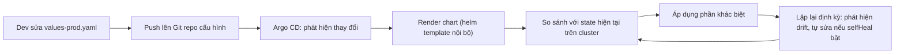
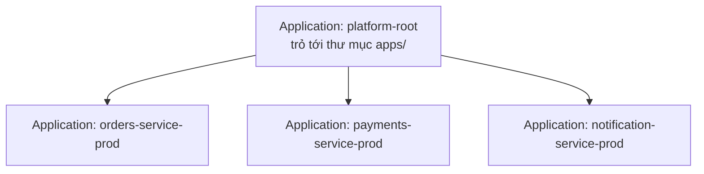
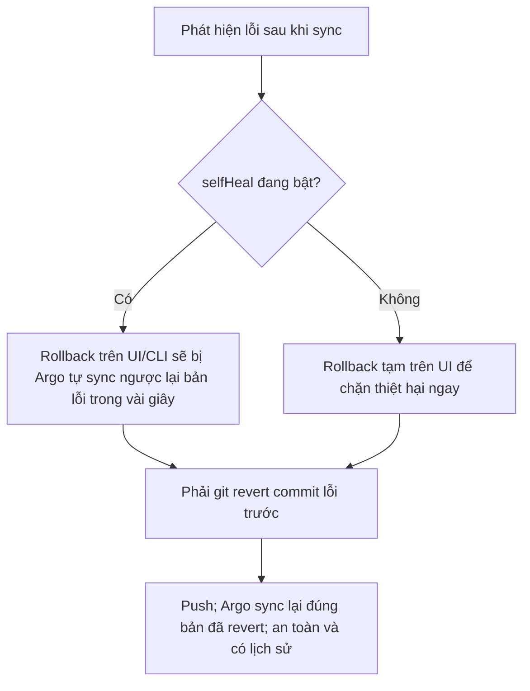

# Helm chart thực chiến và vận hành Argo CD nâng cao

Bài CI/CD đã giới thiệu GitOps: Git là nguồn sự thật, Argo CD/Flux chạy trong cluster tự kéo và áp cấu hình. Nhưng "cấu hình trong Git" nghĩa là gì cụ thể? Nếu chỉ là file YAML thuần, bạn sẽ phải copy-paste gần như nguyên vẹn bộ Deployment/Service/Ingress cho mỗi environment (dev, staging, prod) và tự tay sửa đúng vài dòng khác nhau — dễ quên, dễ lệch. Helm giải quyết phần "viết YAML thế nào cho tái dùng được"; bài này còn đi sâu vào cách Argo CD thật sự vận hành một ứng dụng Helm trong thực tế: Application CRD, sync policy, app-of-apps, và cách rollback khi một lần sync làm hỏng production.

**Tóm tắt:**

- Helm "chart" là một bộ template YAML có tham số (`values.yaml`); cùng một chart render ra manifest khác nhau cho dev/staging/prod chỉ bằng cách đổi values, không đổi template.
- `helm template` chỉ render tĩnh ra YAML để xem trước; `helm install`/`upgrade` còn lưu lại "release" (lịch sử các lần deploy) nên rollback được về bất kỳ revision nào.
- Argo CD không chạy `helm install`: nó theo dõi một Git repo, mỗi khi phát hiện thay đổi thì tự render chart và `kubectl apply`, đồng thời liên tục so sánh cluster với Git để tự sửa drift.
- `Application` là CRD trung tâm của Argo CD, khai báo "repo nào, path nào, cluster đích nào"; app-of-apps dùng một Application cha để quản lý hàng chục Application con mà không phải thêm tay từng cái.
- Sync policy `automated` + `selfHeal` khiến Argo CD tự sửa mọi thay đổi tay trên cluster trong vài giây; đây là tính năng, không phải lỗi, nhưng làm `kubectl edit` khẩn cấp trở nên vô nghĩa nếu không tắt tạm.
- Rollback trong Argo CD ưu tiên `git revert` (đúng tinh thần GitOps, có lịch sử) hơn là bấm rollback trên UI, vì UI rollback chỉ sửa cluster mà không sửa Git — lần sync tiếp theo sẽ tự đẩy cluster quay lại bản lỗi.
- `helm diff` hoặc chế độ "Diff" của Argo CD trước khi áp dụng là bước không được bỏ qua, vì một thay đổi values tưởng nhỏ (ví dụ đổi `replicaCount`) có thể kéo theo thay đổi lớn hơn dự kiến (ví dụ đổi luôn cả `resources` do template lồng điều kiện).

## Vấn đề Helm giải quyết

Giả sử bạn có một Deployment, Service, Ingress, ConfigMap cho một service Spring Boot. Ba environment cần gần như y hệt cấu trúc đó, chỉ khác số replica, giới hạn tài nguyên, domain Ingress, và biến môi trường. Giữ ba bộ YAML riêng thì mỗi lần sửa cấu trúc (ví dụ thêm một probe) phải nhớ sửa cả ba nơi — một nơi quên sửa sẽ lệch âm thầm cho tới khi gây sự cố. Helm tách phần **cấu trúc chung** (template) khỏi phần **khác nhau giữa environment** (values), nên sửa cấu trúc chỉ sửa một chỗ.

## Các khái niệm cần biết

| Khái niệm | Là gì | Vì sao quan trọng |
|---|---|---|
| **Chart** | Một package Helm: template + metadata + values mặc định | Đơn vị đóng gói, publish và version của một ứng dụng/thư viện hạ tầng |
| **Template** | File YAML chèn biến bằng cú pháp Go template `{{ .Values.x }}` | Một bộ template dùng chung cho mọi environment |
| **Values** | File tham số (`values.yaml`, hoặc `-f values-prod.yaml`) | Thứ thay đổi giữa dev/staging/prod; không đụng vào template |
| **Release** | Một lần cài/nâng cấp chart vào một cluster, có tên và lịch sử revision | Cho phép `helm rollback <release> <revision>` |
| **Application (Argo CD)** | CRD khai báo nguồn Git, path, cluster đích của một ứng dụng | Đơn vị Argo CD theo dõi và đồng bộ |
| **Sync policy** | `manual` (bấm nút) hay `automated` (tự áp khi Git đổi), kèm `selfHeal` | Quyết định Argo CD có tự sửa drift hay chỉ cảnh báo |
| **App-of-apps** | Một Application cha trỏ tới thư mục chứa định nghĩa nhiều Application con | Quản lý hàng chục ứng dụng bằng một thao tác Git, không thêm tay từng cái |

## Cấu trúc một chart và cách template hoạt động

```text
orders-service/
├── Chart.yaml              # tên, version chart
├── values.yaml              # giá trị mặc định
├── values-prod.yaml         # ghi đè cho prod
└── templates/
    ├── deployment.yaml
    ├── service.yaml
    └── ingress.yaml
```

```yaml
# templates/deployment.yaml (rút gọn)
apiVersion: apps/v1
kind: Deployment
metadata:
  name: {{ .Release.Name }}-orders
spec:
  replicas: {{ .Values.replicaCount }}
  template:
    spec:
      containers:
        - name: orders
          image: "{{ .Values.image.repository }}:{{ .Values.image.tag }}"
          resources:
            requests:
              memory: {{ .Values.resources.requests.memory }}
              cpu: {{ .Values.resources.requests.cpu }}
```

```yaml
# values.yaml (mặc định, dùng cho dev)
replicaCount: 1
image: { repository: registry.internal/orders, tag: latest }
resources: { requests: { memory: 256Mi, cpu: 100m } }
```

```yaml
# values-prod.yaml (chỉ ghi đè phần khác)
replicaCount: 3
resources: { requests: { memory: 1Gi, cpu: 500m } }
```

```bash
# Xem trước YAML thật sự sinh ra, không áp dụng gì cả
helm template orders-service ./orders-service -f values-prod.yaml

# Cài hoặc nâng cấp, Helm tự lưu lại thành một revision mới
helm upgrade --install orders orders-service -f values-prod.yaml

# Xem lịch sử và quay lại bản trước nếu vừa nâng cấp làm hỏng
helm history orders
helm rollback orders 3
```

**Phải thuộc:** `helm template` chỉ render, không chạm cluster; `helm install`/`upgrade` mới thật sự áp dụng và ghi lại một **release revision**, nên `helm rollback` hoạt động được là nhờ lịch sử này — khác với việc tự `kubectl apply` một file YAML cũ (không có khái niệm "revision" để quay lại).

## Argo CD vận hành chart như thế nào



Argo CD không giữ "trạng thái Helm release" theo đúng nghĩa CLI `helm`; nó coi Git là nguồn sự thật tuyệt đối và liên tục đối chiếu, nên kể cả khi ai đó `kubectl edit` sửa tay trên cluster, vòng lặp `Loop → Diff` phía trên sẽ phát hiện và (nếu `selfHeal: true`) tự sửa lại đúng như Git trong vài giây tới vài phút tùy chu kỳ polling.

```yaml
apiVersion: argoproj.io/v1alpha1
kind: Application
metadata:
  name: orders-service-prod
  namespace: argocd
spec:
  source:
    repoURL: https://git.internal/platform/charts.git
    path: orders-service
    helm:
      valueFiles: ["values-prod.yaml"]
  destination:
    server: https://kubernetes.default.svc
    namespace: orders
  syncPolicy:
    automated:
      selfHeal: true     # tự sửa khi phát hiện drift
      prune: true          # xóa tài nguyên không còn khai báo trong Git
```

**Nền tảng:** `prune: true` nghĩa là xóa khỏi Git = xóa khỏi cluster. Đây là hành vi đúng tinh thần GitOps (Git là sự thật duy nhất) nhưng cũng là nơi dễ gây sự cố nhất: xóa nhầm một dòng trong file YAML cấu hình tương đương với lệnh xóa tài nguyên đó khỏi production ở lần sync kế tiếp.

## App-of-apps: quản lý hàng chục Application

Một tổ chức có hàng chục service thì tạo tay từng `Application` không scale. App-of-apps dùng chính Argo CD để quản lý Argo CD:



Thêm một service mới chỉ cần thêm một file định nghĩa `Application` vào thư mục `apps/` và push Git; `platform-root` tự phát hiện và tạo Application con tương ứng, không ai phải chạy `argocd app create` bằng tay.

## Rollback đúng cách: Git trước, UI sau



**Phải thuộc:** Nếu `selfHeal: true`, bấm "Rollback" trên UI Argo CD chỉ có tác dụng tạm thời — vòng lặp đối chiếu sẽ thấy cluster "lệch" khỏi Git (vì Git vẫn còn bản lỗi) và tự sync ngược lại. Cách đúng và bền là `git revert` commit gây lỗi rồi để Argo tự sync bản đã revert; đây cũng là lý do "Phải thuộc" của bài CI/CD nói rollback GitOps bằng `git revert`, không phải bằng thao tác tay trên cluster.

**Suy luận:** Toàn bộ mô hình GitOps đặt cược vào một tiền đề: Git luôn là bản đúng nhất, cluster chỉ là "bản chiếu" của Git. Nếu tiền đề đó đúng, tự động hóa (`selfHeal`, `prune`) là an toàn vì mọi sai lệch đều được sửa về đúng. Nhưng tiền đề đó cũng có nghĩa: nếu bản thân Git sai (deploy nhầm, values sai), hệ thống sẽ cực kỳ "trung thành" áp cái sai đó vào production và tự sửa lại nếu bạn cố vá tay trên cluster. Vì vậy kỷ luật quan trọng nhất của GitOps không nằm ở Argo CD mà nằm ở quy trình trước khi merge vào Git: review kỹ, chạy `helm template`/chế độ Diff để xem trước thay đổi thật sự sinh ra, và với production nên để `automated` sync nhưng gắn thêm bước duyệt thủ công (ví dụ qua một PR gate) trước khi merge, chứ không tắt hẳn tự động hóa — tắt tự động hóa chỉ đổi rủi ro "deploy sai" bằng rủi ro "quên deploy" hoặc "drift không ai biết".

## Điều cần nhớ

- Helm tách template (cấu trúc chung) khỏi values (khác nhau theo environment); luôn `helm template` hoặc xem Diff trước khi áp dụng, đừng đoán.
- Release revision là cơ chế cho `helm rollback`; Argo CD lại coi Git là sự thật tuyệt đối nên rollback bền vững phải đi qua `git revert`, không phải thao tác tay trên cluster hay trên UI.
- `selfHeal` và `prune` mạnh nhưng hai lưỡi: chúng áp đúng những gì Git nói, kể cả khi Git đang sai.
- App-of-apps là cách quản lý nhiều Application bằng chính Git, không phải tạo tay từng cái qua `argocd app create`.
