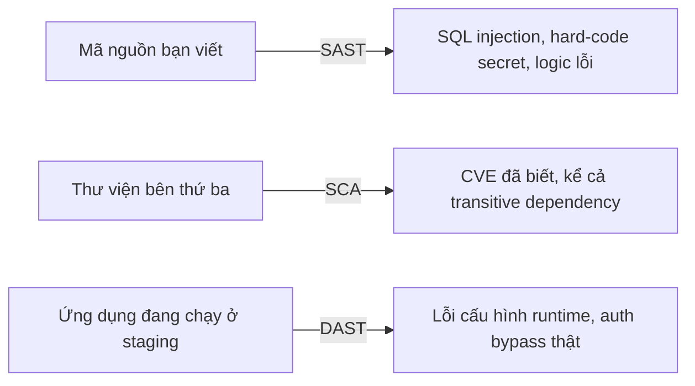
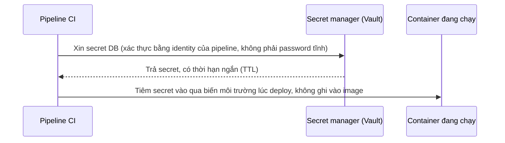
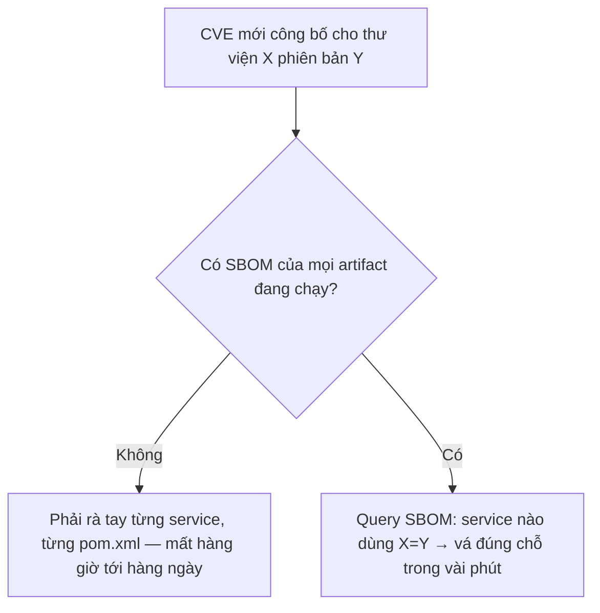

# DevSecOps: bảo mật trong pipeline CI/CD

Bài CI/CD nói một quality gate tốt cần "không lỗ hổng nghiêm trọng", nhưng không nói ai kiểm tra điều đó và bằng cách nào. Trong thực tế, một pipeline chạy build-test-deploy mà không quét bảo mật thì chính pipeline đó trở thành đường tắt lớn nhất của kẻ tấn công: nó có quyền kéo code, build artifact, và thường nắm credential để đẩy lên production — tức là nắm chìa khóa toàn bộ hệ thống. DevSecOps là đưa các bước kiểm tra bảo mật vào pipeline, tự động, thay vì để đến lúc audit cuối năm mới phát hiện secret bị hard-code từ sáu tháng trước.

**Tóm tắt:**

- Secret (mật khẩu DB, API key) không bao giờ nằm trong code hay biến môi trường commit vào Git; pipeline lấy secret từ một secret manager (Vault, AWS Secrets Manager) tại thời điểm chạy, và cache của CI cũng có thể làm rò secret nếu không cẩn thận.
- SCA (Software Composition Analysis) quét lỗ hổng đã biết trong thư viện bên thứ ba (CVE), còn SAST quét chính mã nguồn bạn viết để tìm lỗi (SQL injection, hard-code secret); hai loại quét khác mục tiêu, cần cả hai.
- DAST chạy ứng dụng thật (đã deploy ở staging) và tấn công nó như hacker thật, nên bắt được lỗi mà SAST đọc code tĩnh không thấy (lỗi cấu hình runtime, lỗi logic xác thực).
- Image container cũng phải quét riêng (Trivy, Grype): base image cũ chứa hàng trăm CVE là chuyện bình thường, không liên quan gì tới code bạn viết.
- SBOM (Software Bill of Materials) là danh sách đầy đủ mọi thành phần (kể cả transitive) nằm trong một artifact; không có nó thì khi một CVE mới công bố (ví dụ Log4Shell), bạn không biết hệ thống nào đang dùng thư viện đó để vá khẩn cấp.
- Supply chain security lo việc chính artifact (image, jar) không bị thay đổi giữa lúc build và lúc chạy; ký artifact (cosign) và xác minh provenance là cách chứng minh "đây đúng là bản build từ commit X, không bị chèn thêm gì".
- Nguyên tắc đặc quyền tối thiểu áp cho chính pipeline: token CI chỉ nên có quyền đúng phạm vi cần (deploy vào một namespace cụ thể), không dùng token admin toàn cluster cho mọi job.

## Vấn đề nó giải quyết

Một lỗ hổng trong thư viện mã nguồn mở (ví dụ Log4Shell năm 2021) có thể nằm im trong một dependency gián tiếp (dependency của dependency) mà không ai từng khai báo trực tiếp. Nếu pipeline không tự động quét, đội ngũ chỉ biết tới nó khi đọc tin tức — và lúc đó câu hỏi đầu tiên luôn là "hệ thống nào của mình đang dùng thư viện này?", một câu không ai trả lời được nếu không có SBOM. DevSecOps biến các câu hỏi đó thành việc tự động chạy mỗi lần build, thay vì một cuộc điều tra khẩn cấp lúc nửa đêm.

## Các khái niệm cần biết

| Khái niệm | Quét gì | Công cụ ví dụ |
|---|---|---|
| **SCA** | Lỗ hổng đã biết (CVE) trong thư viện bên thứ ba, kể cả transitive | OWASP Dependency-Check, Snyk, Dependabot |
| **SAST** | Mã nguồn bạn viết, phân tích tĩnh không cần chạy | SonarQube, Semgrep, CodeQL |
| **DAST** | Ứng dụng đang chạy thật, tấn công từ ngoài như hacker | OWASP ZAP, Burp Suite |
| **Image scanning** | Lỗ hổng trong base image và các layer của container image | Trivy, Grype |
| **SBOM** | Danh sách đầy đủ thành phần (và version) trong artifact | Syft, CycloneDX |
| **Secret scanning** | Phát hiện key/password vô tình commit vào Git | Gitleaks, TruffleHog |
| **Provenance / ký artifact** | Chứng minh artifact đến từ đúng pipeline, không bị chèn thêm | Sigstore/cosign, SLSA |

## SAST, SCA, DAST: ba lớp quét khác mục tiêu



**Phải thuộc:** SAST đọc code bạn viết, không bắt được lỗ hổng trong thư viện; SCA đọc danh sách thư viện, không biết logic bạn viết đúng hay sai; DAST tấn công ứng dụng đang chạy nên bắt được cả lỗi cấu hình mà hai loại kia không thấy (ví dụ endpoint debug quên tắt ở production). Một pipeline nghiêm túc cần cả ba, không phải chọn một.

```yaml
# Đoạn job quét trong pipeline (rút gọn, minh họa)
security-scan:
  steps:
    - run: semgrep ci                          # SAST
    - run: dependency-check --project orders --failOnCVSS 7   # SCA, fail nếu CVSS >= 7
    - run: trivy image registry.internal/orders:$GIT_SHA      # quét image
    - run: syft registry.internal/orders:$GIT_SHA -o cyclonedx-json > sbom.json  # sinh SBOM
```

## Secret: lấy đúng lúc, không bao giờ commit

Một secret bị commit vào Git coi như đã lộ vĩnh viễn — kể cả xóa commit đó sau, lịch sử Git vẫn giữ lại trừ khi viết lại toàn bộ lịch sử (và secret đã có thể bị đọc trước đó). Cách đúng: secret không bao giờ nằm trong repo, pipeline lấy nó tại thời điểm chạy từ một nơi tập trung.



**Nền tảng:** Secret được tiêm vào **lúc chạy**, không bao giờ **bake vào image** lúc build — nếu secret nằm trong image, bất kỳ ai pull được image (kể cả từ registry nội bộ bị cấu hình sai quyền) đều đọc được secret đó mà không cần qua bất kỳ lớp xác thực nào.

**Phải thuộc:** Secret trong biến môi trường của CI (ví dụ GitHub Actions secrets) vẫn có thể bị rò qua log nếu job lỡ `echo $SECRET` hoặc qua cache dependency nếu secret bị ghi vào file cache; luôn dùng cơ chế "masked" của CI và secret có TTL ngắn thay vì secret tĩnh dùng mãi mãi.

## SBOM: vì sao cần một danh sách thành phần đầy đủ



**Suy luận:** Một ứng dụng hiện đại kéo theo hàng trăm transitive dependency mà không ai từng khai báo trực tiếp — `pom.xml` của bạn có 20 dòng nhưng cây dependency thật có thể vài trăm thư viện. Khi một CVE nghiêm trọng được công bố cho một thư viện sâu trong cây đó, câu hỏi sống còn là "hệ thống nào của mình bị ảnh hưởng", và trả lời câu đó bằng cách đọc tay từng `pom.xml`/`package.json` của hàng chục service là không khả thi trong thời gian cần phản ứng (thường tính bằng giờ). SBOM giải quyết đúng vấn đề đó bằng cách sinh sẵn, cho mỗi lần build, một bản kê khai đầy đủ (kể cả transitive) rồi lưu lại tập trung — khi CVE mới xuất hiện, bạn query ngay "ai đang dùng X phiên bản Y" thay vì điều tra lại từ đầu.

## Supply chain: ký artifact và provenance

Quét lỗ hổng chỉ trả lời "artifact này có lỗ hổng đã biết không". Nó không trả lời "artifact đang chạy ở production có đúng là bản build từ commit đã review không, hay đã bị ai đó chèn thêm một bước giữa build và deploy". Đây là câu hỏi supply chain security.

```mermaid
sequenceDiagram
    participant CI as Pipeline (đã qua review, test, scan)
    participant Sign as Cosign / Sigstore
    participant Reg as Registry
    participant K8s as Cluster
    CI->>Sign: Ký image bằng key/identity của pipeline
    Sign->>Reg: Đẩy image kèm chữ ký
    K8s->>Reg: Pull image
    K8s->>Sign: Xác minh chữ ký trước khi chạy
    Sign-->>K8s: Hợp lệ → cho chạy; không hợp lệ → từ chối
```

**Phải thuộc:** Ký artifact chứng minh "ai đã tạo ra artifact này" (thường là chính CI pipeline, qua danh tính ngắn hạn chứ không phải private key tĩnh dễ rò); cluster có thể cấu hình để **từ chối chạy** bất kỳ image nào không có chữ ký hợp lệ từ pipeline chính thức, chặn đứng việc ai đó đẩy thẳng một image tùy ý vào registry nội bộ rồi deploy qua mặt pipeline.

## Đặc quyền tối thiểu cho chính pipeline

Pipeline thường nắm credential mạnh nhất hệ thống (quyền deploy, quyền đọc secret) nên nó cũng là mục tiêu tấn công hấp dẫn nhất: chiếm được một job CI thường nguy hiểm hơn chiếm một Pod đơn lẻ, vì job CI có thể tự đẩy code độc hại thẳng vào production qua đúng con đường hợp lệ.

- Token CI chỉ nên có quyền đúng phạm vi cần (ví dụ chỉ deploy vào namespace của chính service đó), không dùng một token admin toàn cluster dùng chung cho mọi pipeline.
- Danh tính ngắn hạn (OIDC federation giữa CI và cloud) tốt hơn access key tĩnh lưu trong secret của CI mãi mãi.
- Pull request từ fork bên ngoài không nên chạy với cùng quyền secret như pipeline của nhánh chính — nhiều vụ rò secret xảy ra qua chính cơ chế "chạy CI cho PR" bị lợi dụng.

## Điều cần nhớ

- Bốn lớp quét bổ sung cho nhau, không thay thế nhau: SAST (code của bạn), SCA (thư viện ngoài), image scanning (base image), DAST (ứng dụng đang chạy thật).
- Secret được tiêm lúc chạy từ secret manager, không bao giờ bake vào image hay commit vào Git; coi mọi secret từng lộ ra Git là đã lộ vĩnh viễn.
- SBOM biến "hệ thống nào bị ảnh hưởng bởi CVE mới" từ một cuộc điều tra thành một câu query.
- Ký artifact (cosign/Sigstore) và đặc quyền tối thiểu cho chính token CI là hai việc bảo vệ pipeline khỏi trở thành con đường tắt lớn nhất vào production.
