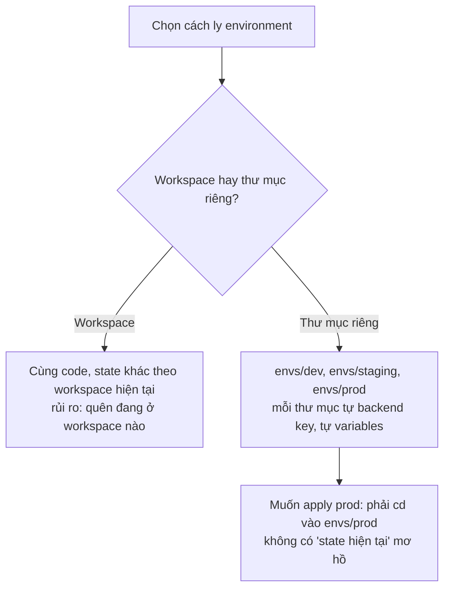
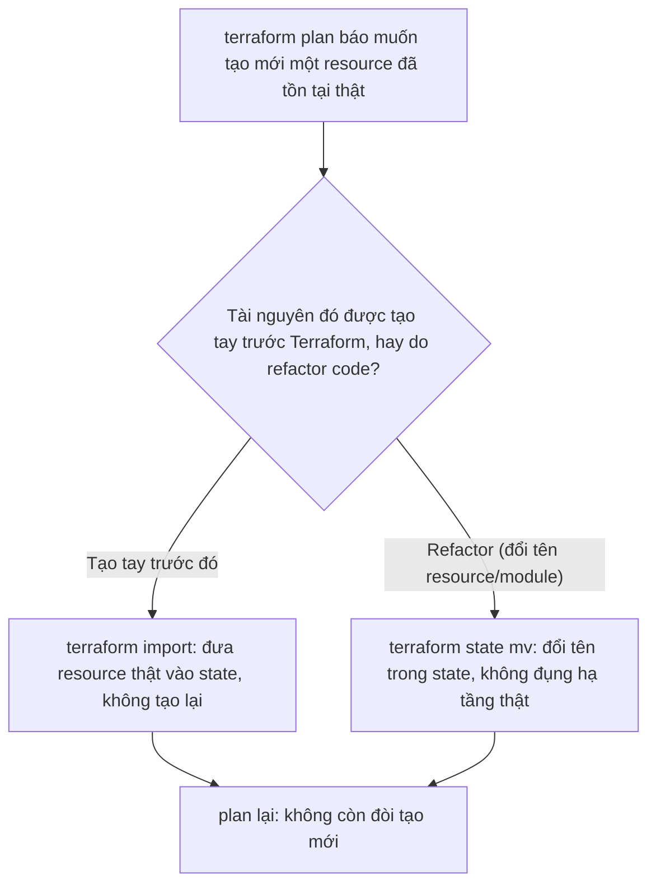

# Terraform: module hóa, nhiều environment và vận hành state thực chiến

Bài IaC đã nói state là gì, vì sao phải để ở backend từ xa có lock, và `plan`/`apply` hoạt động ra sao cho một khối tài nguyên đơn lẻ. Nhưng một hệ thống thật không chỉ có một khối: nó có hàng chục loại tài nguyên lặp lại giữa nhiều service, và cùng một hạ tầng đó phải tồn tại độc lập ở dev, staging, production — sửa nhầm ở dev không được phép chạm tới production. Bài này đi vào phần Terraform thực sự khó khi dự án lớn dần: tổ chức code thành module tái dùng được, cách ly environment cho đúng, và cách sửa chữa khi state hoặc hạ tầng đã lỡ đi lệch nhau.

**Tóm tắt:**

- Module đóng gói một nhóm tài nguyên thành một khối có input (`variables`) và output, giống một hàm; không có module, mỗi service copy-paste lại cùng một đống tài nguyên và sửa cấu trúc phải sửa ở từng nơi.
- Tách environment đúng cách là tách **state hoàn toàn riêng** cho mỗi environment (thư mục riêng hoặc backend key riêng), không phải chỉ tách bằng biến trong cùng một state — một lệnh `apply` sai ở dev tuyệt đối không được có khả năng chạm production.
- Terraform workspace (`terraform workspace new prod`) nghe giống cách ly nhưng chỉ đổi backend key trong cùng một cấu hình; nhầm workspace hiện tại là nguyên nhân phổ biến khiến người ta tưởng đang `apply` dev nhưng thực ra đang chạm prod — vì vậy nhiều đội chọn hẳn thư mục riêng theo environment thay vì workspace.
- `terraform import` đưa một tài nguyên đã tồn tại (tạo tay trên console trước đó) vào quản lý bởi state mà không tạo lại nó; `terraform state mv` sửa state khi đổi tên hoặc cấu trúc lại module mà không muốn Terraform xóa-tạo lại tài nguyên thật.
- Policy-as-code (`tfsec`, `checkov`, Sentinel/OPA) quét chính file Terraform để chặn các cấu hình nguy hiểm (security group mở `0.0.0.0/0`, bucket public) trước khi `apply`, giống SAST nhưng cho hạ tầng thay vì code ứng dụng.
- Một thay đổi tưởng vô hại trong module (ví dụ đổi tên một resource block) có thể khiến Terraform hiểu nhầm là "xóa tài nguyên cũ, tạo tài nguyên mới" — với database hay volume thì đó là mất dữ liệu thật; `state mv` là cách sửa đúng, không phải chấp nhận recreate.
- Biến nhạy cảm (`sensitive = true`) chỉ che giá trị khỏi log CLI, nó **không** mã hóa giá trị trong state — state vẫn phải được bảo vệ như một kho bí mật bất kể biến có đánh dấu sensitive hay không.

## Vấn đề nó giải quyết

Một tổ chức có 15 service, mỗi service cần một RDS instance, một security group, một vài IAM role tương tự nhau. Viết tay 15 lần cùng một khối `resource "aws_db_instance"` nghĩa là khi chính sách đổi (ví dụ bắt buộc bật `storage_encrypted`), bạn phải sửa đúng 15 chỗ và hy vọng không quên chỗ nào. Module giải quyết việc "định nghĩa một lần, dùng lại nhiều lần, sửa một lần áp dụng mọi nơi".

## Các khái niệm cần biết

| Khái niệm | Là gì | Vì sao quan trọng |
|---|---|---|
| **Module** | Thư mục Terraform có `variables.tf`, `main.tf`, `outputs.tf`, gọi được từ nơi khác | Tái dùng; sửa logic chỉ ở một nơi |
| **Root module** | Nơi bạn chạy `terraform apply`, gọi (compose) các module con | Là nơi quyết định cấu hình thật sự cho một environment |
| **Workspace** | Một state phụ trong cùng backend, đổi bằng `terraform workspace select` | Cách ly nhẹ; dễ chọn nhầm workspace đang active |
| **Environment theo thư mục** | Mỗi environment là một thư mục riêng, mỗi thư mục có backend key riêng | Cách ly mạnh hơn workspace: không có "state hiện tại" mơ hồ |
| **`terraform import`** | Đưa resource đã tồn tại thật vào state, không tạo lại | Dùng khi hạ tầng được tạo tay trước khi dùng Terraform |
| **`terraform state mv`** | Đổi tên/di chuyển một resource trong state mà không đụng hạ tầng thật | Tránh recreate ngoài ý muốn khi refactor module |
| **Policy-as-code** | Quét file Terraform để chặn cấu hình vi phạm chính sách trước khi apply | Chặn lỗi bảo mật hạ tầng ngay ở PR, không chờ tới runtime |

## Module: đóng gói để tái dùng

```hcl
# modules/postgres-db/variables.tf
variable "name" { type = string }
variable "instance_class" { type = string, default = "db.t4g.medium" }
variable "multi_az" { type = bool, default = false }

# modules/postgres-db/main.tf
resource "aws_db_instance" "this" {
  identifier          = var.name
  engine              = "postgres"
  instance_class      = var.instance_class
  multi_az            = var.multi_az
  storage_encrypted   = true          # luôn bật, không cho service nào tắt
  deletion_protection = true
}

# modules/postgres-db/outputs.tf
output "endpoint" { value = aws_db_instance.this.endpoint }
```

```hcl
# root module: gọi lại nhiều lần cho nhiều service
module "orders_db" {
  source         = "./modules/postgres-db"
  name           = "orders-db"
  instance_class = "db.m6g.large"
  multi_az       = true
}

module "notifications_db" {
  source = "./modules/postgres-db"
  name   = "notifications-db"
}
```

**Nền tảng:** Module là một hàm: nhận `variables` làm tham số đầu vào, trả `outputs` làm giá trị ra. `storage_encrypted = true` được viết cứng bên trong module (không expose thành biến) chính là cách ép mọi service dùng module này đều bật mã hóa — người gọi module không có cách nào tắt nó.

## Cách ly environment: workspace hay thư mục riêng



```hcl
# envs/prod/backend.tf — backend key tách biệt hoàn toàn với dev/staging
terraform {
  backend "s3" {
    bucket = "my-company-tfstate"
    key    = "prod/orders/terraform.tfstate"
    region = "ap-southeast-1"
  }
}
```

**Phải thuộc:** Workspace chia sẻ **cùng một cấu hình** và chỉ đổi state ngầm theo workspace đang active — gõ `terraform apply` mà quên mình đang ở workspace `prod` thay vì `dev` là lỗi có thật và từng gây sự cố thật. Thư mục riêng theo environment buộc bạn phải `cd` vào đúng thư mục, nên không có khái niệm "workspace hiện tại" để quên; đánh đổi là phải tự đồng bộ thay đổi cấu trúc giữa các thư mục (thường giải quyết bằng cách để mỗi thư mục chỉ gọi chung một bộ module, như ví dụ module ở trên).

**Suy luận:** Vấn đề gốc của workspace không phải kỹ thuật mà là *ngữ cảnh ẩn*: lệnh `terraform apply` không bao giờ hiện rõ "bạn sắp apply vào đâu" trừ khi bạn chủ động gõ `terraform workspace show` trước. Một thao tác quan trọng như "có chạm vào production hay không" mà phụ thuộc vào một trạng thái ẩn, dễ quên là thiết kế rủi ro cao cho vận hành con người, bất kể công cụ có đúng về mặt kỹ thuật. Thư mục riêng biến "ngữ cảnh ẩn" thành "ngữ cảnh hiển nhiên" (đường dẫn bạn đang đứng), đánh đổi bằng việc phải tự quản lý nhiều bản cấu hình root — đó là lý do nhiều đội chấp nhận thêm một chút trùng lặp ở root module để đổi lấy việc không bao giờ apply nhầm environment.

## Sửa chữa khi state và hạ tầng đã lệch



```bash
# Đưa một S3 bucket đã tạo tay vào quản lý bởi Terraform
terraform import aws_s3_bucket.assets my-existing-bucket-name

# Đổi tên resource trong state sau khi refactor (ví dụ đưa vào module)
terraform state mv aws_db_instance.main module.orders_db.aws_db_instance.this
```

**Phải thuộc:** Không chạy `state mv` trước khi refactor code mà đổi tên resource/module thì lần `plan` kế tiếp sẽ hiểu nhầm đó là "xóa resource cũ, tạo resource mới" — với tài nguyên không giữ dữ liệu (ví dụ một security group) chỉ là phiền, nhưng với database hay volume, "xóa rồi tạo lại" nghĩa là **mất dữ liệu thật**. Luôn đọc kỹ dòng `# forces replacement` trong output `plan` trước khi `apply`, đó là Terraform đang cảnh báo đúng tình huống này.

## Policy-as-code: chặn cấu hình nguy hiểm trước khi apply

```bash
# Quét file Terraform trước khi mở PR, giống lint nhưng cho bảo mật hạ tầng
tfsec .
checkov -d .
```

```text
Result 1  HIGH  aws_security_group.app: ingress rule allows 0.0.0.0/0 on port 22
```

**Nền tảng:** Policy-as-code đọc tĩnh file `.tf`, không cần `apply` thật mới phát hiện, nên chạy được ngay trong pipeline CI trước bước `plan` — cùng tinh thần SAST cho mã ứng dụng (bài DevSecOps) nhưng áp cho hạ tầng. Một security group mở SSH (`port 22`) cho `0.0.0.0/0` là lỗi phổ biến nhất mà các công cụ này bắt được ngay từ PR, trước khi nó kịp lên production.

## Điều cần nhớ

- Module là hàm tái dùng cho hạ tầng: input là `variables`, output là `outputs`; viết cứng các ràng buộc bắt buộc (như mã hóa) bên trong module để người gọi không tắt được.
- Cách ly environment bằng state hoàn toàn riêng (thư mục riêng thường an toàn hơn workspace) vì nó loại bỏ ngữ cảnh ẩn "đang ở environment nào".
- `terraform import` đưa tài nguyên có sẵn vào state không tạo lại; `terraform state mv` sửa tên trong state khi refactor; thiếu một trong hai bước này trước khi đổi cấu trúc code dễ dẫn tới recreate ngoài ý muốn.
- Luôn đọc dòng `forces replacement` trong `plan`, và chạy policy-as-code (tfsec/checkov) trong CI trước khi merge, không chờ tới lúc apply mới phát hiện cấu hình nguy hiểm.
