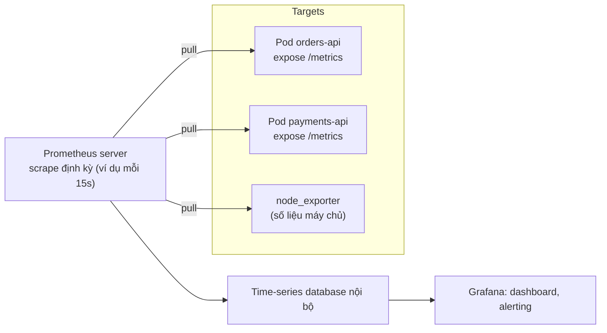
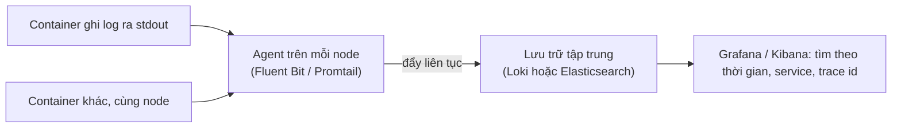
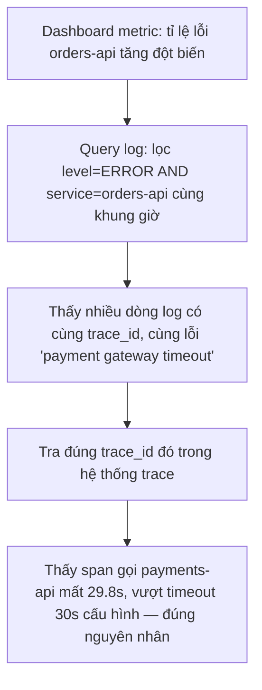

# Monitoring và logging: kiến trúc stack thực chiến

Bài SRE đã nói nguyên tắc cảnh báo tốt (theo triệu chứng người dùng, tránh alert fatigue) và bài Observability của Spring Boot đã nói cách một ứng dụng Spring tự đo bằng Micrometer. Nhưng giữa "ứng dụng tự đo" và "người trực nhìn thấy cảnh báo lúc nửa đêm" là cả một hệ thống hạ tầng: ai thu thập số liệu từ hàng chục Pod, lưu ở đâu, ai gom log từ các container đã bị xóa từ lâu, và làm sao nối một dòng log lỗi với đúng request đã gây ra nó. Bài này nói về tầng hạ tầng đó, ở mức nền tảng (platform-level) chứ không riêng cho Spring.

**Tóm tắt:**

- Prometheus hoạt động theo mô hình **pull**: nó chủ động tới gõ cửa từng target theo chu kỳ (scrape) để lấy số liệu, khác với mô hình push nơi ứng dụng tự đẩy số liệu đi.
- Một target phải expose số liệu qua một endpoint HTTP dạng text đơn giản (thường `/metrics`); "exporter" là một tiến trình phụ dịch số liệu của hệ thống không hỗ trợ sẵn Prometheus (ví dụ node_exporter cho máy chủ) sang đúng định dạng đó.
- PromQL là ngôn ngữ truy vấn time series; phân biệt counter (chỉ tăng, như tổng số request) với gauge (lên xuống, như số kết nối đang mở) là điều kiện để viết đúng câu truy vấn — tính tốc độ tăng (`rate()`) chỉ có ý nghĩa với counter.
- Container là phù du: Pod bị xóa thì log trong nó biến mất theo, nên log phải được "ship" ra ngoài ngay khi sinh ra, qua một agent chạy trên mỗi node (Fluent Bit, Promtail) gom log của mọi container rồi đẩy tới nơi lưu tập trung.
- Logging tập trung tốt cần log có cấu trúc (JSON với field cố định), không phải chuỗi text tự do — có cấu trúc thì mới lọc và truy vấn được theo field (ví dụ `level=ERROR AND service=orders`) thay vì chỉ full-text search đoán từ khóa.
- Ba trụ cột observability (metric, log, trace) trả lời ba câu hỏi khác nhau: metric nói "có đang chậm/lỗi không" (dạng số, rẻ để lưu lâu), log nói "chuyện gì đã xảy ra, chi tiết" (dạng text, đắt hơn), trace nói "request này đi qua những service nào, chậm ở bước nào" (nối các service lại với nhau).
- Trace ID sinh ra ở request đầu vào và được truyền xuyên suốt qua mọi service downstream; đính kèm đúng trace ID vào mọi dòng log liên quan là cách duy nhất để từ một log lỗi nhảy ngay sang toàn bộ hành trình request đó, thay vì dò log từng service một cách thủ công.

## Vấn đề nó giải quyết

Một request lỗi 500 đi qua 4 service. Không có logging tập trung, bạn phải SSH/kubectl vào từng Pod của từng service, đoán khung giờ, grep log tay — và nếu Pod đã bị xóa (scale down, restart), log mất vĩnh viễn. Không có metric tập trung, bạn không biết "chậm" là do service nào trước khi đã mất hàng chục phút đọc log. Stack monitoring/logging giải quyết đúng hai vấn đề: giữ lại số liệu/log sau khi Pod đã chết, và cho một nơi duy nhất để tìm theo nhiều chiều (thời gian, service, trace ID) thay vì từng máy một.

## Kiến trúc Prometheus: pull, scrape, PromQL



**Nền tảng:** Prometheus **chủ động đi hỏi** từng target theo địa chỉ đã biết (qua service discovery trong K8s), chứ target không tự gửi số liệu đi. Hệ quả: nếu một Pod không expose đúng endpoint `/metrics` hoặc Prometheus không "thấy" nó qua service discovery, nó đơn giản là không được scrape — không có lỗi ồn ào nào báo, chỉ là thiếu dữ liệu âm thầm.

| Loại metric | Đặc điểm | Ví dụ | Hàm PromQL thường dùng |
|---|---|---|---|
| **Counter** | Chỉ tăng, reset về 0 khi service restart | Tổng số request đã xử lý | `rate(http_requests_total[5m])` |
| **Gauge** | Lên xuống tự do | Số kết nối DB đang mở, dung lượng còn trống | Đọc giá trị trực tiếp, hoặc `avg_over_time()` |
| **Histogram** | Phân bố giá trị theo bucket (ví dụ độ trễ) | Độ trễ request theo khoảng 50ms/100ms/500ms | `histogram_quantile(0.95, ...)` để tính p95 |

```promql
# Tốc độ lỗi trên tổng số request trong 5 phút gần nhất, theo service
sum(rate(http_requests_total{status=~"5.."}[5m])) by (service)
/
sum(rate(http_requests_total[5m])) by (service)
```

**Phải thuộc:** `rate()` chỉ dùng đúng cho counter (giá trị luôn tăng); áp `rate()` lên một gauge cho ra kết quả vô nghĩa vì gauge có thể giảm, khiến "tốc độ tăng" âm hoặc sai. Đây là lỗi viết PromQL phổ biến nhất của người mới.

## Logging tập trung: log phải rời khỏi Pod trước khi Pod chết



**Nền tảng:** Quy ước container là ghi log ra `stdout`/`stderr`, không tự ghi file log trong container — vì file system của container là tạm thời (xem bài Kubernetes storage) và sẽ mất khi Pod bị xóa. Một agent chạy sẵn trên mỗi node (dạng DaemonSet) đọc `stdout` của mọi container trên node đó và đẩy đi liên tục, nên log vẫn còn sau khi Pod đã biến mất.

```json
{"ts":"2026-11-09T10:00:01Z","level":"ERROR","service":"orders-api","trace_id":"4a7f...","msg":"payment gateway timeout","order_id":"ORD-9231"}
```

**Phải thuộc:** Log có cấu trúc (JSON với field cố định: `level`, `service`, `trace_id`) cho phép truy vấn chính xác theo field (`service="orders-api" AND level="ERROR"`), trong khi log dạng chuỗi text tự do chỉ tìm được bằng full-text search và dễ bỏ sót vì cách viết câu log không nhất quán giữa các lập trình viên.

**Suy luận:** Một dòng log text tự do kiểu `"Payment failed for order ORD-9231 after 30s"` đọc bằng mắt thì rõ, nhưng máy không biết `ORD-9231` là field `order_id` hay chỉ là một chuỗi con tình cờ — muốn lọc "mọi lỗi của order này" bạn phải đoán cú pháp regex và hy vọng mọi lập trình viên viết câu log theo đúng một khuôn. Khi log là JSON với field đặt tên cố định, hệ thống lưu trữ tập trung (Loki/Elasticsearch) index được theo field đó, nên lọc theo `order_id`, `service`, hay `trace_id` là một phép so khớp chính xác, không phải đoán chữ. Cái giá phải trả là log có cấu trúc khó đọc hơn bằng mắt thường khi xem trực tiếp trong terminal — đó là lý do công cụ xem log tập trung luôn có bước "pretty print" lại JSON cho người đọc, trong khi vẫn giữ nguyên dạng có cấu trúc lúc lưu trữ và truy vấn.

## Ba trụ cột: metric, log, trace trả lời ba câu hỏi khác nhau

| Trụ cột | Trả lời câu hỏi | Chi phí lưu trữ | Ví dụ công cụ |
|---|---|---|---|
| **Metric** | "Có đang chậm/lỗi không, xu hướng thế nào?" | Rẻ (chỉ là số theo thời gian), lưu được rất lâu | Prometheus |
| **Log** | "Chuyện gì đã xảy ra, chi tiết là gì?" | Đắt hơn (toàn văn bản), thường lưu ngắn hơn | Loki, Elasticsearch |
| **Trace** | "Request này đi qua đâu, chậm ở bước nào trong chuỗi gọi?" | Đắt nhất nếu ghi mọi request (100% sample), nên thường chỉ sample một phần | Jaeger, Tempo |



**Phải thuộc:** Quy trình điều tra sự cố chuẩn đi từ **metric** (biết đang có vấn đề, phạm vi nào) sang **log** (chi tiết, lọc theo field) sang **trace** (thấy bước nào trong chuỗi gọi chậm) — bỏ qua metric mà đọc thẳng log của tất cả service là tìm kim trong đống rơm; bỏ qua trace mà chỉ đọc log từng service riêng lẻ thì không thấy được quan hệ nhân-quả giữa các service.

**Nền tảng:** `trace_id` phải được sinh ra một lần ở điểm vào đầu tiên (ví dụ API Gateway hoặc service đầu tiên nhận request) và truyền xuyên suốt qua mọi lời gọi downstream (qua HTTP header, qua message broker) — nếu một service quên truyền tiếp `trace_id` khi gọi service kế, chuỗi trace bị đứt gãy tại đó, và từ điểm đó trở đi bạn lại quay về tình trạng dò log thủ công.

## Điều cần nhớ

- Prometheus là mô hình pull/scrape; thiếu dữ liệu scrape thường là lỗi âm thầm (sai service discovery, sai endpoint), không có cảnh báo lỗi rõ ràng.
- `rate()` chỉ áp cho counter; dùng sai cho gauge cho kết quả vô nghĩa.
- Log phải rời container ngay khi sinh ra (qua agent trên node) vì file system container là tạm thời; log có cấu trúc (JSON) mới lọc chính xác theo field được.
- Điều tra sự cố đi từ metric (biết có vấn đề) → log (chi tiết) → trace (quan hệ giữa các service); `trace_id` phải được truyền xuyên suốt, đứt ở đâu thì mất khả năng nối log tại đó.
